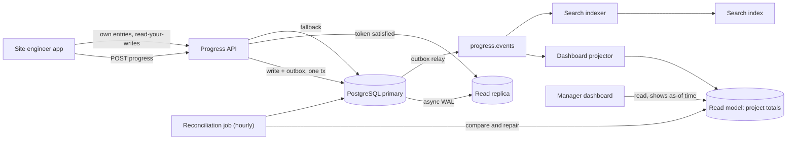
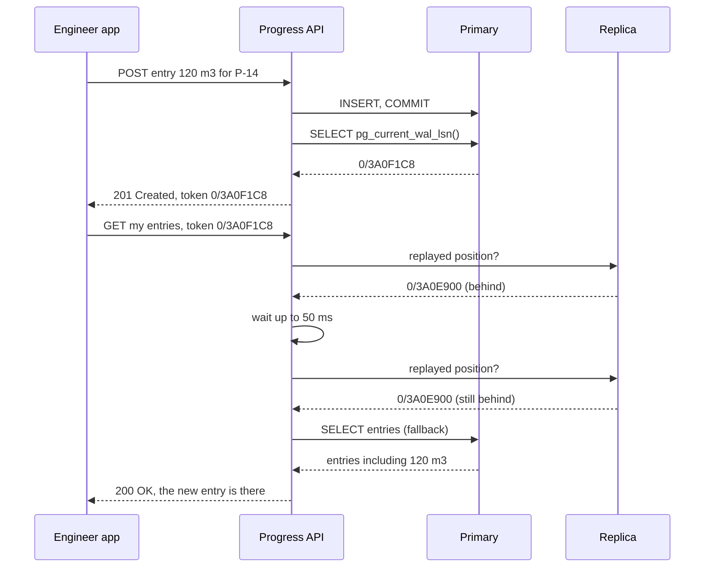
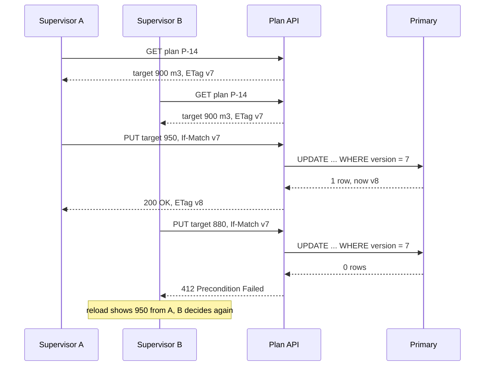

As soon as a system has a cache, a read replica, a search index or a second service holding a copy of some data, it has more than one copy. Copies cannot all change at the same instant. For a short time some of them are behind. "Eventually consistent" is the name for that situation, plus a promise: if writes stop, every copy will end up the same. This lesson is about making that promise true in practice, and about keeping users from noticing the gap.

## Learning objectives

By the end of this lesson you will be able to:

1. Explain what eventual consistency promises and what it does not.
2. List the places in a typical system where copies lag (replicas, caches, read models, search, other services).
3. Measure lag and set a lag budget per feature, with numbers.
4. Design user interfaces that stay honest during lag: pending states, "as of" times, optimistic updates.
5. Implement read-your-writes with a primary fallback, a position token, or a version wait.
6. Make projections converge: idempotent, ordered (or order-tolerant) apply, plus reconciliation.
7. Choose a conflict strategy: optimistic concurrency, last-writer-wins, merge (CRDTs) or keep both.
8. Recognise the invariants that must not be eventually consistent, and protect them.

## Prerequisites

- [Message queues](#/lesson/m12-message-queues): copies are often updated by consuming messages.
- [Transactional outbox](#/lesson/m12-outbox): the reliable way to emit the events that update other copies.
- [Choosing and scaling the database tier](#/lesson/m11-database-architecture): primaries, read replicas and their roles.

## Explain it like I'm a beginner

Imagine a large construction company with a head office in Gurgaon and sites across the country. Every evening, site engineers phone in how much concrete was poured. The head office keeps a big whiteboard showing progress for every project.

The whiteboard is never exactly up to date. When an engineer in Guwahati reports "120 cubic metres done", the clerk takes a few minutes to update the board. If the regional manager looks at the board in those minutes, they see yesterday's figure. That is fine, as long as:

- every report **does** reach the board in the end (nothing is lost),
- reporting the same figure twice does not double it (duplicates are harmless),
- and when reports stop coming in, the board shows the true totals (it converges).

That is eventual consistency. The board is a **copy** of the truth, and it lags.

Two problems make it interesting. First, the engineer who just phoned in looks at the board and sees the old number: "I told you 120!" (the read-your-writes problem). Second, two people may update the same item differently at the same time, for example two supervisors correcting the same entry (a conflict). Good systems handle both on purpose.

## First-principles explanation

### What the promise is, exactly

**Eventual consistency** means: if no new updates are made to an item, all copies of it will eventually return the same, latest value. Werner Vogels described it this way for Amazon's systems in 2008.

What it does **not** promise:

- **How long "eventually" is.** That is a number you have to measure and budget.
- **Which value you read meanwhile.** You may read an old value, and two reads in a row may even go backwards (new, then old) if they hit different copies.
- **That conflicting writes are resolved sensibly.** That is your design choice.

Stronger guarantees sit on top and are worth asking for by name (see [consistency models](#/lesson/m13-consistency-models)):

- **Read-your-writes**: after I write, *my* reads see my write.
- **Monotonic reads**: once I have seen a value, I never see an older one.
- **Consistent prefix**: I see updates in the order they happened, never "reply before question".

### Where copies come from

| Copy | How it is updated | Typical lag (estimates) |
|---|---|---|
| PostgreSQL streaming read replica | WAL shipped asynchronously | Milliseconds normally; seconds or minutes during heavy writes or long queries on the replica |
| Cache (Redis, in-process) | Invalidation or TTL expiry | Up to the TTL if invalidation fails |
| Read model / projection (CQRS) | Consuming events from a broker | Broker latency + consumer lag; seconds normally |
| Search index (Elasticsearch, OpenSearch) | Indexer consuming events; index refresh interval | About 1 s refresh plus pipeline lag |
| Another service's copy | Consuming events | Seconds to minutes; hours if the consumer is down |
| Another region | Cross-region replication | Tens to hundreds of milliseconds, more during incidents |
| Mobile app offline storage | Sync when online | Hours or days |

The important column is the last one's **tail**. A replica that lags 20 ms on a quiet afternoon may lag 30 seconds during a month-end report run. Design for the tail, not the average.

### Measuring lag

You cannot budget what you do not measure.

- **Replicas.** PostgreSQL's `pg_stat_replication` view on the primary shows `write_lag`, `flush_lag` and `replay_lag` per standby. On the replica, `now() - pg_last_xact_replay_timestamp()` approximates how far behind it is (it grows on an idle primary too, so interpret it carefully).
- **Event-driven copies.** Put `occurred_at` on every event. When the consumer applies it, record `now() - occurred_at` as a histogram metric: that is **end-to-end staleness**. Also watch consumer lag (messages behind) on the broker.
- **Synthetic probes.** Every minute, write a heartbeat row and measure how long it takes to appear in the read model or search index. This catches pipelines that are silently stuck.

### Setting a lag budget

The lag you can accept depends on the feature, not on the technology. Take a construction progress platform, which we will call SitePulse:

- 12,000 site engineers each submit about 40 progress entries a day: 480,000 writes/day ÷ 86,400 s ≈ 5.6 writes/s on average. Most arrive between 6 and 8 pm, so the peak is roughly 8× the average ≈ 45 writes/s (an estimate).
- Dashboards are read far more: assume 20 reads per write ≈ 900 reads/s at peak.

| Feature | Acceptable staleness | Why |
|---|---|---|
| Engineer's own "today's entries" list | 0 for their own writes | They just submitted; missing entries cause duplicate submissions |
| Project dashboard for managers | 1–5 minutes | Decisions are daily; a few minutes do not matter |
| Search over all entries | 1 minute | Search is for finding, not for exact counts |
| Monthly billing statement | 0 (must read from the source of truth) | Money; must match the ledger exactly |
| Cement stock available for issue | 0 for the decision to issue | Over-issuing is a real loss |

The last two rows are the key lesson: **some decisions must not be made on a lagging copy**. Show the dashboard from the read model, but make the "issue 50 bags of cement" decision against the primary, inside a transaction that checks the stock.

### UX patterns for lag

Lag becomes a bug only when the user notices it and is confused or misled. These patterns keep the interface honest.

1. **Accepted, not done.** For commands processed asynchronously, return `202 Accepted` with a status link, and show "Submitted, processing" rather than pretending it is finished. Show a final state when the work completes (push notification, WebSocket, or polling the status link).
2. **Optimistic update.** Add the new entry to the list on screen immediately, marked "saving…", and reconcile when the server confirms. If the server rejects it, remove it and say why. This is what chat apps do with a single grey tick.
3. **"As of" timestamps.** Show "Progress as of 18:42" on dashboards built from read models. People accept slightly old data when they are told it is slightly old.
4. **Do not invite duplicates.** Disable the submit button after a click, and send an idempotency key so a second click is harmless ([idempotency keys](#/lesson/m10-idempotency)).
5. **Route the "just changed" screen to fresh data.** The page a user lands on right after saving should read with read-your-writes (next section). Other pages can read from replicas.
6. **Explain eventual effects.** "Your change may take up to a minute to appear in search" sets the right expectation and saves support tickets.

### Read-your-writes techniques

The classic bug: a user saves, the next page reads from a replica that has not caught up, and the saved data is "gone". Fixes, from simplest to most precise:

**1. Read from the primary for a short time after writing.** After a write, set a cookie or session flag `last_write_at`. For the next N seconds (choose N above your replica's p99 lag, say 2 s), route that user's reads to the primary. Cost: extra primary reads. At SitePulse's peak, if each write is followed by about 3 reads in the next 2 seconds, that is 45 × 3 = 135 extra primary reads/s, which is small. The weakness: N is a guess, and during a lag spike longer than N, the bug comes back.

**2. A position token.** After the write commits, read the primary's WAL position (`SELECT pg_current_wal_lsn()`) and return it to the client as a token (a header or cookie). On a later read, compare it with each replica's replayed position (`pg_last_wal_replay_lsn()`): pick a replica that has replayed past the token, wait briefly for one, or fall back to the primary. This is exact: it only goes to the primary when it must.

**3. A version token for read models.** When the write produces an event with a version number (for example "project P-14, version 37"), return that version. The read endpoint waits up to a short timeout for the projection to reach version 37, then returns the view, marking it stale if it is still behind.

**4. Client-side merge.** The client keeps its own recent writes and merges them into whatever the server returns until the server's data includes them. This needs no server change, which is useful for mobile apps.

**5. Update the cache on write.** If the read path uses a cache, write the new value into the cache (or delete the key) in the same request as the database write, so the user's next read does not hit a stale entry.

**Monotonic reads** are a related trick: pin a user's session to one replica (sticky routing by user id), so they never jump from a fresh replica to a staler one.

### Making copies converge

For an event-driven copy to converge, four properties must hold:

1. **Every update is eventually delivered.** Use an outbox on the producer and at-least-once delivery; never acknowledge and drop.
2. **Applying an update twice has no extra effect** (idempotence). Track the last applied event id or version per item.
3. **Order is respected, or order does not matter.** Either apply updates in per-item order (partition by item id, reject gaps), or make the apply function order-insensitive (commutative), as with counters and sets in CRDTs.
4. **Deterministic apply.** Given the same updates, every copy computes the same result. Avoid using `DateTime.Now` or random numbers in the apply logic.

And because bugs, lost messages and manual database fixes happen anyway, add **reconciliation** (also called anti-entropy): a periodic job that compares the copy with the source of truth, reports differences as a metric, and repairs them. Reconciliation turns "eventually" from a hope into a bound: even if an event is lost, the copy is fixed within one reconciliation cycle.

### Conflicts

A conflict happens when two copies accept different writes to the same item before they hear about each other: two supervisors edit the same entry, a user edits on a phone offline and on a laptop online, or two regions accept writes during a network partition.

Strategies, from most common to most specialised:

**Prevent it with optimistic concurrency.** Keep one writable copy (the primary) and a version number on each row. A client reads version 7 and sends its update with "expected version 7" (`If-Match: "7"` in HTTP). The database updates only `WHERE id = @id AND version = 7`; if zero rows change, someone else got there first, and the API returns `409 Conflict` or `412 Precondition Failed`. The second user reloads and decides. This is the right default for business data edited by people.

**Last writer wins (LWW).** Each write carries a timestamp; the newest wins and the other is silently discarded. Simple and convergent, but it **loses data** and depends on clocks. If node A's clock is 3 seconds fast, its older write beats node B's newer one. Use LWW only where losing a concurrent update is acceptable (a user's display name, "last seen" time), and use a tie-breaker (node id) so all copies pick the same winner. See [clock skew and logical clocks](#/lesson/m13-time-ordering).

**Merge automatically (CRDTs).** Conflict-free replicated data types are structures whose merge is commutative, associative and idempotent, so copies converge whatever the order of updates. Examples: a grow-only counter (each node counts its own increments; the total is the sum), sets where adds and removes are tagged, and collaborative text editors. They work beautifully for counters, likes, sets and shared documents, but not for invariants such as "balance must not go negative".

**Keep both and ask.** Store concurrent versions as **siblings** and let the application or the user choose, as a shopping cart might do by taking the union of items. Version vectors detect true concurrency: they tell "this edit already knew about that one" apart from "these two edits happened independently".

### When eventual consistency is the wrong choice

Some rules must hold at every instant, and checking them against a lagging copy is a bug:

- Money cannot be spent twice; stock cannot be over-issued; a seat cannot be sold twice.
- A user whose access was revoked must not be able to approve a payment five minutes later because a permissions cache is stale.

For these, decide against a single authoritative copy inside a transaction, or reserve capacity up front (escrow: give each region a quota of seats it can sell without coordination). Use eventual consistency for everything *around* the decision: notifications, dashboards, analytics, search.

### When a simpler design is enough

If one PostgreSQL primary can serve all reads with headroom, read from the primary and skip the whole problem. SitePulse's 900 reads/s at peak is well within what a single well-indexed PostgreSQL instance can usually serve (an estimate; measure with your own queries). Add replicas and read models when load, isolation of heavy reports, or geography demands them, not by default.

### Trade-offs

| You gain | You pay |
|---|---|
| Fast, scalable reads from replicas, caches and read models | Readers may see old data |
| Services stay available when others are down | Lag must be measured, budgeted and explained to users |
| Writes are not slowed by updating every copy | Idempotence, ordering and reconciliation logic |
| Copies tailored to each read (search, dashboards) | Conflict handling for multi-writer designs |

## Visual explanation

### Architecture: one source of truth, many lagging copies



There is one source of truth: the PostgreSQL primary, written together with an outbox row. Everything else is a copy. The replica receives the WAL asynchronously. The outbox relay publishes events that a projector turns into a dashboard read model and an indexer turns into search documents. The reconciliation job periodically compares the read model with the primary and repairs any drift. Managers read the dashboard from the read model, which shows an "as of" time. Engineers reading their own entries go through the API, which uses read-your-writes: it reads from the replica when the replica has caught up with the engineer's last write, and from the primary otherwise.

### Sequence: the stale read and the token fix



The write returns a token holding the primary's WAL position right after commit. The next read carries the token. The API checks whether the replica has replayed that far. Here it has not, even after a 50 ms wait, so the API reads from the primary instead. Without the token, the API would have read from the lagging replica and the engineer's entry would have been missing. With a healthy replica, the first check usually passes and the primary is not touched.

### Sequence: a conflict prevented by optimistic concurrency



Both supervisors read version 7. A writes first, which moves the row to version 8. B's update still says "expected version 7", so the conditional `UPDATE` changes no rows and the API returns `412`. B reloads, sees A's value and makes an informed decision. Nobody's change is lost silently, which is what last-writer-wins would have done.

## Step-by-step example

We take SitePulse from "reads randomly show old data" to a design with explicit guarantees.

### Step 1: the symptom

Reads were moved to a replica to protect the primary. Support tickets begin: "I submitted my entry and it disappeared", "I submitted it twice to be safe". The replica's normal lag is 30 ms, but during the evening peak and nightly reports it reaches 4 seconds.

### Step 2: measure

Add a metric for `replay_lag` from `pg_stat_replication`, and a staleness histogram in the projector (`now - occurred_at`). The data shows p50 lag of 30 ms, p99 of 1.8 s, and a maximum of 11 s during the 10 pm report.

### Step 3: classify reads

Engineer's own entries need read-your-writes. Manager dashboards accept 5 minutes. Billing reads from the primary only. Search accepts 1 minute.

### Step 4: implement read-your-writes with a token

Return the commit's WAL position on every write. On reads, use a replica that has replayed past it, wait up to 50 ms, otherwise use the primary. Duplicate submissions stop, and primary load rises by only the reads that actually need it.

### Step 5: harden the projection and add reconciliation

Make the dashboard projector idempotent and version-aware (ignore duplicates, hold back on gaps). Add an hourly reconciliation job comparing project totals with the primary. Show "as of" times on dashboards. Add `If-Match` to plan edits. The implementation follows.

## Production-style C# implementation

The code models a primary with replicas, a version-aware projection, optimistic concurrency and a grow-only counter. It runs entirely in memory; the comments show where PostgreSQL calls go.

### Consistency tokens and a replica set

```csharp file=Consistency/ConsistencyToken.cs
using System.Globalization;

namespace SitePulse.Consistency;

/// <summary>A position in the primary's write log (in PostgreSQL, the LSN after commit).</summary>
public readonly record struct ConsistencyToken(long Position)
{
    public const string HeaderName = "X-Consistency-Token";

    public override string ToString() => Position.ToString(CultureInfo.InvariantCulture);

    public static bool TryParse(string? text, out ConsistencyToken token)
    {
        if (long.TryParse(text, NumberStyles.None, CultureInfo.InvariantCulture, out var p))
        {
            token = new ConsistencyToken(p);
            return true;
        }
        token = default;
        return false;
    }
}
```

```csharp file=Consistency/InMemoryReplicaSet.cs
namespace SitePulse.Consistency;

public sealed record NodeStatus(string Name, long AppliedPosition);

/// <summary>
/// A primary with an append-only log and replicas that apply the log up to some position.
/// Stands in for PostgreSQL streaming replication.
/// </summary>
public sealed class InMemoryReplicaSet
{
    public const string PrimaryName = "primary";

    private readonly Lock _gate = new();
    private readonly List<(long Position, string Key, string Value)> _log = new();
    private readonly Dictionary<string, long> _applied = new(StringComparer.Ordinal);

    public InMemoryReplicaSet(params string[] replicaNames)
    {
        foreach (var name in replicaNames) _applied[name] = 0;
    }

    public long PrimaryPosition { get { lock (_gate) return _log.Count; } }

    public IReadOnlyList<NodeStatus> Replicas
    {
        get { lock (_gate) return _applied.Select(kv => new NodeStatus(kv.Key, kv.Value)).ToList(); }
    }

    /// <summary>Commits on the primary and returns its log position (like pg_current_wal_lsn()).</summary>
    public ConsistencyToken Write(string key, string value)
    {
        lock (_gate)
        {
            _log.Add((_log.Count + 1, key, value));
            return new ConsistencyToken(_log.Count);
        }
    }

    /// <summary>Simulates replication: the replica applies the log up to the given position.</summary>
    public void ReplicateTo(string replica, long position)
    {
        lock (_gate) _applied[replica] = Math.Clamp(Math.Max(_applied[replica], position), 0, _log.Count);
    }

    public void ReplicateAll()
    {
        lock (_gate)
            foreach (var name in _applied.Keys.ToList()) _applied[name] = _log.Count;
    }

    public string? Read(string node, string key)
    {
        lock (_gate)
        {
            var upTo = node == PrimaryName ? _log.Count : _applied[node];
            string? value = null;
            foreach (var e in _log)
            {
                if (e.Position > upTo) break;
                if (e.Key == key) value = e.Value;
            }
            return value;
        }
    }
}
```

### Read-your-writes routing

```csharp file=Consistency/ReadYourWritesRouter.cs
using Microsoft.Extensions.Options;

namespace SitePulse.Consistency;

public sealed class ReadYourWritesOptions
{
    /// <summary>How long a read may wait for a replica to catch up before using the primary.</summary>
    public TimeSpan MaxWait { get; set; } = TimeSpan.FromMilliseconds(50);
    public TimeSpan PollEvery { get; set; } = TimeSpan.FromMilliseconds(10);
    /// <summary>Reads without a token may use a replica at most this many log positions behind.</summary>
    public long MaxLagWithoutToken { get; set; } = 1_000;
}

public sealed class ReadYourWritesRouter(InMemoryReplicaSet db, IOptions<ReadYourWritesOptions> options, TimeProvider clock)
{
    public async Task<string> ChooseNodeAsync(ConsistencyToken? token, CancellationToken ct)
    {
        var o = options.Value;
        if (token is null)
        {
            var floor = db.PrimaryPosition - o.MaxLagWithoutToken;
            return BestReplicaAtOrAbove(floor) ?? InMemoryReplicaSet.PrimaryName;
        }

        var deadline = clock.GetUtcNow() + o.MaxWait;
        while (true)
        {
            var replica = BestReplicaAtOrAbove(token.Value.Position);
            if (replica is not null) return replica;
            if (clock.GetUtcNow() >= deadline) return InMemoryReplicaSet.PrimaryName;   // fall back, never serve stale
            await Task.Delay(o.PollEvery, clock, ct);
        }
    }

    private string? BestReplicaAtOrAbove(long position) =>
        db.Replicas
            .Where(r => r.AppliedPosition >= position)
            .OrderByDescending(r => r.AppliedPosition)
            .ThenBy(r => r.Name, StringComparer.Ordinal)
            .Select(r => r.Name)
            .FirstOrDefault();
}
```

### A version-aware projection

```csharp file=Projections/SiteProgressProjection.cs
namespace SitePulse.Projections;

/// <summary>Version is a per-project sequence number assigned by the source of truth: 1, 2, 3, ...</summary>
public sealed record ProgressRecorded(Guid EventId, string ProjectId, long Version, decimal QuantityDone, DateTimeOffset OccurredAt);

public sealed record ProjectProgressView(string ProjectId, decimal TotalDone, long Version, DateTimeOffset AsOf);

public enum ApplyOutcome { Applied, Duplicate, Gap }

public sealed class SiteProgressProjection
{
    private readonly Lock _gate = new();
    private readonly Dictionary<string, ProjectProgressView> _views = new(StringComparer.Ordinal);

    public ApplyOutcome Apply(ProgressRecorded e)
    {
        lock (_gate)
        {
            var current = _views.GetValueOrDefault(e.ProjectId) ?? new ProjectProgressView(e.ProjectId, 0m, 0, DateTimeOffset.MinValue);
            if (e.Version <= current.Version) return ApplyOutcome.Duplicate;   // already applied: idempotent
            if (e.Version > current.Version + 1) return ApplyOutcome.Gap;      // an earlier event is missing: wait for it

            _views[e.ProjectId] = current with
            {
                TotalDone = current.TotalDone + e.QuantityDone,
                Version = e.Version,
                AsOf = e.OccurredAt                                           // deterministic: no DateTime.Now here
            };
            return ApplyOutcome.Applied;
        }
    }

    public ProjectProgressView? Get(string projectId)
    {
        lock (_gate) return _views.GetValueOrDefault(projectId);
    }

    /// <summary>Used by reconciliation to overwrite a drifted view with the truth.</summary>
    public void Repair(ProjectProgressView truth)
    {
        lock (_gate) _views[truth.ProjectId] = truth;
    }

    /// <summary>Waits for the view to reach a version (read-your-writes for read models).</summary>
    public async Task<(ProjectProgressView? View, bool CaughtUp)> WaitForVersionAsync(
        string projectId, long minVersion, TimeSpan timeout, TimeProvider clock, CancellationToken ct)
    {
        var deadline = clock.GetUtcNow() + timeout;
        while (true)
        {
            var view = Get(projectId);
            if (view is not null && view.Version >= minVersion) return (view, true);
            if (clock.GetUtcNow() >= deadline) return (view, false);
            await Task.Delay(TimeSpan.FromMilliseconds(25), clock, ct);
        }
    }
}
```

### The source of truth, the event pump and reconciliation

```csharp file=Projections/ProgressLedger.cs
using System.Threading.Channels;

namespace SitePulse.Projections;

/// <summary>Source of truth for progress entries (the primary database in production).</summary>
public sealed class ProgressLedger(TimeProvider clock)
{
    private readonly Lock _gate = new();
    private readonly Dictionary<string, (decimal Total, long Version, DateTimeOffset LastAt)> _totals = new(StringComparer.Ordinal);
    private readonly Channel<ProgressRecorded> _events = Channel.CreateUnbounded<ProgressRecorded>();

    public ChannelReader<ProgressRecorded> Events => _events.Reader;

    public ProgressRecorded Record(string projectId, decimal quantity)
    {
        ArgumentOutOfRangeException.ThrowIfNegativeOrZero(quantity);
        ProgressRecorded e;
        lock (_gate)
        {
            var now = clock.GetUtcNow();
            var (total, version, _) = _totals.GetValueOrDefault(projectId);
            _totals[projectId] = (total + quantity, version + 1, now);
            e = new ProgressRecorded(Guid.NewGuid(), projectId, version + 1, quantity, now);
        }
        _events.Writer.TryWrite(e);          // in production: the outbox row written in the same transaction
        return e;
    }

    public IReadOnlyList<ProjectProgressView> Snapshot()
    {
        lock (_gate)
            return _totals.Select(kv => new ProjectProgressView(kv.Key, kv.Value.Total, kv.Value.Version, kv.Value.LastAt)).ToList();
    }
}
```

```csharp file=Projections/ProjectionWorkers.cs
using Microsoft.Extensions.Options;

namespace SitePulse.Projections;

/// <summary>Consumes events and applies them to the projection.</summary>
public sealed class ProgressProjector(ProgressLedger ledger, SiteProgressProjection projection, ILogger<ProgressProjector> logger) : BackgroundService
{
    protected override async Task ExecuteAsync(CancellationToken stoppingToken)
    {
        try
        {
            await foreach (var e in ledger.Events.ReadAllAsync(stoppingToken))
            {
                var outcome = projection.Apply(e);
                if (outcome == ApplyOutcome.Gap)
                    logger.LogWarning("Gap for {Project} at version {Version}; reconciliation will repair it", e.ProjectId, e.Version);
            }
        }
        catch (OperationCanceledException) when (stoppingToken.IsCancellationRequested) { }
    }
}

public sealed class ReconciliationOptions
{
    public TimeSpan Interval { get; set; } = TimeSpan.FromHours(1);
}

/// <summary>Anti-entropy: compares the read model with the source of truth and repairs drift.</summary>
public sealed class ReconciliationService(
    ProgressLedger ledger, SiteProgressProjection projection, IOptions<ReconciliationOptions> options,
    TimeProvider clock, ILogger<ReconciliationService> logger) : BackgroundService
{
    public int RunOnce()
    {
        var repaired = 0;
        foreach (var truth in ledger.Snapshot())
        {
            var view = projection.Get(truth.ProjectId);
            if (view is null || view.Version < truth.Version || view.TotalDone != truth.TotalDone)
            {
                projection.Repair(truth);
                repaired++;
            }
        }
        if (repaired > 0) logger.LogWarning("Reconciliation repaired {Count} project views", repaired);
        return repaired;                     // export as a metric: repairs should normally be zero
    }

    protected override async Task ExecuteAsync(CancellationToken stoppingToken)
    {
        using var timer = new PeriodicTimer(options.Value.Interval, clock);
        try
        {
            while (await timer.WaitForNextTickAsync(stoppingToken)) RunOnce();
        }
        catch (OperationCanceledException) when (stoppingToken.IsCancellationRequested) { }
    }
}
```

### Conflict handling: optimistic concurrency and a CRDT counter

```csharp file=Conflicts/VersionedStore.cs
namespace SitePulse.Conflicts;

public sealed record Versioned<T>(T Value, long Version);

public sealed class ConcurrencyConflictException(string key, long expected, long actual)
    : Exception($"'{key}' is at version {actual}, but the update expected {expected}.")
{
    public long ActualVersion { get; } = actual;
}

/// <summary>
/// Compare-and-set by version. In SQL: UPDATE plans SET ..., version = version + 1
/// WHERE id = @id AND version = @expected; zero rows updated means a conflict.
/// </summary>
public sealed class VersionedStore<T>
{
    private readonly Lock _gate = new();
    private readonly Dictionary<string, Versioned<T>> _items = new(StringComparer.Ordinal);

    public Versioned<T>? Get(string key)
    {
        lock (_gate) return _items.GetValueOrDefault(key);
    }

    /// <summary>expectedVersion = 0 means "create; must not exist yet".</summary>
    public Versioned<T> Put(string key, T value, long expectedVersion)
    {
        lock (_gate)
        {
            var actual = _items.TryGetValue(key, out var current) ? current.Version : 0;
            if (actual != expectedVersion) throw new ConcurrencyConflictException(key, expectedVersion, actual);
            var next = new Versioned<T>(value, actual + 1);
            _items[key] = next;
            return next;
        }
    }
}
```

```csharp file=Conflicts/GCounter.cs
using System.Collections.Immutable;

namespace SitePulse.Conflicts;

/// <summary>
/// Grow-only counter CRDT. Each node increments only its own slot; merge takes the per-node maximum.
/// Merge is commutative, associative and idempotent, so replicas converge in any delivery order.
/// Example: photos uploaded per project, counted independently in two regions.
/// </summary>
public sealed class GCounter
{
    private readonly ImmutableDictionary<string, long> _slots;

    public GCounter() : this(ImmutableDictionary<string, long>.Empty.WithComparers(StringComparer.Ordinal)) { }
    private GCounter(ImmutableDictionary<string, long> slots) => _slots = slots;

    public long Value => _slots.Values.Sum();

    public GCounter Increment(string nodeId, long by = 1)
    {
        ArgumentOutOfRangeException.ThrowIfNegativeOrZero(by);
        return new GCounter(_slots.SetItem(nodeId, _slots.GetValueOrDefault(nodeId) + by));
    }

    public GCounter Merge(GCounter other)
    {
        var merged = _slots;
        foreach (var (node, count) in other._slots)
            merged = merged.SetItem(node, Math.Max(count, merged.GetValueOrDefault(node)));
        return new GCounter(merged);
    }
}
```

### Endpoints

```csharp file=Program.cs
using SitePulse.Conflicts;
using SitePulse.Consistency;
using SitePulse.Projections;

var builder = WebApplication.CreateBuilder(args);
builder.Services.AddSingleton(TimeProvider.System);
builder.Services.Configure<ReadYourWritesOptions>(builder.Configuration.GetSection("ReadYourWrites"));
builder.Services.Configure<ReconciliationOptions>(builder.Configuration.GetSection("Reconciliation"));

builder.Services.AddSingleton(new InMemoryReplicaSet("replica-a", "replica-b"));
builder.Services.AddSingleton<ReadYourWritesRouter>();
builder.Services.AddSingleton<ProgressLedger>();
builder.Services.AddSingleton<SiteProgressProjection>();
builder.Services.AddSingleton<VersionedStore<decimal>>();
builder.Services.AddHostedService<ProgressProjector>();
builder.Services.AddHostedService<ReconciliationService>();

var app = builder.Build();

// 1. Write, then return a token so the next read can see it.
app.MapPost("/notes/{key}", async (string key, HttpRequest req, InMemoryReplicaSet db) =>
{
    var value = await new StreamReader(req.Body).ReadToEndAsync();
    var token = db.Write(key, value);
    return Results.Created($"/notes/{key}", new { key, token = token.ToString() });
});

app.MapGet("/notes/{key}", async (string key, HttpRequest req, InMemoryReplicaSet db, ReadYourWritesRouter router, CancellationToken ct) =>
{
    ConsistencyToken? token = ConsistencyToken.TryParse(req.Headers[ConsistencyToken.HeaderName], out var t) ? t : null;
    var node = await router.ChooseNodeAsync(token, ct);
    return Results.Ok(new { key, value = db.Read(node, key), servedBy = node });
});

// 2. Asynchronous update of a read model, with a version to wait for.
app.MapPost("/projects/{id}/progress", (string id, decimal quantity, ProgressLedger ledger) =>
{
    var e = ledger.Record(id, quantity);
    return Results.Accepted($"/projects/{id}/progress?minVersion={e.Version}", new { status = "accepted", e.Version });
});

app.MapGet("/projects/{id}/progress", async (string id, long? minVersion, SiteProgressProjection projection,
    TimeProvider clock, HttpResponse res, CancellationToken ct) =>
{
    if (minVersion is null) return projection.Get(id) is { } v ? Results.Ok(v) : Results.NotFound();

    var (view, caughtUp) = await projection.WaitForVersionAsync(id, minVersion.Value, TimeSpan.FromSeconds(2), clock, ct);
    if (!caughtUp) res.Headers["X-Data-Stale"] = "true";        // honest: the UI can show "updating..."
    return view is null ? Results.Accepted() : Results.Ok(view);
});

// 3. Optimistic concurrency with ETag / If-Match.
app.MapPut("/plans/{id}", (string id, decimal target, HttpRequest req, HttpResponse res, VersionedStore<decimal> plans) =>
{
    var ifMatch = req.Headers.IfMatch.ToString().Trim('"');
    var expected = long.TryParse(ifMatch, out var v) ? v : 0;
    try
    {
        var saved = plans.Put(id, target, expected);
        res.Headers.ETag = $"\"{saved.Version}\"";
        return Results.Ok(saved);
    }
    catch (ConcurrencyConflictException ex)
    {
        return Results.Problem(ex.Message, statusCode: StatusCodes.Status412PreconditionFailed);
    }
});

app.Run();
```

**With PostgreSQL**, the token is the text value of `pg_current_wal_lsn()` read right after commit, and a replica's position is `pg_last_wal_replay_lsn()`; compare them with `pg_wal_lsn_diff(replay, token) >= 0`. With EF Core, mark a column as a concurrency token (or use PostgreSQL's `xmin` system column through the Npgsql provider) and catch `DbUpdateConcurrencyException`.

## Bad design vs good design

**Bad: read from a replica straight after a write.**

```csharp
await primary.ExecuteAsync("INSERT INTO entries ...", entry);
return await replica.QueryAsync("SELECT * FROM entries WHERE engineer_id = @id", id);   // may not include it
```

Works in development (no lag), fails in production under load. **Good:** return a token and route the follow-up read through read-your-writes, or return the saved entity directly from the write.

**Bad: a projection that adds without checking versions.** A redelivered `ProgressRecorded` event adds 120 m³ twice; the dashboard drifts upwards forever. **Good:** track the last applied version per project, ignore duplicates, hold back on gaps, and reconcile.

**Bad: last-writer-wins on business data edited by people.** Two supervisors change a plan; one change vanishes without a trace, and the timestamps came from two servers whose clocks differ by 2 seconds. **Good:** optimistic concurrency with `If-Match`; the second writer gets a clear conflict.

**Bad: making a money decision from a cache.** "Available credit" is read from a cache refreshed every 5 minutes, and a contractor is paid twice against the same credit. **Good:** decide against the primary inside a transaction; use the cache only for display.

**Bad: no "as of" anywhere.** Managers compare two dashboards built from copies with different lag and escalate a "discrepancy" that is just timing. **Good:** every derived view shows its as-of time.

:::callout type=tip title="The cheapest read-your-writes"
Often the simplest fix is to return the saved data in the write response (`201 Created` with the entity), and have the client show that instead of re-reading. No token, no routing, no extra primary load. Use tokens when the next screen genuinely needs a fresh query, such as a list that includes the new item.
:::

## Practical playground

The replication simulator shows how often a user reads their own write from a lagging replica. Start with an average lag of 200 ms and a read 100 ms after the write.

:::playground type=sim sim=replication title="Read-your-writes versus replica lag" lagMs=200 readDelayMs=100 readFrom=replica writesPerSec=50
:::

Try this:

1. Note the stale-read rate. Then increase the read delay to 1,000 ms. Does the problem disappear?
2. Turn on the lag spike. What happens to stale reads during the spike, even with the longer read delay?
3. Switch to read-your-writes. Stale reads should drop to zero. What does it cost the primary?
4. Work out, for SitePulse's 45 writes/s with 3 follow-up reads each, how many extra primary reads per second read-your-writes adds.

## Exercises

:::exercise id=m12-eventual-consistency-ex1 difficulty=beginner kind=written title="Which reads can lag?"
For each feature of SitePulse, decide whether it may read from a lagging copy. If yes, give an acceptable staleness and one UX pattern; if no, say where it must read from and why.

1. A site engineer's "my entries today" list right after submitting.
2. The CEO's weekly progress dashboard.
3. Issuing cement bags from a site store against available stock.
4. Full-text search across all inspection remarks.
5. The contractor's running bill amount used to approve a payment.
6. The count of photos uploaded per project, shown on the project card.
::acceptance
- Items 3 and 5 are identified as decisions that must use the source of truth in a transaction.
- Item 1 is identified as needing read-your-writes, with a concrete technique.
- Each lagging item has a staleness number and a UX pattern ("as of" time, pending state, notice).
::hint
Ask for each item: is this display only, or does someone make an irreversible decision based on it?
::hint
For item 1, the user's own write is the one that matters. Which technique from the lesson targets exactly that?
::hint
Item 6 is a counter updated from several places. Which data structure in the lesson converges automatically?
::solution
1. **Read-your-writes.** Return a token (WAL position) from the submit call and route the list read to a replica that has caught up, or to the primary. Alternatively, show the saved entry from the write response and merge it client-side. Staleness for the user's own data: zero.
2. **May lag, minutes to hours.** Weekly decisions do not need second-level freshness. Read from the read model and show "as of 18:42".
3. **Must not lag.** Check and decrement stock in one transaction on the primary (`UPDATE stock SET qty = qty - 50 WHERE item = 'cement' AND qty >= 50`). Show the stock level from a replica for display only.
4. **May lag about a minute.** Search is for finding; show "new remarks may take a minute to appear in search".
5. **Must not lag.** Approval moves money; read the running bill from the source of truth inside the approval transaction.
6. **May lag; converges by design.** A grow-only counter per region merges without conflicts. Staleness of a few minutes is fine; label it "about 1,240 photos".
::mistakes
- Treating "important" as "must be strongly consistent"; the CEO's dashboard is important but can lag.
- Solving item 1 by making all reads go to the primary.
:::

:::exercise id=m12-eventual-consistency-ex2 difficulty=beginner kind=code title="A last-writer-wins register that converges"
Implement a last-writer-wins (LWW) register. Each value carries a timestamp in milliseconds and the id of the node that wrote it. Merging two registers must give the same answer whichever order you merge them in, and merging a register with itself must change nothing.
::requirements
- `Merge(other)` returns the register with the larger `TimestampMs`. On equal timestamps, the one with the ordinally larger `NodeId` wins (`string.CompareOrdinal`).
- `Set(value, nowMs, nodeId)` returns a new register whose timestamp is `max(nowMs, TimestampMs + 1)`, so a node whose clock has gone backwards still produces a newer value than the one it has seen.
::acceptance
- The newer timestamp wins.
- Equal timestamps are broken by node id.
- `a.Merge(b)` equals `b.Merge(a)`, and `a.Merge(a)` equals `a`.
- `Set` with a clock behind the current timestamp still produces a register that wins over the current one.
::hint
Write a small private comparison: first by timestamp, then by node id.
::hint
Merge returns `this` or `other`, whichever compares higher; no new object is needed.
::hint
Records already give value equality, so `Assert.Equal(a.Merge(b), b.Merge(a))` works if you return one of the two inputs.
::hint
```csharp
private static bool Wins(LwwRegister<T> a, LwwRegister<T> b) =>
    a.TimestampMs != b.TimestampMs ? a.TimestampMs > b.TimestampMs
                                   : string.CompareOrdinal(a.NodeId, b.NodeId) > 0;
```
::starter
```csharp file=LwwRegister.cs
using System;

public sealed record LwwRegister<T>(T Value, long TimestampMs, string NodeId)
{
    public LwwRegister<T> Merge(LwwRegister<T> other) => throw new NotImplementedException();

    public LwwRegister<T> Set(T value, long nowMs, string nodeId) => throw new NotImplementedException();
}
```
::tests
```csharp file=LwwRegisterTests.cs
using Xunit;

public class LwwRegisterTests
{
    [Fact]
    public void Newer_timestamp_wins()
    {
        var a = new LwwRegister<string>("Rohit", 1000, "node-a");
        var b = new LwwRegister<string>("Rohan", 1005, "node-b");
        Assert.Equal("Rohan", a.Merge(b).Value);
    }

    [Fact]
    public void Tie_is_broken_by_node_id()
    {
        var a = new LwwRegister<string>("from-a", 1000, "node-a");
        var b = new LwwRegister<string>("from-b", 1000, "node-b");
        Assert.Equal("from-b", a.Merge(b).Value);
        Assert.Equal("from-b", b.Merge(a).Value);
    }

    [Fact]
    public void Merge_is_commutative_and_idempotent()
    {
        var a = new LwwRegister<string>("x", 7, "n1");
        var b = new LwwRegister<string>("y", 9, "n2");
        Assert.Equal(a.Merge(b), b.Merge(a));
        Assert.Equal(a, a.Merge(a));
    }

    [Fact]
    public void Set_with_clock_behind_still_wins()
    {
        var current = new LwwRegister<string>("old", 5000, "node-a");
        var updated = current.Set("new", 4000, "node-b");      // node-b's clock is 1 s behind
        Assert.Equal(5001, updated.TimestampMs);
        Assert.Equal("new", current.Merge(updated).Value);
    }

    [Fact]
    public void Set_with_clock_ahead_uses_the_clock()
    {
        var current = new LwwRegister<string>("old", 5000, "node-a");
        Assert.Equal(9000, current.Set("new", 9000, "node-a").TimestampMs);
    }
}
```
::solution
A total order (timestamp, then node id) makes every replica pick the same winner, which is what makes LWW converge.

```csharp file=LwwRegister.cs
using System;

public sealed record LwwRegister<T>(T Value, long TimestampMs, string NodeId)
{
    public LwwRegister<T> Merge(LwwRegister<T> other) => Wins(other, this) ? other : this;

    public LwwRegister<T> Set(T value, long nowMs, string nodeId) =>
        new(value, Math.Max(nowMs, TimestampMs + 1), nodeId);

    private static bool Wins(LwwRegister<T> a, LwwRegister<T> b) =>
        a.TimestampMs != b.TimestampMs
            ? a.TimestampMs > b.TimestampMs
            : string.CompareOrdinal(a.NodeId, b.NodeId) > 0;
}
```

Convergence is not correctness: two people who edit concurrently still lose one edit. LWW is a good fit for "last seen" times or a profile photo, and a poor fit for anything where a lost edit matters.
::mistakes
- No tie-breaker: two replicas with equal timestamps keep different values forever.
- Using `DateTime.Now` inside `Merge`, which makes the result depend on when you merge.
- Letting `Set` use a clock that went backwards, producing a "new" value that loses to the old one.
::extensions
Replace the millisecond timestamp with a hybrid logical clock (wall time plus a counter) and explain what problem it solves that `TimestampMs + 1` only partly solves.
:::

:::exercise id=m12-eventual-consistency-ex3 difficulty=intermediate kind=code title="Pick a replica that has your write"
Implement the replica-selection rule behind read-your-writes. Given the primary's position, each replica's applied position and health, and an optional token from the user's last write, choose where to send the read.
::requirements
- Unhealthy replicas are never chosen.
- **With a token:** eligible replicas have `AppliedPosition >= token`. Choose the one with the highest position (ties: ordinal-smallest name). If none, return the primary's name.
- **Without a token:** eligible replicas are at most `maxLagWithoutToken` behind the primary (`primaryPosition - AppliedPosition <= maxLagWithoutToken`). Same choice rule; if none, return the primary.
::acceptance
- With a token, a replica that has replayed past it is chosen over the primary.
- With a token no replica has reached, the primary is chosen.
- An unhealthy replica is skipped even if it is the most up to date.
- Without a token, a replica that is too far behind is not used.
- Ties are broken by name.
::hint
Both cases share the same "choose best eligible replica" step; only the eligibility test differs.
::hint
Compute a minimum required position: the token, or `primaryPosition - maxLagWithoutToken`.
::hint
`OrderByDescending(r => r.AppliedPosition).ThenBy(r => r.Name, StringComparer.Ordinal).FirstOrDefault()`.
::hint
```csharp
var min = token ?? primaryPosition - _maxLagWithoutToken;
var best = replicas.Where(r => r.Healthy && r.AppliedPosition >= min)
                   .OrderByDescending(...).ThenBy(...).FirstOrDefault();
return best?.Name ?? _primaryName;
```
::starter
```csharp file=ReplicaSelector.cs
using System;
using System.Collections.Generic;
using System.Linq;

public sealed record ReplicaInfo(string Name, long AppliedPosition, bool Healthy);

public sealed class ReplicaSelector
{
    private readonly string _primaryName;
    private readonly long _maxLagWithoutToken;

    public ReplicaSelector(string primaryName, long maxLagWithoutToken)
    {
        _primaryName = primaryName;
        _maxLagWithoutToken = maxLagWithoutToken;
    }

    public string Choose(long? token, long primaryPosition, IReadOnlyList<ReplicaInfo> replicas) =>
        throw new NotImplementedException();
}
```
::tests
```csharp file=ReplicaSelectorTests.cs
using Xunit;

public class ReplicaSelectorTests
{
    private static readonly ReplicaSelector S = new("primary", maxLagWithoutToken: 100);

    [Fact]
    public void Token_satisfied_by_replica_uses_replica()
    {
        var replicas = new[] { new ReplicaInfo("r1", 950, true), new ReplicaInfo("r2", 990, true) };
        Assert.Equal("r2", S.Choose(980, 1000, replicas));
    }

    [Fact]
    public void Token_not_reached_falls_back_to_primary()
    {
        var replicas = new[] { new ReplicaInfo("r1", 950, true) };
        Assert.Equal("primary", S.Choose(999, 1000, replicas));
    }

    [Fact]
    public void Unhealthy_replica_is_skipped()
    {
        var replicas = new[] { new ReplicaInfo("r1", 1000, false), new ReplicaInfo("r2", 985, true) };
        Assert.Equal("r2", S.Choose(980, 1000, replicas));
    }

    [Fact]
    public void Without_token_too_far_behind_is_not_used()
    {
        var replicas = new[] { new ReplicaInfo("r1", 850, true) };
        Assert.Equal("primary", S.Choose(null, 1000, replicas));
        var close = new[] { new ReplicaInfo("r1", 920, true) };
        Assert.Equal("r1", S.Choose(null, 1000, close));
    }

    [Fact]
    public void Ties_are_broken_by_name()
    {
        var replicas = new[] { new ReplicaInfo("r-b", 990, true), new ReplicaInfo("r-a", 990, true) };
        Assert.Equal("r-a", S.Choose(900, 1000, replicas));
    }
}
```
::solution
Turn both cases into a minimum position, then pick the best healthy replica at or above it.

```csharp file=ReplicaSelector.cs
using System;
using System.Collections.Generic;
using System.Linq;

public sealed record ReplicaInfo(string Name, long AppliedPosition, bool Healthy);

public sealed class ReplicaSelector
{
    private readonly string _primaryName;
    private readonly long _maxLagWithoutToken;

    public ReplicaSelector(string primaryName, long maxLagWithoutToken)
    {
        _primaryName = primaryName;
        _maxLagWithoutToken = maxLagWithoutToken;
    }

    public string Choose(long? token, long primaryPosition, IReadOnlyList<ReplicaInfo> replicas)
    {
        var minimum = token ?? primaryPosition - _maxLagWithoutToken;
        var best = replicas
            .Where(r => r.Healthy && r.AppliedPosition >= minimum)
            .OrderByDescending(r => r.AppliedPosition)
            .ThenBy(r => r.Name, StringComparer.Ordinal)
            .FirstOrDefault();
        return best?.Name ?? _primaryName;
    }
}
```

Choosing the *most* caught-up replica maximises the chance of also giving monotonic reads. If you prefer spreading load, choose randomly among eligible replicas; for strict monotonic reads, pin each user to one replica.
::alternatives
Wait briefly (for example 50 ms) for a replica to catch up before falling back to the primary, as the lesson's `ReadYourWritesRouter` does. That trades a little latency for less primary load during short lag blips.
::mistakes
- Comparing the token with the *primary's* position instead of the replica's.
- Forgetting health checks, so a replica that stopped replaying (but reports an old high position) keeps getting traffic.
- Using "lag in seconds" from `pg_last_xact_replay_timestamp()` as the token test; it grows on an idle primary and is not tied to the user's write.
::extensions
Add a per-user "monotonic floor": remember the highest position each user has been served and never route them below it.
:::

:::exercise id=m12-eventual-consistency-ex4 difficulty=intermediate kind=sql ordered=true title="Reconcile the dashboard with the ledger"
The `project_totals` read model should equal the sum of `progress_entries` per project. Write the reconciliation query: return every project where they differ, including projects missing from the read model and read-model rows for projects with no entries. Columns: `project_id`, `truth_total`, `view_total` (use 0 when missing), `difference` (`truth_total - view_total`). Order by `project_id`.
::setup
```sql
CREATE TABLE progress_entries (
  entry_id int PRIMARY KEY,
  project_id text NOT NULL,
  qty numeric(10,2) NOT NULL CHECK (qty > 0)
);
CREATE TABLE project_totals (
  project_id text PRIMARY KEY,
  total_qty numeric(10,2) NOT NULL,
  last_entry_id int NOT NULL
);
INSERT INTO progress_entries VALUES
 (1, 'P-11', 120.00), (2, 'P-11', 80.00),
 (3, 'P-14', 50.00),  (4, 'P-14', 50.00), (5, 'P-14', 25.50),
 (6, 'P-20', 300.00),
 (7, 'P-31', 10.00);
INSERT INTO project_totals VALUES
 ('P-11', 200.00, 2),
 ('P-14', 150.00, 5),
 ('P-31', 10.00, 7),
 ('P-99', 40.00, 0);
```
::check
```sql
WITH truth AS (
  SELECT project_id, SUM(qty) AS total FROM progress_entries GROUP BY project_id
)
SELECT COALESCE(t.project_id, v.project_id) AS project_id,
       COALESCE(t.total, 0) AS truth_total,
       COALESCE(v.total_qty, 0) AS view_total,
       COALESCE(t.total, 0) - COALESCE(v.total_qty, 0) AS difference
FROM truth t
FULL OUTER JOIN project_totals v ON v.project_id = t.project_id
WHERE COALESCE(t.total, 0) <> COALESCE(v.total_qty, 0)
ORDER BY project_id;
```
::acceptance
- `P-14`: truth 125.50, view 150.00, difference -24.50 (a duplicate event was applied).
- `P-20`: truth 300.00, view 0, difference 300.00 (missing from the read model).
- `P-99`: truth 0, view 40.00, difference -40.00 (a row with no entries).
- `P-11` and `P-31` do not appear because they match.
::hint
Aggregate the truth first (a CTE with `SUM(qty) GROUP BY project_id`), then compare with the read model.
::hint
A project can be missing on either side. Which join keeps unmatched rows from both tables?
::hint
After a `FULL OUTER JOIN`, either side's columns may be `NULL`; use `COALESCE(..., 0)` for totals and `COALESCE(t.project_id, v.project_id)` for the id.
::hint
Filter with `WHERE COALESCE(t.total, 0) <> COALESCE(v.total_qty, 0)`.
::solution
```sql
WITH truth AS (
  SELECT project_id, SUM(qty) AS total FROM progress_entries GROUP BY project_id
)
SELECT COALESCE(t.project_id, v.project_id) AS project_id,
       COALESCE(t.total, 0) AS truth_total,
       COALESCE(v.total_qty, 0) AS view_total,
       COALESCE(t.total, 0) - COALESCE(v.total_qty, 0) AS difference
FROM truth t
FULL OUTER JOIN project_totals v ON v.project_id = t.project_id
WHERE COALESCE(t.total, 0) <> COALESCE(v.total_qty, 0)
ORDER BY project_id;
```

Three kinds of drift show up: a duplicate applied twice (`P-14`), a project the projector never saw (`P-20`), and an orphan row (`P-99`). A reconciliation job runs this, exports the row count as a metric (it should normally be zero), and repairs each row from the truth. On large tables, reconcile in slices (by project id range or by recently changed projects) rather than scanning everything every hour.
::mistakes
- Using an inner or left join, which misses projects present on only one side.
- Comparing without `COALESCE`, so `NULL <> 40` evaluates to `NULL` and the row disappears.
- Summing inside the join instead of aggregating first, which multiplies rows.
::extensions
Also report projects where `last_entry_id` is behind the highest `entry_id` for that project, even when totals happen to match.
:::

:::exercise id=m12-eventual-consistency-ex5 difficulty=advanced kind=code title="Version vectors: detect true conflicts"
SitePulse's offline mobile app lets engineers edit an inspection remark on a phone without network, while a colleague edits it on the web. Timestamps cannot tell "edited after seeing the other change" from "edited independently". Implement version vectors, then use them to reduce a set of stored versions to the ones that are genuinely concurrent (siblings).
::requirements
- `VersionVector` is immutable. `Increment(node)` returns a new vector with that node's counter + 1. The indexer returns 0 for unknown nodes.
- `Merge(other)` returns the per-node maximum.
- `Compare(other)` returns `Equal`, `Before` (this happened before other: every counter ≤ and at least one <), `After`, or `Concurrent`.
- `SiblingResolver.Reconcile(versions)` removes any version that is `Before` another version, keeps only one of a set of `Equal` versions, and returns the remaining siblings.
::acceptance
- Incrementing two different nodes from the same vector gives `Concurrent` vectors.
- A vector compared with its own increment is `Before`; the increment is `After`.
- `Merge` of two concurrent vectors is `After` both.
- `Reconcile` drops an outdated version and keeps two concurrent ones.
- `Reconcile` keeps a single copy of duplicate versions.
::hint
Compare by walking the union of node ids from both vectors and tracking two flags: "this has something bigger" and "other has something bigger".
::hint
Both flags false: Equal. Only "other bigger": Before. Only "this bigger": After. Both: Concurrent.
::hint
For `Reconcile`, a version survives if no *other* version is `After` it, and it is the first of any group of `Equal` versions.
::hint
Store counters in an `ImmutableDictionary<string, long>` with an ordinal comparer, or copy a `Dictionary` on every change.
::hint
```csharp
bool thisBigger = false, otherBigger = false;
foreach (var node in _c.Keys.Union(other._c.Keys))
{
    var a = this[node]; var b = other[node];
    if (a > b) thisBigger = true; else if (b > a) otherBigger = true;
}
```
::starter
```csharp file=VersionVectors.cs
using System;
using System.Collections.Generic;
using System.Collections.Immutable;
using System.Linq;

public enum Causality { Equal, Before, After, Concurrent }

public sealed class VersionVector
{
    public static VersionVector Empty { get; } = new();

    public long this[string node] => throw new NotImplementedException();

    public VersionVector Increment(string node) => throw new NotImplementedException();

    public VersionVector Merge(VersionVector other) => throw new NotImplementedException();

    public Causality Compare(VersionVector other) => throw new NotImplementedException();
}

public sealed record Sibling(string Value, VersionVector Clock);

public static class SiblingResolver
{
    public static IReadOnlyList<Sibling> Reconcile(IEnumerable<Sibling> versions) => throw new NotImplementedException();
}
```
::tests
```csharp file=VersionVectorTests.cs
using System.Linq;
using Xunit;

public class VersionVectorTests
{
    [Fact]
    public void Unknown_node_reads_as_zero() => Assert.Equal(0L, VersionVector.Empty["phone"]);

    [Fact]
    public void Independent_increments_are_concurrent()
    {
        var baseV = VersionVector.Empty.Increment("web");
        var phone = baseV.Increment("phone");
        var web = baseV.Increment("web");
        Assert.Equal(Causality.Concurrent, phone.Compare(web));
    }

    [Fact]
    public void Increment_happens_after()
    {
        var v1 = VersionVector.Empty.Increment("web");
        var v2 = v1.Increment("web");
        Assert.Equal(Causality.Before, v1.Compare(v2));
        Assert.Equal(Causality.After, v2.Compare(v1));
        Assert.Equal(Causality.Equal, v1.Compare(VersionVector.Empty.Increment("web")));
    }

    [Fact]
    public void Merge_dominates_both_inputs()
    {
        var a = VersionVector.Empty.Increment("phone");
        var b = VersionVector.Empty.Increment("web");
        var m = a.Merge(b);
        Assert.Equal(Causality.After, m.Compare(a));
        Assert.Equal(Causality.After, m.Compare(b));
        Assert.Equal(1L, m["phone"]);
        Assert.Equal(1L, m["web"]);
    }

    [Fact]
    public void Reconcile_drops_outdated_and_keeps_concurrent()
    {
        var v1 = VersionVector.Empty.Increment("web");
        var phone = v1.Increment("phone");
        var web = v1.Increment("web");
        var result = SiblingResolver.Reconcile(new[]
        {
            new Sibling("original", v1),
            new Sibling("phone edit", phone),
            new Sibling("web edit", web)
        });
        Assert.Equal(new[] { "phone edit", "web edit" }, result.Select(s => s.Value).OrderBy(x => x).ToArray());
    }

    [Fact]
    public void Reconcile_keeps_one_of_duplicates()
    {
        var web = VersionVector.Empty.Increment("web");
        var phone = VersionVector.Empty.Increment("phone");
        var result = SiblingResolver.Reconcile(new[]
        {
            new Sibling("web edit", web),
            new Sibling("phone edit", phone),
            new Sibling("web edit", VersionVector.Empty.Increment("web"))   // same version delivered twice
        });
        Assert.Equal(2, result.Count);
        Assert.Single(result, s => s.Value == "web edit");
    }
}
```
::solution
Version vectors record, per node, how many updates from that node a version has seen. Comparing them per node tells you whether one version already includes the other.

```csharp file=VersionVectors.cs
using System;
using System.Collections.Generic;
using System.Collections.Immutable;
using System.Linq;

public enum Causality { Equal, Before, After, Concurrent }

public sealed class VersionVector
{
    private readonly ImmutableDictionary<string, long> _counters;

    public static VersionVector Empty { get; } = new();

    private VersionVector() : this(ImmutableDictionary<string, long>.Empty.WithComparers(StringComparer.Ordinal)) { }
    private VersionVector(ImmutableDictionary<string, long> counters) => _counters = counters;

    public long this[string node] => _counters.GetValueOrDefault(node);

    public VersionVector Increment(string node) => new(_counters.SetItem(node, this[node] + 1));

    public VersionVector Merge(VersionVector other)
    {
        var merged = _counters;
        foreach (var (node, count) in other._counters)
            merged = merged.SetItem(node, Math.Max(count, merged.GetValueOrDefault(node)));
        return new VersionVector(merged);
    }

    public Causality Compare(VersionVector other)
    {
        bool thisBigger = false, otherBigger = false;
        foreach (var node in _counters.Keys.Union(other._counters.Keys, StringComparer.Ordinal))
        {
            var a = this[node];
            var b = other[node];
            if (a > b) thisBigger = true;
            else if (b > a) otherBigger = true;
        }
        return (thisBigger, otherBigger) switch
        {
            (false, false) => Causality.Equal,
            (false, true) => Causality.Before,
            (true, false) => Causality.After,
            _ => Causality.Concurrent
        };
    }
}

public sealed record Sibling(string Value, VersionVector Clock);

public static class SiblingResolver
{
    public static IReadOnlyList<Sibling> Reconcile(IEnumerable<Sibling> versions)
    {
        var all = versions.ToList();
        var result = new List<Sibling>();
        for (var i = 0; i < all.Count; i++)
        {
            var candidate = all[i];
            var dominated = all.Any(other => candidate.Clock.Compare(other.Clock) == Causality.Before);
            var duplicateOfEarlier = all.Take(i).Any(other => candidate.Clock.Compare(other.Clock) == Causality.Equal);
            if (!dominated && !duplicateOfEarlier) result.Add(candidate);
        }
        return result;
    }
}
```

When `Reconcile` returns more than one sibling, the system shows both remarks to the engineer ("this remark was edited on two devices") or applies a domain rule (for a checklist, keep the union of ticked items). After the user resolves it, the new version's vector is the merge of the siblings' vectors, incremented for the resolving node, so it dominates both and the conflict disappears everywhere.
::alternatives
For text, a CRDT designed for sequences (as used by collaborative editors) merges concurrent edits character by character instead of asking the user. For a single field where losing one edit is acceptable, LWW is far simpler.
::mistakes
- Comparing only the nodes present in one vector, which misses counters the other vector has.
- Treating `Concurrent` as `Before` or `After` based on timestamps, which reintroduces silent data loss.
- Forgetting to merge vectors when resolving, so the resolved version is itself concurrent with the siblings.
::extensions
Vectors grow with every node that ever wrote. Research "dotted version vectors" and explain how systems keep vector size bounded when many short-lived clients write.
:::

## Automated testing

**Projection convergence.** Feed a projection the same events in different orders, with duplicates, and assert the final views are equal. Property-style tests are ideal: generate random shuffles of a valid event list and check that every shuffle either converges or reports gaps that are later filled.

```csharp
[Fact]
public void Duplicates_do_not_change_the_total()
{
    var p = new SiteProgressProjection();
    var t = DateTimeOffset.UnixEpoch;
    var e1 = new ProgressRecorded(Guid.NewGuid(), "P-14", 1, 50m, t);
    var e2 = new ProgressRecorded(Guid.NewGuid(), "P-14", 2, 25m, t);

    Assert.Equal(ApplyOutcome.Gap, p.Apply(e2));          // early: held back
    Assert.Equal(ApplyOutcome.Applied, p.Apply(e1));
    Assert.Equal(ApplyOutcome.Applied, p.Apply(e2));
    Assert.Equal(ApplyOutcome.Duplicate, p.Apply(e1));    // redelivered
    Assert.Equal(75m, p.Get("P-14")!.TotalDone);
}
```

**Read-your-writes.** With `InMemoryReplicaSet`, write a value, leave replicas behind, and assert the router returns the primary; then call `ReplicateAll()` and assert it returns a replica. Use a fake `TimeProvider` (or a zero `MaxWait`) so the test does not sleep.

**Conflicts.** For `VersionedStore`, assert that two writers with the same expected version produce exactly one success and one `ConcurrencyConflictException`. For CRDTs, assert commutativity (`a.Merge(b)` equals `b.Merge(a)`), associativity and idempotence.

**Reconciliation.** Corrupt a view deliberately (apply a duplicate by calling `Repair` with a wrong total) and assert that `RunOnce` repairs exactly one project.

**End-to-end with real infrastructure.** In CI, run PostgreSQL with a streaming replica in containers, pause replay on the replica (`SELECT pg_wal_replay_pause();`), write on the primary, and verify that the API with a token reads from the primary while replay is paused, then from the replica after `pg_wal_replay_resume()`. This is the test that catches a router that silently ignores tokens.

## Real-world application

- **Amazon's shopping cart** was the original Dynamo example: carts stay writable during failures, conflicting versions are detected with vector clocks, and the application merges them (union of items), accepting that a deleted item can occasionally reappear.
- **Social feeds and counters.** Like counts and view counts on large social platforms are typically eventually consistent and approximate; nobody minds if a count is a few seconds behind.
- **Banking apps** show "pending" transactions and an "available balance" that may differ from the ledger balance; the authorisation decision itself is made against the authoritative ledger.
- **E-commerce search** commonly lags the catalogue by seconds; product pages read price and stock from the source of truth at checkout.
- **Infrastructure and construction platforms** often aggregate site data into dashboards nightly or hourly; showing "as of" times and reconciling against the source records prevents disputes when a contractor's bill is checked against measured quantities.
- **Collaborative editors** such as shared documents use CRDTs or operational transformation so that people editing at the same time all converge on the same text.

## Interview questions

:::interview
::q beginner
What does "eventually consistent" mean?
::a
If no new updates are made to an item, all copies of it will eventually return the same, latest value. It does not say how long that takes, which value you see meanwhile, or how conflicting writes are resolved. In practice you must measure the lag, budget it per feature, and choose a conflict strategy. Stronger session guarantees such as read-your-writes and monotonic reads can be added on top.
::q beginner
A user saves their profile and the next page shows the old data. Why, and how do you fix it?
::a
The write went to the primary and the next read went to a replica (or cache) that had not caught up yet. Fixes: return the saved data in the write response; route the user's reads to the primary for a short window after writing; or, more precisely, return a position token (for PostgreSQL, the WAL LSN after commit) and only read from a replica that has replayed past it, falling back to the primary. Also update or delete any cache entry in the same request as the write.
::q intermediate
How do you make an event-driven read model converge with its source?
::a
Deliver every event at least once (outbox on the producer, no ack-and-drop on the consumer). Make apply idempotent by tracking the last applied event id or version per item. Respect order per item (partition by item id and hold back on gaps) or use order-insensitive operations. Keep apply deterministic (no current time or randomness). Then add reconciliation: a periodic job that compares the read model with the source of truth, exports the number of differences as a metric and repairs them, so even a lost event is fixed within one cycle.
::q intermediate
Compare last-writer-wins with optimistic concurrency.
::a
Last-writer-wins accepts every write and keeps the one with the newest timestamp (with a tie-breaker), so replicas converge, but concurrent updates are silently lost and clock skew can make an older write win. Optimistic concurrency keeps a version number per item; each update says which version it expects, and the update is rejected if the item has changed since (HTTP 409 or 412). Nothing is lost silently; the second writer must reload and decide. Use optimistic concurrency for business data people edit; use LWW for low-value fields where losing a concurrent update is acceptable.
::q advanced
When is eventual consistency unacceptable, and how do you design around it?
::a
When a decision must respect an invariant at every instant: not spending money twice, not selling the same seat twice, not over-issuing stock, not acting on revoked permissions. Those decisions must be made against a single authoritative copy inside a transaction (for example a conditional `UPDATE ... WHERE qty >= 50`), or with pre-allocated quotas (escrow) that each node can spend without coordination. Everything around the decision (notifications, dashboards, search, analytics) can still be eventually consistent. The key is to separate display reads from decision reads.
::q advanced
How would you detect and handle conflicting edits from an offline mobile app and a web client?
::a
Attach a version vector to each version: one counter per writing node (device or server). When versions meet, compare vectors: if one dominates, the other is outdated and can be dropped; if they are concurrent, keep both as siblings. Resolve siblings with a domain rule (union of checklist items, sum of counters via a CRDT) or by asking the user, then write a resolved version whose vector is the merge of the siblings' vectors incremented for the resolver, so it dominates both. Timestamps alone cannot distinguish "edited after seeing the other change" from "edited independently", which is why vectors (or CRDTs) are used. Bound vector growth with techniques such as dotted version vectors when many clients write.
:::

## Summary and revision

**Key takeaways**

- Eventual consistency promises convergence when writes stop, not how fast or which value you read meanwhile.
- Copies are everywhere: replicas, caches, read models, search, other services, other regions, offline devices.
- Measure lag (replay lag, end-to-end staleness, synthetic probes) and budget it per feature using the tail, not the average.
- Keep the UI honest: accepted-not-done states, optimistic updates, "as of" times, duplicate protection.
- Read-your-writes: return the saved data, route to the primary briefly, or use a position or version token with a fallback.
- Convergence needs delivery, idempotence, order (or commutativity), determinism, and a reconciliation safety net.
- Conflicts: prevent with optimistic concurrency; accept loss with LWW; merge with CRDTs; or keep siblings using version vectors.
- Decisions that protect invariants must read the source of truth in a transaction.

**Terminology**: eventual consistency, convergence, replication lag, staleness, read-your-writes, monotonic reads, consistent prefix, read model, projection, reconciliation (anti-entropy), optimistic concurrency, ETag, last-writer-wins, CRDT, grow-only counter, version vector, sibling.

:::flashcards
Q: What does eventual consistency promise?
A: If writes stop, all copies converge to the same latest value. Not how long it takes or what you read in the meantime.
Q: Three ways to give a user read-your-writes?
A: Return the saved data in the response; route their reads to the primary for a short window; or pass a position or version token and only read from copies that have reached it.
Q: What is a consistency token in PostgreSQL terms?
A: The WAL LSN after the write commits (`pg_current_wal_lsn()`), compared with a replica's `pg_last_wal_replay_lsn()`.
Q: Four properties an event-driven copy needs to converge?
A: Every event delivered, idempotent apply, per-item order (or commutative operations), deterministic apply.
Q: What is reconciliation (anti-entropy)?
A: A periodic comparison of a copy with the source of truth that measures and repairs drift.
Q: Why is last-writer-wins dangerous for business data?
A: Concurrent updates are silently lost, and clock skew can let an older write win.
Q: What does optimistic concurrency return when versions do not match?
A: A conflict (HTTP 409 or 412 with If-Match); the client reloads and decides.
Q: What do version vectors tell you that timestamps cannot?
A: Whether one version already includes another (happened-before) or the two were made independently (concurrent).
:::

## Knowledge check

:::quiz pass=70
::q single
Reads move to a replica with 30 ms average lag. Users rarely see problems in testing, but in production during the 10 pm report run, saved entries "disappear". What is the best explanation?
- [ ] The primary is losing writes.
- [x] Replica lag has a long tail; during heavy load it far exceeds the time between save and the next read.
- [ ] The browser is caching the page.
- [ ] The replica is applying writes out of order.
> Average lag hides the tail. Budget and design for p99 and worst-case lag, and use read-your-writes where it matters.
::q single
Which read-your-writes technique only goes to the primary when the replica genuinely has not caught up?
- [ ] Always read from the primary.
- [ ] Read from the primary for 2 seconds after any write.
- [x] Return the commit's WAL position as a token and use a replica only if it has replayed past it.
- [ ] Add a 2-second sleep before every read.
> The token test is exact. The time window is a guess that fails during lag spikes longer than the window.
::q single
A dashboard projection receives the same `ProgressRecorded` event twice and the total doubles. What is missing?
- [ ] A bigger broker.
- [x] Idempotent apply: tracking the last applied version or event id per project.
- [ ] Last-writer-wins.
- [ ] A read replica.
> At-least-once delivery means duplicates. The apply step must recognise and skip them.
::q single
Two supervisors edit the same plan. Which approach guarantees that neither edit is lost silently?
- [ ] Last-writer-wins with server timestamps.
- [x] Optimistic concurrency with a version number and If-Match.
- [ ] Reading from the primary.
- [ ] A longer cache TTL.
> The second writer gets a conflict and must reload, instead of one edit silently overwriting the other.
::q multi
Which of these decisions must not be made from an eventually consistent copy? (Select all that apply.)
- [x] Approving a payment against a contractor's remaining budget.
- [ ] Showing the number of photos uploaded to a project.
- [x] Issuing 50 bags of cement from site stock.
- [ ] Ranking projects by progress on a weekly dashboard.
- [x] Allowing an action for a user whose permission was revoked a minute ago.
> Decisions protecting invariants (money, stock, access) need the source of truth in a transaction. Display can lag.
::q single
Two regions each count photo uploads. Region A has seen 700 of its own and region B 540 of its own. Using a grow-only counter, what does every replica show after merging, and why?
- [ ] 700, the larger value wins.
- [ ] 540, the most recent region wins.
- [x] 1,240, because each region keeps its own slot and the value is the sum of slots.
- [ ] It depends on the order of merges.
> The G-counter's merge takes per-slot maxima and sums them; the result is the same whatever the merge order.
::q single
A reconciliation job finds 12 drifted project views every hour. What is the right response?
- [ ] Nothing; reconciliation repairs them.
- [x] Treat the count as an alert: repairs should be near zero, so find the bug (lost events, non-idempotent apply) that causes drift.
- [ ] Run reconciliation every minute instead.
- [ ] Remove the projection.
> Reconciliation is a safety net and a detector. A steady stream of repairs points to a real defect upstream.
::q single
Your read path serves 900 reads/s and one PostgreSQL primary handles it with plenty of headroom. A colleague proposes read replicas plus read-your-writes routing. What is the best advice?
- [x] Keep reading from the primary for now; add replicas when load, report isolation or geography require it.
- [ ] Add replicas immediately; they are always better.
- [ ] Move all reads to a cache with a 10-minute TTL.
- [ ] Use last-writer-wins.
> Copies bring lag and complexity. If one primary is enough, it is the simpler and more consistent design.
:::

## Completion criteria

You have finished this lesson when you can:

- [ ] Score at least 70 % on the knowledge check.
- [ ] Complete exercises 1 and 2, with `dotnet test` passing for exercise 2.
- [ ] Complete at least two of exercises 3–5 and compare your answers with the solutions.
- [ ] For a feature you work on, list its copies, their expected lag, and which reads need read-your-writes.
- [ ] Explain when you would choose optimistic concurrency, LWW, a CRDT or siblings, with one example each.
