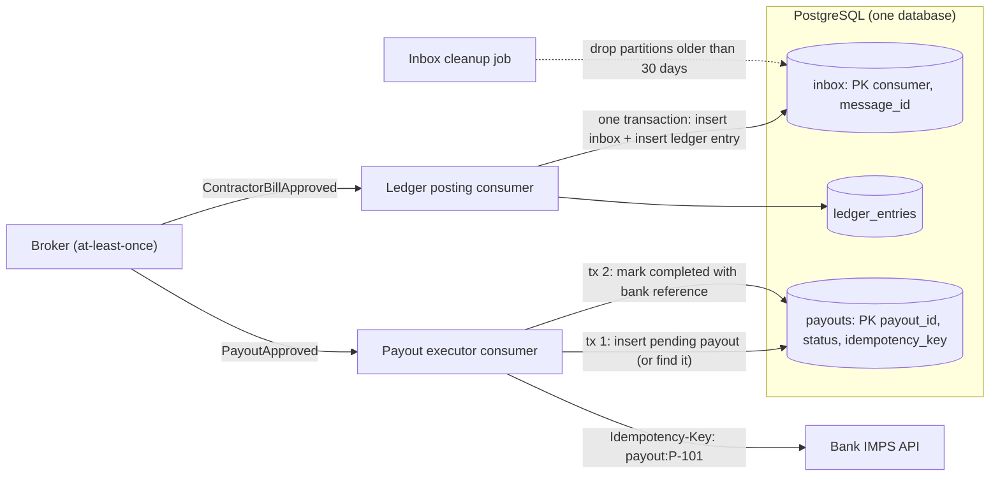
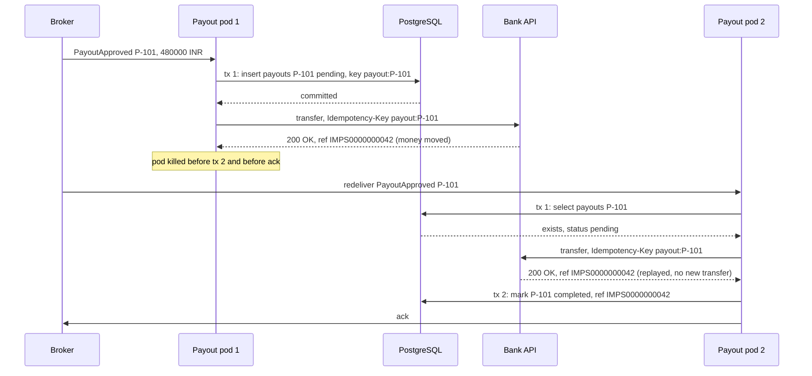

A highway project's billing system approves a ₹4,80,000 payout to a subcontractor. The approval service publishes `PayoutApproved`; the payout consumer calls the bank's IMPS API. The consumer pod is killed during a deploy right after the bank confirms the transfer, before it acknowledges the message. The broker does exactly what it should and redelivers. The consumer, which has no memory of the first attempt, pays again. The subcontractor is happy; the finance controller is not, and recovering ₹4,80,000 from a vendor takes weeks of letters. [Delivery guarantees](#/lesson/m12-delivery-guarantees) showed that this redelivery cannot be prevented. This lesson shows how to make it harmless.

## Learning objectives

By the end of this lesson you will be able to:

1. Explain what an idempotent consumer is and why every at-least-once consumer needs to be one.
2. Recognise naturally idempotent operations and rewrite non-idempotent ones (increments, appends) into idempotent forms.
3. Build an inbox (deduplication) table with a unique key, written in the same database transaction as the effect, using PostgreSQL `INSERT ... ON CONFLICT DO NOTHING`.
4. Choose the right deduplication key: producer message id, business key, or both.
5. Explain how concurrent duplicates behave under PostgreSQL's unique constraints and transactions.
6. Make external side effects (bank transfers, SMS, third-party APIs) safe with idempotency keys and a recorded intent.
7. Size and clean up an inbox table, and choose a retention period from your redelivery and replay windows.
8. Fix a consumer that processes payments twice, and test it with duplicate and concurrent deliveries.

## Prerequisites

- [Delivery guarantees](#/lesson/m12-delivery-guarantees): why duplicates are unavoidable with at-least-once delivery.
- [Transactions and ACID](#/lesson/m09-transactions-acid): atomic commits and rollbacks.
- [Idempotency keys](#/lesson/m10-idempotency): the same idea applied to HTTP APIs.

## Explain it like I'm a beginner

Think of a lift button. Pressing "5" once calls the lift to the fifth floor. Pressing it ten more times does nothing extra: the lift still goes to the fifth floor once. The button is **idempotent**: doing it again has the same effect as doing it once.

Now think of a vending machine that drops one samosa each time you press the button. Pressing twice gives two samosas. That button is **not** idempotent.

A message consumer is like a button that the broker sometimes presses twice by accident. If the consumer is a lift button ("set payout P-101 to paid"), the second press is harmless. If it is a vending machine ("add ₹4,80,000 to the transfer list"), the second press costs money.

You have two ways to make a vending machine safe:

1. **Change the button** so it describes the result, not the action: "make sure there is exactly one samosa in tray 7". Pressing it twice leaves one samosa. This is **natural idempotency**.
2. **Keep a register** next to the machine. Every request has a number; before dropping a samosa, the machine writes the number in the register. If the number is already there, it does nothing. This register is the **inbox**, and the number is the **deduplication key**.

The register only works if writing the number and dropping the samosa happen **together**. If the machine drops the samosa and then the power fails before it writes the number, the next press drops another. That is why the inbox row and the effect must be in the same database transaction.

## First-principles explanation

### What it is

An **idempotent consumer** (Idempotent Receiver, in Enterprise Integration Patterns) is a message handler for which processing the same message once or many times leaves the system in the same state, with the same external effects. Formally, applying the handler `f` twice gives the same result as once: `f(f(state)) = f(state)`.

Idempotency is a property of **the effect**, not of the code. "Charge the card" is not idempotent; "charge the card with idempotency key `payout:P-101`" is, if the payment provider honours the key.

### Why it exists

Brokers are at-least-once. Redeliveries happen after consumer crashes, lost acks, lease timeouts, Kafka rebalances, DLQ replays and operators resetting offsets. Producers resend after uncertain confirms. Upstream systems double-submit. At a few lakh messages a day, "rare" means "several times a day". The only place all of these duplicates can be stopped is the place they all arrive: the consumer and the data it changes.

### Three ways to be idempotent

**1. Natural idempotency.** Express the effect as a state, not a change:

| Not idempotent | Idempotent rewrite |
|---|---|
| `UPDATE wallets SET balance = balance + 50` | Insert a cashback row with unique `payment_id`, and compute or update the balance from rows that were actually inserted |
| `INSERT INTO shipments (...)` | `INSERT ... ON CONFLICT (order_id) DO NOTHING` |
| `UPDATE orders SET status = 'shipped'` (any time) | `UPDATE orders SET status = 'shipped' WHERE id = $1 AND status = 'packed'` (a guarded transition) |
| "Append GPS ping to track" | Upsert keyed by `(vehicle_id, recorded_at)` |
| "Set price to ₹120" from an event stream | `UPDATE ... SET price = $2, version = $3 WHERE id = $1 AND version < $3` (ignore stale or repeated versions) |

Natural idempotency is the cheapest option: no extra table, no extra index, no cleanup. Prefer it whenever the effect can be stated as "make it so".

**2. An inbox (deduplication) table.** When the effect is inherently "do it once" (post a ledger entry, increment a counter, create a task), record a key for each processed message:

```sql
CREATE TABLE inbox (
    consumer     text        NOT NULL,
    message_id   uuid        NOT NULL,
    processed_at timestamptz NOT NULL DEFAULT now(),
    PRIMARY KEY (consumer, message_id)
);
```

The handler runs one transaction:

```sql
BEGIN;
INSERT INTO inbox (consumer, message_id) VALUES ('ledger-posting', $1)
ON CONFLICT DO NOTHING;
-- If the INSERT affected 0 rows, this message was already processed: ROLLBACK (or COMMIT nothing) and ack.
INSERT INTO ledger_entries (contractor_id, project_code, amount_inr, source_message) VALUES ($2, $3, $4, $1);
COMMIT;
-- Ack the message only after COMMIT succeeds.
```

The `consumer` column matters: the same message is legitimately processed by several consumers (ledger posting, notifications, analytics), and each needs its own record.

**3. A business-key constraint.** Some duplicates arrive with *different* message ids: a user double-taps "Approve", or an upstream service retries by publishing a fresh event. Only a business identifier catches them:

```sql
CREATE TABLE payouts (
    payout_id        text PRIMARY KEY,          -- the business key from the approval system
    contractor_id    text NOT NULL,
    amount_inr       numeric(14,2) NOT NULL CHECK (amount_inr > 0),
    idempotency_key  text NOT NULL UNIQUE,
    status           text NOT NULL CHECK (status IN ('pending', 'completed')),
    bank_reference   text,
    created_at       timestamptz NOT NULL DEFAULT now()
);
```

Robust consumers often use both: the inbox for "have I processed this message?" and a business-key constraint for "does this payout already exist?".

### Why "same transaction" is the whole trick

Consider the three possible orders:

- **Record the id, commit, then do the effect.** A crash after the commit and before the effect marks the message as processed when it was not. The effect is **lost**.
- **Do the effect, commit, then record the id.** A crash between them leaves no record. The redelivery does the effect **again**.
- **Record the id and do the effect in one transaction.** Either both are committed or neither is. A crash before the commit rolls both back, so the redelivery processes the message for the first time. A crash after the commit leaves the id recorded, so the redelivery is skipped.

Only the third order is correct, and it works only when the effect lives in **the same database** as the inbox. That is why the pattern is easy for database effects and harder for external ones (bank APIs, emails), covered below.

### Concurrent duplicates in PostgreSQL

Sometimes two consumers process the same message at the same moment: a visibility timeout expired while the first was still working, or a rebalance overlapped. What happens with the inbox?

1. Consumer A runs `INSERT INTO inbox ... ON CONFLICT DO NOTHING`. The row is inserted but not yet committed.
2. Consumer B runs the same insert. PostgreSQL sees a conflicting *uncommitted* row and **waits** for A's transaction to finish.
3. If A commits, B's insert finds the committed row and does nothing (0 rows): B knows it is a duplicate.
4. If A rolls back, B's insert proceeds and B does the work.

This is exactly the behaviour you want, at the default `READ COMMITTED` isolation level, with no explicit locks. The unique index is the referee. A check-then-insert in application code (`SELECT` first, then `INSERT`) does **not** have this property: both consumers can see "not processed" before either inserts.

### Choosing the deduplication key

| Key | Catches | Misses | Notes |
|---|---|---|---|
| Producer-generated message id (UUID) | Broker redeliveries, producer retries with the same id, DLQ replays | Upstream double-submits that create new messages | Must be generated once, when the event is created (for example in the outbox row), and never regenerated on retry |
| Business key (`payout_id`, `payment_id`, `order_id + event_type`) | All of the above, plus upstream duplicates | Legitimate repeated events for the same entity (a second partial payout) | Model repeats explicitly: `payout_id` per payout, not per contractor |
| Content hash | Accidental duplicates without ids | Two genuinely identical events (two ₹500 top-ups on one day) | Avoid for money; useful as a last resort for legacy feeds |
| Broker delivery tag or Kafka offset | Nothing reliable | Republished messages get new offsets; delivery tags are per channel | Never use as a cross-system key |

### External side effects: idempotency keys and recorded intent

A bank transfer cannot be inside your PostgreSQL transaction. The consumer must call the bank, and a crash can happen after the bank moves money but before your commit. Two tools make this safe:

**An idempotency key on the external call.** Many payment APIs accept a client-supplied key and promise that repeated requests with the same key return the original result instead of performing the operation again (Stripe's `Idempotency-Key` header is a well-documented example; check what your bank or payment gateway supports and for how long it remembers keys). Derive the key from the business identity, such as `payout:P-101`, never from a random value generated per attempt.

**A recorded intent (a small state machine).**

1. Transaction 1: if a `payouts` row for `P-101` exists and is `completed`, stop. If none exists, insert it as `pending` with `idempotency_key = 'payout:P-101'`. Commit.
2. Call the bank with that idempotency key.
3. Transaction 2: mark the row `completed` with the bank reference. Commit. Ack the message.

If the consumer crashes after step 2, the redelivery finds the row `pending`, calls the bank again **with the same key**, receives the original transfer result, and completes the row. Money moves once. If the provider does **not** support idempotency keys, a `pending` row found on redelivery must not trigger a blind retry: query the provider for the status of that reference first, or park the payout for a human to reconcile.

The same idea applies to emails and SMS (store "sent" with the provider's message id, and pass a dedupe key if the provider supports one) and to calls to your own services (give them [idempotency keys](#/lesson/m10-idempotency) too).

### Ordering and stale messages

Idempotency stops repeats of the *same* message. A related problem is an *older* message arriving after a newer one (a retry from a DLQ, or competing consumers). If events carry a version or sequence number per entity, a guarded write makes the handler order-tolerant too:

```sql
UPDATE contractor_bank_details
SET account_no = $2, ifsc = $3, version = $4
WHERE contractor_id = $1 AND version < $4;   -- ignores repeats and stale versions alike
```

### Sizing and cleaning the inbox

The inbox grows with every processed message. Estimates for a payments platform:

- 5,00,000 messages a day across 4 consumers = 20,00,000 inbox rows a day.
- Row size with a `text` consumer name, a `uuid`, a timestamp and tuple overhead: roughly 60 to 80 bytes, plus a primary-key index of similar size. Call it about 150 bytes per row all-in (an estimate; measure with `pg_total_relation_size`).
- 20,00,000 × 150 B ≈ 300 MB a day. With 30 days of retention: about **9 GB**.

How long to keep ids? Longer than the longest window in which a duplicate can arrive: broker redelivery (minutes), retry tiers (hours), DLQ retention and replay (often 14 days), and Kafka offset resets (up to the topic retention). If your DLQ keeps messages for 14 days, keep inbox rows for at least 14 days and preferably 30. Deleting an id too early turns a late replay into a duplicate.

Clean up cheaply: partition the inbox by day (`PARTITION BY RANGE (processed_at)`) and drop old partitions, which is far cheaper than `DELETE` of millions of rows followed by vacuum. For smaller volumes, a nightly batched `DELETE ... WHERE processed_at < now() - interval '30 days'` is fine.

### When it is unnecessary

- The effect is naturally idempotent (upserts, guarded transitions, "latest wins").
- Duplicates are cheap and visible, and dedupe costs more than they do (debug telemetry).
- The broker's own duplicate detection covers your entire duplicate window *and* every duplicate source (rare: broker windows are minutes, and they cannot see consumer-side crashes).

### Trade-offs

| You gain | You pay |
|---|---|
| Exactly-once effects on top of at-least-once delivery | An extra insert and index entry per message |
| Safe retries, replays and offset resets | A table to size, partition and clean |
| Concurrency safety from the unique constraint | Every effect must live in the same database as the inbox, or use intent + idempotency keys |
| A record of what was processed, useful for audits | Retention decisions: too short and late duplicates slip through |

## Visual explanation

### Architecture: inbox in the same transaction, intent for the bank call



The ledger consumer's effect lives in the same PostgreSQL database as the inbox, so one transaction records the message id and posts the ledger entry together; a duplicate fails the inbox insert and posts nothing. The payout consumer's effect is outside the database, so it uses the `payouts` table as a record of intent: transaction 1 creates or finds the `pending` row keyed by `payout_id`, the bank call carries an idempotency key derived from that id, and transaction 2 marks the row completed. A crash anywhere in between leads to a retry that reuses the same key, so the bank moves money once. A cleanup job drops old inbox partitions after the replay window has passed.

### Sequence: crash after the bank call, then a safe redelivery



Pod 1 records the intent and calls the bank, and the bank moves the money. Pod 1 dies before it can record the result or ack. The broker redelivers to pod 2, which finds `P-101` already `pending`, so it knows a previous attempt may have reached the bank. It calls the bank with the **same** idempotency key; the bank recognises the key and returns the original reference without moving money again. Pod 2 records the completion and acks. One message, two deliveries, two bank calls, one transfer.

## Step-by-step example

### Step 1: the buggy consumer

```csharp
public async Task HandleAsync(PayoutApproved msg, CancellationToken ct)
{
    await bank.TransferAsync(new TransferRequest(Guid.NewGuid().ToString(), msg.BeneficiaryAccount, msg.Ifsc, msg.AmountInr, "Payout"), ct);
    await db.ExecuteAsync("INSERT INTO payouts (payout_id, status) VALUES (@id, 'completed')", new { id = msg.PayoutId });
}
```

Three bugs: the idempotency key is random per attempt (so the bank cannot recognise a retry), the transfer happens before anything is recorded, and the insert has no conflict handling (a redelivery throws a unique violation *after* paying again, then is retried until it dead-letters).

### Step 2: a business key and a stable idempotency key

Derive `idempotency_key = "payout:" + PayoutId`. Now the bank deduplicates retries of the same payout, whoever sends them.

### Step 3: record intent before the call

Insert the `pending` row first (or find the existing one). If it is already `completed`, ack and stop without calling the bank.

### Step 4: record the outcome, then ack

After the bank responds, mark the row `completed` with the bank reference in a second transaction, then ack. Every crash point now leads either to "nothing happened yet" or "retry with the same key".

### Step 5: the database-only consumer gets an inbox

The ledger-posting consumer has no external call. It inserts into `inbox` and `ledger_entries` in one transaction, and treats "0 rows inserted into inbox" as a duplicate.

### Step 6: test duplicates on purpose

Deliver every message twice in tests, deliver it concurrently from several tasks, and crash between the bank call and the second transaction. The production code below is shaped so all of these are easy.

## Production-style C# implementation

Npgsql is not available to this lesson's offline compiler, so the database is modelled by `InMemoryPayoutsDb`, which gives the two properties the pattern depends on: transactions that commit all-or-nothing, and unique keys that reject a second insert. The SQL each method stands for is shown in comments. The bank is a fake that honours idempotency keys, as a real payment API would.

```text
Payouts.Worker/
  Program.cs
  Data/PayoutsDb.cs
  Bank/BankGateway.cs
  Consumers/Messages.cs
  Consumers/LedgerPostingHandler.cs
  Consumers/PayoutHandler.cs
  Hosting/InboxCleanupService.cs
```

```csharp file=Data/PayoutsDb.cs
namespace Payouts.Data;

public enum PayoutStatus { Pending, Completed }

public sealed record PayoutRow(
    string PayoutId,
    string ContractorId,
    decimal AmountInr,
    string IdempotencyKey,
    PayoutStatus Status,
    string? BankReference,
    DateTimeOffset CreatedAt);

public sealed record LedgerEntry(Guid EntryId, string ContractorId, string ProjectCode, decimal AmountInr, Guid SourceMessageId);

/// <summary>Operations available inside one database transaction.</summary>
public interface IPayoutsTransaction
{
    /// <summary>INSERT INTO inbox (consumer, message_id) VALUES (...) ON CONFLICT DO NOTHING; true if a row was inserted.</summary>
    bool TryInsertInbox(string consumer, Guid messageId);

    /// <summary>INSERT INTO ledger_entries (...).</summary>
    void InsertLedgerEntry(LedgerEntry entry);

    /// <summary>SELECT ... FROM payouts WHERE payout_id = $1 FOR UPDATE.</summary>
    PayoutRow? GetPayout(string payoutId);

    /// <summary>INSERT INTO payouts (...) ON CONFLICT (payout_id) DO NOTHING; true if inserted.</summary>
    bool TryInsertPayout(PayoutRow row);

    /// <summary>UPDATE payouts SET ... WHERE payout_id = $1.</summary>
    void UpdatePayout(PayoutRow row);
}

public interface IPayoutsDb
{
    /// <summary>Runs work in one transaction: committed if it returns, rolled back if it throws.</summary>
    Task<T> InTransactionAsync<T>(Func<IPayoutsTransaction, Task<T>> work, CancellationToken ct);

    /// <summary>DELETE FROM inbox WHERE processed_at &lt; $1 (or drop old partitions).</summary>
    Task<int> PurgeInboxAsync(DateTimeOffset olderThan, CancellationToken ct);
}

/// <summary>In-memory stand-in for PostgreSQL. Transactions are serialised (a simplification of row locks)
/// and staged, so a throwing transaction leaves no trace, exactly like a rollback.</summary>
public sealed class InMemoryPayoutsDb(TimeProvider clock) : IPayoutsDb
{
    private readonly SemaphoreSlim _serial = new(1, 1);
    private readonly Dictionary<(string Consumer, Guid MessageId), DateTimeOffset> _inbox = new();
    private readonly List<LedgerEntry> _ledger = new();
    private readonly Dictionary<string, PayoutRow> _payouts = new(StringComparer.Ordinal);

    public IReadOnlyList<LedgerEntry> LedgerEntries => _ledger.ToList();
    public int InboxCount => _inbox.Count;
    public PayoutRow? FindPayout(string payoutId) => _payouts.GetValueOrDefault(payoutId);

    public async Task<T> InTransactionAsync<T>(Func<IPayoutsTransaction, Task<T>> work, CancellationToken ct)
    {
        await _serial.WaitAsync(ct);
        try
        {
            var tx = new Transaction(this, clock.GetUtcNow());
            var result = await work(tx);   // throws => nothing below runs => rollback
            tx.Commit();
            return result;
        }
        finally
        {
            _serial.Release();
        }
    }

    public async Task<int> PurgeInboxAsync(DateTimeOffset olderThan, CancellationToken ct)
    {
        await _serial.WaitAsync(ct);
        try
        {
            var old = _inbox.Where(kv => kv.Value < olderThan).Select(kv => kv.Key).ToList();
            foreach (var key in old) _inbox.Remove(key);
            return old.Count;
        }
        finally
        {
            _serial.Release();
        }
    }

    private sealed class Transaction(InMemoryPayoutsDb db, DateTimeOffset now) : IPayoutsTransaction
    {
        private readonly Dictionary<(string, Guid), DateTimeOffset> _inbox = new();
        private readonly List<LedgerEntry> _ledger = new();
        private readonly Dictionary<string, PayoutRow> _payouts = new(StringComparer.Ordinal);

        public bool TryInsertInbox(string consumer, Guid messageId)
        {
            var key = (consumer, messageId);
            if (db._inbox.ContainsKey(key) || _inbox.ContainsKey(key)) return false;
            _inbox[key] = now;
            return true;
        }

        public void InsertLedgerEntry(LedgerEntry entry) => _ledger.Add(entry);

        public PayoutRow? GetPayout(string payoutId) =>
            _payouts.TryGetValue(payoutId, out var staged) ? staged : db._payouts.GetValueOrDefault(payoutId);

        public bool TryInsertPayout(PayoutRow row)
        {
            if (GetPayout(row.PayoutId) is not null) return false;
            if (db._payouts.Values.Concat(_payouts.Values).Any(p => p.IdempotencyKey == row.IdempotencyKey))
                throw new InvalidOperationException($"duplicate key value violates unique constraint (idempotency_key = {row.IdempotencyKey})");
            _payouts[row.PayoutId] = row;
            return true;
        }

        public void UpdatePayout(PayoutRow row)
        {
            if (GetPayout(row.PayoutId) is null) throw new InvalidOperationException($"No payout {row.PayoutId}.");
            _payouts[row.PayoutId] = row;
        }

        public void Commit()
        {
            foreach (var (key, at) in _inbox) db._inbox[key] = at;
            db._ledger.AddRange(_ledger);
            foreach (var (id, row) in _payouts) db._payouts[id] = row;
        }
    }
}
```

```csharp file=Bank/BankGateway.cs
namespace Payouts.Bank;

public sealed record TransferRequest(string IdempotencyKey, string BeneficiaryAccount, string Ifsc, decimal AmountInr, string Narration);

/// <summary>Replayed = true means the bank recognised the idempotency key and returned the original transfer.</summary>
public sealed record TransferResult(string BankReference, bool Replayed);

public interface IBankGateway
{
    Task<TransferResult> TransferAsync(TransferRequest request, CancellationToken ct);
}

/// <summary>Behaves like a payment API that honours idempotency keys. MoneyMovements counts real transfers.</summary>
public sealed class FakeBankGateway : IBankGateway
{
    private readonly Lock _gate = new();
    private readonly Dictionary<string, (TransferRequest Request, string Reference)> _byKey = new(StringComparer.Ordinal);
    private int _sequence;

    public int Calls { get; private set; }
    public int MoneyMovements { get; private set; }

    public Task<TransferResult> TransferAsync(TransferRequest request, CancellationToken ct)
    {
        lock (_gate)
        {
            Calls++;
            if (_byKey.TryGetValue(request.IdempotencyKey, out var existing))
            {
                if (existing.Request.AmountInr != request.AmountInr || existing.Request.BeneficiaryAccount != request.BeneficiaryAccount)
                    throw new InvalidOperationException("Idempotency key reused with different parameters (HTTP 422).");
                return Task.FromResult(new TransferResult(existing.Reference, Replayed: true));
            }

            var reference = $"IMPS{++_sequence:D10}";
            _byKey[request.IdempotencyKey] = (request, reference);
            MoneyMovements++;
            return Task.FromResult(new TransferResult(reference, Replayed: false));
        }
    }
}
```

```csharp file=Consumers/Messages.cs
namespace Payouts.Consumers;

/// <summary>MessageId is generated once by the producer (in its outbox row) and kept across retries and replays.</summary>
public sealed record ContractorBillApproved(Guid MessageId, string BillId, string ContractorId, string ProjectCode, decimal AmountInr);

public sealed record PayoutApproved(Guid MessageId, string PayoutId, string ContractorId, string BeneficiaryAccount, string Ifsc, decimal AmountInr);

public enum HandleOutcome
{
    /// <summary>First successful processing.</summary>
    Processed,
    /// <summary>Already processed: nothing done, safe to ack.</summary>
    Duplicate,
    /// <summary>A previous attempt was interrupted; it was finished without repeating the side effect.</summary>
    Resumed,
}

public sealed class ConflictingDuplicateException(string message) : Exception(message);
```

```csharp file=Consumers/LedgerPostingHandler.cs
using Payouts.Data;

namespace Payouts.Consumers;

/// <summary>Database-only effect: inbox row and ledger entry in ONE transaction.</summary>
public sealed class LedgerPostingHandler(IPayoutsDb db, ILogger<LedgerPostingHandler> logger)
{
    public const string ConsumerName = "ledger-posting";

    public async Task<HandleOutcome> HandleAsync(ContractorBillApproved message, CancellationToken ct)
    {
        if (message.AmountInr <= 0) throw new ArgumentException($"Bill {message.BillId} has a non-positive amount.");

        var outcome = await db.InTransactionAsync(tx =>
        {
            // BEGIN; INSERT INTO inbox ... ON CONFLICT DO NOTHING;
            if (!tx.TryInsertInbox(ConsumerName, message.MessageId))
                return Task.FromResult(HandleOutcome.Duplicate);   // 0 rows: someone already did this

            // INSERT INTO ledger_entries ...; COMMIT;
            tx.InsertLedgerEntry(new LedgerEntry(Guid.NewGuid(), message.ContractorId, message.ProjectCode, message.AmountInr, message.MessageId));
            return Task.FromResult(HandleOutcome.Processed);
        }, ct);

        if (outcome == HandleOutcome.Duplicate)
            logger.LogInformation("Duplicate {MessageId} for bill {BillId} ignored", message.MessageId, message.BillId);
        return outcome;   // the caller acks only after this returns
    }
}
```

```csharp file=Consumers/PayoutHandler.cs
using Payouts.Bank;
using Payouts.Data;

namespace Payouts.Consumers;

/// <summary>External effect: record intent, call the bank with a stable idempotency key, record the outcome.</summary>
public sealed class PayoutHandler(IPayoutsDb db, IBankGateway bank, TimeProvider clock, ILogger<PayoutHandler> logger)
{
    public static string IdempotencyKeyFor(string payoutId) => $"payout:{payoutId}";

    public async Task<HandleOutcome> HandleAsync(PayoutApproved message, CancellationToken ct)
    {
        // Transaction 1: find or create the intent, keyed by the business id (catches upstream duplicates too).
        var (payout, created) = await db.InTransactionAsync(tx =>
        {
            var existing = tx.GetPayout(message.PayoutId);
            if (existing is not null) return Task.FromResult((existing, false));

            var row = new PayoutRow(message.PayoutId, message.ContractorId, message.AmountInr,
                IdempotencyKeyFor(message.PayoutId), PayoutStatus.Pending, null, clock.GetUtcNow());
            tx.TryInsertPayout(row);
            return Task.FromResult((row, true));
        }, ct);

        if (payout.AmountInr != message.AmountInr || payout.ContractorId != message.ContractorId)
            throw new ConflictingDuplicateException(
                $"Payout {message.PayoutId} already exists with different data; refusing to pay. Needs human review.");

        if (payout.Status == PayoutStatus.Completed)
        {
            logger.LogInformation("Payout {PayoutId} already completed ({Reference}); duplicate ignored", payout.PayoutId, payout.BankReference);
            return HandleOutcome.Duplicate;
        }

        // The side effect. Safe to repeat because the key is derived from the payout, not from this attempt.
        var transfer = await bank.TransferAsync(new TransferRequest(payout.IdempotencyKey, message.BeneficiaryAccount,
            message.Ifsc, payout.AmountInr, $"Payout {payout.PayoutId}"), ct);

        // Transaction 2: record the outcome. A crash before this line is repaired by the next delivery.
        await db.InTransactionAsync(tx =>
        {
            var current = tx.GetPayout(payout.PayoutId)!;
            if (current.Status != PayoutStatus.Completed)
                tx.UpdatePayout(current with { Status = PayoutStatus.Completed, BankReference = transfer.BankReference });
            return Task.FromResult(true);
        }, ct);

        var outcome = created && !transfer.Replayed ? HandleOutcome.Processed : HandleOutcome.Resumed;
        logger.LogInformation("Payout {PayoutId}: {Outcome}, bank reference {Reference}", payout.PayoutId, outcome, transfer.BankReference);
        return outcome;
    }
}
```

```csharp file=Hosting/InboxCleanupService.cs
using Microsoft.Extensions.Options;
using Payouts.Data;

namespace Payouts.Hosting;

public sealed class InboxOptions
{
    /// <summary>Keep ids longer than any redelivery, retry-tier, DLQ-replay or offset-reset window.</summary>
    public TimeSpan Retention { get; set; } = TimeSpan.FromDays(30);
    public TimeSpan CleanupInterval { get; set; } = TimeSpan.FromHours(6);
}

public sealed class InboxCleanupService(IPayoutsDb db, IOptions<InboxOptions> options, TimeProvider clock,
    ILogger<InboxCleanupService> logger) : BackgroundService
{
    protected override async Task ExecuteAsync(CancellationToken stoppingToken)
    {
        using var timer = new PeriodicTimer(options.Value.CleanupInterval, clock);
        try
        {
            while (await timer.WaitForNextTickAsync(stoppingToken))
            {
                var removed = await db.PurgeInboxAsync(clock.GetUtcNow() - options.Value.Retention, stoppingToken);
                logger.LogInformation("Inbox cleanup removed {Count} ids older than {Retention}", removed, options.Value.Retention);
            }
        }
        catch (OperationCanceledException) when (stoppingToken.IsCancellationRequested) { }
    }
}
```

```csharp file=Program.cs
using Payouts.Bank;
using Payouts.Consumers;
using Payouts.Data;
using Payouts.Hosting;

var builder = WebApplication.CreateBuilder(args);

builder.Services.AddSingleton(TimeProvider.System);
builder.Services.Configure<InboxOptions>(builder.Configuration.GetSection("Inbox"));
builder.Services.AddSingleton<InMemoryPayoutsDb>();
builder.Services.AddSingleton<IPayoutsDb>(sp => sp.GetRequiredService<InMemoryPayoutsDb>());
builder.Services.AddSingleton<FakeBankGateway>();
builder.Services.AddSingleton<IBankGateway>(sp => sp.GetRequiredService<FakeBankGateway>());
builder.Services.AddSingleton<LedgerPostingHandler>();
builder.Services.AddSingleton<PayoutHandler>();
builder.Services.AddHostedService<InboxCleanupService>();

var app = builder.Build();

// Simulates the broker delivering the same message several times (redeliveries, replays).
app.MapPost("/simulate/payout", async (PayoutApproved message, int? deliveries, PayoutHandler handler,
    FakeBankGateway bank, InMemoryPayoutsDb db, CancellationToken ct) =>
{
    var outcomes = new List<HandleOutcome>();
    for (var i = 0; i < Math.Clamp(deliveries ?? 3, 1, 10); i++) outcomes.Add(await handler.HandleAsync(message, ct));
    return Results.Ok(new { outcomes, bank.Calls, bank.MoneyMovements, payout = db.FindPayout(message.PayoutId) });
});

app.MapPost("/simulate/bill", async (ContractorBillApproved message, LedgerPostingHandler handler, InMemoryPayoutsDb db, CancellationToken ct) =>
{
    var first = await handler.HandleAsync(message, ct);
    var second = await handler.HandleAsync(message, ct);
    return Results.Ok(new { first, second, ledgerEntries = db.LedgerEntries.Count(e => e.SourceMessageId == message.MessageId) });
});

app.Run();
```

What to notice:

- **The ledger handler never checks first and inserts later.** The inbox insert *is* the check, and it shares a transaction with the effect.
- **The payout handler dedupes by business key**, so a second `PayoutApproved` with a new message id but the same `PayoutId` cannot pay twice either.
- **Conflicting duplicates are refused**: the same `PayoutId` with a different amount is not a duplicate, it is a bug or fraud, and it goes to a human (via the DLQ), not to the bank.
- **The idempotency key is a pure function of the payout id**, so any pod, on any attempt, sends the same key.
- **Acks happen after `HandleAsync` returns**, never inside it. An exception means "no ack", which means redelivery, which is now safe.

With Npgsql the ledger handler's transaction looks like this (not compiled here; the package is not available offline):

```csharp
await using var conn = await dataSource.OpenConnectionAsync(ct);
await using var tx = await conn.BeginTransactionAsync(ct);

await using (var inbox = new NpgsqlCommand(
    "INSERT INTO inbox (consumer, message_id) VALUES ($1, $2) ON CONFLICT DO NOTHING", conn, tx))
{
    inbox.Parameters.Add(new() { Value = "ledger-posting" });
    inbox.Parameters.Add(new() { Value = message.MessageId });
    if (await inbox.ExecuteNonQueryAsync(ct) == 0)
    {
        await tx.RollbackAsync(ct);
        return HandleOutcome.Duplicate;   // already processed: ack and move on
    }
}

await using (var post = new NpgsqlCommand(
    "INSERT INTO ledger_entries (contractor_id, project_code, amount_inr, source_message) VALUES ($1, $2, $3, $4)", conn, tx))
{
    post.Parameters.Add(new() { Value = message.ContractorId });
    post.Parameters.Add(new() { Value = message.ProjectCode });
    post.Parameters.Add(new() { Value = message.AmountInr });
    post.Parameters.Add(new() { Value = message.MessageId });
    await post.ExecuteNonQueryAsync(ct);
}

await tx.CommitAsync(ct);
return HandleOutcome.Processed;
```

## Bad design vs good design

**Bad: check, then act, in separate steps.**

```csharp
if (await db.ExistsAsync("SELECT 1 FROM inbox WHERE message_id = @id", msg.MessageId)) return;
await db.ExecuteAsync("UPDATE wallets SET balance = balance + @amt WHERE id = @w", ...);
await db.ExecuteAsync("INSERT INTO inbox (message_id) VALUES (@id)", msg.MessageId);
```

Two consumers with the same message both pass the `SELECT`. A crash between the update and the insert leaves no record. **Good:** one transaction, insert-first with `ON CONFLICT DO NOTHING`, and decide from the row count.

**Bad: an in-memory `HashSet<Guid>` of processed ids.** It is empty after every restart, which is exactly when redeliveries arrive, and each pod has its own. **Good:** a durable table, shared by all instances.

**Bad: a random idempotency key per attempt.** `Idempotency-Key: Guid.NewGuid()` makes every retry look new to the bank. **Good:** derive it from the business identity.

**Bad: inbox in Redis, effect in PostgreSQL.** Two systems cannot commit together; a crash between them reopens the gap. A Redis `SET NX` with a TTL is acceptable only as an optimisation in front of a real database check, or when duplicates are cheap. **Good:** keep the inbox in the same database as the effect.

**Bad: treating every unique violation as "duplicate, ack".** A unique violation on `idempotency_key` with a *different* amount means two different payouts collided on an id. Acking hides a real problem. **Good:** compare the stored data with the message; dead-letter conflicts.

:::callout type=tradeoff title="Inbox or natural idempotency?"
An inbox works for every handler without thinking, which is why frameworks (MassTransit, NServiceBus, Wolverine) offer it as a switch. It also costs an insert and an index entry on every message and a cleanup job. Naturally idempotent writes cost nothing extra but require care in each handler. A good default: natural idempotency for state updates ("set status", "upsert latest"), an inbox for additive effects ("post", "credit", "create"), and recorded intent plus idempotency keys for anything that leaves your database.
:::

## Practical playground

The playground database has an `inbox`, a `ledger_entries` table and some processed messages. Try the pattern by hand:

1. Run the inbox insert for message `'2b7c...'` (see below) and look at the row count. Run it again: 0 rows.
2. Wrap it in a transaction with a ledger insert, `ROLLBACK`, and confirm the inbox row is gone too.
3. Find duplicate deliveries in `delivery_log` with `GROUP BY message_id HAVING count(*) > 1`.
4. Write the guarded update for `contractor_bank_details` that ignores stale versions, and run it with an old version number.

```sql
-- 1. First processing inserts one row; repeating it inserts none.
INSERT INTO inbox (consumer, message_id) VALUES ('ledger-posting', '2b7c1d3e-0000-4000-8000-000000000099')
ON CONFLICT DO NOTHING
RETURNING message_id;
```

:::playground type=sql title="Inbox deduplication in PostgreSQL"
```sql
CREATE TABLE inbox (
  consumer     text        NOT NULL,
  message_id   uuid        NOT NULL,
  processed_at timestamptz NOT NULL DEFAULT now(),
  PRIMARY KEY (consumer, message_id)
);
CREATE TABLE ledger_entries (
  entry_id       bigserial PRIMARY KEY,
  contractor_id  text NOT NULL,
  project_code   text NOT NULL,
  amount_inr     integer NOT NULL CHECK (amount_inr > 0),
  source_message uuid NOT NULL
);
CREATE TABLE delivery_log (
  delivery_id  serial PRIMARY KEY,
  message_id   uuid NOT NULL,
  consumer     text NOT NULL,
  delivered_at timestamptz NOT NULL
);
CREATE TABLE contractor_bank_details (
  contractor_id text PRIMARY KEY,
  account_no    text NOT NULL,
  ifsc          text NOT NULL,
  version       integer NOT NULL
);
INSERT INTO inbox (consumer, message_id, processed_at) VALUES
  ('ledger-posting', '2b7c1d3e-0000-4000-8000-000000000001', '2026-10-18 09:00:00+05:30'),
  ('ledger-posting', '2b7c1d3e-0000-4000-8000-000000000002', '2026-10-18 09:05:00+05:30'),
  ('notifications',  '2b7c1d3e-0000-4000-8000-000000000001', '2026-10-18 09:00:02+05:30');
INSERT INTO ledger_entries (contractor_id, project_code, amount_inr, source_message) VALUES
  ('CTR-ARORA', 'NH-48-PKG-3', 480000, '2b7c1d3e-0000-4000-8000-000000000001'),
  ('CTR-COAST', 'NH-66-PKG-1', 210000, '2b7c1d3e-0000-4000-8000-000000000002');
INSERT INTO delivery_log (message_id, consumer, delivered_at) VALUES
  ('2b7c1d3e-0000-4000-8000-000000000001', 'ledger-posting', '2026-10-18 09:00:00+05:30'),
  ('2b7c1d3e-0000-4000-8000-000000000001', 'ledger-posting', '2026-10-18 09:00:31+05:30'),
  ('2b7c1d3e-0000-4000-8000-000000000002', 'ledger-posting', '2026-10-18 09:05:00+05:30'),
  ('2b7c1d3e-0000-4000-8000-000000000001', 'notifications',  '2026-10-18 09:00:02+05:30');
INSERT INTO contractor_bank_details VALUES ('CTR-ARORA', '50100012345678', 'HDFC0001234', 3);
```
:::

## Exercises

:::exercise id=m12-idempotent-consumers-ex1 difficulty=beginner kind=written title="Is it idempotent? Make it so"
For each consumer action, say whether running it twice is harmless. If not, rewrite it so that it is, and say which technique you used (natural idempotency, inbox, business-key constraint, or idempotency key).

1. `UPDATE orders SET status = 'cancelled' WHERE id = $1`
2. `UPDATE wallets SET balance = balance + $2 WHERE user_id = $1` on `CashbackGranted`
3. `INSERT INTO shipments (order_id, courier) VALUES ($1, $2)` on `OrderPacked`
4. Send an SMS "Your OTP is 482913" on `OtpRequested`
5. `UPDATE products SET price = $2 WHERE sku = $1` on `PriceChanged` events that may arrive out of order
6. Call a partner API `POST /bookings` to book a crane for a site on `CraneRequested`
::acceptance
- Each case says harmless or not, with a reason.
- Every non-idempotent case gets a concrete rewrite.
- Case 5 handles out-of-order delivery, not just repeats.
- Case 6 uses a stable key derived from the request, not a random one.
::hint
Ask: does the statement describe a final state, or a change relative to the current state?
::hint
Inserts become idempotent with a unique key and `ON CONFLICT DO NOTHING`.
::hint
For out-of-order events, you need a version or timestamp to compare with what is stored.
::hint
For an external API, what can you send so that the partner recognises a retry?
::solution
1. **Harmless** (natural idempotency): it sets a final state. Better still, guard the transition: `... WHERE id = $1 AND status IN ('placed', 'packed')`, so a late duplicate cannot cancel an order that has since been delivered.
2. **Not idempotent**: each run adds again. Rewrite with a business-key row in the same transaction: `INSERT INTO cashback (payment_id, user_id, amount) VALUES (...) ON CONFLICT (payment_id) DO NOTHING`, and update the balance only if a row was inserted (or compute balance from the cashback rows). Technique: business-key constraint (or inbox).
3. **Not idempotent** if `order_id` is not unique: two shipments. Add `UNIQUE (order_id)` and `ON CONFLICT (order_id) DO NOTHING`. Technique: business-key constraint.
4. **Not idempotent**: a second SMS. Record `sms_sent (otp_request_id)` with a unique key before or with sending, and pass a dedupe reference to the SMS provider if it supports one. Note the residual risk: if the process crashes after the provider accepts the SMS but before recording it, a duplicate SMS is still possible without provider support; for OTPs this is usually acceptable.
5. **Repeats are harmless, but out-of-order delivery is not**: an older price can overwrite a newer one. Rewrite: `UPDATE products SET price = $2, price_version = $3 WHERE sku = $1 AND price_version < $3`. Technique: natural idempotency with a version guard.
6. **Not idempotent**: two cranes booked. Record the intent (`crane_requests` row keyed by `request_id`, status `pending`), then call `POST /bookings` with `Idempotency-Key: crane:<request_id>` if the partner supports it, then record the booking reference. If the partner does not support keys, query by your reference before retrying, or ask them to add a unique client reference field.
::mistakes
- Calling case 1 non-idempotent because it is an `UPDATE`; setting a final value is idempotent.
- Fixing case 5 with an inbox: it stops repeats but not stale versions.
- Using `Guid.NewGuid()` as the idempotency key in case 6.
:::

:::exercise id=m12-idempotent-consumers-ex2 difficulty=beginner kind=code title="An inbox with retention"
Implement an in-memory model of an inbox table: it records `(consumer, messageId)` pairs with the time they were processed, rejects repeats, and purges old entries.
::requirements
- `TryRegister(consumer, messageId)` returns `true` the first time a pair is seen and records the current time; `false` afterwards.
- The same message id under a different consumer is a different entry.
- `Contains(consumer, messageId)` reports whether a pair is recorded.
- `Purge(retention)` removes entries processed strictly earlier than `now - retention` and returns how many were removed.
- Time comes from the injected `TimeProvider`. `Count` returns the number of entries.
::acceptance
- A repeat registration returns `false`.
- Two consumers can each register the same message id once.
- After purging, an old id can be registered again (demonstrating why retention must exceed the duplicate window).
- Entries newer than the retention are kept.
::hint
Use a `Dictionary<(string Consumer, Guid MessageId), DateTimeOffset>`.
::hint
`TryAdd` returns `false` if the key exists, which is exactly `ON CONFLICT DO NOTHING`.
::hint
For `Purge`, compute the cutoff once, collect the matching keys into a list, then remove them.
::hint
```csharp
var cutoff = _clock.GetUtcNow() - retention;
var old = _entries.Where(e => e.Value < cutoff).Select(e => e.Key).ToList();
foreach (var k in old) _entries.Remove(k);
return old.Count;
```
::starter
```csharp file=InboxDeduplicator.cs
using System;
using System.Collections.Generic;
using System.Linq;

public sealed class InboxDeduplicator
{
    public InboxDeduplicator(TimeProvider clock)
    {
        throw new NotImplementedException();
    }

    public int Count => throw new NotImplementedException();

    public bool TryRegister(string consumer, Guid messageId) => throw new NotImplementedException();

    public bool Contains(string consumer, Guid messageId) => throw new NotImplementedException();

    public int Purge(TimeSpan retention) => throw new NotImplementedException();
}
```
::tests
```csharp file=InboxDeduplicatorTests.cs
using System;
using Xunit;

public sealed class TestClock : TimeProvider
{
    private DateTimeOffset _now = new(2026, 10, 19, 9, 0, 0, TimeSpan.Zero);
    public override DateTimeOffset GetUtcNow() => _now;
    public void Advance(TimeSpan by) => _now += by;
}

public class InboxDeduplicatorTests
{
    private static readonly Guid M1 = new("11111111-1111-4111-8111-111111111111");
    private static readonly Guid M2 = new("22222222-2222-4222-8222-222222222222");

    [Fact]
    public void Repeat_is_rejected()
    {
        var inbox = new InboxDeduplicator(new TestClock());
        Assert.True(inbox.TryRegister("ledger", M1));
        Assert.False(inbox.TryRegister("ledger", M1));
        Assert.True(inbox.Contains("ledger", M1));
        Assert.Equal(1, inbox.Count);
    }

    [Fact]
    public void Consumers_are_independent()
    {
        var inbox = new InboxDeduplicator(new TestClock());
        Assert.True(inbox.TryRegister("ledger", M1));
        Assert.True(inbox.TryRegister("notifications", M1));
        Assert.False(inbox.Contains("analytics", M1));
    }

    [Fact]
    public void Purge_removes_only_old_entries()
    {
        var clock = new TestClock();
        var inbox = new InboxDeduplicator(clock);
        inbox.TryRegister("ledger", M1);
        clock.Advance(TimeSpan.FromDays(20));
        inbox.TryRegister("ledger", M2);
        clock.Advance(TimeSpan.FromDays(11));

        Assert.Equal(1, inbox.Purge(TimeSpan.FromDays(30)));
        Assert.False(inbox.Contains("ledger", M1));
        Assert.True(inbox.Contains("ledger", M2));
    }

    [Fact]
    public void Purged_id_is_accepted_again()
    {
        var clock = new TestClock();
        var inbox = new InboxDeduplicator(clock);
        inbox.TryRegister("ledger", M1);
        clock.Advance(TimeSpan.FromDays(31));
        inbox.Purge(TimeSpan.FromDays(30));
        Assert.True(inbox.TryRegister("ledger", M1));   // a replay this late would be processed twice
    }
}
```
::solution
```csharp file=InboxDeduplicator.cs
using System;
using System.Collections.Generic;
using System.Linq;

public sealed class InboxDeduplicator
{
    private readonly TimeProvider _clock;
    private readonly Dictionary<(string Consumer, Guid MessageId), DateTimeOffset> _entries = new();
    private readonly object _gate = new();

    public InboxDeduplicator(TimeProvider clock) => _clock = clock;

    public int Count { get { lock (_gate) return _entries.Count; } }

    public bool TryRegister(string consumer, Guid messageId)
    {
        lock (_gate) return _entries.TryAdd((consumer, messageId), _clock.GetUtcNow());
    }

    public bool Contains(string consumer, Guid messageId)
    {
        lock (_gate) return _entries.ContainsKey((consumer, messageId));
    }

    public int Purge(TimeSpan retention)
    {
        lock (_gate)
        {
            var cutoff = _clock.GetUtcNow() - retention;
            var old = _entries.Where(e => e.Value < cutoff).Select(e => e.Key).ToList();
            foreach (var key in old) _entries.Remove(key);
            return old.Count;
        }
    }
}
```

The last test is the important lesson: once an id is purged, a late duplicate looks new. Retention must be longer than the latest a duplicate can arrive, including DLQ replays and offset resets. In PostgreSQL this class is the `inbox` table with a composite primary key, and `Purge` is dropping old daily partitions.
::mistakes
- Keying only by message id, so a second consumer of the same event is wrongly treated as a duplicate.
- Using `<=` in purge, which removes entries exactly at the boundary (the tests pin "strictly older").
- Modifying the dictionary while iterating it.
:::

:::exercise id=m12-idempotent-consumers-ex3 difficulty=intermediate kind=code title="Fix duplicate payment processing"
This consumer credits wallets when a payment succeeds. In production, some wallets were credited twice:

```csharp
public Outcome Handle(PaymentMessage msg)
{
    var seen = db.InTransaction(tx => tx.InboxContains("wallet-credit", msg.MessageId));   // check
    if (seen) return Outcome.Duplicate;
    db.InTransaction(tx => { tx.AddToBalance(msg.Account, msg.Amount); return true; });  // act
    db.InTransaction(tx => tx.TryInsertInbox("wallet-credit", msg.MessageId));           // record
    return Outcome.Processed;
}
```

Implement `IdempotentPaymentHandler.Handle` correctly using the provided `PaymentsDb`.
::requirements
- Use **one** `db.InTransaction` call per message.
- Inside it: insert the inbox row first; if it already exists, return `Duplicate`.
- Then insert the payment by `PaymentId` (the business key); if it already exists (an upstream duplicate with a new message id), return `Duplicate`.
- Then call the optional `validate` callback (it may throw), then add the amount to the account's balance, and return `Processed`.
- If anything throws, the transaction must leave no trace, so a later redelivery processes the message normally.
::acceptance
- The same message delivered twice credits once.
- Two messages with different ids but the same `PaymentId` credit once.
- A failure on the first attempt leaves no inbox row, and the retry credits once.
- 20 concurrent deliveries of the same message produce exactly one `Processed`.
::hint
The bug is check-then-act across three transactions. Collapse them into one.
::hint
`tx.TryInsertInbox` returns `false` when the row exists; that *is* the duplicate check.
::hint
Put `validate` after the inserts and before the balance change; if it throws, `InTransaction` never applies the staged inserts.
::hint
```csharp
return _db.InTransaction(tx =>
{
    if (!tx.TryInsertInbox(Consumer, msg.MessageId)) return Outcome.Duplicate;
    if (!tx.TryInsertPayment(msg.PaymentId, msg.Amount)) return Outcome.Duplicate;
    _validate?.Invoke(msg);
    tx.AddToBalance(msg.Account, msg.Amount);
    return Outcome.Processed;
});
```
::starter
```csharp file=PaymentHandler.cs
using System;
using System.Collections.Generic;
using System.Linq;

public sealed record PaymentMessage(Guid MessageId, string PaymentId, string Account, decimal Amount);

public enum Outcome { Processed, Duplicate }

/// <summary>Provided: a database with all-or-nothing transactions and unique keys.</summary>
public sealed class PaymentsDb
{
    private readonly object _lock = new();
    private readonly HashSet<(string, Guid)> _inbox = new();
    private readonly Dictionary<string, decimal> _payments = new();
    private readonly Dictionary<string, decimal> _balances = new();

    public decimal BalanceOf(string account) { lock (_lock) return _balances.GetValueOrDefault(account); }
    public int InboxCount { get { lock (_lock) return _inbox.Count; } }
    public int PaymentCount { get { lock (_lock) return _payments.Count; } }

    public sealed class Tx
    {
        private readonly PaymentsDb _db;
        internal readonly HashSet<(string, Guid)> Inbox = new();
        internal readonly Dictionary<string, decimal> Payments = new();
        internal readonly List<(string Account, decimal Amount)> Credits = new();
        internal Tx(PaymentsDb db) => _db = db;

        public bool InboxContains(string consumer, Guid messageId) =>
            _db._inbox.Contains((consumer, messageId)) || Inbox.Contains((consumer, messageId));

        /// <summary>INSERT INTO inbox ... ON CONFLICT DO NOTHING. False if the row exists.</summary>
        public bool TryInsertInbox(string consumer, Guid messageId) =>
            !InboxContains(consumer, messageId) && Inbox.Add((consumer, messageId));

        /// <summary>INSERT INTO payments (payment_id, amount) ... ON CONFLICT (payment_id) DO NOTHING.</summary>
        public bool TryInsertPayment(string paymentId, decimal amount)
        {
            if (_db._payments.ContainsKey(paymentId) || Payments.ContainsKey(paymentId)) return false;
            Payments[paymentId] = amount;
            return true;
        }

        public void AddToBalance(string account, decimal amount) => Credits.Add((account, amount));
    }

    public T InTransaction<T>(Func<Tx, T> work)
    {
        lock (_lock)
        {
            var tx = new Tx(this);
            var result = work(tx);   // throws => nothing is applied (rollback)
            foreach (var key in tx.Inbox) _inbox.Add(key);
            foreach (var (id, amount) in tx.Payments) _payments[id] = amount;
            foreach (var (account, amount) in tx.Credits) _balances[account] = _balances.GetValueOrDefault(account) + amount;
            return result;
        }
    }
}

public sealed class IdempotentPaymentHandler
{
    public const string Consumer = "wallet-credit";

    public IdempotentPaymentHandler(PaymentsDb db, Action<PaymentMessage>? validate = null)
    {
        throw new NotImplementedException();
    }

    public Outcome Handle(PaymentMessage msg) => throw new NotImplementedException();
}
```
::tests
```csharp file=PaymentHandlerTests.cs
using System;
using System.Linq;
using System.Threading.Tasks;
using Xunit;

public class PaymentHandlerTests
{
    private static PaymentMessage Msg(string paymentId = "P-9001", Guid? id = null) =>
        new(id ?? Guid.NewGuid(), paymentId, "wallet-42", 50m);

    [Fact]
    public void Redelivered_message_credits_once()
    {
        var db = new PaymentsDb();
        var handler = new IdempotentPaymentHandler(db);
        var m = Msg();
        Assert.Equal(Outcome.Processed, handler.Handle(m));
        Assert.Equal(Outcome.Duplicate, handler.Handle(m));
        Assert.Equal(50m, db.BalanceOf("wallet-42"));
    }

    [Fact]
    public void Upstream_duplicate_with_new_message_id_credits_once()
    {
        var db = new PaymentsDb();
        var handler = new IdempotentPaymentHandler(db);
        Assert.Equal(Outcome.Processed, handler.Handle(Msg("P-1")));
        Assert.Equal(Outcome.Duplicate, handler.Handle(Msg("P-1")));
        Assert.Equal(50m, db.BalanceOf("wallet-42"));
        Assert.Equal(1, db.PaymentCount);
    }

    [Fact]
    public void Failure_leaves_no_trace_and_retry_succeeds()
    {
        var db = new PaymentsDb();
        var failOnce = true;
        var handler = new IdempotentPaymentHandler(db, _ =>
        {
            if (failOnce) { failOnce = false; throw new TimeoutException("fraud check timed out"); }
        });
        var m = Msg();

        Assert.Throws<TimeoutException>(() => handler.Handle(m));
        Assert.Equal(0, db.InboxCount);
        Assert.Equal(0m, db.BalanceOf("wallet-42"));

        Assert.Equal(Outcome.Processed, handler.Handle(m));
        Assert.Equal(50m, db.BalanceOf("wallet-42"));
    }

    [Fact]
    public async Task Concurrent_duplicates_process_exactly_once()
    {
        var db = new PaymentsDb();
        var handler = new IdempotentPaymentHandler(db);
        var m = Msg();
        var outcomes = await Task.WhenAll(Enumerable.Range(0, 20).Select(_ => Task.Run(() => handler.Handle(m))));
        Assert.Equal(1, outcomes.Count(o => o == Outcome.Processed));
        Assert.Equal(50m, db.BalanceOf("wallet-42"));
    }

    [Fact]
    public void Different_payments_are_both_credited()
    {
        var db = new PaymentsDb();
        var handler = new IdempotentPaymentHandler(db);
        handler.Handle(Msg("P-1"));
        handler.Handle(Msg("P-2"));
        Assert.Equal(100m, db.BalanceOf("wallet-42"));
    }
}
```
::solution
The fix is structural: one transaction, insert-first, and let the unique keys decide.

```csharp file=PaymentHandler.cs
using System;
using System.Collections.Generic;
using System.Linq;

public sealed record PaymentMessage(Guid MessageId, string PaymentId, string Account, decimal Amount);

public enum Outcome { Processed, Duplicate }

public sealed class PaymentsDb
{
    private readonly object _lock = new();
    private readonly HashSet<(string, Guid)> _inbox = new();
    private readonly Dictionary<string, decimal> _payments = new();
    private readonly Dictionary<string, decimal> _balances = new();

    public decimal BalanceOf(string account) { lock (_lock) return _balances.GetValueOrDefault(account); }
    public int InboxCount { get { lock (_lock) return _inbox.Count; } }
    public int PaymentCount { get { lock (_lock) return _payments.Count; } }

    public sealed class Tx
    {
        private readonly PaymentsDb _db;
        internal readonly HashSet<(string, Guid)> Inbox = new();
        internal readonly Dictionary<string, decimal> Payments = new();
        internal readonly List<(string Account, decimal Amount)> Credits = new();
        internal Tx(PaymentsDb db) => _db = db;

        public bool InboxContains(string consumer, Guid messageId) =>
            _db._inbox.Contains((consumer, messageId)) || Inbox.Contains((consumer, messageId));

        public bool TryInsertInbox(string consumer, Guid messageId) =>
            !InboxContains(consumer, messageId) && Inbox.Add((consumer, messageId));

        public bool TryInsertPayment(string paymentId, decimal amount)
        {
            if (_db._payments.ContainsKey(paymentId) || Payments.ContainsKey(paymentId)) return false;
            Payments[paymentId] = amount;
            return true;
        }

        public void AddToBalance(string account, decimal amount) => Credits.Add((account, amount));
    }

    public T InTransaction<T>(Func<Tx, T> work)
    {
        lock (_lock)
        {
            var tx = new Tx(this);
            var result = work(tx);
            foreach (var key in tx.Inbox) _inbox.Add(key);
            foreach (var (id, amount) in tx.Payments) _payments[id] = amount;
            foreach (var (account, amount) in tx.Credits) _balances[account] = _balances.GetValueOrDefault(account) + amount;
            return result;
        }
    }
}

public sealed class IdempotentPaymentHandler
{
    public const string Consumer = "wallet-credit";

    private readonly PaymentsDb _db;
    private readonly Action<PaymentMessage>? _validate;

    public IdempotentPaymentHandler(PaymentsDb db, Action<PaymentMessage>? validate = null)
    {
        _db = db;
        _validate = validate;
    }

    public Outcome Handle(PaymentMessage msg) =>
        _db.InTransaction(tx =>
        {
            if (!tx.TryInsertInbox(Consumer, msg.MessageId)) return Outcome.Duplicate;       // redelivery or replay
            if (!tx.TryInsertPayment(msg.PaymentId, msg.Amount)) return Outcome.Duplicate;  // upstream duplicate
            _validate?.Invoke(msg);                                                          // may throw: full rollback
            tx.AddToBalance(msg.Account, msg.Amount);
            return Outcome.Processed;
        });
}
```

Why each bug mattered: the separate check let concurrent duplicates both pass; the separate "record" step meant a crash after the credit left no record, so the redelivery credited again; and with no business key, an upstream double-submit with a new message id was always treated as new. When the second insert returns `Duplicate`, the transaction still commits the inbox row for this new message id, which is correct: this message has now been handled (as a duplicate), and a redelivery of it is skipped at the first check.
::alternatives
If balances are derived (`SELECT sum(amount) FROM payments WHERE account = $1`) rather than stored, the business-key insert alone is enough and the inbox becomes optional for this consumer.
::mistakes
- Keeping the `InboxContains` pre-check outside the transaction "for speed"; it is the race.
- Calling `validate` before the inserts but outside the transaction, which is fine for pure validation but wrong for any check that reads the database.
- Catching the exception inside `InTransaction` and returning `Processed`, which commits a partial result.
:::

:::exercise id=m12-idempotent-consumers-ex4 difficulty=intermediate kind=sql ordered=true title="The overpayment damage report"
A payout consumer without deduplication ran for a week. Every delivery it processed is in `payout_deliveries`, and each one moved money. Some rows are **redeliveries** (same `message_id`), and some are **upstream duplicates** (a new `message_id` for the same `payout_id`). Each `payout_id` should have been paid exactly once.

Write a query that returns, for every contractor: `contractor`, `paid_total` (sum of all delivered amounts), `correct_total` (sum counting each `payout_id` once) and `overpaid` (`paid_total - correct_total`), ordered by `contractor`.
::setup
```sql
CREATE TABLE payout_deliveries (
  delivery_id  integer PRIMARY KEY,
  message_id   text    NOT NULL,
  payout_id    text    NOT NULL,
  contractor   text    NOT NULL,
  amount_inr   integer NOT NULL CHECK (amount_inr > 0),
  delivered_at timestamptz NOT NULL
);
INSERT INTO payout_deliveries VALUES
 (1, 'm-01', 'PO-101', 'Arora Infra',        480000, '2026-10-12 10:00:00+05:30'),
 (2, 'm-01', 'PO-101', 'Arora Infra',        480000, '2026-10-12 10:00:45+05:30'),
 (3, 'm-02', 'PO-102', 'Arora Infra',        125000, '2026-10-13 11:20:00+05:30'),
 (4, 'm-03', 'PO-201', 'Coastal Builders',    90000, '2026-10-13 12:00:00+05:30'),
 (5, 'm-04', 'PO-202', 'Coastal Builders',   210000, '2026-10-14 09:15:00+05:30'),
 (6, 'm-05', 'PO-202', 'Coastal Builders',   210000, '2026-10-14 09:15:02+05:30'),
 (7, 'm-04', 'PO-202', 'Coastal Builders',   210000, '2026-10-14 09:16:10+05:30'),
 (8, 'm-06', 'PO-301', 'Deccan Earthmovers',  64000, '2026-10-15 15:40:00+05:30');
```
::check
```sql
WITH once_per_payout AS (
  SELECT DISTINCT ON (payout_id) payout_id, contractor, amount_inr
  FROM payout_deliveries
  ORDER BY payout_id, delivered_at, delivery_id
),
correct AS (
  SELECT contractor, SUM(amount_inr) AS correct_total
  FROM once_per_payout
  GROUP BY contractor
),
paid AS (
  SELECT contractor, SUM(amount_inr) AS paid_total
  FROM payout_deliveries
  GROUP BY contractor
)
SELECT p.contractor, p.paid_total, c.correct_total, p.paid_total - c.correct_total AS overpaid
FROM paid p
JOIN correct c USING (contractor)
ORDER BY p.contractor;
```
::acceptance
- Arora Infra: paid 1,085,000, correct 605,000, overpaid 480,000 (one redelivery of PO-101).
- Coastal Builders: paid 720,000, correct 300,000, overpaid 420,000 (PO-202 paid three times: a redelivery and an upstream duplicate).
- Deccan Earthmovers: overpaid 0.
- Rows are ordered by contractor.
::hint
Deduplicate by the **business key** (`payout_id`), not by `message_id`: `m-05` is a different message for the same payout.
::hint
`SELECT DISTINCT ON (payout_id) ... ORDER BY payout_id, delivered_at` keeps the first delivery of each payout.
::hint
Compute two aggregates per contractor (all rows, and deduplicated rows) in separate CTEs, then join them.
::hint
```sql
WITH once_per_payout AS (
  SELECT DISTINCT ON (payout_id) payout_id, contractor, amount_inr
  FROM payout_deliveries
  ORDER BY payout_id, delivered_at, delivery_id
)
SELECT contractor, SUM(amount_inr) FROM once_per_payout GROUP BY contractor;
```
::solution
```sql
WITH once_per_payout AS (
  SELECT DISTINCT ON (payout_id) payout_id, contractor, amount_inr
  FROM payout_deliveries
  ORDER BY payout_id, delivered_at, delivery_id
),
correct AS (
  SELECT contractor, SUM(amount_inr) AS correct_total
  FROM once_per_payout
  GROUP BY contractor
),
paid AS (
  SELECT contractor, SUM(amount_inr) AS paid_total
  FROM payout_deliveries
  GROUP BY contractor
)
SELECT p.contractor, p.paid_total, c.correct_total, p.paid_total - c.correct_total AS overpaid
FROM paid p
JOIN correct c USING (contractor)
ORDER BY p.contractor;
```

Deduplicating by `message_id` would report Coastal Builders' correct total as 510,000, missing the upstream duplicate `m-05`. That is the same reason the fixed consumer needs a business-key constraint on `payout_id`, not only an inbox keyed by message id. This query is also what a nightly reconciliation job runs, comparing your ledger with the bank statement, so overpayments are caught within a day even if a bug slips through.
::mistakes
- `COUNT(DISTINCT message_id)`-style deduplication, which misses upstream duplicates.
- Summing `DISTINCT amount_inr`, which wrongly merges two different payouts that happen to have the same amount.
- Forgetting `ORDER BY contractor`, which the check requires.
:::

:::exercise id=m12-idempotent-consumers-ex5 difficulty=advanced kind=code title="Pay exactly once through an external bank API"
Implement `PayoutProcessor.Handle` so that a payout is executed exactly once even when messages are redelivered, the process crashes after the bank moves money, or the bank's response times out after it has already done the transfer. The provided `FakeBank` honours idempotency keys, and `PayoutStore` is your database table.
::requirements
- If the store already has the payout as `Completed`, return `AlreadyCompleted` without calling the bank.
- Otherwise ensure a `Pending` row exists, with idempotency key `"payout:" + PayoutId` (create it if missing, reuse it if present).
- Call `bank.Transfer(key, account, amount)`. Exceptions (such as `TimeoutException`) propagate; the message will be redelivered.
- Call the optional `afterBankCall` hook (tests use it to simulate a crash), then mark the row `Completed` with the bank reference and return `Completed`.
::acceptance
- Delivering the same message three times moves money once.
- A crash after the bank call (hook throws) followed by a redelivery moves money once and completes the payout.
- A timeout after the bank did the transfer, followed by a retry, moves money once.
- Two different payouts move money twice.
- A completed payout is not sent to the bank again.
::hint
The order is: check completed → record intent → external call → record outcome.
::hint
The idempotency key must be derived from the payout id, so every attempt sends the same one.
::hint
When the row already exists as `Pending`, a previous attempt may or may not have reached the bank. Calling again with the same key is safe *because* the bank deduplicates.
::hint
`store.GetOrCreatePending(payoutId, key, amount)` returns the existing row or creates one; use it instead of separate get and insert calls.
::hint
```csharp
var row = _store.Get(msg.PayoutId);
if (row is { Status: PayoutState.Completed }) return PayoutOutcome.AlreadyCompleted;
row = _store.GetOrCreatePending(msg.PayoutId, "payout:" + msg.PayoutId, msg.Amount);
var reference = _bank.Transfer(row.IdempotencyKey, msg.Account, msg.Amount);
afterBankCall?.Invoke();
_store.MarkCompleted(msg.PayoutId, reference);
```
::starter
```csharp file=PayoutProcessor.cs
using System;
using System.Collections.Generic;

public sealed record PayoutMessage(Guid MessageId, string PayoutId, string Account, decimal Amount);

public enum PayoutState { Pending, Completed }

public sealed record PayoutRecord(string PayoutId, string IdempotencyKey, decimal Amount, PayoutState Status, string? BankReference);

public enum PayoutOutcome { Completed, AlreadyCompleted }

/// <summary>Provided: a bank API that honours idempotency keys. Set FailAfterTransfer to make the next call
/// perform the transfer and then throw TimeoutException (the response was lost).</summary>
public sealed class FakeBank
{
    private readonly Dictionary<string, string> _byKey = new();
    public int Calls { get; private set; }
    public int Transfers { get; private set; }
    public bool FailAfterTransfer { get; set; }

    public string Transfer(string idempotencyKey, string account, decimal amount)
    {
        Calls++;
        if (!_byKey.TryGetValue(idempotencyKey, out var reference))
        {
            reference = $"IMPS{++Transfers:D6}";
            _byKey[idempotencyKey] = reference;
        }
        if (FailAfterTransfer) { FailAfterTransfer = false; throw new TimeoutException("bank response timed out"); }
        return reference;
    }
}

/// <summary>Provided: the payouts table.</summary>
public sealed class PayoutStore
{
    private readonly Dictionary<string, PayoutRecord> _rows = new();

    public PayoutRecord? Get(string payoutId) => _rows.GetValueOrDefault(payoutId);

    public PayoutRecord GetOrCreatePending(string payoutId, string idempotencyKey, decimal amount)
    {
        if (_rows.TryGetValue(payoutId, out var existing)) return existing;
        var row = new PayoutRecord(payoutId, idempotencyKey, amount, PayoutState.Pending, null);
        _rows[payoutId] = row;
        return row;
    }

    public void MarkCompleted(string payoutId, string bankReference) =>
        _rows[payoutId] = _rows[payoutId] with { Status = PayoutState.Completed, BankReference = bankReference };
}

public sealed class PayoutProcessor
{
    public PayoutProcessor(PayoutStore store, FakeBank bank)
    {
        throw new NotImplementedException();
    }

    public PayoutOutcome Handle(PayoutMessage msg, Action? afterBankCall = null) => throw new NotImplementedException();
}
```
::tests
```csharp file=PayoutProcessorTests.cs
using System;
using Xunit;

public class PayoutProcessorTests
{
    private static PayoutMessage Msg(string id = "PO-101") => new(Guid.NewGuid(), id, "50100012345678", 480000m);

    [Fact]
    public void Repeated_deliveries_move_money_once()
    {
        var bank = new FakeBank();
        var store = new PayoutStore();
        var p = new PayoutProcessor(store, bank);
        var m = Msg();
        Assert.Equal(PayoutOutcome.Completed, p.Handle(m));
        Assert.Equal(PayoutOutcome.AlreadyCompleted, p.Handle(m));
        Assert.Equal(PayoutOutcome.AlreadyCompleted, p.Handle(m));
        Assert.Equal(1, bank.Transfers);
        Assert.Equal(1, bank.Calls);
    }

    [Fact]
    public void Crash_after_bank_call_then_redelivery_moves_money_once()
    {
        var bank = new FakeBank();
        var store = new PayoutStore();
        var p = new PayoutProcessor(store, bank);
        var m = Msg();

        Assert.Throws<InvalidOperationException>(() => p.Handle(m, () => throw new InvalidOperationException("pod killed")));
        Assert.Equal(PayoutState.Pending, store.Get("PO-101")!.Status);

        Assert.Equal(PayoutOutcome.Completed, p.Handle(m));
        Assert.Equal(1, bank.Transfers);
        Assert.Equal(2, bank.Calls);
        Assert.Equal("IMPS000001", store.Get("PO-101")!.BankReference);
    }

    [Fact]
    public void Timeout_after_transfer_then_retry_moves_money_once()
    {
        var bank = new FakeBank { FailAfterTransfer = true };
        var store = new PayoutStore();
        var p = new PayoutProcessor(store, bank);
        var m = Msg();
        Assert.Throws<TimeoutException>(() => p.Handle(m));
        Assert.Equal(PayoutOutcome.Completed, p.Handle(m));
        Assert.Equal(1, bank.Transfers);
    }

    [Fact]
    public void Different_payouts_both_pay()
    {
        var bank = new FakeBank();
        var p = new PayoutProcessor(new PayoutStore(), bank);
        p.Handle(Msg("PO-101"));
        p.Handle(Msg("PO-102"));
        Assert.Equal(2, bank.Transfers);
    }

    [Fact]
    public void Upstream_duplicate_with_new_message_id_is_already_completed()
    {
        var bank = new FakeBank();
        var p = new PayoutProcessor(new PayoutStore(), bank);
        p.Handle(Msg("PO-101"));
        Assert.Equal(PayoutOutcome.AlreadyCompleted, p.Handle(Msg("PO-101")));
        Assert.Equal(1, bank.Calls);
    }
}
```
::solution
Four steps, each safe to repeat: check, record intent, call with a stable key, record outcome.

```csharp file=PayoutProcessor.cs
using System;
using System.Collections.Generic;

public sealed record PayoutMessage(Guid MessageId, string PayoutId, string Account, decimal Amount);

public enum PayoutState { Pending, Completed }

public sealed record PayoutRecord(string PayoutId, string IdempotencyKey, decimal Amount, PayoutState Status, string? BankReference);

public enum PayoutOutcome { Completed, AlreadyCompleted }

public sealed class FakeBank
{
    private readonly Dictionary<string, string> _byKey = new();
    public int Calls { get; private set; }
    public int Transfers { get; private set; }
    public bool FailAfterTransfer { get; set; }

    public string Transfer(string idempotencyKey, string account, decimal amount)
    {
        Calls++;
        if (!_byKey.TryGetValue(idempotencyKey, out var reference))
        {
            reference = $"IMPS{++Transfers:D6}";
            _byKey[idempotencyKey] = reference;
        }
        if (FailAfterTransfer) { FailAfterTransfer = false; throw new TimeoutException("bank response timed out"); }
        return reference;
    }
}

public sealed class PayoutStore
{
    private readonly Dictionary<string, PayoutRecord> _rows = new();

    public PayoutRecord? Get(string payoutId) => _rows.GetValueOrDefault(payoutId);

    public PayoutRecord GetOrCreatePending(string payoutId, string idempotencyKey, decimal amount)
    {
        if (_rows.TryGetValue(payoutId, out var existing)) return existing;
        var row = new PayoutRecord(payoutId, idempotencyKey, amount, PayoutState.Pending, null);
        _rows[payoutId] = row;
        return row;
    }

    public void MarkCompleted(string payoutId, string bankReference) =>
        _rows[payoutId] = _rows[payoutId] with { Status = PayoutState.Completed, BankReference = bankReference };
}

public sealed class PayoutProcessor
{
    private readonly PayoutStore _store;
    private readonly FakeBank _bank;

    public PayoutProcessor(PayoutStore store, FakeBank bank)
    {
        _store = store;
        _bank = bank;
    }

    public static string KeyFor(string payoutId) => "payout:" + payoutId;

    public PayoutOutcome Handle(PayoutMessage msg, Action? afterBankCall = null)
    {
        // 1. Already done? (catches redeliveries and upstream duplicates by business key)
        if (_store.Get(msg.PayoutId) is { Status: PayoutState.Completed }) return PayoutOutcome.AlreadyCompleted;

        // 2. Record intent with a key derived from the payout, never from this attempt.
        var row = _store.GetOrCreatePending(msg.PayoutId, KeyFor(msg.PayoutId), msg.Amount);
        if (row.Amount != msg.Amount)
            throw new InvalidOperationException($"Payout {msg.PayoutId} exists with a different amount; needs review.");

        // 3. The side effect: safe to repeat because the bank deduplicates by key.
        var reference = _bank.Transfer(row.IdempotencyKey, msg.Account, row.Amount);
        afterBankCall?.Invoke();

        // 4. Record the outcome. Then the caller acks.
        _store.MarkCompleted(msg.PayoutId, reference);
        return PayoutOutcome.Completed;
    }
}
```

In production, steps 2 and 4 are separate short database transactions, and step 1 uses `SELECT ... FOR UPDATE` (or the unique key on `payout_id`) so two pods cannot both create intent rows. Notice what the design relies on: the bank's idempotency guarantee. Ask your provider how long it remembers keys. If the bank does *not* support keys, a `Pending` row found on redelivery must trigger a **status enquiry** using your reference, and only if the bank says "no such transfer" may you transfer; if the enquiry is not possible, park the payout for manual reconciliation. Never retry money movement blindly.
::alternatives
Split the work into two messages: the consumer only records intent and emits `PayoutRequested` through an outbox; a dedicated executor calls the bank with the key and records the result. Each step stays small and independently retryable, at the cost of one more hop.
::mistakes
- Generating the idempotency key with `Guid.NewGuid()` inside `Handle`, so a retry looks new to the bank.
- Calling the bank before recording intent, so a crash leaves no trace that a transfer might have happened.
- Treating a timeout as "failed" and marking the payout failed or creating a new payout id for the retry.
:::

## Automated testing

Idempotency is a promise about *repeated* and *concurrent* execution, so test exactly that.

**1. Deliver twice.** For every handler, a test that calls it twice with the same message and asserts one effect. Make it a shared helper so no handler is forgotten:

```csharp
public static async Task AssertIdempotent<T>(Func<T, Task<HandleOutcome>> handle, T message, Func<int> effectCount)
{
    Assert.Equal(HandleOutcome.Processed, await handle(message));
    var after = effectCount();
    Assert.Equal(HandleOutcome.Duplicate, await handle(message));
    Assert.Equal(after, effectCount());
}
```

**2. Deliver concurrently.** Run 20 to 50 copies at once with `Task.WhenAll(Enumerable.Range(...).Select(_ => Task.Run(...)))` and assert exactly one `Processed`. Against real PostgreSQL this proves the unique constraint, not your application code, is the referee.

**3. Crash at every step.** Inject a failure after each statement inside the handler (a hook or a fake that throws on the N-th call), then redeliver and assert the end state is the same as a clean run. For the payout handler: crash before intent, after intent, after the bank call, after completion.

**4. Upstream duplicates.** Same business key, new message id: one effect.

**5. Conflicting duplicates.** Same business key, different amount: an exception that sends the message to the DLQ, and no effect.

**6. Retention.** Advance a fake clock past the inbox retention, purge, and confirm a late duplicate *would* be processed again; this documents the window you are promising.

**7. Integration with real PostgreSQL.** With Testcontainers, run the real SQL (`ON CONFLICT DO NOTHING`, unique constraints, `FOR UPDATE`) and the concurrent test. In-memory fakes cannot prove locking behaviour; a real database can.

## Real-world application

- **Messaging frameworks.** MassTransit, NServiceBus and Wolverine in .NET all offer an inbox (and outbox) that records message ids in your database within the handler's transaction. Knowing the pattern lets you configure retention and understand their guarantees.
- **Payment APIs.** Providers such as Stripe document idempotency keys for POST requests; card networks and UPI use unique transaction references so that a retried request is recognised. Payment gateways in India commonly require a merchant-generated order or transaction id, which plays the same role.
- **Banking integrations.** Bank payout APIs typically offer a status-enquiry endpoint by client reference. Reliable payout systems record intent first, enquire on uncertainty, and reconcile daily against bank statements, the same flow as exercise 5 plus a safety net.
- **Webhooks.** Webhook senders retry until they receive a 2xx, so receivers store the webhook's event id with a unique constraint before acting. See [webhooks](#/lesson/m10-webhooks).
- **Infrastructure project platforms.** Contractor billing, measurement-book entries and progress claims flow between site, consultant and client systems; deduplicating by bill number and claim id stops a re-sync from a field tablet from double-counting work done or payments due.

## Interview questions

:::interview
::q beginner
What is an idempotent consumer, and why do message-driven systems need them?
::a
An idempotent consumer produces the same result whether it processes a message once or several times. Message brokers deliver at least once: messages are redelivered after crashes, lost acks, timeouts, rebalances and replays, and producers resend after uncertain confirms. Without idempotency, each of those becomes a duplicate effect, such as a double payment. Idempotency moves exactly-once from the network (impossible) to the data (achievable).
::q beginner
Give examples of naturally idempotent and non-idempotent operations.
::a
Naturally idempotent: setting a value (`status = 'shipped'`), upserting by key, deleting by id, guarded transitions (`WHERE status = 'packed'`), "set if newer version". Not idempotent: incrementing a balance, appending a row without a unique key, sending an email or SMS, calling an external API that creates something. Non-idempotent operations are made safe with an inbox, a business-key constraint or an idempotency key.
::q intermediate
How does an inbox table work, and why must it be in the same transaction as the effect?
::a
The inbox stores `(consumer, message_id)` with a primary key. The handler starts a transaction, inserts the id with `ON CONFLICT DO NOTHING`, and if a row was inserted, applies the effect, then commits and acks; if no row was inserted, it is a duplicate, so it skips the effect and acks. In one transaction, the id and the effect commit together or not at all. If they were separate, a crash after the effect but before recording the id would let a redelivery apply the effect again, and a crash after recording but before the effect would lose it.
::q intermediate
What key should you deduplicate on?
::a
A producer-generated message id that is created once, when the event is created (for example in the outbox row), and kept across retries and replays: it catches redeliveries and producer retries. Add a business key (payment id, payout id) with a unique constraint to catch upstream duplicates that arrive as new messages. Avoid broker delivery tags and Kafka offsets, which change on republish, and avoid content hashes for money because genuinely identical transactions exist.
::q advanced
Two consumers receive the same message at the same time. Walk through what happens with an inbox in PostgreSQL.
::a
Both start transactions and run `INSERT INTO inbox ... ON CONFLICT DO NOTHING`. The first inserts the row (uncommitted). The second's insert detects a conflicting uncommitted row and waits for the first transaction. If the first commits, the second's insert becomes a no-op (0 rows), so it treats the message as a duplicate, skips the effect and acks. If the first rolls back, the second's insert succeeds and it does the work. This works at `READ COMMITTED` with no explicit locks, because the unique index serialises the competing inserts. A `SELECT`-then-`INSERT` check in application code would not be safe, since both could see no row.
::q advanced
How do you make a consumer that calls an external payment API idempotent?
::a
You cannot put the external call in your database transaction, so record intent: in a first transaction create (or find) a `pending` payout row keyed by the business id, with an idempotency key derived from it. If the row is already `completed`, ack and stop. Call the provider with that idempotency key, so retries return the original result. In a second transaction mark the row `completed` with the provider's reference, then ack. A crash at any point leads to a retry with the same key. If the provider has no idempotency keys, on finding a `pending` row query the provider's status by your reference before any retry, and park for manual reconciliation when unsure. Back it all with daily reconciliation against the provider's statement.
:::

## Summary and revision

**Key takeaways**

- At-least-once delivery means every consumer will see duplicates; idempotency makes them harmless.
- Prefer **natural idempotency**: describe final states, upsert by key, guard transitions, compare versions.
- For additive effects, use an **inbox**: `INSERT ... ON CONFLICT DO NOTHING` on `(consumer, message_id)`, **in the same transaction** as the effect, then ack.
- Add a **business-key** unique constraint to catch upstream duplicates with new message ids.
- In PostgreSQL, the unique index safely referees **concurrent duplicates**; check-then-insert in code does not.
- For **external side effects**, record intent, call with a **stable idempotency key**, record the outcome; enquire before retrying if the provider has no keys.
- Keep inbox ids longer than any duplicate window (redelivery, retry tiers, DLQ replay, offset resets); partition by day and drop old partitions.
- Refuse **conflicting duplicates** (same key, different data) instead of silently acking them.

**Terminology:** idempotent, idempotent consumer (Idempotent Receiver), natural idempotency, inbox table, deduplication key, message id, business key, idempotency key, recorded intent, guarded transition, version check, conflicting duplicate, retention window, reconciliation.

:::flashcards
Q: What makes an operation idempotent?
A: Doing it twice has the same effect as doing it once: f(f(x)) = f(x).
Q: Inbox pattern in one line?
A: Insert (consumer, message_id) with ON CONFLICT DO NOTHING in the same transaction as the effect; 0 rows means duplicate.
Q: Why not check the inbox first, then insert?
A: Two concurrent duplicates can both pass the check, and a crash between effect and insert leaves no record.
Q: Message id vs business key?
A: Message id catches redeliveries and retries of the same message; a business key also catches upstream duplicates sent as new messages.
Q: What happens to the second of two concurrent identical inserts in PostgreSQL?
A: It waits for the first transaction; if that commits, the insert does nothing; if it rolls back, the insert succeeds.
Q: How do you make an external payment call safe to retry?
A: Record a pending intent, call with an idempotency key derived from the business id, record the result, and only then ack.
Q: How long should inbox ids be kept?
A: Longer than the latest a duplicate can arrive, including retry tiers, DLQ replays and offset resets (often 14 to 30 days).
Q: What is a conflicting duplicate?
A: Same business key but different data; it is a bug or fraud, so it should be dead-lettered for review, not acked.
Q: Cheapest way to clean a large inbox?
A: Partition it by day and drop old partitions instead of deleting rows.
:::

## Knowledge check

:::quiz pass=70
::q single
A consumer runs `UPDATE wallets SET balance = balance + 50` on each `CashbackGranted` message and acks afterwards. What is the risk?
- [ ] None; UPDATE statements are idempotent.
- [x] A redelivery after a crash between the update and the ack credits the wallet again.
- [ ] The update can be lost if the ack fails.
- [ ] PostgreSQL rejects the second update.
> Relative updates are not idempotent. Record the payment id with a unique key in the same transaction, or derive balances from unique rows.
::q single
Which design deduplicates correctly?
- [ ] Check `inbox` for the id; if absent, apply the effect; then insert the id.
- [ ] Insert the id and commit; then apply the effect in a second transaction.
- [x] In one transaction, insert the id with ON CONFLICT DO NOTHING; if a row was inserted, apply the effect; commit; then ack.
- [ ] Apply the effect; ack; then insert the id.
> Only the single-transaction version makes the id and the effect commit together.
::q single
An upstream service sends two `PayoutApproved` messages for payout `PO-202` with different message ids. The consumer has an inbox keyed by message id only. What happens?
- [ ] The second is rejected as a duplicate.
- [x] Both are processed, because their message ids differ; a business-key constraint on payout_id is needed.
- [ ] The broker removes the second one.
- [ ] PostgreSQL detects the duplicate automatically.
> The inbox only knows message ids. Upstream duplicates need a unique business key.
::q single
Two pods insert the same `(consumer, message_id)` into the inbox at the same moment, in separate transactions. Pod A's transaction later commits. What does pod B's insert do?
- [ ] Inserts a second row.
- [ ] Fails with a deadlock.
- [x] Waits for A, then does nothing (0 rows), so B treats the message as a duplicate.
- [ ] Succeeds, and A's row is overwritten.
> The unique index makes B wait for A's outcome; after A commits, ON CONFLICT DO NOTHING inserts nothing.
::q single
A payout consumer calls the bank with `Idempotency-Key: Guid.NewGuid()`, then records the payout. It crashes after the bank call and the message is redelivered. What happens?
- [ ] The bank recognises the retry.
- [x] The bank sees a new key and transfers again.
- [ ] The inbox prevents the second call.
- [ ] The broker detects the duplicate.
> The key must be derived from the business identity (for example payout:PO-101) so every attempt sends the same one.
::q multi
Which are good inbox retention choices? (Select all that apply.)
- [x] Longer than DLQ retention, if DLQ messages may be replayed.
- [x] Longer than the Kafka topic retention, if offsets may be reset to replay the topic.
- [ ] As short as possible (one hour) to save space.
- [x] Implemented by dropping daily partitions.
> Ids must outlive every way a duplicate can arrive. Partition dropping makes long retention cheap to clean.
::q single
For which consumer is an inbox table least necessary?
- [ ] Posting ledger entries for approved contractor bills.
- [ ] Crediting cashback to wallets.
- [x] Upserting the latest status of a shipment keyed by shipment id, with a version check.
- [ ] Creating crane bookings from requests.
> A versioned upsert is naturally idempotent and order-tolerant. The others are additive effects that need dedupe.
::q single
The same `PayoutId` arrives with amount ₹4,80,000 and later with ₹48,00,000. What should the consumer do with the second?
- [ ] Ack it as a duplicate.
- [ ] Pay the difference.
- [x] Refuse it as a conflicting duplicate and send it to the DLQ for human review.
- [ ] Overwrite the payout with the new amount and pay again.
> Same key with different data is not a duplicate; it is a bug or fraud. Never silently ack or pay it.
:::

## Completion criteria

You have finished this lesson when you can:

- [ ] Score at least 70 % on the knowledge check.
- [ ] Complete exercises 1 and 2, with the inbox tests passing.
- [ ] Complete exercise 3 with all tests passing, including the concurrent one.
- [ ] Write the damage-report query in exercise 4 and explain why it deduplicates by payout id.
- [ ] Complete exercise 5, or explain its four steps and what changes when the bank has no idempotency keys.
- [ ] Review one consumer in a codebase you know and state, for each effect, which idempotency technique it uses or needs.
