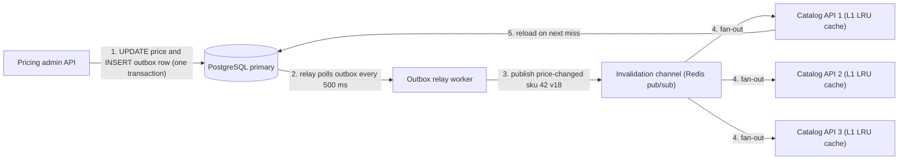
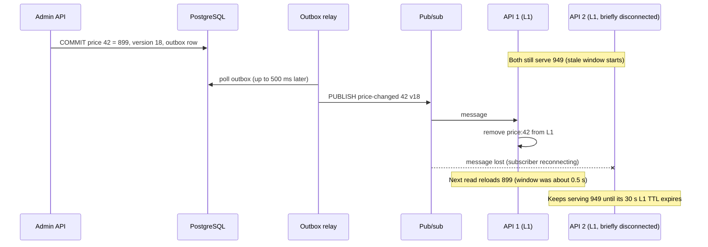
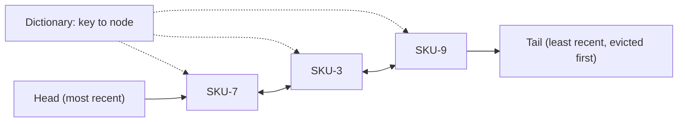

Phil Karlton's well-known joke says there are only two hard things in computer science: cache invalidation and naming things. The joke lands because invalidation looks trivial ("just delete the key") until you have five servers, a read replica, a message bus and a deploy all happening at once. This lesson gives you the tools to make it boring.

## Learning objectives

By the end of this lesson you will be able to:

1. Name the three ways an entry leaves a cache — expiry, invalidation and eviction — and say which problem each one solves.
2. Choose a TTL from a staleness budget and a change rate, and explain absolute versus sliding expiry.
3. Use versioned keys to invalidate one entity or a whole namespace without scanning keys.
4. Design event-based invalidation for multiple app instances and calculate the worst-case stale window.
5. Explain LRU, LFU and FIFO eviction, implement an O(1) LRU cache in C#, and pick a Redis `maxmemory-policy`.
6. Spot the classic traps: re-caching from a lagging replica, lost invalidation messages and TTL-less keys.

## Prerequisites

- [Why caching works](#/lesson/m12-why-caching): hit ratio and hot sets.
- [Cache-aside, read-through, write-through and write-behind](#/lesson/m12-cache-patterns): where invalidation happens in each pattern.

## Explain it like I'm a beginner

Think about the fridge at home.

- **Expiry (TTL).** A milk packet has a "use by" date printed on it. You throw it away on that date whether or not it has gone bad. Nobody needs to tell you; the date decides. That is a **time to live** (TTL).
- **Invalidation.** Your mother calls: "the paneer I bought yesterday is from a bad batch, throw it out". Something outside the fridge changed, and someone told you. That is **invalidation**: removing an entry because the source of truth changed.
- **Eviction.** The fridge is full and you need space for a watermelon. You take out what you have not touched for the longest time, the jar of pickle at the back. That is **eviction**, and "least recently used" is the rule you just followed (LRU).

A good kitchen uses all three. Dates catch things nobody remembered to throw out. Phone calls catch urgent changes. The space rule keeps the fridge from overflowing. Caches work the same way.

## First-principles explanation

### Three exits, three different jobs

| Exit | Trigger | Protects against | Typical tool |
|---|---|---|---|
| **Expiry (TTL)** | Time passes | Forgotten or failed invalidation; slow drift | `EX` in Redis, `AbsoluteExpiration` in .NET |
| **Invalidation** | Source data changes | Users seeing old data after a known change | `DEL`, tags, versioned keys, change events |
| **Eviction** | Memory is full | Running out of memory | LRU / LFU / FIFO policy |

A healthy cache uses invalidation for freshness, TTL as the safety net when invalidation fails, and eviction for memory. Relying on only one is the root of most caching incidents.

### TTL: choosing a number

A TTL is a promise: **"this value may be up to N seconds old."** Choose N from two inputs.

**1. The staleness budget (how old is acceptable?).** Ask the business, not the database. Examples:

| Data | Acceptable staleness | Reasonable TTL |
|---|---|---|
| List of states and union territories | Days | 24 h |
| Restaurant menu text | Minutes | 10 min |
| Product price shown on a listing | About a minute (checkout re-reads it) | 60 s |
| Seat availability shown on a map | A few seconds | 5 s |
| Wallet balance used for a payment | Zero | Do not cache |

**2. The cost of a miss.** Each key misses at most once per TTL. So for K distinct hot keys, expiry causes at most **K ÷ TTL misses per second**. With 20,000 hot products and a 60-second TTL, that is up to 333 misses per second; with a 10-second TTL, up to 2,000. Shorter TTL means fresher data *and* more database load. If the arithmetic says the TTL you need is too expensive, you need invalidation, not a shorter TTL.

**Absolute versus sliding expiry.**

- **Absolute:** the entry dies N seconds after it was written. Predictable staleness bound. The right default for data that has a source of truth.
- **Sliding:** the entry dies N seconds after it was last *read*. A popular entry can live forever. Good for sessions or per-user working data ("keep it while they are active"), dangerous for data that can change: a hot product with a 5-minute sliding TTL that is read every second never refreshes. If you use sliding expiry, **always add an absolute cap** (`IMemoryCache` supports both on one entry).

**TTL jitter.** If 50,000 entries are all written at deploy time with a 600-second TTL, they all expire in the same second ten minutes later. Add a random ±10 % (540–660 s) so expiries spread out. [Cache failures](#/lesson/m12-cache-failures) covers this "avalanche" in detail.

**How Redis expires keys.** Redis removes an expired key when a client touches it (lazy expiry) and also samples keys with expiry in the background and deletes the expired ones (active expiry). An expired key is never *returned*, but it may occupy memory briefly. In-process `IMemoryCache` also expires lazily on access and scans for expired entries periodically.

### Invalidation: telling the cache that the truth changed

**Direct delete.** The write path deletes the key after committing (cache-aside). Simple and immediate, but only works if the writer knows every key that depends on the row. A product row might feed `product:42`, `category:shoes:page:1`, `search:"running shoes"` and `home:trending`. The writer usually does not know all of them.

**Tags.** Attach tags to entries (`HybridCache` supports `tags:` on `GetOrCreateAsync` and `RemoveByTagAsync`). Removing tag `product:42` removes every entry that declared it. Good when dependencies are known at *read* time, which they usually are.

**Versioned keys.** Put a version number into the key itself, and change the version instead of deleting:

- **Entity version:** `product:42:v17`. When product 42 changes, its row's version becomes 18; readers that know the new version build `product:42:v18`, which misses and loads fresh data. The old `v17` entry is never read again and leaves via TTL or eviction. Requires readers to know the current version — for example, it is embedded in a parent object or read from a cheap version store.
- **Namespace version:** keep one counter per group, e.g. `ver:catalog = 5`, and build keys as `catalog:v5:product:42`. Incrementing the counter to 6 invalidates *every* catalogue key at once, without `SCAN`ning or deleting millions of keys. Cost: one extra (cheap, cacheable) lookup of the counter per request, and a burst of misses after each bump.
- **Schema version:** a `v1` segment you bump on deploy when the cached object's shape changes, so new code never tries to deserialise old bytes.

Versioned keys also solve the cache-aside race from the previous lesson: a slow reader that re-inserts old data writes it under the *old* version key, which no one reads any more.

**Event-based invalidation.** The writer publishes "product 42 changed" as an event, and every cache that might hold product 42 removes its copy. This is the only approach that works when:

- several app instances each keep an in-process (L1) cache, or
- the service that writes the data is not the service that caches it.

How the event is produced matters:

- **Publish after commit from the app.** Simple, but if the process crashes between commit and publish, the event is lost. Bounded by TTL.
- **Transactional outbox.** Write the event to an outbox table in the same database transaction, and let a relay publish it ([outbox](#/lesson/m12-outbox)). No lost events; adds the relay's polling delay.
- **Change data capture.** Read the database's change log (PostgreSQL logical replication) and turn row changes into invalidation events ([CDC](#/lesson/m16-cdc)). Catches writes from *any* source, including manual SQL fixes.

The transport is typically Redis pub/sub, a message broker topic, or a stream. **Redis pub/sub is fire-and-forget**: a subscriber that is disconnected for two seconds misses those messages forever. That is acceptable for L1 invalidation only because a short L1 TTL bounds the damage.

### The stale window: calculate it, do not guess

The **stale window** is how long a user can see old data after a change commits. For event-based invalidation of an L1 cache, with estimated numbers:

- Outbox relay polling interval: up to 500 ms.
- Bus delivery: about 5 ms.
- Listener processing: about 1 ms.
- **Normal worst case ≈ 0.5 s.**
- If the event is lost: the stale window becomes the **L1 TTL** (say 30 s).
- If the data is also in Redis (L2) with a 10-minute TTL and the L2 delete is lost: **up to 10 minutes.**

So the real promise is: "usually under a second, at most 30 seconds for L1, at most 10 minutes if the L2 invalidation also fails". Write that down in the design doc. If 10 minutes is unacceptable, shorten the L2 TTL or make L2 invalidation durable.

**The replica trap.** After an invalidation, the next reader reloads. If it reads from a **read replica** that lags 2 seconds behind the primary, it loads the *old* row and caches it again for the full TTL. Now the stale window is the TTL, despite perfect invalidation. Fixes: reload from the primary after an invalidation; carry the new version in the event and refuse to cache a row whose version is lower; or delay the delete by more than the replica lag.

### Eviction: what to throw out when memory is full

When the cache reaches its memory limit, something must go. The **eviction policy** chooses the victim.

- **LRU (least recently used).** Evict the entry not read for the longest time. Great for temporal locality — recently used things are used again. Weakness: **scan pollution**. A batch job that reads 1 million cold items once pushes the whole hot set out.
- **LFU (least frequently used).** Evict the entry with the fewest reads. Resists one-off scans and protects stable favourites. Weakness: slow to adapt; yesterday's viral item keeps a high count. Practical LFUs **decay** counts over time.
- **FIFO (first in, first out).** Evict the oldest *inserted* entry, regardless of use. Very cheap, ignores popularity; often worse hit ratio than LRU.
- **Random.** Surprisingly decent and cheap; no bookkeeping.
- **TTL-based (volatile-ttl).** Evict the entry closest to expiring.

Modern libraries blend these. For example, the W-TinyLFU policy used by Java's Caffeine library keeps a small LRU "window" for new items and admits them to the main area only if their estimated frequency beats the victim's.

**Redis `maxmemory-policy`.** Redis applies a policy when it reaches `maxmemory`:

| Policy | Evicts | Use when |
|---|---|---|
| `noeviction` | Nothing; writes return errors | Redis is a primary store, not a cache |
| `allkeys-lru` | Any key, approximately LRU | Pure cache, recency matters (common default for caches) |
| `allkeys-lfu` | Any key, approximately LFU | Pure cache with stable popular keys |
| `volatile-lru` / `volatile-lfu` | Only keys with a TTL | Mixed: cache keys have TTLs, important keys do not |
| `allkeys-random` / `volatile-random` | Random | Uniform access |
| `volatile-ttl` | Keys with the shortest remaining TTL | You encode priority in TTLs |

Redis's LRU and LFU are **approximations**: it samples a few keys (`maxmemory-samples`, default 5) and evicts the best candidate among them, rather than keeping a perfect global order. Its LFU uses a small logarithmic counter that decays over time. Note the trap with `volatile-*` policies: if no keys have TTLs, nothing is evictable, and writes fail just as with `noeviction`.

**`IMemoryCache` eviction.** It evicts only when you set `SizeLimit` (and give each entry a `Size`). When over the limit, it compacts: expired entries first, then by `CacheItemPriority` (low before normal before high), and least recently used within those. Entries with `Priority = NeverRemove` are never evicted by compaction.

**Watch the eviction rate.** A high eviction rate with a low hit ratio means the hot set does not fit: add memory or cache smaller objects. A cache that never evicts is probably oversized.

### Implementing LRU in O(1)

An LRU cache needs two operations to be fast: *find by key* and *move to most recent / remove least recent*. One data structure cannot do both, so combine two:

- A **hash map** from key to a node: O(1) lookup.
- A **doubly linked list** of nodes in recency order, most recent at the head: O(1) move-to-front and remove-from-tail, because each node knows its neighbours.

On a read hit, unlink the node and put it at the head. On insert when full, remove the tail node and its map entry. Both are a handful of pointer changes, whatever the cache size. The production code below builds this, with TTL support, in about 100 lines.

### When a simpler design is enough

- **One instance, small data:** `IMemoryCache` with an absolute TTL. No events, no versions.
- **Several instances, staleness of 30–60 s acceptable:** short L1 TTLs and no invalidation bus at all. Many systems never need more.
- **Need instant consistency on a small set of keys:** do not cache them, or use a single shared cache (Redis) with delete-on-write and no L1.

## Visual explanation

### Architecture: event-based invalidation across instances



An admin changes a price. In one database transaction, the admin API updates the price row and inserts an outbox row (arrow 1), so the change and its event cannot be separated. The relay worker polls the outbox (arrow 2) and publishes an invalidation message carrying the SKU and its new version (arrow 3). The channel fans the message out to every catalogue instance (arrows 4), and each one removes SKU 42 from its in-process LRU cache. The next request for SKU 42 on any instance misses and reloads from the primary (arrow 5) — from the primary, not a replica, to avoid the replica trap.

### Sequence: the stale window, and what happens when a message is lost



The commit starts the stale window: until invalidation arrives, every instance serves the old price of ₹949. The relay picks up the outbox row within its polling interval and publishes. API 1 receives the message and removes its copy, so its stale window was about half a second. API 2 was reconnecting and the fire-and-forget message is lost. Its window is now bounded only by its L1 TTL. This diagram is the whole argument for **always keeping a TTL, even with perfect invalidation**.

### Structure: the O(1) LRU cache



The dictionary gives instant access to any node (dotted arrows). The doubly linked list keeps the recency order: reading SKU-3 unlinks it and moves it to the head; inserting a new key into a full cache removes SKU-9 from the tail and deletes its dictionary entry. Neither operation depends on how many entries the cache holds.

## Step-by-step example

**Scenario.** A national highway authority's public portal shows the toll rate for each of 1,100 toll plazas, by vehicle class (7 classes). Rates are revised on 1 April each year and occasionally mid-year for a few plazas. The portal runs 6 API instances behind a load balancer and gets up to 3,000 RPS during holiday travel. Mobile apps and trip planners call it constantly.

### Step 1 — Size the data

1,100 plazas × 7 classes = 7,700 rates. As one object per plaza (all classes, about 600 bytes), that is 1,100 × 0.6 KB ≈ 660 KB. It fits in every instance's memory with ease.

### Step 2 — Staleness budget

Ask the business. Answer: "When a rate changes at midnight, the portal must show it within a minute. Trip planners can live with a minute." So the budget is **60 seconds**.

### Step 3 — Try TTL alone

L1 cache per instance, absolute TTL 60 s. Expiry misses: at most 1,100 keys ÷ 60 s ≈ 18 misses per second per instance, × 6 instances ≈ 110 database reads per second. Easily affordable. Staleness: at most 60 s. **The budget is met with TTL alone.** No events, no versions. Add ±10 % jitter so the 1,100 entries do not expire together.

### Step 4 — The 1 April problem

On 1 April at 00:00, every rate changes in one batch update. With TTL alone, the portal shows a mix of old and new rates for up to 66 seconds (60 s + jitter). The authority wants the switch to be clean.

Use a **namespace version**: the batch update increments `ver:toll-rates` in the same job. Keys are `toll:v{n}:plaza:{id}`. Each instance re-reads the version every 5 seconds (cached locally). Within 5 seconds of the bump, every instance builds new keys and loads new rates. Old entries are simply never read again and fall out by TTL or eviction.

### Step 5 — Eviction

The full data set fits, so eviction should never run. Set `SizeLimit` anyway (say 5,000 entries) as a guard against a key bug, and alert if evictions are non-zero.

### Step 6 — Write down the promise

"Normal staleness ≤ 66 s. After an annual revision, ≤ 5 s after the version bump. If the version store is unreachable, instances keep the last known version and fall back to TTL staleness."

## Production-style C# implementation

A catalogue service with an in-process LRU (L1) cache, jittered TTLs, namespace-versioned keys and event-based invalidation from a bus. In-memory fakes stand in for PostgreSQL, the version store (Redis `INCR` in production) and the pub/sub channel.

```text
Catalog.Api/
  Program.cs
  Caching/LruCache.cs
  Caching/TtlPolicy.cs
  Caching/KeyVersions.cs
  Invalidation/InvalidationBus.cs
  Invalidation/L1InvalidationListener.cs
  Pricing/PriceModels.cs
  Pricing/PriceService.cs
```

### The LRU cache with TTL

```csharp file=Caching/LruCache.cs
using System.Diagnostics.CodeAnalysis;

namespace Catalog.Caching;

/// <summary>Thread-safe LRU cache with per-entry absolute expiry.
/// Get, Set and Remove are O(1): a dictionary finds the node, a linked list keeps recency order.</summary>
public sealed class LruCache<TKey, TValue> where TKey : notnull
{
    private sealed class Entry(TKey key, TValue value, DateTimeOffset expiresAt)
    {
        public TKey Key { get; } = key;
        public TValue Value { get; set; } = value;
        public DateTimeOffset ExpiresAt { get; set; } = expiresAt;
    }

    private readonly Dictionary<TKey, LinkedListNode<Entry>> _map;
    private readonly LinkedList<Entry> _order = new();   // First = most recently used
    private readonly Lock _lock = new();
    private readonly TimeProvider _clock;
    private long _hits, _misses, _evictions;

    public LruCache(int capacity, TimeProvider clock)
    {
        ArgumentOutOfRangeException.ThrowIfNegativeOrZero(capacity);
        Capacity = capacity;
        _clock = clock;
        _map = new Dictionary<TKey, LinkedListNode<Entry>>(capacity);
    }

    public int Capacity { get; }
    public int Count { get { lock (_lock) return _map.Count; } }
    public long Hits => Interlocked.Read(ref _hits);
    public long Misses => Interlocked.Read(ref _misses);
    public long Evictions => Interlocked.Read(ref _evictions);

    public bool TryGet(TKey key, [MaybeNullWhen(false)] out TValue value)
    {
        lock (_lock)
        {
            if (_map.TryGetValue(key, out var node))
            {
                if (node.Value.ExpiresAt > _clock.GetUtcNow())
                {
                    _order.Remove(node);        // O(1): the node knows its neighbours
                    _order.AddFirst(node);
                    Interlocked.Increment(ref _hits);
                    value = node.Value.Value;
                    return true;
                }
                RemoveNode(node);               // lazy expiry, like Redis
            }
        }
        Interlocked.Increment(ref _misses);
        value = default;
        return false;
    }

    public void Set(TKey key, TValue value, TimeSpan ttl)
    {
        var expiresAt = _clock.GetUtcNow() + ttl;
        lock (_lock)
        {
            if (_map.TryGetValue(key, out var existing))
            {
                existing.Value.Value = value;
                existing.Value.ExpiresAt = expiresAt;
                _order.Remove(existing);
                _order.AddFirst(existing);
                return;
            }
            if (_map.Count >= Capacity)
            {
                var victim = _order.Last!;      // least recently used
                RemoveNode(victim);
                Interlocked.Increment(ref _evictions);
            }
            _map[key] = _order.AddFirst(new Entry(key, value, expiresAt));
        }
    }

    public bool Remove(TKey key)
    {
        lock (_lock)
        {
            if (!_map.TryGetValue(key, out var node)) return false;
            RemoveNode(node);
            return true;
        }
    }

    /// <summary>Keys from most to least recently used. For diagnostics and tests.</summary>
    public IReadOnlyList<TKey> KeysByRecency()
    {
        lock (_lock) return _order.Select(e => e.Key).ToList();
    }

    private void RemoveNode(LinkedListNode<Entry> node)
    {
        _order.Remove(node);
        _map.Remove(node.Value.Key);
    }
}
```

### TTL with jitter

```csharp file=Caching/TtlPolicy.cs
namespace Catalog.Caching;

public static class TtlPolicy
{
    /// <summary>Returns ttl ± (fraction × ttl), uniformly, so entries written together expire apart.</summary>
    public static TimeSpan WithJitter(TimeSpan ttl, double fraction, Random random)
    {
        if (ttl <= TimeSpan.Zero) throw new ArgumentOutOfRangeException(nameof(ttl));
        if (fraction is < 0 or >= 1) throw new ArgumentOutOfRangeException(nameof(fraction));
        var factor = 1 + (random.NextDouble() * 2 - 1) * fraction;
        return TimeSpan.FromMilliseconds(ttl.TotalMilliseconds * factor);
    }

    /// <summary>Upper bound on expiry-driven misses per second: hot keys ÷ TTL.</summary>
    public static double MaxExpiryMissesPerSecond(int hotKeys, TimeSpan ttl) => hotKeys / ttl.TotalSeconds;
}
```

### Namespace-versioned keys

```csharp file=Caching/KeyVersions.cs
using System.Collections.Concurrent;

namespace Catalog.Caching;

/// <summary>Where namespace versions live. In production: Redis INCR / GET on "ver:{namespace}".</summary>
public interface IKeyVersionStore
{
    Task<long> GetAsync(string ns, CancellationToken ct);
    Task<long> IncrementAsync(string ns, CancellationToken ct);
}

public sealed class InMemoryKeyVersionStore : IKeyVersionStore
{
    private readonly ConcurrentDictionary<string, long> _versions = new();

    public Task<long> GetAsync(string ns, CancellationToken ct) => Task.FromResult(_versions.GetOrAdd(ns, 1));

    public Task<long> IncrementAsync(string ns, CancellationToken ct) =>
        Task.FromResult(_versions.AddOrUpdate(ns, 2, (_, v) => v + 1));
}

/// <summary>Builds keys like "price:v3:SKU-42". Bumping the namespace version invalidates every key in it.
/// The version is cached locally for a few seconds, which adds that long to the stale window after a bump.</summary>
public sealed class VersionedKeys(IKeyVersionStore store, TimeProvider clock)
{
    public static readonly TimeSpan VersionCacheTime = TimeSpan.FromSeconds(5);
    private readonly ConcurrentDictionary<string, (long Version, DateTimeOffset ReadAt)> _local = new();

    public async Task<string> KeyAsync(string ns, string id, CancellationToken ct)
    {
        var now = clock.GetUtcNow();
        if (!_local.TryGetValue(ns, out var cached) || now - cached.ReadAt >= VersionCacheTime)
        {
            try
            {
                cached = (await store.GetAsync(ns, ct), now);
                _local[ns] = cached;
            }
            catch (Exception) when (_local.ContainsKey(ns))
            {
                // Version store unreachable: keep using the last known version (TTL still bounds staleness).
                cached = _local[ns];
            }
        }
        return $"{ns}:v{cached.Version}:{id}";
    }

    public async Task BumpAsync(string ns, CancellationToken ct)
    {
        var v = await store.IncrementAsync(ns, ct);
        _local[ns] = (v, clock.GetUtcNow());
    }
}
```

### The invalidation bus and listener

```csharp file=Invalidation/InvalidationBus.cs
using System.Threading.Channels;

namespace Catalog.Invalidation;

public sealed record CacheInvalidation(string Namespace, string Id, long Version);

/// <summary>Production: Redis pub/sub or a broker topic, fanned out to every instance.</summary>
public interface IInvalidationBus
{
    ValueTask PublishAsync(CacheInvalidation message, CancellationToken ct);
    IAsyncEnumerable<CacheInvalidation> SubscribeAsync(CancellationToken ct);
}

/// <summary>Single-process stand-in. Like Redis pub/sub it keeps nothing durable;
/// unlike it, it has exactly one subscriber.</summary>
public sealed class InMemoryInvalidationBus : IInvalidationBus
{
    private readonly Channel<CacheInvalidation> _channel =
        Channel.CreateBounded<CacheInvalidation>(new BoundedChannelOptions(10_000) { FullMode = BoundedChannelFullMode.DropOldest });

    public ValueTask PublishAsync(CacheInvalidation message, CancellationToken ct) => _channel.Writer.WriteAsync(message, ct);

    public IAsyncEnumerable<CacheInvalidation> SubscribeAsync(CancellationToken ct) => _channel.Reader.ReadAllAsync(ct);
}
```

```csharp file=Invalidation/L1InvalidationListener.cs
using Catalog.Caching;
using Catalog.Pricing;
using Microsoft.Extensions.Hosting;
using Microsoft.Extensions.Logging;

namespace Catalog.Invalidation;

/// <summary>Runs in every instance and removes changed entries from that instance's L1 cache.</summary>
public sealed class L1InvalidationListener(
    IInvalidationBus bus,
    LruCache<string, CachedQuote> l1,
    ILogger<L1InvalidationListener> logger) : BackgroundService
{
    protected override async Task ExecuteAsync(CancellationToken stoppingToken)
    {
        try
        {
            await foreach (var message in bus.SubscribeAsync(stoppingToken))
            {
                // L1 is keyed by SKU, so one Remove drops the entry whatever namespace version it carries.
                var removed = l1.Remove(PriceService.EntityKey(message.Id));
                logger.LogDebug("Invalidated {Ns}/{Id} v{Version}, removed={Removed}",
                    message.Namespace, message.Id, message.Version, removed);
            }
        }
        catch (OperationCanceledException)
        {
            // Shutting down.
        }
    }
}
```

### The price service

```csharp file=Pricing/PriceModels.cs
using System.Collections.Concurrent;

namespace Catalog.Pricing;

public sealed record PriceQuote(string Sku, decimal PriceInr, long Version);

/// <summary>What the L1 cache stores: the quote plus the versioned key it was cached under.
/// A namespace bump changes the expected key, so old entries stop matching without being deleted.</summary>
public sealed record CachedQuote(string Key, PriceQuote Quote);

public interface IPriceRepository
{
    /// <summary>Must read from the primary: reloading from a lagging replica re-caches old data.</summary>
    Task<PriceQuote?> GetFromPrimaryAsync(string sku, CancellationToken ct);
    /// <summary>Saves the price, increments its version and (in production) writes an outbox row in the same transaction.</summary>
    Task<PriceQuote> SaveAsync(string sku, decimal priceInr, CancellationToken ct);
}

public sealed class InMemoryPriceRepository : IPriceRepository
{
    private readonly ConcurrentDictionary<string, PriceQuote> _rows = new(StringComparer.OrdinalIgnoreCase);
    private long _reads;

    public InMemoryPriceRepository()
    {
        for (var i = 1; i <= 1_000; i++) _rows[$"SKU-{i}"] = new PriceQuote($"SKU-{i}", 199m + i, 1);
    }

    public long Reads => Interlocked.Read(ref _reads);

    public Task<PriceQuote?> GetFromPrimaryAsync(string sku, CancellationToken ct)
    {
        Interlocked.Increment(ref _reads);
        return Task.FromResult(_rows.GetValueOrDefault(sku));
    }

    public Task<PriceQuote> SaveAsync(string sku, decimal priceInr, CancellationToken ct)
    {
        var saved = _rows.AddOrUpdate(sku,
            k => new PriceQuote(k, priceInr, 1),
            (_, old) => old with { PriceInr = priceInr, Version = old.Version + 1 });
        return Task.FromResult(saved);
    }
}
```

```csharp file=Pricing/PriceService.cs
using Catalog.Caching;
using Catalog.Invalidation;

namespace Catalog.Pricing;

public sealed class PriceService(
    IPriceRepository repository,
    LruCache<string, CachedQuote> l1,
    VersionedKeys keys,
    IInvalidationBus bus)
{
    public const string Namespace = "price";
    public static readonly TimeSpan L1Ttl = TimeSpan.FromSeconds(30);

    // L1 entries are keyed by SKU; each stores the versioned key it was cached under,
    // so a namespace bump makes old entries miss without deleting them.
    public static string EntityKey(string sku) => sku.Trim().ToUpperInvariant();

    public async Task<PriceQuote?> GetAsync(string sku, CancellationToken ct)
    {
        var versionedKey = await keys.KeyAsync(Namespace, EntityKey(sku), ct);
        if (l1.TryGet(EntityKey(sku), out var cached) && cached.Key == versionedKey) return cached.Quote;

        var quote = await repository.GetFromPrimaryAsync(EntityKey(sku), ct);
        if (quote is not null)
            l1.Set(EntityKey(sku), new CachedQuote(versionedKey, quote), TtlPolicy.WithJitter(L1Ttl, 0.1, Random.Shared));
        return quote;
    }

    public async Task<PriceQuote> UpdateAsync(string sku, decimal priceInr, CancellationToken ct)
    {
        var saved = await repository.SaveAsync(EntityKey(sku), priceInr, ct);   // commit first
        l1.Remove(EntityKey(sku));                                               // this instance: immediately
        await bus.PublishAsync(new CacheInvalidation(Namespace, saved.Sku, saved.Version), ct);  // all instances
        return saved;
    }

    /// <summary>Annual revision: one counter bump makes every price key unreachable.</summary>
    public Task InvalidateAllAsync(CancellationToken ct) => keys.BumpAsync(Namespace, ct);
}
```

### Wiring it up

```csharp file=Program.cs
using Catalog.Caching;
using Catalog.Invalidation;
using Catalog.Pricing;

var builder = WebApplication.CreateBuilder(args);

builder.Services.AddSingleton(TimeProvider.System);
builder.Services.AddSingleton(sp => new LruCache<string, CachedQuote>(capacity: 5_000, sp.GetRequiredService<TimeProvider>()));
builder.Services.AddSingleton<IKeyVersionStore, InMemoryKeyVersionStore>();
builder.Services.AddSingleton<VersionedKeys>();
builder.Services.AddSingleton<IInvalidationBus, InMemoryInvalidationBus>();
builder.Services.AddSingleton<IPriceRepository, InMemoryPriceRepository>();
builder.Services.AddSingleton<PriceService>();
builder.Services.AddHostedService<L1InvalidationListener>();

var app = builder.Build();

app.MapGet("/prices/{sku}", async (string sku, PriceService prices, CancellationToken ct) =>
    await prices.GetAsync(sku, ct) is { } q ? Results.Ok(q) : Results.NotFound());

app.MapPut("/prices/{sku}", async (string sku, decimal priceInr, PriceService prices, CancellationToken ct) =>
    Results.Ok(await prices.UpdateAsync(sku, priceInr, ct)));

app.MapPost("/prices/invalidate-all", async (PriceService prices, CancellationToken ct) =>
{
    await prices.InvalidateAllAsync(ct);
    return Results.Accepted();
});

app.MapGet("/debug/l1", (LruCache<string, CachedQuote> l1) =>
    Results.Ok(new { l1.Count, l1.Capacity, l1.Hits, l1.Misses, l1.Evictions }));

app.Run();
```

Design notes:

- **Three exits, all present.** Events invalidate one SKU; a namespace bump invalidates all of them; TTL (30 s ± 10 %) catches lost events; LRU capacity guards memory.
- **Reload from the primary.** `GetFromPrimaryAsync` is named to make the replica trap impossible to miss in code review.
- **Local removal plus publish.** The writing instance removes its own copy synchronously, so the user who made the change sees it immediately (read-your-writes on that instance).
- **The bus is lossy on purpose.** A bounded channel that drops the oldest message under pressure mirrors Redis pub/sub's guarantees. Correctness never depends on the message arriving; only freshness does.

## Bad design vs good design

**Bad: no TTL, invalidation by pattern scan, reload from a replica.**

```csharp
// Anti-example.
public async Task OnProductChangedAsync(int productId)
{
    // KEYS blocks Redis while it walks every key: at 5 million keys this can stall all clients.
    foreach (var key in _redis.Keys(pattern: $"*product:{productId}*"))
        await _db.KeyDeleteAsync(key);
}

public async Task<Product> GetAsync(int id)
{
    var json = await _db.StringGetAsync($"product:{id}");
    if (json.HasValue) return Deserialize(json!);
    var p = await _replica.QuerySingleAsync<Product>(Sql, new { id });   // may lag by seconds
    await _db.StringSetAsync($"product:{id}", Serialize(p));               // no expiry
    return p;
}
```

What goes wrong:

- **Pattern scans** (`KEYS`, or even `SCAN` across millions of keys) are slow, and `KEYS` blocks Redis's single command thread. Invalidation becomes an outage.
- **No TTL**: a missed invalidation means stale data forever.
- **Replica reload**: right after the invalidation, the reload can read the pre-update row from a lagging replica and cache it — forever, given the missing TTL.

**Good:** the `PriceService` above. Invalidation targets exact keys (or bumps a namespace version instead of scanning); every entry has a jittered TTL; reloads read the primary; and correctness never depends on an invalidation message arriving.

:::callout type=mistake title="Sliding expiry on data with a source of truth"
A team caches product prices with a 10-minute *sliding* TTL. The best-selling phone is read every second, so its entry never expires — and the event-based invalidation was silently failing for a week. Customers saw the pre-sale price until someone restarted the pods. Use absolute expiry for anything that can change at the source, and add an absolute cap if you need sliding behaviour.
:::

## Practical playground

The cache simulator below starts with a high cacheable hit ratio (95 %) but a short 5-second TTL across 2,000 hot keys.

1. Note the *effective* hit rate: it is well below 95 % because each hot key expires and misses every 5 seconds. Check it against the formula: expiry misses ≤ hot keys ÷ TTL = 2,000 ÷ 5 = 400 per second.
2. Raise the TTL to 60 s. Expiry misses fall to at most about 33 per second. What did you trade away?
3. Now suppose the business needs prices fresh within 5 seconds. Instead of a 5-second TTL, what invalidation design from this lesson would let you keep a 60-second TTL?
4. Turn on the cache outage. Even a perfect invalidation design does not help when the cache is gone — that is the next two lessons.

:::playground type=sim sim=cache title="TTL versus effective hit rate" hitRatio=0.95 ttlSeconds=5 hotKeys=2000 rps=1000 dbCapacityRps=600 dbLatencyMs=40 cacheLatencyMs=2
Move the TTL slider and watch how the effective hit rate and database load respond.
:::

## Exercises

:::exercise id=m12-invalidation-ttl-ex1 difficulty=beginner kind=code title="Absolute and sliding expiry"
Implement `ExpiringEntry<T>`, a cache entry that supports an absolute TTL, a sliding TTL, both, or neither — the same rules `IMemoryCache` uses.
::requirements
- Absolute deadline = creation time + absolute TTL.
- Sliding deadline = last successful read + sliding TTL (the creation time counts as the first access).
- With both, the entry expires at the **earlier** deadline. With neither, it never expires.
- An entry is expired when `now >= deadline`.
- `TryRead(now, out value)` returns `false` for an expired entry and does **not** extend it; otherwise it extends the sliding window and returns the value.
- A TTL that is zero or negative throws `ArgumentOutOfRangeException`.
::acceptance
- Absolute 60 s: alive at 59 s, expired at 60 s.
- Sliding 30 s with reads every 20 s stays alive; it expires 30 s after the last read.
- Sliding 30 s with absolute 120 s expires at 120 s even if read at 100 s.
- No TTLs: `ExpiresAt` is `null` and the entry never expires.
::hint
Keep three pieces of state: the fixed absolute deadline (or `null`), the sliding TTL (or `null`), and the last access time.
::hint
`ExpiresAt` is computed, not stored: the minimum of the deadlines that exist.
::hint
`IsExpired(now)` is `ExpiresAt is { } d && now >= d`. `TryRead` checks it first and only then updates the last access time.
::hint
```csharp
DateTimeOffset? sliding = _sliding is { } s ? _lastAccess + s : null;
if (_absolute is { } a && sliding is { } b) return a < b ? a : b;
return _absolute ?? sliding;
```
::starter
```csharp file=ExpiringEntry.cs
using System;

public sealed class ExpiringEntry<T>
{
    public ExpiringEntry(T value, DateTimeOffset createdAt, TimeSpan? absoluteTtl, TimeSpan? slidingTtl)
        => throw new NotImplementedException();

    public T Value => throw new NotImplementedException();

    /// <summary>The current effective deadline, or null if the entry never expires.</summary>
    public DateTimeOffset? ExpiresAt => throw new NotImplementedException();

    public bool IsExpired(DateTimeOffset now) => throw new NotImplementedException();

    public bool TryRead(DateTimeOffset now, out T value) => throw new NotImplementedException();
}
```
::tests
```csharp file=ExpiringEntryTests.cs
using System;
using Xunit;

public class ExpiringEntryTests
{
    private static readonly DateTimeOffset T0 = new(2026, 4, 1, 0, 0, 0, TimeSpan.FromHours(5.5));
    private static DateTimeOffset At(int seconds) => T0.AddSeconds(seconds);

    [Fact]
    public void Absolute_expires_exactly_at_deadline()
    {
        var e = new ExpiringEntry<string>("rate", T0, TimeSpan.FromSeconds(60), null);
        Assert.False(e.IsExpired(At(59)));
        Assert.True(e.IsExpired(At(60)));
        Assert.Equal(At(60), e.ExpiresAt);
    }

    [Fact]
    public void Sliding_is_extended_by_reads()
    {
        var e = new ExpiringEntry<int>(7, T0, null, TimeSpan.FromSeconds(30));
        Assert.True(e.TryRead(At(20), out _));
        Assert.True(e.TryRead(At(40), out _));
        Assert.True(e.TryRead(At(60), out var v));
        Assert.Equal(7, v);
        Assert.False(e.IsExpired(At(89)));
        Assert.True(e.IsExpired(At(90)));
        Assert.False(e.TryRead(At(95), out _));
    }

    [Fact]
    public void Absolute_cap_wins_over_sliding()
    {
        var e = new ExpiringEntry<int>(1, T0, TimeSpan.FromSeconds(120), TimeSpan.FromSeconds(30));
        for (var t = 20; t <= 100; t += 20) Assert.True(e.TryRead(At(t), out _));
        Assert.Equal(At(120), e.ExpiresAt);
        Assert.False(e.TryRead(At(120), out _));
    }

    [Fact]
    public void Expired_read_does_not_revive()
    {
        var e = new ExpiringEntry<int>(1, T0, null, TimeSpan.FromSeconds(30));
        Assert.False(e.TryRead(At(31), out _));
        Assert.False(e.TryRead(At(32), out _));
        Assert.True(e.IsExpired(At(32)));
    }

    [Fact]
    public void No_ttl_never_expires()
    {
        var e = new ExpiringEntry<int>(1, T0, null, null);
        Assert.Null(e.ExpiresAt);
        Assert.False(e.IsExpired(T0.AddDays(3650)));
    }

    [Fact]
    public void Zero_ttl_throws() =>
        Assert.Throws<ArgumentOutOfRangeException>(() => new ExpiringEntry<int>(1, T0, TimeSpan.Zero, null));
}
```
::solution
The effective deadline is the earlier of the two deadlines that exist; reads move only the sliding one.

```csharp file=ExpiringEntry.cs
using System;

public sealed class ExpiringEntry<T>
{
    private readonly DateTimeOffset? _absoluteDeadline;
    private readonly TimeSpan? _sliding;
    private DateTimeOffset _lastAccess;

    public ExpiringEntry(T value, DateTimeOffset createdAt, TimeSpan? absoluteTtl, TimeSpan? slidingTtl)
    {
        if (absoluteTtl is { } a && a <= TimeSpan.Zero) throw new ArgumentOutOfRangeException(nameof(absoluteTtl));
        if (slidingTtl is { } s && s <= TimeSpan.Zero) throw new ArgumentOutOfRangeException(nameof(slidingTtl));
        Value = value;
        _absoluteDeadline = absoluteTtl is { } abs ? createdAt + abs : null;
        _sliding = slidingTtl;
        _lastAccess = createdAt;
    }

    public T Value { get; }

    public DateTimeOffset? ExpiresAt
    {
        get
        {
            DateTimeOffset? slidingDeadline = _sliding is { } s ? _lastAccess + s : null;
            if (_absoluteDeadline is { } a && slidingDeadline is { } b) return a < b ? a : b;
            return _absoluteDeadline ?? slidingDeadline;
        }
    }

    public bool IsExpired(DateTimeOffset now) => ExpiresAt is { } d && now >= d;

    public bool TryRead(DateTimeOffset now, out T value)
    {
        if (IsExpired(now))
        {
            value = default!;
            return false;
        }
        _lastAccess = now;
        value = Value;
        return true;
    }
}
```

This mirrors `MemoryCacheEntryOptions`: `AbsoluteExpirationRelativeToNow` plus `SlidingExpiration`. In real caches the entry is also removed when found expired, as `LruCache.TryGet` does.
::mistakes
- Extending the sliding window on an expired read, which revives dead entries.
- Using `>` instead of `>=`, so an entry is still alive at its exact deadline.
- Forgetting the absolute cap, which lets a hot entry live forever.
::extensions
Add a `Priority` and write a `Compact(entries, targetCount)` function that removes expired entries first, then low-priority ones, then the least recently accessed — the order `MemoryCache` uses.
:::

:::exercise id=m12-invalidation-ttl-ex2 difficulty=beginner kind=written title="TTLs and stale windows"
A metro-rail app runs 4 API instances, each with a 20-second in-process cache in front of Redis (L2), which has a 5-minute TTL. Writes publish an invalidation over Redis pub/sub; the publisher runs right after the database commit (no outbox).

1. A fare is changed. What is the normal stale window, and the worst case if the pub/sub message is lost?
2. The "next train in N minutes" data changes every 30 seconds. Should it share the same TTL design? Propose one.
3. The fare reload after an invalidation reads from a read replica that lags up to 3 seconds. What can happen, and how do you fix it?
4. How many expiry-driven misses per second hit Redis from L1 if there are 600 hot keys?
::acceptance
- Stale windows are given with both normal and worst-case numbers.
- The replica trap is explained with a concrete fix.
- The miss calculation shows the formula keys ÷ TTL and multiplies by instances.
- Item 2 proposes a TTL derived from the 30-second change rate.
::hint
Write the chain of delays: commit → publish → delivery → removal. Then ask what bounds the window when a link breaks.
::hint
Two cache levels means two TTLs. A lost L2 delete is bounded by the L2 TTL.
::hint
Expiry misses per instance ≤ hot keys ÷ TTL.
::solution
1. **Normal:** commit → publish (immediate, same request) → delivery (~ms) → removal: well under a second. **Lost message:** L1 entries survive up to 20 s. If the L2 delete *also* failed (the publisher crashed after commit before doing anything), Redis can serve the old fare for up to **5 minutes**, and L1s refill from it. An outbox would remove the "crash after commit" case.
2. No. Data that changes every 30 s should not sit in a 5-minute L2. Use a short absolute TTL (5–10 s) at both levels and skip invalidation entirely; or have the producer write the new value into Redis (write-through) every 30 s and give L1 a 5 s TTL.
3. The reloader can read the *old* fare from the lagging replica and re-cache it for the full TTL, even though invalidation worked. Fixes: reload from the primary after an invalidation; include the new version in the event and only cache a row whose version is at least that; or delay the delete by more than the maximum replica lag.
4. Per instance: 600 ÷ 20 s = 30 misses/s to Redis. Four instances: **120 per second** at most. Trivial for Redis.
::mistakes
- Quoting only the happy-path stale window.
- Forgetting that L1 caches refill from a stale L2.
- Assuming invalidation alone guarantees freshness when reloads come from replicas.
:::

:::exercise id=m12-invalidation-ttl-ex3 difficulty=intermediate kind=code title="Namespace-versioned keys"
Implement `VersionedCache<TValue>`, which builds keys as `{ns}:v{version}:{id}` from an `IVersionStore`, so a whole namespace can be invalidated by bumping a counter.
::requirements
- `KeyFor(ns, id)` returns `"{ns}:v{version}:{id}"` using the store's current version.
- `GetOrLoad(ns, id, load)` returns the cached value for the current key or calls `load(id)` and caches it.
- `Invalidate(ns, id)` removes only the current-version entry for that id and returns whether it existed.
- `InvalidateNamespace(ns)` bumps the version and returns the new version. It must **not** delete anything.
- `StoredCount` is the number of stored entries; `UnreachableCount` is how many of them belong to an old version (they would leave by TTL or eviction in a real cache).
::acceptance
- The first key for a namespace is `price:v1:SKU-1`.
- After `InvalidateNamespace("price")`, every price reloads and keys contain `v2`; other namespaces are unaffected.
- Old entries remain stored but are counted as unreachable.
- `Invalidate` affects one id only.
::hint
Store entries in a dictionary keyed by the full versioned key. What extra data do you need per entry to compute `UnreachableCount`?
::hint
Keep `(Namespace, Version, Value)` per entry. An entry is unreachable when its version differs from `versions.Get(ns)`.
::hint
`InvalidateNamespace` is one line: `return _versions.Increment(ns);`. The point of the pattern is that it is O(1) whatever the number of keys.
::hint
```csharp
var key = KeyFor(ns, id);
if (_entries.TryGetValue(key, out var e)) return e.Value;
var value = load(id);
_entries[key] = (ns, _versions.Get(ns), value);
return value;
```
::starter
```csharp file=VersionedCache.cs
using System;
using System.Collections.Generic;
using System.Linq;

public interface IVersionStore
{
    long Get(string ns);
    long Increment(string ns);
}

/// <summary>Provided: an in-memory version store where every namespace starts at version 1.</summary>
public sealed class InMemoryVersionStore : IVersionStore
{
    private readonly Dictionary<string, long> _v = new();
    public long Get(string ns) => _v.TryGetValue(ns, out var v) ? v : 1;
    public long Increment(string ns) => _v[ns] = Get(ns) + 1;
}

public sealed class VersionedCache<TValue>
{
    public VersionedCache(IVersionStore versions) => throw new NotImplementedException();

    public int StoredCount => throw new NotImplementedException();
    public int UnreachableCount => throw new NotImplementedException();

    public string KeyFor(string ns, string id) => throw new NotImplementedException();

    public TValue GetOrLoad(string ns, string id, Func<string, TValue> load) => throw new NotImplementedException();

    public bool Invalidate(string ns, string id) => throw new NotImplementedException();

    public long InvalidateNamespace(string ns) => throw new NotImplementedException();
}
```
::tests
```csharp file=VersionedCacheTests.cs
using System;
using Xunit;

public class VersionedCacheTests
{
    [Fact]
    public void First_key_uses_version_one() =>
        Assert.Equal("price:v1:SKU-1", new VersionedCache<int>(new InMemoryVersionStore()).KeyFor("price", "SKU-1"));

    [Fact]
    public void Loads_once_then_hits()
    {
        var loads = 0;
        var c = new VersionedCache<int>(new InMemoryVersionStore());
        c.GetOrLoad("price", "SKU-1", _ => ++loads);
        Assert.Equal(1, c.GetOrLoad("price", "SKU-1", _ => ++loads));
        Assert.Equal(1, loads);
    }

    [Fact]
    public void Namespace_bump_invalidates_all_keys_without_deleting()
    {
        var loads = 0;
        var c = new VersionedCache<int>(new InMemoryVersionStore());
        c.GetOrLoad("price", "SKU-1", _ => ++loads);
        c.GetOrLoad("price", "SKU-2", _ => ++loads);
        Assert.Equal(2L, c.InvalidateNamespace("price"));
        Assert.Equal(2, c.StoredCount);
        Assert.Equal(2, c.UnreachableCount);
        Assert.Equal(3, c.GetOrLoad("price", "SKU-1", _ => ++loads));
        Assert.Equal(4, c.GetOrLoad("price", "SKU-2", _ => ++loads));
        Assert.Equal("price:v2:SKU-1", c.KeyFor("price", "SKU-1"));
        Assert.Equal(4, c.StoredCount);
        Assert.Equal(2, c.UnreachableCount);
    }

    [Fact]
    public void Other_namespaces_are_unaffected()
    {
        var loads = 0;
        var c = new VersionedCache<int>(new InMemoryVersionStore());
        c.GetOrLoad("stock", "SKU-1", _ => ++loads);
        c.InvalidateNamespace("price");
        Assert.Equal(1, c.GetOrLoad("stock", "SKU-1", _ => ++loads));
        Assert.Equal(0, c.UnreachableCount);
    }

    [Fact]
    public void Invalidate_removes_one_id()
    {
        var loads = 0;
        var c = new VersionedCache<int>(new InMemoryVersionStore());
        c.GetOrLoad("price", "SKU-1", _ => ++loads);
        c.GetOrLoad("price", "SKU-2", _ => ++loads);
        Assert.True(c.Invalidate("price", "SKU-1"));
        Assert.False(c.Invalidate("price", "SKU-9"));
        Assert.Equal(3, c.GetOrLoad("price", "SKU-1", _ => ++loads));
        Assert.Equal(2, c.GetOrLoad("price", "SKU-2", _ => ++loads));
    }
}
```
::solution
Store the version alongside each entry so you can tell which ones a bump made unreachable.

```csharp file=VersionedCache.cs
using System;
using System.Collections.Generic;
using System.Linq;

public interface IVersionStore
{
    long Get(string ns);
    long Increment(string ns);
}

/// <summary>Provided: an in-memory version store where every namespace starts at version 1.</summary>
public sealed class InMemoryVersionStore : IVersionStore
{
    private readonly Dictionary<string, long> _v = new();
    public long Get(string ns) => _v.TryGetValue(ns, out var v) ? v : 1;
    public long Increment(string ns) => _v[ns] = Get(ns) + 1;
}

public sealed class VersionedCache<TValue>
{
    private readonly IVersionStore _versions;
    private readonly Dictionary<string, (string Ns, long Version, TValue Value)> _entries = new();

    public VersionedCache(IVersionStore versions) => _versions = versions;

    public int StoredCount => _entries.Count;

    public int UnreachableCount => _entries.Values.Count(e => e.Version != _versions.Get(e.Ns));

    public string KeyFor(string ns, string id) => $"{ns}:v{_versions.Get(ns)}:{id}";

    public TValue GetOrLoad(string ns, string id, Func<string, TValue> load)
    {
        var key = KeyFor(ns, id);
        if (_entries.TryGetValue(key, out var e)) return e.Value;
        var value = load(id);
        _entries[key] = (ns, _versions.Get(ns), value);
        return value;
    }

    public bool Invalidate(string ns, string id) => _entries.Remove(KeyFor(ns, id));

    public long InvalidateNamespace(string ns) => _versions.Increment(ns);
}
```

The unreachable entries are the cost of this pattern: memory is reclaimed by TTL or eviction, not immediately. In Redis, give every versioned key a TTL so that orphans disappear on their own.
::mistakes
- Deleting old keys on a namespace bump — that brings back the expensive scan the pattern exists to avoid.
- Versioned keys without a TTL in Redis: orphans accumulate until memory is full.
- Reading the version from the store on every request at high RPS without a short local cache of it.
::extensions
Combine both levels: `{ns}:v{nsVersion}:{id}:v{rowVersion}`. Which race from the cache-patterns lesson does the row version close?
:::

:::exercise id=m12-invalidation-ttl-ex4 difficulty=intermediate kind=sql ordered=true title="Coalesce invalidation events from a change log"
An invalidator worker reads a `price_change` log in PostgreSQL and removes cache keys. It records the last processed change id per consumer in `invalidator_checkpoint`. Write the query the `l1-invalidator` consumer runs: one row per SKU changed **after** its checkpoint, with the cache key `'price:' || sku` and the highest change id for that SKU (`last_change_id`), ordered by `last_change_id`.
::setup
```sql
CREATE TABLE price_change (
  id         bigint PRIMARY KEY,
  sku        text          NOT NULL,
  new_price  numeric(10,2) NOT NULL,
  changed_at timestamptz   NOT NULL
);
CREATE TABLE invalidator_checkpoint (
  consumer text   PRIMARY KEY,
  last_id  bigint NOT NULL
);
INSERT INTO price_change VALUES
  (1,'SKU-1',499.00,'2026-10-01 09:00:00+05:30'),
  (2,'SKU-2',899.00,'2026-10-01 09:00:05+05:30'),
  (3,'SKU-1',479.00,'2026-10-01 09:01:00+05:30'),
  (4,'SKU-3',149.00,'2026-10-01 09:02:00+05:30'),
  (5,'SKU-2',879.00,'2026-10-01 09:03:00+05:30'),
  (6,'SKU-4',259.00,'2026-10-01 09:03:30+05:30'),
  (7,'SKU-2',869.00,'2026-10-01 09:04:00+05:30'),
  (8,'SKU-5',999.00,'2026-10-01 09:05:00+05:30'),
  (9,'SKU-4',249.00,'2026-10-01 09:06:00+05:30'),
  (10,'SKU-2',859.00,'2026-10-01 09:07:00+05:30');
INSERT INTO invalidator_checkpoint VALUES ('l1-invalidator', 4), ('search-indexer', 9);
```
::check
```sql
SELECT 'price:' || c.sku AS cache_key, max(c.id) AS last_change_id
FROM price_change c
WHERE c.id > (SELECT last_id FROM invalidator_checkpoint WHERE consumer = 'l1-invalidator')
GROUP BY c.sku
ORDER BY last_change_id;
```
::acceptance
- Returns `price:SKU-5` (8), `price:SKU-4` (9), `price:SKU-2` (10), in that order.
- SKU-2 appears once even though it changed three times after the checkpoint.
- Changes at or before id 4 are excluded.
- The other consumer's checkpoint does not affect the result.
::hint
Filter first: only rows with `id` greater than this consumer's `last_id`. A scalar subquery can fetch it.
::hint
Many changes to one SKU need only one invalidation. Which SQL clause collapses rows per SKU?
::hint
`GROUP BY sku` with `max(id)`; build the key with the `||` concatenation operator.
::hint
After processing, the worker would run `UPDATE invalidator_checkpoint SET last_id = 10 WHERE consumer = 'l1-invalidator'` — the highest id it handled.
::solution
```sql
SELECT 'price:' || c.sku AS cache_key, max(c.id) AS last_change_id
FROM price_change c
WHERE c.id > (SELECT last_id FROM invalidator_checkpoint WHERE consumer = 'l1-invalidator')
GROUP BY c.sku
ORDER BY last_change_id;
```

Coalescing turns six change rows into three invalidations. The worker removes the keys, then advances the checkpoint to the maximum id it saw (10). If it crashes before advancing, it re-processes the same rows next time — harmless, because deleting a cache key twice is idempotent. That idempotency is why invalidation is a good fit for at-least-once delivery.

In production, an index on `price_change (id)` (the primary key) makes the range scan cheap, and a `LIMIT` with a loop keeps each batch small after a long outage.
::mistakes
- Using `>=` and re-processing the checkpoint row every time.
- Forgetting the consumer filter in the subquery, which fails with "more than one row returned".
- Returning every change row instead of one per SKU, which multiplies cache deletes during bulk updates.
::extensions
Replace polling with PostgreSQL `LISTEN/NOTIFY` for low latency, keeping this query as the catch-up path after a reconnect. Why do you still need the checkpoint?
:::

:::exercise id=m12-invalidation-ttl-ex5 difficulty=advanced kind=code title="An O(1) LFU cache"
Implement `LfuCache<TKey, TValue>`: when full, it evicts the key with the lowest use count; ties are broken by evicting the **least recently used** among them. `TryGet` and `Set` must be O(1).
::requirements
- `Set(key, value)` inserts with frequency 1, or updates an existing key's value and counts as a use.
- `TryGet(key, out value)` counts as a use on a hit.
- When inserting into a full cache, evict the lowest-frequency key; among equal frequencies, the one used least recently.
- `Evicted` lists evicted keys in order. `FrequencyOf(key)` returns the count, or 0 if absent.
- Capacity 0 stores nothing; negative capacity throws `ArgumentOutOfRangeException`.
::acceptance
- Capacity 2: set a, set b, get a, set c → b is evicted.
- Capacity 2: set a, set b, set c → a is evicted (tie, a is older).
- Hot keys survive a scan of ten one-off keys in a capacity-3 cache.
- `FrequencyOf` is 4 after one set and three gets.
::hint
You need: key → entry (value, frequency), and for each frequency an ordered list of keys by recency.
::hint
Use `Dictionary<int, LinkedList<TKey>>` for the frequency buckets, and store each entry's `LinkedListNode<TKey>` so you can unlink it in O(1).
::hint
Track `_minFrequency`. A new key always resets it to 1. When a touch empties the bucket at `_minFrequency`, increment it.
::hint
Put the most recent key at the **front** of each bucket; evict from the **back** of the `_minFrequency` bucket.
::hint
```csharp
private void Touch(Entry e)
{
    var bucket = _buckets[e.Frequency];
    bucket.Remove(e.Node);
    if (bucket.Count == 0) { _buckets.Remove(e.Frequency); if (_minFrequency == e.Frequency) _minFrequency++; }
    e.Frequency++;
    e.Node = Bucket(e.Frequency).AddFirst(e.Key);
}
```
::starter
```csharp file=LfuCache.cs
using System;
using System.Collections.Generic;
using System.Diagnostics.CodeAnalysis;

public sealed class LfuCache<TKey, TValue> where TKey : notnull
{
    public LfuCache(int capacity) => throw new NotImplementedException();

    public int Count => throw new NotImplementedException();

    public IReadOnlyList<TKey> Evicted => throw new NotImplementedException();

    public bool TryGet(TKey key, [MaybeNullWhen(false)] out TValue value) => throw new NotImplementedException();

    public void Set(TKey key, TValue value) => throw new NotImplementedException();

    public int FrequencyOf(TKey key) => throw new NotImplementedException();
}
```
::tests
```csharp file=LfuCacheTests.cs
using System;
using Xunit;

public class LfuCacheTests
{
    [Fact]
    public void Evicts_least_frequently_used()
    {
        var c = new LfuCache<string, int>(2);
        c.Set("a", 1); c.Set("b", 2);
        Assert.True(c.TryGet("a", out _));
        c.Set("c", 3);
        Assert.False(c.TryGet("b", out _));
        Assert.True(c.TryGet("a", out _));
        Assert.True(c.TryGet("c", out _));
        Assert.Equal("b", Assert.Single(c.Evicted));
    }

    [Fact]
    public void Ties_are_broken_by_recency()
    {
        var c = new LfuCache<string, int>(2);
        c.Set("a", 1); c.Set("b", 2); c.Set("c", 3);
        Assert.Equal("a", Assert.Single(c.Evicted));
    }

    [Fact]
    public void Update_counts_as_a_use()
    {
        var c = new LfuCache<string, int>(2);
        c.Set("a", 1); c.Set("b", 2); c.Set("a", 10);
        c.Set("c", 3);
        Assert.Equal("b", Assert.Single(c.Evicted));
        Assert.True(c.TryGet("a", out var v));
        Assert.Equal(10, v);
    }

    [Fact]
    public void Tracks_frequency()
    {
        var c = new LfuCache<string, int>(5);
        c.Set("a", 1);
        for (var i = 0; i < 3; i++) c.TryGet("a", out _);
        Assert.Equal(4, c.FrequencyOf("a"));
        Assert.Equal(0, c.FrequencyOf("zzz"));
    }

    [Fact]
    public void Min_frequency_resets_for_new_keys()
    {
        var c = new LfuCache<string, int>(2);
        c.Set("a", 1); c.TryGet("a", out _); c.TryGet("a", out _);
        c.Set("b", 2); c.TryGet("b", out _);
        c.Set("c", 3);
        c.Set("d", 4);
        Assert.Equal(new[] { "b", "c" }, c.Evicted);
        Assert.True(c.TryGet("a", out _));
        Assert.True(c.TryGet("d", out _));
    }

    [Fact]
    public void Hot_keys_survive_a_scan()
    {
        var c = new LfuCache<string, int>(3);
        c.Set("h1", 1); c.Set("h2", 2);
        for (var i = 0; i < 5; i++) { c.TryGet("h1", out _); c.TryGet("h2", out _); }
        for (var i = 0; i < 10; i++) c.Set($"scan{i}", i);
        Assert.True(c.TryGet("h1", out _));
        Assert.True(c.TryGet("h2", out _));
    }

    [Fact]
    public void Zero_capacity_stores_nothing()
    {
        var c = new LfuCache<string, int>(0);
        c.Set("a", 1);
        Assert.Equal(0, c.Count);
        Assert.False(c.TryGet("a", out _));
    }

    [Fact]
    public void Negative_capacity_throws() =>
        Assert.Throws<ArgumentOutOfRangeException>(() => new LfuCache<string, int>(-1));
}
```
::solution
Two dictionaries and one integer: entries by key, recency-ordered key lists by frequency, and the current minimum frequency.

```csharp file=LfuCache.cs
using System;
using System.Collections.Generic;
using System.Diagnostics.CodeAnalysis;

public sealed class LfuCache<TKey, TValue> where TKey : notnull
{
    private sealed class Entry(TKey key, TValue value)
    {
        public TKey Key { get; } = key;
        public TValue Value { get; set; } = value;
        public int Frequency { get; set; }
        public LinkedListNode<TKey>? Node { get; set; }
    }

    private readonly int _capacity;
    private readonly Dictionary<TKey, Entry> _entries = new();
    private readonly Dictionary<int, LinkedList<TKey>> _buckets = new();
    private readonly List<TKey> _evicted = new();
    private int _minFrequency;

    public LfuCache(int capacity)
    {
        if (capacity < 0) throw new ArgumentOutOfRangeException(nameof(capacity));
        _capacity = capacity;
    }

    public int Count => _entries.Count;

    public IReadOnlyList<TKey> Evicted => _evicted;

    public bool TryGet(TKey key, [MaybeNullWhen(false)] out TValue value)
    {
        if (!_entries.TryGetValue(key, out var e))
        {
            value = default;
            return false;
        }
        Touch(e);
        value = e.Value;
        return true;
    }

    public void Set(TKey key, TValue value)
    {
        if (_capacity == 0) return;
        if (_entries.TryGetValue(key, out var existing))
        {
            existing.Value = value;
            Touch(existing);
            return;
        }
        if (_entries.Count >= _capacity) EvictOne();

        var entry = new Entry(key, value) { Frequency = 1 };
        entry.Node = Bucket(1).AddFirst(key);
        _entries[key] = entry;
        _minFrequency = 1;   // a brand-new key is always the least frequent
    }

    public int FrequencyOf(TKey key) => _entries.TryGetValue(key, out var e) ? e.Frequency : 0;

    private void Touch(Entry e)
    {
        var bucket = _buckets[e.Frequency];
        bucket.Remove(e.Node!);
        if (bucket.Count == 0)
        {
            _buckets.Remove(e.Frequency);
            if (_minFrequency == e.Frequency) _minFrequency++;
        }
        e.Frequency++;
        e.Node = Bucket(e.Frequency).AddFirst(e.Key);
    }

    private void EvictOne()
    {
        var bucket = _buckets[_minFrequency];
        var victim = bucket.Last!.Value;   // least recent within the lowest frequency
        bucket.RemoveLast();
        if (bucket.Count == 0) _buckets.Remove(_minFrequency);
        _entries.Remove(victim);
        _evicted.Add(victim);
    }

    private LinkedList<TKey> Bucket(int frequency)
    {
        if (!_buckets.TryGetValue(frequency, out var list))
        {
            list = new LinkedList<TKey>();
            _buckets[frequency] = list;
        }
        return list;
    }
}
```

The `_minFrequency` trick is what makes eviction O(1): you never search for the minimum. It only moves up by one when a touch empties its bucket, and resets to 1 on every insert.
::alternatives
- **Decaying LFU** (as in Redis): halve all counts periodically, or decrement counts by elapsed time, so yesterday's favourite does not stay forever.
- **W-TinyLFU**: a small LRU window plus a frequency sketch that decides admission. Better hit ratios on mixed workloads; much more complex.
::mistakes
- Searching all buckets for the minimum on every eviction (O(number of frequencies)).
- Forgetting to reset `_minFrequency` to 1 on insert, which evicts from an empty or wrong bucket.
- Treating updates as non-uses, so a frequently rewritten key is evicted.
::extensions
Replay the Zipf sampler from [Why caching works](#/lesson/m12-why-caching) through `LfuCache` and the lesson's `LruCache` at capacities of 1 %, 5 % and 10 % of the catalogue. Then add a one-off scan of 50,000 keys in the middle. Which policy recovers its hit ratio faster?
:::

## Automated testing

**LRU behaviour with a fake clock.** `LruCache` takes a `TimeProvider`, so expiry tests advance time instead of sleeping:

```csharp
public sealed class ManualClock : TimeProvider
{
    public DateTimeOffset Now { get; set; } = DateTimeOffset.Parse("2026-10-01T09:00:00Z");
    public override DateTimeOffset GetUtcNow() => Now;
}

[Fact]
public void Evicts_least_recently_used_and_expires_lazily()
{
    var clock = new ManualClock();
    var lru = new LruCache<string, int>(capacity: 2, clock);
    lru.Set("a", 1, TimeSpan.FromSeconds(30));
    lru.Set("b", 2, TimeSpan.FromSeconds(30));
    Assert.True(lru.TryGet("a", out _));          // a is now most recent
    lru.Set("c", 3, TimeSpan.FromSeconds(30));    // evicts b
    Assert.False(lru.TryGet("b", out _));
    Assert.Equal(new[] { "c", "a" }, lru.KeysByRecency());

    clock.Now += TimeSpan.FromSeconds(31);
    Assert.False(lru.TryGet("a", out _));         // expired
    Assert.Equal(1L, lru.Evictions);
}
```

**Concurrency.** Hammer `LruCache` from 8 threads with random gets and sets over 100 keys and capacity 50, then assert `Count <= Capacity` and that `KeysByRecency()` has no duplicates. A broken lock usually shows up as a corrupted linked list (an exception) within a few thousand operations.

**Invalidation end to end.** Wire `PriceService` with the in-memory bus and a started `L1InvalidationListener`, read a SKU (cached), call `UpdateAsync` from a *second* `PriceService` instance sharing the same bus and repository, wait for the listener (poll `l1.Count` with a short timeout), and assert the next read returns the new price. Then repeat with a bus fake that drops every message, advance the clock past the L1 TTL, and assert the new price appears — proving the TTL safety net.

**Namespace bump.** Read 100 SKUs, call `InvalidateAllAsync`, advance the clock past `VersionedKeys.VersionCacheTime`, and assert every read goes to the repository again (`repo.Reads` grows by 100).

**Load test the stale window.** In staging, write a price and poll every instance until all return it. Record the distribution. That measured number — not the design doc — is what you quote to the business.

## Real-world application

- **CDNs** combine all three exits: `Cache-Control: max-age` (TTL), purge APIs or surrogate-key tags (invalidation), and LRU-like eviction at each edge. Many sites prefer versioned asset URLs (`app.3f9c1e.js`) so they never need to purge at all.
- **Database buffer pools** use eviction only; PostgreSQL's shared buffers use a clock-sweep algorithm, an LRU approximation that is cheap to maintain.
- **Product catalogues and pricing** use event-based invalidation from the write path or CDC, with short L1 TTLs on each app instance.
- **Feature flags and configuration** often use namespace versions or a periodic poll with a version number: clients re-fetch only when the version changes.
- **Government portals with annual revisions** (tax rates, toll rates, schedule-of-rates for public works) are textbook namespace-version cases: one bump on the effective date switches everything at once.

## Interview questions

:::interview
::q beginner
What is the difference between expiry, invalidation and eviction?
::a
Expiry removes an entry because its TTL has passed, regardless of whether the data changed. Invalidation removes it because the source data changed and something told the cache. Eviction removes it because the cache is full and needs space, chosen by a policy such as LRU. Expiry is the safety net, invalidation gives freshness, eviction protects memory; a robust cache uses all three.
::q beginner
How does an LRU cache achieve O(1) get and put?
::a
It combines a hash map from key to node with a doubly linked list ordered by recency. The map finds a node in O(1); because the list is doubly linked, the node can be unlinked and moved to the head in O(1). Eviction removes the tail node and its map entry in O(1). Neither structure alone can do both jobs.
::q intermediate
How do you choose a TTL?
::a
From the staleness budget the business accepts and the cost of misses. Each hot key misses at most once per TTL, so expiry misses ≤ hot keys ÷ TTL — check the database can absorb that. Use absolute expiry for data with a source of truth, add ±10 % jitter so entries written together do not expire together, and if the TTL needed for freshness is too short to afford, add invalidation rather than shrinking the TTL further.
::q intermediate
What are versioned keys, and what problems do they solve?
::a
The version is part of the key, e.g. `catalog:v5:product:42` or `product:42:v17`. Bumping a namespace counter invalidates every key in that namespace in O(1), with no scans or mass deletes; old keys are simply never read again and leave by TTL or eviction. Row versions also defeat the cache-aside race, because a slow reader re-inserting old data writes it under an old key nobody reads. Costs: orphaned entries use memory until they expire, and readers must obtain the current version (usually cached locally for a few seconds).
::q advanced
You run 20 instances with in-process caches and a Redis L2. Design invalidation and state the worst-case stale window.
::a
Commit the change and an outbox row in one transaction; a relay publishes an invalidation event (key and new version) to a fan-out channel; every instance's listener removes the key from L1, and the publisher (or a dedicated worker) deletes it from Redis. Reloads read the primary, or reject rows older than the event's version, to avoid the replica trap. Every level keeps a TTL with jitter. Normal stale window: relay interval plus delivery, about 0.5–1 s. If an instance misses the message (pub/sub is lossy), bounded by L1 TTL, say 30 s. If the L2 delete fails too, bounded by the L2 TTL, say 5 minutes — so either make L2 deletion durable (retried from the outbox) or keep the L2 TTL within the business budget. Monitor invalidation lag and failed deletes.
::q advanced
Your Redis cache's hit ratio dropped from 95 % to 70 % after a nightly batch job was added. What is happening and what can you do?
::a
Likely scan pollution: the job reads many cold keys once through the cache, and with `allkeys-lru` those recent-but-useless keys push the daytime hot set out. Options: make the batch job bypass the cache (read the database or a replica directly); switch to `allkeys-lfu`, which keeps frequently used keys over one-off ones; give batch-loaded entries short TTLs; or use a separate cache for batch workloads. Confirm with eviction-rate and keyspace metrics before and during the job.
:::

## Summary and revision

**Key takeaways**

- Entries leave by **expiry** (time), **invalidation** (data changed) or **eviction** (memory full). Use all three.
- A TTL is a staleness promise. Expiry misses ≤ hot keys ÷ TTL. Prefer absolute expiry; cap sliding expiry; add jitter.
- Invalidate exact keys, tags or versions — never by scanning. Namespace versions invalidate millions of keys in O(1).
- Event-based invalidation (outbox or CDC → fan-out → listeners) is required for multi-instance L1 caches. Pub/sub is lossy, so keep TTLs.
- Calculate the stale window for the normal and failure paths, and beware reloading from lagging replicas.
- LRU suits recency, LFU resists scans, FIFO is cheap but naive. Redis approximates LRU/LFU by sampling; choose `maxmemory-policy` deliberately.

**Terminology**: TTL, absolute expiry, sliding expiry, jitter, invalidation, tag, versioned key, namespace version, stale window, event-based invalidation, eviction, LRU, LFU, FIFO, scan pollution, `maxmemory-policy`.

:::flashcards
Q: Three ways an entry leaves a cache?
A: Expiry (TTL passed), invalidation (source changed), eviction (memory full).
Q: Upper bound on expiry-driven misses per second?
A: Number of hot keys ÷ TTL in seconds (per independent cache).
Q: Why is sliding expiry risky for prices?
A: A hot entry that is read constantly never expires, so if invalidation fails it stays stale forever. Add an absolute cap.
Q: How does a namespace version invalidate a million keys?
A: Keys embed the version (catalog:v5:...). Incrementing the counter makes all old keys unreachable in O(1); they leave by TTL or eviction.
Q: What is the replica trap in invalidation?
A: After invalidating, the reload reads a lagging replica, gets the old row and re-caches it for a full TTL.
Q: Data structures behind an O(1) LRU?
A: A hash map from key to node plus a doubly linked list in recency order.
Q: Weakness of LRU that LFU fixes?
A: Scan pollution: one-off reads of many cold keys push out the hot set.
Q: What happens with volatile-lru when no keys have a TTL?
A: Nothing is evictable, so writes fail when memory is full, just like noeviction.
:::

## Knowledge check

:::quiz pass=70
::q single
A catalogue has 30,000 hot products cached with a 120-second TTL in one shared Redis. What is the upper bound on expiry-driven misses per second?
- [ ] 30,000
- [ ] 2,500
- [x] 250
- [ ] 25
> Each key misses at most once per TTL: 30,000 ÷ 120 s = 250 per second.
::q single
Prices are cached with a 10-minute sliding TTL and invalidated by events. The invalidation consumer has been down for a day. What do users of the best-selling item see?
- [ ] The new price, because sliding expiry refreshes on each read.
- [x] The old price indefinitely, because constant reads keep extending the entry.
- [ ] An error, because the entry expired.
- [ ] The new price within 10 minutes.
> Sliding expiry resets on every read. A hot entry never expires, so with invalidation broken it stays stale until evicted or restarted. Use absolute expiry or an absolute cap.
::q single
On 1 April, 50,000 toll rates change at once. Which invalidation approach is cheapest and cleanest?
- [ ] Delete keys with `KEYS toll:*`.
- [ ] Publish 50,000 individual invalidation events.
- [x] Bump a namespace version so all keys become unreachable at once.
- [ ] Lower the TTL to 1 second for the day.
> A namespace bump is O(1) and switches every reader to new keys within the version cache time. `KEYS` blocks Redis; 50,000 events work but are heavier; a 1-second TTL multiplies database load.
::q multi
After a correct invalidation, users still see an old price for 5 minutes (the TTL). Which could explain it? (Select all that apply.)
- [x] The reload read a read replica that had not yet applied the update.
- [x] A slow reader that had read the old row re-inserted it after the delete.
- [ ] The cache used LRU eviction.
- [x] The invalidation was delivered to L1 but the L2 (Redis) delete failed, so L1 refilled from L2.
> Replica lag, the cache-aside race and multi-level caches can all re-introduce old data after invalidation. Eviction policy does not cause staleness; it only removes entries.
::q single
A nightly report job reads 2 million cold rows through the same Redis cache, and the daytime hit ratio drops sharply each morning. Which change targets the cause most directly?
- [ ] Switch from `allkeys-lru` to `noeviction`.
- [x] Make the job bypass the cache, or switch to `allkeys-lfu`.
- [ ] Increase every TTL to 24 hours.
- [ ] Add TTL jitter.
> This is scan pollution of an LRU cache. Bypassing the cache removes the cold reads; LFU keeps frequently used keys over one-off ones. `noeviction` would make writes fail when memory fills.
::q single
Redis pub/sub is used to invalidate in-process caches on 12 instances. One instance's connection drops for 3 seconds during a deploy. What is true?
- [ ] Redis replays the missed messages when it reconnects.
- [x] That instance misses those messages; its stale entries live until their L1 TTL expires.
- [ ] The publisher blocks until all 12 instances acknowledge.
- [ ] The messages are stored in a Redis stream automatically.
> Pub/sub is fire-and-forget with no persistence. If you need replay, use a Redis stream or a broker with durable subscriptions — or accept the L1 TTL as the bound.
::q single
In an O(1) LRU implementation, what happens on a cache hit?
- [ ] The entry's counter is incremented and the list is re-sorted.
- [x] The node is unlinked and moved to the head of the linked list.
- [ ] The entry is removed and re-inserted into the dictionary.
- [ ] Nothing; LRU only acts on eviction.
> The doubly linked list keeps recency order; moving the hit node to the head is a constant-time pointer update. Re-sorting would be O(n log n).
:::

## Completion criteria

You have finished this lesson when you can:

- [ ] Score at least 70 % on the knowledge check.
- [ ] Complete exercises 1 and 3 with all tests passing, and exercise 5 for the advanced level.
- [ ] Choose a TTL for a data type from a staleness budget and the keys ÷ TTL miss bound.
- [ ] Draw event-based invalidation across instances and state the normal and worst-case stale windows.
- [ ] Explain LRU versus LFU, implement LRU in O(1), and choose a Redis `maxmemory-policy` for a pure cache.
