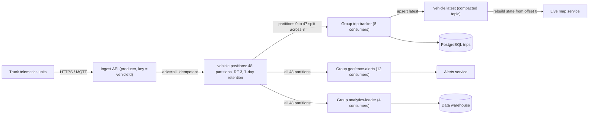
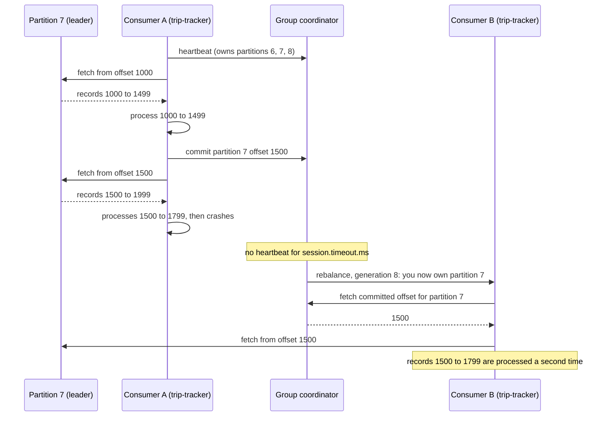

A queue forgets a message once it is acknowledged. Kafka does not. It keeps every record in an append-only log for days or weeks, and each reader simply remembers how far it has read. That one difference changes almost everything: ten teams can read the same events without stealing them from each other, a new service can replay last week's history to build its own view, and a bug in a consumer can be fixed and the data reprocessed. The price is a stricter model: ordering exists only within a partition, scaling is bounded by the partition count, and the reader, not the broker, is responsible for tracking progress. This lesson explains that model with a fleet-tracking example and compares it with RabbitMQ.

## Learning objectives

By the end of this lesson you will be able to:

1. Explain topics, partitions, offsets, brokers, leaders and replicas, and how a record finds its partition.
2. Choose a message key so that the records that must stay in order land in the same partition.
3. Explain consumer groups: how partitions are assigned, why consumers beyond the partition count sit idle, and how several groups read the same topic independently.
4. Commit offsets correctly, and predict what is lost or duplicated with auto-commit, commit-before-processing and commit-after-processing.
5. Configure retention by time and size, and use log compaction for "latest value per key" topics, including tombstones.
6. Explain what triggers a rebalance, what it costs, and how cooperative rebalancing and static membership reduce the damage.
7. Size partitions and storage for a real workload with back-of-the-envelope numbers.
8. Decide between Kafka and RabbitMQ for a given problem.

## Prerequisites

- [Message queues](#/lesson/m12-message-queues): producers, consumers, acks, competing consumers.
- [RabbitMQ exchanges and routing](#/lesson/m12-rabbitmq): a queue-based broker, for comparison.
- Helpful: [sharding and consistent hashing](#/lesson/m13-sharding), because partitions are shards.

## Explain it like I'm a beginner

Think of the register at the gate of a large construction site. Every truck that enters is written on the next line: line 1, line 2, line 3, and so on. Nobody tears pages out after reading them.

Different people read the same register for different reasons:

- The **security officer** reads every line to check vehicle permits.
- The **stores manager** reads it to know which materials arrived.
- The **accounts clerk** reads it at the end of each day to pay transporters.

Each of them keeps a **bookmark**: "I have read up to line 4,512". The security officer may be up to date while the clerk is 900 lines behind. That is fine; the register still has every line. If the clerk makes a mistake, they move their bookmark back to line 3,000 and read again.

The site is so busy that one register is too slow, so the gate has **12 registers**, one per lane. A rule decides the lane: all entries for one truck number always go in the same register, so each truck's entries stay in time order.

In Kafka terms:

- The set of 12 registers is a **topic** (`vehicle.positions`), and each register is a **partition**.
- A line number is an **offset**.
- The truck number is the **key** that decides the partition.
- Each reader (security, stores, accounts) is a **consumer group**, and the bookmark is its **committed offset**.
- Old pages are thrown away after a week: that is **retention**.

If the stores team hires three people, they split the 12 registers between them, 4 each. A thirteenth person would have no register to read.

## First-principles explanation

### The log

A Kafka **topic** is a named stream of records. Each topic is split into **partitions**, and each partition is an ordered, append-only sequence of records stored on disk. Every record in a partition gets the next **offset**: 0, 1, 2, ... Offsets never change and are never reused.

A record has a **key** (optional), a **value** (the payload), headers and a timestamp. Records are immutable: you cannot update or delete one record in place. To "change" something you append a new record.

Reading does not remove anything. A consumer asks, "give me records from partition 7, starting at offset 15,200". The broker sends them, and the consumer later records how far it got. Many consumers can read the same partition at different offsets at the same time.

### Brokers, leaders and replicas

A Kafka cluster has several **brokers** (servers). Each partition has a **replication factor**, typically 3: one broker holds the **leader** replica, which handles reads and writes, and two others hold **follower** replicas that copy the leader. Followers that are fully caught up form the **in-sync replica set (ISR)**.

Durability comes from three settings working together:

- Topic `replication.factor = 3`.
- Topic or broker `min.insync.replicas = 2`.
- Producer `acks = all`: the leader acknowledges a write only after every in-sync replica has it, and refuses writes if fewer than `min.insync.replicas` are in sync.

With these, a record acknowledged to the producer survives the loss of any one broker. With `acks = 1` the leader acknowledges as soon as it has written the record; if it dies before followers copy it, the record is lost. Since Kafka 4.0, cluster metadata is managed by Kafka's own Raft-based controller quorum (KRaft); ZooKeeper is no longer supported. See [replication](#/lesson/m13-replication) and [consensus](#/lesson/m13-consensus).

### How a record finds its partition

The producer chooses the partition:

- **With a key**: partition = hash(key) mod partition count. The same key always goes to the same partition (as long as the partition count does not change).
- **Without a key**: the producer spreads records across partitions. Modern clients use a "sticky" approach, filling a batch for one partition before moving on, which makes batches larger and cheaper.

Two practical warnings:

1. **Different clients may hash differently.** The Java client's default partitioner uses murmur2. The C/C++ library under Confluent's .NET client (librdkafka) defaults to a different scheme (`consistent_random`, based on CRC32). If a Java service and a .NET service both produce to one topic with default settings, the same key can land in different partitions, silently breaking per-key ordering. Set `Partitioner = Partitioner.Murmur2Random` in .NET to match Java.
2. **Adding partitions remaps keys.** Going from 12 to 24 partitions changes hash mod N for most keys. New records for a vehicle may go to a new partition while older ones are still unread in the old one, so per-key order breaks during the transition. Choose the partition count with growth in mind; you can add partitions but never remove them.

### Ordering: only within a partition

Kafka guarantees that records in **one partition** are stored and read in the order they were written. There is **no order across partitions**. So the rule of key design is:

> Everything that must be processed in order must share a key.

For vehicle positions, the key is the vehicle id: each truck's pings stay in order, while different trucks are processed in parallel. For bank transfers on an account, the key is the account number. A key that is too coarse (city) creates **hot partitions**: Mumbai traffic overloads one partition while others sit idle. A key that is too fine (a random id) gives perfect balance but no useful ordering.

Producer retries can also reorder records. With the **idempotent producer** (`enable.idempotence = true`, the default since Kafka 3.0 together with `acks = all`), each producer gets an id and numbers its records per partition; the broker discards duplicates from retries and keeps order with up to 5 in-flight requests. Leave it on.

### Consumer groups

A **consumer group** is a set of consumer instances that share a `group.id` and divide a topic's partitions between them:

- Each partition is assigned to **exactly one** consumer in the group at a time. That is how Kafka keeps per-partition order while scaling.
- A consumer may own several partitions.
- If there are **more consumers than partitions, the extra consumers are idle**. The partition count is the ceiling on a group's parallelism.

Different groups are completely independent. The `trip-tracker` group and the `analytics-loader` group each receive every record and each keep their own offsets. This is Kafka's version of publish-subscribe: instead of copying a message into several queues, several groups read the same log.

| Group | Consumers | Partitions per consumer (12 partitions) |
|---|---|---|
| trip-tracker | 4 | 3 each |
| geofence-alerts | 12 | 1 each |
| analytics-loader | 16 | 12 get 1 each, **4 idle** |

### Offsets and commits

Each consumer tracks its **position** (the next offset it will read) in memory. To survive restarts and reassignments, the group **commits** offsets to Kafka's internal `__consumer_offsets` topic. By convention the committed offset is the **next** record to read: after processing offset 41, commit 42.

When a consumer starts on a partition, it begins at the committed offset. If there is none (a brand-new group) or it points to data already deleted by retention, `auto.offset.reset` decides: `earliest` (start of the retained log) or `latest` (only new records; the default).

When you commit relative to processing decides your delivery guarantee:

- **Commit before processing**: a crash after the commit skips the records being processed. At-most-once.
- **Commit after processing**: a crash after processing but before the commit re-reads those records. At-least-once, the usual choice.
- **Auto-commit** (`enable.auto.commit = true`, every 5 seconds by default): the client commits the offsets returned by previous polls in the background. If you process records synchronously before the next poll, this behaves like at-least-once. If you hand records to background tasks, auto-commit can commit records that were never processed, so a crash loses them.

The [delivery guarantees](#/lesson/m12-delivery-guarantees) lesson covers these and Kafka's transactional "exactly-once" in depth.

**Consumer lag** is log end offset minus committed offset, per partition. It is Kafka's equivalent of queue depth, and like depth it means little until you divide by throughput: a lag of 120,000 records at 40,000 records/s is 3 seconds behind; at 400 records/s it is 5 minutes.

### Retention

Kafka deletes old data by policy, not by acknowledgement:

- `retention.ms` (default 7 days): delete data older than this.
- `retention.bytes` (per partition, unlimited by default): delete the oldest data beyond this size.

Deletion happens a **segment** at a time (a partition is stored as segment files, 1 GB by default), and the active segment is never deleted, so data can live somewhat longer than the retention setting. A consumer that falls further behind than the retention period loses data: its committed offset now points before the log start, and `auto.offset.reset` moves it forward. Alert on lag *in time* compared with retention.

### Log compaction

Some topics represent the **current state** of things: the latest position of each truck, the latest profile of each customer. For these, set `cleanup.policy = compact`. A background cleaner keeps **at least the most recent record for every key** and removes older records with the same key. Offsets do not change, so a compacted partition has gaps.

To delete a key, write a **tombstone**: a record with that key and a `null` value. Compaction removes older values for the key, and the tombstone itself is removed after `delete.retention.ms` (default 24 hours), long enough for consumers to see it.

A compacted topic lets a new service rebuild a full "latest state" table by reading from offset 0, without reading years of history. Kafka's own `__consumer_offsets` topic is compacted for this reason. Compaction can be combined with time-based deletion (`compact,delete`).

### Rebalancing

When the membership of a group changes, partitions are reassigned: a **rebalance**. Triggers:

- A consumer joins (scale out, deploy) or leaves cleanly (shutdown).
- A consumer stops sending heartbeats for `session.timeout.ms` (45 seconds by default in recent versions): it is assumed dead.
- A consumer does not call `poll` within `max.poll.interval.ms` (5 minutes by default): it is assumed stuck and removed, even though it is alive. Slow processing of a big batch is a classic cause.
- The topic's partition count changes.

Rebalances cost time and cause duplicates. With the classic **eager** protocol, every consumer gives up all its partitions, the group waits for everyone, then a new assignment is handed out; consumption stops for the whole group. Records processed but not yet committed before the revocation are processed again by the new owner.

Mitigations:

- **Cooperative incremental rebalancing** (the `cooperative-sticky` assignor): only partitions that actually move are revoked; others keep flowing.
- **Static membership** (`group.instance.id`): a consumer that restarts within the session timeout gets its old partitions back without a rebalance, which makes rolling deploys much calmer.
- **The new consumer group protocol** (KIP-848), generally available since Kafka 4.0 for Java clients, moves assignment to the broker and makes rebalances incremental by design. Check your client library's support before relying on it.
- **Commit in the revocation callback** so the next owner starts exactly where you stopped.
- Keep processing per poll well below `max.poll.interval.ms`, by lowering `max.poll.records` or moving slow work elsewhere.

### Sizing with real numbers

A logistics company tracks 2,00,000 trucks (estimates throughout):

- Each truck sends a GPS ping every 10 seconds: 2,00,000 ÷ 10 = **20,000 records/s** on average.
- Daytime peak about 2× = **40,000 records/s**.
- Each record about 300 bytes: 40,000 × 300 B = 12 MB/s at peak; 6 MB/s on average.
- Per day: 20,000 × 86,400 ≈ 1.73 billion records ≈ 518 GB.
- Retention 7 days: ≈ 3.6 TB; with replication factor 3: ≈ **10.9 TB** of disk before compression. JSON compresses well (lz4 or zstd), often by several times; treat that as an estimate to measure, not a promise.

Partitions: suppose one consumer instance of the heaviest group can process about 5,000 records/s (measure yours). Peak 40,000 ÷ 5,000 = 8 consumers today. Plan for 3× growth: 24 consumers. Choose **48 partitions**, so the group can grow without repartitioning, and each partition carries about 830 records/s at peak, well within one partition's capacity. Too many partitions is also a cost (more files, more replication traffic, slower leader elections), so do not pick 1,000 "just in case".

12 MB/s of writes is small for a modern Kafka cluster; the main costs here are storage and the consumers, not the brokers.

### Kafka versus RabbitMQ

| | Kafka | RabbitMQ (classic and quorum queues) |
|---|---|---|
| Model | Replicated, partitioned log; reads do not delete | Queues; ack deletes the message |
| Fan-out | Many consumer groups read the same topic | Exchange copies into one queue per subscriber |
| Replay | Yes: reset offsets, read history within retention | No (except RabbitMQ streams) |
| Ordering | Per partition, by key | Per queue, weakened by competing consumers and requeues |
| Parallelism limit | Number of partitions per group | Number of consumers on the queue |
| Per-message features | Few: no per-message ack, TTL, priority, or delayed delivery | Rich: per-message ack/nack, TTL, priorities, DLX, flexible routing |
| Failed message handling | Build it: retry topics, DLQ topics | Built in: nack, dead-letter exchanges, delivery limits |
| Throughput sweet spot | Very high, sustained streams (telemetry, clickstreams, CDC) | Moderate to high task and event traffic with routing needs |
| Consumer bookkeeping | Consumer commits offsets | Broker tracks each message |

Choose **Kafka** when you need replay, many independent readers, very high sustained throughput, per-key ordering at scale, or stream processing (Kafka Streams, Flink). Choose **RabbitMQ** (or a managed queue) for task distribution, complex routing, per-message retries and TTLs, request-reply, and moderate volumes where operating a Kafka cluster would be overkill. Many companies run both.

### When Kafka is the wrong tool

- **A work queue with slow, uneven jobs** (PDF rendering, 2 to 60 s each). Per-partition ordering means one slow job blocks every later record in that partition (head-of-line blocking), and you cannot simply add consumers beyond the partition count. A queue with competing consumers fits better.
- **Low volume.** A few hundred events a minute do not justify a cluster; a managed queue or a PostgreSQL outbox table is simpler.
- **Per-message delays, priorities or TTLs.** Kafka has none built in.
- **You need to delete individual records on demand** (for example, privacy erasure) from a non-compacted topic. Plan this up front: compacted topics with tombstones, or keep personal data out of the log and store only references.

### Trade-offs

| You gain | You pay |
|---|---|
| Replay and many independent consumers | Consumers own offset management and its bugs |
| Very high throughput with sequential disk I/O | A cluster to run (or a managed Kafka bill), with storage proportional to retention |
| Per-key ordering at scale | No ordering across keys; hot keys create hot partitions |
| Durable, replicated history | Partition count fixed in practice; increasing it remaps keys |
| Compacted topics as state stores | No per-message ack, TTL, delay or priority; retries and DLQs are DIY |

## Visual explanation

### Architecture: one topic, three consumer groups



The ingest API produces every ping keyed by vehicle id, with `acks=all` and idempotence, into a 48-partition topic replicated three times. Three consumer groups read that **same** topic independently: each group sees every record, and each splits the 48 partitions among its own consumers (8, 12 and 4 instances respectively). Nothing is copied per group, unlike RabbitMQ's queue-per-subscriber model. The trip tracker writes trips to PostgreSQL and the latest position per truck to a **compacted** topic, which the live map service reads from offset 0 on startup to rebuild its state, then follows for updates.

### Sequence: consume, commit, crash and rebalance



Consumer A reads a batch, processes it, and commits offset 1500, meaning "next to read is 1500". It then processes part of the next batch and crashes before committing. The coordinator notices the missing heartbeats, starts a new **generation** of the group, and gives partition 7 to consumer B. B asks for the committed offset, gets 1500, and re-reads from there, so records 1500 to 1799 are processed twice. Nothing is lost, but the duplicates are real: this is at-least-once, and it is why Kafka consumers must be idempotent. If A had come back with its old generation number and tried to commit, the coordinator would reject the commit, because A no longer owns the partition.

## Step-by-step example

### Step 1: one topic, no key

The ingest API produces pings without a key. They spread evenly across partitions, so throughput is good, but pings from truck `MH12AB1234` land in partitions 3, 17 and 40. Three consumers process them concurrently, and the trip tracker sees the truck jump backwards in time.

### Step 2: key by vehicle id

Produce with `key = vehicleId`. All pings for one truck share a partition and are read in order by one consumer. Throughput is unchanged because there are 2,00,000 distinct keys spread over 48 partitions.

### Step 3: a consumer group with manual commits

The trip tracker runs as group `trip-tracker` with `enable.auto.commit = false`. It polls a batch, processes it, upserts results, then commits. A crash means some records are re-read, so the handler is idempotent: it ignores a ping older than the stored latest timestamp for that truck.

### Step 4: a second, independent group

The geofence team starts group `geofence-alerts` with `auto.offset.reset = earliest`. It reads the last 7 days of history to warm up, then follows live data. The trip tracker is completely unaffected: no new queue, no producer change.

### Step 5: a compacted "latest state" topic

The trip tracker writes each truck's latest position to `vehicle.latest` with `cleanup.policy = compact`. When a truck is decommissioned, it writes a tombstone. The live map service can now restart and rebuild its in-memory state by reading about 2,00,000 records instead of 1.7 billion.

### Step 6: calm deploys

Switch the assignor to `cooperative-sticky`, set `group.instance.id` to a stable per-pod name, commit in the partitions-revoked callback, and cap `max.poll.records` so one batch is processed well within `max.poll.interval.ms`. Rolling deploys now move few partitions and cause few duplicates.

## Production-style C# implementation

`Confluent.Kafka` is not available to this lesson's offline compiler, so the compiled code models Kafka's concepts **in memory**: a partitioned log with stable key hashing, offsets, retention and compaction; a consumer group with a range assignor, generations and committed offsets; and a background projector that consumes with commit-after-processing and an idempotent store. The real client code follows.

```text
Fleet.Api/
  Program.cs
  Streaming/Log/PartitionedLog.cs
  Streaming/Consumers/ConsumerGroup.cs
  Tracking/Positions.cs
  Tracking/PositionProjector.cs
```

```csharp file=Streaming/Log/PartitionedLog.cs
using System.Text;

namespace Fleet.Streaming.Log;

public enum CleanupPolicy { Delete, Compact }

public sealed record TopicConfig(string Name, int Partitions, TimeSpan Retention, CleanupPolicy Cleanup = CleanupPolicy.Delete);

public sealed record LogRecord(long Offset, string? Key, string? Value, DateTimeOffset Timestamp);

public sealed record AppendResult(string Topic, int Partition, long Offset);

public sealed class OffsetOutOfRangeException(string message) : Exception(message);

public interface IPartitioner
{
    int Partition(string? key, int partitionCount);
}

/// <summary>Stable key hashing (FNV-1a). Never use string.GetHashCode: it is randomised per process.
/// Real clients use murmur2 (Java) or CRC32-based schemes (librdkafka); all producers of a topic must agree.</summary>
public sealed class Fnv1aPartitioner : IPartitioner
{
    private int _roundRobin = -1;

    public int Partition(string? key, int partitionCount)
    {
        ArgumentOutOfRangeException.ThrowIfLessThan(partitionCount, 1);
        if (key is null) return (int)((uint)Interlocked.Increment(ref _roundRobin) % (uint)partitionCount);
        return (int)((Hash(key) & 0x7fffffff) % (uint)partitionCount);
    }

    public static uint Hash(string key)
    {
        uint hash = 2166136261;
        foreach (var b in Encoding.UTF8.GetBytes(key))
        {
            hash ^= b;
            hash *= 16777619;
        }
        return hash;
    }
}

/// <summary>In-memory model of Kafka topics: append-only partitions, offsets, retention and compaction.</summary>
public sealed class PartitionedLog(IPartitioner partitioner, TimeProvider clock)
{
    private sealed class Partition
    {
        public readonly List<LogRecord> Records = new();
        public long NextOffset;    // log end offset
        public long StartOffset;   // first offset still retained
    }

    private readonly Lock _gate = new();
    private readonly Dictionary<string, (TopicConfig Config, Partition[] Partitions)> _topics = new(StringComparer.Ordinal);

    public void CreateTopic(TopicConfig config)
    {
        ArgumentOutOfRangeException.ThrowIfLessThan(config.Partitions, 1);
        lock (_gate)
        {
            if (_topics.ContainsKey(config.Name)) throw new InvalidOperationException($"Topic '{config.Name}' exists.");
            _topics[config.Name] = (config, Enumerable.Range(0, config.Partitions).Select(_ => new Partition()).ToArray());
        }
    }

    public TopicConfig Describe(string topic)
    {
        lock (_gate) return Get(topic).Config;
    }

    public AppendResult Append(string topic, string? key, string? value)
    {
        lock (_gate)
        {
            var (config, partitions) = Get(topic);
            if (config.Cleanup == CleanupPolicy.Compact && key is null)
                throw new ArgumentException("Records in a compacted topic must have a key.", nameof(key));

            var index = partitioner.Partition(key, partitions.Length);
            var p = partitions[index];
            var record = new LogRecord(p.NextOffset++, key, value, clock.GetUtcNow());
            p.Records.Add(record);
            return new AppendResult(topic, index, record.Offset);
        }
    }

    public IReadOnlyList<LogRecord> Read(string topic, int partition, long fromOffset, int maxRecords)
    {
        lock (_gate)
        {
            var p = Get(topic).Partitions[partition];
            if (fromOffset < p.StartOffset || fromOffset > p.NextOffset)
                throw new OffsetOutOfRangeException($"{topic}-{partition}: offset {fromOffset} outside [{p.StartOffset}, {p.NextOffset}]");
            var start = p.Records.FindIndex(r => r.Offset >= fromOffset);
            return start < 0 ? [] : p.Records.Skip(start).Take(maxRecords).ToList();
        }
    }

    public long StartOffset(string topic, int partition) { lock (_gate) return Get(topic).Partitions[partition].StartOffset; }

    public long EndOffset(string topic, int partition) { lock (_gate) return Get(topic).Partitions[partition].NextOffset; }

    /// <summary>Deletes records older than the topic's retention (real Kafka deletes whole segments).</summary>
    public int ApplyRetention()
    {
        var removed = 0;
        lock (_gate)
        {
            var now = clock.GetUtcNow();
            foreach (var (config, partitions) in _topics.Values)
            {
                if (config.Cleanup != CleanupPolicy.Delete || config.Retention == TimeSpan.MaxValue) continue;
                var cutoff = now - config.Retention;
                foreach (var p in partitions)
                {
                    removed += p.Records.RemoveAll(r => r.Timestamp < cutoff);
                    p.StartOffset = p.Records.Count > 0 ? p.Records[0].Offset : p.NextOffset;
                }
            }
        }
        return removed;
    }

    /// <summary>Keeps the latest record per key and drops keys whose latest record is a tombstone.
    /// Simplified: real Kafka never compacts the active segment and keeps tombstones for delete.retention.ms.</summary>
    public int Compact(string topic)
    {
        lock (_gate)
        {
            var (config, partitions) = Get(topic);
            if (config.Cleanup != CleanupPolicy.Compact) throw new InvalidOperationException($"'{topic}' is not compacted.");
            var removed = 0;
            foreach (var p in partitions)
            {
                var latest = p.Records.GroupBy(r => r.Key!).Select(g => g.MaxBy(r => r.Offset)!)
                                      .Where(r => r.Value is not null).OrderBy(r => r.Offset).ToList();
                removed += p.Records.Count - latest.Count;
                p.Records.Clear();
                p.Records.AddRange(latest);   // offsets unchanged: compacted partitions have gaps
            }
            return removed;
        }
    }

    private (TopicConfig Config, Partition[] Partitions) Get(string topic) =>
        _topics.TryGetValue(topic, out var t) ? t : throw new KeyNotFoundException($"Unknown topic '{topic}'.");
}
```

```csharp file=Streaming/Consumers/ConsumerGroup.cs
using Fleet.Streaming.Log;

namespace Fleet.Streaming.Consumers;

public enum OffsetReset { Earliest, Latest }

public interface IPartitionAssignor
{
    IReadOnlyDictionary<string, IReadOnlyList<int>> Assign(int partitionCount, IReadOnlyList<string> sortedMembers);
}

/// <summary>Kafka's range strategy for one topic: contiguous blocks, earlier members get one extra.</summary>
public sealed class RangeAssignor : IPartitionAssignor
{
    public IReadOnlyDictionary<string, IReadOnlyList<int>> Assign(int partitionCount, IReadOnlyList<string> sortedMembers)
    {
        var result = new Dictionary<string, IReadOnlyList<int>>(StringComparer.Ordinal);
        if (sortedMembers.Count == 0) return result;
        int per = partitionCount / sortedMembers.Count, extra = partitionCount % sortedMembers.Count, next = 0;
        for (var i = 0; i < sortedMembers.Count; i++)
        {
            var count = per + (i < extra ? 1 : 0);
            result[sortedMembers[i]] = Enumerable.Range(next, count).ToList();
            next += count;
        }
        return result;
    }
}

/// <summary>A commit from a member that is no longer the owner (older generation). Kafka: CommitFailedException.</summary>
public sealed class StaleGenerationException(string message) : Exception(message);

public sealed record MemberAssignment(int Generation, IReadOnlyList<int> Partitions);

/// <summary>Models the group coordinator for one topic: membership, generations, assignment and committed offsets.</summary>
public sealed class ConsumerGroup(string groupId, string topic, PartitionedLog log, IPartitionAssignor assignor,
    OffsetReset reset = OffsetReset.Earliest)
{
    private readonly Lock _gate = new();
    private readonly SortedSet<string> _members = new(StringComparer.Ordinal);
    private readonly Dictionary<int, long> _committed = new();
    private IReadOnlyDictionary<string, IReadOnlyList<int>> _assignment = new Dictionary<string, IReadOnlyList<int>>();
    private int _generation;

    public string GroupId => groupId;
    public string Topic => topic;

    public MemberAssignment Join(string memberId)
    {
        lock (_gate)
        {
            if (_members.Add(memberId)) Rebalance();
            return AssignmentOf(memberId);
        }
    }

    public void Leave(string memberId)
    {
        lock (_gate) if (_members.Remove(memberId)) Rebalance();
    }

    public MemberAssignment Current(string memberId)
    {
        lock (_gate) return AssignmentOf(memberId);
    }

    /// <summary>Where a new owner starts: the committed offset, or the reset policy if none or out of range.</summary>
    public long StartPosition(int partition)
    {
        lock (_gate)
        {
            long start = log.StartOffset(topic, partition), end = log.EndOffset(topic, partition);
            if (_committed.TryGetValue(partition, out var c) && c >= start && c <= end) return c;
            return reset == OffsetReset.Earliest ? start : end;
        }
    }

    public void Commit(string memberId, int generation, int partition, long nextOffset)
    {
        lock (_gate)
        {
            if (generation != _generation || !AssignmentOf(memberId).Partitions.Contains(partition))
                throw new StaleGenerationException(
                    $"{memberId} (generation {generation}) no longer owns {topic}-{partition}; current generation is {_generation}.");
            _committed[partition] = nextOffset;
        }
    }

    /// <summary>Lag per partition: log end offset minus where the group would resume.</summary>
    public IReadOnlyDictionary<int, long> Lag()
    {
        var partitions = log.Describe(topic).Partitions;
        return Enumerable.Range(0, partitions).ToDictionary(p => p, p => log.EndOffset(topic, p) - StartPosition(p));
    }

    private void Rebalance()
    {
        _generation++;
        _assignment = assignor.Assign(log.Describe(topic).Partitions, _members.ToList());
    }

    private MemberAssignment AssignmentOf(string memberId) =>
        new(_generation, _assignment.TryGetValue(memberId, out var parts) ? parts : []);
}
```

```csharp file=Tracking/Positions.cs
using System.Collections.Concurrent;

namespace Fleet.Tracking;

public sealed record VehiclePosition(string VehicleId, double Lat, double Lon, double SpeedKmph, DateTimeOffset RecordedAt);

public static class Topics
{
    public const string Positions = "vehicle.positions";
    public const string Latest = "vehicle.latest";
}

/// <summary>Latest position per vehicle. Apply is idempotent and order-tolerant: older pings never overwrite newer ones,
/// so re-processing after a crash or rebalance is harmless.</summary>
public sealed class LatestPositionStore
{
    private readonly ConcurrentDictionary<string, VehiclePosition> _latest = new(StringComparer.Ordinal);

    public bool Apply(VehiclePosition position)
    {
        var applied = false;
        _latest.AddOrUpdate(position.VehicleId,
            _ => { applied = true; return position; },
            (_, current) =>
            {
                if (position.RecordedAt <= current.RecordedAt) return current;
                applied = true;
                return position;
            });
        return applied;
    }

    public VehiclePosition? Get(string vehicleId) => _latest.TryGetValue(vehicleId, out var p) ? p : null;
}
```

```csharp file=Tracking/PositionProjector.cs
using System.Text.Json;
using Fleet.Streaming.Consumers;
using Fleet.Streaming.Log;

namespace Fleet.Tracking;

/// <summary>One member of the "trip-tracker" group. Run several instances (pods) to share the partitions.</summary>
public sealed class PositionProjector(
    PartitionedLog log,
    ConsumerGroup group,
    LatestPositionStore store,
    TimeProvider clock,
    ILogger<PositionProjector> logger) : BackgroundService
{
    private readonly string _memberId = $"trip-tracker-{Environment.MachineName}-{Guid.NewGuid():N}"[..40];

    protected override async Task ExecuteAsync(CancellationToken stoppingToken)
    {
        var assignment = group.Join(_memberId);
        var positions = new Dictionary<int, long>();
        try
        {
            while (!stoppingToken.IsCancellationRequested)
            {
                var current = group.Current(_memberId);
                if (current.Generation != assignment.Generation)
                {
                    // Rebalanced: forget positions; resume owned partitions from committed offsets.
                    logger.LogInformation("Generation {Gen}: now own {Partitions}", current.Generation, current.Partitions);
                    assignment = current;
                    positions.Clear();
                }

                var processedAny = false;
                foreach (var partition in assignment.Partitions)
                {
                    if (!positions.TryGetValue(partition, out var from)) from = group.StartPosition(partition);

                    IReadOnlyList<LogRecord> batch;
                    try { batch = log.Read(group.Topic, partition, from, maxRecords: 500); }
                    catch (OffsetOutOfRangeException)
                    {
                        positions[partition] = group.StartPosition(partition);   // retention removed our place
                        continue;
                    }
                    if (batch.Count == 0) continue;

                    foreach (var record in batch)
                    {
                        var position = JsonSerializer.Deserialize<VehiclePosition>(record.Value!)!;
                        if (store.Apply(position))
                            log.Append(Topics.Latest, position.VehicleId, record.Value);   // compacted state topic
                    }

                    var next = batch[^1].Offset + 1;
                    try
                    {
                        group.Commit(_memberId, assignment.Generation, partition, next);   // commit AFTER processing
                        positions[partition] = next;
                        processedAny = true;
                    }
                    catch (StaleGenerationException ex)
                    {
                        logger.LogWarning(ex, "Lost partition {Partition} during rebalance; the batch will be re-read by its new owner", partition);
                        break;
                    }
                }

                if (!processedAny) await Task.Delay(TimeSpan.FromMilliseconds(200), clock, stoppingToken);
            }
        }
        catch (OperationCanceledException) when (stoppingToken.IsCancellationRequested) { }
        finally
        {
            group.Leave(_memberId);   // a clean leave triggers an immediate rebalance instead of waiting for a timeout
        }
    }
}
```

```csharp file=Program.cs
using System.Text.Json;
using Fleet.Streaming.Consumers;
using Fleet.Streaming.Log;
using Fleet.Tracking;

var builder = WebApplication.CreateBuilder(args);

builder.Services.AddSingleton(TimeProvider.System);
builder.Services.AddSingleton<IPartitioner, Fnv1aPartitioner>();
builder.Services.AddSingleton(sp =>
{
    var log = new PartitionedLog(sp.GetRequiredService<IPartitioner>(), sp.GetRequiredService<TimeProvider>());
    log.CreateTopic(new TopicConfig(Topics.Positions, Partitions: 48, Retention: TimeSpan.FromDays(7)));
    log.CreateTopic(new TopicConfig(Topics.Latest, Partitions: 12, Retention: TimeSpan.MaxValue, CleanupPolicy.Compact));
    return log;
});
builder.Services.AddSingleton(sp => new ConsumerGroup("trip-tracker", Topics.Positions,
    sp.GetRequiredService<PartitionedLog>(), new RangeAssignor(), OffsetReset.Earliest));
builder.Services.AddSingleton<LatestPositionStore>();
builder.Services.AddHostedService<PositionProjector>();

var app = builder.Build();

app.MapPost("/positions", (VehiclePosition p, PartitionedLog log) =>
{
    var result = log.Append(Topics.Positions, key: p.VehicleId, value: JsonSerializer.Serialize(p));
    return Results.Accepted(value: new { result.Partition, result.Offset });
});

app.MapGet("/vehicles/{vehicleId}", (string vehicleId, LatestPositionStore store) =>
    store.Get(vehicleId) is { } p ? Results.Ok(p) : Results.NotFound());

app.MapGet("/admin/lag", (ConsumerGroup group) =>
    new { group.GroupId, TotalLag = group.Lag().Values.Sum(), Partitions = group.Lag() });

app.MapPost("/admin/maintenance", (PartitionedLog log) =>
    new { RetentionRemoved = log.ApplyRetention(), CompactionRemoved = log.Compact(Topics.Latest) });

app.Run();
```

What to notice:

- **Stable hashing.** `string.GetHashCode()` differs between processes in .NET, so it must never choose partitions. Every producer of a topic must use the same algorithm.
- **Generations fence stale owners.** A member that was too slow and lost its partition gets `StaleGenerationException` when it tries to commit, so it cannot overwrite the new owner's progress. Its last batch is simply re-read by the new owner.
- **Commit after processing, and an idempotent store.** `LatestPositionStore.Apply` ignores pings that are not newer, so duplicates from crashes and rebalances do no harm.
- **Retention can overtake a slow consumer.** When the committed offset falls before the log start, the reset policy decides where to resume; the gap is data the group never saw. Monitor lag in time against retention.
- **The compacted topic only publishes real changes**, keeping it small.

The same flow with `Confluent.Kafka` (not compiled here because the package is not available offline):

```csharp
// Producer: durable, ordered per key, compatible with Java producers' partitioning.
var producerConfig = new ProducerConfig
{
    BootstrapServers = "kafka-1:9092,kafka-2:9092,kafka-3:9092",
    Acks = Acks.All,
    EnableIdempotence = true,
    LingerMs = 5,                                  // small batching delay for throughput
    CompressionType = CompressionType.Lz4,
    Partitioner = Partitioner.Murmur2Random,       // same key hashing as the Java client
};
using var producer = new ProducerBuilder<string, string>(producerConfig).Build();
var delivery = await producer.ProduceAsync("vehicle.positions",
    new Message<string, string> { Key = position.VehicleId, Value = JsonSerializer.Serialize(position) }, ct);
// delivery.Partition, delivery.Offset

// Consumer: manual commits after processing, cooperative rebalancing, static membership.
var consumerConfig = new ConsumerConfig
{
    BootstrapServers = "kafka-1:9092,kafka-2:9092,kafka-3:9092",
    GroupId = "trip-tracker",
    GroupInstanceId = Environment.GetEnvironmentVariable("POD_NAME"),
    EnableAutoCommit = false,
    AutoOffsetReset = AutoOffsetReset.Earliest,
    PartitionAssignmentStrategy = PartitionAssignmentStrategy.CooperativeSticky,
    MaxPollIntervalMs = 300_000,
};
using var consumer = new ConsumerBuilder<string, string>(consumerConfig)
    .SetPartitionsRevokedHandler((c, revoked) => logger.LogInformation("Revoked {Partitions}", revoked))
    .Build();
consumer.Subscribe("vehicle.positions");
while (!ct.IsCancellationRequested)
{
    var result = consumer.Consume(ct);
    var position = JsonSerializer.Deserialize<VehiclePosition>(result.Message.Value)!;
    store.Apply(position);
    consumer.Commit(result);   // commits result.Offset + 1 for this partition; batch commits in real code
}
consumer.Close();   // leave the group cleanly
```

## Bad design vs good design

**Bad: no key, or a random key, for data that needs order.**

```csharp
await producer.ProduceAsync("account.transactions", new Message<string, string> { Key = Guid.NewGuid().ToString(), Value = json });
```

Debits and credits for one account land in different partitions and are applied in an unpredictable order; a balance can go negative temporarily or end up wrong if the consumer is not order-tolerant. **Good:** key by the entity whose order matters (`accountId`).

**Bad: a coarse key.** Keying by `city` sends every Mumbai record to one partition. That partition's consumer falls behind while 47 others idle, and adding consumers does not help. **Good:** a key with many distinct values and a fairly even load, such as vehicle id.

**Bad: auto-commit with asynchronous processing.**

```csharp
// enable.auto.commit = true
var result = consumer.Consume(ct);
_ = Task.Run(() => HandleAsync(result));   // offsets get auto-committed before HandleAsync finishes
```

A crash loses every record whose handler had not finished, even though their offsets are committed. **Good:** process, then commit; if you need parallelism, run one consumer per partition or track completed offsets per partition and commit only the highest contiguous one.

**Bad: one slow call per record inside the poll loop.** A 2-second external API call per record with `max.poll.records = 500` takes 1,000 seconds per batch, exceeding `max.poll.interval.ms` (300 seconds). The consumer is kicked out, its partitions are reassigned, the batch is re-read, and the cycle repeats: a rebalance storm. **Good:** smaller batches, bounded concurrency per partition, or move the slow work to a queue designed for slow jobs.

**Bad: using Kafka as a database for ad-hoc queries.** "Find all pings for truck X last Tuesday" means scanning a partition. **Good:** consume into a store built for queries (PostgreSQL with time partitioning, a time-series database, a warehouse).

:::callout type=tradeoff title="Partitions: choose once, carefully"
More partitions give more consumer parallelism and spread load, but each one adds files, memory, replication traffic and recovery time, and adding partitions later remaps keys. A practical approach: size for expected peak in 2 to 3 years divided by the per-consumer throughput you measured, round up to a number with many divisors (12, 24, 48), and keep a per-topic justification in your design document.
:::

## Practical playground

The starter graph is a fleet platform with one topic and one consumer group. Open it in the HLD canvas and extend it for the requirements below. Label the topic with partition count, replication factor and retention; label each consumer group with its instance count.

1. Add a `geofence-alerts` group (needs alerts within 10 seconds) and an `analytics-loader` group (hourly loads are fine). Should they share the trip tracker's group id?
2. Add a compacted `vehicle.latest` topic and the live map service that rebuilds from it.
3. Add a dead-letter topic for pings that fail validation, and monitoring for consumer lag per group.
4. Write the storage arithmetic next to the topic: records/s, bytes per day, retention, replication factor.

:::playground type=hld title="Fleet telemetry on Kafka"
```json
{
  "nodes": [
    { "id": "trucks", "type": "client", "label": "Truck telematics units", "props": { "rps": 20000 } },
    { "id": "ingest", "type": "app-server", "label": "Ingest API", "props": { "instances": 4 } },
    { "id": "topic", "type": "stream", "label": "vehicle.positions (12 partitions?)" },
    { "id": "trip", "type": "worker", "label": "trip-tracker group", "props": { "instances": 4 } },
    { "id": "db", "type": "database", "label": "PostgreSQL (trips)" }
  ],
  "edges": [
    { "from": "trucks", "to": "ingest", "kind": "sync" },
    { "from": "ingest", "to": "topic", "kind": "async", "label": "key = ?" },
    { "from": "topic", "to": "trip", "kind": "async" },
    { "from": "trip", "to": "db", "kind": "sync" }
  ]
}
```
:::

## Exercises

:::exercise id=m12-kafka-ex1 difficulty=beginner kind=code title="A stable key partitioner"
Implement the partitioner used by every producer of the `vehicle.positions` topic. It must be identical in every service and every process, so it uses a fixed hash (32-bit FNV-1a) instead of `string.GetHashCode()`.
::requirements
- `Hash(key)`: 32-bit FNV-1a over the key's UTF-8 bytes. Start with `2166136261`; for each byte, XOR it into the hash, then multiply by `16777619` (unchecked, wrapping at 32 bits).
- `Partition(key, partitionCount)`: for a non-null key, `(Hash(key) & 0x7fffffff) % partitionCount`.
- A `null` key uses round robin: 0, 1, 2, ... wrapping at `partitionCount`.
- `partitionCount < 1` throws `ArgumentOutOfRangeException`.
::acceptance
- `Hash("MH12AB1234")` is `650056560`, and that key maps to partition 0 of 12; `KA01XY9876` maps to partition 1.
- The same key always gives the same partition.
- Null keys go 0, 1, 2, 0 with 3 partitions.
- 10,000 different keys spread roughly evenly over 12 partitions.
::hint
`uint` arithmetic in C# wraps around by default (unless you compile with `checked`), which is exactly what FNV needs.
::hint
`Encoding.UTF8.GetBytes(key)` gives the bytes; loop over them.
::hint
Mask with `0x7fffffff` before the modulo so the result is never negative, matching what Kafka clients do with signed hashes.
::hint
For round robin keep an `int` counter and use `Interlocked.Increment` so concurrent producers do not race.
::hint
```csharp
uint hash = 2166136261;
foreach (var b in Encoding.UTF8.GetBytes(key)) { hash ^= b; hash *= 16777619; }
return hash;
```
::starter
```csharp file=KeyPartitioner.cs
using System;
using System.Text;
using System.Threading;

public sealed class KeyPartitioner
{
    public static uint Hash(string key) => throw new NotImplementedException();

    public int Partition(string? key, int partitionCount) => throw new NotImplementedException();
}
```
::tests
```csharp file=KeyPartitionerTests.cs
using System;
using System.Linq;
using Xunit;

public class KeyPartitionerTests
{
    [Fact]
    public void Known_hash_values() => Assert.Equal(650056560u, KeyPartitioner.Hash("MH12AB1234"));

    [Fact]
    public void Known_partitions()
    {
        var p = new KeyPartitioner();
        Assert.Equal(0, p.Partition("MH12AB1234", 12));
        Assert.Equal(1, p.Partition("KA01XY9876", 12));
    }

    [Fact]
    public void Same_key_same_partition()
    {
        var p = new KeyPartitioner();
        var first = p.Partition("DL01CA0001", 48);
        for (var i = 0; i < 100; i++) Assert.Equal(first, p.Partition("DL01CA0001", 48));
    }

    [Fact]
    public void Null_keys_round_robin()
    {
        var p = new KeyPartitioner();
        Assert.Equal(new[] { 0, 1, 2, 0 }, Enumerable.Range(0, 4).Select(_ => p.Partition(null, 3)).ToArray());
    }

    [Fact]
    public void Rejects_zero_partitions() =>
        Assert.Throws<ArgumentOutOfRangeException>(() => new KeyPartitioner().Partition("x", 0));

    [Fact]
    public void Spreads_keys_evenly()
    {
        var p = new KeyPartitioner();
        var counts = new int[12];
        for (var i = 0; i < 10_000; i++) counts[p.Partition($"TRUCK-{i:D6}", 12)]++;
        Assert.All(counts, c => Assert.InRange(c, 600, 1100));   // ideal is about 833
    }
}
```
::solution
```csharp file=KeyPartitioner.cs
using System;
using System.Text;
using System.Threading;

public sealed class KeyPartitioner
{
    private int _next = -1;

    public static uint Hash(string key)
    {
        uint hash = 2166136261;
        foreach (var b in Encoding.UTF8.GetBytes(key))
        {
            hash ^= b;
            hash *= 16777619;
        }
        return hash;
    }

    public int Partition(string? key, int partitionCount)
    {
        if (partitionCount < 1) throw new ArgumentOutOfRangeException(nameof(partitionCount));
        if (key is null)
            return (int)((uint)Interlocked.Increment(ref _next) % (uint)partitionCount);
        return (int)((Hash(key) & 0x7fffffff) % (uint)partitionCount);
    }
}
```

The algorithm matters less than agreement: every producer of a topic must hash identically, or one vehicle's records split across partitions and lose their order. That is why the .NET client is often configured with `Partitioner.Murmur2Random` when Java services produce to the same topic.
::alternatives
Real Kafka producers send keyless records with a "sticky" partitioner: they fill one batch for one partition, then switch. That makes larger batches than per-record round robin.
::mistakes
- Using `key.GetHashCode()`, which is randomised per process in .NET, so two pods disagree.
- `Math.Abs((int)hash) % n`, which overflows for `int.MinValue`.
- Hashing characters instead of UTF-8 bytes, so non-ASCII keys differ from other languages' implementations.
:::

:::exercise id=m12-kafka-ex2 difficulty=beginner kind=written title="What order will the consumer see?"
Topic `account.events` has 6 partitions. Answer each question and explain using partitions, keys and consumer groups.

1. A producer sends `deposit(A, ₹500)` then `withdraw(A, ₹300)`, both with key `A`. Can a consumer process the withdrawal first?
2. The same two events are sent with no key. Same question.
3. Events for accounts `A` and `B` are sent with their own keys, A first. Will every consumer see A's event before B's?
4. Group `ledger` has 8 consumers. How many are doing work?
5. Group `ledger` and group `fraud` both subscribe. A consumer in `ledger` processes offset 900 of partition 2. What does that mean for `fraud`?
6. The team grows the topic to 12 partitions while traffic is flowing. What can happen to account `A`'s ordering?
::acceptance
- Each answer says yes or no and why.
- Answers 1 and 2 contrast keyed and unkeyed records.
- Answer 4 mentions idle consumers.
- Answer 6 explains key remapping.
::hint
Order is guaranteed only inside one partition. Which partition does each record go to?
::hint
Consumer groups are independent: each has its own offsets.
::hint
What is hash(key) mod 6 versus hash(key) mod 12?
::solution
1. **No.** Same key, same partition; records in a partition are read in order by one consumer of the group. (Assuming the idempotent producer, which prevents retries from reordering.)
2. **Yes.** Without a key the records may go to different partitions, read by different consumers at different speeds.
3. **No.** A and B are probably in different partitions; there is no ordering across partitions.
4. **6.** Each partition goes to one consumer in a group; 2 consumers are idle (useful only as hot standbys).
5. **Nothing.** `fraud` has its own committed offsets and may be at offset 50 or 2,000 of partition 2.
6. New records for `A` may now hash to a different partition (hash mod 12 instead of mod 6) while older records for `A` are still unread in the old partition. Two consumers can process A's old and new events at the same time, out of order. Plan partition counts ahead, or migrate by creating a new topic and switching over after the old one is drained.
::mistakes
- Believing Kafka orders a whole topic.
- Thinking more consumers than partitions increases throughput.
- Assuming one group's progress affects another's.
:::

:::exercise id=m12-kafka-ex3 difficulty=intermediate kind=code title="The range assignor and rebalance cost"
Implement Kafka's range assignment for one topic, and a helper that counts how many partitions change owner between two assignments, which is a rough measure of rebalance cost.
::requirements
- `Assign(partitionCount, members)`: sort member ids with ordinal comparison. With `n` partitions and `m` members, each member gets `n / m` partitions and the first `n % m` members get one more. Partitions are given out in contiguous ranges in sorted member order.
- Every member appears in the result, even with an empty list. No members gives an empty dictionary.
- `PartitionsMoved(before, after)`: the number of partitions whose owner differs between the two assignments (a partition with no owner in one of them counts as moved if it has an owner in the other).
::acceptance
- 6 partitions, 4 members → `[0,1] [2,3] [4] [5]`.
- 3 partitions, 5 members → three members with one partition, two with none.
- The result does not depend on the order members are passed in.
- Going from 3 to 4 members on 12 partitions moves several partitions; adding no member moves none.
::hint
`members.OrderBy(m => m, StringComparer.Ordinal).ToList()` first.
::hint
Keep a `next` partition counter; for member `i`, `count = n / m + (i < n % m ? 1 : 0)`; take `Enumerable.Range(next, count)`.
::hint
For `PartitionsMoved`, invert each assignment into `partition → owner` dictionaries and compare over the union of partitions.
::hint
```csharp
static Dictionary<int, string> Owners(IReadOnlyDictionary<string, IReadOnlyList<int>> a) =>
    a.SelectMany(kv => kv.Value.Select(p => (p, kv.Key))).ToDictionary(x => x.p, x => x.Key);
```
::starter
```csharp file=RangeAssignment.cs
using System;
using System.Collections.Generic;
using System.Linq;

public static class RangeAssignment
{
    public static IReadOnlyDictionary<string, IReadOnlyList<int>> Assign(int partitionCount, IEnumerable<string> members) =>
        throw new NotImplementedException();

    public static int PartitionsMoved(IReadOnlyDictionary<string, IReadOnlyList<int>> before,
                                      IReadOnlyDictionary<string, IReadOnlyList<int>> after) =>
        throw new NotImplementedException();
}
```
::tests
```csharp file=RangeAssignmentTests.cs
using System.Linq;
using Xunit;

public class RangeAssignmentTests
{
    [Fact]
    public void Six_partitions_four_members()
    {
        var a = RangeAssignment.Assign(6, new[] { "c-1", "c-2", "c-3", "c-4" });
        Assert.Equal(new[] { 0, 1 }, a["c-1"]);
        Assert.Equal(new[] { 2, 3 }, a["c-2"]);
        Assert.Equal(new[] { 4 }, a["c-3"]);
        Assert.Equal(new[] { 5 }, a["c-4"]);
    }

    [Fact]
    public void More_members_than_partitions_leaves_some_idle()
    {
        var a = RangeAssignment.Assign(3, new[] { "a", "b", "c", "d", "e" });
        Assert.Equal(5, a.Count);
        Assert.Equal(3, a.Values.Count(v => v.Count == 1));
        Assert.Equal(2, a.Values.Count(v => v.Count == 0));
    }

    [Fact]
    public void Input_order_does_not_matter()
    {
        var x = RangeAssignment.Assign(5, new[] { "b", "a" });
        var y = RangeAssignment.Assign(5, new[] { "a", "b" });
        Assert.Equal(x["a"], y["a"]);
        Assert.Equal(new[] { 0, 1, 2 }, x["a"]);
    }

    [Fact]
    public void No_members_gives_empty_assignment() =>
        Assert.Empty(RangeAssignment.Assign(12, new string[0]));

    [Fact]
    public void Adding_a_member_moves_partitions()
    {
        var before = RangeAssignment.Assign(12, new[] { "a", "b", "c" });
        var after = RangeAssignment.Assign(12, new[] { "a", "b", "c", "d" });
        Assert.Equal(0, RangeAssignment.PartitionsMoved(before, before));
        Assert.Equal(6, RangeAssignment.PartitionsMoved(before, after));
    }
}
```
::solution
```csharp file=RangeAssignment.cs
using System;
using System.Collections.Generic;
using System.Linq;

public static class RangeAssignment
{
    public static IReadOnlyDictionary<string, IReadOnlyList<int>> Assign(int partitionCount, IEnumerable<string> members)
    {
        var sorted = members.Distinct().OrderBy(m => m, StringComparer.Ordinal).ToList();
        var result = new Dictionary<string, IReadOnlyList<int>>(StringComparer.Ordinal);
        if (sorted.Count == 0) return result;

        int per = partitionCount / sorted.Count, extra = partitionCount % sorted.Count, next = 0;
        for (var i = 0; i < sorted.Count; i++)
        {
            var count = per + (i < extra ? 1 : 0);
            result[sorted[i]] = Enumerable.Range(next, count).ToList();
            next += count;
        }
        return result;
    }

    public static int PartitionsMoved(IReadOnlyDictionary<string, IReadOnlyList<int>> before,
                                      IReadOnlyDictionary<string, IReadOnlyList<int>> after)
    {
        var b = Owners(before);
        var a = Owners(after);
        return b.Keys.Union(a.Keys).Count(p => b.GetValueOrDefault(p) != a.GetValueOrDefault(p));
    }

    private static Dictionary<int, string> Owners(IReadOnlyDictionary<string, IReadOnlyList<int>> assignment) =>
        assignment.SelectMany(kv => kv.Value.Select(p => (Partition: p, Owner: kv.Key)))
                  .ToDictionary(x => x.Partition, x => x.Owner);
}
```

Going from 3 members (`a: 0-3, b: 4-7, c: 8-11`) to 4 (`a: 0-2, b: 3-5, c: 6-8, d: 9-11`) moves partition 3 (a to b), partitions 6 and 7 (b to c) and partitions 9, 10 and 11 (c to d), while 4, 5 and 8 keep their owners: 6 of 12 partitions move, half the topic, to add one consumer. With the classic eager protocol, *all* 12 are revoked and paused during the rebalance anyway. The `cooperative-sticky` assignor keeps as many partitions as possible with their current owner and revokes only the ones that must move.
::alternatives
Implement a sticky assignor: start from the previous assignment, take partitions away only from members above their fair share, and give them to members below it. It moves the minimum number of partitions.
::mistakes
- Not sorting members, so different consumers compute different assignments.
- Giving the extra partitions to the last members instead of the first.
- Leaving members without partitions out of the result, which hides idle consumers from monitoring.
:::

:::exercise id=m12-kafka-ex4 difficulty=intermediate kind=code title="Compact a partition"
Implement log compaction for one partition of a compacted topic: keep only the latest record for each key, and remove keys whose latest record is a tombstone.
::requirements
- Input: records in offset order. Each has `Offset`, `Key` and `Value` (a `null` value is a tombstone).
- Any record with a `null` key throws `ArgumentException` (compacted topics require keys).
- Output: for each key, only its highest-offset record, unless that record is a tombstone, in which case the key disappears. Output stays in offset order, and offsets are never changed.
- `removeTombstones = false` keeps the latest tombstones (as Kafka does until `delete.retention.ms` has passed), still dropping older values for those keys.
::acceptance
- Three updates for one key compact to the last one, with its original offset.
- A key deleted by a tombstone disappears when `removeTombstones` is true, and only the tombstone remains when false.
- A key that is deleted and then written again keeps the new value.
- Output is ordered by offset.
- A null key throws.
::hint
Group by key and take the record with the maximum offset per key.
::hint
Then filter out tombstones if `removeTombstones` is true, and order by offset.
::hint
Validate keys first, before grouping, so the error is raised even if a later record would hide it.
::hint
```csharp
var latest = list.GroupBy(r => r.Key!).Select(g => g.MaxBy(r => r.Offset)!);
if (removeTombstones) latest = latest.Where(r => r.Value is not null);
return latest.OrderBy(r => r.Offset).ToList();
```
::starter
```csharp file=Compactor.cs
using System;
using System.Collections.Generic;
using System.Linq;

public sealed record Rec(long Offset, string? Key, string? Value);

public static class Compactor
{
    public static IReadOnlyList<Rec> Compact(IEnumerable<Rec> records, bool removeTombstones = true) =>
        throw new NotImplementedException();
}
```
::tests
```csharp file=CompactorTests.cs
using System;
using System.Linq;
using Xunit;

public class CompactorTests
{
    [Fact]
    public void Keeps_latest_value_per_key_with_original_offsets()
    {
        var log = new[]
        {
            new Rec(0, "MH12", "pune"), new Rec(1, "KA01", "blr"), new Rec(2, "MH12", "mumbai"), new Rec(3, "MH12", "nashik"),
        };
        var result = Compactor.Compact(log);
        Assert.Equal(new long[] { 1, 3 }, result.Select(r => r.Offset).ToArray());
        Assert.Equal("nashik", result.Single(r => r.Key == "MH12").Value);
    }

    [Fact]
    public void Tombstone_removes_key()
    {
        var log = new[] { new Rec(0, "A", "x"), new Rec(1, "B", "y"), new Rec(2, "A", null) };
        Assert.Equal(new[] { "B" }, Compactor.Compact(log).Select(r => r.Key).ToArray());
    }

    [Fact]
    public void Tombstone_can_be_kept_for_consumers_to_see()
    {
        var log = new[] { new Rec(0, "A", "x"), new Rec(1, "A", null) };
        var kept = Assert.Single(Compactor.Compact(log, removeTombstones: false));
        Assert.Equal(1, kept.Offset);
        Assert.Null(kept.Value);
    }

    [Fact]
    public void Rewritten_key_after_delete_survives()
    {
        var log = new[] { new Rec(0, "A", "x"), new Rec(1, "A", null), new Rec(2, "A", "z") };
        Assert.Equal("z", Assert.Single(Compactor.Compact(log)).Value);
    }

    [Fact]
    public void Null_key_is_rejected() =>
        Assert.Throws<ArgumentException>(() => Compactor.Compact(new[] { new Rec(0, null, "x") }));
}
```
::solution
```csharp file=Compactor.cs
using System;
using System.Collections.Generic;
using System.Linq;

public sealed record Rec(long Offset, string? Key, string? Value);

public static class Compactor
{
    public static IReadOnlyList<Rec> Compact(IEnumerable<Rec> records, bool removeTombstones = true)
    {
        var list = records.ToList();
        if (list.Any(r => r.Key is null))
            throw new ArgumentException("Compacted topics require a key on every record.", nameof(records));

        IEnumerable<Rec> latest = list.GroupBy(r => r.Key!, StringComparer.Ordinal)
                                      .Select(g => g.MaxBy(r => r.Offset)!);
        if (removeTombstones) latest = latest.Where(r => r.Value is not null);
        return latest.OrderBy(r => r.Offset).ToList();
    }
}
```

The output has gaps in offsets, which is normal for compacted topics; consumers must never assume `next offset = previous + 1`. Real Kafka compacts only closed segments, so recent duplicates remain until their segment rolls, and it keeps tombstones for `delete.retention.ms` so slow consumers still learn about deletions.
::mistakes
- Renumbering offsets after compaction, which breaks every committed offset.
- Removing tombstones immediately in production, so a consumer that was offline never learns the key was deleted.
- Keeping the *first* record per key instead of the latest.
:::

:::exercise id=m12-kafka-ex5 difficulty=advanced kind=hld title="Size a Kafka platform for fleet telemetry"
Design the Kafka part of the fleet platform from this lesson for 3 years ahead. Today: 2,00,000 trucks, one ping every 10 s, 300 bytes per ping, daytime peak 2× average. Growth: 3× trucks in 3 years. Consumers: trip tracker (5,000 records/s per instance, measured), geofence alerts (must alert within 10 s), analytics loader (hourly is fine), and a new team that wants to replay 30 days of history once a quarter. Compliance requires deleting a decommissioned truck's personal data (driver id) within 30 days.

Produce a graph and written numbers for: partitions, replication and durability settings, retention and storage, consumer instance counts, how the 30-day replay is served, and how deletion is handled.
::acceptance
- Throughput and storage are calculated for today and in 3 years, with replication.
- The partition count is justified from per-consumer throughput and growth.
- Durability settings (acks, replication factor, min.insync.replicas, idempotence) are stated.
- The 30-day replay requirement is met without keeping everything hot for 30 days on expensive disks, or the cost of doing so is stated.
- The deletion requirement has a concrete mechanism.
::hint
In 3 years: 6,00,000 trucks ÷ 10 s = 60,000 records/s average, 1,20,000/s peak.
::hint
Storage per day in 3 years: 60,000 × 86,400 × 300 B. Multiply by days of retention and by the replication factor.
::hint
For 30-day replay, consider tiered storage (older segments in object storage) or archiving to a data lake and replaying from there.
::hint
For deletion in an immutable log: keep personal data out of the event (use references), or encrypt per driver and delete the key ("crypto-shredding"), or use a compacted topic with tombstones.
::starter
```json
{
  "nodes": [
    { "id": "trucks", "type": "client", "label": "Trucks", "props": { "rps": 20000 } },
    { "id": "ingest", "type": "app-server", "label": "Ingest API", "props": { "instances": 4 } },
    { "id": "topic", "type": "stream", "label": "vehicle.positions" },
    { "id": "trip", "type": "worker", "label": "trip-tracker" },
    { "id": "geo", "type": "worker", "label": "geofence-alerts" },
    { "id": "ana", "type": "worker", "label": "analytics-loader" }
  ],
  "edges": [
    { "from": "trucks", "to": "ingest", "kind": "sync" },
    { "from": "ingest", "to": "topic", "kind": "async" },
    { "from": "topic", "to": "trip", "kind": "async" },
    { "from": "topic", "to": "geo", "kind": "async" },
    { "from": "topic", "to": "ana", "kind": "async" }
  ]
}
```
::solution
```json
{
  "nodes": [
    { "id": "trucks", "type": "client", "label": "Trucks (6 lakh in 3 years)", "props": { "rps": 120000 } },
    { "id": "lb", "type": "load-balancer", "label": "Load balancer" },
    { "id": "ingest", "type": "app-server", "label": "Ingest API (validates, strips driver PII)", "props": { "instances": 8 } },
    { "id": "topic", "type": "stream", "label": "vehicle.positions: 96 partitions, RF 3, min ISR 2, 3-day hot + tiered to 30 days" },
    { "id": "dlt", "type": "stream", "label": "vehicle.positions.invalid (DLQ topic)" },
    { "id": "latest", "type": "stream", "label": "vehicle.latest (compacted)" },
    { "id": "drivers", "type": "database", "label": "Driver registry (PostgreSQL, deletable)" },
    { "id": "obj", "type": "object-storage", "label": "Tiered storage / data lake (Parquet)" },
    { "id": "trip", "type": "worker", "label": "trip-tracker", "props": { "instances": 24 } },
    { "id": "geo", "type": "worker", "label": "geofence-alerts", "props": { "instances": 16 } },
    { "id": "ana", "type": "worker", "label": "analytics-loader", "props": { "instances": 4 } },
    { "id": "replay", "type": "worker", "label": "Quarterly replay job (reads lake)" },
    { "id": "mon", "type": "monitoring", "label": "Lag in seconds per group, ISR shrink, disk" }
  ],
  "edges": [
    { "from": "trucks", "to": "lb", "kind": "sync" },
    { "from": "lb", "to": "ingest", "kind": "sync" },
    { "from": "ingest", "to": "topic", "kind": "async", "label": "key = vehicleId, acks=all, idempotent" },
    { "from": "ingest", "to": "dlt", "kind": "async", "label": "invalid pings" },
    { "from": "topic", "to": "trip", "kind": "async" },
    { "from": "topic", "to": "geo", "kind": "async" },
    { "from": "topic", "to": "ana", "kind": "async" },
    { "from": "topic", "to": "obj", "kind": "async", "label": "tiered segments / sink connector" },
    { "from": "trip", "to": "latest", "kind": "async" },
    { "from": "trip", "to": "drivers", "kind": "sync", "label": "lookup by reference" },
    { "from": "obj", "to": "replay", "kind": "async" },
    { "from": "topic", "to": "mon", "kind": "async" }
  ]
}
```

**Throughput (estimates).** Today: 2,00,000 ÷ 10 = 20,000/s average, 40,000/s peak, 12 MB/s peak. In 3 years: 60,000/s average, **1,20,000/s peak**, 36 MB/s peak. Still modest for a Kafka cluster of a few brokers; disk and consumers dominate.

**Partitions.** Trip tracker at 5,000/s per instance needs 1,20,000 ÷ 5,000 = 24 instances at peak in 3 years. Choose **96 partitions**: room for 24 to 48 instances with headroom, and each partition carries about 1,250 records/s at peak. Do it now, because adding partitions later remaps vehicle keys.

**Durability.** Replication factor 3, `min.insync.replicas = 2`, producers with `acks = all` and idempotence on, the same partitioner in every producer. Spread replicas across 3 availability zones (rack awareness).

**Retention and storage.** Daily volume in 3 years: 60,000 × 86,400 × 300 B ≈ 1.56 TB/day raw. Keeping 30 days hot with RF 3 would need about 1.56 × 30 × 3 ≈ **140 TB** of broker disk before compression, which is expensive. Instead keep **3 days hot** (≈ 1.56 × 3 × 3 ≈ 14 TB) and move older segments to object storage (Kafka's tiered storage, available in recent Kafka versions and in managed offerings) or sink to a data lake as Parquet. The quarterly 30-day replay reads from the lake with a batch job, not from brokers, so it cannot disturb live consumers.

**Consumer groups.** Trip tracker 24 instances; geofence 16 instances with lag alerts at 5 seconds (lag in time, not records); analytics loader 4 instances, lag up to an hour is acceptable but must stay well under the 3-day hot retention. Each group has its own `group.id`.

**Deletion.** Do not put driver identity in the immutable log. The ingest API replaces the driver id with a `driverRef`; the mapping lives in a PostgreSQL registry where a row can be deleted. If personal data must travel in events, encrypt it with a per-driver key and delete the key when the driver leaves (crypto-shredding). The compacted `vehicle.latest` topic receives a tombstone for a decommissioned truck.
::mistakes
- Sizing partitions for today's 8 consumers and repartitioning in a year.
- Keeping 30 days on broker disks for a quarterly job.
- Storing personal data directly in a 30-day log with no deletion plan.
- Monitoring lag in records only; 1 lakh records means 1 second for one group and an hour for another.
:::

## Automated testing

**1. Pure functions.** The partitioner, assignor and compactor are deterministic. Test them with fixed inputs, including the "known value" test that pins the hash so a refactor cannot silently change partitioning.

**2. The consumer loop against the in-memory log.** The projector depends on `PartitionedLog`, `ConsumerGroup` and a store, all in-process. Useful tests:

```csharp
[Fact]
public void Rebalance_fences_the_old_owner_and_new_owner_resumes_from_commit()
{
    var log = new PartitionedLog(new Fnv1aPartitioner(), TimeProvider.System);
    log.CreateTopic(new TopicConfig("t", 2, TimeSpan.FromDays(1)));
    for (var i = 0; i < 10; i++) log.Append("t", "same-key", $"v{i}");   // all in one partition
    var group = new ConsumerGroup("g", "t", log, new RangeAssignor());

    var a = group.Join("a");
    var p = a.Partitions.Single(x => log.EndOffset("t", x) == 10);
    group.Commit("a", a.Generation, p, 4);                                 // a processed offsets 0 to 3

    group.Join("b");                                                       // rebalance: generation + 1
    Assert.Throws<StaleGenerationException>(() => group.Commit("a", a.Generation, p, 8));
    Assert.Equal(4, group.StartPosition(p));                               // new owner resumes at 4, not 8
}
```

Also test: retention moves the start offset and a lagging group resets to it; `Lag()` equals end minus committed; `LatestPositionStore.Apply` ignores an older ping delivered after a newer one.

**3. Against real Kafka.** Use Testcontainers with a single-node Kafka (KRaft mode) to check configuration you cannot model: topic configs are applied, the .NET producer with `Murmur2Random` and the Java producer agree on partitions for sample keys, cooperative rebalancing keeps most partitions in place during a rolling restart, and a consumer that exceeds `max.poll.interval.ms` really is removed. Keep a "contract test" that produces known keys and asserts their partitions.

## Real-world application

- **Activity tracking and log pipelines.** Kafka was created at LinkedIn for activity streams and log aggregation; Jay Kreps' essay "The Log" (in the references) explains the idea. Many companies use it as the central pipe between services and data platforms.
- **Change data capture (CDC).** Tools like Debezium read PostgreSQL's write-ahead log and publish row changes to Kafka topics keyed by primary key, often compacted, so other systems keep copies in sync.
- **Payments and ride-hailing style platforms** commonly use Kafka for event streams such as trip or payment state changes, consumed by fraud detection, notifications and analytics groups independently; ordering is kept per entity key.
- **IoT and telematics.** Vehicle, smart-meter and site-sensor data fits Kafka's model: very high, steady volume, per-device ordering, and many consumers.
- **Managed offerings.** Confluent Cloud, Amazon MSK, Azure Event Hubs (with a Kafka-compatible endpoint) and others remove broker operations; you still own key design, partition counts, consumer behaviour and costs.

## Interview questions

:::interview
::q beginner
What is a Kafka partition and why does it exist?
::a
A partition is one ordered, append-only log within a topic, stored and replicated on brokers. Partitions exist for scale and ordering: a topic's load is spread across partitions on different brokers, consumers in a group divide partitions among themselves for parallelism, and order is guaranteed within each partition. Records with the same key go to the same partition, so per-key order is preserved.
::q beginner
How is Kafka different from a traditional message queue?
::a
In a queue, a message is deleted once a consumer acks it, and each message goes to one consumer. In Kafka, records stay for the retention period regardless of reads; each consumer group tracks its own offset, so many groups can read the same data independently and replay it. Kafka orders per partition and scales consumers up to the partition count; queues offer per-message acks, TTLs, priorities and flexible routing that Kafka lacks.
::q intermediate
A consumer group has 10 consumers but the topic has 6 partitions. What happens, and how would you scale further?
::a
Six consumers each get one partition and four sit idle, since a partition is consumed by at most one member of a group. To scale past six you must add partitions, which remaps keys and can break per-key ordering during the transition, or make each consumer faster (batching, bounded concurrency per partition with careful offset tracking). That is why partition counts are chosen up front with growth in mind.
::q intermediate
When should a consumer commit offsets, and what goes wrong with auto-commit?
::a
Commit after the records are processed and their effects are durable, so a crash causes re-reading (at-least-once) rather than loss. Auto-commit periodically commits the offsets returned by previous polls; if processing is synchronous within the poll loop that is effectively at-least-once, but if records are handed to background tasks, offsets can be committed before processing finishes and a crash loses them. Either way, re-reads happen after crashes and rebalances, so handlers must be idempotent.
::q advanced
What causes rebalances, why are they costly, and how do you reduce their impact?
::a
Rebalances happen when members join or leave, miss heartbeats for `session.timeout.ms`, exceed `max.poll.interval.ms` between polls, or when partitions are added. With the eager protocol all partitions are revoked and consumption pauses group-wide; uncommitted work is redone by the new owners, creating duplicates. Reduce impact with the cooperative-sticky assignor (only moved partitions are revoked), static membership via `group.instance.id` (quick restarts keep partitions), committing in the revocation callback, keeping per-poll work well under `max.poll.interval.ms`, and, where supported, the newer broker-side consumer group protocol (KIP-848).
::q advanced
You need "current state per entity" from an event stream, and the ability to delete an entity. How do you do it with Kafka?
::a
Use a compacted topic keyed by entity id: compaction keeps at least the latest record per key, so a new consumer can rebuild the full current state by reading from offset 0. To delete, publish a tombstone (key with null value); compaction removes older values, and the tombstone is kept for `delete.retention.ms` so consumers see the deletion before it disappears. For personal data in non-compacted history topics, avoid storing it in events (use references to a deletable store) or encrypt it per subject and delete the key.
:::

## Summary and revision

**Key takeaways**

- Kafka is a replicated, partitioned, append-only **log**; reading does not delete.
- A **key** decides the **partition**; order is guaranteed only within a partition, so key by the entity whose order matters.
- A **consumer group** splits partitions among its members; consumers beyond the partition count are idle; different groups are independent.
- **Offsets** are the consumer's responsibility: commit after processing for at-least-once, and make handlers idempotent.
- **Retention** deletes by time or size, not by acknowledgement; slow consumers can fall off the end.
- **Compaction** keeps the latest value per key; **tombstones** delete keys.
- **Rebalances** pause work and cause duplicates; use cooperative-sticky, static membership and sensible poll sizes.
- Durability = replication factor 3, `min.insync.replicas = 2`, `acks = all`, idempotent producer.
- Pick partitions for future peak ÷ per-consumer throughput; adding partitions later remaps keys.
- Kafka for streams, replay and many readers; RabbitMQ for tasks, routing and per-message control.

**Terminology:** topic, partition, offset, log end offset, broker, leader, follower, in-sync replicas (ISR), replication factor, min.insync.replicas, acks, idempotent producer, partitioner, consumer group, group coordinator, generation, assignment, committed offset, auto.offset.reset, consumer lag, retention, segment, log compaction, tombstone, rebalance, cooperative-sticky, static membership, KRaft.

:::flashcards
Q: What does Kafka guarantee about ordering?
A: Order within a partition only. Records with the same key go to the same partition, so per-key order holds.
Q: Maximum useful consumers in one group?
A: The number of partitions. Extra members are idle.
Q: What is a committed offset?
A: The next offset a group will read from a partition after a restart or reassignment, stored in __consumer_offsets.
Q: Commit before or after processing for at-least-once?
A: After. Commit before processing gives at-most-once.
Q: Settings for "an acknowledged write survives losing one broker"?
A: Replication factor 3, min.insync.replicas = 2, producer acks = all (and idempotence on).
Q: What does log compaction keep?
A: At least the latest record for every key; older values for the same key are removed, offsets unchanged.
Q: What is a tombstone?
A: A record with a key and a null value; it deletes that key in a compacted topic and is removed after delete.retention.ms.
Q: Two causes of an unexpected rebalance?
A: Missing heartbeats for session.timeout.ms, or not polling within max.poll.interval.ms (slow processing).
Q: Why is adding partitions risky?
A: hash(key) mod N changes, so keys move to new partitions and per-key order can break during the transition.
:::

## Knowledge check

:::quiz pass=70
::q single
Truck pings are produced with key = city. Mumbai has 30 % of all trucks. The trip tracker has 48 partitions and 24 consumers but one consumer is always far behind. Why?
- [ ] 24 consumers are too few for 48 partitions.
- [x] All Mumbai pings hash to one partition, which only one consumer can read: a hot partition.
- [ ] Kafka cannot handle 30 % of traffic on one broker.
- [ ] The consumer's offsets are auto-committed.
> A low-cardinality key concentrates load. Key by vehicle id to spread it while keeping per-vehicle order.
::q single
Group `geofence` has 12 consumers on a 12-partition topic. You add 6 more consumers to cope with a backlog. What happens?
- [ ] Throughput rises by 50 %.
- [x] After a rebalance, 6 consumers are idle; throughput does not improve.
- [ ] Kafka creates 6 more partitions automatically.
- [ ] The new consumers read copies of the same partitions.
> One partition per group member at most. To scale, you need more partitions or faster consumers.
::q single
A consumer commits offset 500 for partition 3, then processes records 500 to 699 and crashes before committing. What does the next owner do?
- [ ] Starts at 700; records 500 to 699 are lost.
- [x] Starts at 500; records 500 to 699 are processed again.
- [ ] Starts at 0.
- [ ] Waits for the crashed consumer to return.
> The committed offset is the restart point. Commit-after-processing gives at-least-once delivery with duplicates after crashes.
::q multi
Which settings together ensure that an acknowledged record survives the loss of one broker? (Select all that apply.)
- [x] Replication factor 3
- [x] min.insync.replicas = 2
- [x] Producer acks = all
- [ ] enable.auto.commit = true
- [ ] auto.offset.reset = earliest
> Replication with a minimum in-sync count and acks=all makes the leader confirm only after enough replicas have the record. The other two are consumer settings.
::q single
The analytics group was paused for 9 days on a topic with 7-day retention. When it restarts, what happens?
- [ ] It processes all 9 days of data.
- [x] Its committed offset is before the log start, so auto.offset.reset moves it; about 2 days of data were never seen by this group.
- [ ] Kafka keeps data until every group has read it.
- [ ] The group fails permanently.
> Kafka deletes by retention, not by consumption. Monitor lag in time against retention.
::q single
A consumer makes a 3-second API call per record and polls 500 records at a time; max.poll.interval.ms is 300,000. What will you observe?
- [ ] Steady progress, just slow.
- [x] Repeated rebalances: the consumer exceeds the poll interval, is removed, and its batch is re-processed elsewhere.
- [ ] Records are skipped.
- [ ] The broker slows the producer.
> 500 × 3 s = 1,500 s per batch, well above 300 s. Reduce max.poll.records, add bounded concurrency, or move slow work to a queue.
::q single
You need every service to rebuild "latest profile per customer" on startup without reading years of events. What do you use?
- [ ] A topic with 10-year retention.
- [x] A compacted topic keyed by customer id, with tombstones for deletions.
- [ ] A RabbitMQ fanout exchange.
- [ ] Auto-commit with offset reset to latest.
> Compaction keeps at least the latest value per key, so reading from offset 0 rebuilds current state quickly.
::q single
Which workload fits RabbitMQ better than Kafka?
- [ ] 1 lakh GPS pings per second consumed by five independent teams.
- [ ] Replaying last month's events to build a new read model.
- [x] PDF rendering jobs taking 2 to 60 seconds each, with per-job retries and delays.
- [ ] Change data capture from PostgreSQL to a data warehouse.
> Slow, uneven jobs suffer from Kafka's per-partition head-of-line blocking and lack of per-message retry and delay. A queue with competing consumers fits better.
:::

## Completion criteria

You have finished this lesson when you can:

- [ ] Score at least 70 % on the knowledge check.
- [ ] Complete exercises 1 and 2, with the partitioner tests passing.
- [ ] Complete exercise 3 or 4 with the tests passing, and exercise 5.
- [ ] Choose a key and partition count for a new topic and justify both with numbers.
- [ ] Explain to a teammate, in two minutes, what happens to offsets and duplicates when a consumer crashes and the group rebalances.
