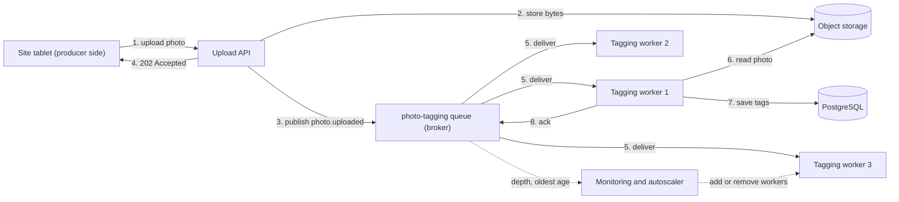
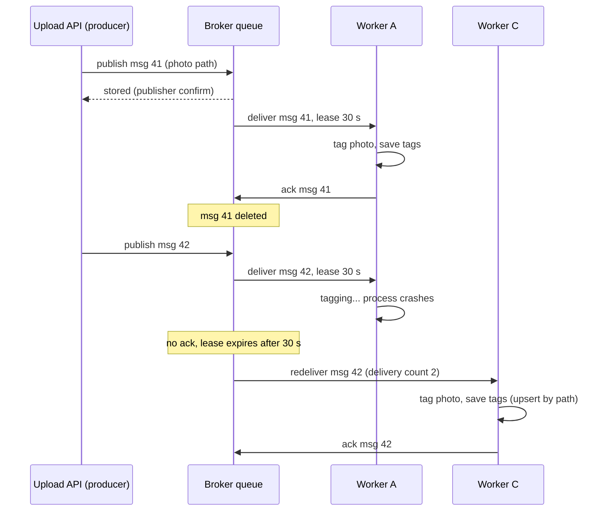

Most web requests do two kinds of work: the part the user is waiting for, and the part they are not. When a site engineer uploads a photo of a cracked culvert, they need to see "uploaded" in under a second. They do not need the AI defect tags, the thumbnail set and the weekly report entry right now. A message queue lets the API do the first part, write a small note saying "please do the rest", and answer immediately. Other machines pick up those notes and do the slow work at their own pace. This lesson explains how that waiting line works, why it makes systems calmer under load, and where it can go wrong.

## Learning objectives

By the end of this lesson you will be able to:

1. Explain producers, consumers, brokers, messages and acknowledgements in plain words and with the correct terms.
2. Describe how a queue buffers bursts (load levelling) and calculate backlog and drain time with simple arithmetic.
3. Explain what happens to a message when a consumer crashes, and why acknowledgements and visibility timeouts exist.
4. Scale consumers horizontally (competing consumers) and say what that does to ordering.
5. Use `System.Threading.Channels` as an in-process model of a queue, including bounded capacity and backpressure, and explain why it is not a durable queue.
6. Monitor a queue with depth, age of the oldest message and consumer throughput, and know which number to alert on.
7. Decide when a queue is the wrong tool and a simpler design (a synchronous call or a database table) is enough.

## Prerequisites

- [Synchronous versus asynchronous communication](#/lesson/m10-sync-async): what it means for a caller to wait, and temporal coupling.
- [Background processing and job queues](#/lesson/m11-background-processing): moving slow work out of the request path.
- Basic C# `async`/`await` and ASP.NET Core minimal APIs.

## Explain it like I'm a beginner

Think of a busy restaurant kitchen in Mumbai on a Saturday night.

Waiters take orders at the tables. They do not walk into the kitchen and stand next to the chef until the dish is ready; that would leave every other table waiting. Instead, each waiter writes the order on a slip and puts it on the **order rail** above the kitchen counter. Then the waiter goes back to the tables.

The cooks take slips off the rail one at a time, oldest first, and cook. When the dish leaves the kitchen, the cook spikes the slip on the "done" spike.

Map this to software:

- The waiter is the **producer**: the code that creates work.
- The slip is the **message**: a small description of the work ("table 7, two masala dosa").
- The rail is the **queue**, and the kitchen system that keeps it is the **broker**.
- The cook is the **consumer**: the code that does the work.
- Spiking the slip when the dish is done is the **acknowledgement (ack)**: "this one is finished, you can forget it".

Three good things happen. When 40 orders arrive at 8:30 pm, the rail simply gets longer; nobody is turned away (this is **buffering**). The kitchen can add a cook during the rush without the waiters noticing (**scaling consumers**). And if a cook burns their hand and walks away mid-dish, the slip is still on the rail, not spiked, so another cook picks it up (**redelivery**).

There is also a catch. If cooks are slower than waiters for the whole evening, the rail gets longer and longer, and the customer at table 7 waits an hour. A queue hides overload for a while; it does not remove it.

## First-principles explanation

### What a message queue is

A message queue is a piece of software (the broker) that stores messages in order and hands them out to consumers. Its job has four parts:

1. **Accept** a message from a producer and store it safely (often on disk, sometimes on several machines).
2. **Deliver** each message to one consumer.
3. **Wait** for that consumer to say it has finished (the ack).
4. **Redeliver** the message if the consumer fails or goes silent.

The producer and consumer never talk to each other directly. They only agree on the queue name and the message format (the **contract**). This is called **decoupling**: each side can be deployed, scaled, restarted or rewritten without the other side knowing.

Popular brokers include RabbitMQ, Amazon SQS, Azure Service Bus and Google Cloud Pub/Sub. Apache Kafka is related but works differently: it is a *log* that consumers read at their own position, rather than a queue that deletes messages after an ack. The next lessons cover [RabbitMQ](#/lesson/m12-rabbitmq) and [Kafka](#/lesson/m12-kafka).

### Why it exists: three problems with doing everything synchronously

**Problem 1: bursts.** Traffic is rarely flat. A construction-monitoring app used across 2,000 project sites sees most photo uploads between 5 pm and 7 pm, when engineers finish the shift and sync their tablets. If every upload triggers AI tagging inside the request, you need enough tagging servers for the 6 pm peak, and they sit idle the other 22 hours.

**Problem 2: fragile chains.** If the API calls the tagging service synchronously and the tagging service is down for five minutes, every upload fails for five minutes. With a queue, uploads keep succeeding; the messages wait; tagging catches up when the service returns. The availability of the API no longer depends on the availability of the tagging service (see [availability](#/lesson/m11-availability)).

**Problem 3: slow responses.** AI tagging takes about 1.5 seconds per photo (an estimate for this example). Users should not wait 1.5 seconds for work whose result they will look at tomorrow.

### Load levelling with real numbers

Let us size the photo pipeline. All numbers are estimates for a realistic example, not measurements.

- 2,000 sites × 40 photos per site per day = **80,000 photos/day**.
- Average rate: 80,000 ÷ 86,400 s ≈ **0.93 photos/s**.
- But 70 % arrive between 5 pm and 7 pm: 56,000 photos in 7,200 s ≈ **7.8 photos/s** at peak.
- One tagging worker handles 1 photo per 1.5 s ≈ **0.67 photos/s**.

**Without a queue** you need 7.8 ÷ 0.67 ≈ **12 workers** running all the time to keep up with the peak, or users see failures at 6 pm.

**With a queue and 3 workers** (3 × 0.67 = 2 photos/s):

- During the peak, the backlog grows by 7.8 − 2 = 5.8 photos/s. After 7,200 s the queue holds about 5.8 × 7,200 ≈ **41,800 messages**.
- After 7 pm, the remaining 24,000 photos arrive over 22 hours ≈ 0.3 photos/s, so the backlog shrinks at 2 − 0.3 = 1.7 photos/s.
- Drain time: 41,800 ÷ 1.7 ≈ 24,600 s ≈ **6.8 hours**. The queue is empty by about 2 am.

Three workers instead of twelve. The price is **latency**: a photo uploaded at 6:59 pm gets its tags around 2 am. For defect tags that the project manager reviews the next morning, that is fine. For a "photo rejected: too blurry" warning that the engineer must see while still on site, it is not, and that check should stay synchronous or get its own fast queue.

This idea is called **queue-based load levelling**: the queue turns a spiky arrival rate into a smooth processing rate. The rule that makes it work is simple: **over a full cycle (a day here), average consumer capacity must exceed average arrival rate.** Here 2 photos/s > 0.93 photos/s, so the queue always empties eventually. If capacity were below the average, the backlog would grow every day until something broke.

:::callout type=tip title="Little's law, the one formula worth remembering"
Average number of messages waiting (L) = arrival rate (λ) × average time each waits (W). Turn it around: W = L ÷ λ. If the queue holds 41,800 photos and workers drain 2 per second, the newest photo waits about 41,800 ÷ 2 = 20,900 s, nearly 6 hours. Queue depth alone means nothing until you divide it by throughput.
:::

### Acknowledgements and redelivery

The most important question about any queue is: **when does the broker forget a message?**

If the broker deletes a message the moment it hands it out (**auto-ack**), then a consumer crash after receiving it loses the message for ever. If the broker waits for an explicit "done" (**manual ack**), a crash means the broker never hears "done", so it gives the message to another consumer.

How does the broker know a consumer has gone silent? Two common mechanisms:

- **Connection-based** (RabbitMQ): unacknowledged messages are returned when the consumer's connection or channel closes. RabbitMQ also has a delivery acknowledgement timeout (30 minutes by default) for consumers that stay connected but never ack.
- **Lease-based** (Amazon SQS, Azure Service Bus): a received message becomes invisible for a **visibility timeout** or **lock duration** (30 seconds by default in SQS, 1 minute in Service Bus). If the consumer does not delete or complete it in time, it becomes visible again and someone else receives it.

Redelivery has an unavoidable side effect: **duplicates**. If a consumer finishes the work but crashes a millisecond before sending the ack, the broker cannot tell this apart from a crash before the work. It redelivers, and the work runs twice. This behaviour is called **at-least-once delivery**, and it is the default in almost every real system. The consequence is that consumers must be safe to run twice (**idempotent**). [Delivery guarantees](#/lesson/m12-delivery-guarantees) and [idempotent consumers](#/lesson/m12-idempotent-consumers) cover this in depth. For now, remember the rule: **ack after the work is done, and make the work safe to repeat.**

### Competing consumers and ordering

To process faster, you run several consumers on the same queue. Each message goes to exactly one of them. This is the **competing consumers** pattern, and it is how you scale a queue horizontally: one worker gives 0.67 photos/s, three give 2, ten give 6.7.

The trade-off is **ordering**. A queue hands messages out in order, but with three consumers, message 2 may finish before message 1 because consumer A got a large photo. Redelivery makes it worse: if message 1's consumer crashes, message 1 comes back *after* messages 2 to 50. If order matters for some data (all updates to one project's budget, for example), you need a design that keeps those messages on one consumer: a partitioned log like Kafka, single-active-consumer queues, or message sessions/groups keyed by project. For photo tagging, order does not matter, which is exactly why it is a good fit for a plain queue.

### Buffering is not infinite: backpressure

A queue absorbs bursts, but disks and memory are finite, and so is patience. Two dangers:

- **Unbounded growth.** If consumers are down for a day, an in-memory queue runs out of RAM, and even a disk-backed broker runs out of disk. RabbitMQ, for example, blocks publishers when memory or disk alarms trigger.
- **Stale work.** A message that waited 6 hours might no longer be wanted ("send OTP" after 6 hours is useless).

The defence is a **bounded queue** plus a deliberate policy for when it is full: make the producer wait (**backpressure**), reject the new message with an error such as HTTP 503 so the client retries later, or drop the oldest messages if only fresh data matters. Each choice is correct for some workload. Silent unbounded growth is never correct. Brokers also support **message TTL** (time to live), so stale messages expire instead of being processed. See [backpressure and load shedding](#/lesson/m13-backpressure).

### An in-process model: System.Threading.Channels

.NET has a built-in producer-consumer queue: `System.Threading.Channels`. A `Channel<T>` has a `Writer` (the producer side) and a `Reader` (the consumer side). It can be **bounded** (a fixed capacity) with a `FullMode` that says what happens when it is full: `Wait` (backpressure), `DropOldest`, `DropNewest` or `DropWrite`.

Channels are an excellent *model* of a queue and an excellent tool *inside one process*, for example to let an API endpoint hand work to a `BackgroundService`. But a channel is not a message broker:

| | `Channel<T>` | Message broker (RabbitMQ, SQS, Service Bus) |
|---|---|---|
| Survives a process crash or deploy | No: contents are lost | Yes (durable queues, persistent messages) |
| Shared by several servers | No: one process only | Yes |
| Acknowledgements and redelivery | No | Yes |
| Throughput | Millions per second (estimate: in-memory, no network) | Thousands to hundreds of thousands per second per node (varies widely) |
| Operational cost | None | A cluster to run, or a managed service bill |

Use a channel when losing queued work on restart is acceptable or recoverable (for example, re-scan a table on startup). Use a broker when the work must survive restarts and be shared across instances.

### What a message should contain

Keep messages small and self-describing:

- A **message id** (a GUID) chosen by the producer. Consumers use it to detect duplicates.
- A **type and version**, such as `photo.uploaded.v1`, so consumers can evolve.
- The **minimum data** needed, or a reference to it. Never put a 6 MB photo in a message; put it in [object storage](#/lesson/m11-object-storage) and send its path. This is the **claim check** pattern. Many brokers have size limits (Amazon SQS, for example, has long had a 256 KB limit, recently raised; check current documentation) and large messages slow everything down.
- A **timestamp** and a **correlation id** for tracing.

### Monitoring a queue

Four numbers tell you almost everything:

1. **Depth (ready messages):** how many are waiting. Useful, but only meaningful relative to throughput.
2. **Age of the oldest message:** how long the head of the line has waited. This is the best single number to alert on, because it is what users feel. "Oldest photo older than 8 hours" is a clear, actionable alert.
3. **In-flight (unacked) messages:** received but not yet acked. If this stays at the maximum, consumers may be stuck.
4. **Publish rate versus ack rate:** if publish is higher for long periods, the queue will grow without bound.

Consumers can **autoscale on queue depth or age**: KEDA on Kubernetes and Azure Container Apps both support scaling rules based on queue length.

### When a queue is the wrong tool

- **The caller needs the answer now.** Checking a UPI PIN, reading a balance or validating a coupon must be synchronous. A queue adds latency and complexity with no benefit.
- **Low volume.** A few hundred jobs a day can live in a PostgreSQL table that workers poll with `SELECT ... FOR UPDATE SKIP LOCKED`. You get transactions, durability and easy inspection with SQL, and no new infrastructure. Many teams run this pattern happily for years.
- **The work must be in the same transaction as the request.** A queue publish and a database commit are two separate systems; making them consistent needs the [transactional outbox](#/lesson/m12-outbox).
- **You are hiding a capacity problem.** If consumers are slower than the *average* arrival rate, a queue only delays the failure.

### Trade-offs

| You gain | You pay |
|---|---|
| Producers answer fast; slow work happens later | Results arrive later (eventual consistency) |
| Bursts are absorbed; fewer workers needed | A new system to run, monitor and secure |
| Producer and consumer fail and scale independently | Duplicates under at-least-once delivery |
| Easy horizontal scaling with competing consumers | Ordering is weakened |
| Work survives consumer crashes | Debugging spans several processes and a broker |

## Visual explanation

### Architecture: photo upload with a queue



Follow the numbers. The tablet uploads the photo to the API (1), which stores the bytes in object storage (2) and publishes a small `photo.uploaded` message containing only the storage path (3). The API answers `202 Accepted` straight away (4); the user does not wait for tagging. The broker delivers each message to one of three competing workers (5). A worker reads the photo from storage (6), saves the tags in PostgreSQL (7), and only then acknowledges the message (8). Dotted lines are the control loop: monitoring reads queue depth and the oldest message's age and adds or removes workers. Notice that the API never talks to the workers; the queue is the only thing they share.

### Sequence: a normal delivery, then a crash and redelivery



Message 41 is the happy path: the broker confirms it has stored the message, delivers it to worker A with a 30-second lease, and deletes it only after A acknowledges. Message 42 shows why acks exist: worker A crashes mid-way, so the broker never receives an ack. When the lease expires, the broker redelivers the same message to worker C with a delivery count of 2. Worker C saves the tags with an *upsert* keyed by the photo path, so even if worker A had saved tags before crashing, running the work twice produces the same result. That is idempotency in its simplest form.

## Step-by-step example

We will grow a photo-tagging pipeline in four steps, starting with the simplest thing that works.

### Step 1: synchronous tagging (the starting point)

```csharp
app.MapPost("/sites/{siteCode}/photos", async (string siteCode, PhotoUploadRequest req, IDefectTagger tagger, IPhotoTagStore store, CancellationToken ct) =>
{
    var tags = await tagger.TagAsync(new PhotoUploaded(siteCode, req.BlobPath, req.UploadedBy, req.TakenAt), ct); // ~1.5 s
    await store.SaveAsync(req.BlobPath, tags, ct);
    return Results.Ok(tags);
});
```

Every upload waits 1.5 seconds. At 7.8 uploads/s the API needs about 12 concurrent tagging calls at all times during the peak, and if the tagger is down, uploads fail.

### Step 2: an in-process queue with Channels

Move the slow work behind a bounded channel and a `BackgroundService`:

```csharp
var channel = Channel.CreateBounded<PhotoUploaded>(new BoundedChannelOptions(5_000)
{
    FullMode = BoundedChannelFullMode.Wait,   // backpressure: writers wait when full
    SingleReader = false,
    SingleWriter = false,
});

// Producer (endpoint): wait at most 2 s for space, otherwise tell the client to retry.
using var cts = CancellationTokenSource.CreateLinkedTokenSource(ct);
cts.CancelAfter(TimeSpan.FromSeconds(2));
await channel.Writer.WriteAsync(photo, cts.Token);

// Consumers (BackgroundService): three readers compete for items.
await Task.WhenAll(Enumerable.Range(0, 3).Select(async _ =>
{
    await foreach (var p in channel.Reader.ReadAllAsync(stoppingToken))
        await TagAndSaveAsync(p, stoppingToken);
}));
```

The API now answers in milliseconds, bursts are absorbed up to 5,000 photos, and a full channel pushes back on the clients instead of eating memory. But a deploy or crash loses every queued photo, and with three API instances each has its own private channel.

### Step 3: acknowledgements and redelivery

To survive consumer crashes, a delivery must be *leased*, not removed. The consumer gets the message plus a delivery tag, and the queue keeps a copy "in flight" until the consumer acks that tag. If the lease expires, the message goes back to the ready list with its delivery count raised. After too many deliveries, it goes to a dead-letter list instead of looping for ever (see [retries and dead-letter queues](#/lesson/m12-retries-dlq)). The production code below implements exactly this, in memory, so you can see the mechanics.

### Step 4: a real broker

Replace the in-memory implementation of `IMessageQueue<T>` with one backed by RabbitMQ, SQS or Service Bus. The endpoint and the worker do not change, because they depend only on the interface. Now queued messages survive restarts, all API instances publish to the same queue, and workers can run on separate machines and scale on queue age.

## Production-style C# implementation

The code below models a broker queue in memory so it compiles and runs without infrastructure. It has the three behaviours that matter: bounded capacity with backpressure, leases with delivery tags and redelivery after a visibility timeout, and dead-lettering after too many deliveries. In production, `IMessageQueue<T>` would wrap a real broker client; the worker and endpoints stay the same.

```text
SiteMedia.Api/
  Program.cs
  Messaging/MessagingContracts.cs
  Messaging/InMemoryQueue.cs
  Photos/PhotoTagging.cs
  Workers/PhotoTaggingWorker.cs
```

```csharp file=Messaging/MessagingContracts.cs
namespace SiteMedia.Messaging;

/// <summary>One delivery of a message. DeliveryTag is unique per delivery, MessageId per message.</summary>
public sealed record Delivery<T>(Guid MessageId, long DeliveryTag, T Body, int DeliveryCount, DateTimeOffset EnqueuedAt);

public sealed record QueueStats(
    int Ready,
    int InFlight,
    long Published,
    long Acked,
    long Redelivered,
    long DeadLettered,
    TimeSpan OldestReadyAge);

public sealed class QueueOptions
{
    /// <summary>Maximum messages held (ready + in flight). Publishers wait when it is reached.</summary>
    public int Capacity { get; set; } = 10_000;

    /// <summary>How long a consumer may hold a delivery before it is given to someone else.</summary>
    public TimeSpan VisibilityTimeout { get; set; } = TimeSpan.FromSeconds(30);

    /// <summary>After this many deliveries without an ack, the message is dead-lettered.</summary>
    public int MaxDeliveries { get; set; } = 5;

    /// <summary>How often expired leases are checked.</summary>
    public TimeSpan SweepInterval { get; set; } = TimeSpan.FromSeconds(1);
}

public interface IMessageQueue<T>
{
    /// <summary>Stores a message. Waits (backpressure) while the queue is at capacity.</summary>
    ValueTask PublishAsync(T body, CancellationToken ct = default);

    /// <summary>Waits for the next message and leases it to the caller.</summary>
    ValueTask<Delivery<T>> ReceiveAsync(CancellationToken ct = default);

    /// <summary>Work finished: forget the message. Returns false if the lease had already expired.</summary>
    bool Ack(long deliveryTag);

    /// <summary>Work failed: requeue it (counts as a delivery) or dead-letter it now.</summary>
    bool Nack(long deliveryTag, bool requeue);

    QueueStats GetStats();
}
```

```csharp file=Messaging/InMemoryQueue.cs
using System.Collections.Concurrent;
using System.Threading.Channels;
using Microsoft.Extensions.Options;

namespace SiteMedia.Messaging;

/// <summary>
/// In-memory model of a broker queue: bounded, leased deliveries, redelivery on timeout, dead-lettering.
/// Not durable: contents are lost when the process stops. Use it for tests, demos and local development.
/// </summary>
public sealed class InMemoryQueue<T> : IMessageQueue<T>, IDisposable
{
    private readonly QueueOptions _options;
    private readonly TimeProvider _clock;
    private readonly Channel<Delivery<T>> _ready = Channel.CreateUnbounded<Delivery<T>>();
    private readonly ConcurrentDictionary<long, (Delivery<T> Delivery, DateTimeOffset Deadline)> _inFlight = new();
    private readonly ConcurrentQueue<Delivery<T>> _deadLetters = new();
    private readonly SemaphoreSlim _capacity;
    private readonly ITimer _sweeper;
    private long _nextTag;
    private int _readyCount;
    private long _published, _acked, _redelivered, _deadLettered;

    public InMemoryQueue(IOptions<QueueOptions> options, TimeProvider clock)
    {
        _options = options.Value;
        if (_options.Capacity < 1) throw new ArgumentOutOfRangeException(nameof(options), "Capacity must be at least 1.");
        _clock = clock;
        _capacity = new SemaphoreSlim(_options.Capacity, _options.Capacity);
        _sweeper = clock.CreateTimer(_ => RequeueExpired(), null, _options.SweepInterval, _options.SweepInterval);
    }

    public IReadOnlyCollection<Delivery<T>> DeadLetters => _deadLetters.ToArray();

    public async ValueTask PublishAsync(T body, CancellationToken ct = default)
    {
        await _capacity.WaitAsync(ct);   // backpressure: wait for space
        var message = new Delivery<T>(Guid.NewGuid(), 0, body, 0, _clock.GetUtcNow());
        Interlocked.Increment(ref _readyCount);
        Interlocked.Increment(ref _published);
        _ready.Writer.TryWrite(message); // unbounded internally; capacity is enforced by the semaphore
    }

    public async ValueTask<Delivery<T>> ReceiveAsync(CancellationToken ct = default)
    {
        var message = await _ready.Reader.ReadAsync(ct);
        Interlocked.Decrement(ref _readyCount);
        var delivery = message with
        {
            DeliveryTag = Interlocked.Increment(ref _nextTag),
            DeliveryCount = message.DeliveryCount + 1,
        };
        _inFlight[delivery.DeliveryTag] = (delivery, _clock.GetUtcNow() + _options.VisibilityTimeout);
        return delivery;
    }

    public bool Ack(long deliveryTag)
    {
        if (!_inFlight.TryRemove(deliveryTag, out _)) return false;   // lease expired: someone else has it
        Interlocked.Increment(ref _acked);
        _capacity.Release();
        return true;
    }

    public bool Nack(long deliveryTag, bool requeue)
    {
        if (!_inFlight.TryRemove(deliveryTag, out var entry)) return false;
        if (requeue) Requeue(entry.Delivery);
        else DeadLetter(entry.Delivery);
        return true;
    }

    /// <summary>Returns expired leases to the ready list. Called by the timer; public for tests.</summary>
    public void RequeueExpired()
    {
        var now = _clock.GetUtcNow();
        foreach (var (tag, entry) in _inFlight)
            if (entry.Deadline <= now && _inFlight.TryRemove(tag, out var expired))
                Requeue(expired.Delivery);
    }

    public QueueStats GetStats()
    {
        var oldest = _ready.Reader.TryPeek(out var head) ? _clock.GetUtcNow() - head.EnqueuedAt : TimeSpan.Zero;
        return new QueueStats(
            Volatile.Read(ref _readyCount), _inFlight.Count,
            Interlocked.Read(ref _published), Interlocked.Read(ref _acked),
            Interlocked.Read(ref _redelivered), Interlocked.Read(ref _deadLettered),
            oldest);
    }

    private void Requeue(Delivery<T> delivery)
    {
        if (delivery.DeliveryCount >= _options.MaxDeliveries)
        {
            DeadLetter(delivery);
            return;
        }
        Interlocked.Increment(ref _redelivered);
        Interlocked.Increment(ref _readyCount);
        _ready.Writer.TryWrite(delivery with { DeliveryTag = 0 });
    }

    private void DeadLetter(Delivery<T> delivery)
    {
        _deadLetters.Enqueue(delivery);
        Interlocked.Increment(ref _deadLettered);
        _capacity.Release();
    }

    public void Dispose()
    {
        _sweeper.Dispose();
        _capacity.Dispose();
    }
}
```

```csharp file=Photos/PhotoTagging.cs
using System.Collections.Concurrent;

namespace SiteMedia.Photos;

/// <summary>The message: a reference to the photo (claim check), never the bytes.</summary>
public sealed record PhotoUploaded(string SiteCode, string BlobPath, string UploadedBy, DateTimeOffset TakenAt);

public interface IDefectTagger
{
    Task<IReadOnlyList<string>> TagAsync(PhotoUploaded photo, CancellationToken ct);
}

public interface IPhotoTagStore
{
    /// <summary>Upsert keyed by blob path: running it twice gives the same result (idempotent).</summary>
    Task SaveAsync(string blobPath, IReadOnlyList<string> tags, CancellationToken ct);
    Task<IReadOnlyList<string>?> GetAsync(string blobPath, CancellationToken ct);
}

/// <summary>Stands in for an AI model call that takes a while.</summary>
public sealed class FakeDefectTagger(TimeProvider clock) : IDefectTagger
{
    private static readonly string[] Labels = ["crack", "spalling", "honeycombing", "exposed-rebar", "water-ponding"];

    public async Task<IReadOnlyList<string>> TagAsync(PhotoUploaded photo, CancellationToken ct)
    {
        await Task.Delay(TimeSpan.FromMilliseconds(150), clock, ct);
        var seed = photo.BlobPath.Aggregate(17, (h, c) => unchecked(h * 31 + c));
        return [Labels[Math.Abs(seed % Labels.Length)]];
    }
}

public sealed class InMemoryPhotoTagStore : IPhotoTagStore
{
    private readonly ConcurrentDictionary<string, IReadOnlyList<string>> _tags = new();

    public Task SaveAsync(string blobPath, IReadOnlyList<string> tags, CancellationToken ct)
    {
        _tags[blobPath] = tags;
        return Task.CompletedTask;
    }

    public Task<IReadOnlyList<string>?> GetAsync(string blobPath, CancellationToken ct) =>
        Task.FromResult(_tags.TryGetValue(blobPath, out var t) ? t : null);
}
```

```csharp file=Workers/PhotoTaggingWorker.cs
using Microsoft.Extensions.Options;
using SiteMedia.Messaging;
using SiteMedia.Photos;

namespace SiteMedia.Workers;

public sealed class WorkerOptions
{
    /// <summary>Competing consumer loops in this process.</summary>
    public int Concurrency { get; set; } = 3;

    /// <summary>Must be shorter than the queue's visibility timeout, or the message is redelivered while we work.</summary>
    public TimeSpan HandlerTimeout { get; set; } = TimeSpan.FromSeconds(20);
}

public sealed class PhotoTaggingWorker(
    IMessageQueue<PhotoUploaded> queue,
    IDefectTagger tagger,
    IPhotoTagStore store,
    IOptions<WorkerOptions> options,
    ILogger<PhotoTaggingWorker> logger) : BackgroundService
{
    protected override Task ExecuteAsync(CancellationToken stoppingToken) =>
        Task.WhenAll(Enumerable.Range(1, Math.Max(1, options.Value.Concurrency))
                               .Select(n => ConsumeLoopAsync(n, stoppingToken)));

    private async Task ConsumeLoopAsync(int consumerNo, CancellationToken ct)
    {
        while (!ct.IsCancellationRequested)
        {
            Delivery<PhotoUploaded> delivery;
            try { delivery = await queue.ReceiveAsync(ct); }
            catch (OperationCanceledException) { return; }

            try
            {
                using var timeout = CancellationTokenSource.CreateLinkedTokenSource(ct);
                timeout.CancelAfter(options.Value.HandlerTimeout);

                var tags = await tagger.TagAsync(delivery.Body, timeout.Token);
                await store.SaveAsync(delivery.Body.BlobPath, tags, timeout.Token);

                // Ack only after the work is saved. A crash before this line means redelivery, not loss.
                if (!queue.Ack(delivery.DeliveryTag))
                    logger.LogWarning("Lease for {MessageId} expired before ack; it may be processed again", delivery.MessageId);
            }
            catch (OperationCanceledException) when (ct.IsCancellationRequested)
            {
                queue.Nack(delivery.DeliveryTag, requeue: true);   // shutting down: give it back
                return;
            }
            catch (Exception ex)
            {
                logger.LogWarning(ex, "Consumer {Consumer} failed {MessageId} (delivery {Count})",
                    consumerNo, delivery.MessageId, delivery.DeliveryCount);
                queue.Nack(delivery.DeliveryTag, requeue: true);   // the queue dead-letters after MaxDeliveries
            }
        }
    }
}
```

```csharp file=Program.cs
using SiteMedia.Messaging;
using SiteMedia.Photos;
using SiteMedia.Workers;

var builder = WebApplication.CreateBuilder(args);

builder.Services.AddSingleton(TimeProvider.System);
builder.Services.Configure<QueueOptions>(builder.Configuration.GetSection("Queue"));
builder.Services.Configure<WorkerOptions>(builder.Configuration.GetSection("Worker"));
builder.Services.AddSingleton<IMessageQueue<PhotoUploaded>, InMemoryQueue<PhotoUploaded>>();
builder.Services.AddSingleton<IDefectTagger, FakeDefectTagger>();
builder.Services.AddSingleton<IPhotoTagStore, InMemoryPhotoTagStore>();
builder.Services.AddHostedService<PhotoTaggingWorker>();

var app = builder.Build();

app.MapPost("/sites/{siteCode}/photos", async (string siteCode, PhotoUploadRequest req,
    IMessageQueue<PhotoUploaded> queue, CancellationToken ct) =>
{
    using var publishTimeout = CancellationTokenSource.CreateLinkedTokenSource(ct);
    publishTimeout.CancelAfter(TimeSpan.FromSeconds(2));
    try
    {
        await queue.PublishAsync(new PhotoUploaded(siteCode, req.BlobPath, req.UploadedBy, req.TakenAt), publishTimeout.Token);
    }
    catch (OperationCanceledException) when (!ct.IsCancellationRequested)
    {
        // The queue stayed full for 2 s: pass the backpressure on to the client instead of buffering in RAM.
        return Results.Problem("Photo processing is busy, please retry shortly.", statusCode: StatusCodes.Status503ServiceUnavailable);
    }
    return Results.Accepted($"/photo-tags?blobPath={Uri.EscapeDataString(req.BlobPath)}");
});

app.MapGet("/photo-tags", async (string blobPath, IPhotoTagStore store, CancellationToken ct) =>
    await store.GetAsync(blobPath, ct) is { } tags ? Results.Ok(tags) : Results.NotFound());

app.MapGet("/admin/queue", (IMessageQueue<PhotoUploaded> queue) => queue.GetStats());

app.Run();

public sealed record PhotoUploadRequest(string BlobPath, string UploadedBy, DateTimeOffset TakenAt);
```

What to notice:

- **Two identifiers.** `MessageId` identifies the message for its whole life (use it for deduplication). `DeliveryTag` identifies one delivery. A late ack from a consumer whose lease expired carries an old tag and is rejected, so it cannot accidentally acknowledge the redelivered copy. RabbitMQ uses delivery tags in exactly this way.
- **Capacity counts in-flight messages too.** Space is released only on ack or dead-letter, so a stuck consumer cannot make the queue look emptier than it is.
- **The handler timeout is shorter than the visibility timeout** (20 s versus 30 s). If it were longer, the broker would redeliver while the first consumer was still working, creating duplicates on purpose.
- **Graceful shutdown nacks with requeue**, so a deploy hands in-progress work back instead of losing it.
- **The upsert store makes duplicates harmless** for this workload. Other workloads need stronger tools; see [idempotent consumers](#/lesson/m12-idempotent-consumers).

For reference, the consumer side with a real broker looks like this with Azure Service Bus (not compiled here because the package is not available offline). Note the same shape: receive, work, complete; abandon on failure; the broker counts deliveries and dead-letters after `MaxDeliveryCount`.

```csharp
await using var client = new ServiceBusClient(connectionString);
await using var processor = client.CreateProcessor("photo-tagging", new ServiceBusProcessorOptions
{
    AutoCompleteMessages = false,   // manual ack
    MaxConcurrentCalls = 3,         // competing consumer loops in this process
    PrefetchCount = 6,
});
processor.ProcessMessageAsync += async args =>
{
    var photo = args.Message.Body.ToObjectFromJson<PhotoUploaded>()!;
    var tags = await tagger.TagAsync(photo, args.CancellationToken);
    await store.SaveAsync(photo.BlobPath, tags, args.CancellationToken);
    await args.CompleteMessageAsync(args.Message);   // the ack
};
processor.ProcessErrorAsync += args => { logger.LogError(args.Exception, "Service Bus error"); return Task.CompletedTask; };
await processor.StartProcessingAsync();
```

## Bad design vs good design

**Bad: auto-ack, then work.**

```csharp
var msg = await queue.ReceiveAsync(ct);
queue.Ack(msg.DeliveryTag);          // forgotten by the broker now
await tagger.TagAsync(msg.Body, ct); // a crash here loses the photo's tags for ever
```

This is *at-most-once* delivery by accident. It looks fine in testing, because tests rarely crash at the right moment. In production, every deploy that kills a busy worker silently loses the messages it was holding.

**Bad: an unbounded in-memory queue in the API.**

```csharp
private static readonly ConcurrentQueue<PhotoUploaded> Pending = new();   // grows without limit
app.MapPost("/photos", (PhotoUploaded p) => { Pending.Enqueue(p); return Results.Accepted(); });
```

During a tagging outage, memory grows until the API process is killed, taking every queued photo *and* the API with it. The users were told "accepted", so they will not retry.

**Bad: the whole photo in the message.** A 6 MB base64 payload per message makes the broker slow, hits size limits, and multiplies storage by the number of retries and copies.

**Good:** store the bytes in object storage, publish a small message with a stable id, ack only after the work is saved, bound the queue and push back when full, cap redeliveries with a dead-letter queue, keep the handler idempotent, and alert on the age of the oldest message. That is the implementation above.

:::callout type=tradeoff title="A database table can be your first queue"
For a few thousand jobs a day, a `jobs` table with `status`, `run_after` and `attempts` columns, polled with `SELECT ... FOR UPDATE SKIP LOCKED LIMIT 10`, gives you durability, transactions with your business data, and SQL for debugging. It stops being the right tool when polling load, lock contention or fan-out to many consumers starts to hurt. Moving to a broker later is easy if your code depends on an interface like `IMessageQueue<T>`.
:::

## Practical playground

Use the queue simulator to feel load levelling and backpressure. It starts with a producer at 80 messages/s, 4 consumers and 40 ms per message (capacity 4 × 25 = 100 messages/s, so utilisation 80 %).

1. Raise the producer rate to 120 messages/s. Watch the backlog line: it grows steadily because utilisation is above 100 %. Calculate how fast it should grow (120 − 100 = 20 messages/s) and check the chart.
2. Bring the rate back to 80 and turn on the consumer crash. All consumers stop for 30 seconds. How large does the backlog get (about 80 × 30 = 2,400)? How long does it take to drain at a spare capacity of 20 messages/s (about 120 s)?
3. During the crash, add consumers. What is the smallest number that drains the backlog within 30 seconds of the crash ending?

:::playground type=sim sim=queue title="Load levelling and consumer crashes" producerRate=80 consumers=4 processingMs=40
:::

## Exercises

:::exercise id=m12-message-queues-ex1 difficulty=beginner kind=written title="Queue or not?"
For each feature below, say whether you would put a message queue between the request and the work, and why. If yes, say what the message would contain.

1. A UPI payment app checks the user's PIN before a transfer.
2. After an order is placed on a grocery app, a GST invoice PDF is generated and emailed.
3. A project dashboard shows the current budget used on a highway package.
4. A drone survey uploads 3,000 images that must be stitched into an orthomosaic (takes about 40 minutes).
5. A user changes their profile photo and expects the new one on the next screen.
6. A railway booking site sends a booking-confirmation SMS.
::acceptance
- Every item has a yes or no with a reason based on "does the caller need the result now?"
- At least two "yes" answers name a message with an id and a reference rather than large data.
- Item 5 discusses the user-visible delay and how to hide it.
::hint
Ask: does the user need the *result* of this work in the same response?
::hint
Ask: is the work slow, bursty or dependent on another system that might be down?
::hint
For large inputs, the message should carry a pointer to the data, not the data itself.
::hint
For item 5, the bytes can be saved synchronously while the resizing happens later. What does the app show in the meantime?
::solution
| # | Queue? | Reason | Message |
|---|---|---|---|
| 1 | No | The transfer cannot continue without the answer; it must be synchronous and fast. | — |
| 2 | Yes | The customer does not wait for the PDF; generation is slow and email providers rate-limit. | `{ messageId, orderId, type: "invoice.requested.v1" }` |
| 3 | No | It is a read; the user wants current data now. Use a query, perhaps a cache. | — |
| 4 | Yes | 40 minutes cannot fit in a request. Bursty and heavy. | `{ messageId, surveyId, imagesPrefix: "s3://surveys/2026-10-19/pkg-4/" }` |
| 5 | Partly | Save the original synchronously and show it immediately (scaled by the browser). Queue the thumbnail generation; the app switches to the thumbnail when ready. | `{ messageId, userId, blobPath }` |
| 6 | Yes | SMS gateways are slow and sometimes down; the booking should not fail because of SMS. | `{ messageId, bookingId, phone, templateId }` |

The deciding question each time is "does the caller need the result now?" Queues are for work whose result can arrive later.
::mistakes
- Queuing reads (item 3). Queues are for commands and events, not for answering questions.
- Putting the 3,000 images or the PDF bytes in the message.
- Forgetting that item 5's user expects to see *something* immediately.
:::

:::exercise id=m12-message-queues-ex2 difficulty=beginner kind=code title="A bounded work queue with Channels"
Build a small in-process work queue on top of `System.Threading.Channels`. It is the building block you would use inside one ASP.NET Core process to hand work from endpoints to a background worker.
::requirements
- The constructor takes a capacity; values below 1 throw `ArgumentOutOfRangeException`.
- `TryEnqueue(item)` returns `true` if the item was accepted, `false` if the queue is full or has been completed.
- `Count` returns the number of items waiting.
- `Complete()` means "no more items will be added".
- `RunConsumersAsync(consumers, handler)` starts that many consumer loops that compete for items, finishes when the queue is completed **and** empty, and returns the total number of items processed.
::acceptance
- Capacity 2: the third `TryEnqueue` returns `false` and `Count` is 2.
- 100 items processed by 3 consumers: each item handled exactly once, total 100.
- After `Complete()`, `TryEnqueue` returns `false`.
- With 4 consumers and a handler that waits, more than one item is processed at the same time.
::hint
`Channel.CreateBounded<T>(new BoundedChannelOptions(capacity) { FullMode = BoundedChannelFullMode.Wait })` gives you a channel whose `Writer.TryWrite` returns `false` when full.
::hint
`Complete()` maps to `Writer.TryComplete()`. After that, `TryWrite` returns `false`.
::hint
`await foreach (var item in reader.ReadAllAsync(ct))` ends when the channel is completed and drained. Run several of those loops with `Task.WhenAll`.
::hint
Count processed items with `Interlocked.Increment(ref _processed)`, because several loops update it at once.
::hint
```csharp
var loops = Enumerable.Range(0, consumers).Select(async _ =>
{
    await foreach (var item in _channel.Reader.ReadAllAsync(ct))
    {
        await handler(item);
        Interlocked.Increment(ref processed);
    }
});
await Task.WhenAll(loops);
```
::starter
```csharp file=BoundedWorkQueue.cs
using System;
using System.Threading;
using System.Threading.Channels;
using System.Threading.Tasks;

public sealed class BoundedWorkQueue<T>
{
    public BoundedWorkQueue(int capacity)
    {
        throw new NotImplementedException();
    }

    public int Count => throw new NotImplementedException();

    public bool TryEnqueue(T item) => throw new NotImplementedException();

    public void Complete() => throw new NotImplementedException();

    public Task<int> RunConsumersAsync(int consumers, Func<T, Task> handler, CancellationToken ct = default) =>
        throw new NotImplementedException();
}
```
::tests
```csharp file=BoundedWorkQueueTests.cs
using System;
using System.Collections.Concurrent;
using System.Linq;
using System.Threading;
using System.Threading.Tasks;
using Xunit;

public class BoundedWorkQueueTests
{
    [Fact]
    public void Rejects_items_when_full()
    {
        var q = new BoundedWorkQueue<int>(2);
        Assert.True(q.TryEnqueue(1));
        Assert.True(q.TryEnqueue(2));
        Assert.False(q.TryEnqueue(3));
        Assert.Equal(2, q.Count);
    }

    [Fact]
    public void Capacity_below_one_throws() =>
        Assert.Throws<ArgumentOutOfRangeException>(() => new BoundedWorkQueue<int>(0));

    [Fact]
    public void Completed_queue_rejects_items()
    {
        var q = new BoundedWorkQueue<string>(10);
        q.Complete();
        Assert.False(q.TryEnqueue("late"));
    }

    [Fact]
    public async Task Every_item_is_processed_exactly_once()
    {
        var q = new BoundedWorkQueue<int>(100);
        for (var i = 0; i < 100; i++) Assert.True(q.TryEnqueue(i));
        q.Complete();

        var seen = new ConcurrentBag<int>();
        var processed = await q.RunConsumersAsync(3, i => { seen.Add(i); return Task.CompletedTask; });

        Assert.Equal(100, processed);
        Assert.Equal(100, seen.Distinct().Count());
        Assert.Equal(0, q.Count);
    }

    [Fact]
    public async Task Consumers_work_in_parallel()
    {
        var q = new BoundedWorkQueue<int>(8);
        for (var i = 0; i < 8; i++) q.TryEnqueue(i);
        q.Complete();

        int active = 0, maxActive = 0;
        await q.RunConsumersAsync(4, async _ =>
        {
            var now = Interlocked.Increment(ref active);
            int seenMax;
            do { seenMax = Volatile.Read(ref maxActive); }
            while (now > seenMax && Interlocked.CompareExchange(ref maxActive, now, seenMax) != seenMax);
            await Task.Delay(50);
            Interlocked.Decrement(ref active);
        });

        Assert.True(maxActive > 1, $"expected parallel consumers, max active was {maxActive}");
    }
}
```
::solution
A bounded channel already does the hard parts: thread-safe hand-off, capacity, completion and async waiting. The class is a thin, intention-revealing wrapper.

```csharp file=BoundedWorkQueue.cs
using System;
using System.Linq;
using System.Threading;
using System.Threading.Channels;
using System.Threading.Tasks;

public sealed class BoundedWorkQueue<T>
{
    private readonly Channel<T> _channel;

    public BoundedWorkQueue(int capacity)
    {
        if (capacity < 1) throw new ArgumentOutOfRangeException(nameof(capacity), "Capacity must be at least 1.");
        _channel = Channel.CreateBounded<T>(new BoundedChannelOptions(capacity)
        {
            FullMode = BoundedChannelFullMode.Wait,   // TryWrite returns false when full; WriteAsync would wait
            SingleReader = false,
            SingleWriter = false,
        });
    }

    public int Count => _channel.Reader.Count;

    public bool TryEnqueue(T item) => _channel.Writer.TryWrite(item);

    public void Complete() => _channel.Writer.TryComplete();

    public async Task<int> RunConsumersAsync(int consumers, Func<T, Task> handler, CancellationToken ct = default)
    {
        if (consumers < 1) throw new ArgumentOutOfRangeException(nameof(consumers));
        var processed = 0;

        var loops = Enumerable.Range(0, consumers).Select(async _ =>
        {
            await foreach (var item in _channel.Reader.ReadAllAsync(ct))
            {
                await handler(item);
                Interlocked.Increment(ref processed);
            }
        });

        await Task.WhenAll(loops);
        return processed;
    }
}
```

`TryEnqueue` returning `false` is the API's chance to answer `503 Service Unavailable` with a `Retry-After` header instead of buffering without limit. In an endpoint you might prefer `Writer.WriteAsync` with a short timeout, which waits a little before giving up.
::alternatives
- `BoundedChannelFullMode.DropOldest` is right for "latest value wins" data such as live GPS positions, where an old reading is worthless.
- `BlockingCollection<T>` is the older, synchronous equivalent; prefer channels in async code.
::mistakes
- Using `Channel.CreateUnbounded`, which removes the capacity limit you were asked for.
- Counting processed items with `processed++` from several loops (a data race).
- Returning from `RunConsumersAsync` before all loops finish, for example by awaiting only the first task.
::extensions
Add an `EnqueueAsync(item, TimeSpan maxWait)` that waits up to `maxWait` for space and then returns `false`.
:::

:::exercise id=m12-message-queues-ex3 difficulty=intermediate kind=written title="Results day: size the email queue"
A state examination board publishes results for 12 lakh (1,200,000) students at 10:00. Each student gets an email with a link to their marksheet. The email provider allows 200 emails per second for this account. Each queued message is about 1 KB.

Answer with arithmetic:

1. If the board sends emails synchronously when results are published, what goes wrong?
2. With a queue and enough workers to use the full 200/s, how long until the last student gets their email?
3. How much queue storage do you need at the peak?
4. The board wants every student emailed within 30 minutes. What are your options, and what does each cost?
5. What should you alert on during the send?
::acceptance
- Drain time is calculated correctly (about 100 minutes).
- Storage is estimated (about 1.2 GB) with the arithmetic shown.
- At least two options for the 30-minute goal, with their trade-offs.
- The alert is based on age or projected drain time, not only queue depth.
::hint
Drain time = messages ÷ rate. Convert seconds to minutes.
::hint
Storage = messages × size per message. 1 KB × 1,000,000 ≈ 1 GB.
::hint
To meet 30 minutes you need 1,200,000 ÷ 1,800 s ≈ 667 emails/s. Where could the extra capacity come from? Or does every student need an email at all?
::hint
Users feel waiting time, not depth. Which metric shows "the last student will wait too long"?
::solution
1. **Synchronous send:** 1,200,000 emails at 200/s cannot fit in one request; the publishing job either runs for 100 minutes holding a connection, or blasts the provider, gets throttled (HTTP 429) and drops emails. Any crash midway leaves no record of who was emailed.
2. **Drain time:** 1,200,000 ÷ 200/s = 6,000 s = **100 minutes**. The last student gets the email around 11:40.
3. **Storage:** 1,200,000 × 1 KB ≈ 1.2 GB at 10:00, shrinking at 200 messages/s. Any broker handles this comfortably; an in-memory channel in one web process would be risky.
4. **Options for 30 minutes** (needs about 1,200,000 ÷ 1,800 s ≈ 667 emails/s):
   - Buy a higher rate limit from the provider, or split across two or three providers. Cost: money and integration work.
   - Send in waves by district so each wave meets a 30-minute target, and publish results to districts on a schedule. Cost: a policy change.
   - Change the requirement: send one SMS or push notification ("results are out, check the portal"), which is cheaper and faster, and email the marksheet link afterwards. Cost: the portal must handle the read spike (CDN and caching, see [CDN architecture](#/lesson/m11-cdn)).
   - Do *not* simply add more workers: they will all hit the same 200/s provider limit.
5. **Alerts:** age of the oldest message (for example "older than 40 minutes"), send rate below 180/s for 5 minutes (a throttled or failing provider), and a growing dead-letter count (bounced addresses). A projected drain time = depth ÷ current send rate is a great dashboard number.
::mistakes
- Thinking more consumers always means faster; the bottleneck is the provider's rate limit.
- Treating 1.2 GB as a problem for a broker (it is not) or as safe in web-server memory (it is not).
- Alerting on depth alone; 600,000 messages is normal at 10:50 and alarming at 13:00.
:::

:::exercise id=m12-message-queues-ex4 difficulty=intermediate kind=code title="Leases, redelivery and dead letters"
Implement a single-threaded model of a broker queue with acknowledgements. Consumers receive a *lease*; if they do not ack before the visibility timeout, the message goes back to the queue. After too many deliveries it is dead-lettered.
::requirements
- `Enqueue(body)` adds a message to the back of the ready list.
- `TryReceive()` first returns expired leases to the **back** of the ready list (or to `DeadLetters` if the lease's `DeliveryCount` has reached `maxDeliveries`), then returns the next ready message as a new `Lease` with a new, increasing `Tag` and `DeliveryCount` raised by one. It returns `null` when nothing is ready.
- `Ack(tag)` returns `true` and removes the in-flight lease if the tag is current; it returns `false` for unknown or expired tags.
- `Ready` and `InFlight` report counts. Time comes from the injected `TimeProvider`.
::acceptance
- Messages are received in FIFO order with `DeliveryCount` 1.
- An unacked lease is not redelivered before the timeout, and is redelivered after it with `DeliveryCount` 2 and a different tag.
- A redelivered message goes behind messages that were already waiting.
- A stale ack (old tag after redelivery) returns `false` and does not remove the new lease.
- After `maxDeliveries` expired leases, the message is in `DeadLetters` and is not delivered again.
::hint
Keep two collections: a `Queue` of ready messages and a `Dictionary<long, ...>` of in-flight leases keyed by tag, each with its deadline.
::hint
The ready list must remember the delivery count of a message that comes back, so store `(T Body, int DeliveryCount)` pairs.
::hint
Write a private `Reclaim()` that runs at the start of `TryReceive()`: find in-flight entries whose deadline is `<= now`, remove them, and either dead-letter or re-enqueue them.
::hint
Process expired leases in tag order so the result is deterministic when several expire at once.
::hint
```csharp
foreach (var (tag, entry) in _inFlight.Where(e => e.Value.Deadline <= now).OrderBy(e => e.Key).ToList())
{
    _inFlight.Remove(tag);
    if (entry.Lease.DeliveryCount >= _maxDeliveries) _dead.Add(entry.Lease.Body);
    else _ready.Enqueue((entry.Lease.Body, entry.Lease.DeliveryCount));
}
```
::starter
```csharp file=LeaseQueue.cs
using System;
using System.Collections.Generic;
using System.Linq;

public sealed record Lease<T>(long Tag, T Body, int DeliveryCount);

public sealed class LeaseQueue<T>
{
    public LeaseQueue(TimeSpan visibilityTimeout, int maxDeliveries, TimeProvider clock)
    {
        throw new NotImplementedException();
    }

    public int Ready => throw new NotImplementedException();
    public int InFlight => throw new NotImplementedException();
    public IReadOnlyList<T> DeadLetters => throw new NotImplementedException();

    public void Enqueue(T body) => throw new NotImplementedException();

    public Lease<T>? TryReceive() => throw new NotImplementedException();

    public bool Ack(long tag) => throw new NotImplementedException();
}
```
::tests
```csharp file=LeaseQueueTests.cs
using System;
using Xunit;

public sealed class FakeClock : TimeProvider
{
    private DateTimeOffset _now = new(2026, 10, 19, 18, 0, 0, TimeSpan.FromHours(5.5));
    public override DateTimeOffset GetUtcNow() => _now.ToUniversalTime();
    public void Advance(TimeSpan by) => _now += by;
}

public class LeaseQueueTests
{
    private static (LeaseQueue<string> Q, FakeClock Clock) Make(int maxDeliveries = 3)
    {
        var clock = new FakeClock();
        return (new LeaseQueue<string>(TimeSpan.FromSeconds(30), maxDeliveries, clock), clock);
    }

    [Fact]
    public void Receives_in_fifo_order()
    {
        var (q, _) = Make();
        q.Enqueue("a"); q.Enqueue("b");
        var first = q.TryReceive()!;
        Assert.Equal("a", first.Body);
        Assert.Equal(1, first.DeliveryCount);
        Assert.Equal("b", q.TryReceive()!.Body);
        Assert.Null(q.TryReceive());
        Assert.Equal(2, q.InFlight);
    }

    [Fact]
    public void Unacked_lease_is_redelivered_only_after_timeout()
    {
        var (q, clock) = Make();
        q.Enqueue("a");
        var first = q.TryReceive()!;
        clock.Advance(TimeSpan.FromSeconds(29));
        Assert.Null(q.TryReceive());
        clock.Advance(TimeSpan.FromSeconds(1));
        var again = q.TryReceive()!;
        Assert.Equal("a", again.Body);
        Assert.Equal(2, again.DeliveryCount);
        Assert.NotEqual(first.Tag, again.Tag);
    }

    [Fact]
    public void Redelivered_message_goes_to_the_back()
    {
        var (q, clock) = Make();
        q.Enqueue("a"); q.Enqueue("b");
        q.TryReceive();                      // lease "a", never acked
        clock.Advance(TimeSpan.FromSeconds(31));
        Assert.Equal("b", q.TryReceive()!.Body);
        Assert.Equal("a", q.TryReceive()!.Body);
    }

    [Fact]
    public void Ack_removes_and_second_ack_fails()
    {
        var (q, _) = Make();
        q.Enqueue("a");
        var lease = q.TryReceive()!;
        Assert.True(q.Ack(lease.Tag));
        Assert.False(q.Ack(lease.Tag));
        Assert.Equal(0, q.InFlight);
        Assert.Equal(0, q.Ready);
    }

    [Fact]
    public void Stale_ack_does_not_remove_new_lease()
    {
        var (q, clock) = Make();
        q.Enqueue("a");
        var old = q.TryReceive()!;
        clock.Advance(TimeSpan.FromSeconds(31));
        var fresh = q.TryReceive()!;
        Assert.False(q.Ack(old.Tag));
        Assert.Equal(1, q.InFlight);
        Assert.True(q.Ack(fresh.Tag));
    }

    [Fact]
    public void Dead_letters_after_max_deliveries()
    {
        var (q, clock) = Make(maxDeliveries: 2);
        q.Enqueue("poison");
        q.TryReceive();
        clock.Advance(TimeSpan.FromSeconds(31));
        Assert.Equal(2, q.TryReceive()!.DeliveryCount);
        clock.Advance(TimeSpan.FromSeconds(31));
        Assert.Null(q.TryReceive());
        Assert.Equal("poison", Assert.Single(q.DeadLetters));
        Assert.Equal(0, q.InFlight);
    }
}
```
::solution
Two collections and one reclaim step. The tag is what makes stale acks safe: each delivery gets a new one, so an ack can only refer to the delivery it came from.

```csharp file=LeaseQueue.cs
using System;
using System.Collections.Generic;
using System.Linq;

public sealed record Lease<T>(long Tag, T Body, int DeliveryCount);

public sealed class LeaseQueue<T>
{
    private readonly TimeSpan _visibilityTimeout;
    private readonly int _maxDeliveries;
    private readonly TimeProvider _clock;
    private readonly Queue<(T Body, int DeliveryCount)> _ready = new();
    private readonly Dictionary<long, (Lease<T> Lease, DateTimeOffset Deadline)> _inFlight = new();
    private readonly List<T> _dead = new();
    private long _nextTag;

    public LeaseQueue(TimeSpan visibilityTimeout, int maxDeliveries, TimeProvider clock)
    {
        if (visibilityTimeout <= TimeSpan.Zero) throw new ArgumentOutOfRangeException(nameof(visibilityTimeout));
        if (maxDeliveries < 1) throw new ArgumentOutOfRangeException(nameof(maxDeliveries));
        _visibilityTimeout = visibilityTimeout;
        _maxDeliveries = maxDeliveries;
        _clock = clock;
    }

    public int Ready => _ready.Count;
    public int InFlight => _inFlight.Count;
    public IReadOnlyList<T> DeadLetters => _dead;

    public void Enqueue(T body) => _ready.Enqueue((body, 0));

    public Lease<T>? TryReceive()
    {
        Reclaim();
        if (!_ready.TryDequeue(out var next)) return null;

        var lease = new Lease<T>(++_nextTag, next.Body, next.DeliveryCount + 1);
        _inFlight[lease.Tag] = (lease, _clock.GetUtcNow() + _visibilityTimeout);
        return lease;
    }

    public bool Ack(long tag) => _inFlight.Remove(tag);

    private void Reclaim()
    {
        var now = _clock.GetUtcNow();
        var expired = _inFlight.Where(e => e.Value.Deadline <= now).OrderBy(e => e.Key).ToList();
        foreach (var (tag, entry) in expired)
        {
            _inFlight.Remove(tag);
            if (entry.Lease.DeliveryCount >= _maxDeliveries) _dead.Add(entry.Lease.Body);
            else _ready.Enqueue((entry.Lease.Body, entry.Lease.DeliveryCount));
        }
    }
}
```

Reclaiming lazily (on the next receive) is how many simple systems work, and it is easy to test. A real broker also reclaims on a timer so that `Ready` is accurate even when nobody is receiving. Note that the dead-letter check uses the count of deliveries already made: with `maxDeliveries = 2`, the second expiry dead-letters the message.
::alternatives
SQS-style queues let the consumer *extend* a lease (`ChangeMessageVisibility`) for long jobs. Add `bool Extend(long tag, TimeSpan by)` that moves the deadline if the tag is still current.
::mistakes
- Reusing the same tag for a redelivery, so a stale ack removes the new lease and the message is lost.
- Putting redelivered messages at the front, which lets one poison message starve everything behind it.
- Forgetting to carry the delivery count through the ready list, so the dead-letter limit never triggers.
::extensions
Add `Nack(tag, requeue)`: `requeue = true` puts it back immediately (counting a delivery), `false` dead-letters it.
:::

:::exercise id=m12-message-queues-ex5 difficulty=advanced kind=hld title="Design the site photo pipeline"
The photo pipeline from this lesson must now serve 6,000 sites (3× today) and add a second consumer: a weekly progress report that needs every photo's tags. Requirements:

- Uploads must keep succeeding when tagging is down for up to 2 hours.
- 95 % of photos should be tagged within 8 hours.
- The "too blurry, please retake" warning must reach the engineer in under 5 seconds.
- Peak: 70 % of uploads between 5 pm and 7 pm.

Extend the starter graph and write down your numbers.
::acceptance
- The graph separates the fast blur check from the slow tagging path.
- Worker count is calculated from the peak and the 8-hour target, with arithmetic.
- The 2-hour outage is handled with a backlog estimate.
- Monitoring and a dead-letter queue are shown, with what you alert on.
- The second consumer (reports) does not slow down or steal messages from tagging.
::hint
New volume: 6,000 × 40 = 240,000 photos/day; peak ≈ 168,000 in 7,200 s ≈ 23 photos/s.
::hint
The blur check is fast and needed immediately. Should it be in a queue at all?
::hint
If two different consumers each need every message, one queue with competing consumers is wrong: each message goes to only one of them. What do you need instead?
::hint
For the 8-hour target, the backlog at 7 pm must drain within about 6 hours (2 hours of peak already used). Work out the capacity needed: backlog at 7 pm ÷ 6 h plus the trickle rate.
::starter
```json
{
  "nodes": [
    { "id": "tab", "type": "client", "label": "Site tablets", "props": { "rps": 23 } },
    { "id": "api", "type": "app-server", "label": "Upload API", "props": { "instances": 2 } },
    { "id": "s3", "type": "object-storage", "label": "Photo storage" },
    { "id": "q", "type": "queue", "label": "photo-tagging" },
    { "id": "w", "type": "worker", "label": "Tagging workers", "props": { "instances": 3 } },
    { "id": "db", "type": "database", "label": "PostgreSQL" }
  ],
  "edges": [
    { "from": "tab", "to": "api", "kind": "sync" },
    { "from": "api", "to": "s3", "kind": "sync" },
    { "from": "api", "to": "q", "kind": "async" },
    { "from": "q", "to": "w", "kind": "async" },
    { "from": "w", "to": "db", "kind": "sync" }
  ]
}
```
::solution
```json
{
  "nodes": [
    { "id": "tab", "type": "client", "label": "Site tablets", "props": { "rps": 23 } },
    { "id": "lb", "type": "load-balancer", "label": "Load balancer" },
    { "id": "api", "type": "app-server", "label": "Upload API + blur check (sync, ~200 ms)", "props": { "instances": 3 } },
    { "id": "s3", "type": "object-storage", "label": "Photo storage" },
    { "id": "ex", "type": "queue", "label": "photo.uploaded (fanout to 2 queues)" },
    { "id": "qt", "type": "queue", "label": "photo-tagging queue" },
    { "id": "qr", "type": "queue", "label": "report-indexing queue" },
    { "id": "wt", "type": "worker", "label": "Tagging workers (autoscale 4 to 30 on oldest age)", "props": { "instances": 8 } },
    { "id": "wr", "type": "worker", "label": "Report indexer", "props": { "instances": 1 } },
    { "id": "dlq", "type": "queue", "label": "photo-tagging.dlq" },
    { "id": "db", "type": "database", "label": "PostgreSQL (tags, report index)" },
    { "id": "mon", "type": "monitoring", "label": "Oldest age, depth, DLQ count" }
  ],
  "edges": [
    { "from": "tab", "to": "lb", "kind": "sync" },
    { "from": "lb", "to": "api", "kind": "sync" },
    { "from": "api", "to": "s3", "kind": "sync", "label": "store bytes" },
    { "from": "api", "to": "ex", "kind": "async", "label": "publish id + path" },
    { "from": "ex", "to": "qt", "kind": "async" },
    { "from": "ex", "to": "qr", "kind": "async" },
    { "from": "qt", "to": "wt", "kind": "async" },
    { "from": "qr", "to": "wr", "kind": "async" },
    { "from": "wt", "to": "s3", "kind": "sync", "label": "read photo" },
    { "from": "wt", "to": "db", "kind": "sync", "label": "upsert tags" },
    { "from": "wr", "to": "db", "kind": "sync" },
    { "from": "wt", "to": "dlq", "kind": "async", "label": "after 5 deliveries" },
    { "from": "qt", "to": "mon", "kind": "async" },
    { "from": "dlq", "to": "mon", "kind": "async" }
  ]
}
```

**Blur check stays synchronous.** It is fast (estimated 200 ms on a small model or a Laplacian-variance check) and the user needs the answer while on site. Putting it in a queue would make the 5-second target depend on queue depth at 6 pm.

**Fan-out for two consumers.** Tagging and report indexing each need *every* message, so the API publishes to a fanout exchange (or topic) that copies each message into two queues. Each queue has its own consumers, its own backlog and its own speed. A slow report indexer cannot delay tagging. [RabbitMQ exchanges](#/lesson/m12-rabbitmq) show how.

**Worker sizing (estimates).**
- 240,000 photos/day; peak 168,000 over 7,200 s ≈ 23.3/s; rest 72,000 over 79,200 s ≈ 0.9/s.
- With *n* workers at 0.67/s each, backlog at 7 pm = (23.3 − 0.67n) × 7,200.
- To be under 8 hours for 95 %, the 7 pm backlog must drain in about 6 h (21,600 s): (23.3 − 0.67n) × 7,200 ≤ (0.67n − 0.9) × 21,600.
- Solving: 167,800 − 4,824n ≤ 14,472n − 19,440 → 187,240 ≤ 19,296n → **n ≥ 10**. Plan 12 at peak for headroom, autoscaling between 4 and 30 on oldest-message age.

**Two-hour tagging outage at peak.** About 23.3 × 7,200 ≈ 168,000 messages accumulate. At 1 KB each that is about 170 MB, easy for a broker. After recovery, scale workers to 30 (20/s) to drain in about 2.5 hours, keeping the 8-hour target for most photos. Uploads are unaffected because the API only depends on storage and the broker.

**Dead-letter queue.** After 5 failed deliveries (corrupt image, unsupported format), messages go to the DLQ. Alerts: oldest message in `photo-tagging` older than 6 hours, DLQ count above zero for more than an hour, and publish rate far above ack rate for 30 minutes. See [retries and dead-letter queues](#/lesson/m12-retries-dlq).
::mistakes
- Two consumer types on one queue: each photo would be tagged *or* indexed, not both.
- Putting the blur check behind the queue, breaking the 5-second requirement at peak.
- Sizing workers for the average (240,000 ÷ 86,400 ≈ 2.8/s → 4 workers) and missing the 8-hour target by a wide margin.
:::

## Automated testing

Queue code is concurrency code, so test it at three levels.

**1. Queue semantics with a fake clock.** `InMemoryQueue<T>` takes a `TimeProvider`, so tests can control time. Because its sweeper timer is created through the same `TimeProvider`, a fake clock can also fire it. Here we call `RequeueExpired()` directly to keep the test simple:

```csharp
[Fact]
public async Task Unacked_message_is_redelivered_after_visibility_timeout()
{
    var clock = new FakeClock();
    using var queue = new InMemoryQueue<string>(Options.Create(new QueueOptions { VisibilityTimeout = TimeSpan.FromSeconds(30) }), clock);
    await queue.PublishAsync("photo-1");

    var first = await queue.ReceiveAsync();        // worker "crashes": no ack
    clock.Advance(TimeSpan.FromSeconds(31));
    queue.RequeueExpired();

    var second = await queue.ReceiveAsync();
    Assert.Equal(first.MessageId, second.MessageId);
    Assert.Equal(2, second.DeliveryCount);
    Assert.False(queue.Ack(first.DeliveryTag));    // stale tag rejected
    Assert.True(queue.Ack(second.DeliveryTag));
}
```

**2. Backpressure.** Create a queue with `Capacity = 1`, publish one message, and assert that a second `PublishAsync` with a 100 ms cancellation token throws `OperationCanceledException`. Then ack the first message and assert the second publish succeeds.

**3. The worker with fakes.** Register a fake tagger that throws on its first call and succeeds on the second. Start the `PhotoTaggingWorker` with `StartAsync`, publish one message, wait until the store contains the tags (poll with a timeout), and assert the `Redelivered` stat is 1 and `DeadLettered` is 0. Also test shutdown: cancel during a slow tagging call and assert the message is back in the ready list, not lost.

**4. Against a real broker in CI.** Run RabbitMQ or the Service Bus emulator in a container (Testcontainers) to check what in-memory tests cannot: that queues are durable, that messages survive a broker restart, and that your lock duration really is longer than your handler timeout.

Edge cases worth a test: a message that always fails (reaches the DLQ after exactly `MaxDeliveries`), a late ack after redelivery, and a burst of 10× capacity publishes (producers wait, nothing is dropped, nothing is processed twice in a happy run).

## Real-world application

- **Order and notification pipelines.** A system like a large Indian e-commerce or food-delivery platform typically publishes "order placed" once and lets separate consumers send SMS, generate the GST invoice, notify the restaurant or warehouse and update analytics, each at its own pace.
- **Government portals on deadline days.** Tax and filing portals see enormous spikes on the last day. Accepting a submission quickly and processing acknowledgements, validations and receipts from a queue is the standard way to survive these spikes; the receipt arrives by email later.
- **Media processing.** Video platforms queue transcoding jobs; one upload becomes jobs for several resolutions. Construction and survey platforms queue drone-image stitching and photo analysis in the same way.
- **Managed services.** Amazon SQS, Azure Service Bus and Google Cloud Pub/Sub remove the operational work of running a broker. Many teams start there and move to self-managed RabbitMQ or Kafka only when they need specific features or lower cost at very high volume.
- **Inside one service.** ASP.NET Core apps use `System.Threading.Channels` with a `BackgroundService` for audit-log batching, metrics aggregation and webhook dispatch, where a restart losing a few seconds of queued work is acceptable or recoverable.

## Interview questions

:::interview
::q beginner
What is a message queue and why would you use one?
::a
A message queue is a broker that stores messages from producers and delivers each one to a consumer, deleting it only after the consumer acknowledges it. You use one to decouple the code that creates work from the code that does it: the producer answers quickly, bursts are absorbed by the queue (load levelling), consumers scale independently, and work survives consumer crashes because unacked messages are redelivered. You pay with added latency, an extra system to run, possible duplicates and weaker ordering.
::q beginner
What is an acknowledgement, and what happens if the consumer crashes before sending it?
::a
An ack is the consumer telling the broker "I have finished this message, you can delete it". Until the broker gets it, the message stays in flight. If the consumer crashes or its lease or visibility timeout expires, the broker makes the message available again and another consumer receives it. This is why you should ack only after the work is saved, and why consumers must tolerate duplicates: a crash after the work but before the ack causes the work to run twice.
::q intermediate
Your queue has 50,000 messages in it. Is that a problem?
::a
It depends on throughput and on how old the messages are. Divide depth by the consumer rate to get the wait time (Little's law): at 5,000 messages/s that is 10 seconds; at 10 messages/s it is 83 minutes. Then compare with the business target. I would look at the age of the oldest message, publish rate versus ack rate (is it growing or draining?), in-flight count (are consumers stuck?) and the dead-letter count. I alert on oldest age and on sustained publish rate above ack rate, not on raw depth.
::q intermediate
When would you use System.Threading.Channels instead of RabbitMQ or SQS?
::a
Inside a single process, when queued work can be lost on restart or rebuilt from another source: buffering audit logs or metrics before a batch write, handing work from an endpoint to a background service, or connecting stages of an in-memory pipeline. Channels are fast, have bounded capacity with backpressure and need no infrastructure. They are not durable, not shared across instances, and have no acknowledgements or redelivery, so for business-critical work that must survive deploys and crashes I would use a broker, or at least a database table polled with `FOR UPDATE SKIP LOCKED`.
::q advanced
How do you size the number of consumers for a bursty workload?
::a
Measure or estimate three numbers: peak arrival rate and its duration, off-peak rate, and per-consumer throughput. Then decide the acceptable delay. Without a queue you need peak ÷ per-consumer throughput. With a queue, the backlog after the peak is (peak − capacity) × duration, and it drains at (capacity − off-peak rate); choose capacity so that drain time meets the delay target, and make sure capacity exceeds the average rate over the whole cycle. Add headroom for redeliveries and failures, autoscale on oldest-message age, and check that downstream dependencies (database, external APIs) can actually handle the consumer concurrency, because they are often the real limit.
::q advanced
What can go wrong when the handler takes longer than the visibility timeout?
::a
The broker assumes the consumer has died and redelivers the message to another consumer while the first is still working. Now two consumers process the same message concurrently, which can double side effects or cause conflicting writes, and the first consumer's ack fails or acks a delivery that no longer exists. Fixes: keep the handler timeout shorter than the visibility timeout, extend the lease for long jobs (SQS `ChangeMessageVisibility`, Service Bus lock renewal), split long jobs into smaller steps, and make the handler idempotent so the occasional overlap is harmless.
:::

## Summary and revision

**Key takeaways**

- A queue sits between producers and consumers; neither knows about the other.
- Queues absorb bursts (load levelling): size consumers for the *average over a cycle* plus an acceptable drain time, not for the peak.
- Little's law: waiting time = depth ÷ throughput. Depth means nothing on its own.
- Ack after the work is saved. Crashes cause redelivery, which means duplicates, which means idempotent consumers.
- Competing consumers scale throughput but weaken ordering.
- Bound your queues and decide what happens when they are full (wait, reject, drop oldest).
- `Channel<T>` is a great in-process queue and model, but it is not durable or shared.
- Alert on the age of the oldest message and on publish rate exceeding ack rate.
- Use a synchronous call when the caller needs the answer, and a database table when volume is low.

**Terminology:** producer, consumer, broker, message, acknowledgement (ack), negative acknowledgement (nack), visibility timeout or lock duration, delivery tag, redelivery, at-least-once delivery, competing consumers, load levelling, backpressure, dead-letter queue, claim check, message TTL.

:::flashcards
Q: What is load levelling?
A: Using a queue to turn spiky arrivals into a smooth processing rate, so consumers can be sized for the average over a cycle rather than the peak. The price is extra latency during and after bursts.
Q: When should a consumer ack a message?
A: After the work is done and saved. Acking first turns any crash into a lost message.
Q: Why do redeliveries cause duplicates?
A: The broker cannot tell "crashed before the work" from "crashed after the work but before the ack", so it redelivers in both cases.
Q: What is a visibility timeout?
A: How long a received message stays hidden from other consumers. If it is not deleted or completed in time, it becomes visible and is delivered again.
Q: Little's law for queues?
A: Messages waiting = arrival rate × waiting time, so waiting time ≈ depth ÷ throughput.
Q: Best single metric to alert on for a queue?
A: Age of the oldest message, because it measures what users feel; depth only matters relative to throughput.
Q: What does BoundedChannelFullMode.Wait do?
A: Makes writers wait when the channel is full (backpressure); TryWrite returns false instead of waiting.
Q: Why not put a 6 MB photo in a message?
A: Brokers have size limits and slow down with big messages. Store the bytes in object storage and send a reference (claim check).
Q: What does competing consumers do to ordering?
A: Messages are handed out in order but can finish out of order, and redeliveries come back later, so global order is lost.
:::

## Knowledge check

:::quiz pass=70
::q single
Photo uploads peak at 8 photos/s for 2 hours, and the average over the day is 1 photo/s. Each worker handles 0.5 photos/s. Which statement is true?
- [ ] You need 16 workers, or the queue will grow for ever.
- [x] With 4 workers (2 photos/s) the queue grows during the peak but empties later in the day, because capacity exceeds the daily average.
- [ ] With 2 workers (1 photo/s) the queue is stable because it equals the average.
- [ ] A queue removes the need to know the rates.
> Over a full cycle capacity must exceed the average arrival rate. 2 > 1, so the backlog drains. At exactly 1 photo/s, any variation leaves a growing backlog; 16 workers are only needed without a queue.
::q single
A worker receives a message, sends the ack, then calls the tagging service and crashes. What happens to that message?
- [ ] It is redelivered after the visibility timeout.
- [x] It is lost: the broker deleted it when it received the ack.
- [ ] It goes to the dead-letter queue.
- [ ] It is processed twice.
> Acking before doing the work is at-most-once delivery. The broker has already forgotten the message.
::q single
A queue shows depth 30,000. Consumers process 1,000 messages/s, and producers publish 400 messages/s. Roughly how long until a new message is processed?
- [ ] 30,000 seconds
- [x] About 30 seconds now, and the queue is draining at about 600 messages/s
- [ ] 75 seconds
- [ ] It will never be processed
> Waiting time ≈ depth ÷ throughput = 30,000 ÷ 1,000 = 30 s. Since ack rate exceeds publish rate, the backlog shrinks by about 600/s.
::q multi
Which are good reasons to use an in-process `Channel<T>` rather than a broker? (Select all that apply.)
- [x] Batching audit-log writes inside one service, where a restart can lose a few seconds of entries.
- [ ] Payment instructions that must survive deploys.
- [x] Handing work from an endpoint to a BackgroundService in the same process, with work that can be rebuilt from the database on startup.
- [ ] Sharing work between five API instances on different servers.
> Channels are in-memory and single-process: no durability, no sharing across servers, no redelivery.
::q single
Tagging takes up to 45 seconds for large photos, and the visibility timeout is 30 seconds. What will you see?
- [ ] Nothing unusual.
- [ ] Large photos go straight to the dead-letter queue on the first attempt.
- [x] Large photos are redelivered to a second worker while the first is still working, so they are processed twice and the first ack fails.
- [ ] The broker extends the timeout automatically.
> When the lease expires the broker assumes the consumer died. Keep handler time below the lease, renew the lease, or split the work.
::q single
Two teams both need every `photo.uploaded` message: tagging and reporting. They each run consumers on the same queue. What happens?
- [ ] Each team gets every message.
- [x] Each message is delivered to only one consumer, so each team sees roughly half the messages.
- [ ] The broker refuses the second consumer.
- [ ] Messages are duplicated automatically.
> Consumers on one queue compete. Each team needs its own queue, filled by fan-out (pub/sub).
::q single
The tagging service is down for a day. Your API uses an unbounded in-memory queue. What is the most likely outcome?
- [ ] Photos are tagged a day late with no other effect.
- [x] Memory grows until the API process is killed, losing the queued work and taking the upload endpoint down too.
- [ ] The queue automatically writes to disk.
- [ ] Producers are slowed down automatically.
> Unbounded in-memory buffers turn a downstream outage into an upstream crash. Bound the queue and push back, or use a durable broker.
:::

## Completion criteria

You have finished this lesson when you can:

- [ ] Score at least 70 % on the knowledge check.
- [ ] Complete exercises 1 and 2, with the tests passing for exercise 2.
- [ ] Complete exercise 4 or 5 and compare your answer with the solution.
- [ ] Calculate backlog and drain time for a bursty workload from its peak rate, off-peak rate and consumer throughput.
- [ ] Explain in one minute why acking after the work causes duplicates and acking before it causes loss.
