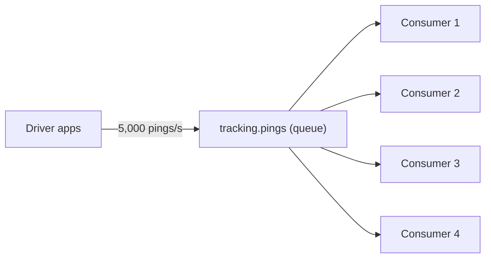
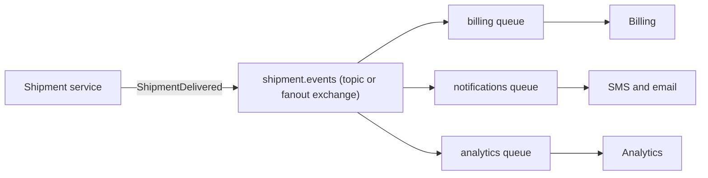
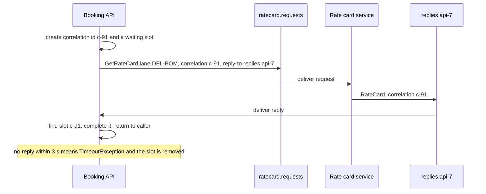
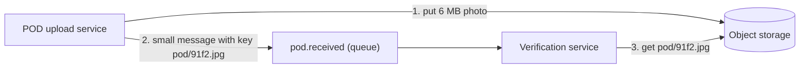
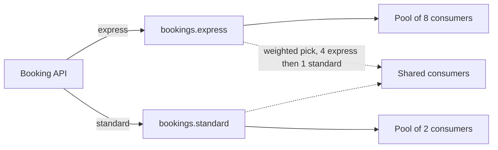
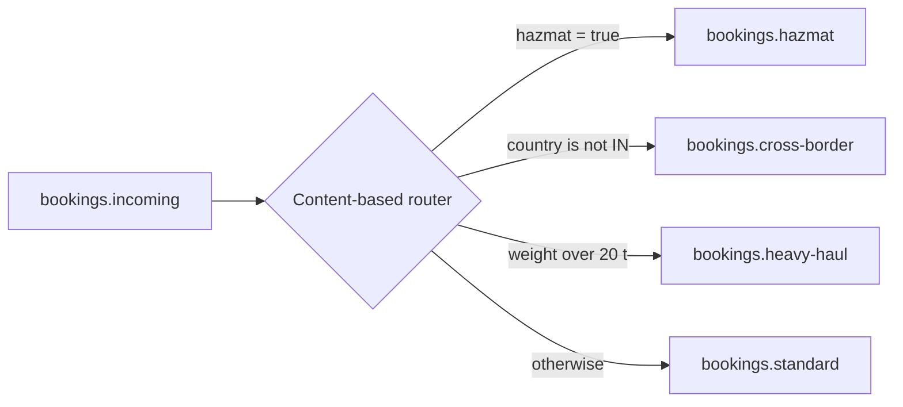
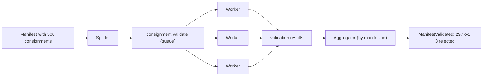
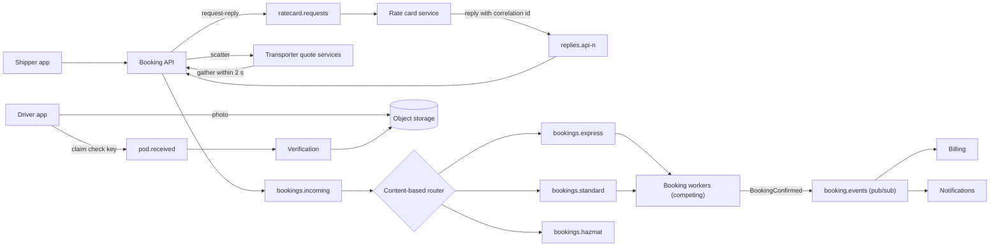
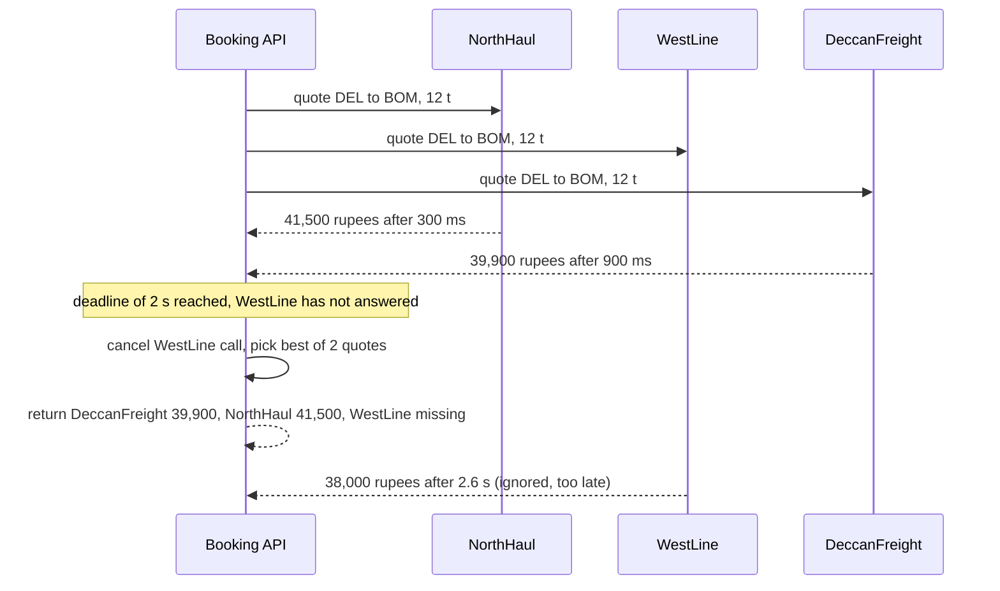

Once services talk through messages, the same dozen shapes keep coming back. Someone needs one worker to do a job; someone else needs every interested service to hear about an event; a third team needs an answer back, or needs to send a 40 MB file through a broker that accepts 1 MB. These shapes have names, mostly from Hohpe and Woolf's *Enterprise Integration Patterns* (2003). Knowing the names saves time in design reviews, and knowing when each one is the *wrong* choice saves outages.

## Learning objectives

By the end of this lesson you will be able to:

1. Tell point-to-point from publish-subscribe, and pick one from the question "how many receivers should act on this message?".
2. Scale a queue with competing consumers, and name what it costs in ordering.
3. Build request-reply over a broker with a correlation id, reply queue and timeout.
4. Move large payloads safely with a claim check.
5. Serve urgent work first with priority queues, without starving everything else.
6. Route, split, aggregate and resequence messages, and explain fan-out/fan-in and scatter-gather.
7. Implement each pattern's core in a few lines of C#, and test it without a broker.
8. Choose the simplest pattern that meets a requirement, and recognise when a plain HTTP call is better.

## Prerequisites

- [Message queues](#/lesson/m12-message-queues): producers, consumers, acknowledgements.
- [RabbitMQ exchanges and routing](#/lesson/m12-rabbitmq): direct, topic and fanout exchanges appear in several patterns.
- [Synchronous versus asynchronous communication](#/lesson/m10-sync-async): when to wait for an answer and when not to.

## Explain it like I'm a beginner

Think about how messages move around a large railway station.

- A **ticket counter queue** has many people waiting and several clerks. Each person is served by exactly **one** clerk, whichever is free. That is a queue with competing consumers.
- The **station announcement** ("the Rajdhani is on platform 4") is heard by **everyone** who is listening. That is publish-subscribe.
- At the **enquiry counter** you ask a question and wait for the answer; the clerk writes your token number on the reply so it reaches you and not the person behind you. That is request-reply with a correlation id.
- At the **cloakroom** you hand over a heavy suitcase and get a small token. You carry the token, not the suitcase, and swap it back later. That is a claim check.
- A **separate counter for senior citizens** gets served first. That is a priority queue.
- A **porter** reads each parcel's label and sends it to the right platform. That is a content-based router.
- A **parcel office** breaks a big consignment into boxes (splitter), sends them out, and at the destination someone waits until all boxes have arrived before handing them over as one delivery (aggregator). If they arrive out of order, someone sorts them back into box number order (resequencer).
- When you want the **cheapest taxi**, you ask five drivers at once and take the best answer you get within a minute. That is scatter-gather.

Each of these solves a different problem. The skill is matching the problem to the shape.

## First-principles explanation

### Two questions that choose most patterns

Before picking a pattern, answer two questions:

1. **How many receivers should act on each message?** Exactly one (a command such as "generate this invoice") or every interested party (an event such as "shipment delivered")?
2. **Does the sender need an answer, and how soon?** No answer (fire and forget), an answer later (a reply message), or an answer now (consider plain HTTP or gRPC instead).

Everything else (routing, splitting, ordering) is detail on top.

The running example is a freight platform, which we will call RoadLink. Shippers book trucks, transporters quote prices, drivers' phones send GPS pings every 10 seconds, and documents such as e-way bills and proof-of-delivery photos travel between services. Estimated load: 50,000 trucks on the road at peak × 1 ping per 10 s = 5,000 pings/s; 200,000 bookings a day ÷ 86,400 s ≈ 2.3 bookings/s average, perhaps 10/s at the morning peak.

### 1. Point-to-point channel

**What.** A queue where each message is delivered to exactly one consumer. The sender knows the job must be done once, not who will do it.


The booking API drops a `GenerateInvoice` command into a queue. One invoice worker takes it, generates the invoice and acknowledges it. If the worker crashes before acknowledging, the broker redelivers the message, so the job is not lost.

**Use it when** the message is a **command**: "do this job once". **Do not use it** for events that several teams care about; you would end up with each team "stealing" messages from the others.

**Broker support.** A RabbitMQ queue, an Azure Service Bus queue, Amazon SQS. In Kafka, a topic read by **one consumer group** behaves like point-to-point for that group.

### 2. Competing consumers

**What.** Several identical consumers read from the **same** queue. Each message still goes to one of them, so you get parallelism without duplicated work.



Pings arrive at 5,000 per second. If one consumer takes 2 ms per ping, it handles at most 1,000 ÷ 2 = 500 pings/s, so you need at least 5,000 ÷ 500 = 10 consumers, and about 13 to keep utilisation near 75 % (an estimate that leaves headroom for spikes). Each arrow out of the queue is one consumer taking the next available message; adding a consumer is how you scale.

**Costs.**
- **Ordering is lost.** Ping 1 for truck `HR55-1234` may be handled by consumer 3 while ping 2 is handled by consumer 1, and finish first. If order matters per key, use a partitioned log (Kafka partitions keyed by truck id, one consumer per partition) or session-aware queues (Azure Service Bus sessions).
- **Every consumer must be idempotent**, because redelivery after a crash can hand a message to a different consumer that does it again.
- **Prefetch matters.** With RabbitMQ, a high prefetch on a slow consumer hoards messages while other consumers sit idle. Start with a prefetch of about 10 to 50 and measure.

**Use it when** work items are independent and you need throughput. It is the default way to scale a queue.

### 3. Publish-subscribe channel

**What.** The sender publishes an **event** to a topic; every subscriber gets its **own copy**. The publisher does not know who the subscribers are.



The shipment service publishes one `ShipmentDelivered` event. The topic copies it into one queue per subscriber, so billing, notifications and analytics each process it at their own pace. If analytics is down for an hour, its queue fills up while billing carries on. In Kafka the equivalent is one topic with several consumer groups, each with its own offset.

**Use it when** the message is an **event** (a fact about the past) and more than one service may react. Adding a new subscriber needs no change to the publisher, which is the main benefit.

**Watch out for:**
- **Subscribers that join late** miss old events on a classic broker (RabbitMQ, Service Bus topics). On Kafka they can read from the start of retention.
- **Hidden coupling.** If the publisher changes the event's shape, every subscriber may break. Version event schemas and add fields rather than rename them.
- **Events that are really commands.** "SendSmsRequested" published to a topic that only the SMS service reads is a command in disguise; use a queue.

### 4. Request-reply with a correlation id

**What.** Two one-way messages that together act like a call: a request on one queue and a reply on another. The request carries a **reply-to address** and a **correlation id**; the reply copies the correlation id back so the requester can match it.



The API instance creates a correlation id and a waiting slot (in C#, a `TaskCompletionSource`) before sending. The request names the instance's own reply queue. The rate card service does the work and sends a reply to that queue with the same correlation id. The API's reply listener looks up the slot by id and completes it. If nothing comes back within the timeout, the API gives up and removes the slot, and any late reply is ignored.

**Why a correlation id is essential.** One API instance may have 200 requests in flight. Replies come back in any order. Without the id, the reply for request 17 could be handed to request 42.

**Use it when** the requester can tolerate broker latency, the responder may be offline briefly, or you want load levelling on the responder's side. **Prefer plain HTTP or gRPC** when you need a fast answer to show a user right now and both sides are online; request-reply over a broker adds two queue hops and a reply listener for little gain. A good middle ground is **asynchronous request-reply over HTTP**: return `202 Accepted` with a status URL and let the client poll.

### 5. Claim check

**What.** Store a large payload somewhere cheap and durable (object storage), and send a small message carrying only a **reference** (the claim check). The receiver uses the reference to fetch the payload.



A driver uploads a 6 MB proof-of-delivery photo. The upload service stores it in object storage (step 1) and publishes a message of a few hundred bytes containing the key (step 2). The verification service reads the message and fetches the photo only if it needs it (step 3). The broker never carries the 6 MB.

**Why.** Brokers have size limits and are tuned for small messages: Amazon SQS caps a message at 1 MiB (it was 256 KB until 2025), Azure Service Bus Standard at 256 KB (Premium allows much larger), and Kafka's default maximum is about 1 MB. Even when large messages are allowed, they slow down every consumer on the queue and multiply storage cost by the number of replicas and subscribers.

**Watch out for:**
- **Lifecycle.** Who deletes the blob? Use a storage lifecycle rule (delete after 30 days) or have the last consumer delete it.
- **Ordering of steps.** Upload first, then publish. If you publish first, a fast consumer may look for a blob that is not there yet.
- **Access.** Consumers need read permission to the bucket; for external consumers, put a short-lived presigned URL in the message instead of a raw key. See [object storage](#/lesson/m11-object-storage).

**Use it when** payloads are larger than a few hundred kilobytes, or the same payload would be copied to many subscribers who mostly do not need it.

### 6. Priority queue

**What.** Urgent messages are processed before ordinary ones. There are two common implementations:

- **Broker-level priority.** RabbitMQ classic queues support a per-queue maximum priority (`x-max-priority`) and per-message priority; since RabbitMQ 4.0, quorum queues support two levels (messages with priority above 4 count as high, the rest as normal) without any queue argument. Kafka, SQS and Service Bus do not reorder by priority inside one queue.
- **Separate queues per priority** (portable and easier to reason about): `bookings.express` and `bookings.standard`, either with **more consumers on the express queue** or with consumers that **poll express first**.



The booking API sends express bookings to one queue and standard bookings to another. The solid arrows show the simplest design, a separate consumer pool per queue sized for its own deadline. The dotted arrows show the alternative: one pool that picks from express most of the time but takes from standard every fifth pick, so standard work keeps moving even when express is busy.

**The trap is starvation.** If consumers always take express first and express traffic never stops, standard bookings wait forever. Always guarantee a minimum share for lower priorities.

**Use it when** some work has a much tighter deadline than the rest (OTP SMS versus marketing SMS, express versus standard bookings, paid-tier versus free-tier jobs).

### 7. Content-based router

**What.** A component that looks at each message's content or headers and forwards it to the right channel.



Every booking enters one queue. The router checks rules in order: hazardous goods need special permits and go to their own team, cross-border bookings need customs paperwork, loads over 20 tonnes need a heavy-haul transporter, and everything else is standard. The first matching rule wins, and there is always a default route so no message is dropped.

**Implementation options.** RabbitMQ topic and headers exchanges can route on routing keys and headers inside the broker. Azure Service Bus subscriptions can have SQL-like filters. For rules that need the message body, write a small router service.

**Watch out for:** rules that overlap (order matters, so test it), a missing default route, and routers that grow business logic. If the router starts calling databases to decide, it has become a service and should be owned like one.

### 8. Splitter

**What.** Breaks one message containing many items into one message per item, tagged so they can be reassembled.

A shipper uploads a manifest with 300 consignments. The splitter emits 300 `ConsignmentBooked` messages, each with headers `correlation-id = manifest id`, `sequence = 1..300` and `sequence-size = 300`. Each consignment can now be processed in parallel by competing consumers, retried on its own, and dead-lettered on its own if it is invalid.

**Use it when** items are independent and you want parallelism or per-item failure handling. **Do not split** when items must succeed or fail together; then process the batch as one unit.

### 9. Aggregator

**What.** The opposite of a splitter: collects related messages (same correlation id) and emits one combined message when a **completion condition** is met.

Completion conditions, from strictest to loosest:

- **All parts arrived** (`count == sequence-size`).
- **Timeout**: emit whatever has arrived after, say, 30 seconds, marked as partial.
- **First good answer** or **best of N** (used with scatter-gather).

**The hard parts.** The aggregator holds state (the parts so far), so it must survive restarts: store partial groups in a database or use a durable workflow, not just memory. It must ignore duplicate parts. And it needs a timeout, because if one part is lost forever the group never completes and memory grows.

### 10. Fan-out / fan-in

**What.** A splitter followed by parallel workers followed by an aggregator. "Fan out" the work, "fan in" the results.



The manifest is split into 300 messages on one queue. Three competing workers validate consignments in parallel and write results to a results queue. The aggregator groups results by manifest id and, when all 300 are in (or the timeout fires), publishes one `ManifestValidated` summary. With 300 items at 200 ms each, one worker takes 60 seconds; ten workers take about 6 seconds plus queueing.

The phrase "fan-out" is also used for pub/sub (one event copied to many subscribers). Context tells you which is meant: fan-out of **events** to different services, or fan-out of **work** to identical workers.

### 11. Scatter-gather

**What.** Send the **same request** to several different responders, then gather their replies into one result, usually with a deadline.

RoadLink asks 8 transporters for a quote on Delhi to Mumbai, 12 tonnes. It waits at most 2 seconds, takes all replies that arrived, and shows the cheapest three. Transporters that did not answer in time are listed as "no quote".

Scatter-gather differs from fan-out/fan-in: the recipients are **different** services each giving their own answer, rather than identical workers splitting one job. The sequence diagram in the next section shows it step by step.

**Watch out for:** the deadline (the slowest responder should not decide your latency), partial results (decide what is "good enough", for example at least 3 quotes), and cost (8 responders means 8× the calls; cache recent quotes where the business allows it).

### 12. Resequencer

**What.** Puts messages back into order using a sequence number, buffering early arrivals until the gaps are filled.

Messages 1, 2, 4, 5, 3 arrive. The resequencer releases 1 and 2 at once, holds 4 and 5, and when 3 arrives releases 3, 4, 5 together.

**The hard parts.** What if 3 never arrives? You need a **maximum buffer size** or a **gap timeout**, after which you skip the gap, release the rest and report the missing number. And you need a sequence per key (per truck, per order), assigned by the producer.

**Use it rarely.** A resequencer is often a sign that ordering was lost upstream unnecessarily. Prefer keeping order at the source (Kafka partition per key, Service Bus sessions) or making consumers order-tolerant by ignoring updates older than what they already have.

### Choosing quickly

| Need | Pattern |
|---|---|
| A job done once by any worker | Point-to-point + competing consumers |
| Tell everyone who cares that something happened | Publish-subscribe |
| An answer back, but async is acceptable | Request-reply with correlation id |
| Move a large file | Claim check |
| Urgent work first | Priority queue (separate queues + minimum share) |
| Different handling by type or content | Content-based router |
| Process items of a batch in parallel | Splitter, fan-out/fan-in, aggregator |
| Best answer from many providers | Scatter-gather |
| Restore order lost upstream | Resequencer (last resort) |

### When a simpler alternative is better

- **One producer, one consumer, both always online, answer needed now**: an HTTP call. A broker adds latency and operational cost.
- **A batch of 20 items that must succeed together**: process the batch in one message and one transaction; splitting creates a distributed consistency problem.
- **A "priority" requirement that is really a capacity problem**: if standard bookings are slow because there are too few consumers, add consumers before adding priority lanes.
- **A resequencer to fix ordering**: fix ordering at the source with a partition key first.

## Visual explanation

### Architecture: the patterns working together



Follow a booking through the diagram. The booking API asks the rate card service for the lane's rate using request-reply (the reply comes back to the API instance's own reply queue), and scatters quote requests to transporter services, gathering answers for up to 2 seconds. It then puts the booking on `bookings.incoming`. The content-based router sends it to the express, standard or hazmat queue. Competing booking workers drain the express and standard queues (more of them watch express). A confirmed booking is published as an event, and billing and notifications each receive their own copy. Separately, the driver app uploads a delivery photo to object storage and sends only its key, which the verification service uses to fetch the photo: a claim check.

### Sequence: scatter-gather with a deadline



All three requests go out at once, so total latency is set by the deadline, not by the sum of the responders. Two answers arrive within 2 seconds; when the deadline fires the API cancels the outstanding call and builds the result from what it has, reporting WestLine as missing. WestLine's late answer, even though it is the cheapest, is ignored: that is the price of a predictable response time. If missing the cheapest quote is costly, you can raise the deadline or show "more quotes may arrive" and update the page later.

## Step-by-step example

We will add patterns to RoadLink one problem at a time, adding each only when a problem forces it.

### Step 1: one queue, one worker

Bookings go to `bookings.incoming`, and one worker confirms them. At 2.3 bookings/s and 150 ms each, one worker is at 2.3 × 0.15 ≈ 35 % utilisation. No other pattern is needed yet.

### Step 2: competing consumers for the morning peak

At 10 bookings/s, one worker would need 10 × 0.15 = 1.5 seconds of work per second, so the queue grows. Add 3 more consumers on the same queue (4 workers ≈ 38 % utilisation each). Make the confirm handler idempotent on booking id, because a redelivered message can now land on a different worker.

### Step 3: publish-subscribe for the booking-confirmed event

Billing, notifications and analytics all want to know about confirmed bookings. Instead of the worker calling each of them, it publishes `BookingConfirmed` to a topic; each team owns its own subscription queue.

### Step 4: a router and an express lane

Hazmat bookings need a specialised team; express bookings promise confirmation within 2 minutes. Add a content-based router with a default route, and an express queue with its own consumers.

### Step 5: claim check for documents, scatter-gather for quotes

Drivers start uploading delivery photos (2–8 MB each), which exceed the broker's limits: upload to object storage and send keys. The product team wants live quotes: scatter to transporters with a 2-second deadline. The implementation follows.

## Production-style C# implementation

Each pattern's core is a small class. The broker is an in-memory implementation built on `System.Threading.Channels`, so everything compiles and runs without RabbitMQ or Kafka; in production `IMessageBroker` wraps the real client and the pattern classes do not change.

### Messages and the broker seam

```csharp file=Messaging/Message.cs
namespace RoadLink.Messaging;

public sealed record Message
{
    public Guid Id { get; init; } = Guid.NewGuid();
    public required string Type { get; init; }
    public required string Body { get; init; }
    public IReadOnlyDictionary<string, string> Headers { get; init; } = new Dictionary<string, string>();

    public string? Header(string name) => Headers.TryGetValue(name, out var value) ? value : null;

    public Message WithHeader(string name, string value)
    {
        var copy = new Dictionary<string, string>(Headers) { [name] = value };
        return this with { Headers = copy };
    }
}

public static class MessageHeaders
{
    public const string CorrelationId = "correlation-id";
    public const string ReplyTo = "reply-to";
    public const string ClaimCheck = "claim-check";
    public const string Sequence = "sequence";
    public const string SequenceSize = "sequence-size";
}
```

```csharp file=Messaging/InMemoryBroker.cs
using System.Collections.Concurrent;
using System.Threading.Channels;

namespace RoadLink.Messaging;

public interface IMessageBroker
{
    /// <summary>Point-to-point: exactly one consumer of the queue receives the message.</summary>
    ValueTask SendAsync(string queue, Message message, CancellationToken ct);

    /// <summary>Publish-subscribe: every queue subscribed to the topic receives a copy.</summary>
    ValueTask PublishAsync(string topic, Message message, CancellationToken ct);

    void Subscribe(string topic, string queue);

    /// <summary>Several readers on one queue are competing consumers.</summary>
    ChannelReader<Message> Consume(string queue);
}

public sealed class InMemoryBroker : IMessageBroker
{
    private readonly ConcurrentDictionary<string, Channel<Message>> _queues = new();
    private readonly ConcurrentDictionary<string, ConcurrentDictionary<string, byte>> _bindings = new();

    private Channel<Message> Queue(string name) =>
        _queues.GetOrAdd(name, _ => Channel.CreateUnbounded<Message>());

    public ValueTask SendAsync(string queue, Message message, CancellationToken ct) =>
        Queue(queue).Writer.WriteAsync(message, ct);

    public async ValueTask PublishAsync(string topic, Message message, CancellationToken ct)
    {
        // Like a fanout exchange with no bindings: no subscribers means the event is dropped.
        if (!_bindings.TryGetValue(topic, out var queues)) return;
        foreach (var queue in queues.Keys)
            await Queue(queue).Writer.WriteAsync(message, ct);
    }

    public void Subscribe(string topic, string queue) =>
        _bindings.GetOrAdd(topic, _ => new ConcurrentDictionary<string, byte>()).TryAdd(queue, 0);

    public ChannelReader<Message> Consume(string queue) => Queue(queue).Reader;

    public int Depth(string queue) => Queue(queue).Reader.Count;
}
```

### Request-reply with a correlation id

```csharp file=Patterns/RequestReplyClient.cs
using System.Collections.Concurrent;
using RoadLink.Messaging;

namespace RoadLink.Patterns;

public sealed class RequestReplyClient(IMessageBroker broker, string replyQueue)
{
    private readonly ConcurrentDictionary<string, TaskCompletionSource<Message>> _pending = new();

    public string ReplyQueue => replyQueue;
    public int PendingCount => _pending.Count;

    /// <summary>Throws TimeoutException if no reply arrives in time.</summary>
    public async Task<Message> RequestAsync(string queue, Message request, TimeSpan timeout, CancellationToken ct)
    {
        var correlationId = Guid.NewGuid().ToString("N");
        var slot = new TaskCompletionSource<Message>(TaskCreationOptions.RunContinuationsAsynchronously);
        _pending[correlationId] = slot;                       // register BEFORE sending, or a fast reply is lost
        try
        {
            var outgoing = request
                .WithHeader(MessageHeaders.CorrelationId, correlationId)
                .WithHeader(MessageHeaders.ReplyTo, replyQueue);
            await broker.SendAsync(queue, outgoing, ct);
            return await slot.Task.WaitAsync(timeout, ct);
        }
        finally
        {
            _pending.TryRemove(correlationId, out _);         // late replies will find no slot
        }
    }

    /// <summary>Returns false for unknown or late replies, which are simply dropped.</summary>
    public bool HandleReply(Message reply) =>
        reply.Header(MessageHeaders.CorrelationId) is { } id
        && _pending.TryRemove(id, out var slot)
        && slot.TrySetResult(reply);

    public async Task ListenAsync(CancellationToken ct)
    {
        await foreach (var reply in broker.Consume(replyQueue).ReadAllAsync(ct))
            HandleReply(reply);
    }

    /// <summary>Helper for responders: builds a reply that carries the request's correlation id.</summary>
    public static (string ReplyTo, Message Reply) CreateReply(Message request, string type, string body)
    {
        var replyTo = request.Header(MessageHeaders.ReplyTo)
            ?? throw new InvalidOperationException("Request has no reply-to header.");
        var reply = new Message { Type = type, Body = body }
            .WithHeader(MessageHeaders.CorrelationId, request.Header(MessageHeaders.CorrelationId) ?? "");
        return (replyTo, reply);
    }
}
```

### Claim check

```csharp file=Patterns/ClaimCheck.cs
using System.Collections.Concurrent;
using System.Text;
using RoadLink.Messaging;

namespace RoadLink.Patterns;

public interface IBlobStore
{
    Task PutAsync(string key, string content, CancellationToken ct);
    Task<string> GetAsync(string key, CancellationToken ct);
}

public sealed class InMemoryBlobStore : IBlobStore
{
    private readonly ConcurrentDictionary<string, string> _blobs = new();
    public Task PutAsync(string key, string content, CancellationToken ct) { _blobs[key] = content; return Task.CompletedTask; }
    public Task<string> GetAsync(string key, CancellationToken ct) =>
        _blobs.TryGetValue(key, out var c) ? Task.FromResult(c) : throw new KeyNotFoundException(key);
}

public sealed class ClaimCheck(IBlobStore blobs, int thresholdBytes = 64 * 1024)
{
    /// <summary>Large bodies go to the blob store; the message keeps only the key.</summary>
    public async Task<Message> CheckInAsync(Message message, CancellationToken ct)
    {
        if (Encoding.UTF8.GetByteCount(message.Body) <= thresholdBytes) return message;
        var key = $"claims/{message.Id:N}";
        await blobs.PutAsync(key, message.Body, ct);           // store first, then send the reference
        return (message with { Body = "" }).WithHeader(MessageHeaders.ClaimCheck, key);
    }

    public async Task<Message> CheckOutAsync(Message message, CancellationToken ct)
    {
        var key = message.Header(MessageHeaders.ClaimCheck);
        return key is null ? message : message with { Body = await blobs.GetAsync(key, ct) };
    }
}
```

### Priority lanes without starvation

```csharp file=Patterns/PriorityLanes.cs
using System.Diagnostics.CodeAnalysis;
using RoadLink.Messaging;

namespace RoadLink.Patterns;

/// <summary>
/// Two lanes. High priority is served first, but after (fairnessEvery - 1) high picks in a row,
/// one low-priority message is taken if any is waiting, so the low lane never starves.
/// </summary>
public sealed class PriorityLanes(int fairnessEvery = 5)
{
    private readonly Queue<Message> _high = new();
    private readonly Queue<Message> _low = new();
    private readonly Lock _gate = new();
    private int _highPicksInARow;

    public void Enqueue(Message message, bool highPriority)
    {
        lock (_gate) (highPriority ? _high : _low).Enqueue(message);
    }

    public bool TryDequeue([NotNullWhen(true)] out Message? message)
    {
        lock (_gate)
        {
            var lowTurn = _low.Count > 0 && (_high.Count == 0 || _highPicksInARow >= fairnessEvery - 1);
            if (lowTurn)
            {
                _highPicksInARow = 0;
                message = _low.Dequeue();
                return true;
            }
            if (_high.Count > 0)
            {
                _highPicksInARow++;
                message = _high.Dequeue();
                return true;
            }
            message = null;
            return false;
        }
    }
}
```

### Content-based router

```csharp file=Patterns/ContentBasedRouter.cs
using RoadLink.Messaging;

namespace RoadLink.Patterns;

public sealed class ContentBasedRouter(string defaultDestination)
{
    private readonly List<(string Name, Func<Message, bool> Matches, string Destination)> _rules = new();

    /// <summary>Rules are checked in the order added; the first match wins.</summary>
    public ContentBasedRouter When(string name, Func<Message, bool> matches, string destination)
    {
        _rules.Add((name, matches, destination));
        return this;
    }

    public string Route(Message message)
    {
        foreach (var rule in _rules)
            if (rule.Matches(message)) return rule.Destination;
        return defaultDestination;                             // never drop a message
    }
}
```

### Splitter, aggregator and resequencer

```csharp file=Patterns/SplitAggregate.cs
using System.Globalization;
using RoadLink.Messaging;

namespace RoadLink.Patterns;

public static class Splitter
{
    public static IReadOnlyList<Message> Split(Message batch, IReadOnlyList<string> itemBodies, string itemType)
    {
        var correlationId = batch.Id.ToString("N");
        var size = itemBodies.Count.ToString(CultureInfo.InvariantCulture);
        return itemBodies
            .Select((body, i) => new Message { Type = itemType, Body = body }
                .WithHeader(MessageHeaders.CorrelationId, correlationId)
                .WithHeader(MessageHeaders.Sequence, (i + 1).ToString(CultureInfo.InvariantCulture))
                .WithHeader(MessageHeaders.SequenceSize, size))
            .ToList();
    }
}

/// <summary>Completes a group when all parts have arrived. Not thread-safe: run one per partition.</summary>
public sealed class Aggregator
{
    private readonly Dictionary<string, Dictionary<int, Message>> _groups = new();

    public int OpenGroups => _groups.Count;

    /// <summary>Returns the parts in sequence order when the group completes, otherwise null.</summary>
    public IReadOnlyList<Message>? Add(Message part)
    {
        var id = part.Header(MessageHeaders.CorrelationId) ?? throw new ArgumentException("Missing correlation id.");
        var seq = int.Parse(part.Header(MessageHeaders.Sequence) ?? throw new ArgumentException("Missing sequence."), CultureInfo.InvariantCulture);
        var size = int.Parse(part.Header(MessageHeaders.SequenceSize) ?? throw new ArgumentException("Missing size."), CultureInfo.InvariantCulture);

        if (!_groups.TryGetValue(id, out var parts)) _groups[id] = parts = new Dictionary<int, Message>();
        parts.TryAdd(seq, part);                                // duplicates are ignored
        if (parts.Count < size) return null;

        _groups.Remove(id);
        return parts.OrderBy(p => p.Key).Select(p => p.Value).ToList();
    }
}

/// <summary>Releases messages in sequence order, starting at 1.</summary>
public sealed class Resequencer
{
    private readonly SortedDictionary<long, Message> _buffer = new();
    private long _next = 1;

    public int Buffered => _buffer.Count;

    public IReadOnlyList<Message> Accept(long sequence, Message message)
    {
        var released = new List<Message>();
        if (sequence < _next || !_buffer.TryAdd(sequence, message)) return released;   // old or duplicate

        while (_buffer.TryGetValue(_next, out var ready))
        {
            _buffer.Remove(_next);
            released.Add(ready);
            _next++;
        }
        return released;
    }
}
```

### Scatter-gather with a deadline

```csharp file=Patterns/ScatterGather.cs
namespace RoadLink.Patterns;

public sealed record QuoteRequest(string From, string To, decimal WeightTonnes);
public sealed record Quote(string Provider, decimal PriceInr);

public sealed record QuoteResult(IReadOnlyList<Quote> Quotes, IReadOnlyList<string> Missing)
{
    public Quote? Best => Quotes.MinBy(q => q.PriceInr);
}

public interface IQuoteProvider
{
    string Name { get; }
    Task<decimal> QuoteAsync(QuoteRequest request, CancellationToken ct);
}

public sealed class QuoteScatterGather(IEnumerable<IQuoteProvider> providers, TimeProvider clock)
{
    public async Task<QuoteResult> GatherAsync(QuoteRequest request, TimeSpan deadline, CancellationToken ct)
    {
        var list = providers.ToList();
        using var cts = CancellationTokenSource.CreateLinkedTokenSource(ct);

        async Task<decimal> Call(IQuoteProvider p) => await p.QuoteAsync(request, cts.Token);
        var calls = list.Select(Call).ToList();                // scatter: all requests start now

        await Task.WhenAny(Task.WhenAll(calls), Task.Delay(deadline, clock, ct));
        cts.Cancel();                                          // stop waiting for slow providers

        var quotes = new List<Quote>();
        var missing = new List<string>();
        for (var i = 0; i < list.Count; i++)                   // gather: keep what finished well
        {
            if (calls[i].IsCompletedSuccessfully) quotes.Add(new Quote(list[i].Name, calls[i].Result));
            else missing.Add(list[i].Name);
        }
        return new QuoteResult(quotes.OrderBy(q => q.PriceInr).ToList(), missing);
    }
}

/// <summary>Demo provider with a fixed price and latency.</summary>
public sealed class FixedQuoteProvider(string name, decimal price, TimeSpan latency, TimeProvider clock) : IQuoteProvider
{
    public string Name => name;
    public async Task<decimal> QuoteAsync(QuoteRequest request, CancellationToken ct)
    {
        await Task.Delay(latency, clock, ct);
        return price;
    }
}
```

### Hosted consumers and wiring

```csharp file=Hosting/Consumers.cs
using RoadLink.Messaging;
using RoadLink.Patterns;

namespace RoadLink.Hosting;

/// <summary>Competing consumers: several workers read the same queue.</summary>
public sealed class TrackingPingConsumer(IMessageBroker broker, ILogger<TrackingPingConsumer> logger) : BackgroundService
{
    public const string Queue = "tracking.pings";
    private const int Workers = 4;

    protected override Task ExecuteAsync(CancellationToken stoppingToken) =>
        Task.WhenAll(Enumerable.Range(1, Workers).Select(id => WorkAsync(id, stoppingToken)));

    private async Task WorkAsync(int workerId, CancellationToken ct)
    {
        try
        {
            await foreach (var ping in broker.Consume(Queue).ReadAllAsync(ct))
                logger.LogDebug("Worker {Worker} stored ping {Id}", workerId, ping.Id);
        }
        catch (OperationCanceledException) when (ct.IsCancellationRequested) { }
    }
}

/// <summary>The responder side of request-reply.</summary>
public sealed class RateCardResponder(IMessageBroker broker) : BackgroundService
{
    public const string Queue = "ratecard.requests";

    protected override async Task ExecuteAsync(CancellationToken stoppingToken)
    {
        try
        {
            await foreach (var request in broker.Consume(Queue).ReadAllAsync(stoppingToken))
            {
                var (replyTo, reply) = RequestReplyClient.CreateReply(request, "RateCard", $"{{\"lane\":\"{request.Body}\",\"perTonneInr\":3200}}");
                await broker.SendAsync(replyTo, reply, stoppingToken);
            }
        }
        catch (OperationCanceledException) when (stoppingToken.IsCancellationRequested) { }
    }
}

public sealed class ReplyListener(RequestReplyClient client) : BackgroundService
{
    protected override async Task ExecuteAsync(CancellationToken stoppingToken)
    {
        try { await client.ListenAsync(stoppingToken); }
        catch (OperationCanceledException) when (stoppingToken.IsCancellationRequested) { }
    }
}
```

```csharp file=Program.cs
using RoadLink.Hosting;
using RoadLink.Messaging;
using RoadLink.Patterns;

var builder = WebApplication.CreateBuilder(args);
builder.Services.AddSingleton(TimeProvider.System);

builder.Services.AddSingleton<InMemoryBroker>();
builder.Services.AddSingleton<IMessageBroker>(sp => sp.GetRequiredService<InMemoryBroker>());

// Each API instance has its own reply queue.
builder.Services.AddSingleton(sp => new RequestReplyClient(sp.GetRequiredService<IMessageBroker>(), "replies." + Environment.MachineName));
builder.Services.AddSingleton<IBlobStore, InMemoryBlobStore>();
builder.Services.AddSingleton(sp => new ClaimCheck(sp.GetRequiredService<IBlobStore>()));

builder.Services.AddSingleton(new ContentBasedRouter("bookings.standard")
    .When("hazmat", m => m.Header("hazmat") == "true", "bookings.hazmat")
    .When("cross-border", m => m.Header("country") is { } c && c != "IN", "bookings.cross-border")
    .When("express", m => m.Header("service") == "express", "bookings.express"));

builder.Services.AddSingleton<IQuoteProvider>(sp => new FixedQuoteProvider("NorthHaul", 41_500m, TimeSpan.FromMilliseconds(300), sp.GetRequiredService<TimeProvider>()));
builder.Services.AddSingleton<IQuoteProvider>(sp => new FixedQuoteProvider("WestLine", 38_000m, TimeSpan.FromMilliseconds(2600), sp.GetRequiredService<TimeProvider>()));
builder.Services.AddSingleton<IQuoteProvider>(sp => new FixedQuoteProvider("DeccanFreight", 39_900m, TimeSpan.FromMilliseconds(900), sp.GetRequiredService<TimeProvider>()));
builder.Services.AddSingleton<QuoteScatterGather>();

builder.Services.AddHostedService<TrackingPingConsumer>();
builder.Services.AddHostedService<RateCardResponder>();
builder.Services.AddHostedService<ReplyListener>();

var app = builder.Build();

var broker = app.Services.GetRequiredService<IMessageBroker>();
broker.Subscribe("booking.events", "billing.booking-events");        // pub/sub: one queue per subscriber
broker.Subscribe("booking.events", "notifications.booking-events");

app.MapPost("/quotes", async (QuoteRequest req, QuoteScatterGather sg, CancellationToken ct) =>
    Results.Ok(await sg.GatherAsync(req, TimeSpan.FromSeconds(2), ct)));

app.MapGet("/ratecards/{lane}", async (string lane, RequestReplyClient rr, CancellationToken ct) =>
{
    try
    {
        var reply = await rr.RequestAsync(RateCardResponder.Queue, new Message { Type = "GetRateCard", Body = lane }, TimeSpan.FromSeconds(3), ct);
        return Results.Content(reply.Body, "application/json");
    }
    catch (TimeoutException)
    {
        return Results.StatusCode(StatusCodes.Status504GatewayTimeout);
    }
});

app.MapPost("/bookings", async (HttpRequest http, ContentBasedRouter router, IMessageBroker bus, CancellationToken ct) =>
{
    var body = await new StreamReader(http.Body).ReadToEndAsync(ct);
    var msg = new Message { Type = "BookingRequested", Body = body }
        .WithHeader("hazmat", http.Headers["X-Hazmat"].ToString())
        .WithHeader("country", http.Headers["X-Country"].ToString())
        .WithHeader("service", http.Headers["X-Service"].ToString());
    var destination = router.Route(msg);
    await bus.SendAsync(destination, msg, ct);
    return Results.Accepted(value: new { msg.Id, destination });
});

app.Run();
```

**What changes with a real broker.** With RabbitMQ, `Subscribe` becomes a queue bound to a fanout or topic exchange, and request-reply can use the `reply_to` and `correlation_id` message properties (or the direct reply-to pseudo-queue `amq.rabbitmq.reply-to`). With Azure Service Bus, topics and subscriptions with SQL filters implement pub/sub and content-based routing inside the broker, and sessions give per-key ordering for competing consumers. With Kafka, consumer groups give point-to-point (within a group) and pub/sub (across groups), and the message key gives per-key ordering.

## Bad design vs good design

**Bad: one queue shared by several different services.**

```text
billing-service   --consumes--> booking-events (queue)
notification-svc  --consumes--> booking-events (same queue)
```

The two services compete for messages: each event is received by only one of them, so roughly half the confirmations never reach billing. This is competing consumers used where publish-subscribe was needed. **Good:** one topic, one subscription queue per service.

**Bad: request-reply with a shared reply queue and no correlation id.** Ten API instances consume one `replies` queue; instance 3 receives the reply meant for instance 7 and either drops it or returns the wrong rate card to a user. **Good:** a reply queue per instance (or RabbitMQ direct reply-to) and a correlation id on every request.

**Bad: a 12 MB e-way bill PDF in every message.** It is copied into three subscriber queues, replicated three times by the broker, and slows every consumer. **Good:** claim check with a lifecycle rule on the bucket.

**Bad: "high priority first, always".** Marketing SMS sat in the low lane for six hours during a busy OTP period. **Good:** separate lanes with a guaranteed share, or separate consumer pools sized for each lane's deadline.

**Bad: an aggregator holding partial groups in memory with no timeout.** One lost part means a group that never completes; after a week of this, the process runs out of memory, and a restart loses every partial group. **Good:** durable state (a table keyed by correlation id), a timeout that emits partial results, and duplicate detection.

:::callout type=tradeoff title="Patterns in the broker or in your code?"
Routing, priority and pub/sub can often be done by the broker (RabbitMQ exchanges, Service Bus filters). That is less code and usually faster. But broker-side rules are harder to test and review than C#, and they tie you to one broker. A good rule: let the broker do simple routing on headers and keys; put routing that depends on the message body, or on business rules that change often, in code with unit tests.
:::

## Practical playground

The queue simulator shows competing consumers at work. Start with a producer rate of 120 messages/s, 2 consumers and 25 ms per message. Each consumer can handle 1,000 ÷ 25 = 40 messages/s, so 2 consumers manage only 80/s and the backlog grows by about 40 messages every second.

:::playground type=sim sim=queue title="Competing consumers draining a backlog" producerRate=120 consumers=2 processingMs=25
:::

Try this:

1. Add consumers one at a time. At how many does the backlog stop growing? (Arithmetic says 3 consumers give 120/s, exactly at capacity; check whether that is really enough.)
2. With 4 consumers, turn on a consumer crash. How long does the backlog take to drain afterwards, compared with how long the crash lasted?
3. Raise the processing time to 100 ms. How many consumers do you now need, and what would that cost if each consumer were a separate container?

## Exercises

:::exercise id=m12-messaging-patterns-ex1 difficulty=beginner kind=written title="Pick the pattern"
For each requirement, name the messaging pattern (or combination) you would use, and give one sentence of reasoning. Say if a plain HTTP call would be better.

1. When a shipment is delivered, billing must raise an invoice, the shipper must get an SMS, and analytics must update a dashboard.
2. 5,000 GPS pings per second must be stored; one worker can store 400 per second.
3. A booking page must show the cheapest of 6 transporter quotes within 2 seconds.
4. Drivers upload 5 MB delivery photos that a verification service checks.
5. OTP SMS must go out within 10 seconds even when 2 million promotional SMS are queued.
6. A manifest of 500 consignments must be validated, and the shipper wants one summary at the end.
7. The mobile app needs the current status of one booking to show on screen.
8. Hazardous-goods bookings must go to a specialised team; all others go to the normal team.
::acceptance
- Each answer names the right pattern: pub/sub, competing consumers, scatter-gather, claim check, priority queue, splitter plus aggregator (fan-out/fan-in), HTTP, content-based router.
- Item 2 includes the arithmetic for the number of consumers.
- Item 7 recognises that a synchronous HTTP read is simpler than messaging.
::hint
For each item, first ask: how many receivers should act on each message, and does the sender need an answer?
::hint
Item 2: 5,000 ÷ 400 = 12.5. Round up, then add headroom.
::hint
Item 5 is about deadlines, not just order. What happens to the low lane?
::hint
Item 7: is there any reason to put a broker between a phone and a database read?
::solution
1. **Publish-subscribe.** `ShipmentDelivered` is an event with three independent reactions; each service gets its own subscription queue, and new subscribers can be added later without touching the shipment service.
2. **Competing consumers.** 5,000 ÷ 400 = 12.5, so at least 13 consumers; with about 25 % headroom, 16 to 17. If order per truck matters, use a partitioned topic keyed by truck id instead of a plain queue.
3. **Scatter-gather** with a 2-second deadline, returning the best of the quotes that arrived and listing missing ones.
4. **Claim check.** Store the photo in object storage and send the key; broker limits are typically 256 KB to 1 MB (Service Bus Standard, SQS, Kafka defaults).
5. **Priority queue** as separate lanes: an OTP queue with its own consumers (sized for the 10-second deadline) and a promotional queue. Do not rely on "high first" in a shared pool without a guaranteed share for the low lane.
6. **Splitter, then fan-out to competing workers, then an aggregator** (fan-out/fan-in) keyed by manifest id, with a timeout that emits a partial summary.
7. **Plain HTTP GET.** The user waits for the answer and the data is in a database; a broker adds latency and moving parts for nothing.
8. **Content-based router** with a default route for non-hazardous bookings (or broker-side routing on a `hazmat` header).
::mistakes
- Using a single shared queue for item 1, so services steal each other's events.
- Answering "Kafka" or "RabbitMQ" instead of a pattern; the product is not the pattern.
- Using request-reply over a broker for item 7.
:::

:::exercise id=m12-messaging-patterns-ex2 difficulty=beginner kind=code title="Build a content-based router"
Implement a rule-based router for bookings. Rules are checked in the order they were added and the first match wins. If nothing matches, the booking goes to the default destination. The router also reports *which* rule matched, which helps when debugging misrouted bookings.
::requirements
- `AddRule(name, predicate, destination)` adds a rule and returns the router (fluent style).
- `Route(booking)` returns a `RouteDecision(Destination, RuleName)`; `RuleName` is `"default"` if no rule matched.
- Adding two rules with the same name throws `ArgumentException`.
- A predicate that throws must not crash routing: treat it as "no match" and continue with the next rule.
::acceptance
- A hazmat booking goes to `bookings.hazmat` with rule name `hazmat`.
- A booking matching two rules goes to the first one added.
- A booking matching nothing goes to the default with rule name `default`.
- A duplicate rule name throws `ArgumentException`.
- A throwing predicate is skipped.
::hint
Store the rules in a `List` to keep their order. A `Dictionary` does not guarantee the order you want.
::hint
Keep a `HashSet<string>` of names to detect duplicates.
::hint
Wrap each predicate call in `try/catch` and treat an exception as `false`.
::hint
```csharp
foreach (var r in _rules)
{
    bool match;
    try { match = r.Predicate(booking); } catch { match = false; }
    if (match) return new RouteDecision(r.Destination, r.Name);
}
return new RouteDecision(_default, "default");
```
::starter
```csharp file=BookingRouter.cs
using System;
using System.Collections.Generic;

public sealed record Booking(string Id, bool Hazmat, string DestinationCountry, decimal WeightTonnes, string Service);

public sealed record RouteDecision(string Destination, string RuleName);

public sealed class BookingRouter
{
    private readonly string _defaultDestination;

    public BookingRouter(string defaultDestination) => _defaultDestination = defaultDestination;

    public BookingRouter AddRule(string name, Func<Booking, bool> predicate, string destination) =>
        throw new NotImplementedException();

    public RouteDecision Route(Booking booking) => throw new NotImplementedException();
}
```
::tests
```csharp file=BookingRouterTests.cs
using System;
using Xunit;

public class BookingRouterTests
{
    private static BookingRouter Router() => new BookingRouter("bookings.standard")
        .AddRule("hazmat", b => b.Hazmat, "bookings.hazmat")
        .AddRule("cross-border", b => b.DestinationCountry != "IN", "bookings.cross-border")
        .AddRule("heavy", b => b.WeightTonnes > 20m, "bookings.heavy-haul");

    private static Booking B(bool hazmat = false, string country = "IN", decimal weight = 10m) =>
        new("BK-1", hazmat, country, weight, "standard");

    [Fact]
    public void Hazmat_goes_to_hazmat_queue()
    {
        var d = Router().Route(B(hazmat: true));
        Assert.Equal("bookings.hazmat", d.Destination);
        Assert.Equal("hazmat", d.RuleName);
    }

    [Fact]
    public void First_matching_rule_wins() =>
        Assert.Equal("bookings.hazmat", Router().Route(B(hazmat: true, country: "NP", weight: 30m)).Destination);

    [Fact]
    public void No_match_goes_to_default()
    {
        var d = Router().Route(B());
        Assert.Equal("bookings.standard", d.Destination);
        Assert.Equal("default", d.RuleName);
    }

    [Fact]
    public void Duplicate_rule_name_is_rejected() =>
        Assert.Throws<ArgumentException>(() => Router().AddRule("heavy", b => true, "x"));

    [Fact]
    public void Throwing_predicate_is_skipped()
    {
        var r = new BookingRouter("bookings.standard")
            .AddRule("broken", b => throw new InvalidOperationException("bug"), "bookings.broken")
            .AddRule("heavy", b => b.WeightTonnes > 20m, "bookings.heavy-haul");
        Assert.Equal("bookings.heavy-haul", r.Route(B(weight: 25m)).Destination);
    }
}
```
::solution
Keep rules in a list (order matters), names in a set (uniqueness), and guard each predicate.

```csharp file=BookingRouter.cs
using System;
using System.Collections.Generic;

public sealed record Booking(string Id, bool Hazmat, string DestinationCountry, decimal WeightTonnes, string Service);

public sealed record RouteDecision(string Destination, string RuleName);

public sealed class BookingRouter
{
    private readonly string _defaultDestination;
    private readonly List<(string Name, Func<Booking, bool> Predicate, string Destination)> _rules = new();
    private readonly HashSet<string> _names = new(StringComparer.Ordinal);

    public BookingRouter(string defaultDestination) => _defaultDestination = defaultDestination;

    public BookingRouter AddRule(string name, Func<Booking, bool> predicate, string destination)
    {
        if (!_names.Add(name)) throw new ArgumentException($"A rule named '{name}' already exists.", nameof(name));
        _rules.Add((name, predicate, destination));
        return this;
    }

    public RouteDecision Route(Booking booking)
    {
        foreach (var rule in _rules)
        {
            bool match;
            try { match = rule.Predicate(booking); }
            catch (Exception) { match = false; }      // in production: log and count this
            if (match) return new RouteDecision(rule.Destination, rule.Name);
        }
        return new RouteDecision(_defaultDestination, "default");
    }
}
```

Returning the rule name costs nothing and makes routing observable: add it as a message header and a metric label, and "why did this booking go to heavy-haul?" becomes a one-line query.
::mistakes
- No default route, so unmatched bookings disappear.
- Storing rules in a dictionary and relying on its order.
- Letting a buggy predicate crash the whole router, which stops all bookings.
::extensions
Load rules from configuration (`IOptions<RoutingOptions>`) using simple header-equals conditions, and add a test that the order in the config file is preserved.
:::

:::exercise id=m12-messaging-patterns-ex3 difficulty=intermediate kind=code title="A resequencer with a bounded buffer"
GPS pings for one truck carry a sequence number starting at 1, but arrive out of order. Build a resequencer that releases pings in order. Because a ping can be lost forever, the buffer is bounded: when it would exceed `maxBuffered`, the resequencer gives up on the missing numbers, records them as skipped, and releases what it can.
::requirements
- `Accept(sequence, payload)` returns the payloads released by this call, in order.
- Sequence numbers below the next expected one, or already buffered, are duplicates: ignore them (return nothing).
- If, after buffering, the buffer holds more than `maxBuffered` items, jump `next` to the smallest buffered sequence, add every skipped number to `Skipped`, and release in order from there.
- `Buffered` reports how many items are waiting.
::acceptance
- 1, 2, 3 in order are each released immediately.
- 2, 3 are held until 1 arrives, then 1, 2, 3 are released together.
- Duplicates and old numbers return nothing.
- With `maxBuffered = 2`, receiving 2, 3, 4 (1 lost) skips 1 and releases 2, 3, 4.
- After a skip, a late arrival of 1 is ignored.
::hint
A `SortedDictionary<long, string>` keeps buffered items ordered by sequence number.
::hint
Releasing is a loop: while the buffer contains `next`, move it to the output and increment `next`.
::hint
The overflow rule runs after buffering and before releasing: if `Count > maxBuffered`, the smallest key becomes the new `next`.
::hint
The numbers you skip are `next, next+1, ..., smallestKey-1`.
::hint
```csharp
if (_buffer.Count > _max)
{
    var first = _buffer.Keys.First();
    for (var s = _next; s < first; s++) Skipped.Add(s);
    _next = first;
}
while (_buffer.TryGetValue(_next, out var p)) { _buffer.Remove(_next); released.Add(p); _next++; }
```
::starter
```csharp file=Resequencer.cs
using System;
using System.Collections.Generic;
using System.Linq;

public sealed class PingResequencer
{
    private readonly int _maxBuffered;

    public PingResequencer(int maxBuffered = 100) => _maxBuffered = maxBuffered;

    public List<long> Skipped { get; } = new();

    public int Buffered => throw new NotImplementedException();

    public IReadOnlyList<string> Accept(long sequence, string payload) => throw new NotImplementedException();
}
```
::tests
```csharp file=ResequencerTests.cs
using System.Collections.Generic;
using Xunit;

public class ResequencerTests
{
    [Fact]
    public void In_order_messages_flow_straight_through()
    {
        var r = new PingResequencer();
        Assert.Equal(new List<string> { "p1" }, r.Accept(1, "p1"));
        Assert.Equal(new List<string> { "p2" }, r.Accept(2, "p2"));
        Assert.Equal(0, r.Buffered);
    }

    [Fact]
    public void Early_messages_wait_for_the_gap()
    {
        var r = new PingResequencer();
        Assert.Empty(r.Accept(2, "p2"));
        Assert.Empty(r.Accept(3, "p3"));
        Assert.Equal(2, r.Buffered);
        Assert.Equal(new List<string> { "p1", "p2", "p3" }, r.Accept(1, "p1"));
    }

    [Fact]
    public void Duplicates_and_old_messages_are_ignored()
    {
        var r = new PingResequencer();
        r.Accept(1, "p1");
        Assert.Empty(r.Accept(1, "p1-again"));
        r.Accept(3, "p3");
        Assert.Empty(r.Accept(3, "p3-again"));
        Assert.Equal(1, r.Buffered);
    }

    [Fact]
    public void Overflow_skips_the_lost_message()
    {
        var r = new PingResequencer(maxBuffered: 2);
        Assert.Empty(r.Accept(2, "p2"));
        Assert.Empty(r.Accept(3, "p3"));
        Assert.Equal(new List<string> { "p2", "p3", "p4" }, r.Accept(4, "p4"));
        Assert.Equal(new List<long> { 1 }, r.Skipped);
    }

    [Fact]
    public void Late_arrival_after_skip_is_ignored()
    {
        var r = new PingResequencer(maxBuffered: 1);
        r.Accept(2, "p2");
        r.Accept(3, "p3");
        Assert.Empty(r.Accept(1, "p1-late"));
    }
}
```
::solution
Buffer, apply the overflow rule, then release from `next` while possible.

```csharp file=Resequencer.cs
using System;
using System.Collections.Generic;
using System.Linq;

public sealed class PingResequencer
{
    private readonly int _maxBuffered;
    private readonly SortedDictionary<long, string> _buffer = new();
    private long _next = 1;

    public PingResequencer(int maxBuffered = 100) => _maxBuffered = maxBuffered;

    public List<long> Skipped { get; } = new();

    public int Buffered => _buffer.Count;

    public IReadOnlyList<string> Accept(long sequence, string payload)
    {
        var released = new List<string>();
        if (sequence < _next || _buffer.ContainsKey(sequence)) return released;

        _buffer[sequence] = payload;

        if (_buffer.Count > _maxBuffered)
        {
            var first = _buffer.Keys.First();
            for (var s = _next; s < first; s++) Skipped.Add(s);
            _next = first;
        }

        while (_buffer.TryGetValue(_next, out var ready))
        {
            _buffer.Remove(_next);
            released.Add(ready);
            _next++;
        }
        return released;
    }
}
```

The bound turns an unbounded memory risk into a visible, countable data gap. In production, export `Skipped.Count` as a metric and also use a time-based gap timeout, so a truck that sends only two pings a minute does not wait for 100 pings before a lost one is skipped.
::alternatives
For GPS pings, a resequencer is often unnecessary: store every ping with its device timestamp and have readers sort by timestamp, or have the "latest position" table ignore pings older than the stored one. That is order tolerance instead of reordering.
::mistakes
- An unbounded buffer: one lost ping makes the buffer grow until the process runs out of memory.
- Releasing only one message per call instead of draining every consecutive one.
- Accepting a late message after its number was skipped, which emits data out of order.
::extensions
Add a `FlushOlderThan(TimeSpan)` method that skips a gap once the oldest buffered item has waited longer than the limit, using an injected `TimeProvider`.
:::

:::exercise id=m12-messaging-patterns-ex4 difficulty=intermediate kind=code title="An aggregator with a completion timeout"
Validation results for a manifest arrive as separate messages. Build an aggregator that emits a result when all parts have arrived, or a partial result when the group has been open longer than a timeout. Time is passed in explicitly so tests are deterministic.
::requirements
- `Add(ResultPart part, DateTimeOffset now)` returns a completed `AggregateResult` when the group has `part.ExpectedCount` distinct parts, otherwise `null`.
- Parts are distinct by `PartNumber`; a repeated part number is ignored.
- `ExpireOlderThan(DateTimeOffset now)` returns partial results (`IsComplete = false`) for every group whose first part arrived more than `timeout` before `now`, and removes them.
- A completed or expired group is forgotten; parts arriving later for it start a new group.
- `AggregateResult.Parts` is ordered by `PartNumber`.
::acceptance
- Three of three parts produce a complete result with parts in order.
- A duplicate part does not count twice.
- A group with two of three parts older than the timeout is returned as partial and removed.
- A group younger than the timeout is not expired.
::hint
Store per group: the time the first part arrived and a `Dictionary<int, ResultPart>`.
::hint
`Dictionary.TryAdd` returns false for a duplicate key, which handles duplicate parts.
::hint
In `ExpireOlderThan`, collect the expired keys first, then remove them, because you cannot remove from a dictionary while enumerating it.
::hint
```csharp
var expired = _groups.Where(g => now - g.Value.FirstSeen > _timeout).Select(g => g.Key).ToList();
foreach (var id in expired) { results.Add(Build(id, _groups[id], complete: false)); _groups.Remove(id); }
```
::starter
```csharp file=ManifestAggregator.cs
using System;
using System.Collections.Generic;
using System.Linq;

public sealed record ResultPart(string ManifestId, int PartNumber, int ExpectedCount, bool Valid);

public sealed record AggregateResult(string ManifestId, IReadOnlyList<ResultPart> Parts, bool IsComplete)
{
    public int ValidCount => Parts.Count(p => p.Valid);
}

public sealed class ManifestAggregator
{
    private readonly TimeSpan _timeout;

    public ManifestAggregator(TimeSpan timeout) => _timeout = timeout;

    public int OpenGroups => throw new NotImplementedException();

    public AggregateResult? Add(ResultPart part, DateTimeOffset now) => throw new NotImplementedException();

    public IReadOnlyList<AggregateResult> ExpireOlderThan(DateTimeOffset now) => throw new NotImplementedException();
}
```
::tests
```csharp file=ManifestAggregatorTests.cs
using System;
using System.Linq;
using Xunit;

public class ManifestAggregatorTests
{
    private static readonly DateTimeOffset T0 = new(2026, 10, 1, 9, 0, 0, TimeSpan.Zero);
    private static ResultPart P(int n, int of = 3, bool valid = true) => new("MF-1", n, of, valid);

    [Fact]
    public void Completes_when_all_parts_arrive_in_any_order()
    {
        var a = new ManifestAggregator(TimeSpan.FromSeconds(30));
        Assert.Null(a.Add(P(3), T0));
        Assert.Null(a.Add(P(1), T0));
        var result = a.Add(P(2, valid: false), T0);
        Assert.NotNull(result);
        Assert.True(result!.IsComplete);
        Assert.Equal(new[] { 1, 2, 3 }, result.Parts.Select(p => p.PartNumber).ToArray());
        Assert.Equal(2, result.ValidCount);
        Assert.Equal(0, a.OpenGroups);
    }

    [Fact]
    public void Duplicate_parts_do_not_count_twice()
    {
        var a = new ManifestAggregator(TimeSpan.FromSeconds(30));
        a.Add(P(1), T0);
        Assert.Null(a.Add(P(1), T0));
        Assert.Null(a.Add(P(2), T0));
        Assert.NotNull(a.Add(P(3), T0));
    }

    [Fact]
    public void Old_incomplete_group_expires_as_partial()
    {
        var a = new ManifestAggregator(TimeSpan.FromSeconds(30));
        a.Add(P(1), T0);
        a.Add(P(2), T0.AddSeconds(10));
        var expired = a.ExpireOlderThan(T0.AddSeconds(31));
        var r = Assert.Single(expired);
        Assert.False(r.IsComplete);
        Assert.Equal(2, r.Parts.Count);
        Assert.Equal(0, a.OpenGroups);
    }

    [Fact]
    public void Young_group_is_not_expired()
    {
        var a = new ManifestAggregator(TimeSpan.FromSeconds(30));
        a.Add(P(1), T0);
        Assert.Empty(a.ExpireOlderThan(T0.AddSeconds(20)));
        Assert.Equal(1, a.OpenGroups);
    }
}
```
::solution
Track each group's first-seen time and its parts by number; complete on count, expire on age.

```csharp file=ManifestAggregator.cs
using System;
using System.Collections.Generic;
using System.Linq;

public sealed record ResultPart(string ManifestId, int PartNumber, int ExpectedCount, bool Valid);

public sealed record AggregateResult(string ManifestId, IReadOnlyList<ResultPart> Parts, bool IsComplete)
{
    public int ValidCount => Parts.Count(p => p.Valid);
}

public sealed class ManifestAggregator
{
    private sealed class Group
    {
        public required DateTimeOffset FirstSeen { get; init; }
        public Dictionary<int, ResultPart> Parts { get; } = new();
    }

    private readonly TimeSpan _timeout;
    private readonly Dictionary<string, Group> _groups = new(StringComparer.Ordinal);

    public ManifestAggregator(TimeSpan timeout) => _timeout = timeout;

    public int OpenGroups => _groups.Count;

    public AggregateResult? Add(ResultPart part, DateTimeOffset now)
    {
        if (!_groups.TryGetValue(part.ManifestId, out var group))
            _groups[part.ManifestId] = group = new Group { FirstSeen = now };

        group.Parts.TryAdd(part.PartNumber, part);
        if (group.Parts.Count < part.ExpectedCount) return null;

        _groups.Remove(part.ManifestId);
        return Build(part.ManifestId, group, complete: true);
    }

    public IReadOnlyList<AggregateResult> ExpireOlderThan(DateTimeOffset now)
    {
        var expiredIds = _groups.Where(g => now - g.Value.FirstSeen > _timeout).Select(g => g.Key).ToList();
        var results = new List<AggregateResult>();
        foreach (var id in expiredIds)
        {
            results.Add(Build(id, _groups[id], complete: false));
            _groups.Remove(id);
        }
        return results;
    }

    private static AggregateResult Build(string id, Group group, bool complete) =>
        new(id, group.Parts.Values.OrderBy(p => p.PartNumber).ToList(), complete);
}
```

In production the groups live in a table (`manifest_id`, `part_number`, `payload`, `first_seen`) with a primary key on (`manifest_id`, `part_number`), which gives duplicate detection for free and survives restarts. A scheduled job calls the expiry logic every few seconds.
::mistakes
- Counting messages rather than distinct part numbers, so a redelivered part completes the group early.
- No timeout, so one lost part keeps a group open forever.
- Keeping state only in memory, so a deploy loses every partial group.
::extensions
Emit the partial result with a list of missing part numbers, and publish a `ManifestValidationIncomplete` event that the shipper can act on.
:::

:::exercise id=m12-messaging-patterns-ex5 difficulty=advanced kind=hld title="Live freight quotes with documents and express lanes"
Design RoadLink's quote-and-book flow. Requirements: a shipper asks for quotes and the page must show results within 2 seconds; 12 transporter integrations, of which 3 are slow partner APIs (p99 about 5 s); 2,000 quote requests/s at peak; bookings with attached e-way bill PDFs (1–15 MB); express bookings must be confirmed within 60 seconds, standard within 15 minutes; billing, notifications and analytics all react to confirmed bookings. Extend the starter graph and name each messaging pattern you use, with the arithmetic that sizes it.
::acceptance
- Scatter-gather with a deadline, plus a way to deliver late quotes or cached quotes.
- Claim check for PDFs, with storage lifecycle.
- Separate express and standard lanes, sized from their deadlines.
- Pub/sub for confirmed bookings with one subscription per consumer service.
- The number of outbound quote calls per second is computed.
::hint
2,000 quote requests/s × 12 transporters is how many outbound calls per second? Which transporters can afford that?
::hint
For the 3 slow partners, can you pre-fetch or cache lane prices instead of calling them live?
::hint
A 15 MB PDF cannot go through SQS or Service Bus Standard. Where does it go?
::hint
Express lane: if a confirmation takes 3 seconds of work and 30 express bookings arrive per minute at peak, how many consumers keep you under 60 seconds even with a burst?
::starter
```json
{
  "nodes": [
    { "id": "web", "type": "client", "label": "Shipper web and app", "props": { "rps": 2000 } },
    { "id": "gw", "type": "api-gateway", "label": "API gateway" },
    { "id": "api", "type": "app-server", "label": "Booking API", "props": { "instances": 6 } },
    { "id": "db", "type": "database", "label": "PostgreSQL" },
    { "id": "tp", "type": "external", "label": "12 transporter APIs" }
  ],
  "edges": [
    { "from": "web", "to": "gw", "kind": "sync" },
    { "from": "gw", "to": "api", "kind": "sync" },
    { "from": "api", "to": "db", "kind": "sync" },
    { "from": "api", "to": "tp", "kind": "sync", "label": "quotes" }
  ]
}
```
::solution
```json
{
  "nodes": [
    { "id": "web", "type": "client", "label": "Shipper web and app", "props": { "rps": 2000 } },
    { "id": "gw", "type": "api-gateway", "label": "API gateway" },
    { "id": "api", "type": "app-server", "label": "Booking API (scatter-gather, 2 s deadline)", "props": { "instances": 8 } },
    { "id": "qc", "type": "cache", "label": "Quote cache per lane (Redis)", "props": { "ttlSeconds": 300 } },
    { "id": "fast", "type": "external", "label": "9 fast transporter APIs" },
    { "id": "slow", "type": "external", "label": "3 slow partner APIs" },
    { "id": "pre", "type": "worker", "label": "Lane price pre-fetcher", "props": { "instances": 2 } },
    { "id": "sched", "type": "scheduler", "label": "Refresh popular lanes every 5 min" },
    { "id": "ws", "type": "websocket-gateway", "label": "Push late quotes to the page" },
    { "id": "obj", "type": "object-storage", "label": "E-way bill PDFs (lifecycle: 180 days)" },
    { "id": "router", "type": "worker", "label": "Content-based router" },
    { "id": "inq", "type": "queue", "label": "bookings.incoming" },
    { "id": "exq", "type": "queue", "label": "bookings.express" },
    { "id": "stq", "type": "queue", "label": "bookings.standard" },
    { "id": "exw", "type": "worker", "label": "Express confirmers", "props": { "instances": 4 } },
    { "id": "stw", "type": "worker", "label": "Standard confirmers", "props": { "instances": 4 } },
    { "id": "db", "type": "database", "label": "PostgreSQL (bookings + outbox)" },
    { "id": "topic", "type": "stream", "label": "booking.events (pub/sub)" },
    { "id": "bill", "type": "worker", "label": "Billing" },
    { "id": "notif", "type": "worker", "label": "Notifications" },
    { "id": "ana", "type": "worker", "label": "Analytics" }
  ],
  "edges": [
    { "from": "web", "to": "gw", "kind": "sync" },
    { "from": "gw", "to": "api", "kind": "sync" },
    { "from": "api", "to": "qc", "kind": "sync", "label": "cached and slow-partner prices" },
    { "from": "api", "to": "fast", "kind": "sync", "label": "scatter, 2 s deadline" },
    { "from": "sched", "to": "pre", "kind": "async" },
    { "from": "pre", "to": "slow", "kind": "sync" },
    { "from": "pre", "to": "qc", "kind": "sync" },
    { "from": "api", "to": "ws", "kind": "async", "label": "late quotes" },
    { "from": "web", "to": "ws", "kind": "sync" },
    { "from": "web", "to": "obj", "kind": "sync", "label": "presigned upload" },
    { "from": "api", "to": "inq", "kind": "async", "label": "booking with claim check key" },
    { "from": "inq", "to": "router", "kind": "async" },
    { "from": "router", "to": "exq", "kind": "async" },
    { "from": "router", "to": "stq", "kind": "async" },
    { "from": "exq", "to": "exw", "kind": "async" },
    { "from": "stq", "to": "stw", "kind": "async" },
    { "from": "exw", "to": "obj", "kind": "sync", "label": "fetch PDF" },
    { "from": "stw", "to": "obj", "kind": "sync", "label": "fetch PDF" },
    { "from": "exw", "to": "db", "kind": "sync" },
    { "from": "stw", "to": "db", "kind": "sync" },
    { "from": "db", "to": "topic", "kind": "async", "label": "outbox relay" },
    { "from": "topic", "to": "bill", "kind": "async" },
    { "from": "topic", "to": "notif", "kind": "async" },
    { "from": "topic", "to": "ana", "kind": "async" }
  ]
}
```

**Scatter-gather sizing.** 2,000 requests/s × 12 transporters = 24,000 outbound calls/s, which most partner APIs will not accept. Split the transporters: the 9 fast ones are called live (2,000 × 9 = 18,000 calls/s, which still needs per-partner agreements and rate limits, so cache identical lane-and-weight requests for a short time, for example 60 s, to cut repeats). The 3 slow partners (p99 ≈ 5 s) can never fit a 2-second deadline, so a **pre-fetcher** refreshes their prices for popular lanes every 5 minutes into a cache, and the API reads those instantly. Live quotes that miss the deadline are pushed to the page over a WebSocket ("2 more quotes arrived").

**Claim check.** The app uploads PDFs straight to object storage with a presigned URL; the booking message carries only the object key. A lifecycle rule moves PDFs to cheaper storage after 30 days and deletes them after the legally required retention (shown here as 180 days; check the actual requirement).

**Priority lanes.** The content-based router splits express and standard. Express: suppose 30 express bookings/minute at peak, each taking about 3 s of work (estimates). That is 30 × 3 = 90 seconds of work per minute, so 2 consumers are the minimum; 4 consumers handle a 3× burst within the 60-second deadline. Standard has a 15-minute deadline, so 4 consumers can absorb long bursts; alert if the oldest standard message is older than 10 minutes.

**Pub/sub.** Confirmed bookings are written with an outbox and published to `booking.events`; billing, notifications and analytics each have their own consumer group or subscription.

**Failure handling.** A transporter outage only removes its quotes (listed as missing); a slow partner never blocks the page; a stuck express booking alerts after 45 seconds so a human can step in before the deadline.
::mistakes
- Calling all 12 transporters live for every request, including the 5-second ones, and blowing the 2-second budget.
- Sending PDFs through the broker.
- One shared booking queue with "priority" as a field nobody acts on.
::extensions
Add a circuit breaker per transporter so that one failing partner is skipped immediately instead of using up the deadline on every request.
:::

## Automated testing

Each pattern's core is a plain class, so most tests need no broker.

**Router, splitter, aggregator, resequencer.** Table-driven tests with hand-built messages: rule order, default route, duplicate parts, out-of-order arrival, overflow and timeouts (pass the time in, as in exercise 4).

**Request-reply.** Test the correlation logic directly: start a request, deliver a reply with the matching id, and check the task completes; deliver a reply with an unknown id and check it is ignored; let a short timeout expire and check that `PendingCount` returns to zero.

```csharp
[Fact]
public async Task Reply_with_matching_correlation_id_completes_the_request()
{
    var broker = new InMemoryBroker();
    var client = new RequestReplyClient(broker, "replies.test");
    var pending = client.RequestAsync("ratecard.requests", new Message { Type = "GetRateCard", Body = "DEL-BOM" },
        TimeSpan.FromSeconds(5), default);

    var request = await broker.Consume("ratecard.requests").ReadAsync();
    var (replyTo, reply) = RequestReplyClient.CreateReply(request, "RateCard", "{\"perTonneInr\":3200}");
    Assert.Equal("replies.test", replyTo);
    Assert.True(client.HandleReply(reply));

    Assert.Contains("3200", (await pending).Body);
    Assert.Equal(0, client.PendingCount);
}
```

**Scatter-gather.** Use fake providers with different delays and one that throws, and a short deadline. Assert that fast quotes are present, slow and failing providers are listed as missing, and the call returns close to the deadline rather than waiting for the slowest provider.

**Priority lanes.** Enqueue 10 high and 3 low messages, dequeue all, and assert that a low message appears within every 5 picks while low work is waiting.

**Pub/sub versus point-to-point.** With the in-memory broker, publish one event to a topic with two subscriber queues and assert that each queue receives exactly one copy; send one command to a queue with two readers and assert exactly one of them receives it.

**With a real broker in CI.** Run RabbitMQ in a container and verify the broker configuration: exchange bindings, queue arguments such as `x-max-priority`, and that a reply sent to `reply_to` reaches the right instance.

## Real-world application

- **Ride-hailing and food delivery.** A system like a ride-hailing platform uses pub/sub for trip events, competing consumers for location updates, and a form of scatter-gather when offering a trip to several nearby drivers and taking the first acceptance.
- **Travel and insurance aggregators.** Flight, hotel and insurance comparison sites are scatter-gather systems with strict deadlines, heavy caching and late-result streaming.
- **Banking and payments.** UPI-style payment flows use request-reply semantics between banks over messaging infrastructure, with correlation by transaction reference, and timeouts that trigger status-check requests rather than blind retries.
- **Document-heavy workflows.** Insurance-claim apps, hospital systems moving scan reports, and loan platforms collecting KYC documents use claim checks with object storage almost by default; the message says "MRI report for patient visit V-2291 is ready" and carries a link, never the 40 MB file.
- **Notification platforms.** OTP versus promotional SMS is the textbook priority-queue case; most providers expose separate routes or priorities for transactional and promotional traffic.
- **Batch imports.** Uploading a spreadsheet of 10,000 rows and validating them in parallel is a splitter, fan-out to workers and an aggregator producing a summary report.

## Interview questions

:::interview
::q beginner
What is the difference between point-to-point and publish-subscribe messaging?
::a
In point-to-point, each message on a queue is delivered to exactly one consumer; it fits commands ("generate this invoice") that must be done once. In publish-subscribe, a message published to a topic is copied to every subscriber; it fits events ("shipment delivered") that several services react to independently. A quick test: if adding a second receiver should mean the work is shared, it is point-to-point; if it should mean both receivers get everything, it is pub/sub. In Kafka, one consumer group gives point-to-point within the group and multiple groups give pub/sub.
::q beginner
What is the claim check pattern and why use it?
::a
Instead of putting a large payload in a message, you store it in object storage and send a small message containing a reference (the claim check). The receiver fetches the payload when it needs it. It keeps messages within broker limits (for example 256 KB on Azure Service Bus Standard, 1 MiB on SQS, about 1 MB by default on Kafka), keeps queues fast, and avoids copying a big payload to every subscriber. You must store the payload before sending the message, give consumers read access, and set a lifecycle rule so old payloads are deleted.
::q intermediate
How do you implement request-reply over a message broker, and what can go wrong?
::a
The requester creates a correlation id, registers a waiting slot for it, and sends the request with headers `correlation-id` and `reply-to` (its own reply queue). The responder processes the request and sends the reply to the `reply-to` queue, copying the correlation id. The requester's listener matches the reply to the slot and completes it. What can go wrong: a shared reply queue across instances (replies reach the wrong instance), registering the slot after sending (a fast reply is lost), no timeout (requests hang forever), slots not removed on timeout (memory leak), and late replies being treated as valid. If the caller needs an immediate answer and both sides are online, plain HTTP or gRPC is usually simpler.
::q intermediate
You add competing consumers to a queue and suddenly some customers see updates in the wrong order. Why, and how do you fix it?
::a
With several consumers, consecutive messages for the same key can be processed in parallel and finish in a different order. Fixes: partition by key so one consumer handles all messages for a key (Kafka partitions keyed by entity id, Azure Service Bus sessions, or consistent-hash exchanges in RabbitMQ); or make consumers order-tolerant by carrying a version or timestamp and ignoring older updates; or, as a last resort, add a resequencer. Keeping order per key at the source is the cleanest option.
::q advanced
Design scatter-gather for a price comparison across 10 providers where 2 are slow. What are the key decisions?
::a
Send all requests in parallel and set a deadline from the user's latency budget (for example 2 s), not from the slowest provider. Decide what result is acceptable: best of whatever arrived, a minimum count, or a fallback to cached prices. Cancel outstanding calls at the deadline to free resources. For providers that cannot meet the deadline, pre-fetch prices for popular routes into a cache and serve them instantly, labelled with their age. Stream late answers to the client over WebSocket or SSE if they are valuable. Protect each provider with a rate limit and a circuit breaker, and compute the fan-out cost: requests per second × providers is the outbound call rate, which often forces caching. Measure per-provider latency and "missing" rates.
::q advanced
How would you implement a priority queue on a broker that does not support message priorities, without starving low-priority work?
::a
Use one queue per priority level. Either give each queue its own consumer pool sized for its deadline (simplest and most predictable), or use a shared pool with weighted selection: consumers take from high most of the time but are guaranteed to take from low at a minimum rate (for example 1 in 5 picks) whenever low work is waiting. Monitor the age of the oldest message in each lane and alert per lane. Make sure producers cannot all mark everything "high"; enforce priority by message type or customer tier at the API. Remember that priority does not create capacity: if total demand exceeds capacity, low-priority work will still back up, so pair this with autoscaling or load shedding.
:::

## Summary and revision

**Key takeaways**

- Two questions choose most patterns: how many receivers act on each message, and does the sender need an answer?
- Commands go to queues (point-to-point); scale them with competing consumers and accept the loss of ordering, or partition by key.
- Events go to topics (pub/sub), with one subscription per consuming service.
- Request-reply over a broker needs a correlation id, a per-instance reply queue and a timeout; prefer HTTP when an immediate answer is needed.
- Claim check keeps large payloads out of the broker.
- Priority lanes need a guaranteed share for low priority.
- Routers need a default route; splitters and aggregators need correlation ids, sequence numbers, duplicate detection and timeouts.
- Scatter-gather is bounded by a deadline, not by the slowest responder.
- A resequencer is a last resort; keep order at the source when you can.

**Terminology**: point-to-point channel, publish-subscribe channel, competing consumers, prefetch, correlation identifier, reply-to, request-reply, claim check, priority queue, starvation, content-based router, splitter, aggregator, completion condition, fan-out/fan-in, scatter-gather, resequencer.

:::flashcards
Q: Command or event: which goes to a queue and which to a topic?
A: Commands ("do this once") go to a queue; events ("this happened") go to a topic so every interested service gets a copy.
Q: What do competing consumers cost you?
A: Ordering between messages, and the need for idempotent handlers because redelivery can land on any consumer.
Q: Two headers every request-reply message needs?
A: A correlation id (to match the reply) and a reply-to address (where to send it).
Q: Why register the waiting slot before sending a request?
A: A fast reply could arrive before the slot exists and be dropped.
Q: What problem does a claim check solve?
A: Large payloads exceeding broker limits or slowing queues; the message carries a reference to object storage instead.
Q: How do you prevent starvation in a priority queue?
A: Guarantee the low lane a minimum share (for example 1 in 5 picks) or give each lane its own consumer pool.
Q: Fan-out/fan-in versus scatter-gather?
A: Fan-out/fan-in splits one job across identical workers and combines the parts; scatter-gather sends the same request to different responders and combines their answers.
Q: Three things every aggregator needs?
A: A correlation id to group parts, duplicate detection, and a completion timeout (with durable state).
Q: What must every content-based router have?
A: A default route, so no message is silently dropped.
Q: When is a resequencer the wrong fix?
A: When ordering could be kept at the source with a partition key or made unnecessary with version checks.
:::

## Knowledge check

:::quiz pass=70
::q single
Billing and notifications both consume from the same `booking-events` queue. Billing reports that about half of bookings are never invoiced. What is wrong?
- [ ] The broker is losing messages.
- [x] The two services are competing consumers on one queue, so each message reaches only one of them.
- [ ] Billing's prefetch is too low.
- [ ] Notifications is too slow.
> Events need pub/sub: one subscription queue per service, so each gets its own copy.
::q single
A queue receives 3,000 messages/s and each consumer handles 250 messages/s. What is the minimum number of consumers, and a sensible number to run?
- [ ] 3 minimum, 4 to run.
- [x] 12 minimum, about 15 to 16 to run.
- [ ] 250 minimum, 300 to run.
- [ ] 1 minimum, because queues buffer everything.
> 3,000 ÷ 250 = 12. Running at 100 % utilisation leaves no room for spikes or a crashed consumer, so add about 25 % headroom.
::q single
In a request-reply design, ten API instances share one reply queue and replies carry a correlation id. What still goes wrong?
- [ ] Nothing.
- [x] A reply can be consumed by an instance that has no waiting slot for it, so the right instance never gets it.
- [ ] Correlation ids collide.
- [ ] The responder cannot find the reply queue.
> Each instance should have its own reply queue (or use broker features like direct reply-to), so replies reach the instance that is waiting.
::q single
Drivers upload 8 MB photos and the system uses Amazon SQS. What should the message contain?
- [ ] The photo, base64-encoded.
- [ ] The photo split into 8 messages of 1 MB.
- [x] An object storage key (or presigned URL) for the photo, uploaded before the message is sent.
- [ ] Nothing; the consumer polls the bucket.
> A claim check keeps the message small. Splitting into chunks adds an aggregator and reassembly problems for no benefit.
::q single
OTP and promotional SMS share one pool of consumers that always takes OTP first. During a 3-hour OTP surge, what happens?
- [ ] Both kinds are delayed equally.
- [x] Promotional SMS are not sent at all until the surge ends (starvation).
- [ ] OTPs are delayed.
- [ ] The broker reorders by age automatically.
> Strict priority starves the low lane. Give it a guaranteed share or its own consumers.
::q single
A scatter-gather asks 6 providers with a 2-second deadline; one provider always takes 4 seconds. What is the best change?
- [ ] Raise the deadline to 5 seconds for everyone.
- [x] Keep the 2-second deadline, and serve that provider's prices from a cache refreshed in the background.
- [ ] Call providers one after another.
- [ ] Remove the deadline and wait for all.
> The deadline protects user latency. Pre-fetching the slow provider keeps its prices without blocking every request.
::q multi
An aggregator collects results for manifests split into parts. Which features does it need? (Select all that apply.)
- [x] Grouping by correlation id.
- [x] Ignoring duplicate parts.
- [x] A timeout that emits partial results.
- [ ] Strict global ordering of all messages.
- [x] Durable storage of partial groups.
> Global ordering is unnecessary; parts are ordered within a group by sequence number when the result is built.
::q single
GPS pings for each truck must be processed in order, and you need 10 consumers for throughput. Which option is best?
- [ ] One queue, 10 competing consumers, and a resequencer.
- [x] A Kafka topic keyed by truck id with enough partitions, so each truck's pings stay in one partition handled by one consumer.
- [ ] One consumer only.
- [ ] Send pings by HTTP instead.
> Keyed partitions keep per-truck order while spreading trucks across consumers. A resequencer is a last resort.
:::

## Completion criteria

You have finished this lesson when you can:

- [ ] Score at least 70 % on the knowledge check.
- [ ] Complete exercises 1 and 2, with `dotnet test` passing for exercise 2.
- [ ] Complete at least two of exercises 3–5 and compare your answers with the solutions.
- [ ] Draw pub/sub, competing consumers, request-reply and scatter-gather from memory and explain each arrow.
- [ ] For any new requirement, name the simplest pattern that meets it and one reason a simpler option (such as HTTP) might be better.
