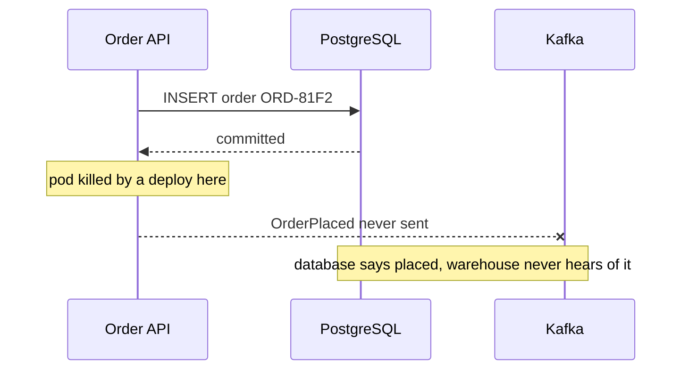
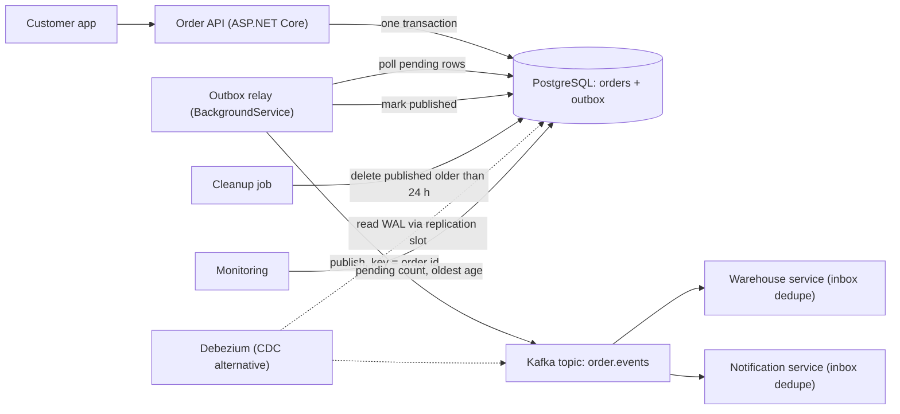
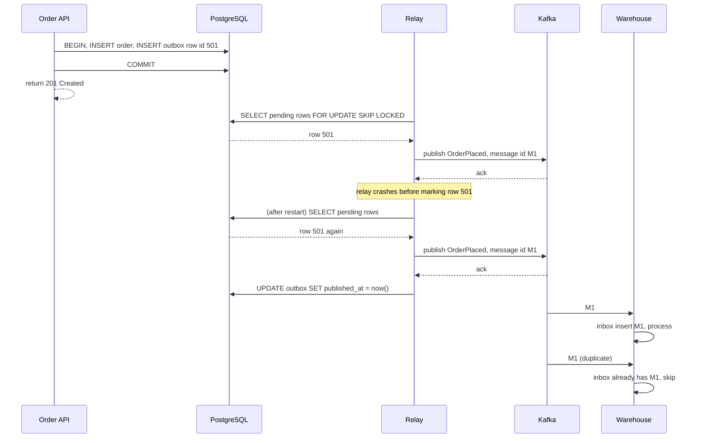

Almost every service that publishes events has the same hidden bug on day one: it writes to its database and then sends a message to the broker, as two separate steps. Most of the time both succeed. Occasionally one succeeds and the other does not, and the system quietly disagrees with itself. The transactional outbox is the standard, boring and very reliable fix. This lesson builds one on PostgreSQL and ASP.NET Core, and shows where it breaks under load.

## Learning objectives

By the end of this lesson you will be able to:

1. Explain the dual-write problem and show the two crash points that make "save, then publish" unsafe.
2. Design an outbox table in PostgreSQL with the right columns and a partial index for pending rows.
3. Write the order and its event in one transaction from an ASP.NET Core service.
4. Build a relay as a `BackgroundService` that publishes pending rows, marks them, and survives crashes.
5. Compare a polling relay with change data capture (CDC) from the write-ahead log, and choose between them.
6. Keep per-aggregate ordering, even with retries and more than one relay instance.
7. Size and clean up the outbox table so it does not grow without limit.
8. Explain why the outbox gives at-least-once delivery and what the consumer must do about duplicates.

## Prerequisites

- [Message queues](#/lesson/m12-message-queues): producers, consumers and acknowledgements.
- [Delivery guarantees](#/lesson/m12-delivery-guarantees): at-most-once, at-least-once and effectively-once.
- [Idempotent consumers and inbox deduplication](#/lesson/m12-idempotent-consumers): the outbox can send a message twice, so the consumer must cope.

It also helps to know basic SQL transactions (`BEGIN`, `COMMIT`, `ROLLBACK`).

## Explain it like I'm a beginner

Think of a busy government office that issues building permits. When a clerk approves a permit, two things must happen: the approval is written in the **register** (the database), and a **letter** goes to the applicant (the message).

A careless clerk writes in the register and then walks to the post room. If the clerk is called away on the way, the register says "approved" but no letter ever goes out. Another careless clerk posts the letter first and then writes in the register. If the register write fails (the page is torn, the pen runs out), the applicant has a letter for a permit that officially does not exist.

A careful office does it differently. The clerk writes the approval **and** a line in an "outgoing letters" column on the **same page** of the register, in one go. Either the whole line is written or none of it is. Later, a post-room assistant walks through the register, finds lines marked "letter not yet sent", posts each letter and ticks it as sent.

If the assistant posts a letter and faints before ticking it, the next assistant posts it again. The applicant gets two copies of the same letter, which is annoying but harmless: they recognise the permit number and ignore the duplicate.

- The "outgoing letters" column is the **outbox table**.
- Writing both in one go is a **database transaction**.
- The assistant is the **relay** (also called a message relay or outbox publisher).
- The applicant ignoring the duplicate is an **idempotent consumer**.

## First-principles explanation

### The dual-write problem

A **dual write** is when one operation must change two systems that do not share a transaction, for example PostgreSQL and Kafka. Consider an online grocery service, which we will call QuickBasket, placing an order:

```csharp
await db.SaveOrderAsync(order, ct);                 // step 1: PostgreSQL
await broker.PublishAsync(new OrderPlaced(order), ct); // step 2: Kafka
```

There are three ways this goes wrong:

1. **Crash or failure between the steps.** The order is saved, the process dies (deploy, out-of-memory, pod eviction) before publishing. The warehouse never picks the order. The customer was charged and waits forever.
2. **Publish first, then the save fails.** If you swap the steps, a unique-key violation or a deadlock in step 2 leaves an `OrderPlaced` event for an order that does not exist. The warehouse picks phantom groceries.
3. **The publish times out but actually succeeded.** The broker received the message, but the acknowledgement was lost. If you treat the timeout as failure and roll back the order, you have the phantom event again.

You cannot fix this with a `try/catch`. Whatever you put in the `catch` can also fail, and a crash skips the `catch` entirely. You cannot fix it with a distributed transaction either, at least not cheaply: Kafka does not take part in two-phase commit with PostgreSQL, and [two-phase commit](#/lesson/m13-distributed-transactions) has its own blocking failure modes.

How often does it happen? Rarely per request, which is exactly why it survives testing. Suppose QuickBasket handles 2 million orders a day and the process crashes or is killed between the two lines in 1 of every 100,000 requests (an assumption for illustration). That is 20 lost or phantom orders every day, each one a support ticket.

### The idea

Instead of writing to two systems, write to **one** system twice, inside one transaction:

1. In the same PostgreSQL transaction that inserts the order, insert a row into an `outbox` table describing the event.
2. Commit. Now either both rows exist or neither does. PostgreSQL guarantees it.
3. A separate process, the **relay**, reads unpublished outbox rows, publishes them to the broker, and marks them as published.

The broker is now updated *eventually*, not *atomically*, but it is guaranteed to be updated as long as the relay keeps running. The database is the single source of truth, and the outbox is a durable to-do list derived from it.

### The outbox table

```sql
CREATE TABLE outbox (
    id              bigint GENERATED ALWAYS AS IDENTITY PRIMARY KEY,
    message_id      uuid        NOT NULL UNIQUE,      -- consumers deduplicate on this
    aggregate_type  text        NOT NULL,             -- 'order'
    aggregate_id    text        NOT NULL,             -- 'ORD-81F2' (becomes the message key)
    event_type      text        NOT NULL,             -- 'OrderPlaced'
    payload         jsonb       NOT NULL,
    headers         jsonb       NOT NULL DEFAULT '{}', -- trace id, schema version
    occurred_at     timestamptz NOT NULL DEFAULT now(),
    published_at    timestamptz,                      -- NULL means pending
    attempts        int         NOT NULL DEFAULT 0,
    last_error      text
);

-- Small, fast index that only contains pending rows.
CREATE INDEX outbox_pending_idx ON outbox (id) WHERE published_at IS NULL;
```

Why each column exists:

- **`message_id`** travels with the message as a header. Consumers store it in an inbox table and ignore repeats. A `uuid` version 7 is a good choice because it is time-ordered.
- **`aggregate_type` and `aggregate_id`** say which business object the event is about. The id becomes the Kafka message key (or RabbitMQ routing key), so all events for one order land on the same partition and stay in order.
- **`payload`** is the event as JSON, written by the same code that changed the business data, so it cannot drift from it.
- **`published_at`** separates pending rows from done rows. The partial index keeps "find pending rows" fast even when the table holds millions of published rows.
- **`attempts` and `last_error`** make a stuck message visible instead of silent.

### Writing in the same transaction

```sql
BEGIN;
INSERT INTO orders (id, customer_id, total, status) VALUES ('ORD-81F2', 'C-1001', 1249.00, 'placed');
INSERT INTO outbox (message_id, aggregate_type, aggregate_id, event_type, payload)
VALUES ('01929a3e-...', 'order', 'ORD-81F2', 'OrderPlaced',
        '{"orderId":"ORD-81F2","customerId":"C-1001","total":1249.00}');
COMMIT;
```

The rule is strict: **the outbox insert must use the same connection and the same transaction as the business write.** If a developer opens a second connection "for the outbox", the pattern is broken without anyone noticing.

### The relay

The relay is a loop:

1. Fetch a batch of pending rows, oldest first.
2. Publish each one to the broker and wait for the broker's acknowledgement.
3. Mark it as published (`UPDATE outbox SET published_at = now() WHERE id = ...`).
4. If the batch was not full, sleep for a short poll interval, then repeat.

Look at the crash points:

- Crash **before publishing**: the row is still pending. The next run publishes it. Nothing is lost.
- Crash **after publishing, before marking**: the row is still pending. The next run publishes it **again**. The consumer receives a duplicate.

So the outbox gives **at-least-once** delivery. It never loses a committed event, and it sometimes sends one twice. That is why the consumer side needs [inbox deduplication](#/lesson/m12-idempotent-consumers) keyed on `message_id`. The outbox and the inbox are two halves of one design: outbox on the producer side, inbox on the consumer side, together giving effectively-once processing.

### Polling relay versus change data capture

There are two ways to find new outbox rows.

**Polling publisher.** The relay runs a query every few hundred milliseconds:

```sql
SELECT id, message_id, aggregate_type, aggregate_id, event_type, payload, headers
FROM outbox
WHERE published_at IS NULL
ORDER BY id
LIMIT 100
FOR UPDATE SKIP LOCKED;
```

`FOR UPDATE` locks the selected rows until the relay's transaction ends. `SKIP LOCKED` makes a second relay instance skip rows the first has locked instead of waiting. The relay publishes the batch and updates `published_at` in the same transaction that holds the locks.

**Transaction log tailing (CDC).** PostgreSQL writes every committed change to its write-ahead log (WAL). With **logical decoding** (`wal_level = logical`) a tool such as Debezium reads inserts into the outbox table from a replication slot and publishes them to Kafka. Debezium's outbox event router turns each row into a message, using `aggregate_id` as the key. No polling queries hit the table.

| | Polling relay | CDC (log tailing) |
|---|---|---|
| Moving parts | Your app code only | Debezium or similar, Kafka Connect, a replication slot |
| Latency | About half the poll interval on average (250 ms at a 500 ms interval), plus publish time | Usually well under a second, no polling delay |
| Load on the database | One cheap indexed query per poll, plus one `UPDATE` per message | Reads the WAL; no extra queries, no updates |
| Ordering | Ordered by `id`; careful with gaps (see below) and multiple relays | Commit order from the WAL, which is the true order |
| Cleanup | You must delete published rows | Rows can be deleted immediately, even in the same transaction |
| Failure modes | Relay down means growing lag | An inactive replication slot makes PostgreSQL keep WAL, which can fill the disk |
| Broker choice | Any broker | Best with Kafka; other sinks need extra work |

A sensible default: **start with polling**. It is a few hundred lines of code you understand, and it is fast enough for most systems. Move to CDC when the polling `UPDATE` load, the latency or the number of services makes it worth running Kafka Connect, and when someone on the team will own the replication slots.

### Ordering and the identity gap

Ordering has three traps.

**Trap 1: commit order is not id order.** An identity column assigns `id` when a row is *inserted*, not when its transaction *commits*. Transaction A inserts `id = 101`, transaction B inserts `id = 102`, B commits first. For a moment, 102 is visible and 101 is not. A relay that remembers "last published id = 102" and next asks for `id > 102` will **skip 101 forever**. The fix is to select by state (`published_at IS NULL`), not by a high-water mark, or to use CDC, which reads in commit order.

**Trap 2: retries reorder.** If event 1 for `ORD-81F2` fails to publish and event 2 for the same order succeeds, the consumer sees "OrderShipped" before "OrderPlaced". The relay must stop publishing for an aggregate after the first failure in a batch, and try again from that event next time.

**Trap 3: more than one relay.** With `SKIP LOCKED`, relay A may lock events 1 and 3 of an order while relay B grabs event 2. Each publishes its own rows, so the broker may receive 2 before 1. Options:

- Run **one active relay** at a time. Each instance tries `SELECT pg_try_advisory_lock(73001)`; only the winner relays, the others wait as hot standbys.
- **Partition the work**: relay instance *k* of *N* only handles rows where `hashtext(aggregate_id) % N = k`, so each aggregate has exactly one owner.
- Accept unordered delivery and make consumers order-tolerant by carrying a per-aggregate version number.

For most systems a single active relay is plenty, as the numbers below show.

### Back-of-the-envelope sizing

QuickBasket's numbers (all estimates for illustration):

- 2,000,000 orders per day, each producing about 3 events (placed, paid, packed) = 6,000,000 outbox rows per day.
- Average rate: 6,000,000 ÷ 86,400 s ≈ 70 rows/s. Evening peak, estimated at 4× average: ≈ 280 rows/s.
- Average row size with JSON payload and index entries: about 1 KB, so 6,000,000 × 1 KB ≈ 6 GB of new outbox data per day.

**What breaks first: the publish loop, not the database.** If the relay publishes one message, waits for the broker's acknowledgement (say 5 ms within a data centre, an estimate) and then the next, one relay manages at most 1,000 ms ÷ 5 ms = 200 messages per second. That is below the 280/s peak, so lag grows every evening. Fixes, cheapest first: publish the whole batch concurrently and await all acknowledgements (Kafka producers batch and pipeline naturally), then mark the batch with one `UPDATE ... WHERE id = ANY(@ids)`; or partition the relay as described above.

**Then the table.** Without cleanup, 6 GB a day is about 180 GB in a month, most of it rows nobody will ever read again. Every `UPDATE` also leaves a dead row version that autovacuum must clean. Keep published rows for a short audit window (24 hours is common), then delete them in batches, or partition the outbox by day and drop old partitions, which is much cheaper than `DELETE`.

**Polling cost when idle.** A poll every 500 ms is 172,800 queries a day. With the partial index each costs well under a millisecond, so this is negligible. Do not make the interval 10 ms "for latency"; use a short sleep only when the last batch was full.

### Cleanup

```sql
-- Run every few minutes; small batches keep locks and WAL bursts short.
DELETE FROM outbox
WHERE id IN (
    SELECT id FROM outbox
    WHERE published_at < now() - interval '24 hours'
    ORDER BY id
    LIMIT 5000
);
```

With CDC you can skip the retention window entirely: insert the outbox row and delete it in the same transaction. The insert is still in the WAL, so Debezium sees it, and the table stays empty.

### When it is unnecessary

- **The event is a hint, not a fact.** A "cache may be stale" notification that is also covered by a TTL can be fire-and-forget.
- **There is no second system.** If the "event" is consumed by a job that reads the same database, just query the database (a status column plus a worker is already an outbox in disguise).
- **You publish first and the database is a projection.** In event sourcing the event store *is* the source of truth; there is no dual write to fix.
- **The broker can be the only write.** Sometimes the cleanest design is to publish the command to Kafka and have a consumer write the database. Then there is again only one write that must succeed.

### Trade-offs

| You gain | You pay |
|---|---|
| No lost or phantom events, even on crashes | A relay to run, monitor and keep healthy |
| Events always match committed data | Delivery is delayed (milliseconds to seconds) |
| Works with any database that has transactions | At-least-once: consumers must deduplicate |
| Easy to replay: the rows are in the database | Extra writes, table growth and cleanup |
| Clear audit of what was published and when | Ordering needs deliberate design with retries or many relays |

## Visual explanation

### Where the dual write breaks



This is the failure the pattern exists for. The first two arrows succeed, then the process stops. Nothing in the code can "catch" a killed process. The database now holds an order that no other service knows about, and there is no record anywhere that a message was owed.

### Architecture: polling relay with a CDC alternative



The order API writes the order and its outbox row in one transaction; that is the only write a request makes. The relay polls the pending rows, publishes each to Kafka keyed by order id (so all events for one order go to one partition), and marks them published. A cleanup job deletes old published rows. The dotted path is the alternative: Debezium reads committed inserts from the WAL and publishes them, replacing the relay's polling. Downstream, both consumers keep an inbox of seen `message_id`s to drop duplicates. Monitoring watches the number of pending rows and the age of the oldest one, which together show whether the relay is keeping up.

### Sequence: the happy path and the duplicate



The API's work is finished as soon as the transaction commits; it never talks to Kafka. The relay picks up row 501, publishes it and gets an acknowledgement, then crashes before marking it. After a restart the row is still pending, so it is published again with the **same** `message_id`. The warehouse receives both copies, records `M1` in its inbox the first time, and skips the second. No event is lost and no order is picked twice.

## Step-by-step example

We will move QuickBasket from the unsafe version to a production outbox in five steps.

### Step 1: the unsafe dual write

```csharp
public async Task<Order> PlaceOrderAsync(PlaceOrderCommand cmd, CancellationToken ct)
{
    var order = await _orders.InsertAsync(cmd, ct);      // commits on its own
    await _producer.ProduceAsync("order.events", order.Id, new OrderPlaced(order), ct);
    return order;
}
```

Two independent writes. Every failure mode from the first-principles section applies.

### Step 2: add the outbox table and write it in the same transaction

Create the `outbox` table and the partial index. Change `PlaceOrderAsync` to open one transaction, insert the order, insert the outbox row, and commit. Remove the broker call from the request path entirely. The API is now faster too: it no longer waits for Kafka.

### Step 3: add a relay

Add a `BackgroundService` that fetches pending rows in batches of 100, publishes them with the row's `aggregate_id` as the key and `message_id` as a header, and marks them published. When a batch is not full, it sleeps for 500 ms.

### Step 4: protect ordering and make failures visible

When publishing fails for a row, record the error, increase `attempts`, and skip the rest of that aggregate's rows in the batch. Expose two numbers as metrics: pending rows and the age of the oldest pending row. Alert if the oldest pending row is older than, say, 5 minutes.

### Step 5: clean up and add the inbox downstream

Add a cleanup job that deletes published rows older than 24 hours in batches of 5,000. In every consumer, add an inbox table keyed on `message_id`. The full version follows.

## Production-style C# implementation

The implementation below uses an in-memory database and an in-memory publisher so that it compiles and runs anywhere. The interfaces are the seams: in production, `IOrderDatabase` and `IOutboxStore` are implemented with Npgsql (sketch at the end of this section), and `IMessagePublisher` with Confluent.Kafka or RabbitMQ.Client.

```text
QuickBasket.Orders/
  Program.cs
  Orders/       Order.cs, IOrderDatabase.cs, OrderService.cs
  Outbox/       OutboxMessage.cs, OutboxOptions.cs, IOutboxStore.cs, IMessagePublisher.cs,
                OutboxRelay.cs, OutboxCleanupService.cs
  Persistence/  InMemoryOrderDatabase.cs
```

### The outbox message and options

```csharp file=Outbox/OutboxMessage.cs
using System.Text.Json;

namespace QuickBasket.Outbox;

/// <summary>One row of the outbox table.</summary>
public sealed class OutboxMessage
{
    public required Guid MessageId { get; init; }
    public long Sequence { get; set; }                  // assigned by the store, like an identity column
    public required string AggregateType { get; init; }
    public required string AggregateId { get; init; }
    public required string EventType { get; init; }
    public required string Payload { get; init; }
    public required DateTimeOffset OccurredAt { get; init; }
    public DateTimeOffset? PublishedAt { get; set; }
    public int Attempts { get; set; }
    public string? LastError { get; set; }

    public static OutboxMessage For<TEvent>(string aggregateType, string aggregateId, TEvent @event, DateTimeOffset now) => new()
    {
        MessageId = Guid.CreateVersion7(now),           // time-ordered, good for indexes and dedupe tables
        AggregateType = aggregateType,
        AggregateId = aggregateId,
        EventType = typeof(TEvent).Name,
        Payload = JsonSerializer.Serialize(@event, JsonSerializerOptions.Web),
        OccurredAt = now
    };
}
```

```csharp file=Outbox/OutboxOptions.cs
namespace QuickBasket.Outbox;

public sealed class OutboxOptions
{
    public int BatchSize { get; set; } = 100;
    public TimeSpan PollInterval { get; set; } = TimeSpan.FromMilliseconds(500);
    public TimeSpan Retention { get; set; } = TimeSpan.FromHours(24);
    public TimeSpan CleanupInterval { get; set; } = TimeSpan.FromMinutes(10);
    /// <summary>Rows with at least this many failed attempts are reported as stuck.</summary>
    public int StuckAfterAttempts { get; set; } = 10;
}
```

### The store and publisher seams

```csharp file=Outbox/IOutboxStore.cs
namespace QuickBasket.Outbox;

public sealed record OutboxStats(int Pending, int Stuck, TimeSpan OldestPendingAge);

/// <summary>Relay-side access to the outbox table.</summary>
public interface IOutboxStore
{
    /// <summary>Oldest pending rows first. In PostgreSQL: ORDER BY id LIMIT n FOR UPDATE SKIP LOCKED.</summary>
    Task<IReadOnlyList<OutboxMessage>> FetchPendingAsync(int batchSize, CancellationToken ct);
    Task MarkPublishedAsync(Guid messageId, DateTimeOffset publishedAt, CancellationToken ct);
    Task MarkFailedAsync(Guid messageId, string error, CancellationToken ct);
    Task<int> DeletePublishedBeforeAsync(DateTimeOffset cutoff, CancellationToken ct);
    Task<OutboxStats> GetStatsAsync(DateTimeOffset now, int stuckAfterAttempts, CancellationToken ct);
}
```

```csharp file=Outbox/IMessagePublisher.cs
namespace QuickBasket.Outbox;

public sealed record OutgoingMessage(Guid MessageId, string Topic, string Key, string EventType, string Payload);

/// <summary>Completes only when the broker has durably accepted the message.</summary>
public interface IMessagePublisher
{
    Task PublishAsync(OutgoingMessage message, CancellationToken ct);
}

/// <summary>Test and demo publisher. Can be told to fail the next N publishes.</summary>
public sealed class InMemoryPublisher : IMessagePublisher
{
    private readonly Lock _gate = new();
    private readonly List<OutgoingMessage> _sent = new();

    public int FailuresToInject { get; set; }

    public IReadOnlyList<OutgoingMessage> Sent
    {
        get { lock (_gate) return _sent.ToList(); }
    }

    public Task PublishAsync(OutgoingMessage message, CancellationToken ct)
    {
        ct.ThrowIfCancellationRequested();
        lock (_gate)
        {
            if (FailuresToInject > 0)
            {
                FailuresToInject--;
                throw new IOException("Broker unavailable");
            }
            _sent.Add(message);
        }
        return Task.CompletedTask;
    }
}
```

### Orders and the transactional write

```csharp file=Orders/Order.cs
namespace QuickBasket.Orders;

public sealed record Order(string Id, string CustomerId, decimal Total, DateTimeOffset PlacedAt);

public sealed record OrderPlaced(string OrderId, string CustomerId, decimal Total, DateTimeOffset PlacedAt);

public sealed record PlaceOrderCommand(string CustomerId, decimal Total);
```

```csharp file=Orders/IOrderDatabase.cs
using QuickBasket.Outbox;

namespace QuickBasket.Orders;

/// <summary>Everything written through one IOrderTransaction commits together or not at all.</summary>
public interface IOrderTransaction
{
    void InsertOrder(Order order);
    void InsertOutbox(OutboxMessage message);
}

public interface IOrderDatabase
{
    Task ExecuteInTransactionAsync(Func<IOrderTransaction, CancellationToken, Task> work, CancellationToken ct);
}
```

```csharp file=Orders/OrderService.cs
using QuickBasket.Outbox;

namespace QuickBasket.Orders;

public sealed class OrderService(IOrderDatabase db, TimeProvider clock)
{
    public const string AggregateType = "order";

    public async Task<Order> PlaceOrderAsync(PlaceOrderCommand cmd, CancellationToken ct)
    {
        ArgumentOutOfRangeException.ThrowIfNegativeOrZero(cmd.Total);
        var now = clock.GetUtcNow();
        var order = new Order("ORD-" + Guid.NewGuid().ToString("N")[..10].ToUpperInvariant(), cmd.CustomerId, cmd.Total, now);
        var evt = new OrderPlaced(order.Id, order.CustomerId, order.Total, now);

        await db.ExecuteInTransactionAsync((tx, _) =>
        {
            tx.InsertOrder(order);
            tx.InsertOutbox(OutboxMessage.For(AggregateType, order.Id, evt, now));  // same transaction
            return Task.CompletedTask;
        }, ct);

        return order;   // no broker call on the request path
    }
}
```

### An in-memory database with real transaction semantics

```csharp file=Persistence/InMemoryOrderDatabase.cs
using QuickBasket.Orders;
using QuickBasket.Outbox;

namespace QuickBasket.Persistence;

/// <summary>
/// Buffers writes per transaction and applies them under one lock at commit, so a failure
/// anywhere in the unit of work leaves no partial state. Stands in for PostgreSQL.
/// </summary>
public sealed class InMemoryOrderDatabase : IOrderDatabase, IOutboxStore
{
    private readonly Lock _gate = new();
    private readonly Dictionary<string, Order> _orders = new();
    private readonly List<OutboxMessage> _outbox = new();
    private long _sequence;

    public int OrderCount { get { lock (_gate) return _orders.Count; } }
    public int OutboxCount { get { lock (_gate) return _outbox.Count; } }

    public async Task ExecuteInTransactionAsync(Func<IOrderTransaction, CancellationToken, Task> work, CancellationToken ct)
    {
        var tx = new Transaction();
        await work(tx, ct);                   // throws => nothing below runs => implicit rollback
        ct.ThrowIfCancellationRequested();

        lock (_gate)                          // COMMIT
        {
            foreach (var o in tx.Orders)
                if (_orders.ContainsKey(o.Id))
                    throw new InvalidOperationException($"Order {o.Id} already exists.");
            foreach (var o in tx.Orders) _orders[o.Id] = o;
            foreach (var m in tx.Outbox)
            {
                m.Sequence = ++_sequence;
                _outbox.Add(m);
            }
        }
    }

    public Task<IReadOnlyList<OutboxMessage>> FetchPendingAsync(int batchSize, CancellationToken ct)
    {
        lock (_gate)
        {
            IReadOnlyList<OutboxMessage> batch = _outbox
                .Where(m => m.PublishedAt is null)
                .OrderBy(m => m.Sequence)
                .Take(batchSize)
                .ToList();
            return Task.FromResult(batch);
        }
    }

    public Task MarkPublishedAsync(Guid messageId, DateTimeOffset publishedAt, CancellationToken ct)
    {
        lock (_gate)
        {
            var m = _outbox.FirstOrDefault(x => x.MessageId == messageId);
            if (m is not null && m.PublishedAt is null) m.PublishedAt = publishedAt;
        }
        return Task.CompletedTask;
    }

    public Task MarkFailedAsync(Guid messageId, string error, CancellationToken ct)
    {
        lock (_gate)
        {
            var m = _outbox.FirstOrDefault(x => x.MessageId == messageId);
            if (m is not null)
            {
                m.Attempts++;
                m.LastError = error.Length > 500 ? error[..500] : error;
            }
        }
        return Task.CompletedTask;
    }

    public Task<int> DeletePublishedBeforeAsync(DateTimeOffset cutoff, CancellationToken ct)
    {
        lock (_gate)
            return Task.FromResult(_outbox.RemoveAll(m => m.PublishedAt is { } p && p < cutoff));
    }

    public Task<OutboxStats> GetStatsAsync(DateTimeOffset now, int stuckAfterAttempts, CancellationToken ct)
    {
        lock (_gate)
        {
            var pending = _outbox.Where(m => m.PublishedAt is null).ToList();
            var oldest = pending.Count == 0 ? TimeSpan.Zero : now - pending.Min(m => m.OccurredAt);
            return Task.FromResult(new OutboxStats(pending.Count, pending.Count(m => m.Attempts >= stuckAfterAttempts), oldest));
        }
    }

    private sealed class Transaction : IOrderTransaction
    {
        public List<Order> Orders { get; } = new();
        public List<OutboxMessage> Outbox { get; } = new();
        public void InsertOrder(Order order) => Orders.Add(order);
        public void InsertOutbox(OutboxMessage message) => Outbox.Add(message);
    }
}
```

### The relay

The relay keeps per-aggregate order: after the first failure for an aggregate in a batch, the rest of that aggregate's rows wait for the next pass. Other aggregates carry on.

```csharp file=Outbox/OutboxRelay.cs
using Microsoft.Extensions.Options;

namespace QuickBasket.Outbox;

public sealed class OutboxRelay(
    IOutboxStore store,
    IMessagePublisher publisher,
    IOptions<OutboxOptions> options,
    TimeProvider clock,
    ILogger<OutboxRelay> logger) : BackgroundService
{
    public static string TopicFor(string aggregateType) => $"{aggregateType}.events";

    protected override async Task ExecuteAsync(CancellationToken stoppingToken)
    {
        while (!stoppingToken.IsCancellationRequested)
        {
            int published;
            try
            {
                published = await RunOnceAsync(stoppingToken);
            }
            catch (OperationCanceledException) when (stoppingToken.IsCancellationRequested)
            {
                break;
            }
            catch (Exception ex)
            {
                logger.LogError(ex, "Outbox relay pass failed; retrying after the poll interval");
                published = 0;
            }

            // A full batch means more rows are probably waiting: loop again immediately.
            if (published < options.Value.BatchSize)
            {
                try { await Task.Delay(options.Value.PollInterval, clock, stoppingToken); }
                catch (OperationCanceledException) { break; }
            }
        }
    }

    /// <summary>Publishes one batch. Returns how many rows were published.</summary>
    public async Task<int> RunOnceAsync(CancellationToken ct)
    {
        var batch = await store.FetchPendingAsync(options.Value.BatchSize, ct);
        var blocked = new HashSet<string>(StringComparer.Ordinal);
        var published = 0;

        foreach (var m in batch)
        {
            var aggregateKey = m.AggregateType + "/" + m.AggregateId;
            if (blocked.Contains(aggregateKey)) continue;          // an earlier event failed: keep order

            try
            {
                await publisher.PublishAsync(
                    new OutgoingMessage(m.MessageId, TopicFor(m.AggregateType), m.AggregateId, m.EventType, m.Payload), ct);
                await store.MarkPublishedAsync(m.MessageId, clock.GetUtcNow(), ct);
                published++;
            }
            catch (Exception ex) when (ex is not OperationCanceledException)
            {
                blocked.Add(aggregateKey);
                await store.MarkFailedAsync(m.MessageId, ex.Message, ct);
                logger.LogWarning(ex, "Publishing outbox message {MessageId} ({EventType}) failed", m.MessageId, m.EventType);
            }
        }

        return published;
    }
}
```

### Cleanup

```csharp file=Outbox/OutboxCleanupService.cs
using Microsoft.Extensions.Options;

namespace QuickBasket.Outbox;

public sealed class OutboxCleanupService(
    IOutboxStore store,
    IOptions<OutboxOptions> options,
    TimeProvider clock,
    ILogger<OutboxCleanupService> logger) : BackgroundService
{
    protected override async Task ExecuteAsync(CancellationToken stoppingToken)
    {
        using var timer = new PeriodicTimer(options.Value.CleanupInterval, clock);
        try
        {
            while (await timer.WaitForNextTickAsync(stoppingToken))
            {
                var cutoff = clock.GetUtcNow() - options.Value.Retention;
                var deleted = await store.DeletePublishedBeforeAsync(cutoff, stoppingToken);
                if (deleted > 0) logger.LogInformation("Deleted {Count} published outbox rows older than {Cutoff}", deleted, cutoff);
            }
        }
        catch (OperationCanceledException) when (stoppingToken.IsCancellationRequested)
        {
            // normal shutdown
        }
    }
}
```

### Wiring it up

```csharp file=Program.cs
using QuickBasket.Orders;
using QuickBasket.Outbox;
using QuickBasket.Persistence;
using Microsoft.Extensions.Options;

var builder = WebApplication.CreateBuilder(args);

builder.Services.AddSingleton(TimeProvider.System);
builder.Services.Configure<OutboxOptions>(builder.Configuration.GetSection("Outbox"));

// One database object plays both roles here; with PostgreSQL these are two small Npgsql classes.
builder.Services.AddSingleton<InMemoryOrderDatabase>();
builder.Services.AddSingleton<IOrderDatabase>(sp => sp.GetRequiredService<InMemoryOrderDatabase>());
builder.Services.AddSingleton<IOutboxStore>(sp => sp.GetRequiredService<InMemoryOrderDatabase>());

builder.Services.AddSingleton<IMessagePublisher, InMemoryPublisher>();   // swap for a Kafka adapter
builder.Services.AddScoped<OrderService>();
builder.Services.AddHostedService<OutboxRelay>();
builder.Services.AddHostedService<OutboxCleanupService>();

var app = builder.Build();

app.MapPost("/orders", async (PlaceOrderCommand cmd, OrderService orders, CancellationToken ct) =>
{
    var order = await orders.PlaceOrderAsync(cmd, ct);
    return Results.Created($"/orders/{order.Id}", order);
});

app.MapGet("/admin/outbox/stats", async (IOutboxStore store, IOptions<OutboxOptions> o, TimeProvider clock, CancellationToken ct) =>
    Results.Ok(await store.GetStatsAsync(clock.GetUtcNow(), o.Value.StuckAfterAttempts, ct)));

app.Run();
```

### What the PostgreSQL version looks like

With Npgsql, the business write and the outbox insert share one `NpgsqlTransaction`. This snippet is a sketch (Npgsql is not available in the offline checker):

```csharp
await using var conn = await dataSource.OpenConnectionAsync(ct);
await using var tx = await conn.BeginTransactionAsync(ct);

await using (var cmd = new NpgsqlCommand(
    "INSERT INTO orders (id, customer_id, total, status) VALUES ($1, $2, $3, 'placed')", conn, tx))
{
    cmd.Parameters.AddWithValue(order.Id);
    cmd.Parameters.AddWithValue(order.CustomerId);
    cmd.Parameters.AddWithValue(order.Total);
    await cmd.ExecuteNonQueryAsync(ct);
}

await using (var cmd = new NpgsqlCommand(
    """
    INSERT INTO outbox (message_id, aggregate_type, aggregate_id, event_type, payload)
    VALUES ($1, $2, $3, $4, $5::jsonb)
    """, conn, tx))                                   // same connection, same transaction
{
    cmd.Parameters.AddWithValue(msg.MessageId);
    cmd.Parameters.AddWithValue(msg.AggregateType);
    cmd.Parameters.AddWithValue(msg.AggregateId);
    cmd.Parameters.AddWithValue(msg.EventType);
    cmd.Parameters.AddWithValue(msg.Payload);
    await cmd.ExecuteNonQueryAsync(ct);
}

await tx.CommitAsync(ct);
```

If you use EF Core, add the outbox row to the same `DbContext` before `SaveChangesAsync`; EF Core wraps all changes from one `SaveChangesAsync` call in a single transaction. Libraries such as MassTransit, NServiceBus and Wolverine ship ready-made outbox implementations for .NET; knowing how the parts work helps you configure and debug them.

## Bad design vs good design

**Bad: publish inside the transaction.**

```csharp
await using var tx = await conn.BeginTransactionAsync(ct);
await InsertOrderAsync(conn, tx, order, ct);
await producer.ProduceAsync("order.events", msg, ct);   // published...
await tx.CommitAsync(ct);                                // ...but this can still fail
```

It looks atomic but is not. If the commit fails (serialization error, connection drop), the event is already out. It also holds database locks for the duration of a network call to the broker, which hurts throughput under load.

**Bad: an outbox on a separate connection.**

```csharp
await orderRepository.SaveAsync(order, ct);   // connection 1, commits
await outboxRepository.AddAsync(msg, ct);     // connection 2, commits separately
```

This is a dual write with extra steps. Code review should check that the outbox insert receives the transaction object, not just "an outbox repository".

**Bad: a high-water-mark cursor.** `WHERE id > @lastPublishedId` skips rows whose transactions commit out of id order. Select by `published_at IS NULL` instead.

**Bad: no cleanup and no lag metric.** The table grows by gigabytes a day, and nobody knows the relay died last Tuesday until the warehouse team asks why there are no orders to pick.

**Good:** one transaction for the business row and the outbox row; a relay that fetches by state, publishes with the aggregate id as key and a stable `message_id`, keeps per-aggregate order on failure, marks rows as published, and exposes pending count and oldest age; a cleanup job; idempotent consumers.

:::callout type=tradeoff title="Outbox or listen-to-yourself?"
An alternative is to publish the event to Kafka first and have the service consume its own event to update its database ("listen to yourself"). There is only one write that must succeed, but the service cannot read its own write immediately, and request validation that needs the database becomes awkward. The outbox keeps the familiar "write the database, return the result" flow. Choose listen-to-yourself mainly when the event stream is already the source of truth.
:::

## Practical playground

The playground below is a PostgreSQL database seeded with an `orders` table and an `outbox` table in a mid-incident state: some rows are published, some are pending, and one order has a failing event. Try these:

1. Write the relay's fetch query: the oldest 3 pending rows, ordered by `id`, with `FOR UPDATE SKIP LOCKED`.
2. Mark rows 4 and 5 as published with one `UPDATE ... WHERE id = ANY(ARRAY[4,5])`, then run the fetch again.
3. Find, for each `aggregate_id`, its **earliest** pending row (the only one that may be published next if order matters). Hint: `DISTINCT ON (aggregate_id)`.
4. Write the batched cleanup `DELETE` for rows published before `2026-10-01 11:00:00+00`.
5. Compute the age of the oldest pending row relative to `2026-10-01 12:00:00+00`.

:::playground type=sql title="Outbox table in the middle of an incident"
```sql
CREATE TABLE orders (
  id text PRIMARY KEY,
  customer_id text NOT NULL,
  total numeric(10,2) NOT NULL,
  status text NOT NULL
);
CREATE TABLE outbox (
  id bigint GENERATED ALWAYS AS IDENTITY PRIMARY KEY,
  message_id uuid NOT NULL UNIQUE,
  aggregate_type text NOT NULL,
  aggregate_id text NOT NULL,
  event_type text NOT NULL,
  payload jsonb NOT NULL,
  occurred_at timestamptz NOT NULL,
  published_at timestamptz,
  attempts int NOT NULL DEFAULT 0,
  last_error text
);
CREATE INDEX outbox_pending_idx ON outbox (id) WHERE published_at IS NULL;

INSERT INTO orders VALUES
 ('ORD-1001', 'C-11', 640.00, 'packed'),
 ('ORD-1002', 'C-12', 1249.00, 'paid'),
 ('ORD-1003', 'C-13', 89.50, 'placed'),
 ('ORD-1004', 'C-11', 2310.00, 'placed');

INSERT INTO outbox (message_id, aggregate_type, aggregate_id, event_type, payload, occurred_at, published_at, attempts, last_error) VALUES
 ('01929a3e-0001-7000-8000-000000000001', 'order', 'ORD-1001', 'OrderPlaced', '{"orderId":"ORD-1001"}', '2026-10-01 10:00:00+00', '2026-10-01 10:00:01+00', 0, NULL),
 ('01929a3e-0002-7000-8000-000000000002', 'order', 'ORD-1001', 'OrderPaid',   '{"orderId":"ORD-1001"}', '2026-10-01 10:02:00+00', '2026-10-01 10:02:01+00', 0, NULL),
 ('01929a3e-0003-7000-8000-000000000003', 'order', 'ORD-1002', 'OrderPlaced', '{"orderId":"ORD-1002"}', '2026-10-01 11:30:00+00', '2026-10-01 11:30:01+00', 0, NULL),
 ('01929a3e-0004-7000-8000-000000000004', 'order', 'ORD-1002', 'OrderPaid',   '{"orderId":"ORD-1002"}', '2026-10-01 11:40:00+00', NULL, 3, 'broker timeout'),
 ('01929a3e-0005-7000-8000-000000000005', 'order', 'ORD-1001', 'OrderPacked', '{"orderId":"ORD-1001"}', '2026-10-01 11:45:00+00', NULL, 0, NULL),
 ('01929a3e-0006-7000-8000-000000000006', 'order', 'ORD-1003', 'OrderPlaced', '{"orderId":"ORD-1003"}', '2026-10-01 11:50:00+00', NULL, 0, NULL),
 ('01929a3e-0007-7000-8000-000000000007', 'order', 'ORD-1002', 'OrderPacked', '{"orderId":"ORD-1002"}', '2026-10-01 11:55:00+00', NULL, 0, NULL),
 ('01929a3e-0008-7000-8000-000000000008', 'order', 'ORD-1004', 'OrderPlaced', '{"orderId":"ORD-1004"}', '2026-10-01 11:58:00+00', NULL, 0, NULL);
```
:::

## Exercises

:::exercise id=m12-outbox-ex1 difficulty=beginner kind=code title="Save the order and its event atomically"
QuickBasket's `OrderPlacer` must save an order and an `OrderPlaced` outbox row so that either both exist or neither does. A small fake database with real transaction behaviour is provided. Implement `OrderPlacer.Place`.
::requirements
- Begin one transaction with `FakeDb.Begin()`, insert the order, insert one outbox row with event type `"OrderPlaced"` and aggregate id equal to the order id, then commit.
- The payload is JSON with camelCase names, for example `{"orderId":"ORD-1","total":499.5}`.
- If the order id already exists, throw `InvalidOperationException` and write nothing.
- If anything fails before commit, roll back and let the exception propagate.
::acceptance
- After a successful `Place`, the database has one order and one outbox row for it.
- If the outbox insert throws, no order is saved.
- A duplicate order id throws `InvalidOperationException` and adds no outbox row.
- Two orders get outbox sequence numbers 1 and 2.
::hint
The whole point is that the order and the outbox row go through the **same** transaction object.
::hint
Check for a duplicate before you start writing, using `FakeDb.OrderExists`.
::hint
Use `try { ...; tx.Commit(); } catch { tx.Rollback(); throw; }` so a failure leaves nothing behind and the caller still sees the error.
::hint
`JsonSerializer.Serialize(new { orderId, total })` produces camelCase names because the anonymous type's property names are already camelCase.
::hint
```csharp
var tx = _db.Begin();
try
{
    tx.InsertOrder(new OrderRow(orderId, total));
    tx.InsertOutbox(orderId, "OrderPlaced", JsonSerializer.Serialize(new { orderId, total }));
    tx.Commit();
}
catch { tx.Rollback(); throw; }
```
::starter
```csharp file=AtomicOrders.cs
using System;
using System.Collections.Generic;
using System.Text.Json;

public sealed record OrderRow(string OrderId, decimal Total);
public sealed record OutboxRow(long Sequence, string AggregateId, string EventType, string Payload);

/// <summary>A tiny database: writes made through a transaction become visible only on Commit.</summary>
public sealed class FakeDb
{
    private readonly List<OrderRow> _orders = new();
    private readonly List<OutboxRow> _outbox = new();
    private long _sequence;

    /// <summary>When true, InsertOutbox throws (simulates a failure halfway through).</summary>
    public bool FailOutboxInsert { get; set; }
    public IReadOnlyList<OrderRow> Orders => _orders;
    public IReadOnlyList<OutboxRow> Outbox => _outbox;
    public bool OrderExists(string orderId) => _orders.Exists(o => o.OrderId == orderId);

    public FakeTransaction Begin() => new(this);

    public sealed class FakeTransaction
    {
        private readonly FakeDb _db;
        private readonly List<OrderRow> _orders = new();
        private readonly List<(string AggregateId, string EventType, string Payload)> _outbox = new();
        private bool _completed;

        internal FakeTransaction(FakeDb db) => _db = db;

        public void InsertOrder(OrderRow row) => _orders.Add(row);

        public void InsertOutbox(string aggregateId, string eventType, string payload)
        {
            if (_db.FailOutboxInsert) throw new InvalidOperationException("Simulated failure: disk full");
            _outbox.Add((aggregateId, eventType, payload));
        }

        public void Commit()
        {
            if (_completed) throw new InvalidOperationException("Transaction already completed.");
            _completed = true;
            _db._orders.AddRange(_orders);
            foreach (var (a, t, p) in _outbox) _db._outbox.Add(new OutboxRow(++_db._sequence, a, t, p));
        }

        public void Rollback() => _completed = true;
    }
}

public sealed class OrderPlacer
{
    private readonly FakeDb _db;
    public OrderPlacer(FakeDb db) => _db = db;

    /// <summary>Saves the order and an OrderPlaced outbox row in one transaction.</summary>
    public void Place(string orderId, decimal total) => throw new NotImplementedException();
}
```
::tests
```csharp file=AtomicOrdersTests.cs
using System;
using Xunit;

public class AtomicOrdersTests
{
    [Fact]
    public void Saves_order_and_outbox_row_together()
    {
        var db = new FakeDb();
        new OrderPlacer(db).Place("ORD-1", 499.5m);
        Assert.Single(db.Orders);
        var row = Assert.Single(db.Outbox);
        Assert.Equal("ORD-1", row.AggregateId);
        Assert.Equal("OrderPlaced", row.EventType);
    }

    [Fact]
    public void Payload_contains_order_id_and_total()
    {
        var db = new FakeDb();
        new OrderPlacer(db).Place("ORD-1", 499.5m);
        Assert.Contains("\"orderId\":\"ORD-1\"", db.Outbox[0].Payload);
        Assert.Contains("\"total\":499.5", db.Outbox[0].Payload);
    }

    [Fact]
    public void Failure_in_outbox_insert_saves_nothing()
    {
        var db = new FakeDb { FailOutboxInsert = true };
        Assert.Throws<InvalidOperationException>(() => new OrderPlacer(db).Place("ORD-1", 100m));
        Assert.Empty(db.Orders);
        Assert.Empty(db.Outbox);
    }

    [Fact]
    public void Duplicate_order_is_rejected_without_a_second_event()
    {
        var db = new FakeDb();
        var placer = new OrderPlacer(db);
        placer.Place("ORD-1", 100m);
        Assert.Throws<InvalidOperationException>(() => placer.Place("ORD-1", 100m));
        Assert.Single(db.Orders);
        Assert.Single(db.Outbox);
    }

    [Fact]
    public void Sequences_increase()
    {
        var db = new FakeDb();
        var placer = new OrderPlacer(db);
        placer.Place("ORD-1", 100m);
        placer.Place("ORD-2", 200m);
        Assert.Equal(1L, db.Outbox[0].Sequence);
        Assert.Equal(2L, db.Outbox[1].Sequence);
    }
}
```
::solution
Check for a duplicate first, then do both inserts through one transaction, committing only if both succeed.

```csharp file=AtomicOrders.cs
using System;
using System.Collections.Generic;
using System.Text.Json;

public sealed record OrderRow(string OrderId, decimal Total);
public sealed record OutboxRow(long Sequence, string AggregateId, string EventType, string Payload);

public sealed class FakeDb
{
    private readonly List<OrderRow> _orders = new();
    private readonly List<OutboxRow> _outbox = new();
    private long _sequence;

    public bool FailOutboxInsert { get; set; }
    public IReadOnlyList<OrderRow> Orders => _orders;
    public IReadOnlyList<OutboxRow> Outbox => _outbox;
    public bool OrderExists(string orderId) => _orders.Exists(o => o.OrderId == orderId);

    public FakeTransaction Begin() => new(this);

    public sealed class FakeTransaction
    {
        private readonly FakeDb _db;
        private readonly List<OrderRow> _orders = new();
        private readonly List<(string AggregateId, string EventType, string Payload)> _outbox = new();
        private bool _completed;

        internal FakeTransaction(FakeDb db) => _db = db;

        public void InsertOrder(OrderRow row) => _orders.Add(row);

        public void InsertOutbox(string aggregateId, string eventType, string payload)
        {
            if (_db.FailOutboxInsert) throw new InvalidOperationException("Simulated failure: disk full");
            _outbox.Add((aggregateId, eventType, payload));
        }

        public void Commit()
        {
            if (_completed) throw new InvalidOperationException("Transaction already completed.");
            _completed = true;
            _db._orders.AddRange(_orders);
            foreach (var (a, t, p) in _outbox) _db._outbox.Add(new OutboxRow(++_db._sequence, a, t, p));
        }

        public void Rollback() => _completed = true;
    }
}

public sealed class OrderPlacer
{
    private readonly FakeDb _db;
    public OrderPlacer(FakeDb db) => _db = db;

    public void Place(string orderId, decimal total)
    {
        if (_db.OrderExists(orderId))
            throw new InvalidOperationException($"Order {orderId} already exists.");

        var tx = _db.Begin();
        try
        {
            tx.InsertOrder(new OrderRow(orderId, total));
            tx.InsertOutbox(orderId, "OrderPlaced", JsonSerializer.Serialize(new { orderId, total }));
            tx.Commit();
        }
        catch
        {
            tx.Rollback();
            throw;
        }
    }
}
```

In a real database the duplicate check is the primary-key constraint itself, enforced at insert time inside the transaction; checking first is only a friendlier error message. The important line is that both inserts use `tx`.
::mistakes
- Committing after the order insert and opening a second transaction for the outbox row.
- Swallowing the exception in `catch` so the caller thinks the order was placed.
- Building the JSON by string concatenation, which breaks on quotes in values.
::extensions
Add a `CorrelationId` parameter and store it in a `Headers` field on the outbox row, so the relay can forward it as a message header for tracing.
:::

:::exercise id=m12-outbox-ex2 difficulty=beginner kind=written title="Spot the dual writes"
For each of the four snippets, say whether it is safe or unsafe, and if unsafe, describe one concrete crash or failure that leaves the systems inconsistent.

**A.** `await db.SaveChangesAsync(); await bus.Publish(new OrderPlaced(id));`

**B.** `using var tx = db.BeginTransaction(); db.Orders.Add(o); await bus.Publish(evt); await db.SaveChangesAsync(); tx.Commit();`

**C.** `db.Orders.Add(o); db.Outbox.Add(OutboxMessage.For(evt)); await db.SaveChangesAsync();` (EF Core, one `DbContext`)

**D.** `await db.SaveChangesAsync(); await File.AppendAllTextAsync("pending-events.log", json);` with a cron job that publishes lines from the file.
::acceptance
- A, B and D are identified as unsafe, each with a specific failure scenario.
- C is identified as safe, with the reason (one `SaveChangesAsync` call is one transaction).
- The answer notes that C still gives at-least-once delivery and needs idempotent consumers.
::hint
For each snippet, imagine the process is killed between every pair of lines. What state is left behind?
::hint
B publishes before commit. What if the commit fails?
::hint
D writes to a file, which is a second system with no shared transaction. What if the pod restarts and the file was on local disk?
::hint
For C, ask: is there anything outside the database that must change for the request to be "done"?
::solution
- **A: unsafe.** If the process dies after `SaveChangesAsync` and before `Publish`, the order exists and nobody is told. Also, if `Publish` throws, the order is already committed and cannot be rolled back.
- **B: unsafe.** The event is published before the commit. If `SaveChangesAsync` or `Commit` fails (unique key, deadlock, connection drop), consumers act on an order that does not exist. It also holds a database transaction open across a network call.
- **C: safe.** Both rows are added to the same `DbContext`, and one `SaveChangesAsync` writes them in one transaction. A relay publishes later. Delivery is at-least-once, so consumers must deduplicate on the message id.
- **D: unsafe.** The file is a second system. A crash between the two lines loses the event. On Kubernetes the local file also disappears when the pod is rescheduled, and two pods each have their own file. This is an outbox without the transaction, which removes the only property that makes an outbox work.
::mistakes
- Calling B safe because "it uses a transaction": the broker is not part of that transaction.
- Calling C exactly-once. It is atomic on the producer side and at-least-once on delivery.
:::

:::exercise id=m12-outbox-ex3 difficulty=intermediate kind=sql ordered=true title="Outbox lag report"
The on-call dashboard needs one row per `event_type` that has pending messages, showing how far behind the relay is. Return `event_type`, `pending` (number of rows with `published_at IS NULL`), `oldest_age_seconds` (seconds between the oldest pending `occurred_at` and the fixed time `2026-10-01 12:00:00+00`, as an integer), and `max_attempts` (highest `attempts` among pending rows). Order by `oldest_age_seconds` descending.
::setup
```sql
CREATE TABLE outbox (
  id bigint GENERATED ALWAYS AS IDENTITY PRIMARY KEY,
  message_id uuid NOT NULL UNIQUE,
  aggregate_id text NOT NULL,
  event_type text NOT NULL,
  occurred_at timestamptz NOT NULL,
  published_at timestamptz,
  attempts int NOT NULL DEFAULT 0
);
INSERT INTO outbox (message_id, aggregate_id, event_type, occurred_at, published_at, attempts) VALUES
 ('00000000-0000-7000-8000-000000000001', 'ORD-1', 'OrderPlaced', '2026-10-01 11:00:00+00', '2026-10-01 11:00:01+00', 0),
 ('00000000-0000-7000-8000-000000000002', 'ORD-2', 'OrderPlaced', '2026-10-01 11:50:00+00', NULL, 0),
 ('00000000-0000-7000-8000-000000000003', 'ORD-3', 'OrderPlaced', '2026-10-01 11:59:00+00', NULL, 1),
 ('00000000-0000-7000-8000-000000000004', 'ORD-1', 'OrderPaid',   '2026-10-01 11:20:00+00', NULL, 6),
 ('00000000-0000-7000-8000-000000000005', 'ORD-2', 'OrderPaid',   '2026-10-01 11:55:00+00', NULL, 0),
 ('00000000-0000-7000-8000-000000000006', 'ORD-1', 'OrderPacked', '2026-10-01 11:30:00+00', '2026-10-01 11:30:02+00', 0),
 ('00000000-0000-7000-8000-000000000007', 'ORD-4', 'OrderCancelled', '2026-10-01 11:58:30+00', NULL, 0);
```
::check
```sql
SELECT event_type,
       count(*)::int AS pending,
       EXTRACT(EPOCH FROM (timestamptz '2026-10-01 12:00:00+00' - min(occurred_at)))::int AS oldest_age_seconds,
       max(attempts) AS max_attempts
FROM outbox
WHERE published_at IS NULL
GROUP BY event_type
ORDER BY oldest_age_seconds DESC;
```
::acceptance
- `OrderPaid`: 2 pending, oldest age 2400 seconds, max attempts 6.
- `OrderPlaced`: 2 pending, oldest age 600 seconds, max attempts 1.
- `OrderCancelled`: 1 pending, oldest age 90 seconds.
- `OrderPacked` does not appear, because all its rows are published.
::hint
Filter to pending rows first with `WHERE published_at IS NULL`, then `GROUP BY event_type`.
::hint
The oldest pending row has the smallest `occurred_at`, so use `min(occurred_at)`.
::hint
Subtracting two `timestamptz` values gives an `interval`; `EXTRACT(EPOCH FROM interval)` turns it into seconds.
::hint
Cast with `::int` so the result is an integer, and remember you can `ORDER BY` a column alias.
::solution
```sql
SELECT event_type,
       count(*)::int AS pending,
       EXTRACT(EPOCH FROM (timestamptz '2026-10-01 12:00:00+00' - min(occurred_at)))::int AS oldest_age_seconds,
       max(attempts) AS max_attempts
FROM outbox
WHERE published_at IS NULL
GROUP BY event_type
ORDER BY oldest_age_seconds DESC;
```

`OrderPaid` tops the list: its oldest pending row (for `ORD-1`) is 40 minutes old and has failed 6 times. That one row is probably blocking `ORD-1`'s later events too, so it is the first thing to investigate. In production, replace the fixed time with `now()` and alert when `oldest_age_seconds` exceeds a threshold such as 300. The partial index on pending rows keeps this query cheap.
::mistakes
- Forgetting the `WHERE` filter, which counts published rows and hides the real lag.
- Using `max(occurred_at)`, which gives the *newest* pending row, not the oldest.
- Using `now()` in the exercise, which makes the result change every second.
::extensions
Add a column `stuck` that counts pending rows with `attempts >= 5`, using `count(*) FILTER (WHERE attempts >= 5)`.
:::

:::exercise id=m12-outbox-ex4 difficulty=intermediate kind=code title="A relay pass that keeps per-order ordering"
Implement one pass of the outbox relay. The batch may arrive in any order. Publish in sequence order, and once a message for an aggregate fails (or is stuck), do not publish later messages for the same aggregate in this pass. Other aggregates continue.
::requirements
- Process messages sorted by `Sequence` ascending.
- If the aggregate is already blocked in this pass, add the message to `Skipped`.
- If `Attempts >= maxAttempts`, add it to `Stuck`, block the aggregate, and do **not** call the publisher.
- Otherwise call `IPublisher.Publish`. On success add to `Published`; if it throws, add to `Failed` and block the aggregate.
::acceptance
- With no failures, all messages are published in sequence order even if the input is shuffled.
- If `ORD-1`'s first message fails, its second is skipped, and `ORD-2`'s message is still published.
- A message at or above `maxAttempts` is reported as stuck, the publisher is not called for it, and later messages for that aggregate are skipped.
- Each result list contains sequence numbers in processing order.
::hint
Sort a copy of the batch first; never trust the caller's order.
::hint
Keep a `HashSet<string>` of blocked aggregate ids for this pass.
::hint
The checks go in this order for each message: blocked? stuck? then try to publish.
::hint
```text
for m in batch sorted by Sequence:
    if blocked has m.AggregateId: skipped += m; continue
    if m.Attempts >= max: stuck += m; block; continue
    try publish(m): published += m
    catch: failed += m; block
```
::hint
Wrap only the `Publish` call in `try/catch`, so a bug in your own bookkeeping is not mistaken for a broker failure.
::starter
```csharp file=RelayPass.cs
using System;
using System.Collections.Generic;
using System.Linq;

public sealed record PendingMessage(long Sequence, string AggregateId, string EventType, int Attempts);

/// <summary>Throws when the broker does not accept the message.</summary>
public interface IPublisher
{
    void Publish(PendingMessage message);
}

public sealed class PassResult
{
    public List<long> Published { get; } = new();
    public List<long> Failed { get; } = new();
    public List<long> Skipped { get; } = new();
    public List<long> Stuck { get; } = new();
}

public sealed class OutboxRelayPass
{
    private readonly IPublisher _publisher;
    private readonly int _maxAttempts;

    public OutboxRelayPass(IPublisher publisher, int maxAttempts = 5)
    {
        _publisher = publisher;
        _maxAttempts = maxAttempts;
    }

    public PassResult Run(IReadOnlyList<PendingMessage> batch) => throw new NotImplementedException();
}
```
::tests
```csharp file=RelayPassTests.cs
using System;
using System.Collections.Generic;
using Xunit;

public class RelayPassTests
{
    private sealed class FakePublisher : IPublisher
    {
        public HashSet<long> FailOn { get; } = new();
        public List<long> Calls { get; } = new();
        public void Publish(PendingMessage m)
        {
            Calls.Add(m.Sequence);
            if (FailOn.Contains(m.Sequence)) throw new InvalidOperationException("broker down");
        }
    }

    private static PendingMessage M(long seq, string agg, int attempts = 0) => new(seq, agg, "Evt", attempts);

    [Fact]
    public void Publishes_everything_in_sequence_order()
    {
        var pub = new FakePublisher();
        var r = new OutboxRelayPass(pub).Run(new[] { M(3, "ORD-1"), M(1, "ORD-1"), M(2, "ORD-2") });
        Assert.Equal(new List<long> { 1, 2, 3 }, r.Published);
        Assert.Equal(new List<long> { 1, 2, 3 }, pub.Calls);
    }

    [Fact]
    public void Failure_blocks_only_that_aggregate()
    {
        var pub = new FakePublisher();
        pub.FailOn.Add(1);
        var r = new OutboxRelayPass(pub).Run(new[] { M(1, "ORD-1"), M(2, "ORD-2"), M(3, "ORD-1") });
        Assert.Equal(new List<long> { 1 }, r.Failed);
        Assert.Equal(new List<long> { 2 }, r.Published);
        Assert.Equal(new List<long> { 3 }, r.Skipped);
    }

    [Fact]
    public void Stuck_message_is_not_published_and_blocks_its_aggregate()
    {
        var pub = new FakePublisher();
        var r = new OutboxRelayPass(pub, maxAttempts: 5).Run(new[] { M(1, "ORD-1", attempts: 5), M(2, "ORD-1"), M(3, "ORD-2") });
        Assert.Equal(new List<long> { 1 }, r.Stuck);
        Assert.Equal(new List<long> { 2 }, r.Skipped);
        Assert.Equal(new List<long> { 3 }, r.Published);
        Assert.DoesNotContain(1L, pub.Calls);
    }

    [Fact]
    public void Below_max_attempts_is_still_tried()
    {
        var pub = new FakePublisher();
        var r = new OutboxRelayPass(pub, maxAttempts: 5).Run(new[] { M(1, "ORD-1", attempts: 4) });
        Assert.Equal(new List<long> { 1 }, r.Published);
    }

    [Fact]
    public void Empty_batch_gives_empty_result()
    {
        var r = new OutboxRelayPass(new FakePublisher()).Run(Array.Empty<PendingMessage>());
        Assert.Empty(r.Published);
        Assert.Empty(r.Failed);
    }
}
```
::solution
Sort, then apply the three checks in order. Only the publish call is inside `try/catch`.

```csharp file=RelayPass.cs
using System;
using System.Collections.Generic;
using System.Linq;

public sealed record PendingMessage(long Sequence, string AggregateId, string EventType, int Attempts);

public interface IPublisher
{
    void Publish(PendingMessage message);
}

public sealed class PassResult
{
    public List<long> Published { get; } = new();
    public List<long> Failed { get; } = new();
    public List<long> Skipped { get; } = new();
    public List<long> Stuck { get; } = new();
}

public sealed class OutboxRelayPass
{
    private readonly IPublisher _publisher;
    private readonly int _maxAttempts;

    public OutboxRelayPass(IPublisher publisher, int maxAttempts = 5)
    {
        _publisher = publisher;
        _maxAttempts = maxAttempts;
    }

    public PassResult Run(IReadOnlyList<PendingMessage> batch)
    {
        var result = new PassResult();
        var blocked = new HashSet<string>(StringComparer.Ordinal);

        foreach (var m in batch.OrderBy(x => x.Sequence))
        {
            if (blocked.Contains(m.AggregateId))
            {
                result.Skipped.Add(m.Sequence);
                continue;
            }

            if (m.Attempts >= _maxAttempts)
            {
                result.Stuck.Add(m.Sequence);
                blocked.Add(m.AggregateId);
                continue;
            }

            bool ok;
            try
            {
                _publisher.Publish(m);
                ok = true;
            }
            catch (Exception)
            {
                ok = false;
            }

            if (ok) result.Published.Add(m.Sequence);
            else
            {
                result.Failed.Add(m.Sequence);
                blocked.Add(m.AggregateId);
            }
        }

        return result;
    }
}
```

A stuck message blocks its aggregate on purpose: publishing `OrderPacked` without `OrderPaid` would be worse than a delay. The stuck list feeds an alert so a human can fix or skip the bad row deliberately.
::alternatives
If consumers are order-tolerant (they carry a version number and drop stale events), you can drop the blocking rule and publish everything that succeeds. That gives higher throughput during partial broker failures at the cost of more consumer logic.
::mistakes
- Iterating the batch in the order given, which can publish event 3 before event 1.
- Blocking the whole batch on the first failure, which lets one bad order stall every customer.
- Calling the publisher for stuck messages, which keeps hammering a row that will never succeed.
::extensions
Return the sequence numbers that should be marked published in one SQL statement, and write that `UPDATE outbox SET published_at = now() WHERE id = ANY(@ids)` call.
:::

:::exercise id=m12-outbox-ex5 difficulty=advanced kind=hld title="Outbox for three services at festival-sale scale"
QuickBasket now has three services that publish events: Orders, Payments and Inventory, each with its own PostgreSQL database. During a festival sale, Orders peaks at 1,500 events/s, Payments at 1,200 events/s and Inventory at 3,000 events/s (stock changes). Events for one aggregate must stay in order. The business wants events visible to consumers within 2 seconds at the 99th percentile, and the platform team can run Kafka Connect. Extend the starter graph and explain: polling or CDC for each service, how many relay instances, how ordering is kept, how the outbox tables are cleaned up, and what you monitor.
::acceptance
- A clear choice of polling or CDC per service, justified with throughput arithmetic.
- Ordering is preserved per aggregate, with the mechanism named.
- Cleanup and the replication-slot (or relay lag) risk are both addressed.
- Monitoring includes relay lag or slot lag, pending count and oldest pending age.
::hint
How many messages per second can one sequential polling relay publish if each broker acknowledgement takes about 5 ms? Compare with each service's peak.
::hint
CDC reads committed changes in commit order and does not need `UPDATE` statements. What new risk does a replication slot add?
::hint
If you keep polling for a service, how do you split work between instances without breaking per-aggregate order?
::hint
Draw the Debezium connectors as `worker` nodes reading each database and writing to Kafka. Add `monitoring` reading slot lag.
::starter
```json
{
  "nodes": [
    { "id": "app", "type": "client", "label": "Shoppers", "props": { "rps": 5000 } },
    { "id": "gw", "type": "api-gateway", "label": "API gateway" },
    { "id": "orders", "type": "app-server", "label": "Orders service", "props": { "instances": 6 } },
    { "id": "payments", "type": "app-server", "label": "Payments service", "props": { "instances": 4 } },
    { "id": "inventory", "type": "app-server", "label": "Inventory service", "props": { "instances": 6 } },
    { "id": "odb", "type": "database", "label": "Orders DB (orders + outbox)" },
    { "id": "pdb", "type": "database", "label": "Payments DB (payments + outbox)" },
    { "id": "idb", "type": "database", "label": "Inventory DB (stock + outbox)" },
    { "id": "kafka", "type": "stream", "label": "Kafka" }
  ],
  "edges": [
    { "from": "app", "to": "gw", "kind": "sync" },
    { "from": "gw", "to": "orders", "kind": "sync" },
    { "from": "gw", "to": "payments", "kind": "sync" },
    { "from": "gw", "to": "inventory", "kind": "sync" },
    { "from": "orders", "to": "odb", "kind": "sync" },
    { "from": "payments", "to": "pdb", "kind": "sync" },
    { "from": "inventory", "to": "idb", "kind": "sync" }
  ]
}
```
::solution
```json
{
  "nodes": [
    { "id": "app", "type": "client", "label": "Shoppers", "props": { "rps": 5000 } },
    { "id": "gw", "type": "api-gateway", "label": "API gateway" },
    { "id": "orders", "type": "app-server", "label": "Orders service", "props": { "instances": 6 } },
    { "id": "payments", "type": "app-server", "label": "Payments service", "props": { "instances": 4 } },
    { "id": "inventory", "type": "app-server", "label": "Inventory service", "props": { "instances": 6 } },
    { "id": "odb", "type": "database", "label": "Orders DB (outbox, wal_level=logical)", "props": { "replicas": 1, "multiAz": true } },
    { "id": "pdb", "type": "database", "label": "Payments DB (outbox, wal_level=logical)", "props": { "replicas": 1, "multiAz": true } },
    { "id": "idb", "type": "database", "label": "Inventory DB (outbox, wal_level=logical)", "props": { "replicas": 1, "multiAz": true } },
    { "id": "cdc", "type": "worker", "label": "Kafka Connect + Debezium (3 connectors)", "props": { "instances": 3 } },
    { "id": "kafka", "type": "stream", "label": "Kafka: order/payment/stock events, keyed by aggregate id" },
    { "id": "consumers", "type": "worker", "label": "Consumers with inbox dedupe", "props": { "instances": 12 } },
    { "id": "mon", "type": "monitoring", "label": "Slot lag, connector status, consumer lag" }
  ],
  "edges": [
    { "from": "app", "to": "gw", "kind": "sync" },
    { "from": "gw", "to": "orders", "kind": "sync" },
    { "from": "gw", "to": "payments", "kind": "sync" },
    { "from": "gw", "to": "inventory", "kind": "sync" },
    { "from": "orders", "to": "odb", "kind": "sync", "label": "business row + outbox, one tx" },
    { "from": "payments", "to": "pdb", "kind": "sync", "label": "business row + outbox, one tx" },
    { "from": "inventory", "to": "idb", "kind": "sync", "label": "business row + outbox, one tx" },
    { "from": "cdc", "to": "odb", "kind": "async", "label": "logical replication slot" },
    { "from": "cdc", "to": "pdb", "kind": "async", "label": "logical replication slot" },
    { "from": "cdc", "to": "idb", "kind": "async", "label": "logical replication slot" },
    { "from": "cdc", "to": "kafka", "kind": "async", "label": "outbox event router" },
    { "from": "kafka", "to": "consumers", "kind": "async" },
    { "from": "mon", "to": "cdc", "kind": "sync" },
    { "from": "mon", "to": "odb", "kind": "sync" }
  ]
}
```

**Arithmetic.** A sequential polling relay at about 5 ms per acknowledgement (an estimate) tops out near 200 messages/s. Orders needs 1,500/s, Payments 1,200/s, Inventory 3,000/s, so sequential polling is out by a factor of 6 to 15. A polling relay that publishes a batch of 500 concurrently and marks it with one `UPDATE` could reach the target, but at 3,000 events/s it also issues 3,000 row updates per second on Inventory's primary, creating dead tuples for autovacuum, on top of 3,000 inserts and the stock updates themselves.

**Choice.** Since the platform team can run Kafka Connect, use **CDC for all three**. It reads committed changes in commit order (so the identity-gap trap disappears), adds no queries or updates, and typically delivers well inside 2 seconds. Debezium's outbox event router uses `aggregate_id` as the Kafka key, so each aggregate stays on one partition and in order. For a fourth, small service, a polling relay would be perfectly fine; consistency across services does not require the same mechanism everywhere.

**Cleanup.** With CDC, insert the outbox row and delete it in the same transaction; Debezium still sees the insert in the WAL and the table stays near-empty. Keep a short WAL retention.

**The new risk: replication slots.** If a connector stops, PostgreSQL keeps all WAL since the slot's position, and the disk fills. At, say, 50 MB of WAL per minute during the sale (an estimate), a connector outage of 2 hours retains about 6 GB. Set `max_slot_wal_keep_size` (PostgreSQL 13+) to cap it, alert on slot lag in bytes and on connector state, and document the recovery: if a slot is dropped, events written since are lost to CDC, so you must re-snapshot or replay from the business tables.

**Failover.** Logical replication slots must survive a primary failover; PostgreSQL 17 can synchronise logical slots to a physical standby (`sync_replication_slots`). Test the failover path before the sale.

**Monitoring.** Slot lag (bytes and seconds), connector task status, Kafka consumer lag per group, and end-to-end latency measured by comparing the event's `occurred_at` with consume time.

**Consumers.** CDC is still at-least-once (a connector restart can resend events after its last committed offset), so every consumer keeps an inbox keyed on `message_id`.
::mistakes
- Choosing polling and simply adding instances with `SKIP LOCKED`, which breaks per-aggregate ordering.
- Forgetting that an abandoned replication slot can fill the primary's disk.
- Believing CDC gives exactly-once delivery.
::extensions
Estimate the Kafka partition count for the Inventory topic if each consumer instance handles about 300 events/s, and explain why the partition count must be chosen with future growth in mind.
:::

## Automated testing

Test the outbox at three levels.

**1. The transactional write.** With an in-memory database that buffers writes until commit (like the one above), assert that a failure after the business insert leaves neither row behind, and that a successful call leaves exactly one of each.

```csharp
[Fact]
public async Task Order_and_outbox_row_commit_together()
{
    var db = new InMemoryOrderDatabase();
    var svc = new OrderService(db, TimeProvider.System);

    var order = await svc.PlaceOrderAsync(new PlaceOrderCommand("C-1001", 1249m), default);

    Assert.Equal(1, db.OrderCount);
    var pending = await db.FetchPendingAsync(10, default);
    var msg = Assert.Single(pending);
    Assert.Equal(order.Id, msg.AggregateId);
    Assert.Equal(nameof(OrderPlaced), msg.EventType);
}
```

**2. The relay with fakes.** Use `InMemoryPublisher` with injected failures and call `RunOnceAsync` directly, so the test does not depend on timers.

```csharp
[Fact]
public async Task Failed_publish_keeps_row_pending_and_retries_next_pass()
{
    var db = new InMemoryOrderDatabase();
    var publisher = new InMemoryPublisher { FailuresToInject = 1 };
    var relay = new OutboxRelay(db, publisher, Options.Create(new OutboxOptions()),
        TimeProvider.System, NullLogger<OutboxRelay>.Instance);
    await new OrderService(db, TimeProvider.System).PlaceOrderAsync(new PlaceOrderCommand("C-1", 100m), default);

    Assert.Equal(0, await relay.RunOnceAsync(default));   // broker down
    Assert.Equal(1, await relay.RunOnceAsync(default));   // recovered
    Assert.Single(publisher.Sent);
}
```

Also test: two events for one order where the first fails (the second must not be sent in that pass), cleanup deletes only published rows older than the retention, and stats report the oldest pending age correctly with a fake `TimeProvider`.

**3. Against real PostgreSQL in CI.** Run PostgreSQL in a container (Testcontainers) and verify the parts the in-memory version cannot prove: that the outbox insert really uses the request's transaction (roll back and assert zero rows), that two relay connections running the `FOR UPDATE SKIP LOCKED` query concurrently never get the same row, and that the partial index is used (`EXPLAIN` shows an index scan on `outbox_pending_idx`).

**Chaos test.** Kill the relay process between publish and mark in a test environment and assert that the consumer still processes each order exactly once. This is the test that proves the inbox and outbox work together.

## Real-world application

- **.NET messaging libraries.** MassTransit, NServiceBus and Wolverine each provide a transactional outbox that stores outgoing messages in the application's database (often via EF Core) and dispatches them in the background. Knowing the parts helps you set batch sizes, cleanup and monitoring sensibly.
- **CDC platforms.** Debezium with Kafka Connect is a widely used open-source way to tail PostgreSQL, MySQL and SQL Server logs; its outbox event router is designed for exactly the table in this lesson.
- **Payments.** A system like a UPI payment aggregator records a transaction status change and the merchant notification in one transaction, then delivers webhooks from that table with retries. Merchants receive duplicates occasionally and deduplicate on the transaction id.
- **Infrastructure project platforms.** When a site engineer approves a measurement book entry, the approval and an `MbApproved` event for the billing service are written together; the billing service raises the contractor bill from the event. Without the outbox, an approval could exist with no bill, which is exactly the kind of gap an audit finds.
- **E-commerce.** "Order placed" fans out to warehouse, notifications, analytics and loyalty points. An outbox lets the order service stay simple and fast while every downstream team consumes the same reliable stream.

## Interview questions

:::interview
::q beginner
What is the dual-write problem?
::a
It is when one operation must update two systems that do not share a transaction, such as a database and a message broker. Because the two writes are separate, a crash or failure between them leaves one updated and the other not: an order with no event, or an event for an order that was never saved. Retrying or `try/catch` cannot fully fix it, because a crash skips both. The transactional outbox fixes it by making both writes go to the database in one transaction.
::q beginner
What delivery guarantee does the outbox give, and what must consumers do?
::a
At-least-once. A committed event is never lost, because it stays in the outbox until it is marked published. But if the relay publishes and crashes before marking the row, it publishes again after restart. Consumers must be idempotent, typically by recording each `message_id` in an inbox table in the same transaction as their own changes and skipping ids they have already seen.
::q intermediate
Compare a polling relay with CDC for the outbox.
::a
A polling relay queries the outbox for pending rows every few hundred milliseconds, publishes them and marks them published. It is simple, works with any broker and needs only application code, but adds query and update load, has latency of about half the poll interval, needs a cleanup job and needs care with ordering and multiple instances. CDC reads committed inserts from the database log (PostgreSQL logical decoding, usually via Debezium), so there are no polling queries or updates, latency is low, and order is commit order. The costs are more infrastructure (Kafka Connect) and the replication-slot risk: a stopped connector makes PostgreSQL retain WAL, which can fill the disk. Start with polling; move to CDC for high volume or many services.
::q intermediate
Why should the relay select `WHERE published_at IS NULL` rather than `WHERE id > last_id`?
::a
Identity or sequence values are assigned at insert time, but transactions commit in a different order. A row with a smaller id can become visible after a row with a larger id. A relay that tracks the highest published id would move past the late row and never publish it. Selecting by state finds every pending row whenever it becomes visible. CDC avoids the problem because it reads in commit order.
::q advanced
You need to run three relay instances for availability. How do you keep per-aggregate ordering?
::a
Plain `FOR UPDATE SKIP LOCKED` lets different instances publish different events of the same aggregate concurrently, so order can break. Options: (1) active-passive: each instance tries a PostgreSQL advisory lock (`pg_try_advisory_lock`) and only the holder relays, giving availability without parallelism, which is often enough; (2) partition ownership: instance k handles rows where `hashtext(aggregate_id) % N = k`, with leases so a dead instance's partition is taken over; (3) relax the requirement by putting a per-aggregate version in each event and making consumers drop stale ones. Within one instance, stop publishing an aggregate's later events in a batch after its first failure.
::q advanced
The outbox table has grown to 400 GB and the relay is slow. Diagnose and fix.
::a
Likely causes: no cleanup job, so published rows accumulate; no partial index on pending rows, so the fetch scans a huge index or table; and heavy `UPDATE` churn creating dead tuples that autovacuum cannot keep up with. Fixes: add `CREATE INDEX ... WHERE published_at IS NULL` (concurrently); delete published rows older than the retention window in small batches, or better, partition the table by day and drop old partitions; tune autovacuum for the table; batch the "mark published" updates into one statement per batch. Long term, consider CDC with insert-and-delete in the same transaction, which keeps the table nearly empty. Add alerts on table size, pending count and oldest pending age so it never silently grows again.
:::

## Summary and revision

**Key takeaways**

- Writing to a database and a broker as two steps is a dual write; crashes make them disagree.
- The outbox writes the business change and the event in one database transaction.
- A relay publishes pending rows later and marks them; this gives at-least-once delivery.
- Consumers must deduplicate on a stable `message_id` (the inbox pattern).
- Polling is simple and enough for most systems; CDC is faster and cheaper on the database at high volume, but brings replication-slot risk.
- Select pending rows by state, not by a high-water-mark id, to avoid skipping late commits.
- Keep per-aggregate order: key messages by aggregate id, stop on the first failure per aggregate, and avoid uncoordinated parallel relays.
- Clean up published rows, and monitor pending count and oldest pending age.

**Terminology**: dual write, transactional outbox, outbox table, message relay, polling publisher, transaction log tailing, change data capture (CDC), logical decoding, replication slot, `FOR UPDATE SKIP LOCKED`, advisory lock, inbox, at-least-once delivery.

:::flashcards
Q: What is the dual-write problem?
A: Updating two systems (for example a database and a broker) in separate steps, so a crash between them leaves them inconsistent.
Q: What does the transactional outbox store, and where?
A: A row describing each event, in an outbox table in the same database, inserted in the same transaction as the business change.
Q: What delivery guarantee does an outbox relay give?
A: At-least-once: committed events are never lost, but can be published twice if the relay crashes after publishing and before marking.
Q: Why use `FOR UPDATE SKIP LOCKED` in the relay query?
A: It locks the fetched rows so other relay instances skip them instead of waiting or publishing them too.
Q: Why not track the last published id?
A: Ids are assigned at insert but commits happen in a different order, so a late-committing lower id would be skipped forever.
Q: What is the main operational risk of CDC on PostgreSQL?
A: An inactive replication slot makes PostgreSQL keep WAL, which can fill the disk. Cap it with `max_slot_wal_keep_size` and alert on slot lag.
Q: Which two metrics show whether the relay is healthy?
A: The number of pending rows and the age of the oldest pending row.
Q: How do you keep events for one order in order?
A: Use the order id as the message key, publish in id order, stop an order's later events after a failure, and avoid parallel relays on the same aggregate.
:::

## Knowledge check

:::quiz pass=70
::q single
A service saves an order and then publishes `OrderPlaced`. During a deploy, pods are killed at random. What is the most likely visible effect?
- [ ] Duplicate orders in the database.
- [x] Occasionally an order exists but downstream services never hear about it.
- [ ] Kafka rejects the messages.
- [ ] Nothing, because Kubernetes waits for requests to finish.
> A kill between the two steps leaves the order committed and the event unsent. Graceful shutdown reduces but does not remove this window.
::q single
Which change makes the write atomic?
- [ ] Publish inside the database transaction, before commit.
- [ ] Retry the publish three times.
- [x] Insert an outbox row in the same transaction as the order and publish it from a relay.
- [ ] Write the event to a local file and publish it from a cron job.
> Only the outbox puts both writes under one transaction. Publishing before commit can publish an event for a rolled-back order.
::q single
The relay publishes message M1, then crashes before marking it. What happens next?
- [ ] M1 is lost.
- [x] M1 is published again after restart, and the consumer must deduplicate it.
- [ ] The database rolls back the order.
- [ ] Kafka detects the duplicate automatically in all cases.
> The row is still pending, so it is published again with the same message id. That is at-least-once delivery.
::q single
Transactions A (outbox id 101) and B (id 102) commit in the order B, then A. The relay uses `WHERE id > @lastId`. What goes wrong?
- [ ] Nothing.
- [x] After publishing 102, the relay never sees 101.
- [ ] 101 is published twice.
- [ ] The relay deadlocks.
> Ids reflect insert order, not commit order. Select by `published_at IS NULL` instead.
::q multi
Two relay instances use `FOR UPDATE SKIP LOCKED` on the same outbox. Which statements are true? (Select all that apply.)
- [x] They never publish the same row concurrently.
- [x] Two events for the same order may be published out of order.
- [ ] Ordering per order is guaranteed.
- [x] An advisory lock can make one instance active and the other a standby.
> `SKIP LOCKED` prevents double processing, not reordering across instances. Use one active relay or partition ownership by aggregate.
::q single
Your outbox gains 6 million rows a day at about 1 KB each and you never delete anything. Roughly how much data accumulates in 30 days?
- [ ] About 6 GB.
- [ ] About 18 GB.
- [x] About 180 GB.
- [ ] About 1.8 TB.
> 6,000,000 × 1 KB ≈ 6 GB per day, × 30 ≈ 180 GB. Delete in batches or drop daily partitions.
::q single
You switch from polling to Debezium CDC. Which new alert is most important?
- [ ] CPU on the API servers.
- [x] Replication slot lag (retained WAL), because a stopped connector can fill the database disk.
- [ ] The number of rows in the orders table.
- [ ] HTTP 500 rate on the order API.
> A slot holds WAL until the connector confirms it. If the connector stops, WAL grows without bound unless capped.
::q single
For a single small internal service publishing 5 events a second, which is the best starting point?
- [ ] CDC with Kafka Connect and Debezium.
- [x] A polling relay as a BackgroundService with a cleanup job.
- [ ] Two-phase commit between PostgreSQL and the broker.
- [ ] No outbox; just retry the publish in the request.
> At low volume a polling relay is simple and fast enough. CDC adds infrastructure that is not yet justified.
:::

## Completion criteria

You have finished this lesson when you can:

- [ ] Score at least 70 % on the knowledge check.
- [ ] Complete exercises 1 and 2, with `dotnet test` passing for exercise 1.
- [ ] Complete at least two of exercises 3–5 and compare your answers with the solutions.
- [ ] Draw the outbox architecture from memory and mark the two crash points of the relay.
- [ ] Explain, with numbers, when you would move from a polling relay to CDC.
