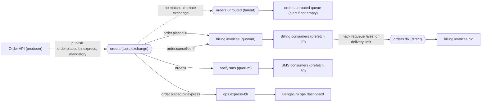
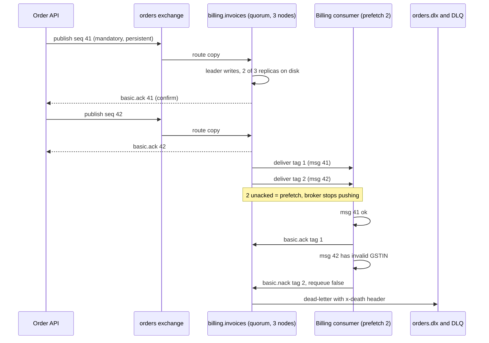

The [message queues](#/lesson/m12-message-queues) lesson treated a queue as one line of messages between a producer and its consumers. Real systems quickly need more: one "order placed" event must reach billing, SMS and the warehouse; the Bengaluru operations team only wants express orders from Bengaluru; a broken message must go somewhere safe. RabbitMQ handles all of this with one idea: producers never write to queues directly. They hand messages to a **router** (an exchange), and **rules** (bindings) decide which queues get a copy. This lesson teaches that routing model, then the settings that decide whether messages are fast, fair and safe: prefetch, acks, queue types and publisher confirms.

## Learning objectives

By the end of this lesson you will be able to:

1. Explain exchanges, queues, bindings and routing keys, and trace a message through them.
2. Choose between direct, topic, fanout and headers exchanges for a given routing need, and write topic patterns with `*` and `#`.
3. Explain what happens to unroutable messages, and use `mandatory` and alternate exchanges so they are not lost silently.
4. Set prefetch from processing time and network round trip, and explain its effect on throughput and fairness.
5. Use manual acks, nacks and rejects correctly, and route failures to a dead-letter exchange.
6. Choose between classic and quorum queues, and explain durability, persistence and replication.
7. Use publisher confirms so a producer knows the broker has really stored a message.
8. Model RabbitMQ routing and consumption in C# behind interfaces, and know what the real `RabbitMQ.Client` calls look like.

## Prerequisites

- [Message queues](#/lesson/m12-message-queues): producers, consumers, acks, redelivery and competing consumers.
- Comfort with C# records, dictionaries and `BackgroundService`.

## Explain it like I'm a beginner

Picture the mail room of a large company in Gurgaon.

People drop letters into the **mail room**, not directly onto colleagues' desks. The mail-room clerk looks at the envelope and follows a list of rules pinned to the wall:

- "Anything addressed to *Billing* goes in the Billing tray."
- "Anything about *orders in Bengaluru* goes in the Bengaluru Ops tray."
- "Company-wide circulars: photocopy and put one in *every* tray."

Each department empties its own tray. If two rules match one letter, the clerk makes a photocopy for each matching tray. If no rule matches, a careless clerk throws the letter in the bin; a careful one puts it in a "could not deliver" tray and tells someone.

In RabbitMQ:

- The mail room is the **exchange**: it receives every message and routes it.
- The address written on the envelope is the **routing key**, such as `order.placed.blr.express`.
- Each rule on the wall is a **binding**: "copy messages matching this pattern into that queue".
- Each tray is a **queue**, and each department's staff are its **consumers**.
- The "could not deliver" tray is an **alternate exchange**; the bin is what RabbitMQ does by default.

The producer only knows the mail room's name and how to write an address. It does not know which departments exist. You can add a new department next month by pinning a new rule to the wall, with no change to anyone who sends letters.

## First-principles explanation

### The AMQP 0-9-1 model

RabbitMQ's core protocol is AMQP 0-9-1 (it also speaks AMQP 1.0, MQTT and STOMP, and has a separate streams protocol). The model has four parts:

- **Exchange**: a named router. It has a *type* (direct, topic, fanout, headers) that decides how it matches. It stores nothing.
- **Queue**: a named, ordered buffer that stores messages until consumers ack them.
- **Binding**: a link from an exchange to a queue, with a **binding key** (or header arguments) saying which messages the queue wants.
- **Message**: a body (bytes) plus properties: a **routing key**, headers, `message_id`, `content_type`, `delivery_mode` (persistent or not), `expiration`, and more.

A producer publishes `(exchange, routingKey, properties, body)`. The exchange finds every binding that matches and puts **one copy into each matching queue** (a queue bound twice still gets one copy). Each queue then delivers its copy to one of its consumers. So fan-out happens at the exchange; competition happens at the queue.

There is also a **default exchange** with an empty name. Every queue is automatically bound to it with its own name as the binding key, so publishing to exchange `""` with routing key `billing.invoices` puts the message straight into that queue. Tutorials use it because it looks like "publish to a queue", but production systems usually publish to named exchanges so that routing can change without touching producers.

### The four exchange types

**Direct**: the routing key must equal the binding key exactly. Use it for commands to a known destination: `invoice.generate` goes to the invoice workers. Several queues can bind with the same key; each gets a copy.

**Fanout**: ignores the routing key and copies the message to every bound queue. Use it for broadcasts: "the price list changed, every API instance must clear its local cache". Each instance declares its own exclusive, auto-delete queue and binds it to the fanout exchange.

**Topic**: routing keys are words separated by dots, and binding keys are patterns:

- `*` matches **exactly one** word.
- `#` matches **zero or more** words.

With routing keys shaped `order.<event>.<city>.<speed>`:

| Binding key | `order.placed.blr.express` | `order.cancelled.del.standard` | `order.placed` |
|---|---|---|---|
| `order.placed.#` | yes | no | yes (`#` can be zero words) |
| `order.*.blr.*` | yes | no | no |
| `order.#` | yes | yes | yes |
| `*.placed.*.*` | yes | no | no |
| `order.placed.*` | no (`*` is one word, there are two left) | no | no |

Topic exchanges are the workhorse of event-driven systems: producers describe *what happened* in the key, and each consumer subscribes to the slice it cares about. The trade-off is that the routing key becomes a contract. Design its word order carefully (most general first) and version it like an API, because changing `order.placed.blr` to `order.blr.placed` breaks every binding.

**Headers**: ignores the routing key and matches on message headers. A binding has header arguments plus `x-match`: `all` (every listed header must match) or `any` (at least one). Use it when routing depends on several attributes that do not fit naturally in a dotted key, such as `format=pdf` and `region=south` for a print service. Headers exchanges are less common and slower to evaluate than topic exchanges; often a well-designed topic key is enough.

### Unroutable messages: the silent bin

If no binding matches, RabbitMQ **drops the message** and, unless you asked, tells nobody. A typo in a routing key (`ordr.placed`) or a queue that was deleted means data loss with no error. Two defences:

- **`mandatory` flag** on publish: if the message cannot be routed to any queue, the broker returns it to the producer (`basic.return`) so the producer can log, alert or fail the request.
- **Alternate exchange (AE)**: an exchange argument naming a second exchange that receives anything the first could not route. Bind a queue such as `orders.unrouted` to it and alert when it is not empty.

Use at least one of them for every business-critical exchange.

### Prefetch: how many unacked messages a consumer may hold

With manual acks, RabbitMQ pushes messages to a consumer until the consumer has `prefetch` messages unacknowledged (set with `basic.qos`). Then it stops and waits for acks. This one number controls throughput, fairness and the blast radius of a crash.

A worked example with estimates:

- Each message takes 20 ms to process.
- The round trip between consumer and broker is 1 ms on the same LAN, 40 ms across regions.

With **prefetch 1**, the consumer finishes a message, sends the ack, and waits a full round trip for the next message:

- LAN: 1 message per 21 ms ≈ 48 messages/s, close to the ideal 50/s.
- Cross-region: 1 message per 60 ms ≈ 17 messages/s, a third of the ideal.

To hide the round trip, prefetch must be at least about (round trip ÷ processing time) + 1 = 40 ÷ 20 + 1 = **3**. In practice teams use somewhat more for safety. RabbitMQ's documentation says values in the 100 to 300 range usually give optimal throughput for fast consumers, and that a value of 1 is the most conservative and fair.

Too much prefetch hurts in three ways:

1. **Unfairness.** With prefetch 1,000 and 3 consumers, the first consumer to connect may grab 1,000 messages while a newly started consumer sits idle. Autoscaling does nothing until the greedy consumer drains its buffer.
2. **Crash blast radius.** If a consumer holding 1,000 unacked messages dies, all 1,000 are redelivered (and some were already processed, so they become duplicates).
3. **Memory.** Prefetched messages live in the consumer's memory.

Rule of thumb: slow, uneven jobs (PDF generation, 2 to 30 s each) use prefetch 1 to 5; fast, uniform jobs (a 5 ms database insert) use 50 to 300; measure and adjust.

### Acks, nacks and rejects

- **Auto-ack** (`autoAck: true`): the broker considers a message delivered as soon as it sends it. Fast, and at-most-once: a consumer crash loses everything it held.
- **Manual ack** (`basic.ack`): the consumer acks after the work. `multiple: true` acks every delivery up to and including that tag, which cuts network traffic.
- **Negative ack** (`basic.nack`, or `basic.reject` for a single message): the consumer says it failed. With `requeue: true` the message goes back to the queue, usually near its original position, with the `redelivered` flag set. With `requeue: false` it is **dead-lettered** if the queue has a dead-letter exchange, otherwise discarded.

Delivery tags are numbers scoped to one channel. Acking an unknown tag (twice, or on a different channel) is a protocol error and RabbitMQ closes the channel. If a channel or connection closes, all its unacked messages are requeued. RabbitMQ also enforces a **delivery acknowledgement timeout** (30 minutes by default); a consumer that holds a message longer has its channel closed.

The classic mistake is `nack(requeue: true)` on a message that will always fail: it comes straight back, fails again, and loops thousands of times a second. Quorum queues protect you with a **delivery limit**: since RabbitMQ 4.0 the default is 20, after which the message is dead-lettered (or dropped if no dead-letter exchange is set). Retry tiers with TTLs are covered in [retries and dead-letter queues](#/lesson/m12-retries-dlq).

### Dead-letter exchanges

A queue can be declared with `x-dead-letter-exchange` (and optionally `x-dead-letter-routing-key`). A message is dead-lettered when it is rejected with `requeue: false`, its TTL expires, the queue exceeds its length limit with overflow set to `drop-head` (the default) or `reject-publish-dlx`, or it exceeds the quorum delivery limit. RabbitMQ republishes it to the dead-letter exchange and adds an `x-death` header recording why, from which queue and how many times. Bind a `.dlq` queue to that exchange, and alert on it.

### Durability, persistence and queue types

Three different settings are often confused:

- A **durable queue** survives a broker restart (its definition is stored). A non-durable queue disappears.
- A **persistent message** (`delivery_mode = 2`, `Persistent = true` in .NET) is written to disk. A transient message in a classic queue may be lost on restart even if the queue is durable.
- **Replication** means copies on several nodes, so losing one *machine* does not lose data.

RabbitMQ has three main queue types today:

| | Classic queue | Quorum queue | Stream |
|---|---|---|---|
| Replication | None (a single node) | Raft consensus across an odd number of nodes, usually 3 | Replicated append-only log |
| Survives node loss | No | Yes, while a majority is up | Yes |
| Consumption | Destructive (deleted on ack) | Destructive | Non-destructive: consumers read from an offset, like Kafka |
| Poison-message protection | No delivery limit | Delivery limit (default 20 in 4.x) | Not applicable |
| Best for | Temporary, exclusive or non-critical queues | Business data that must not be lost | Replay, very large fan-out, history |

Quorum queues are the recommended default for durable data. They use the [Raft consensus algorithm](#/lesson/m13-consensus): the leader appends a message, followers replicate it, and the publish is confirmed once a **majority** (2 of 3) has written it to disk. With 3 nodes you survive the loss of 1; with 5, the loss of 2. The cost is extra disk and network writes per message and somewhat higher latency than a single-node classic queue. The old "classic mirrored queues" were removed in RabbitMQ 4.0; quorum queues replace them.

### Publisher confirms

Publishing over the network is a remote call. Without confirmation, the producer does not know whether the broker stored the message, lost it in a crash, or never received it. **Publisher confirms** fix this: the producer enables confirm mode on its channel, every publish gets a sequence number, and the broker later sends `basic.ack` (stored) or `basic.nack` (the broker could not take responsibility for it) for that number, sometimes with `multiple: true` covering everything up to it.

When is the ack sent? For a persistent message routed to durable queues, after it has been written to disk; for quorum queues, after a majority of replicas have accepted it; for an unroutable message, right after routing (preceded by a `basic.return` if `mandatory` was set). So a confirm plus a `mandatory` check is how a producer gets "this message is safely in at least one queue".

The producer must decide what to do while it waits:

- **Wait for each confirm** before continuing: simplest, but throughput is limited to about one message per round trip.
- **Publish in batches** and wait for the batch: better throughput; on a nack or timeout, republish the whole batch (creating duplicates for consumers to absorb).
- **Track outstanding confirms asynchronously** (a dictionary keyed by sequence number): best throughput; republish only what was nacked or timed out. Exercise 5 builds this tracker.

Every one of these strategies republishes on doubt, so consumers still see duplicates. Confirms protect against *loss*; [idempotent consumers](#/lesson/m12-idempotent-consumers) protect against *duplicates*. And confirms do not help if the producer's own process crashes after committing to the database but before publishing; that needs the [transactional outbox](#/lesson/m12-outbox).

### Connections and channels

A **connection** is a TCP connection (expensive to open: TCP, TLS and AMQP handshakes). A **channel** is a lightweight virtual connection multiplexed inside it. Open one long-lived connection per process (or two: one for publishing, one for consuming, so publisher flow control cannot block consumers), use channels for concurrency, and never open a connection per message. Avoid sharing one channel between concurrent publishers; with the .NET client, give each publishing component its own channel or serialise access.

### When RabbitMQ is the wrong choice, or overkill

- **You need to replay history** or let new consumers read last month's events: use a log ([Kafka](#/lesson/m12-kafka) or RabbitMQ streams).
- **Very high, sustained throughput** with simple routing (millions of messages per second): a partitioned log usually scales more cheaply.
- **One producer, one consumer, low volume, already on a cloud**: a managed queue (SQS, Azure Service Bus) or a PostgreSQL job table avoids running a cluster.
- **Strict global ordering** across consumers: no queue gives you that with competing consumers; use one consumer, single active consumer, or partitioning by key.

### Trade-offs

| You gain | You pay |
|---|---|
| Flexible routing without changing producers | Routing keys become a contract to design and version |
| Per-message acks, nacks, TTLs and dead-lettering | A cluster to operate (or a managed RabbitMQ bill) |
| Low latency push delivery with prefetch control | Prefetch and ack settings to tune per workload |
| Replicated quorum queues for safety | Extra disk and network writes per message |
| Publisher confirms for "safely stored" | Producer complexity: tracking and republishing |

## Visual explanation

### Architecture: one event, many queues



The order API publishes one message to the `orders` topic exchange with the key `order.placed.blr.express` and the `mandatory` flag. Three bindings match: `order.placed.#` copies it to billing, `order.#` copies it to SMS, and the exact key copies it to the Bengaluru express dashboard. Billing has a second binding for cancellations, but a placed order matches only the first, and a queue never gets two copies of one publish anyway. If a key matched nothing (a typo, say), the dotted arrow sends it to the alternate exchange and an alert queue instead of the bin. On the right, each queue has its own consumers with their own prefetch. When billing rejects a broken message, or it exceeds the quorum delivery limit, the queue dead-letters it to `orders.dlx`, which routes it into `billing.invoices.dlq`.

### Sequence: confirm, deliver with prefetch, ack and dead-letter



The producer gets a confirm for message 41 only after a majority of the quorum queue's replicas have written it, so a single node failure cannot lose it. The broker pushes two messages to the consumer and then stops, because prefetch is 2. Message 41 succeeds and is acked; that frees a slot. Message 42 is permanently broken, so the consumer nacks it without requeue, and the queue dead-letters it to the DLX with an `x-death` header recording the reason and source queue, instead of looping it back.

## Step-by-step example

We will build the grocery order routing in five steps.

### Step 1: publish straight to a queue

The tutorial version uses the default exchange: `BasicPublish(exchange: "", routingKey: "billing.invoices", ...)`. It works until the SMS team also needs every order. Now the producer must publish twice, and must be redeployed every time a new consumer appears.

### Step 2: a topic exchange and a routing-key contract

Declare a topic exchange `orders` and define the key as `order.<event>.<city>.<speed>`, for example `order.placed.blr.express`. Billing binds `order.placed.#` and `order.cancelled.#`; SMS binds `order.#`. The producer publishes once; new consumers add bindings without touching it.

### Step 3: never lose an unroutable message

Set `mandatory: true` on publish and give `orders` an alternate exchange `orders.unrouted` with a queue behind it. A mistyped key now produces a return to the producer (or lands in the AE queue) instead of vanishing.

### Step 4: safe consumption

Billing consumes with manual acks and prefetch 20 (invoice generation takes about 100 ms, the broker is on the same LAN). Valid messages are acked after the invoice row is saved. Messages that can never succeed are nacked with `requeue: false` and dead-lettered to `orders.dlx` → `billing.invoices.dlq`. The queue is a quorum queue with a delivery limit of 5, so even transient failures that requeue cannot loop for ever.

### Step 5: safe publishing

The producer enables publisher confirms. The API returns `202 Accepted` only after the confirm arrives; on a nack or timeout it retries the publish with the same `message_id`, which consumers use to drop duplicates.

## Production-style C# implementation

`RabbitMQ.Client` is not available to this lesson's offline compiler, so the compiled code below models RabbitMQ's routing and consumption **in memory** behind interfaces: a `Topology` of exchanges, queues and bindings, a `Router` that implements the four exchange types and alternate exchanges, and an `InMemoryBroker` with mandatory publishes, prefetch, per-channel delivery tags, ack/nack (with `multiple`), requeue on channel close, quorum delivery limits and dead-letter exchanges. The real client calls are shown afterwards.

```text
Grocer.Api/
  Program.cs
  Messaging/Routing/Topology.cs
  Messaging/Routing/Router.cs
  Messaging/Broker/InMemoryBroker.cs
  Orders/GroceryTopology.cs
  Orders/OrderEventPublisher.cs
  Orders/BillingConsumer.cs
```

```csharp file=Messaging/Routing/Topology.cs
namespace Grocer.Messaging.Routing;

public enum ExchangeKind { Direct, Fanout, Topic, Headers }
public enum QueueKind { Classic, Quorum }
public enum HeadersMatch { All, Any }

public sealed record ExchangeDef(string Name, ExchangeKind Kind, bool Durable = true, string? AlternateExchange = null);

public sealed record QueueDef(
    string Name,
    QueueKind Kind = QueueKind.Quorum,
    bool Durable = true,
    string? DeadLetterExchange = null,
    string? DeadLetterRoutingKey = null,
    int? DeliveryLimit = null);

public sealed record Binding(
    string Exchange,
    string Queue,
    string BindingKey = "",
    IReadOnlyDictionary<string, string>? Headers = null,
    HeadersMatch Match = HeadersMatch.All);

/// <summary>Declarations are idempotent, like RabbitMQ: redeclaring with the same settings is fine,
/// redeclaring with different settings fails (RabbitMQ answers PRECONDITION_FAILED).</summary>
public sealed class Topology
{
    private readonly Dictionary<string, ExchangeDef> _exchanges = new(StringComparer.Ordinal);
    private readonly Dictionary<string, QueueDef> _queues = new(StringComparer.Ordinal);
    private readonly List<Binding> _bindings = new();

    public IEnumerable<QueueDef> Queues => _queues.Values;

    public void Declare(ExchangeDef exchange)
    {
        if (_exchanges.TryGetValue(exchange.Name, out var existing) && existing != exchange)
            throw new InvalidOperationException($"Exchange '{exchange.Name}' already declared with different settings.");
        _exchanges[exchange.Name] = exchange;
    }

    public void Declare(QueueDef queue)
    {
        if (queue.Kind == QueueKind.Quorum && !queue.Durable)
            throw new InvalidOperationException("Quorum queues are always durable.");
        if (_queues.TryGetValue(queue.Name, out var existing) && existing != queue)
            throw new InvalidOperationException($"Queue '{queue.Name}' already declared with different settings.");
        _queues[queue.Name] = queue;
    }

    public void Bind(Binding binding)
    {
        if (!_exchanges.ContainsKey(binding.Exchange)) throw new InvalidOperationException($"No exchange '{binding.Exchange}'.");
        if (!_queues.ContainsKey(binding.Queue)) throw new InvalidOperationException($"No queue '{binding.Queue}'.");
        if (!_bindings.Contains(binding)) _bindings.Add(binding);
    }

    public bool HasQueue(string name) => _queues.ContainsKey(name);
    public QueueDef Queue(string name) => _queues.TryGetValue(name, out var q) ? q : throw new KeyNotFoundException(name);
    public ExchangeDef Exchange(string name) => _exchanges.TryGetValue(name, out var e) ? e : throw new KeyNotFoundException(name);
    public IEnumerable<Binding> BindingsFrom(string exchange) => _bindings.Where(b => b.Exchange == exchange);
}
```

```csharp file=Messaging/Routing/Router.cs
namespace Grocer.Messaging.Routing;

public static class TopicPattern
{
    /// <summary>'*' matches exactly one word, '#' matches zero or more words. Words are separated by '.'.</summary>
    public static bool IsMatch(string pattern, string routingKey)
    {
        string[] p = pattern.Split('.');
        string[] k = routingKey.Length == 0 ? [] : routingKey.Split('.');
        return Match(p, 0, k, 0);
    }

    private static bool Match(string[] p, int i, string[] k, int j)
    {
        if (i == p.Length) return j == k.Length;
        if (p[i] == "#")
        {
            for (var next = j; next <= k.Length; next++)   // let '#' swallow 0, 1, 2 ... words
                if (Match(p, i + 1, k, next)) return true;
            return false;
        }
        if (j == k.Length) return false;
        return (p[i] == "*" || p[i] == k[j]) && Match(p, i + 1, k, j + 1);
    }
}

public static class Router
{
    private const int MaxAlternateHops = 4;

    /// <summary>Returns the set of queues that receive a copy. Empty means unroutable.</summary>
    public static IReadOnlySet<string> Route(Topology topology, string exchange, string routingKey,
        IReadOnlyDictionary<string, string> headers)
    {
        var result = new HashSet<string>(StringComparer.Ordinal);

        if (exchange.Length == 0)   // the default exchange: routing key = queue name
        {
            if (topology.HasQueue(routingKey)) result.Add(routingKey);
            return result;
        }

        var current = exchange;
        for (var hop = 0; hop <= MaxAlternateHops && result.Count == 0; hop++)
        {
            var ex = topology.Exchange(current);
            foreach (var b in topology.BindingsFrom(current))
                if (Matches(ex.Kind, b, routingKey, headers)) result.Add(b.Queue);

            if (result.Count > 0 || ex.AlternateExchange is null) break;
            current = ex.AlternateExchange;   // nothing matched: try the alternate exchange
        }
        return result;
    }

    private static bool Matches(ExchangeKind kind, Binding b, string routingKey, IReadOnlyDictionary<string, string> headers) =>
        kind switch
        {
            ExchangeKind.Direct => string.Equals(b.BindingKey, routingKey, StringComparison.Ordinal),
            ExchangeKind.Fanout => true,
            ExchangeKind.Topic => TopicPattern.IsMatch(b.BindingKey, routingKey),
            ExchangeKind.Headers => HeadersMatch(b, headers),
            _ => false,
        };

    private static bool HeadersMatch(Binding b, IReadOnlyDictionary<string, string> headers)
    {
        if (b.Headers is null || b.Headers.Count == 0) return b.Match == Routing.HeadersMatch.All;
        bool Has(KeyValuePair<string, string> h) => headers.TryGetValue(h.Key, out var v) && v == h.Value;
        return b.Match == Routing.HeadersMatch.All ? b.Headers.All(Has) : b.Headers.Any(Has);
    }
}
```

```csharp file=Messaging/Broker/InMemoryBroker.cs
using Grocer.Messaging.Routing;

namespace Grocer.Messaging.Broker;

public sealed record Message(string MessageId, string RoutingKey, IReadOnlyDictionary<string, string> Headers, string Body, bool Persistent = true);

public sealed record DeliveredMessage(ulong DeliveryTag, string Queue, Message Message, bool Redelivered, int DeliveryCount);

public enum PublishOutcome { Confirmed, Returned }

public sealed record PublishResult(PublishOutcome Outcome, IReadOnlySet<string> Queues);

public interface IMessageBroker
{
    /// <summary>Completes when the broker confirms. Returned means mandatory and unroutable.</summary>
    Task<PublishResult> PublishAsync(string exchange, Message message, bool mandatory, CancellationToken ct = default);

    /// <summary>Opens a consuming channel with a prefetch limit (0 = unlimited).</summary>
    IConsumerChannel Consume(string queue, ushort prefetch);
}

public interface IConsumerChannel : IDisposable
{
    string Queue { get; }
    int Unacked { get; }
    DeliveredMessage? TryNext();
    void Ack(ulong deliveryTag, bool multiple = false);
    void Nack(ulong deliveryTag, bool requeue, bool multiple = false);
}

/// <summary>In-memory model of RabbitMQ semantics for tests and local runs. Not durable, not replicated.</summary>
public sealed class InMemoryBroker(Topology topology) : IMessageBroker
{
    private sealed record Stored(Message Message, int DeliveryCount);

    private readonly Lock _gate = new();
    private readonly Dictionary<string, LinkedList<Stored>> _queues = new(StringComparer.Ordinal);
    private readonly List<Message> _discarded = new();

    public IReadOnlyList<Message> Discarded { get { lock (_gate) return _discarded.ToList(); } }

    public Task<PublishResult> PublishAsync(string exchange, Message message, bool mandatory, CancellationToken ct = default)
    {
        ct.ThrowIfCancellationRequested();
        lock (_gate)
        {
            var targets = Router.Route(topology, exchange, message.RoutingKey, message.Headers);
            if (targets.Count == 0)
            {
                if (mandatory) return Task.FromResult(new PublishResult(PublishOutcome.Returned, targets));
                _discarded.Add(message);   // RabbitMQ's default: silently dropped, yet still confirmed
                return Task.FromResult(new PublishResult(PublishOutcome.Confirmed, targets));
            }
            foreach (var q in targets) QueueFor(q).AddLast(new Stored(message, 0));
            return Task.FromResult(new PublishResult(PublishOutcome.Confirmed, targets));
        }
    }

    public IConsumerChannel Consume(string queue, ushort prefetch)
    {
        if (!topology.HasQueue(queue)) throw new InvalidOperationException($"No queue '{queue}'.");
        return new ConsumerChannel(this, queue, prefetch);
    }

    public IReadOnlyDictionary<string, int> Depths()
    {
        lock (_gate) return topology.Queues.ToDictionary(q => q.Name, q => _queues.TryGetValue(q.Name, out var l) ? l.Count : 0);
    }

    private LinkedList<Stored> QueueFor(string name)
    {
        if (!_queues.TryGetValue(name, out var list)) _queues[name] = list = new LinkedList<Stored>();
        return list;
    }

    // Called with _gate held.
    private void Requeue(string queue, Stored stored)
    {
        var def = topology.Queue(queue);
        if (def.Kind == QueueKind.Quorum && def.DeliveryLimit is { } limit && stored.DeliveryCount >= limit)
        {
            DeadLetter(queue, stored, "delivery_limit");
            return;
        }
        QueueFor(queue).AddFirst(stored);   // back near the head, like RabbitMQ's requeue
    }

    // Called with _gate held.
    private void DeadLetter(string queue, Stored stored, string reason)
    {
        var def = topology.Queue(queue);
        if (def.DeadLetterExchange is null) { _discarded.Add(stored.Message); return; }

        var headers = new Dictionary<string, string>(stored.Message.Headers)
        {
            ["x-death-reason"] = reason,
            ["x-death-queue"] = queue,
            ["x-death-count"] = stored.DeliveryCount.ToString(),
        };
        var key = def.DeadLetterRoutingKey ?? stored.Message.RoutingKey;
        var dead = stored.Message with { Headers = headers };
        var targets = Router.Route(topology, def.DeadLetterExchange, key, headers);
        if (targets.Count == 0) _discarded.Add(dead);
        foreach (var q in targets) QueueFor(q).AddLast(new Stored(dead, 0));
    }

    private sealed class ConsumerChannel(InMemoryBroker broker, string queue, ushort prefetch) : IConsumerChannel
    {
        private readonly SortedDictionary<ulong, Stored> _unacked = new();
        private ulong _lastTag;   // delivery tags are per channel and start at 1
        private bool _closed;

        public string Queue => queue;
        public int Unacked { get { lock (broker._gate) return _unacked.Count; } }

        public DeliveredMessage? TryNext()
        {
            lock (broker._gate)
            {
                ObjectDisposedException.ThrowIf(_closed, this);
                if (prefetch > 0 && _unacked.Count >= prefetch) return null;   // credit exhausted
                var list = broker.QueueFor(queue);
                if (list.First is null) return null;

                var stored = list.First.Value with { DeliveryCount = list.First.Value.DeliveryCount + 1 };
                list.RemoveFirst();
                var tag = ++_lastTag;
                _unacked[tag] = stored;
                return new DeliveredMessage(tag, queue, stored.Message, stored.DeliveryCount > 1, stored.DeliveryCount);
            }
        }

        public void Ack(ulong deliveryTag, bool multiple = false)
        {
            lock (broker._gate) Take(deliveryTag, multiple);
        }

        public void Nack(ulong deliveryTag, bool requeue, bool multiple = false)
        {
            lock (broker._gate)
                foreach (var stored in Take(deliveryTag, multiple))
                    if (requeue) broker.Requeue(queue, stored);
                    else broker.DeadLetter(queue, stored, "rejected");
        }

        /// <summary>Closing a channel requeues everything it had not acked, exactly like a crashed consumer.</summary>
        public void Dispose()
        {
            lock (broker._gate)
            {
                if (_closed) return;
                _closed = true;
                foreach (var stored in _unacked.Values.Reverse()) broker.Requeue(queue, stored);
                _unacked.Clear();
            }
        }

        private List<Stored> Take(ulong tag, bool multiple)
        {
            ObjectDisposedException.ThrowIf(_closed, this);
            var tags = multiple ? _unacked.Keys.Where(t => t <= tag).ToList() : _unacked.ContainsKey(tag) ? [tag] : [];
            if (tags.Count == 0)
                throw new InvalidOperationException($"PRECONDITION_FAILED - unknown delivery tag {tag}");   // RabbitMQ closes the channel
            var taken = tags.Select(t => _unacked[t]).ToList();
            foreach (var t in tags) _unacked.Remove(t);
            return taken;
        }
    }
}
```

```csharp file=Orders/GroceryTopology.cs
using Grocer.Messaging.Routing;

namespace Grocer.Orders;

/// <summary>Declared at startup by every service that uses it. Declarations are idempotent.</summary>
public static class GroceryTopology
{
    public const string OrdersExchange = "orders";
    public const string UnroutedExchange = "orders.unrouted";
    public const string DeadLetterExchange = "orders.dlx";
    public const string DocumentsExchange = "documents";

    public const string BillingQueue = "billing.invoices";
    public const string BillingDlq = "billing.invoices.dlq";
    public const string SmsQueue = "notify.sms";
    public const string SmsDlq = "notify.sms.dlq";
    public const string ExpressBlrQueue = "ops.express-blr";
    public const string UnroutedQueue = "orders.unrouted";
    public const string SouthPdfQueue = "print.south-pdf";

    public static Topology Build()
    {
        var t = new Topology();
        t.Declare(new ExchangeDef(OrdersExchange, ExchangeKind.Topic, AlternateExchange: UnroutedExchange));
        t.Declare(new ExchangeDef(UnroutedExchange, ExchangeKind.Fanout));
        t.Declare(new ExchangeDef(DeadLetterExchange, ExchangeKind.Direct));
        t.Declare(new ExchangeDef(DocumentsExchange, ExchangeKind.Headers));

        t.Declare(new QueueDef(BillingQueue, DeadLetterExchange: DeadLetterExchange, DeadLetterRoutingKey: BillingQueue, DeliveryLimit: 5));
        t.Declare(new QueueDef(SmsQueue, DeadLetterExchange: DeadLetterExchange, DeadLetterRoutingKey: SmsQueue, DeliveryLimit: 5));
        t.Declare(new QueueDef(BillingDlq));
        t.Declare(new QueueDef(SmsDlq));
        t.Declare(new QueueDef(ExpressBlrQueue, QueueKind.Classic));   // a dashboard feed; losing it on node failure is acceptable
        t.Declare(new QueueDef(UnroutedQueue));
        t.Declare(new QueueDef(SouthPdfQueue));

        // Routing key contract: order.<event>.<city>.<speed>, for example order.placed.blr.express
        t.Bind(new Binding(OrdersExchange, BillingQueue, "order.placed.#"));
        t.Bind(new Binding(OrdersExchange, BillingQueue, "order.cancelled.#"));
        t.Bind(new Binding(OrdersExchange, SmsQueue, "order.#"));
        t.Bind(new Binding(OrdersExchange, ExpressBlrQueue, "order.placed.blr.express"));
        t.Bind(new Binding(UnroutedExchange, UnroutedQueue));
        t.Bind(new Binding(DeadLetterExchange, BillingDlq, BillingQueue));
        t.Bind(new Binding(DeadLetterExchange, SmsDlq, SmsQueue));
        t.Bind(new Binding(DocumentsExchange, SouthPdfQueue,
            Headers: new Dictionary<string, string> { ["format"] = "pdf", ["region"] = "south" }, Match: HeadersMatch.All));
        return t;
    }
}
```

```csharp file=Orders/OrderEventPublisher.cs
using System.Text.Json;
using Grocer.Messaging.Broker;

namespace Grocer.Orders;

public sealed record OrderPlaced(string OrderId, string City, decimal Amount, bool Express);

public sealed class UnroutableMessageException(string message) : Exception(message);

public sealed class OrderEventPublisher(IMessageBroker broker)
{
    public const string PlacedType = "order.placed.v1";

    public static string RoutingKey(string eventName, string city, bool express) =>
        $"order.{eventName}.{city.ToLowerInvariant()}.{(express ? "express" : "standard")}";

    public async Task PublishPlacedAsync(OrderPlaced order, CancellationToken ct)
    {
        var message = new Message(
            MessageId: $"{order.OrderId}:placed",   // stable: a republish after a timeout carries the same id
            RoutingKey: RoutingKey("placed", order.City, order.Express),
            Headers: new Dictionary<string, string> { ["type"] = PlacedType },
            Body: JsonSerializer.Serialize(order));

        var result = await broker.PublishAsync(GroceryTopology.OrdersExchange, message, mandatory: true, ct);
        if (result.Outcome == PublishOutcome.Returned)
            throw new UnroutableMessageException($"No queue is bound for routing key '{message.RoutingKey}'.");
    }
}
```

```csharp file=Orders/BillingConsumer.cs
using System.Text.Json;
using Grocer.Messaging.Broker;

namespace Grocer.Orders;

public sealed class BillingConsumer(IMessageBroker broker, TimeProvider clock, ILogger<BillingConsumer> logger) : BackgroundService
{
    protected override async Task ExecuteAsync(CancellationToken stoppingToken)
    {
        using var channel = broker.Consume(GroceryTopology.BillingQueue, prefetch: 20);
        while (!stoppingToken.IsCancellationRequested)
        {
            var delivery = channel.TryNext();
            if (delivery is null)
            {
                try { await Task.Delay(TimeSpan.FromMilliseconds(100), clock, stoppingToken); }
                catch (OperationCanceledException) { break; }
                continue;
            }

            try
            {
                var type = delivery.Message.Headers.GetValueOrDefault("type");
                if (type != OrderEventPublisher.PlacedType) { channel.Ack(delivery.DeliveryTag); continue; }   // not for us

                var order = JsonSerializer.Deserialize<OrderPlaced>(delivery.Message.Body)
                            ?? throw new JsonException("Empty body");
                if (order.Amount <= 0) throw new JsonException($"Invalid amount on {order.OrderId}");

                logger.LogInformation("Invoice for {OrderId}: {Amount} INR (delivery {Count})",
                    order.OrderId, order.Amount, delivery.DeliveryCount);
                channel.Ack(delivery.DeliveryTag);
            }
            catch (JsonException ex)
            {
                logger.LogWarning(ex, "Dead-lettering {MessageId}", delivery.Message.MessageId);
                channel.Nack(delivery.DeliveryTag, requeue: false);   // permanent: straight to the DLX
            }
            catch (Exception ex)
            {
                logger.LogWarning(ex, "Requeueing {MessageId}", delivery.Message.MessageId);
                channel.Nack(delivery.DeliveryTag, requeue: true);    // transient: the delivery limit stops loops
            }
        }
        // Disposing the channel requeues anything still unacked.
    }
}
```

```csharp file=Program.cs
using Grocer.Messaging.Broker;
using Grocer.Orders;

var builder = WebApplication.CreateBuilder(args);

builder.Services.AddSingleton(TimeProvider.System);
builder.Services.AddSingleton(_ => GroceryTopology.Build());
builder.Services.AddSingleton<InMemoryBroker>();
builder.Services.AddSingleton<IMessageBroker>(sp => sp.GetRequiredService<InMemoryBroker>());
builder.Services.AddSingleton<OrderEventPublisher>();
builder.Services.AddHostedService<BillingConsumer>();

var app = builder.Build();

app.MapPost("/orders", async (PlaceOrder cmd, OrderEventPublisher publisher, CancellationToken ct) =>
{
    var orderId = $"ORD-{Guid.NewGuid():N}"[..14];
    try
    {
        await publisher.PublishPlacedAsync(new OrderPlaced(orderId, cmd.City, cmd.Amount, cmd.Express), ct);
    }
    catch (UnroutableMessageException ex)
    {
        return Results.Problem(ex.Message, statusCode: StatusCodes.Status500InternalServerError);
    }
    return Results.Accepted($"/orders/{orderId}", new { orderId });
});

app.MapGet("/admin/queues", (InMemoryBroker broker) => broker.Depths());

app.Run();

public sealed record PlaceOrder(string City, decimal Amount, bool Express);
```

What to notice:

- **Producers know exchanges and keys, never queues.** Adding a fraud-check consumer is one `Bind` call.
- **The alternate exchange catches what bindings miss.** Because `orders` has an AE, a mistyped key reaches `orders.unrouted` rather than the bin; `mandatory` is a second line of defence for exchanges without one.
- **Two failure paths in the consumer.** Bad data is rejected without requeue (straight to the DLQ); unknown errors are requeued, and the quorum delivery limit of 5 turns a hidden poison message into a dead letter instead of a hot loop.
- **The message id is derived from the order** (`ORD-…:placed`), so a republish after an uncertain confirm can be deduplicated downstream.
- **Closing a channel requeues unacked messages**, which is exactly what happens when a consumer process dies.

The same topology and flow with the real `RabbitMQ.Client` 7.x API (not compiled here, because the package is not available offline):

```csharp
var factory = new ConnectionFactory { HostName = "rabbit.internal", ClientProvidedName = "grocer-api" };
await using var connection = await factory.CreateConnectionAsync();

// Publisher channel with confirms; with tracking enabled, BasicPublishAsync waits for the broker's ack
// and throws if the message is nacked or returned as unroutable (mandatory).
await using var pub = await connection.CreateChannelAsync(
    new CreateChannelOptions(publisherConfirmationsEnabled: true, publisherConfirmationTrackingEnabled: true));

await pub.ExchangeDeclareAsync("orders.unrouted", ExchangeType.Fanout, durable: true);
await pub.ExchangeDeclareAsync("orders", ExchangeType.Topic, durable: true,
    arguments: new Dictionary<string, object?> { ["alternate-exchange"] = "orders.unrouted" });
await pub.ExchangeDeclareAsync("orders.dlx", ExchangeType.Direct, durable: true);

await pub.QueueDeclareAsync("billing.invoices", durable: true, exclusive: false, autoDelete: false,
    arguments: new Dictionary<string, object?>
    {
        ["x-queue-type"] = "quorum",
        ["x-delivery-limit"] = 5,
        ["x-dead-letter-exchange"] = "orders.dlx",
        ["x-dead-letter-routing-key"] = "billing.invoices",
    });
await pub.QueueBindAsync("billing.invoices", "orders", "order.placed.#");

var props = new BasicProperties { Persistent = true, MessageId = $"{orderId}:placed", Type = "order.placed.v1", ContentType = "application/json" };
await pub.BasicPublishAsync("orders", "order.placed.blr.express", mandatory: true, basicProperties: props, body: bodyBytes);

// Consumer channel: manual acks, prefetch 20.
await using var con = await connection.CreateChannelAsync();
await con.BasicQosAsync(prefetchSize: 0, prefetchCount: 20, global: false);
var consumer = new AsyncEventingBasicConsumer(con);
consumer.ReceivedAsync += async (_, ea) =>
{
    try   { await billing.HandleAsync(ea.Body, ea.BasicProperties.MessageId); await con.BasicAckAsync(ea.DeliveryTag, multiple: false); }
    catch (InvalidInvoiceException) { await con.BasicNackAsync(ea.DeliveryTag, multiple: false, requeue: false); }
    catch (Exception)               { await con.BasicNackAsync(ea.DeliveryTag, multiple: false, requeue: true); }
};
await con.BasicConsumeAsync("billing.invoices", autoAck: false, consumer: consumer);
```

## Bad design vs good design

**Bad: the producer knows every queue.**

```csharp
await channel.BasicPublishAsync("", "billing.invoices", body);
await channel.BasicPublishAsync("", "notify.sms", body);
await channel.BasicPublishAsync("", "ops.express-blr", body);   // and a deploy for every new consumer
```

Three publishes means three chances to fail halfway (billing gets the order, SMS does not), and every new consumer requires a producer change. **Good:** one publish to a topic exchange; consumers own their bindings.

**Bad: auto-ack with a huge prefetch.** `autoAck: true` plus `prefetch 0` (unlimited) lets RabbitMQ push the whole queue into one consumer's memory and forget it. A crash loses all of it, and a second consumer gets nothing to do.

**Bad: requeue on every exception.** `BasicNack(tag, false, requeue: true)` in a blanket `catch` turns a malformed message into an infinite loop on a classic queue. **Good:** reject permanent failures without requeue, cap transient retries with a quorum delivery limit or retry tiers, and dead-letter.

**Bad: fire-and-forget publishing without `mandatory`.** A typo in a routing key, or a queue deleted by a cleanup script, silently drops every order event while the API returns success. **Good:** publisher confirms, `mandatory`, an alternate exchange, and an alert on the unrouted queue.

**Bad: a transient, classic queue for payments.** It disappears on restart and lives on one node. **Good:** a quorum queue with persistent messages.

:::callout type=tradeoff title="Who declares the topology?"
If every service declares the exchanges, queues and bindings it uses at startup (declarations are idempotent), the topology lives next to the code that depends on it, but a typo in one service can create a stray queue. If a platform team declares everything through definitions files or infrastructure-as-code, it is reviewed and consistent, but every new binding needs a ticket. A common split: producers declare their exchanges, consumers declare their own queues and bindings, and production permissions stop services from deleting what they do not own.
:::

## Practical playground

The starter graph is the grocery platform before this lesson: the API publishes directly to one billing queue. Open it in the HLD canvas and turn it into the routed design. Use `queue` nodes for exchanges and queues (label them clearly). Steps:

1. Add an `orders` topic exchange between the API and the queues.
2. Add `notify.sms` and `ops.express-blr` queues with their consumers, and label each edge with its binding key.
3. Add an alternate exchange and an unrouted queue, plus a dead-letter exchange and DLQ for billing.
4. Add monitoring on the DLQ and unrouted queue.
5. Write the prefetch you would choose for each consumer next to it, with the reason.

:::playground type=hld title="Route grocery order events through exchanges"
```json
{
  "nodes": [
    { "id": "app", "type": "client", "label": "Grocery app", "props": { "rps": 400 } },
    { "id": "api", "type": "app-server", "label": "Order API", "props": { "instances": 3 } },
    { "id": "db", "type": "database", "label": "Orders DB (PostgreSQL)" },
    { "id": "bq", "type": "queue", "label": "billing.invoices (classic)" },
    { "id": "bw", "type": "worker", "label": "Billing consumers", "props": { "instances": 2 } }
  ],
  "edges": [
    { "from": "app", "to": "api", "kind": "sync" },
    { "from": "api", "to": "db", "kind": "sync" },
    { "from": "api", "to": "bq", "kind": "async", "label": "default exchange" },
    { "from": "bq", "to": "bw", "kind": "async" }
  ]
}
```
:::

## Exercises

:::exercise id=m12-rabbitmq-ex1 difficulty=beginner kind=written title="Pick the exchange type"
For each requirement, choose an exchange type (direct, topic, fanout or headers), write the routing key and binding key(s) or header arguments, and say why.

1. Invoice-generation commands must go to the invoice workers, and only to them.
2. When the price list changes, every one of 12 API instances must clear its in-memory price cache.
3. The Delhi operations team wants every *express* order event in Delhi; national analytics wants *every* order event; the refunds team wants only cancellations, from any city.
4. A print service must route documents where `format = pdf` and `region = south`, but these attributes are not part of any routing key.
5. A new consumer needs order events next month. Which of your designs above let you add it without changing the producer?
::acceptance
- Each case has a type, keys or header arguments, and a reason.
- Case 2 explains how each instance gets its own copy (a queue per instance).
- Case 3 uses `*` and `#` correctly for the key shape you define.
::hint
Ask first: should one message reach one destination, all destinations, or a filtered subset?
::hint
For case 2, consumers on one queue compete. How do 12 instances each get a copy?
::hint
For case 3, fix a key shape such as `order.<event>.<city>.<speed>` and write one pattern per team.
::hint
Headers exchanges match on message headers with `x-match` set to `all` or `any`.
::solution
1. **Direct** exchange `invoices`, routing key `invoice.generate`, the `invoice-workers` queue bound with `invoice.generate`. A known, single destination; exact matching is simplest. (The default exchange with the queue name also works, but a named exchange keeps routing changeable.)
2. **Fanout** exchange `pricing.changed`. Each API instance declares its own **exclusive, auto-delete, server-named queue** at startup and binds it to the fanout. Every instance gets a copy; queues vanish when instances stop. Messages can be transient: if an instance is down, it rebuilds its cache on start anyway.
3. **Topic** exchange `orders`, key shape `order.<event>.<city>.<speed>`:
   - Delhi ops: `order.*.del.express`.
   - Analytics: `order.#`.
   - Refunds: `order.cancelled.#` (or `order.cancelled.*.*`).
4. **Headers** exchange `documents`; binding arguments `{ "x-match": "all", "format": "pdf", "region": "south" }`. Routing depends on several independent attributes, not on a hierarchy.
5. All of them except a producer that publishes directly to named queues. With exchanges, the new consumer declares a queue and a binding; the producer is untouched.
::mistakes
- Using a single shared queue in case 2, so only one instance clears its cache per message.
- `order.*` for analytics: `*` matches exactly one word, so it matches nothing with a four-word key.
- Encoding everything into headers when a topic key would do; headers routing is slower and less common.
:::

:::exercise id=m12-rabbitmq-ex2 difficulty=beginner kind=code title="Topic pattern matching"
Implement RabbitMQ's topic matching rules. Words are separated by dots. In a binding key, `*` matches exactly one word and `#` matches zero or more words.
::requirements
- `TopicMatcher.IsMatch(bindingKey, routingKey)` returns `true` when the routing key matches the pattern.
- `#` alone matches every key, including the empty key.
- `*` never matches zero words.
- Matching is case-sensitive and word-by-word (`order` does not match `orders`).
::acceptance
- `order.placed.*` matches `order.placed.blr` but not `order.placed.blr.express`.
- `order.#` matches `order`, `order.placed` and `order.placed.blr.express`.
- `order.#.express` matches `order.express` and `order.placed.blr.express`.
- `*.placed.#` matches `order.placed` but not `placed`.
- `#` matches the empty routing key.
::hint
Split both strings on `.` and compare word arrays, not characters.
::hint
Think recursively with two positions: `i` in the pattern and `j` in the key. If both reach the end together, it is a match.
::hint
For `*`, the key must have a word at `j`; advance both. For a literal word, it must equal `k[j]`; advance both.
::hint
For `#`, try letting it swallow 0 words, then 1, then 2 ... until the end of the key: for each `next` from `j` to `k.Length`, check `Match(i + 1, next)`.
::hint
```csharp
if (i == p.Length) return j == k.Length;
if (p[i] == "#")
{
    for (var next = j; next <= k.Length; next++)
        if (Match(p, i + 1, k, next)) return true;
    return false;
}
if (j == k.Length) return false;
return (p[i] == "*" || p[i] == k[j]) && Match(p, i + 1, k, j + 1);
```
::starter
```csharp file=TopicMatcher.cs
using System;

public static class TopicMatcher
{
    public static bool IsMatch(string bindingKey, string routingKey) => throw new NotImplementedException();
}
```
::tests
```csharp file=TopicMatcherTests.cs
using Xunit;

public class TopicMatcherTests
{
    [Theory]
    [InlineData("order.placed.blr", "order.placed.blr", true)]
    [InlineData("order.placed.*", "order.placed.blr", true)]
    [InlineData("order.placed.*", "order.placed.blr.express", false)]
    [InlineData("order.placed.*", "order.placed", false)]
    [InlineData("order.#", "order", true)]
    [InlineData("order.#", "order.placed", true)]
    [InlineData("order.#", "order.placed.blr.express", true)]
    [InlineData("order.#", "orders.placed", false)]
    [InlineData("order.#.express", "order.express", true)]
    [InlineData("order.#.express", "order.placed.blr.express", true)]
    [InlineData("order.#.express", "order.placed.blr.standard", false)]
    [InlineData("*.placed.#", "order.placed", true)]
    [InlineData("*.placed.#", "placed", false)]
    [InlineData("order.*.del.express", "order.cancelled.del.express", true)]
    [InlineData("Order.#", "order.placed", false)]
    [InlineData("#", "anything.at.all", true)]
    [InlineData("#", "", true)]
    [InlineData("*", "", false)]
    [InlineData("#.#", "a.b", true)]
    public void Matches_like_rabbitmq(string pattern, string key, bool expected) =>
        Assert.Equal(expected, TopicMatcher.IsMatch(pattern, key));
}
```
::solution
A small recursive matcher over word arrays. `#` is the only interesting case: it tries every possible number of words to swallow.

```csharp file=TopicMatcher.cs
using System;

public static class TopicMatcher
{
    public static bool IsMatch(string bindingKey, string routingKey)
    {
        string[] p = bindingKey.Split('.');
        string[] k = routingKey.Length == 0 ? Array.Empty<string>() : routingKey.Split('.');
        return Match(p, 0, k, 0);
    }

    private static bool Match(string[] p, int i, string[] k, int j)
    {
        if (i == p.Length) return j == k.Length;

        if (p[i] == "#")
        {
            for (var next = j; next <= k.Length; next++)
                if (Match(p, i + 1, k, next)) return true;
            return false;
        }

        if (j == k.Length) return false;
        return (p[i] == "*" || string.Equals(p[i], k[j], StringComparison.Ordinal))
               && Match(p, i + 1, k, j + 1);
    }
}
```

With several `#` words, plain recursion can revisit the same `(i, j)` pairs many times. Real brokers avoid this with a trie of binding keys built once and walked per message. For bindings of a few words, the simple version is fine; add memoisation with a `bool?[,]` table if patterns get long.
::alternatives
Convert each pattern to a regular expression once (`*` → `[^.]+`, `#` → optional dotted words) and cache it. Be careful with the dots on either side of `#`, which must also be optional.
::mistakes
- Treating `#` as "one or more", so `order.#` fails to match `order`.
- Matching characters instead of words, so `order.#` matches `orders.placed`.
- Splitting the empty routing key into `[""]`, which makes `*` match it.
:::

:::exercise id=m12-rabbitmq-ex3 difficulty=intermediate kind=code title="Route a message through an exchange"
Implement the routing step of an exchange: given its type, its bindings, and a message's routing key and headers, return the queues that receive a copy. A working `TopicMatcher` is provided.
::requirements
- **Direct**: binding key equals routing key exactly (case-sensitive).
- **Fanout**: every bound queue, ignoring the key.
- **Topic**: `TopicMatcher.IsMatch(bindingKey, routingKey)`.
- **Headers**: ignore the routing key. If `MatchAny` is `false`, every header in the binding must be present with an equal value; if `true`, at least one must. A headers binding with no header arguments and `MatchAny = false` matches everything.
- A queue bound several times receives **one** copy. Return queue names sorted with ordinal comparison.
::acceptance
- Direct routing is exact and case-sensitive.
- Fanout returns every queue once.
- Two matching topic bindings to one queue give one entry.
- Headers `all` and `any` behave differently for a partially matching message.
- The result is sorted and has no duplicates.
::hint
Write a `Matches(type, binding, key, headers)` helper and filter the bindings with it.
::hint
`Distinct()` plus `OrderBy(q => q, StringComparer.Ordinal)` handles duplicates and order.
::hint
For headers: `bool Has(KeyValuePair<string,string> h) => headers.TryGetValue(h.Key, out var v) && v == h.Value;` then `All(Has)` or `Any(Has)`.
::hint
Handle the empty-headers binding before calling `All`/`Any`: `All` on an empty set is `true`, `Any` is `false`.
::starter
```csharp file=ExchangeRouter.cs
using System;
using System.Collections.Generic;
using System.Linq;

public enum ExchangeType { Direct, Fanout, Topic, Headers }

public sealed record BindingRule(string Queue, string BindingKey = "", IReadOnlyDictionary<string, string>? Headers = null, bool MatchAny = false);

public static class TopicMatcher
{
    public static bool IsMatch(string bindingKey, string routingKey)
    {
        string[] p = bindingKey.Split('.');
        string[] k = routingKey.Length == 0 ? Array.Empty<string>() : routingKey.Split('.');
        return Match(p, 0, k, 0);
    }

    private static bool Match(string[] p, int i, string[] k, int j)
    {
        if (i == p.Length) return j == k.Length;
        if (p[i] == "#")
        {
            for (var next = j; next <= k.Length; next++)
                if (Match(p, i + 1, k, next)) return true;
            return false;
        }
        if (j == k.Length) return false;
        return (p[i] == "*" || p[i] == k[j]) && Match(p, i + 1, k, j + 1);
    }
}

public static class ExchangeRouter
{
    public static IReadOnlyList<string> Route(ExchangeType type, IEnumerable<BindingRule> bindings,
        string routingKey, IReadOnlyDictionary<string, string> headers) =>
        throw new NotImplementedException();
}
```
::tests
```csharp file=ExchangeRouterTests.cs
using System.Collections.Generic;
using Xunit;

public class ExchangeRouterTests
{
    private static readonly IReadOnlyDictionary<string, string> NoHeaders = new Dictionary<string, string>();

    [Fact]
    public void Direct_is_exact_and_case_sensitive()
    {
        var b = new[] { new BindingRule("invoices", "invoice.generate"), new BindingRule("other", "Invoice.generate") };
        Assert.Equal(new[] { "invoices" }, ExchangeRouter.Route(ExchangeType.Direct, b, "invoice.generate", NoHeaders));
        Assert.Empty(ExchangeRouter.Route(ExchangeType.Direct, b, "invoice.generate.v2", NoHeaders));
    }

    [Fact]
    public void Fanout_ignores_key_and_deduplicates()
    {
        var b = new[] { new BindingRule("api-2"), new BindingRule("api-1", "x"), new BindingRule("api-2", "y") };
        Assert.Equal(new[] { "api-1", "api-2" }, ExchangeRouter.Route(ExchangeType.Fanout, b, "whatever", NoHeaders));
    }

    [Fact]
    public void Topic_gives_one_copy_per_queue()
    {
        var b = new[]
        {
            new BindingRule("sms", "order.#"),
            new BindingRule("billing", "order.placed.#"),
            new BindingRule("billing", "order.*.blr.*"),
            new BindingRule("refunds", "order.cancelled.#"),
        };
        Assert.Equal(new[] { "billing", "sms" },
            ExchangeRouter.Route(ExchangeType.Topic, b, "order.placed.blr.express", NoHeaders));
    }

    [Fact]
    public void Headers_all_versus_any()
    {
        var wanted = new Dictionary<string, string> { ["format"] = "pdf", ["region"] = "south" };
        var b = new[]
        {
            new BindingRule("south-pdf", Headers: wanted, MatchAny: false),
            new BindingRule("pdf-or-south", Headers: wanted, MatchAny: true),
        };
        var partial = new Dictionary<string, string> { ["format"] = "pdf", ["region"] = "north" };
        Assert.Equal(new[] { "pdf-or-south" }, ExchangeRouter.Route(ExchangeType.Headers, b, "ignored", partial));

        var full = new Dictionary<string, string> { ["format"] = "pdf", ["region"] = "south", ["copies"] = "2" };
        Assert.Equal(new[] { "pdf-or-south", "south-pdf" }, ExchangeRouter.Route(ExchangeType.Headers, b, "", full));
    }

    [Fact]
    public void Headers_binding_without_arguments_matches_everything_in_all_mode()
    {
        var b = new[] { new BindingRule("audit"), new BindingRule("never", MatchAny: true) };
        Assert.Equal(new[] { "audit" }, ExchangeRouter.Route(ExchangeType.Headers, b, "", NoHeaders));
    }
}
```
::solution
One `Matches` helper per exchange type, then de-duplicate and sort.

```csharp file=ExchangeRouter.cs
using System;
using System.Collections.Generic;
using System.Linq;

public enum ExchangeType { Direct, Fanout, Topic, Headers }

public sealed record BindingRule(string Queue, string BindingKey = "", IReadOnlyDictionary<string, string>? Headers = null, bool MatchAny = false);

public static class TopicMatcher
{
    public static bool IsMatch(string bindingKey, string routingKey)
    {
        string[] p = bindingKey.Split('.');
        string[] k = routingKey.Length == 0 ? Array.Empty<string>() : routingKey.Split('.');
        return Match(p, 0, k, 0);
    }

    private static bool Match(string[] p, int i, string[] k, int j)
    {
        if (i == p.Length) return j == k.Length;
        if (p[i] == "#")
        {
            for (var next = j; next <= k.Length; next++)
                if (Match(p, i + 1, k, next)) return true;
            return false;
        }
        if (j == k.Length) return false;
        return (p[i] == "*" || p[i] == k[j]) && Match(p, i + 1, k, j + 1);
    }
}

public static class ExchangeRouter
{
    public static IReadOnlyList<string> Route(ExchangeType type, IEnumerable<BindingRule> bindings,
        string routingKey, IReadOnlyDictionary<string, string> headers) =>
        bindings.Where(b => Matches(type, b, routingKey, headers))
                .Select(b => b.Queue)
                .Distinct(StringComparer.Ordinal)
                .OrderBy(q => q, StringComparer.Ordinal)
                .ToList();

    private static bool Matches(ExchangeType type, BindingRule b, string key, IReadOnlyDictionary<string, string> headers) =>
        type switch
        {
            ExchangeType.Direct => string.Equals(b.BindingKey, key, StringComparison.Ordinal),
            ExchangeType.Fanout => true,
            ExchangeType.Topic => TopicMatcher.IsMatch(b.BindingKey, key),
            ExchangeType.Headers => HeadersMatch(b, headers),
            _ => false,
        };

    private static bool HeadersMatch(BindingRule b, IReadOnlyDictionary<string, string> headers)
    {
        if (b.Headers is null || b.Headers.Count == 0) return !b.MatchAny;
        bool Has(KeyValuePair<string, string> h) => headers.TryGetValue(h.Key, out var v) && v == h.Value;
        return b.MatchAny ? b.Headers.Any(Has) : b.Headers.All(Has);
    }
}
```

This is the same logic as the lesson's `Router`, minus alternate exchanges. RabbitMQ also ignores binding arguments that start with `x-` when matching headers (for example `x-match` itself), which this model avoids by keeping `MatchAny` separate.
::mistakes
- Returning a queue twice when two bindings match, which would mean two copies of one message.
- Applying the routing key to headers or fanout exchanges.
- Forgetting the empty-headers case, where `All` and `Any` give opposite results.
::extensions
Add alternate-exchange support: if nothing matches, route through a second exchange's bindings.
:::

:::exercise id=m12-rabbitmq-ex4 difficulty=intermediate kind=hld title="Design the grocery messaging topology"
A quick-commerce grocery platform runs in 8 Indian cities. Order events: about 1,20,000 orders a day, peaking at 3× the average in the 7 pm to 9 pm window. Each order produces about 4 events (placed, packed, out-for-delivery, delivered; some cancelled). Consumers: billing (must never lose an event; generating an invoice takes about 150 ms), SMS (can tolerate a few minutes' delay), a per-city operations dashboard (best effort), and a fraud model that needs only orders above ₹10,000.

Design the exchanges, queues, bindings, queue types and prefetch values. Extend the starter graph and justify each choice with numbers.
::acceptance
- Events per second at average and peak are calculated.
- Each consumer has its own queue with a binding key that matches the key shape you define.
- Queue type (quorum or classic) is chosen per queue with a reason.
- Billing's prefetch and consumer count are justified from 150 ms per message.
- Unroutable and failed messages have a defined home and an alert.
::hint
1,20,000 orders × 4 events ÷ 86,400 s ≈ 5.6 events/s on average. Multiply by 3 for the peak.
::hint
The fraud model needs a condition on the amount. Is that a routing-key word, a header, or a filter inside the consumer?
::hint
Billing at 150 ms per message gives about 6.7 messages/s per consumer with prefetch high enough to hide the round trip. How many consumers for the peak billing events?
::hint
Dashboards are best effort: what queue type and message settings save resources there?
::starter
```json
{
  "nodes": [
    { "id": "api", "type": "app-server", "label": "Order API", "props": { "instances": 3 } },
    { "id": "ox", "type": "queue", "label": "orders (exchange?)" },
    { "id": "billing", "type": "worker", "label": "Billing" },
    { "id": "sms", "type": "worker", "label": "SMS sender" },
    { "id": "dash", "type": "worker", "label": "City dashboards" },
    { "id": "fraud", "type": "worker", "label": "Fraud model" }
  ],
  "edges": [
    { "from": "api", "to": "ox", "kind": "async" }
  ]
}
```
::solution
```json
{
  "nodes": [
    { "id": "api", "type": "app-server", "label": "Order API (confirms + mandatory)", "props": { "instances": 3 } },
    { "id": "ox", "type": "queue", "label": "orders (topic exchange, AE = orders.unrouted)" },
    { "id": "ae", "type": "queue", "label": "orders.unrouted (fanout + queue)" },
    { "id": "bq", "type": "queue", "label": "billing.events (quorum, delivery-limit 5, DLX)" },
    { "id": "sq", "type": "queue", "label": "notify.sms (quorum, DLX)" },
    { "id": "dq", "type": "queue", "label": "ops.dashboard.<city> (classic, max-length 10000, TTL 10 min)" },
    { "id": "fq", "type": "queue", "label": "fraud.high-value (quorum)" },
    { "id": "dlx", "type": "queue", "label": "orders.dlx (direct) + per-queue .dlq" },
    { "id": "billing", "type": "worker", "label": "Billing (prefetch 10)", "props": { "instances": 4 } },
    { "id": "sms", "type": "worker", "label": "SMS sender (prefetch 50)", "props": { "instances": 2 } },
    { "id": "dash", "type": "worker", "label": "City dashboards (auto-ack)", "props": { "instances": 8 } },
    { "id": "fraud", "type": "worker", "label": "Fraud model (prefetch 5)", "props": { "instances": 2 } },
    { "id": "mon", "type": "monitoring", "label": "DLQ depth, unrouted depth, oldest age" }
  ],
  "edges": [
    { "from": "api", "to": "ox", "kind": "async", "label": "order.<event>.<city>.<band>" },
    { "from": "ox", "to": "bq", "kind": "async", "label": "order.placed.# and order.cancelled.#" },
    { "from": "ox", "to": "sq", "kind": "async", "label": "order.#" },
    { "from": "ox", "to": "dq", "kind": "async", "label": "order.*.<city>.*" },
    { "from": "ox", "to": "fq", "kind": "async", "label": "order.placed.*.high" },
    { "from": "ox", "to": "ae", "kind": "async", "label": "unroutable" },
    { "from": "bq", "to": "billing", "kind": "async" },
    { "from": "sq", "to": "sms", "kind": "async" },
    { "from": "dq", "to": "dash", "kind": "async" },
    { "from": "fq", "to": "fraud", "kind": "async" },
    { "from": "bq", "to": "dlx", "kind": "async", "label": "rejected or delivery limit" },
    { "from": "sq", "to": "dlx", "kind": "async" },
    { "from": "dlx", "to": "mon", "kind": "async" },
    { "from": "ae", "to": "mon", "kind": "async" }
  ]
}
```

**Rates (estimates).** 1,20,000 × 4 = 4,80,000 events/day ÷ 86,400 ≈ 5.6 events/s; peak ≈ 17 events/s. Billing receives placed + cancelled ≈ 1.1 events per order ≈ 1.5/s average, ≈ 4.6/s peak.

**Key shape.** `order.<event>.<city>.<band>`, where `band` is `std` or `high` (amount above ₹10,000), decided by the producer. Putting the band in the key lets the fraud queue bind `order.placed.*.high` instead of receiving every order and discarding 95 % of them. The trade-off: the ₹10,000 threshold becomes part of the routing contract, so changing it means changing the producer. If the threshold changes often, use a headers exchange or filter in the consumer instead.

**Queue types.** Billing, SMS and fraud: quorum queues (3 replicas) with persistent messages, because losing an invoice event is a compliance problem. Dashboards: one classic queue per city with `x-max-length` 10,000 and a 10-minute message TTL; stale dashboard updates are worthless, so dropping the oldest is correct and saves disk.

**Billing sizing.** 150 ms per message ≈ 6.7/s per consumer. Peak 4.6/s needs one; run **4** for redundancy and month-end bursts. Prefetch 10: with a LAN round trip of about 1 ms, even 2 would hide latency, but 10 smooths small bursts while keeping a crash's redelivery small.

**Safety.** The API uses publisher confirms and `mandatory`; the `orders` exchange has an alternate exchange whose queue triggers an alert when non-empty. Billing and SMS dead-letter to `orders.dlx`, routed by queue name into `billing.events.dlq` and `notify.sms.dlq`, with alerts on depth above zero and on oldest-message age.
::mistakes
- One shared queue for billing and SMS, so each event goes to only one of them.
- Quorum queues for dashboards: replication cost for data nobody needs after 10 minutes.
- Routing the fraud model with `order.#` and filtering 95 % of messages in code without considering the alternative.
:::

:::exercise id=m12-rabbitmq-ex5 difficulty=advanced kind=code title="Track publisher confirms"
A high-throughput publisher cannot wait for each confirm. Implement a `ConfirmTracker<T>` that remembers outstanding publishes by sequence number and processes the broker's acks and nacks, including RabbitMQ's `multiple` flag, plus a timeout for confirms that never arrive.
::requirements
- `Track(message)` assigns the next sequence number (starting at 1), records the time, and returns the number.
- `HandleAck(tag, multiple)` removes and returns the confirmed messages: just `tag`, or every outstanding number `<= tag` when `multiple` is true. Unknown tags return an empty list (already handled).
- `HandleNack(tag, multiple)` does the same but the returned messages are ones the caller must republish.
- `TakeTimedOut(olderThan)` removes and returns messages tracked more than `olderThan` ago (strictly older), for the caller to republish.
- Returned lists are in sequence-number order. `Outstanding` is the count still waiting. Time comes from the injected `TimeProvider`.
::acceptance
- Sequence numbers start at 1 and increase.
- A single ack removes one message; a multiple ack removes all up to the tag.
- A multiple nack returns all messages up to the tag for republishing.
- An unknown or repeated tag returns an empty list without throwing.
- Timed-out messages are returned and removed; recent ones stay.
::hint
A `SortedDictionary<ulong, (T Message, DateTimeOffset At)>` keeps outstanding publishes ordered by sequence number.
::hint
Write one private `Remove(tag, multiple)` used by both ack and nack. For `multiple`, collect keys with `Where(k => k <= tag)` into a list *before* removing.
::hint
For timeouts, compute `cutoff = now - olderThan` and take entries with `At < cutoff`.
::hint
The broker may confirm out of order across multiple acks; your code must not assume the tag is the lowest outstanding.
::hint
```csharp
private IReadOnlyList<T> Remove(ulong tag, bool multiple)
{
    var keys = multiple ? _pending.Keys.Where(k => k <= tag).ToList()
                        : (_pending.ContainsKey(tag) ? new List<ulong> { tag } : new List<ulong>());
    var result = keys.Select(k => _pending[k].Message).ToList();
    foreach (var k in keys) _pending.Remove(k);
    return result;
}
```
::starter
```csharp file=ConfirmTracker.cs
using System;
using System.Collections.Generic;
using System.Linq;

public sealed class ConfirmTracker<T>
{
    public ConfirmTracker(TimeProvider clock)
    {
        throw new NotImplementedException();
    }

    public int Outstanding => throw new NotImplementedException();

    public ulong Track(T message) => throw new NotImplementedException();

    public IReadOnlyList<T> HandleAck(ulong deliveryTag, bool multiple) => throw new NotImplementedException();

    public IReadOnlyList<T> HandleNack(ulong deliveryTag, bool multiple) => throw new NotImplementedException();

    public IReadOnlyList<T> TakeTimedOut(TimeSpan olderThan) => throw new NotImplementedException();
}
```
::tests
```csharp file=ConfirmTrackerTests.cs
using System;
using Xunit;

public sealed class StepClock : TimeProvider
{
    private DateTimeOffset _now = new(2026, 10, 19, 12, 0, 0, TimeSpan.Zero);
    public override DateTimeOffset GetUtcNow() => _now;
    public void Advance(TimeSpan by) => _now += by;
}

public class ConfirmTrackerTests
{
    private static (ConfirmTracker<string> T, StepClock C) Make()
    {
        var c = new StepClock();
        return (new ConfirmTracker<string>(c), c);
    }

    [Fact]
    public void Sequence_numbers_start_at_one()
    {
        var (t, _) = Make();
        Assert.Equal(1UL, t.Track("a"));
        Assert.Equal(2UL, t.Track("b"));
        Assert.Equal(2, t.Outstanding);
    }

    [Fact]
    public void Single_ack_removes_one()
    {
        var (t, _) = Make();
        t.Track("a"); t.Track("b"); t.Track("c");
        Assert.Equal(new[] { "b" }, t.HandleAck(2, multiple: false));
        Assert.Equal(2, t.Outstanding);
    }

    [Fact]
    public void Multiple_ack_removes_everything_up_to_tag()
    {
        var (t, _) = Make();
        t.Track("a"); t.Track("b"); t.Track("c"); t.Track("d");
        t.HandleAck(2, multiple: false);
        Assert.Equal(new[] { "a", "c" }, t.HandleAck(3, multiple: true));
        Assert.Equal(1, t.Outstanding);
    }

    [Fact]
    public void Multiple_nack_returns_messages_to_republish()
    {
        var (t, _) = Make();
        t.Track("a"); t.Track("b"); t.Track("c");
        Assert.Equal(new[] { "a", "b" }, t.HandleNack(2, multiple: true));
        Assert.Equal(1, t.Outstanding);
    }

    [Fact]
    public void Unknown_or_repeated_tag_is_ignored()
    {
        var (t, _) = Make();
        t.Track("a");
        Assert.Single(t.HandleAck(1, false));
        Assert.Empty(t.HandleAck(1, false));
        Assert.Empty(t.HandleNack(99, false));
        Assert.Equal(0, t.Outstanding);
    }

    [Fact]
    public void Timed_out_messages_are_taken()
    {
        var (t, c) = Make();
        t.Track("old");
        c.Advance(TimeSpan.FromSeconds(4));
        t.Track("new");
        c.Advance(TimeSpan.FromSeconds(2));
        Assert.Equal(new[] { "old" }, t.TakeTimedOut(TimeSpan.FromSeconds(5)));
        Assert.Equal(1, t.Outstanding);
        Assert.Empty(t.TakeTimedOut(TimeSpan.FromSeconds(5)));
    }
}
```
::solution
An ordered dictionary of outstanding publishes and one removal helper shared by acks and nacks.

```csharp file=ConfirmTracker.cs
using System;
using System.Collections.Generic;
using System.Linq;

public sealed class ConfirmTracker<T>
{
    private readonly TimeProvider _clock;
    private readonly SortedDictionary<ulong, (T Message, DateTimeOffset At)> _pending = new();
    private readonly object _gate = new();
    private ulong _next;

    public ConfirmTracker(TimeProvider clock) => _clock = clock;

    public int Outstanding { get { lock (_gate) return _pending.Count; } }

    public ulong Track(T message)
    {
        lock (_gate)
        {
            var seq = ++_next;
            _pending[seq] = (message, _clock.GetUtcNow());
            return seq;
        }
    }

    public IReadOnlyList<T> HandleAck(ulong deliveryTag, bool multiple)
    {
        lock (_gate) return Remove(deliveryTag, multiple);
    }

    public IReadOnlyList<T> HandleNack(ulong deliveryTag, bool multiple)
    {
        lock (_gate) return Remove(deliveryTag, multiple);   // same bookkeeping; the caller republishes
    }

    public IReadOnlyList<T> TakeTimedOut(TimeSpan olderThan)
    {
        lock (_gate)
        {
            var cutoff = _clock.GetUtcNow() - olderThan;
            var keys = _pending.Where(p => p.Value.At < cutoff).Select(p => p.Key).ToList();
            var result = keys.Select(k => _pending[k].Message).ToList();
            foreach (var k in keys) _pending.Remove(k);
            return result;
        }
    }

    private List<T> Remove(ulong tag, bool multiple)
    {
        var keys = multiple
            ? _pending.Keys.Where(k => k <= tag).ToList()
            : (_pending.ContainsKey(tag) ? new List<ulong> { tag } : new List<ulong>());
        var result = keys.Select(k => _pending[k].Message).ToList();
        foreach (var k in keys) _pending.Remove(k);
        return result;
    }
}
```

In a real publisher, the `BasicAcks` and `BasicNacks` events of the client call `HandleAck`/`HandleNack`, and a timer calls `TakeTimedOut` every second. Everything returned by a nack or a timeout is republished **with the same message id**: a timeout does not mean the broker lost the message, only that you do not know, so the republish may create a duplicate that consumers must drop. In `RabbitMQ.Client` 7.x, enabling `publisherConfirmationTrackingEnabled` gives you per-message awaiting built in; this tracker is what that feature does for you, and what you would write for batching.
::alternatives
- Wait synchronously after every publish: trivial, but limited to about one message per round trip.
- Publish in fixed batches of, say, 100 and wait for the whole batch; on any failure republish the batch.
::mistakes
- Treating a multiple ack as acknowledging only `tag`, so earlier messages are republished as false failures.
- Modifying the dictionary while enumerating its keys.
- Dropping timed-out messages instead of republishing them, turning "unknown" into "lost".
- Republishing with a new message id, which defeats consumer deduplication.
:::

## Automated testing

**1. Routing rules as data-driven tests.** The topic matcher and router are pure functions: table-driven `[Theory]` tests cover each exchange type, `*` versus `#`, case sensitivity and the default exchange. When someone changes a routing key or binding, these tests fail before production does.

**2. Topology tests.** Build `GroceryTopology.Build()` and assert routing outcomes for the keys your producers actually send:

```csharp
[Theory]
[InlineData("order.placed.blr.express", "billing.invoices,notify.sms,ops.express-blr")]
[InlineData("order.delivered.del.standard", "notify.sms")]
[InlineData("ordr.placed.blr.express", "orders.unrouted")]   // typo lands in the alternate exchange
public void Routing_contract(string key, string expected)
{
    var queues = Router.Route(GroceryTopology.Build(), GroceryTopology.OrdersExchange, key, new Dictionary<string, string>());
    Assert.Equal(expected.Split(','), queues.OrderBy(q => q, StringComparer.Ordinal));
}
```

**3. Consumer behaviour with the in-memory broker.** Publish a valid and an invalid order, run the consumer loop once per message, and assert: the valid one is acked (queue empty), the invalid one is in `billing.invoices.dlq` with `x-death-reason = rejected`. Open a channel, take two messages without acking, dispose the channel, and assert both are back in the queue with `Redelivered = true` on the next delivery. For the delivery limit, nack-requeue one message five times and assert it ends up in the DLQ.

**4. A real broker in CI.** Start RabbitMQ in a container (Testcontainers has a RabbitMQ module), run the real declarations, and test what a model cannot prove: quorum queue arguments are accepted, `mandatory` returns are raised for a bad key, and a consumer that dies without acking gets its messages redelivered. Keep these few and focused; they are slower.

## Real-world application

- **Event-driven commerce.** A system like a quick-commerce or food-delivery platform commonly publishes order lifecycle events to a topic exchange and lets billing, notifications, logistics and analytics subscribe independently; new teams add bindings, not producer changes.
- **Task distribution.** Document rendering, report generation and image processing use direct exchanges with competing consumers and low prefetch, because each job is slow and uneven.
- **Cache invalidation and configuration broadcasts.** Fanout exchanges with one auto-delete queue per instance push "config changed" to every running node.
- **IoT and field devices.** RabbitMQ's MQTT plugin lets devices on construction sites or in vehicles publish with MQTT, while back-end services consume the same messages over AMQP with topic routing on device and site identifiers.
- **Frameworks.** In .NET, MassTransit, NServiceBus and Wolverine build on RabbitMQ and generate exchanges, queues, retries and dead-lettering from conventions. Knowing the underlying model is what lets you debug them.

## Interview questions

:::interview
::q beginner
What is the difference between an exchange and a queue in RabbitMQ?
::a
An exchange is a router: it receives published messages and, based on its type and its bindings, decides which queues get a copy. It stores nothing. A queue stores messages in order until consumers acknowledge them. Producers publish to exchanges with a routing key; consumers read from queues. Fan-out happens at the exchange (one copy per matching queue), and competition happens at the queue (each message goes to one of its consumers).
::q beginner
What happens to a message that does not match any binding?
::a
By default RabbitMQ drops it silently, and with publisher confirms it is even acked, so the producer thinks it succeeded. To avoid this, publish with the `mandatory` flag so unroutable messages are returned to the producer, and/or configure an alternate exchange on the exchange so unroutable messages go to a queue you monitor.
::q intermediate
How do you choose a prefetch value?
::a
Prefetch limits how many unacked messages a consumer holds. It must be large enough to hide the network round trip: roughly round trip ÷ processing time + 1, so a 20 ms job over a 40 ms round trip needs at least 3. Larger values improve throughput for fast, uniform messages (RabbitMQ suggests 100 to 300 as usually optimal), but they hurt fairness between consumers, increase memory use and increase the number of redeliveries when a consumer crashes. For slow, uneven jobs I use 1 to 5; for fast ones I start around 50 to 100 and measure.
::q intermediate
Explain durable queues, persistent messages and quorum queues. Which do you need to avoid losing a payment event?
::a
A durable queue survives a broker restart; a persistent message is written to disk; both together protect a classic queue against a restart but not against losing the node's disk or the whole node. A quorum queue is replicated with Raft across, typically, three nodes and confirms a message once a majority has stored it, so it survives a node failure. For a payment event I would use a quorum queue, persistent messages, publisher confirms with `mandatory`, and manual acks on the consumer, plus a dead-letter exchange.
::q advanced
A consumer nacks with requeue on every exception. What can go wrong, and how do you fix it?
::a
A message that always fails (bad data or a bug) returns to the head of the queue immediately and is redelivered in a tight loop, burning CPU, flooding logs and, on a single-consumer or ordered workload, blocking everything behind it. Fixes: classify failures; reject permanent ones with `requeue: false` so they go to a dead-letter exchange; use quorum queues, whose delivery limit (default 20 in RabbitMQ 4.x) dead-letters messages after N deliveries; and for transient failures use delayed retries (TTL retry queues that dead-letter back to the main exchange) instead of instant requeue. Alert on the DLQ.
::q advanced
How do publisher confirms work, and do they give you exactly-once delivery?
::a
The producer puts its channel in confirm mode; each publish gets a sequence number, and the broker later sends an ack (it has taken responsibility, for example written to disk or replicated to a quorum majority) or a nack, possibly with `multiple` covering all earlier numbers. The producer tracks outstanding numbers and republishes on nack or timeout. They do not give exactly-once: if the ack is lost or times out, the producer republishes a message the broker may already have, creating a duplicate. Confirms protect against loss between producer and broker; consumers still need idempotency (deduplicate by message id), and the producer still needs an outbox if the publish must be atomic with a database write.
:::

## Summary and revision

**Key takeaways**

- Producers publish to **exchanges** with a **routing key**; **bindings** copy messages into **queues**; consumers read queues.
- **Direct** = exact key; **fanout** = everyone; **topic** = `*` one word, `#` zero or more words; **headers** = match on headers with `all`/`any`.
- Unroutable messages are dropped by default: use `mandatory` and an **alternate exchange**.
- **Prefetch** must hide the round trip but stay small enough for fairness and crash safety.
- **Manual acks** after the work; **nack without requeue** for permanent failures, into a **dead-letter exchange**.
- **Quorum queues** replicate with Raft and have a delivery limit; use them for data you cannot lose.
- **Publisher confirms** tell the producer the broker has the message; republish on doubt with the same message id.
- Durable queue, persistent message and replication are three different things.

**Terminology:** AMQP 0-9-1, exchange, binding, binding key, routing key, default exchange, direct/topic/fanout/headers exchange, alternate exchange, mandatory flag, basic.return, prefetch (basic.qos), delivery tag, ack/nack/reject, requeue, dead-letter exchange, x-death, durable, persistent, quorum queue, delivery limit, stream, publisher confirms.

:::flashcards
Q: Where does fan-out happen in RabbitMQ, and where does competition happen?
A: Fan-out at the exchange (one copy per matching queue); competition at the queue (each message goes to one consumer).
Q: Topic exchange: what do * and # match?
A: `*` matches exactly one word; `#` matches zero or more words. Words are separated by dots.
Q: What does RabbitMQ do with an unroutable message by default?
A: Drops it silently. Use the mandatory flag (returned to the producer) or an alternate exchange.
Q: Minimum prefetch to hide a 40 ms round trip for 20 ms messages?
A: About 40 ÷ 20 + 1 = 3 unacked messages.
Q: nack with requeue=false: what happens?
A: The message is dead-lettered to the queue's dead-letter exchange if one is set, otherwise discarded.
Q: Quorum queue in one sentence?
A: A replicated queue using Raft across an odd number of nodes that confirms writes after a majority stores them, with a delivery limit for poison messages.
Q: Durable vs persistent?
A: Durable: the queue definition survives a restart. Persistent: the message is written to disk. You need both on classic queues.
Q: When is a publisher confirm sent for a quorum queue?
A: After a majority of the queue's replicas have accepted the message.
Q: Why republish with the same message id after a confirm timeout?
A: The broker may already have the message; the same id lets consumers drop the duplicate.
:::

## Knowledge check

:::quiz pass=70
::q single
Billing and SMS both consume from one queue named `orders`. What happens to each order event?
- [ ] Both services receive it.
- [x] Only one of them receives it, because consumers on one queue compete.
- [ ] RabbitMQ rejects the second consumer.
- [ ] It depends on the prefetch.
> One queue means competing consumers. Each service needs its own queue bound to the exchange.
::q single
Routing keys look like `order.<event>.<city>.<speed>`. Which binding receives *every* order event from Bengaluru and nothing else?
- [ ] `order.*.blr`
- [x] `order.*.blr.*`
- [ ] `order.#.blr`
- [ ] `*.blr.#`
> `order.*.blr.*` fixes the third word to `blr` with one word on each side. `order.*.blr` has too few words; `order.#.blr` needs `blr` as the last word.
::q single
A developer mistypes a routing key. The exchange has no alternate exchange and the producer does not set `mandatory`, but uses publisher confirms. What does the producer see?
- [ ] A nack.
- [ ] An exception.
- [x] An ack, even though the message was dropped.
- [ ] Nothing, because confirms only work for routed messages.
> Unroutable messages are confirmed and silently dropped unless mandatory or an alternate exchange is used. That is why both exist.
::q single
Messages take 2 to 30 seconds each (PDF rendering). You add consumers to clear a backlog, but new consumers stay idle while one old consumer is busy. What is the most likely cause?
- [ ] The queue is a quorum queue.
- [x] Prefetch is too high, so the old consumer already holds a large batch of unacked messages.
- [ ] The exchange type is fanout.
- [ ] Publisher confirms are disabled.
> A high prefetch lets one consumer hoard messages. For slow, uneven jobs use prefetch 1 to 5.
::q multi
Which of these cause RabbitMQ to dead-letter a message (with a dead-letter exchange configured)? (Select all that apply.)
- [x] The consumer rejects it with requeue = false.
- [x] Its TTL expires in the queue.
- [x] It exceeds a quorum queue's delivery limit.
- [ ] The consumer acks it.
- [ ] The producer receives a confirm.
> Rejection without requeue, TTL expiry, overflow and the delivery limit dead-letter messages. An ack removes the message; a confirm is about publishing.
::q single
Your payment events must survive the loss of one broker node. Which setup is enough?
- [ ] A durable classic queue with persistent messages on one node.
- [ ] A transient queue with publisher confirms.
- [x] A quorum queue on a 3-node cluster with publisher confirms.
- [ ] A fanout exchange to two classic queues on the same node.
> Only replication protects against losing a node. A quorum queue on three nodes tolerates one failure and confirms after a majority write.
::q single
A publisher's confirm for sequence 57 times out. What should it do?
- [ ] Assume it was lost and publish it with a new message id.
- [x] Republish it with the same message id, and rely on consumers to drop a duplicate if the first copy arrived.
- [ ] Do nothing; timeouts mean success.
- [ ] Close the connection and give up.
> A timeout means "unknown". Republishing protects against loss; the same id lets consumers deduplicate.
::q single
An API publishes an order event *before* committing the order to PostgreSQL, and the commit then fails. What has happened?
- [ ] Nothing; publisher confirms roll the message back.
- [x] Consumers will process an event for an order that does not exist; publishing and committing are not atomic.
- [ ] RabbitMQ waits for the database commit.
- [ ] The message is dead-lettered automatically.
> A broker publish and a database commit are separate systems. Use the transactional outbox to make them consistent.
:::

## Completion criteria

You have finished this lesson when you can:

- [ ] Score at least 70 % on the knowledge check.
- [ ] Complete exercises 1 and 2, with all topic-matching tests passing.
- [ ] Complete exercise 3 or 5 with the tests passing, and exercise 4.
- [ ] Draw the path of one message from producer to two queues and into a DLQ, naming the exchange type, binding keys and ack decisions.
- [ ] Explain, with numbers, how you would choose prefetch for a 150 ms job over a 1 ms network.
