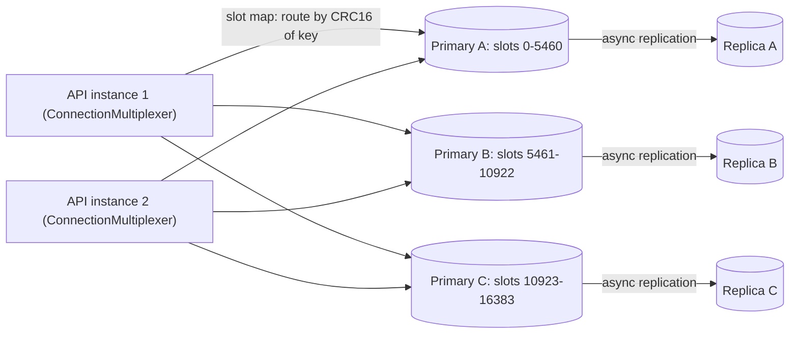
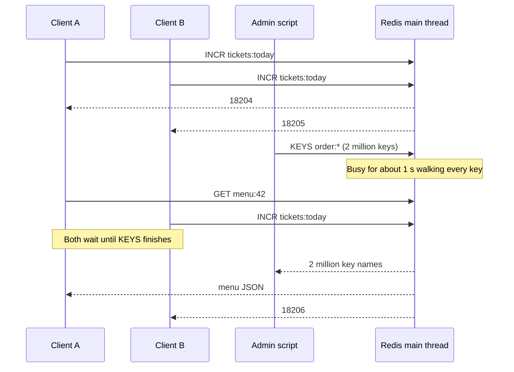
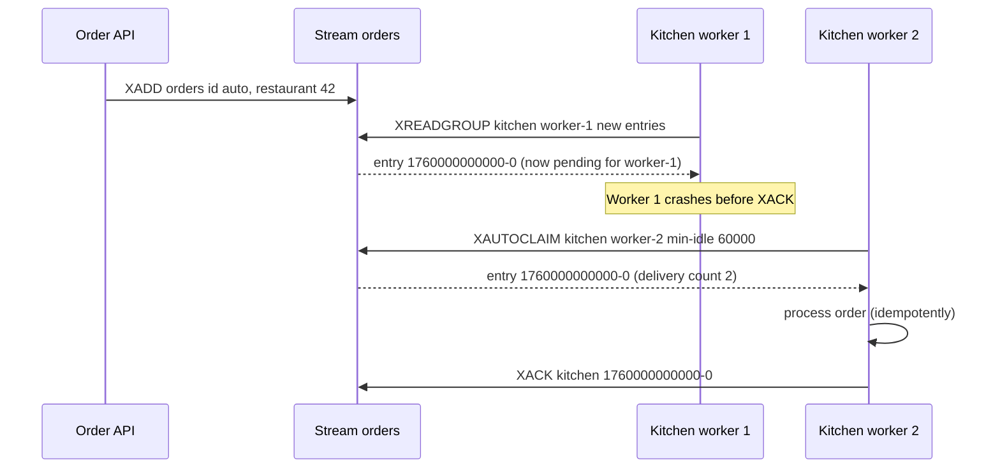

Most teams meet Redis as "the cache". That undersells it. Redis keeps **data structures** in memory — counters, maps, lists, sets, ranked sets, logs — and lets many servers share them over the network with sub-millisecond operations. Choosing the right structure often turns a 40-line feature with a database table and a cron job into three Redis commands.

## Learning objectives

By the end of this lesson you will be able to:

1. Pick the right Redis data structure (string, hash, list, set, sorted set, stream, pub/sub) for a feature, and name its key commands and their cost.
2. Use TTLs correctly, including the classic `INCR` + `EXPIRE` pitfall.
3. Explain Redis's single-threaded command model: why single commands are atomic and why one slow command hurts everyone.
4. Compare RDB snapshots and AOF logging and choose persistence for a cache, a session store and a queue.
5. Explain cluster hash slots, hash tags and the multi-key limitation, and compute a key's slot.
6. Use Redis from ASP.NET Core with StackExchange.Redis, and test the logic with an in-memory fake behind an interface.

## Prerequisites

- [Why caching works](#/lesson/m12-why-caching), [Cache patterns](#/lesson/m12-cache-patterns) and [Invalidation, TTL and eviction](#/lesson/m12-invalidation-ttl): Redis is the usual shared cache those lessons assumed.
- Basic comfort with `async`/`await` in C#.

## Explain it like I'm a beginner

Picture the control room of a big railway station. On the wall there are different kinds of boards, each designed for one job:

- A **counter** showing "tickets sold today: 18,204". Staff just press +1. (*String* with `INCR`.)
- A **card for each train** with fields: platform, delay, coach count. You can change one field without rewriting the card. (*Hash*.)
- A **clipboard of the last 20 announcements**, newest on top; the oldest falls off the bottom. (*List*.)
- A **guest register** where each name appears only once. (*Set*.)
- A **ranking board** of the busiest platforms, always kept in order. (*Sorted set*.)
- A **logbook** where every event is written in order, and several teams each keep a bookmark of what they have processed. (*Stream*.)
- A **loudspeaker**: whoever is listening hears the announcement; whoever is not, misses it. (*Pub/sub*.)

One officer — and only one — updates the boards, handling requests one at a time, very fast. Because he never does two things at once, two staff pressing "+1" together can never lose a count. But if someone asks him to read out *every* board in the building, everybody else waits.

That officer is Redis. The boards are its **data types**. The one-at-a-time rule is its **single-threaded command model**.

## First-principles explanation

### What Redis is

Redis is a server that holds keys in memory. Each key maps to a *typed* value: a string, a hash, a list, a set, a sorted set, a stream, and a few more. Clients send commands over TCP; each command operates on one or more keys and returns quickly, because the data is in RAM and the commands are designed around efficient data structures.

Rough numbers (estimates — measure your own with `redis-benchmark` and your real payloads):

- Server-side time for a simple `GET` or `INCR`: a few microseconds.
- Network round trip inside one data centre: roughly 0.1–0.5 ms. **The network, not Redis, usually dominates.**
- One Redis instance commonly sustains on the order of 100,000 simple operations per second; pipelining raises that.

Redis is **memory-bound**. Everything you store costs RAM, and RAM is the main cost driver of a Redis deployment. Each key has overhead beyond its value (often tens of bytes — measure with `MEMORY USAGE key`).

### The single-threaded command model

Redis executes commands **one at a time on a main thread**. (Since Redis 6, separate I/O threads can read and write sockets, but command execution is still sequential.) Two consequences follow.

**1. Every single command is atomic.** If 1,000 clients send `INCR tickets:today` at the same moment, Redis runs them one after another. The counter ends at exactly +1,000. No locks needed in your code. This is why Redis is the standard home for counters, rate limits and simple locks.

**2. One slow command stalls everyone.** While Redis runs a command, nothing else runs. Commands that touch every element of a big value are dangerous:

| Dangerous | Why | Safer alternative |
|---|---|---|
| `KEYS *` | Walks every key (O(N)) | `SCAN` with a cursor, in small batches |
| `HGETALL` / `SMEMBERS` / `LRANGE 0 -1` on a huge value | O(N) in elements | Paginate (`HSCAN`, `SSCAN`, bounded `LRANGE`) or redesign |
| `DEL` of a key with millions of elements | Freeing memory is O(N) | `UNLINK` (frees memory in the background) |
| Long Lua scripts | The script runs atomically, blocking others | Keep scripts tiny |

A 200 ms `KEYS` call at 50,000 operations per second means about 10,000 requests queue behind it. Use `SLOWLOG` to find offenders.

**Multi-command atomicity.** Separate commands from the same client can interleave with other clients' commands. When you need several steps to be atomic, use:

- `MULTI` / `EXEC`: queues commands and runs them together. No rollback: if one fails, the others still run. `WATCH` adds optimistic concurrency (abort if a watched key changed).
- **Lua scripts** (`EVAL`) or Redis Functions: run a small script atomically on the server. The tool of choice for "read, decide, write" logic such as rate limiters or compare-and-set.

### Strings: values, counters, flags

A string holds up to 512 MB of bytes — text, JSON, a serialised object, or an integer.

- `SET key value EX 300` / `GET key` — the cache-aside workhorse.
- `SET key value NX PX 30000` — set only if absent, with a 30-second expiry: a simple lock or "first one wins" flag. (For locks that protect correctness, read [distributed locks and fencing tokens](#/lesson/m13-distributed-locks) first.)
- `INCR` / `INCRBY` / `DECR` — atomic counters. `INCR` on a missing key starts at 0.
- `MGET k1 k2 k3` — fetch many keys in one round trip.

**The `INCR` + `EXPIRE` pitfall.** A fixed-window limiter does `INCR otp:9876543210` then, if the result is 1, `EXPIRE otp:9876543210 600`. If the client crashes between the two commands, the key has **no TTL** and the phone number is blocked forever after three requests. Fixes: send both in a `MULTI`/`EXEC` transaction; use a Lua script; or defensively check `TTL` and set the expiry if it is missing. Exercise 1 makes you build the defensive version.

### Hashes: objects with fields

A hash maps field names to values under one key: `HSET session:ab12 userId 42 city Pune cartCount 3`.

- Update one field without rewriting the object: `HINCRBY session:ab12 cartCount 1`.
- Read one field (`HGET`), several (`HMGET`) or all (`HGETALL` — fine for small hashes).
- Small hashes are stored in a compact encoding, so many small objects as hashes often use less memory than the same data as separate string keys.
- TTL applies to the **whole key**. (Redis 7.4 and Valkey 9.0 added per-field expiry with `HEXPIRE`; check your server version and managed service before relying on it.)

Use for sessions, user profiles, per-entity counters ("views", "likes", "shares" as fields of one hash).

### Lists: ordered sequences, recent items, simple queues

A list is a sequence with fast push and pop at both ends (O(1)), and O(N) access in the middle.

- `LPUSH` + `LTRIM key 0 19` — keep "the last 20" of something (recently viewed restaurants, recent notifications).
- `LRANGE key 0 9` — read the first 10.
- `RPUSH` + `BLPOP` — a simple work queue where workers block until an item arrives.
- `LMOVE` / `BLMOVE` — atomically move an item to a "processing" list, so a crashed worker's item is not lost (the "reliable queue" pattern).

For real queues with acknowledgement and replay, prefer **streams** (below) or a broker ([message queues](#/lesson/m12-message-queues)).

### Sets: unique members

An unordered collection of unique strings.

- `SADD`, `SREM`, `SISMEMBER` (O(1)), `SCARD` (count).
- `SINTER`, `SUNION`, `SDIFF` — "users who follow both", "tags in common".
- Use for: tags, "who has liked this post", deduplication of recent event ids, online users per room.

For counting **unique** items at huge scale, use **HyperLogLog** (`PFADD`, `PFCOUNT`): it estimates the number of distinct members with a standard error of about 0.81 % using at most 12 KB per key, whatever the count. "Unique visitors per day" for a site with 20 million visitors fits in 12 KB instead of hundreds of MB.

### Sorted sets: rankings, time windows and schedules

A sorted set is a set where each member has a numeric **score**, kept ordered by score. Add, update and rank operations are O(log N).

- `ZINCRBY trending:pune masala-dosa 1` — bump a score.
- `ZRANGE trending:pune 0 9 REV WITHSCORES` (or the older `ZREVRANGE`) — top 10.
- `ZRANK` / `ZREVRANK` — a member's position. `ZSCORE` — its score.
- `ZRANGEBYSCORE` / `ZREMRANGEBYSCORE` — work with score ranges.

Three classic uses:

1. **Leaderboards and trending lists.** Score = points or order count. Top-N reads are O(log N + N).
2. **Sliding-window rate limiting.** Score = request timestamp. Remove entries older than the window, count the rest, add the new one. Precise, but stores one member per request — at 100 requests per minute per client and 1 million clients that is up to 100 million members, so it is costlier than a fixed-window counter ([rate limiting](#/lesson/m10-rate-limiting)).
3. **Delayed jobs.** Score = due time. A worker repeatedly takes members with `score <= now`.

Ties: members with equal scores are ordered lexicographically by member.

### Streams: an append-only log with consumer groups

A stream is an append-only log of entries, each with an id like `1760000000000-0` (milliseconds-sequence) and a set of field-value pairs.

- `XADD orders * restaurantId 42 total 640` — append; `*` means "generate the id".
- `XREADGROUP GROUP kitchen worker-1 COUNT 10 STREAMS orders >` — read entries never delivered to this **consumer group**. Each entry goes to one consumer in the group (competing consumers), and different groups each get every entry (fan-out).
- `XACK orders kitchen <id>` — acknowledge. Unacknowledged entries stay in the group's **pending entries list** (PEL).
- `XPENDING` — inspect pending entries; `XAUTOCLAIM` — take over entries that have been pending longer than a threshold, e.g. because their consumer crashed.
- `XADD ... MAXLEN ~ 1000000` — cap the log length.

Streams give you at-least-once processing with replay, inside the Redis you already run. They are not Kafka: retention is bounded by memory, and durability is whatever your persistence and replication settings give you. For high-volume, long-retention event logs, use a log broker ([Kafka](#/lesson/m12-kafka)).

### Pub/sub: fire-and-forget broadcast

`PUBLISH channel message` delivers the message to every client currently `SUBSCRIBE`d to the channel. Nothing is stored. A subscriber that is disconnected misses the message, and there is no acknowledgement or replay.

Good for: cache-invalidation broadcasts to L1 caches (with TTLs as the safety net, as in the [invalidation lesson](#/lesson/m12-invalidation-ttl)), live dashboards, "typing…" indicators. Bad for: anything that must be processed. In a cluster, classic pub/sub messages are broadcast across all nodes; Redis 7 added **sharded pub/sub** (`SPUBLISH`/`SSUBSCRIBE`) that keeps a channel on its slot's shard.

### A few more types worth knowing

- **Geospatial** (`GEOADD`, `GEOSEARCH`): store longitude/latitude and query "within 2 km". Built on sorted sets. Good for "nearby drivers".
- **Bitmaps** (`SETBIT`, `BITCOUNT`): one bit per user id for daily-active flags; 10 million users ≈ 1.25 MB per day.
- **Bloom filters** (`BF.ADD`, `BF.EXISTS`) are built into Redis 8 (earlier versions needed Redis Stack); Valkey offers them through the `valkey-bloom` module. [Cache failures](#/lesson/m12-cache-failures) builds one by hand.

### TTLs in Redis

- `SET k v EX 60`, `EXPIRE k 60`, `PEXPIRE k 60000`, `TTL k` (−1 = no expiry, −2 = no key), `PERSIST k` (remove expiry).
- A plain `SET` on an existing key **clears its TTL** unless you pass `EX` again (or `KEEPTTL`).
- Modifying a value (`INCR`, `HSET`, `LPUSH`) keeps the existing TTL.
- TTL is per key. If you need one TTL per item, use one key per item (or `HEXPIRE` on newer versions).
- Expired keys are removed lazily on access and actively by background sampling. Eviction under `maxmemory` is separate ([eviction policies](#/lesson/m12-invalidation-ttl)).

### Persistence: RDB and AOF

Redis lives in memory, but it can write to disk so that a restart does not start empty.

- **RDB snapshots.** Periodically, Redis forks a child process that writes the whole dataset to a compact file. Fast restarts and easy backups. You lose everything written since the last snapshot — minutes, typically.
- **AOF (append-only file).** Every write command is appended to a log. With `appendfsync everysec` (the usual choice) you lose at most about one second of writes on a crash; `always` fsyncs every write (much slower); `no` leaves it to the OS. The log is compacted periodically by a rewrite.
- **Both.** Common for data you care about: AOF for durability, RDB for backups.
- **Neither.** Perfectly fine for a pure cache — the database is the source of truth, and a restart just means a cold cache (size the database for that).

Forking for RDB or an AOF rewrite uses copy-on-write memory. Under heavy writes, memory use can grow substantially during the fork, so leave headroom (a common rule of thumb is not to plan beyond roughly 70–80 % of RAM for data; an estimate, not a law).

**Replication is asynchronous.** A primary acknowledges a write before replicas have it. If the primary dies and a replica is promoted (by Sentinel, a cluster, or your cloud provider), recently acknowledged writes can be lost. `WAIT` can reduce the window but does not make Redis a strongly consistent store. This is why money and orders belong in PostgreSQL.

| Use | Persistence | Replica | Eviction policy |
|---|---|---|---|
| Pure cache | None (or RDB for faster warm-up) | Optional, for availability | `allkeys-lru` / `allkeys-lfu` |
| Sessions | AOF `everysec` | Yes | `volatile-lru` (sessions have TTLs) |
| Queue / stream | AOF `everysec` | Yes | `noeviction` — never silently drop jobs |

### Scaling out: Redis Cluster and hash slots

One instance is limited by one machine's memory and one main thread. **Redis Cluster** splits the keyspace into **16,384 hash slots**:

> slot = CRC16(key) mod 16384

Each primary owns a range of slots (with three primaries, roughly 0–5460, 5461–10922 and 10923–16383), and each primary usually has a replica. A cluster-aware client keeps a map of slot → node and sends each command directly to the right node. If the map is stale (after resharding), the node replies `MOVED` and the client updates its map.

**Multi-key commands need one slot.** `MGET a b`, `SINTER`, transactions and Lua scripts that touch several keys only work if all keys hash to the same slot. **Hash tags** make that happen: if a key contains `{...}`, only the part inside the first braces is hashed. `{user:42}:cart` and `{user:42}:profile` land in the same slot, so a transaction can update both. Overuse hash tags and you recreate the problem cluster solves: one slot, one node, all the load.

**Hot keys do not scale out.** A cluster spreads *keys*, not *traffic on one key*. A single key read 200,000 times per second during a flash sale sits on one shard, whatever the cluster size. See [hot keys in cache failures](#/lesson/m12-cache-failures).

### When not to use Redis

- **As the only copy of important data.** Asynchronous replication and memory limits make it a poor system of record for payments, orders and ledgers.
- **When an in-process cache is enough.** A few MB of read-mostly data per instance needs no network hop and no extra component.
- **For large values.** Values over ~100 KB (estimate) make every read and replication slow; store blobs in object storage and cache the URL.
- **For queries.** Redis has no joins or ad-hoc filtering. If you are maintaining six sorted sets to emulate an index, you want a database.

A note on licensing and forks: in 2024 Redis moved from the BSD licence to source-available licences, and the Linux Foundation started **Valkey**, a BSD-licensed fork of Redis 7.2 that is wire-compatible and offered by the major cloud providers. In 2025 Redis 8 added the open-source AGPLv3 as a licence option and folded the former Redis Stack features (JSON, search, Bloom filters) into the core. The data structures, commands, persistence and cluster concepts in this lesson apply to both; StackExchange.Redis talks to either. Check which licence and managed service fit your organisation, and test newer commands against the exact server you run.

## Visual explanation

### Architecture: a three-shard Redis Cluster behind ASP.NET Core



Each API instance holds one long-lived `ConnectionMultiplexer`, which learns the cluster's slot map and opens connections to every primary. For each command it computes the key's slot and sends the command straight to the owning primary — no proxy in between. Each primary replicates asynchronously to its replica; if a primary fails, the cluster promotes the replica and clients update their slot map. Note that the arrows from the APIs go to all three primaries: a feature that touches keys in different slots talks to several nodes, and a multi-key command across slots is rejected.

### Sequence: one command at a time



Clients A and B increment the same counter at the same moment. Redis runs the two `INCR`s one after the other, so each gets a distinct value and no update is lost — atomic without locks. Then an admin script runs `KEYS order:*`. Redis walks two million keys (the "about 1 s" is an illustrative estimate) and serves nobody else meanwhile; A's simple `GET` and B's `INCR` sit in the queue until it finishes. Same thread, same rule: great atomicity, zero tolerance for slow commands.

### Sequence: a stream consumer group surviving a crash



The order API appends an entry. Worker 1 reads it through the `kitchen` group, which records it as pending for worker 1. Worker 1 crashes without acknowledging. A minute later, worker 2 runs `XAUTOCLAIM` for entries idle longer than 60 seconds, takes ownership (the delivery count rises to 2), processes the order and acknowledges it. Because an entry can be delivered twice, processing must be idempotent — the subject of [idempotent consumers](#/lesson/m12-idempotent-consumers).

## Step-by-step example

**Scenario.** A food-delivery app in Pune wants four features on its restaurant pages, each a few weeks apart. Peak: 15,000 RPS on the API, 1.2 million daily users, 300,000 concurrent sessions in the evening.

### Feature 1 — Sessions

Need: look up the session on every request, expire after 30 minutes of inactivity, update one field (cart count) often.

Structure: **hash** `session:{id}` with fields `userId`, `city`, `cartCount`; `EXPIRE` 1800 on every request (sliding expiry is right for sessions). Memory: 300,000 × ~1 KB ≈ 300 MB (estimate). Persistence: AOF `everysec` and a replica, so a Redis restart does not log everyone out.

### Feature 2 — "Recently viewed" restaurants

Need: last 20 per user, newest first, no duplicates.

Structure: **list** `recent:{userId}`: `LREM` the id if present, `LPUSH` it, `LTRIM 0 19`, `EXPIRE` 30 days. Four commands — send them in one pipeline (one round trip) or a transaction. Memory: say 400,000 active users × 20 × ~20 bytes ≈ 160 MB plus overhead (estimate).

### Feature 3 — "Trending in Pune this hour"

Need: count orders per dish per city per hour, show the top 10.

Structure: **sorted set** per city per hour: `trending:pune:2026101919`. `ZINCRBY` on each order (about 300 orders per second at peak, so ~300 operations per second — trivial), `ZRANGE ... 0 9 REV WITHSCORES` for the page, `EXPIRE` 48 h so old buckets clean themselves up. The page itself can be cached for 30 s in-process, so 15,000 RPS of page views produce only a handful of Redis reads per instance per minute.

### Feature 4 — OTP rate limit

Need: at most 3 OTP requests per phone per 10 minutes.

Structure: **string** counter `otp:req:{phone}` with `INCR` + `EXPIRE` 600 (fixed window), sent atomically or with the defensive TTL check. A sliding window (sorted set) is more precise but costs a member per request; for 3 requests per 10 minutes the fixed window is good enough.

### Check the totals

Memory ≈ 300 MB + 160 MB + a few MB ≈ **500 MB**, so a 1–2 GB managed instance with a replica has room for growth and fork headroom. Throughput: sessions dominate at ~15,000 `HGETALL` + `EXPIRE` per second (pipelined: ~15,000 round trips per second), well within a single primary's capacity (estimate; load-test). **No cluster needed yet.** Plan for cluster mode when memory passes what one node can comfortably hold, or when one main thread becomes the bottleneck.

## Production-style C# implementation

The implementation has three layers:

1. **`IRedisCommands`** — a small interface whose methods mirror the Redis commands we use (named like StackExchange.Redis's `IDatabase` methods).
2. **`InMemoryRedis`** — an in-memory implementation with Redis semantics (types, TTL, `WRONGTYPE`, empty keys removed) and **one lock**, mirroring Redis's one-command-at-a-time model. It lets the whole app and its tests run offline.
3. **Feature services** — sessions, recently viewed, trending and a sliding-window limiter — written only against `IRedisCommands`.

In production, a ten-line adapter implements `IRedisCommands` on top of StackExchange.Redis (shown after the compiled code).

```text
FoodApp.Api/
  Program.cs
  Redis/IRedisCommands.cs
  Redis/InMemoryRedis.cs
  Features/SessionStore.cs
  Features/RecentlyViewed.cs
  Features/TrendingDishes.cs
  Features/SlidingWindowRateLimiter.cs
```

```csharp file=Redis/IRedisCommands.cs
namespace FoodApp.Redis;

public sealed record ScoredMember(string Member, double Score);

/// <summary>The subset of Redis commands this app uses. Method names follow StackExchange.Redis's IDatabase.</summary>
public interface IRedisCommands
{
    // Strings
    Task<string?> StringGetAsync(string key);
    Task StringSetAsync(string key, string value, TimeSpan? expiry = null);          // SET [EX]
    Task<long> StringIncrementAsync(string key, long by = 1);                        // INCRBY

    // Keys
    Task<bool> KeyExpireAsync(string key, TimeSpan expiry);                          // EXPIRE
    Task<TimeSpan?> KeyTimeToLiveAsync(string key);                                  // TTL (null: missing or no expiry)
    Task<bool> KeyDeleteAsync(string key);                                           // DEL

    // Hashes
    Task HashSetAsync(string key, IReadOnlyDictionary<string, string> fields);       // HSET
    Task<IReadOnlyDictionary<string, string>> HashGetAllAsync(string key);           // HGETALL

    // Lists
    Task<long> ListLeftPushAsync(string key, string value);                          // LPUSH
    Task<long> ListRemoveAsync(string key, string value);                            // LREM key 0 value
    Task ListTrimAsync(string key, long start, long stop);                           // LTRIM
    Task<IReadOnlyList<string>> ListRangeAsync(string key, long start, long stop);   // LRANGE

    // Sorted sets
    Task<bool> SortedSetAddAsync(string key, string member, double score);           // ZADD
    Task<double> SortedSetIncrementAsync(string key, string member, double by);      // ZINCRBY
    Task<IReadOnlyList<ScoredMember>> SortedSetRangeByRankDescendingAsync(string key, long start, long stop); // ZRANGE REV WITHSCORES
    Task<long> SortedSetRemoveRangeByScoreAsync(string key, double min, double max); // ZREMRANGEBYSCORE
    Task<long> SortedSetLengthAsync(string key);                                     // ZCARD
}
```

```csharp file=Redis/InMemoryRedis.cs
using System.Globalization;

namespace FoodApp.Redis;

/// <summary>In-memory Redis stand-in with Redis semantics for the commands in IRedisCommands.
/// A single lock means one command runs at a time, like Redis's main thread.</summary>
public sealed class InMemoryRedis(TimeProvider clock) : IRedisCommands
{
    private sealed class Slot(object value)
    {
        public object Value { get; set; } = value;
        public DateTimeOffset? ExpiresAt { get; set; }
    }

    private sealed class StringValue { public string Text = ""; }
    private sealed class HashValue : Dictionary<string, string> { public HashValue() : base(StringComparer.Ordinal) { } }
    private sealed class ListValue : List<string> { }

    private sealed class SortedSetValue
    {
        private static readonly Comparer<(double Score, string Member)> ByScoreThenMember =
            Comparer<(double Score, string Member)>.Create((a, b) =>
            {
                var c = a.Score.CompareTo(b.Score);
                return c != 0 ? c : string.CompareOrdinal(a.Member, b.Member);
            });

        public readonly Dictionary<string, double> Scores = new(StringComparer.Ordinal);
        public readonly SortedSet<(double Score, string Member)> Order = new(ByScoreThenMember);
    }

    private readonly Dictionary<string, Slot> _keys = new(StringComparer.Ordinal);
    private readonly Lock _commandThread = new();

    // ---------- Strings ----------
    public Task<string?> StringGetAsync(string key)
    {
        lock (_commandThread) return Task.FromResult(Find<StringValue>(key)?.Text);
    }

    public Task StringSetAsync(string key, string value, TimeSpan? expiry = null)
    {
        lock (_commandThread)
        {
            // SET replaces the value and clears any previous TTL unless a new one is given.
            _keys[key] = new Slot(new StringValue { Text = value }) { ExpiresAt = expiry is { } e ? Now + e : null };
        }
        return Task.CompletedTask;
    }

    public Task<long> StringIncrementAsync(string key, long by = 1)
    {
        lock (_commandThread)
        {
            var s = FindOrCreate<StringValue>(key, () => new StringValue { Text = "0" });
            if (!long.TryParse(s.Text, NumberStyles.Integer, CultureInfo.InvariantCulture, out var current))
                throw new InvalidOperationException("ERR value is not an integer or out of range");
            var next = checked(current + by);
            s.Text = next.ToString(CultureInfo.InvariantCulture);   // TTL is kept, as in Redis
            return Task.FromResult(next);
        }
    }

    // ---------- Keys ----------
    public Task<bool> KeyExpireAsync(string key, TimeSpan expiry)
    {
        lock (_commandThread)
        {
            if (!TryGetLive(key, out var slot)) return Task.FromResult(false);
            slot.ExpiresAt = Now + expiry;
            return Task.FromResult(true);
        }
    }

    public Task<TimeSpan?> KeyTimeToLiveAsync(string key)
    {
        lock (_commandThread)
        {
            TimeSpan? ttl = TryGetLive(key, out var slot) && slot.ExpiresAt is { } at ? at - Now : null;
            return Task.FromResult(ttl);
        }
    }

    public Task<bool> KeyDeleteAsync(string key)
    {
        lock (_commandThread) return Task.FromResult(TryGetLive(key, out _) && _keys.Remove(key));
    }

    // ---------- Hashes ----------
    public Task HashSetAsync(string key, IReadOnlyDictionary<string, string> fields)
    {
        lock (_commandThread)
        {
            var h = FindOrCreate<HashValue>(key, () => new HashValue());
            foreach (var (f, v) in fields) h[f] = v;
        }
        return Task.CompletedTask;
    }

    public Task<IReadOnlyDictionary<string, string>> HashGetAllAsync(string key)
    {
        lock (_commandThread)
        {
            IReadOnlyDictionary<string, string> copy = Find<HashValue>(key) is { } h
                ? new Dictionary<string, string>(h, StringComparer.Ordinal)
                : new Dictionary<string, string>();
            return Task.FromResult(copy);
        }
    }

    // ---------- Lists ----------
    public Task<long> ListLeftPushAsync(string key, string value)
    {
        lock (_commandThread)
        {
            var l = FindOrCreate<ListValue>(key, () => new ListValue());
            l.Insert(0, value);   // O(n) here; O(1) in Redis's real list encoding
            return Task.FromResult((long)l.Count);
        }
    }

    public Task<long> ListRemoveAsync(string key, string value)
    {
        lock (_commandThread)
        {
            if (Find<ListValue>(key) is not { } l) return Task.FromResult(0L);
            long removed = l.RemoveAll(x => x == value);
            DeleteIfEmpty(key, l.Count);
            return Task.FromResult(removed);
        }
    }

    public Task ListTrimAsync(string key, long start, long stop)
    {
        lock (_commandThread)
        {
            if (Find<ListValue>(key) is not { } l) return Task.CompletedTask;
            var (from, to) = Normalise(start, stop, l.Count);
            var kept = from > to ? new List<string>() : l.GetRange((int)from, (int)(to - from + 1));
            l.Clear();
            l.AddRange(kept);
            DeleteIfEmpty(key, l.Count);
        }
        return Task.CompletedTask;
    }

    public Task<IReadOnlyList<string>> ListRangeAsync(string key, long start, long stop)
    {
        lock (_commandThread)
        {
            IReadOnlyList<string> result = [];
            if (Find<ListValue>(key) is { } l)
            {
                var (from, to) = Normalise(start, stop, l.Count);
                if (from <= to) result = l.GetRange((int)from, (int)(to - from + 1));
            }
            return Task.FromResult(result);
        }
    }

    // ---------- Sorted sets ----------
    public Task<bool> SortedSetAddAsync(string key, string member, double score)
    {
        lock (_commandThread)
        {
            var z = FindOrCreate<SortedSetValue>(key, () => new SortedSetValue());
            var isNew = !z.Scores.TryGetValue(member, out var old);
            if (!isNew) z.Order.Remove((old, member));
            z.Scores[member] = score;
            z.Order.Add((score, member));
            return Task.FromResult(isNew);
        }
    }

    public Task<double> SortedSetIncrementAsync(string key, string member, double by)
    {
        lock (_commandThread)
        {
            var z = FindOrCreate<SortedSetValue>(key, () => new SortedSetValue());
            var score = by;
            if (z.Scores.TryGetValue(member, out var old))
            {
                z.Order.Remove((old, member));
                score = old + by;
            }
            z.Scores[member] = score;
            z.Order.Add((score, member));
            return Task.FromResult(score);
        }
    }

    public Task<IReadOnlyList<ScoredMember>> SortedSetRangeByRankDescendingAsync(string key, long start, long stop)
    {
        lock (_commandThread)
        {
            IReadOnlyList<ScoredMember> result = [];
            if (Find<SortedSetValue>(key) is { } z)
            {
                var (from, to) = Normalise(start, stop, z.Order.Count);
                if (from <= to)
                    result = z.Order.Reverse().Skip((int)from).Take((int)(to - from + 1))
                        .Select(x => new ScoredMember(x.Member, x.Score)).ToList();
            }
            return Task.FromResult(result);
        }
    }

    public Task<long> SortedSetRemoveRangeByScoreAsync(string key, double min, double max)
    {
        lock (_commandThread)
        {
            if (Find<SortedSetValue>(key) is not { } z) return Task.FromResult(0L);
            var victims = z.Order.Where(x => x.Score >= min && x.Score <= max).ToList();
            foreach (var v in victims)
            {
                z.Order.Remove(v);
                z.Scores.Remove(v.Member);
            }
            DeleteIfEmpty(key, z.Order.Count);
            return Task.FromResult((long)victims.Count);
        }
    }

    public Task<long> SortedSetLengthAsync(string key)
    {
        lock (_commandThread) return Task.FromResult((long)(Find<SortedSetValue>(key)?.Order.Count ?? 0));
    }

    // ---------- Helpers (called with the lock held) ----------
    private DateTimeOffset Now => clock.GetUtcNow();

    private bool TryGetLive(string key, out Slot slot)
    {
        if (_keys.TryGetValue(key, out slot!))
        {
            if (slot.ExpiresAt is not { } at || at > Now) return true;
            _keys.Remove(key);   // lazy expiry
        }
        return false;
    }

    private T? Find<T>(string key) where T : class
    {
        if (!TryGetLive(key, out var slot)) return null;
        return slot.Value as T
            ?? throw new InvalidOperationException("WRONGTYPE Operation against a key holding the wrong kind of value");
    }

    private T FindOrCreate<T>(string key, Func<T> create) where T : class
    {
        if (Find<T>(key) is { } existing) return existing;
        var created = create();
        _keys[key] = new Slot(created);
        return created;
    }

    private void DeleteIfEmpty(string key, int count)
    {
        if (count == 0) _keys.Remove(key);   // Redis never keeps empty lists, hashes or sets
    }

    /// <summary>Redis index rules: negative indexes count from the end; out-of-range is clamped.</summary>
    private static (long From, long To) Normalise(long start, long stop, int count)
    {
        if (start < 0) start += count;
        if (stop < 0) stop += count;
        if (start < 0) start = 0;
        if (stop >= count) stop = count - 1;
        return (start, stop);
    }
}
```

### Feature services

```csharp file=Features/SessionStore.cs
using FoodApp.Redis;

namespace FoodApp.Features;

/// <summary>Sessions as hashes with sliding expiry: each request pushes the TTL forward.</summary>
public sealed class SessionStore(IRedisCommands redis)
{
    public static readonly TimeSpan IdleTimeout = TimeSpan.FromMinutes(30);
    public static string Key(string sessionId) => $"session:{sessionId}";

    public async Task CreateAsync(string sessionId, string userId, string city)
    {
        // In production, send these two commands in one MULTI/EXEC transaction so a crash
        // between them cannot leave a session without a TTL.
        await redis.HashSetAsync(Key(sessionId), new Dictionary<string, string>
        {
            ["userId"] = userId,
            ["city"] = city,
            ["cartCount"] = "0",
        });
        await redis.KeyExpireAsync(Key(sessionId), IdleTimeout);
    }

    public async Task<IReadOnlyDictionary<string, string>?> TouchAsync(string sessionId)
    {
        var fields = await redis.HashGetAllAsync(Key(sessionId));
        if (fields.Count == 0) return null;   // expired or never existed
        await redis.KeyExpireAsync(Key(sessionId), IdleTimeout);
        return fields;
    }
}
```

```csharp file=Features/RecentlyViewed.cs
using FoodApp.Redis;

namespace FoodApp.Features;

/// <summary>"Recently viewed": a capped list, newest first, no duplicates.</summary>
public sealed class RecentlyViewed(IRedisCommands redis)
{
    public const int MaxItems = 20;
    public static readonly TimeSpan Retention = TimeSpan.FromDays(30);
    public static string Key(string userId) => $"recent:{userId}";

    public async Task AddAsync(string userId, string restaurantId)
    {
        var key = Key(userId);
        // Four commands; with StackExchange.Redis, fire them together in a batch for one round trip.
        await redis.ListRemoveAsync(key, restaurantId);       // LREM key 0 id
        await redis.ListLeftPushAsync(key, restaurantId);     // LPUSH
        await redis.ListTrimAsync(key, 0, MaxItems - 1);      // LTRIM 0 19
        await redis.KeyExpireAsync(key, Retention);
    }

    public Task<IReadOnlyList<string>> GetAsync(string userId) => redis.ListRangeAsync(Key(userId), 0, -1);
}
```

```csharp file=Features/TrendingDishes.cs
using FoodApp.Redis;

namespace FoodApp.Features;

/// <summary>Hourly per-city leaderboards in sorted sets. Old buckets expire on their own.</summary>
public sealed class TrendingDishes(IRedisCommands redis, TimeProvider clock)
{
    public static readonly TimeSpan BucketRetention = TimeSpan.FromHours(48);

    public static string BucketKey(string city, DateTimeOffset at) =>
        $"trending:{city.ToLowerInvariant()}:{at.UtcDateTime:yyyyMMddHH}";

    public async Task RecordOrderAsync(string city, string dish, int quantity = 1)
    {
        var key = BucketKey(city, clock.GetUtcNow());
        await redis.SortedSetIncrementAsync(key, dish, quantity);   // ZINCRBY
        await redis.KeyExpireAsync(key, BucketRetention);
    }

    public Task<IReadOnlyList<ScoredMember>> TopAsync(string city, int count) =>
        redis.SortedSetRangeByRankDescendingAsync(BucketKey(city, clock.GetUtcNow()), 0, count - 1);
}
```

```csharp file=Features/SlidingWindowRateLimiter.cs
using FoodApp.Redis;

namespace FoodApp.Features;

/// <summary>Sliding-window limiter on a sorted set: score = request time in ms.
/// These are separate commands, so two concurrent requests can both pass at the limit;
/// in production run the same steps as one Lua script (shown below) to make it atomic.</summary>
public sealed class SlidingWindowRateLimiter(IRedisCommands redis, TimeProvider clock)
{
    public static string Key(string clientId) => $"rl:{clientId}";

    public async Task<bool> TryAcquireAsync(string clientId, int limit, TimeSpan window)
    {
        var key = Key(clientId);
        var nowMs = clock.GetUtcNow().ToUnixTimeMilliseconds();

        await redis.SortedSetRemoveRangeByScoreAsync(key, double.NegativeInfinity, nowMs - window.TotalMilliseconds);
        if (await redis.SortedSetLengthAsync(key) >= limit) return false;

        await redis.SortedSetAddAsync(key, $"{nowMs}:{Guid.NewGuid():N}", nowMs);   // unique member per request
        await redis.KeyExpireAsync(key, window);
        return true;
    }
}
```

### Wiring it up

```csharp file=Program.cs
using FoodApp.Features;
using FoodApp.Redis;

var builder = WebApplication.CreateBuilder(args);

builder.Services.AddSingleton(TimeProvider.System);
// Offline: in-memory Redis semantics. Production: StackExchangeRedisCommands over a singleton ConnectionMultiplexer.
builder.Services.AddSingleton<IRedisCommands, InMemoryRedis>();
builder.Services.AddSingleton<SessionStore>();
builder.Services.AddSingleton<RecentlyViewed>();
builder.Services.AddSingleton<TrendingDishes>();
builder.Services.AddSingleton<SlidingWindowRateLimiter>();

var app = builder.Build();

app.MapPost("/sessions/{id}", async (string id, string userId, string city, SessionStore sessions) =>
{
    await sessions.CreateAsync(id, userId, city);
    return Results.Created($"/sessions/{id}", null);
});

app.MapGet("/restaurants/{rid}", async (string rid, string userId, RecentlyViewed recent) =>
{
    await recent.AddAsync(userId, rid);
    return Results.Ok(new { restaurant = rid, recentlyViewed = await recent.GetAsync(userId) });
});

app.MapPost("/orders", async (string city, string dish, SlidingWindowRateLimiter limiter, TrendingDishes trending, string clientId) =>
{
    if (!await limiter.TryAcquireAsync(clientId, limit: 20, window: TimeSpan.FromMinutes(1)))
        return Results.StatusCode(StatusCodes.Status429TooManyRequests);
    await trending.RecordOrderAsync(city, dish);
    return Results.Accepted();
});

app.MapGet("/trending/{city}", async (string city, TrendingDishes trending) =>
    Results.Ok(await trending.TopAsync(city, 10)));

app.Run();
```

### The production adapter and atomic scripts (StackExchange.Redis)

These snippets use the StackExchange.Redis NuGet package, so they are not compiled with the lesson.

```csharp
// Program.cs — one multiplexer for the whole app: it is thread-safe and pipelines commands.
builder.Services.AddSingleton<IConnectionMultiplexer>(_ =>
    ConnectionMultiplexer.Connect(builder.Configuration.GetConnectionString("Redis")!));
builder.Services.AddSingleton<IRedisCommands, StackExchangeRedisCommands>();

public sealed class StackExchangeRedisCommands(IConnectionMultiplexer mux) : IRedisCommands
{
    private IDatabase Db => mux.GetDatabase();

    public async Task<long> StringIncrementAsync(string key, long by = 1) => await Db.StringIncrementAsync(key, by);
    public async Task<double> SortedSetIncrementAsync(string key, string member, double by) =>
        await Db.SortedSetIncrementAsync(key, member, by);
    public async Task<IReadOnlyList<ScoredMember>> SortedSetRangeByRankDescendingAsync(string key, long start, long stop) =>
        (await Db.SortedSetRangeByRankWithScoresAsync(key, start, stop, Order.Descending))
            .Select(e => new ScoredMember(e.Element!, e.Score)).ToList();
    // ... the other members map one-to-one onto IDatabase methods.
}

// Atomic sliding-window limiter: the same steps as SlidingWindowRateLimiter, as one Lua script.
const string SlidingWindowLua = """
    redis.call('ZREMRANGEBYSCORE', KEYS[1], '-inf', ARGV[1] - ARGV[2])
    if redis.call('ZCARD', KEYS[1]) >= tonumber(ARGV[3]) then return 0 end
    redis.call('ZADD', KEYS[1], ARGV[1], ARGV[4])
    redis.call('PEXPIRE', KEYS[1], ARGV[2])
    return 1
    """;
var allowed = (long)await db.ScriptEvaluateAsync(SlidingWindowLua,
    keys: [(RedisKey)$"rl:{clientId}"],
    values: [nowMs, windowMs, limit, $"{nowMs}:{Guid.NewGuid():N}"]) == 1;

// Atomic INCR + EXPIRE for a fixed window, as a transaction.
var tx = db.CreateTransaction();
var count = tx.StringIncrementAsync($"otp:req:{phone}");
_ = tx.KeyExpireAsync($"otp:req:{phone}", TimeSpan.FromMinutes(10), ExpireWhen.HasNoExpiry);
await tx.ExecuteAsync();

// Streams: produce, consume in a group, acknowledge.
await db.StreamAddAsync("orders", [new NameValueEntry("restaurantId", 42), new NameValueEntry("total", 640)]);
var entries = await db.StreamReadGroupAsync("orders", "kitchen", "worker-1", ">", count: 10);
foreach (var e in entries) { /* process idempotently */ await db.StreamAcknowledgeAsync("orders", "kitchen", e.Id); }

// Pub/sub: broadcast an invalidation.
await mux.GetSubscriber().PublishAsync(RedisChannel.Literal("invalidate:price"), "SKU-42");
```

Design notes:

- **One `ConnectionMultiplexer` per process**, registered as a singleton. Creating one per request is a classic outage: each connects, handshakes and leaks sockets.
- **Pipelining is automatic** in StackExchange.Redis for concurrent async calls. For the four `RecentlyViewed` commands, `CreateBatch()` sends them together explicitly.
- **Atomicity is explicit.** The C# services issue separate commands for clarity; the Lua script and transaction show how to make the sensitive ones atomic.
- **Every key has an owner and a TTL policy**: `session:*` 30 min sliding, `recent:*` 30 days, `trending:*` 48 h, `rl:*` one window. A Redis full of TTL-less keys is a memory leak waiting to happen.

## Bad design vs good design

**Bad: Redis as a junk drawer.**

```csharp
// Anti-example: one giant JSON string for all sessions, KEYS for lookups, new connection per call.
public async Task<Session?> FindByUserAsync(string userId)
{
    using var conn = await ConnectionMultiplexer.ConnectAsync("redis:6379");   // per call!
    var db = conn.GetDatabase();
    foreach (var key in conn.GetServer("redis:6379").Keys(pattern: "session:*"))  // walks every key
    {
        var json = await db.StringGetAsync(key);
        var s = JsonSerializer.Deserialize<Session>(json!);
        if (s!.UserId == userId) return s;
    }
    return null;
}
```

Problems: a new connection per call (slow, leaks sockets); a full key scan for every lookup (O(N), blocks or slows Redis); reading and deserialising every session to find one (Redis used as a slow table scan); no TTLs mentioned anywhere.

**Good:** model the access path. If you need "session by user", keep a second key `user-session:{userId}` → session id (a string with the same TTL), so the lookup is two O(1) `GET`s. Use one shared multiplexer. Choose a structure per feature (hash for the session, list for recents, sorted set for rankings), give every key a TTL, and keep the source of truth for anything important in PostgreSQL.

:::callout type=warning title="Big keys hurt everyone"
A single sorted set with 50 million members or a 20 MB string makes every operation on it slow, makes deletes block (use `UNLINK`), slows replication and failover, and pins load on one cluster shard. Split big values by time bucket (`trending:pune:2026101919`) or by id range.
:::

## Practical playground

The canvas starts with an API using one Redis node for everything. Redesign it for the Pune food app from the step-by-step example at 3× the traffic:

1. Split Redis by job: a **cache** node (no persistence, `allkeys-lru`) and a **sessions/streams** node (AOF `everysec`, `noeviction` or `volatile-lru`). Put the persistence choice in each node's label.
2. Add replicas (`replicas: 1`) to the node whose data you cannot afford to lose on a restart.
3. Add a `worker` that consumes the `orders` stream with a consumer group, and label the edge with what happens if the worker crashes.
4. Mark which edge must stay in PostgreSQL (orders and payments) and why.

:::playground type=hld title="Split Redis by workload"
```json
{
  "nodes": [
    { "id": "app", "type": "client", "label": "Food app users", "props": { "rps": 45000 } },
    { "id": "lb", "type": "load-balancer", "label": "Load balancer" },
    { "id": "api", "type": "app-server", "label": "Food API", "props": { "instances": 12 } },
    { "id": "redis", "type": "cache", "label": "Redis (everything, no replica)", "props": { "ttlSeconds": 600, "replicas": 0 } },
    { "id": "db", "type": "database", "label": "PostgreSQL", "props": { "replicas": 1 } }
  ],
  "edges": [
    { "from": "app", "to": "lb", "kind": "sync" },
    { "from": "lb", "to": "api", "kind": "sync" },
    { "from": "api", "to": "redis", "kind": "sync", "label": "cache, sessions, trending, rate limits, queue" },
    { "from": "api", "to": "db", "kind": "sync", "label": "orders, payments, misses" }
  ]
}
```
:::

## Exercises

:::exercise id=m12-redis-ex1 difficulty=beginner kind=code title="OTP limiter with INCR and EXPIRE"
Build `OtpRequestLimiter`: at most **3** OTP requests per phone number per **10-minute fixed window**, using a counter store with Redis `INCR` / `EXPIRE` / `TTL` semantics (provided in the starter).
::requirements
- Normalise the phone number to its last 10 digits: `"+91 98765 43210"` and `"9876543210"` share the key `otp:req:9876543210`.
- `TryRequest(phone)` increments the counter and returns `true` while the count is ≤ 3.
- Set the 10-minute expiry when the counter is first created — **and** whenever the key exists without a TTL (a crash between `INCR` and `EXPIRE` must not block a number forever).
- Do **not** reset the TTL on later requests; the window is fixed from the first request.
::acceptance
- Three requests pass; the fourth within 10 minutes fails.
- A request after the window has expired passes again.
- A key left without a TTL gets one on the next request.
- Requests at 0, 3, 6 and 9 minutes: the request at 10:30 passes (the window started at 0, not at 9).
::hint
`INCR` returns the new value. What value tells you the key was just created?
::hint
Strip everything that is not a digit, then keep the last 10 characters.
::hint
After incrementing, call `Expire` if the count is 1 **or** `TimeToLive` returns `null`.
::hint
```csharp
var count = _store.Increment(key);
if (count == 1 || _store.TimeToLive(key) is null) _store.Expire(key, Window);
return count <= MaxRequests;
```
::starter
```csharp file=OtpRequestLimiter.cs
using System;
using System.Collections.Generic;
using System.Linq;

/// <summary>Redis-like counter commands: INCR, EXPIRE, TTL.</summary>
public interface ICounterStore
{
    long Increment(string key);
    bool Expire(string key, TimeSpan ttl);
    TimeSpan? TimeToLive(string key);   // null if the key is missing or has no expiry
}

/// <summary>Provided: in-memory store with lazy expiry, driven by a clock function.</summary>
public sealed class InMemoryCounterStore : ICounterStore
{
    private readonly Func<DateTimeOffset> _now;
    private readonly Dictionary<string, (long Value, DateTimeOffset? ExpiresAt)> _data = new();

    public InMemoryCounterStore(Func<DateTimeOffset> now) => _now = now;

    public long Increment(string key)
    {
        Purge(key);
        (long Value, DateTimeOffset? ExpiresAt) e = _data.TryGetValue(key, out var found) ? found : (0L, null);
        e.Value++;
        _data[key] = e;
        return e.Value;
    }

    public bool Expire(string key, TimeSpan ttl)
    {
        Purge(key);
        if (!_data.TryGetValue(key, out var e)) return false;
        _data[key] = (e.Value, _now() + ttl);
        return true;
    }

    public TimeSpan? TimeToLive(string key)
    {
        Purge(key);
        return _data.TryGetValue(key, out var e) && e.ExpiresAt is { } at ? at - _now() : null;
    }

    private void Purge(string key)
    {
        if (_data.TryGetValue(key, out var e) && e.ExpiresAt is { } at && at <= _now()) _data.Remove(key);
    }
}

public sealed class OtpRequestLimiter
{
    public const int MaxRequests = 3;
    public static readonly TimeSpan Window = TimeSpan.FromMinutes(10);

    public OtpRequestLimiter(ICounterStore store) => throw new NotImplementedException();

    public static string Key(string phone) => throw new NotImplementedException();

    public bool TryRequest(string phone) => throw new NotImplementedException();
}
```
::tests
```csharp file=OtpRequestLimiterTests.cs
using System;
using Xunit;

public class OtpRequestLimiterTests
{
    private DateTimeOffset _now = new(2026, 10, 19, 20, 0, 0, TimeSpan.FromHours(5.5));
    private InMemoryCounterStore NewStore() => new(() => _now);

    [Fact]
    public void Normalises_phone_numbers()
    {
        Assert.Equal("otp:req:9876543210", OtpRequestLimiter.Key("+91 98765 43210"));
        Assert.Equal("otp:req:9876543210", OtpRequestLimiter.Key("9876543210"));
    }

    [Fact]
    public void Fourth_request_in_window_is_rejected()
    {
        var limiter = new OtpRequestLimiter(NewStore());
        Assert.True(limiter.TryRequest("9876543210"));
        Assert.True(limiter.TryRequest("+91-98765-43210"));
        Assert.True(limiter.TryRequest("9876543210"));
        Assert.False(limiter.TryRequest("9876543210"));
    }

    [Fact]
    public void New_window_after_expiry()
    {
        var limiter = new OtpRequestLimiter(NewStore());
        for (var i = 0; i < 4; i++) limiter.TryRequest("9876543210");
        _now = _now.AddMinutes(10).AddSeconds(1);
        Assert.True(limiter.TryRequest("9876543210"));
    }

    [Fact]
    public void Heals_a_key_without_ttl()
    {
        var store = NewStore();
        store.Increment("otp:req:9876543210");   // simulate a crash after INCR, before EXPIRE
        var limiter = new OtpRequestLimiter(store);
        Assert.True(limiter.TryRequest("9876543210"));
        Assert.NotNull(store.TimeToLive("otp:req:9876543210"));
    }

    [Fact]
    public void Window_is_fixed_from_first_request()
    {
        var limiter = new OtpRequestLimiter(NewStore());
        Assert.True(limiter.TryRequest("9876543210"));          // 0 min
        _now = _now.AddMinutes(3); Assert.True(limiter.TryRequest("9876543210"));
        _now = _now.AddMinutes(3); Assert.True(limiter.TryRequest("9876543210"));
        _now = _now.AddMinutes(3); Assert.False(limiter.TryRequest("9876543210"));  // 9 min
        _now = _now.AddMinutes(1).AddSeconds(30);                                    // 10:30
        Assert.True(limiter.TryRequest("9876543210"));
    }
}
```
::solution
Increment first, then set the TTL only when the key is new or has lost its TTL.

```csharp file=OtpRequestLimiter.cs
using System;
using System.Collections.Generic;
using System.Linq;

/// <summary>Redis-like counter commands: INCR, EXPIRE, TTL.</summary>
public interface ICounterStore
{
    long Increment(string key);
    bool Expire(string key, TimeSpan ttl);
    TimeSpan? TimeToLive(string key);   // null if the key is missing or has no expiry
}

/// <summary>Provided: in-memory store with lazy expiry, driven by a clock function.</summary>
public sealed class InMemoryCounterStore : ICounterStore
{
    private readonly Func<DateTimeOffset> _now;
    private readonly Dictionary<string, (long Value, DateTimeOffset? ExpiresAt)> _data = new();

    public InMemoryCounterStore(Func<DateTimeOffset> now) => _now = now;

    public long Increment(string key)
    {
        Purge(key);
        (long Value, DateTimeOffset? ExpiresAt) e = _data.TryGetValue(key, out var found) ? found : (0L, null);
        e.Value++;
        _data[key] = e;
        return e.Value;
    }

    public bool Expire(string key, TimeSpan ttl)
    {
        Purge(key);
        if (!_data.TryGetValue(key, out var e)) return false;
        _data[key] = (e.Value, _now() + ttl);
        return true;
    }

    public TimeSpan? TimeToLive(string key)
    {
        Purge(key);
        return _data.TryGetValue(key, out var e) && e.ExpiresAt is { } at ? at - _now() : null;
    }

    private void Purge(string key)
    {
        if (_data.TryGetValue(key, out var e) && e.ExpiresAt is { } at && at <= _now()) _data.Remove(key);
    }
}

public sealed class OtpRequestLimiter
{
    public const int MaxRequests = 3;
    public static readonly TimeSpan Window = TimeSpan.FromMinutes(10);
    private readonly ICounterStore _store;

    public OtpRequestLimiter(ICounterStore store) => _store = store;

    public static string Key(string phone)
    {
        var digits = new string(phone.Where(char.IsDigit).ToArray());
        if (digits.Length > 10) digits = digits[^10..];
        return $"otp:req:{digits}";
    }

    public bool TryRequest(string phone)
    {
        var key = Key(phone);
        var count = _store.Increment(key);
        if (count == 1 || _store.TimeToLive(key) is null) _store.Expire(key, Window);
        return count <= MaxRequests;
    }
}
```

In real Redis, the cleanest version is one atomic step: a `MULTI`/`EXEC` with `INCR` and `EXPIRE ... NX` (Redis 7: set the expiry only if none exists), or a two-line Lua script. The defensive TTL check above is still worth keeping in code that might run against older servers.
::mistakes
- Calling `Expire` on every request, which turns the fixed window into a window that slides with each attempt and blocks a persistent user forever.
- Calling `Expire` only when `count == 1`, so a crash between `INCR` and `EXPIRE` blocks the number permanently.
- Keying by the raw input, so `+91 98765 43210` and `9876543210` get separate limits.
::extensions
Add a second, longer limit (10 requests per 24 hours) using a second key. Which key should you check first, and why should a rejected request not increment the daily counter?
:::

:::exercise id=m12-redis-ex2 difficulty=beginner kind=written title="Choose the data structure"
For each feature, name the Redis data structure, the main commands, the key naming scheme, and the TTL policy.

1. "Top 10 most-ordered dishes in Chennai in the last hour".
2. A shopping cart: product id → quantity, updated one item at a time.
3. Count of unique visitors per day to a news site with 15 million daily users, where ±1 % is fine.
4. Notifications a user has not yet seen, newest first, max 50.
5. Order events that three separate services (kitchen, analytics, notifications) must each process at least once.
6. Broadcasting "price changed for SKU-42" to 30 API instances so they drop their in-process copies.
::acceptance
- Each answer names a structure and at least two commands.
- Item 3 uses HyperLogLog and justifies the error trade-off.
- Item 5 uses streams with one consumer group per service, and item 6 uses pub/sub, with the difference explained.
- Every key has a TTL policy (or a reason for none).
::hint
Ask: does order matter? Are duplicates allowed? Do I need a ranking? Must every consumer get every message, and must it survive a disconnect?
::hint
"Each service processes every event, at least once, even after a restart" is a consumer-group property.
::hint
Exact unique counts at 15 million per day need a lot of memory; an estimate needs 12 KB.
::solution
1. **Sorted set** `trending:chennai:{yyyyMMddHH}`: `ZINCRBY` per order, `ZRANGE ... 0 9 REV WITHSCORES` to read. TTL 48 h. (For a rolling hour, read and merge the last two buckets with `ZUNIONSTORE` into a short-lived key.)
2. **Hash** `cart:{userId}`: `HINCRBY cart:7 sku-12 1`, `HDEL` to remove, `HGETALL` to show. TTL 7–30 days, refreshed on change. The order itself is written to PostgreSQL at checkout.
3. **HyperLogLog** `uv:{yyyyMMdd}`: `PFADD uv:20261019 visitorId`, `PFCOUNT`. About 0.81 % standard error in at most 12 KB per day, versus hundreds of MB for an exact set of 15 million ids. TTL 90 days (or keep, it is tiny).
4. **List** `notif:{userId}`: `LPUSH`, `LTRIM 0 49`, `LRANGE 0 9`. TTL 30 days. (A sorted set by timestamp works too if you need to remove by id efficiently.)
5. **Stream** `orders` with three consumer groups (`kitchen`, `analytics`, `notifications`): `XADD`, `XREADGROUP`, `XACK`, `XAUTOCLAIM` for crashed consumers. No TTL; cap with `MAXLEN ~` sized to cover the longest consumer outage you must survive. Persistence: AOF + replica.
6. **Pub/sub** channel `invalidate:price`: `PUBLISH` / `SUBSCRIBE`. Nothing stored, so a disconnected instance misses messages; its L1 TTL bounds the staleness. Unlike item 5, losing a message here only costs freshness, not correctness.
::mistakes
- Using pub/sub for order events: a restarting service silently loses orders.
- Using a list as a multi-service event log: `LPOP` gives each item to only one reader.
- An exact set for unique visitors at this scale, or no TTL on per-day keys.
:::

:::exercise id=m12-redis-ex3 difficulty=intermediate kind=code title="Compute cluster hash slots"
Implement `HashSlot`, which computes Redis Cluster slots exactly as the cluster specification does: CRC16 (XMODEM variant: polynomial 0x1021, initial value 0) of the key — or of its hash tag — modulo 16,384.
::requirements
- `Crc16(bytes)` returns the CRC16-XMODEM checksum.
- `HashTagOf(key)` returns the part of the key that is hashed: if the key has a `{`, and a `}` somewhere after it, and at least one character between them, return the characters between the **first** `{` and the first `}` after it; otherwise return the whole key.
- `For(key)` returns the slot (0–16383), hashing the UTF-8 bytes of `HashTagOf(key)`.
- `AllSameSlot(keys)` tells you whether a multi-key command over those keys is allowed.
- `GroupBySlot(keys)` groups keys by slot (so a client can split an `MGET` into one call per slot).
::acceptance
- `Crc16("123456789")` is `0x31C3` (the specification's test vector).
- `For("foo")` is 12182 and `For("hello")` is 866.
- `{user:42}:cart`, `{user:42}:profile` and `user:42` share a slot.
- `foo{}{bar}` hashes the whole key; `foo{{bar}}zap` hashes `{bar`; `foo{bar}{zap}` hashes `bar`.
::hint
CRC16-XMODEM: start with 0; for each byte, XOR it into the high byte of the CRC, then 8 times: shift left, and if the bit that fell out was 1, XOR with 0x1021. Keep 16 bits.
::hint
Find the first `{` with `IndexOf('{')`. Then search for `}` starting at the next position. An empty tag (`{}`) means "hash the whole key".
::hint
`Encoding.UTF8.GetBytes(tag)` then `Crc16(...) % 16384`. For grouping, LINQ's `GroupBy(For)` gets you most of the way.
::hint
```csharp
foreach (var b in data)
{
    crc ^= (ushort)(b << 8);
    for (var i = 0; i < 8; i++)
        crc = (crc & 0x8000) != 0 ? (ushort)((crc << 1) ^ 0x1021) : (ushort)(crc << 1);
}
```
::starter
```csharp file=HashSlot.cs
using System;
using System.Collections.Generic;
using System.Linq;
using System.Text;

public static class HashSlot
{
    public const int SlotCount = 16384;

    public static ushort Crc16(ReadOnlySpan<byte> data) => throw new NotImplementedException();

    public static string HashTagOf(string key) => throw new NotImplementedException();

    public static int For(string key) => throw new NotImplementedException();

    public static bool AllSameSlot(IEnumerable<string> keys) => throw new NotImplementedException();

    public static IReadOnlyDictionary<int, IReadOnlyList<string>> GroupBySlot(IEnumerable<string> keys) =>
        throw new NotImplementedException();
}
```
::tests
```csharp file=HashSlotTests.cs
using System;
using System.Text;
using Xunit;

public class HashSlotTests
{
    [Fact] public void Crc16_matches_spec_test_vector() =>
        Assert.Equal((ushort)0x31C3, HashSlot.Crc16(Encoding.ASCII.GetBytes("123456789")));

    [Fact] public void Known_slots()
    {
        Assert.Equal(12182, HashSlot.For("foo"));
        Assert.Equal(866, HashSlot.For("hello"));
    }

    [Fact] public void Hash_tags_colocate_keys()
    {
        Assert.Equal(HashSlot.For("user:42"), HashSlot.For("{user:42}:cart"));
        Assert.Equal(HashSlot.For("{user:42}:cart"), HashSlot.For("{user:42}:profile"));
        Assert.Equal(15880, HashSlot.For("{user:42}:cart"));
    }

    [Fact] public void Hash_tag_edge_cases()
    {
        Assert.Equal("foo{}{bar}", HashSlot.HashTagOf("foo{}{bar}"));
        Assert.Equal("{bar", HashSlot.HashTagOf("foo{{bar}}zap"));
        Assert.Equal("bar", HashSlot.HashTagOf("foo{bar}{zap}"));
        Assert.Equal("no-braces", HashSlot.HashTagOf("no-braces"));
        Assert.Equal("open{only", HashSlot.HashTagOf("open{only"));
        Assert.Equal(HashSlot.For("bar"), HashSlot.For("foo{bar}{zap}"));
    }

    [Fact] public void Same_slot_check()
    {
        Assert.True(HashSlot.AllSameSlot(new[] { "{order:9}:items", "{order:9}:status" }));
        Assert.False(HashSlot.AllSameSlot(new[] { "foo", "hello" }));
    }

    [Fact] public void Groups_keys_by_slot()
    {
        var groups = HashSlot.GroupBySlot(new[] { "foo", "{user:42}:cart", "hello", "{user:42}:profile" });
        Assert.Equal(3, groups.Count);
        Assert.Equal(2, groups[15880].Count);
        Assert.Contains("foo", groups[12182]);
    }

    [Fact] public void Slots_are_in_range()
    {
        for (var i = 0; i < 1000; i++) Assert.InRange(HashSlot.For($"key:{i}"), 0, HashSlot.SlotCount - 1);
    }
}
```
::solution
The checksum is a standard bitwise CRC; the subtle part is the hash-tag rule.

```csharp file=HashSlot.cs
using System;
using System.Collections.Generic;
using System.Linq;
using System.Text;

public static class HashSlot
{
    public const int SlotCount = 16384;

    public static ushort Crc16(ReadOnlySpan<byte> data)
    {
        ushort crc = 0;
        foreach (var b in data)
        {
            crc ^= (ushort)(b << 8);
            for (var i = 0; i < 8; i++)
                crc = (crc & 0x8000) != 0 ? (ushort)((crc << 1) ^ 0x1021) : (ushort)(crc << 1);
        }
        return crc;
    }

    public static string HashTagOf(string key)
    {
        var open = key.IndexOf('{');
        if (open < 0) return key;
        var close = key.IndexOf('}', open + 1);
        if (close < 0 || close == open + 1) return key;   // no closing brace, or empty tag "{}"
        return key.Substring(open + 1, close - open - 1);
    }

    public static int For(string key) => Crc16(Encoding.UTF8.GetBytes(HashTagOf(key))) % SlotCount;

    public static bool AllSameSlot(IEnumerable<string> keys) => keys.Select(For).Distinct().Count() <= 1;

    public static IReadOnlyDictionary<int, IReadOnlyList<string>> GroupBySlot(IEnumerable<string> keys) =>
        keys.GroupBy(For).ToDictionary(g => g.Key, g => (IReadOnlyList<string>)g.ToList());
}
```

Real clients (including StackExchange.Redis) do exactly this to route each command. Redis itself uses a lookup-table CRC for speed; the bitwise version gives identical results.
::mistakes
- Using the *last* `}` instead of the first one after `{`.
- Treating `{}` as an empty tag and hashing the empty string, which would send every such key to one slot.
- Hashing the UTF-16 bytes of the .NET string instead of UTF-8.
::extensions
Write `ShardFor(slot, ranges)` that maps a slot to a node given a list of slot ranges, and simulate resharding slot 15880 from one node to another. What does a client see in the meantime (`MOVED` versus `ASK`)?
:::

:::exercise id=m12-redis-ex4 difficulty=intermediate kind=hld title="Redis for a ride-hailing app"
A ride-hailing app in Hyderabad has, at peak (estimates):

- 40,000 online drivers sending a location every 4 seconds.
- 2,000 "find drivers within 2 km" searches per second.
- 500,000 concurrent rider sessions.
- Surge pricing per zone (300 zones), recomputed every 30 seconds.
- Trip events (requested, accepted, started, completed) consumed by billing, notifications and analytics.

Design the Redis part of the system. For each feature, name the data structure, persistence, eviction policy and memory estimate. Say what must **not** live only in Redis.
::acceptance
- Location write rate is computed (with arithmetic).
- Geospatial commands are used for nearby search.
- Trip events use a durable path (stream with consumer groups, or a broker) and trips/payments live in PostgreSQL.
- At least two Redis deployments or roles are distinguished by persistence needs.
- Memory estimates are given for locations and sessions.
::hint
40,000 drivers ÷ 4 s = ? writes per second. Is that a lot for Redis? Is losing the last few seconds of locations a problem?
::hint
`GEOADD drivers:hyd lon lat driverId` and `GEOSEARCH drivers:hyd FROMLONLAT ... BYRADIUS 2 km ASC COUNT 20`. How do you remove drivers who went offline without telling you?
::hint
Sessions need to survive a Redis restart; driver locations do not (they are re-sent in 4 seconds). That suggests two different Redis roles.
::hint
Trip events must not be lost. Compare a Redis stream (AOF + replica) with a broker; either way, the trip row is written to PostgreSQL first (outbox).
::starter
```json
{
  "nodes": [
    { "id": "riders", "type": "client", "label": "Rider app", "props": { "rps": 6000 } },
    { "id": "drivers", "type": "client", "label": "Driver app", "props": { "rps": 10000 } },
    { "id": "lb", "type": "load-balancer", "label": "Load balancer" },
    { "id": "api", "type": "app-server", "label": "Ride API", "props": { "instances": 10 } },
    { "id": "db", "type": "database", "label": "PostgreSQL (trips, payments)", "props": { "replicas": 1 } }
  ],
  "edges": [
    { "from": "riders", "to": "lb", "kind": "sync" },
    { "from": "drivers", "to": "lb", "kind": "sync" },
    { "from": "lb", "to": "api", "kind": "sync" },
    { "from": "api", "to": "db", "kind": "sync" }
  ]
}
```
::solution
**Arithmetic.** Locations: 40,000 ÷ 4 s = **10,000 `GEOADD`/s**. Searches: 2,000 `GEOSEARCH`/s. Both are comfortable for one Redis primary (estimate), but they share one key, so it is a hot key: shard by city zone (`drivers:hyd:{zoneId}`) if it grows, and search the neighbouring zones.

**Features.**

| Feature | Structure | Persistence | Eviction | Memory (estimate) |
|---|---|---|---|---|
| Driver locations | Geo (sorted set) `drivers:hyd`, plus `driver:last-seen` sorted set (score = timestamp) | None — data is re-sent every 4 s | `noeviction` on a small dedicated node | 40,000 × ~100 B ≈ 4 MB |
| Offline drivers | Worker runs `ZRANGEBYSCORE last-seen -inf (now-30s)` then `ZREM` from both sets | — | — | — |
| Rider sessions | Hash `session:{id}`, 30 min sliding TTL | AOF `everysec` + replica | `volatile-lru` | 500,000 × ~1 KB ≈ 500 MB |
| Surge per zone | String or hash `surge:{zone}`, refresh-ahead every 30 s, TTL 90 s | None | — | negligible |
| Trip events | Stream `trips` with groups `billing`, `notify`, `analytics`, `MAXLEN ~` 2 M | AOF `everysec` + replica | `noeviction` | 2 M × ~300 B ≈ 600 MB |

**Must not live only in Redis:** trips, fares charged and payments — PostgreSQL is the source of truth, and trip events are published from an outbox so a Redis failover cannot lose a completed trip. Billing should be able to rebuild from PostgreSQL.

```json
{
  "nodes": [
    { "id": "riders", "type": "client", "label": "Rider app", "props": { "rps": 6000 } },
    { "id": "drivers", "type": "client", "label": "Driver app", "props": { "rps": 10000 } },
    { "id": "lb", "type": "load-balancer", "label": "Load balancer" },
    { "id": "api", "type": "app-server", "label": "Ride API", "props": { "instances": 10 } },
    { "id": "geo", "type": "cache", "label": "Redis geo (no persistence, noeviction)", "props": { "replicas": 1 } },
    { "id": "state", "type": "cache", "label": "Redis sessions and surge (AOF everysec, volatile-lru)", "props": { "replicas": 1, "ttlSeconds": 1800 } },
    { "id": "stream", "type": "stream", "label": "Redis stream trips (AOF, noeviction) or Kafka" },
    { "id": "relay", "type": "worker", "label": "Outbox relay" },
    { "id": "sweeper", "type": "worker", "label": "Offline-driver sweeper (every 10 s)" },
    { "id": "surge", "type": "scheduler", "label": "Surge refresher (30 s)" },
    { "id": "billing", "type": "worker", "label": "Billing consumer group" },
    { "id": "db", "type": "database", "label": "PostgreSQL (trips, payments, outbox)", "props": { "replicas": 1 } }
  ],
  "edges": [
    { "from": "riders", "to": "lb", "kind": "sync" },
    { "from": "drivers", "to": "lb", "kind": "sync" },
    { "from": "lb", "to": "api", "kind": "sync" },
    { "from": "api", "to": "geo", "kind": "sync", "label": "GEOADD 10k/s, GEOSEARCH 2k/s" },
    { "from": "api", "to": "state", "kind": "sync", "label": "sessions, surge reads" },
    { "from": "api", "to": "db", "kind": "sync", "label": "trip + outbox row in one transaction" },
    { "from": "relay", "to": "db", "kind": "sync", "label": "poll outbox" },
    { "from": "relay", "to": "stream", "kind": "async", "label": "XADD trip events" },
    { "from": "stream", "to": "billing", "kind": "async", "label": "XREADGROUP, XACK" },
    { "from": "sweeper", "to": "geo", "kind": "sync", "label": "remove stale drivers" },
    { "from": "surge", "to": "state", "kind": "sync", "label": "SET surge with TTL 90 s" }
  ]
}
```

**Failure reasoning.** If the geo node restarts, it is empty for about 4 seconds until drivers re-send — acceptable, so no persistence. If the state node fails over, at most about a second of session changes may be lost (asynchronous replication), but sessions themselves survive. If the stream node is lost, events are re-published from the PostgreSQL outbox.
::mistakes
- Persisting driver locations with AOF `always` — huge write cost for data that is stale in 4 seconds anyway.
- Putting trip events on pub/sub, so a restarting billing service misses trips.
- One Redis with `allkeys-lru` for everything: under memory pressure it can evict stream entries or sessions to make room for cache data.
:::

:::exercise id=m12-redis-ex5 difficulty=advanced kind=code title="A stream with consumer groups"
Implement `StreamLog`, an in-memory model of a Redis stream with consumer groups: `XADD`, `XGROUP CREATE`, `XREADGROUP >`, `XACK`, `XPENDING` and `XAUTOCLAIM`. Time comes from a `TimeProvider`.
::requirements
- `Add(fields)` appends an entry with id `"{unixMs}-{seq}"`; `seq` starts at 0 and increments when several entries share a millisecond. Ids are strictly increasing.
- `CreateGroup(group)` creates a group that will read from the beginning of the stream.
- `ReadGroup(group, consumer, count)` returns up to `count` entries **never delivered to this group**, records each as pending for `consumer` with delivery count 1, and advances the group's position. Different groups read independently.
- `Ack(group, id)` removes a pending entry and returns whether it was pending.
- `Pending(group)` lists pending entries in id order with consumer, delivery time and delivery count.
- `AutoClaim(group, consumer, minIdle, count)` transfers up to `count` pending entries idle for at least `minIdle` to `consumer`, resets their delivery time, increments their delivery count, and returns them.
- An unknown group throws `InvalidOperationException` (Redis returns `NOGROUP`).
::acceptance
- Two consumers in one group never receive the same new entry.
- Two groups each receive every entry.
- Acked entries disappear from `Pending`.
- After a consumer "crashes", another can claim its entries only once they are idle long enough, and the delivery count rises to 2.
::hint
Store entries in a `List<StreamEntry>`. A group needs: the index of the next undelivered entry, and a pending table keyed by entry id.
::hint
For ids, remember the last millisecond and sequence. If the clock's millisecond equals the last one (or is earlier), reuse the last millisecond and increment the sequence.
::hint
`Pending` must be in id order. If you keep the entry's index in the pending record, you can sort by it.
::hint
`AutoClaim`: filter pending records with `now - DeliveredAt >= minIdle`, order by index, take `count`, and replace each record with a new one (new consumer, `DeliveredAt = now`, `DeliveryCount + 1`).
::hint
```csharp
private sealed class Group
{
    public int NextIndex;                                   // first entry not yet delivered to this group
    public readonly Dictionary<string, (int Index, string Consumer, DateTimeOffset DeliveredAt, int Count)> Pending = new();
}
```
::starter
```csharp file=StreamLog.cs
using System;
using System.Collections.Generic;
using System.Linq;

public sealed record StreamEntry(string Id, IReadOnlyDictionary<string, string> Fields);

public sealed record PendingEntry(string Id, string Consumer, DateTimeOffset DeliveredAt, int DeliveryCount);

public sealed class StreamLog
{
    public StreamLog(TimeProvider clock) => throw new NotImplementedException();

    public int Length => throw new NotImplementedException();

    public string Add(IReadOnlyDictionary<string, string> fields) => throw new NotImplementedException();

    public void CreateGroup(string group) => throw new NotImplementedException();

    public IReadOnlyList<StreamEntry> ReadGroup(string group, string consumer, int count) => throw new NotImplementedException();

    public bool Ack(string group, string id) => throw new NotImplementedException();

    public IReadOnlyList<PendingEntry> Pending(string group) => throw new NotImplementedException();

    public IReadOnlyList<StreamEntry> AutoClaim(string group, string consumer, TimeSpan minIdle, int count) =>
        throw new NotImplementedException();
}
```
::tests
```csharp file=StreamLogTests.cs
using System;
using System.Collections.Generic;
using System.Linq;
using Xunit;

public sealed class FixedClock : TimeProvider
{
    public DateTimeOffset Now = DateTimeOffset.FromUnixTimeMilliseconds(1_760_000_000_000);
    public override DateTimeOffset GetUtcNow() => Now;
}

public class StreamLogTests
{
    private static Dictionary<string, string> Order(int n) => new() { ["orderId"] = n.ToString() };

    [Fact]
    public void Ids_increase_within_one_millisecond()
    {
        var log = new StreamLog(new FixedClock());
        Assert.Equal("1760000000000-0", log.Add(Order(1)));
        Assert.Equal("1760000000000-1", log.Add(Order(2)));
        Assert.Equal(2, log.Length);
    }

    [Fact]
    public void Consumers_in_a_group_share_the_work()
    {
        var log = new StreamLog(new FixedClock());
        for (var i = 1; i <= 3; i++) log.Add(Order(i));
        log.CreateGroup("kitchen");
        var a = log.ReadGroup("kitchen", "w1", 2);
        var b = log.ReadGroup("kitchen", "w2", 10);
        Assert.Equal(2, a.Count);
        Assert.Single(b);
        Assert.Empty(log.ReadGroup("kitchen", "w1", 10));
        Assert.Empty(a.Select(e => e.Id).Intersect(b.Select(e => e.Id)));
    }

    [Fact]
    public void Each_group_gets_every_entry()
    {
        var log = new StreamLog(new FixedClock());
        log.Add(Order(1)); log.Add(Order(2));
        log.CreateGroup("billing"); log.CreateGroup("analytics");
        Assert.Equal(2, log.ReadGroup("billing", "b1", 10).Count);
        Assert.Equal(2, log.ReadGroup("analytics", "a1", 10).Count);
    }

    [Fact]
    public void Ack_removes_from_pending()
    {
        var log = new StreamLog(new FixedClock());
        var id1 = log.Add(Order(1)); var id2 = log.Add(Order(2));
        log.CreateGroup("kitchen");
        log.ReadGroup("kitchen", "w1", 10);
        Assert.Equal(new[] { id1, id2 }, log.Pending("kitchen").Select(p => p.Id));
        Assert.True(log.Ack("kitchen", id1));
        Assert.False(log.Ack("kitchen", id1));
        var p = Assert.Single(log.Pending("kitchen"));
        Assert.Equal(id2, p.Id);
        Assert.Equal("w1", p.Consumer);
        Assert.Equal(1, p.DeliveryCount);
    }

    [Fact]
    public void Idle_entries_can_be_claimed_by_another_consumer()
    {
        var clock = new FixedClock();
        var log = new StreamLog(clock);
        log.Add(Order(1)); log.Add(Order(2));
        log.CreateGroup("kitchen");
        log.ReadGroup("kitchen", "w1", 10);          // w1 then crashes
        clock.Now += TimeSpan.FromSeconds(30);
        Assert.Empty(log.AutoClaim("kitchen", "w2", TimeSpan.FromSeconds(60), 10));
        clock.Now += TimeSpan.FromSeconds(31);
        var claimed = log.AutoClaim("kitchen", "w2", TimeSpan.FromSeconds(60), 10);
        Assert.Equal(2, claimed.Count);
        Assert.All(log.Pending("kitchen"), p => { Assert.Equal("w2", p.Consumer); Assert.Equal(2, p.DeliveryCount); });
        Assert.Empty(log.AutoClaim("kitchen", "w3", TimeSpan.FromSeconds(60), 10));   // idle time was reset
    }

    [Fact]
    public void AutoClaim_respects_count()
    {
        var clock = new FixedClock();
        var log = new StreamLog(clock);
        for (var i = 0; i < 5; i++) log.Add(Order(i));
        log.CreateGroup("g");
        log.ReadGroup("g", "w1", 10);
        clock.Now += TimeSpan.FromMinutes(5);
        Assert.Equal(2, log.AutoClaim("g", "w2", TimeSpan.FromMinutes(1), 2).Count);
    }

    [Fact]
    public void Unknown_group_throws() =>
        Assert.Throws<InvalidOperationException>(() => new StreamLog(new FixedClock()).ReadGroup("nope", "w1", 1));
}
```
::solution
Each group is just a cursor plus a pending table; the stream itself is shared and never modified by reads.

```csharp file=StreamLog.cs
using System;
using System.Collections.Generic;
using System.Linq;

public sealed record StreamEntry(string Id, IReadOnlyDictionary<string, string> Fields);

public sealed record PendingEntry(string Id, string Consumer, DateTimeOffset DeliveredAt, int DeliveryCount);

public sealed class StreamLog
{
    private sealed class Group
    {
        public int NextIndex;
        public readonly Dictionary<string, (int Index, string Consumer, DateTimeOffset DeliveredAt, int Count)> Pending = new();
    }

    private readonly TimeProvider _clock;
    private readonly List<StreamEntry> _entries = new();
    private readonly Dictionary<string, int> _indexById = new();
    private readonly Dictionary<string, Group> _groups = new();
    private long _lastMs = -1;
    private long _lastSeq = -1;

    public StreamLog(TimeProvider clock) => _clock = clock;

    public int Length => _entries.Count;

    public string Add(IReadOnlyDictionary<string, string> fields)
    {
        var ms = _clock.GetUtcNow().ToUnixTimeMilliseconds();
        if (ms <= _lastMs) { ms = _lastMs; _lastSeq++; }   // same (or earlier) millisecond: bump sequence
        else { _lastMs = ms; _lastSeq = 0; }
        var id = $"{ms}-{_lastSeq}";
        _indexById[id] = _entries.Count;
        _entries.Add(new StreamEntry(id, new Dictionary<string, string>(fields)));
        return id;
    }

    public void CreateGroup(string group) => _groups.TryAdd(group, new Group());

    public IReadOnlyList<StreamEntry> ReadGroup(string group, string consumer, int count)
    {
        var g = Get(group);
        var now = _clock.GetUtcNow();
        var batch = new List<StreamEntry>();
        while (batch.Count < count && g.NextIndex < _entries.Count)
        {
            var e = _entries[g.NextIndex];
            g.Pending[e.Id] = (g.NextIndex, consumer, now, 1);
            batch.Add(e);
            g.NextIndex++;
        }
        return batch;
    }

    public bool Ack(string group, string id) => Get(group).Pending.Remove(id);

    public IReadOnlyList<PendingEntry> Pending(string group) =>
        Get(group).Pending
            .OrderBy(p => p.Value.Index)
            .Select(p => new PendingEntry(p.Key, p.Value.Consumer, p.Value.DeliveredAt, p.Value.Count))
            .ToList();

    public IReadOnlyList<StreamEntry> AutoClaim(string group, string consumer, TimeSpan minIdle, int count)
    {
        var g = Get(group);
        var now = _clock.GetUtcNow();
        var claimable = g.Pending
            .Where(p => now - p.Value.DeliveredAt >= minIdle)
            .OrderBy(p => p.Value.Index)
            .Take(count)
            .ToList();
        var result = new List<StreamEntry>();
        foreach (var (id, p) in claimable)
        {
            g.Pending[id] = (p.Index, consumer, now, p.Count + 1);
            result.Add(_entries[p.Index]);
        }
        return result;
    }

    private Group Get(string group) =>
        _groups.TryGetValue(group, out var g) ? g : throw new InvalidOperationException($"NOGROUP no such consumer group '{group}'");
}
```

Notice what the model makes obvious: reading never removes entries from the stream, a group's cursor only moves forward, and a crashed consumer's work stays in the pending list until someone claims it. In real Redis, consumers usually call `XAUTOCLAIM` periodically, and send entries whose delivery count passes a threshold (say 5) to a dead-letter stream — see [retries and dead-letter queues](#/lesson/m12-retries-dlq).
::alternatives
A broker such as RabbitMQ or Kafka gives similar semantics with disk-based retention and richer tooling. Redis streams win when you already run Redis, volumes are moderate, and retention can be bounded by `MAXLEN`.
::mistakes
- Removing entries from the stream when a group reads them, which breaks every other group.
- Resetting the delivery count on claim, which hides poison messages that crash every consumer.
- Forgetting to reset the delivery time on claim, so two consumers keep stealing the same entry from each other.
::extensions
Add `Trim(maxLength)` (`XTRIM MAXLEN`). What should happen to a group whose pending list refers to trimmed entries? (Real Redis reports them as deleted when claimed.)
:::

## Automated testing

**Feature logic against `InMemoryRedis`.** Because the features depend only on `IRedisCommands`, unit tests are fast and deterministic:

```csharp
public sealed class TestClock : TimeProvider
{
    public DateTimeOffset Now { get; set; } = DateTimeOffset.Parse("2026-10-19T14:30:00Z");
    public override DateTimeOffset GetUtcNow() => Now;
}

[Fact]
public async Task Recently_viewed_is_newest_first_without_duplicates_and_capped()
{
    var redis = new InMemoryRedis(new TestClock());
    var recent = new RecentlyViewed(redis);
    for (var i = 1; i <= 25; i++) await recent.AddAsync("u1", $"r{i}");
    await recent.AddAsync("u1", "r10");

    var list = await recent.GetAsync("u1");
    Assert.Equal(20, list.Count);
    Assert.Equal("r10", list[0]);
    Assert.Single(list, x => x == "r10");
}

[Fact]
public async Task Sliding_window_allows_limit_then_recovers()
{
    var clock = new TestClock();
    var limiter = new SlidingWindowRateLimiter(new InMemoryRedis(clock), clock);
    for (var i = 0; i < 5; i++) Assert.True(await limiter.TryAcquireAsync("c1", 5, TimeSpan.FromMinutes(1)));
    Assert.False(await limiter.TryAcquireAsync("c1", 5, TimeSpan.FromMinutes(1)));
    clock.Now += TimeSpan.FromSeconds(61);
    Assert.True(await limiter.TryAcquireAsync("c1", 5, TimeSpan.FromMinutes(1)));
}
```

**Semantics of the fake itself.** Test the rules your features rely on: `SET` clears a TTL; `INCR` keeps it; empty lists disappear; `WRONGTYPE` is thrown when a list command touches a string key; negative `LRANGE` indexes work. If the fake and real Redis disagree, the fake is wrong — fix it.

**Contract tests against real Redis.** Run the same test class twice: once with `InMemoryRedis`, once with the StackExchange.Redis adapter pointed at a Redis container in CI. This catches drift between the fake and the real server, and it is where you test Lua scripts and transactions.

**Load and latency checks.** Before launch, run `redis-benchmark` or your own load test with realistic value sizes, watch `SLOWLOG` and `INFO commandstats`, and alert on memory use (`used_memory` versus `maxmemory`), evictions, and replication lag.

## Real-world application

- **Sessions and shopping carts** in hashes with sliding TTLs, so any web server can handle any request.
- **Leaderboards** for games, contests and "top sellers" in sorted sets.
- **Rate limiting** at API gateways: fixed-window counters (`INCR` + `EXPIRE`) or sliding windows (sorted sets or Lua), shared across all gateway instances.
- **Nearby search** for ride-hailing and delivery with geospatial commands.
- **Lightweight job queues and event streams** with lists or streams when a full broker is not justified.
- **Real-time dashboards.** A quick-commerce operations dashboard can keep "orders delivered today per dark store" in a sorted set, updated with `ZINCRBY` as riders complete deliveries, while the end-of-day report is generated from PostgreSQL.

## Interview questions

:::interview
::q beginner
Why is Redis fast?
::a
Data lives in memory, commands operate on purpose-built data structures with known complexity (mostly O(1) or O(log N)), and command execution is single-threaded, so there is no locking overhead. In practice, the network round trip usually dominates the latency, which is why pipelining and fewer round trips matter more than server speed.
::q beginner
How would you build a "top 10 products" leaderboard in Redis?
::a
A sorted set with the product id as member and sales count as score: `ZINCRBY sales:today product-42 1` on each sale and `ZRANGE sales:today 0 9 REV WITHSCORES` to read the top 10. Both are O(log N) plus the size of the result. Use time-bucketed keys (per day or hour) with a TTL so old data cleans itself up.
::q intermediate
Redis is single-threaded. What does that imply for application design?
::a
Each single command is atomic, so counters, `SET NX` flags and similar patterns need no extra locking. But one slow command blocks every client, so avoid O(N) commands on large data (`KEYS`, `HGETALL` on huge hashes, `DEL` on big keys — use `SCAN` and `UNLINK`) and keep Lua scripts short. Multi-step logic is not atomic across commands; use `MULTI/EXEC` or a Lua script when the steps must not interleave with other clients. One instance's throughput is bounded by one core for command execution, so scale out with replicas for reads or a cluster for both.
::q intermediate
Compare RDB and AOF persistence. Which would you use for a cache, for sessions, and for a job queue?
::a
RDB takes periodic point-in-time snapshots by forking: compact, fast to restart from, but loses everything since the last snapshot. AOF logs every write; with `everysec` fsync it loses at most about a second, at the cost of more disk I/O and periodic rewrites. A pure cache can run with no persistence (or RDB for faster warm-up) because the database is the source of truth. Sessions: AOF `everysec` plus a replica so restarts don't log users out. A job queue or stream: AOF `everysec`, a replica, and `noeviction` so jobs are never silently dropped — and remember asynchronous replication can still lose the last acknowledged writes on failover.
::q advanced
Explain Redis Cluster hash slots and the problems they create for multi-key operations.
::a
The keyspace is divided into 16,384 slots; a key's slot is CRC16(key) mod 16384, and each primary owns a range of slots. Clients cache the slot map and route each command to the owning node, following `MOVED` redirects after resharding. Commands touching several keys — `MGET`, `SINTER`, transactions, multi-key Lua scripts — only work when all keys are in the same slot, otherwise you get a `CROSSSLOT` error. Hash tags (`{user:42}:cart`, `{user:42}:profile`) force related keys into one slot. Overusing a common hash tag concentrates load on one shard, and no slot scheme can spread the load of a single hot key.
::q advanced
Would you use Redis as the primary database for a wallet service? Defend your answer.
::a
No. Replication is asynchronous, so an acknowledged balance update can be lost on failover; persistence trades durability for speed (AOF `everysec` can lose up to about a second); memory limits and eviction policies can drop data if misconfigured; and there are no multi-key constraints, foreign keys or rich transactions across shards. A wallet needs durable, strongly consistent writes and an auditable ledger — PostgreSQL with proper transactions. Redis can still help: caching the display balance with a short TTL, rate-limiting payment attempts, holding idempotency keys with a TTL, or streaming events to other services.
:::

## Summary and revision

**Key takeaways**

- Redis is an in-memory **data structure** server. Pick the structure for the access pattern: strings (values, counters), hashes (objects), lists (recent items, simple queues), sets (uniqueness), sorted sets (rankings, windows, schedules), streams (durable-ish logs with consumer groups), pub/sub (fire-and-forget broadcast).
- One command at a time: single commands are atomic; one slow command blocks everyone. Use `SCAN`, `UNLINK`, small values and short Lua scripts.
- TTLs are per key. `SET` clears a TTL; `INCR`/`HSET` keep it. Make `INCR` + `EXPIRE` atomic or defensive.
- Persistence: none for caches, AOF `everysec` for sessions and queues, RDB for backups. Replication is asynchronous.
- Cluster: 16,384 slots, CRC16(key) mod 16384; multi-key operations need one slot (hash tags). Hot keys do not scale out.
- Keep the source of truth for money, orders and trips in PostgreSQL.

**Terminology**: string, hash, list, set, sorted set, stream, consumer group, pending entries list, pub/sub, HyperLogLog, geospatial index, TTL, RDB, AOF, `appendfsync`, replica, Sentinel, cluster, hash slot, hash tag, `MOVED`, big key, hot key, pipelining, Lua script.

:::flashcards
Q: Which Redis structure for a leaderboard, and which commands?
A: Sorted set: ZINCRBY to update scores, ZRANGE ... REV WITHSCORES (or ZREVRANGE) for the top N.
Q: Why are single Redis commands atomic?
A: Redis executes commands one at a time on a single main thread, so no other command can interleave with one in progress.
Q: What is the INCR + EXPIRE pitfall?
A: If the client crashes between INCR and EXPIRE, the key has no TTL and a rate limit never resets. Use MULTI/EXEC, Lua, EXPIRE NX, or re-check TTL.
Q: Streams versus pub/sub?
A: Streams store entries, support consumer groups, acknowledgement and replay. Pub/sub stores nothing; disconnected subscribers miss messages.
Q: How many hash slots does Redis Cluster have, and how is a key's slot computed?
A: 16,384; slot = CRC16(key or its hash tag) mod 16384.
Q: What is a hash tag?
A: The part of a key inside the first {...}; only it is hashed, so keys sharing a tag land in the same slot and can be used together in multi-key commands.
Q: How much data can AOF with appendfsync everysec lose on a crash?
A: Up to about one second of writes.
Q: Safer replacements for KEYS and DEL on big keys?
A: SCAN with a cursor; UNLINK for background freeing.
Q: How do you count unique visitors per day at huge scale in Redis?
A: HyperLogLog: PFADD and PFCOUNT, about 0.81% standard error in at most 12 KB per key.
:::

## Knowledge check

:::quiz pass=70
::q single
A team stores 2 million order ids in one set and runs `SMEMBERS orders:all` from a dashboard every 10 seconds. Users report latency spikes across the whole app every 10 seconds. Why?
- [ ] Sets are slow in Redis.
- [x] SMEMBERS is O(N); while Redis returns 2 million members, every other command waits on the single command thread.
- [ ] The dashboard opens too many connections.
- [ ] Redis is evicting the set every 10 seconds.
> One long-running command blocks all clients. Use SSCAN in batches, keep a separate counter (SCARD or INCR), or move the analysis to the database.
::q single
Which structure best fits "the last 50 notifications per user, newest first"?
- [ ] Set
- [x] List with LPUSH and LTRIM
- [ ] HyperLogLog
- [ ] Pub/sub channel
> A capped list keeps order and is O(1) to push; LTRIM 0 49 drops the oldest. A set loses order, HyperLogLog only counts, and pub/sub stores nothing.
::q single
A fixed-window limiter runs `INCR key` and then, if the result is 1, `EXPIRE key 600`. Some users report being blocked permanently. What is the most likely cause?
- [ ] INCR resets the TTL.
- [x] The process sometimes failed between INCR and EXPIRE, leaving keys without a TTL.
- [ ] Redis evicted the TTL.
- [ ] EXPIRE only works on hashes.
> The two commands are not atomic together. Use a transaction, a Lua script, EXPIRE with NX, or re-check TTL and set it if missing.
::q multi
Which statements about Redis persistence and replication are true? (Select all that apply.)
- [x] With AOF `appendfsync everysec`, a crash can lose about one second of writes.
- [x] Replication is asynchronous, so a failover can lose recently acknowledged writes.
- [ ] RDB snapshots guarantee no data loss.
- [x] A pure cache can run without persistence if the database can handle a cold start.
> RDB loses everything since the last snapshot. AOF everysec bounds loss to about a second on the primary, and asynchronous replication adds its own window on failover.
::q single
In Redis Cluster, `MULTI` with `HSET user:42:profile ...` and `SADD user:42:sessions ...` fails with CROSSSLOT. What is the standard fix?
- [ ] Turn off cluster mode.
- [x] Rename the keys with a hash tag, e.g. `{user:42}:profile` and `{user:42}:sessions`, so both hash to one slot.
- [ ] Use pub/sub instead of a transaction.
- [ ] Add more shards.
> Multi-key operations require all keys in one slot. Hash tags make only the braced part count for hashing.
::q single
Three services must each process every order event at least once, even if one restarts. Which Redis feature fits?
- [ ] One list with BRPOP shared by the three services.
- [ ] Pub/sub channel with three subscribers.
- [x] A stream with one consumer group per service, using XREADGROUP and XACK.
- [ ] A sorted set scored by timestamp.
> Consumer groups give each group every entry, track pending entries per group and allow XAUTOCLAIM after crashes. A shared list gives each item to one reader; pub/sub drops messages for disconnected subscribers.
::q single
A flash sale makes one product key receive 250,000 reads per second. The team adds four more shards to the cluster. What happens?
- [ ] Load spreads across the new shards automatically.
- [x] Nothing improves for that key: one key lives in one slot on one shard.
- [ ] Redis replicates the key to every shard.
- [ ] The key is split into five parts.
> Clusters spread keys, not the traffic on a single key. Hot keys need local caching, replicas for reads, or key splitting (see the cache failures lesson).
:::

## Completion criteria

You have finished this lesson when you can:

- [ ] Score at least 70 % on the knowledge check.
- [ ] Complete exercises 1 and 3 with all tests passing, and exercise 5 for the advanced level.
- [ ] Choose a Redis structure and commands for a new feature and estimate its memory.
- [ ] Explain the single-threaded model, and name three commands to avoid on large data and their alternatives.
- [ ] Choose persistence and eviction settings for a cache, a session store and a stream.
- [ ] Compute a key's cluster slot and design hash tags for a multi-key operation.
