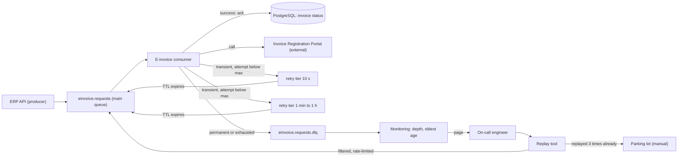
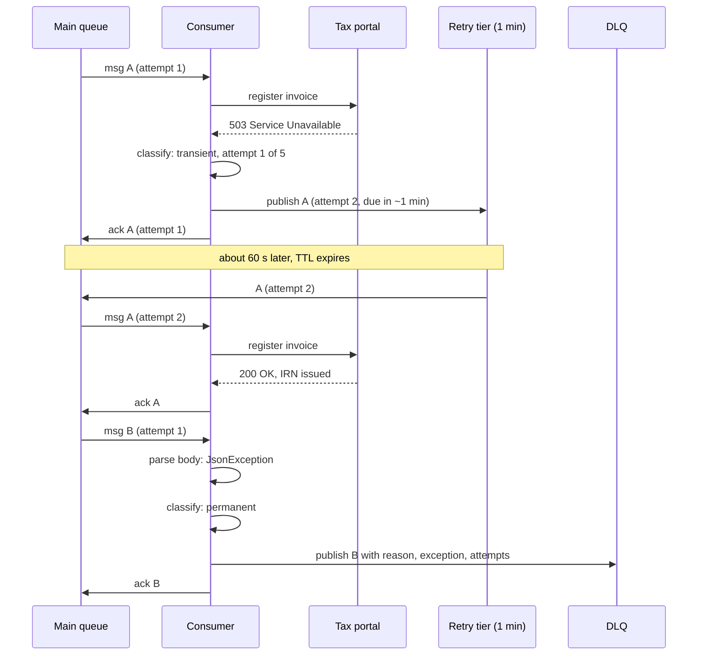

Every consumer eventually meets a message it cannot process. Sometimes the problem goes away by itself (the payment gateway was down for 90 seconds). Sometimes it never will (the message has a GSTIN with 14 characters instead of 15). A good consumer tells these two cases apart, retries the first kind patiently, and moves the second kind out of the way so it cannot block everything else. This lesson is about building that behaviour on purpose instead of discovering it during an outage.

## Learning objectives

By the end of this lesson you will be able to:

1. Explain what a poison message is and why one bad message can stop a whole queue.
2. Classify failures as transient (temporary) or permanent, and choose a different action for each.
3. Design delayed retries with backoff and jitter using retry queues (RabbitMQ), scheduled messages (Azure Service Bus) or retry topics (Kafka).
4. Choose a maximum attempt count from the length of the outages you expect, using simple arithmetic.
5. Build a dead-letter queue (DLQ) that keeps enough metadata to debug and replay a message.
6. Alert on the DLQ so that a dead-lettered message reaches a human within minutes, not weeks.
7. Replay dead-lettered messages safely once the cause is fixed, without causing duplicates or a second outage.
8. Implement a retrying dispatcher and a replay service in ASP.NET Core, and test them with fakes.

## Prerequisites

- [Message queues](#/lesson/m12-message-queues): producers, consumers, acknowledgements and redelivery.
- [Timeouts, retries and backoff with jitter](#/lesson/m10-timeouts-retries): why retries need delays and randomness.
- [Idempotent consumers and inbox deduplication](#/lesson/m12-idempotent-consumers): every retry is a potential duplicate, so the handler must be safe to run twice.

## Explain it like I'm a beginner

Imagine the parcel sorting room of a courier company in Delhi. Parcels arrive on a conveyor belt and a worker scans each one and puts it in the right bag.

Most parcels scan fine. Now and then something goes wrong:

- **The scanner hiccups.** The worker puts the parcel on a side shelf and tries again in a minute. Usually it works the second time. This is a *temporary* problem (transient failure), and the side shelf is a *retry queue*.
- **The label is torn and the address is unreadable.** Scanning it 50 times will never help. If the worker keeps trying, the whole belt stops behind this one parcel. This parcel is a *poison message*.

The sensible worker does three things. They retry temporary problems a few times, waiting a bit longer each time. They put hopeless parcels in a separate **"problem parcels" cage** (the dead-letter queue) with a note saying what went wrong. And a supervisor checks the cage every morning, fixes what can be fixed (calls the sender to get the address) and puts those parcels back on the belt (replay).

The cage is not a dustbin. A parcel in the cage is a customer who has not received their order. That is why the supervisor needs a bell that rings when something lands in the cage (alerting on the DLQ).

## First-principles explanation

### What it is

**Retry** means trying to process the same message again after a failure. **A dead-letter queue (DLQ)** is a separate queue where messages go when the system has decided it will not try again automatically. Together they form a small decision tree that runs every time a handler throws:

1. Is this failure permanent? Dead-letter now.
2. Have we already tried the maximum number of times? Dead-letter now.
3. Otherwise, schedule another attempt after a delay that grows with each attempt.

### Why it exists: the poison message problem

Most brokers redeliver a message if the consumer does not acknowledge it. That is good for crashes: if the consumer dies mid-message, another consumer picks it up. But it is terrible for a message that *always* crashes the handler. The broker hands it out, the handler throws, the broker hands it out again, forever.

Three bad things follow:

- **Head-of-line blocking.** In an ordered queue or a Kafka partition, the consumer cannot move past the poison message. Thousands of healthy messages wait behind it. Consumer lag graphs go up in a straight line.
- **Wasted capacity.** Even in an unordered queue, consumers spend CPU and network on a message that cannot succeed. With 10 poison messages redelivering every few milliseconds, a consumer can spend most of its time on them.
- **Hidden data loss.** Some brokers eventually drop a message after too many attempts, or the message expires by TTL. If nobody captured it, it is simply gone.

### Transient versus permanent failures

The single most important design decision is the classifier: a small piece of code that looks at an exception and says "temporary" or "permanent".

| Failure | Kind | Why |
|---|---|---|
| HTTP 503 from the tax portal, connection refused, DNS timeout | Transient | The dependency is unhealthy; it will probably recover. |
| HTTP 429 Too Many Requests | Transient | We were throttled; wait (respect `Retry-After` if present). |
| Database deadlock, serialization failure (SQLSTATE `40001`, `40P01`) | Transient | The same transaction usually succeeds on a retry. |
| JSON that does not parse, a missing required field | Permanent | The bytes will be the same next time. |
| HTTP 400 "invalid GSTIN", 404 "customer not found" | Permanent (usually) | The request itself is wrong. |
| `NullReferenceException` in our own handler | Permanent for this code version | Only a code fix will help. Retrying a few times is harmless; then dead-letter and replay after the fix. |
| HTTP 409 conflict "already registered" | Often *success* | With idempotent APIs, "already done" means the earlier attempt worked. Treat it as success. |

Two rules of thumb. First, **unknown exceptions should be treated as transient but bounded**: retry a few times, then dead-letter. This is safer than treating them as permanent (you would dead-letter thousands of messages because of a 5-second blip) and safer than retrying forever. Second, **be careful with 4xx codes**: 408 (request timeout) and 429 are temporary even though they are in the 4xx range.

### How delayed retries work

An immediate retry (try again in the same millisecond) only helps for very short glitches, such as a dropped TCP connection. For anything longer, you need to wait. But you must not wait *inside the consumer* with `Task.Delay(10 minutes)`: the consumer would hold the message, block its slot, and probably exceed the broker's acknowledgement timeout. Instead, you put the message somewhere it will reappear later. Each broker does this differently:

- **Azure Service Bus** supports scheduled messages: re-send a copy with `ScheduledEnqueueTime = now + delay`, then complete the original. Its built-in `MaxDeliveryCount` (default 10) moves a message to the `$DeadLetterQueue` subqueue automatically after too many failed deliveries.
- **RabbitMQ** uses dead-letter exchanges plus TTL. You declare a queue per delay tier (`invoices.retry.10s`, `invoices.retry.1m`) with a queue-level message TTL and a dead-letter exchange that points back to the main exchange. A message published to a retry queue sits there until its TTL expires, then is dead-lettered *back* to the main queue. Quorum queues also support a delivery limit (`x-delivery-limit`; RabbitMQ 4.x sets a default of 20) after which the message is dead-lettered or dropped. The `x-death` header records each dead-lettering, which is useful for counting attempts.
- **Kafka** has no per-message delay and no broker-side DLQ. The common design is a chain of retry topics (`invoices.retry.1m`, `invoices.retry.10m`) and a final `invoices.dlq` topic. A retry consumer reads a message, checks its "not before" timestamp header, and waits (by pausing that partition) until it is due. Kafka Connect has a built-in DLQ setting (`errors.deadletterqueue.topic.name`) for connectors, but application consumers build their own. Kafka share groups (KIP-932, "queues for Kafka", early access in 4.0 and maturing through the 4.x releases) add per-record acknowledgement and a delivery-count limit after which a record is archived, which removes the head-of-line blocking problem for unordered work; they still give you no delay tiers and no DLQ topic, so the retry-topic design remains the common answer.
- **Amazon SQS** uses the visibility timeout: if you do not delete the message, it becomes visible again after the timeout, and you can extend or shorten that per message. A redrive policy with `maxReceiveCount` moves it to a DLQ after N receives.

:::callout type=warning title="Per-message TTL in RabbitMQ classic queues"
In a classic RabbitMQ queue, a message with its own per-message TTL is only expired when it reaches the *head* of the queue. If you put a 1-hour message in front of a 10-second message in the same retry queue, the 10-second one waits an hour. Use one queue per delay tier with a *queue-level* TTL, so every message in a queue has the same delay, or use the delayed-message plugin and understand its limits.
:::

### Backoff, jitter and choosing max attempts

The delay schedule should **span the outages you expect**. Here is a worked example with concrete numbers.

An ERP platform generates GST e-invoices for its customers by calling the government Invoice Registration Portal (IRP). It produces about 600,000 invoice requests per day.

- Average rate: 600,000 ÷ 86,400 s ≈ 7 messages/s.
- Month-end peak, estimated at 10× the average: ≈ 70 messages/s.
- Suppose the portal is unavailable for 20 minutes at peak: 70 × 1,200 s ≈ 84,000 messages fail.

**Design A: 5 immediate retries.** Each of those 84,000 messages fails 5 times within a second and lands in the DLQ. Someone now has to replay 84,000 messages by hand, and during the outage you hammered a struggling dependency with up to 70 × 5 = 350 calls per second.

**Design B: 5 attempts with delays of 10 s, 1 min, 10 min, 1 h.** The total retry window is 10 s + 60 s + 600 s + 3,600 s ≈ 71 minutes. A 20-minute outage is fully absorbed: a message that first failed at minute 0 retries at about 10 s, 70 s and 11 minutes (all still inside the outage), and its fifth attempt at about 71 minutes succeeds. Messages that first fail later in the outage recover sooner. Nothing reaches the DLQ. The extra load on the portal during the outage is small because most retries are spread out.

**Jitter** (a random ±20 % on each delay) stops all 84,000 messages from retrying at exactly the same second when the portal comes back, which would look like a self-inflicted denial-of-service attack.

**The trade-off is latency.** With Design B, a message that hits the 1-hour tier is delivered over an hour late. For e-invoices that may be fine (the legal window is days). For an OTP SMS it is useless: an OTP that arrives 10 minutes late is worthless, so dead-letter it quickly and let the user press "resend". The schedule is a *business* decision as much as a technical one.

### What happens without it

Without a deliberate design you get one of two failure modes. Either the broker's default redelivery spins on poison messages and blocks the queue, or someone adds `catch (Exception) { /* log and ack */ }`, which silently throws away every failed message. The second one is worse, because nobody notices until a customer asks why their invoice never registered.

### The dead-letter queue: what to keep

A DLQ message is only useful if someone can understand and replay it later. Store:

- The **original body and headers**, byte for byte. Never "clean up" the payload.
- **Where it came from**: original queue or topic, partition and offset for Kafka.
- **Why it failed**: exception type, message, a short stack trace, and your classification (permanent vs exhausted).
- **How many attempts** and the time of the first and last failure.
- **Which consumer version** failed it (build number or git SHA). After a fix you can say "replay everything that version 1.42 failed".
- A **correlation id** linking it to traces and logs ([distributed request correlation](#/lesson/m10-correlation)).

Give the DLQ a long retention (for example 14 days) and treat its contents as sensitive: it contains real customer data.

### Alerting on the DLQ

A DLQ without an alert is a black hole. Useful signals:

- **Depth greater than zero** on critical flows (payments, invoices): page someone during business hours.
- **Age of the oldest message**: catches the case where one message sits ignored for a week.
- **Inflow rate relative to traffic**: "more than 0.1 % of messages dead-lettered in 15 minutes" usually means a bad deploy or a contract change upstream.
- **Spikes right after a deployment**: annotate dashboards with deploy markers.

Every alert should link to a runbook: how to inspect messages, how to find the cause, how to replay. See [alerting and incident response](#/lesson/m14-alerting-incidents).

### Replay

Replay means sending dead-lettered messages back to the main queue after the cause is fixed. It sounds trivial and causes real incidents when done carelessly:

- **Replay must be idempotent.** Some messages in the DLQ may have partially succeeded (the portal registered the invoice, then our database write failed). The handler must detect "already done".
- **Replay selectively.** Filter by exception type, time window or consumer version. Do not replay 84,000 messages because you fixed one bug that affected 12 of them.
- **Rate-limit the replay.** Pushing 84,000 messages at full speed into a dependency that just recovered can knock it over again.
- **Reset the attempt count, but count replays.** A message that has been replayed three times and failed three times should go to a **parking lot** (a queue for manual handling) instead of looping.
- **Think about ordering.** If invoice v2 was processed while v1 sat in the DLQ, replaying v1 may overwrite newer data. Handlers should compare versions or timestamps and ignore stale updates.

### When it is unnecessary

- **Fire-and-forget telemetry** (page-view events, debug metrics). Losing 0.01 % is acceptable; retrying and alerting cost more than the data is worth.
- **Very low volume internal jobs** where a failed job can simply be re-run from a dashboard.
- **When the broker already does it and you only need the defaults.** Azure Service Bus with `MaxDeliveryCount` and a DLQ alert may be enough for a small system; you do not need a custom retry framework on day one.

### Trade-offs

| You gain | You pay |
|---|---|
| Healthy messages keep flowing past bad ones | Retried messages arrive late, sometimes by an hour |
| Temporary outages are absorbed without human work | Per-key ordering is broken unless you design for it |
| Failed messages are kept, not lost | DLQ storage, retention and privacy obligations |
| Clear signal when something is wrong | Someone must own the DLQ and the runbook |
| Replay after a fix | Replay can cause duplicates or overload if done carelessly |

## Visual explanation

### Architecture: retry tiers and a dead-letter queue



Read the arrows from left to right. The producer publishes to the main queue, and the consumer calls the external portal and writes the result to PostgreSQL. On a transient failure the consumer does not block: it puts a copy of the message in a retry tier and acknowledges the original. When the tier's TTL expires, the broker sends the message back to the main queue for another attempt. On a permanent failure, or when attempts run out, the message goes to the DLQ. Monitoring watches the DLQ and pages a human, who uses a replay tool to send fixed messages back to the main queue at a controlled rate. Messages that keep failing after replays go to a parking lot for manual handling.

### Sequence: one transient failure, one poison message



Message A shows the happy recovery: a 503 is transient, so the consumer publishes a copy with the attempt counter raised and *then* acknowledges the original. That order matters. If the consumer crashed between the two steps, the original would be redelivered and you would get a duplicate, which the idempotent handler absorbs. The opposite order (ack first, then publish) could lose the message. Message B is poison: the body does not parse, so the consumer sends it straight to the DLQ with metadata and acknowledges it. The queue keeps moving.

## Step-by-step example

We will grow an e-invoice consumer in four steps.

### Step 1: the naive consumer

```csharp
while (true)
{
    var msg = await queue.ReceiveAsync(ct);
    try
    {
        var req = JsonSerializer.Deserialize<InvoiceRequest>(msg.Body)!;
        await irp.RegisterAsync(req, ct);
        await queue.AckAsync(msg, ct);
    }
    catch (Exception ex)
    {
        logger.LogError(ex, "failed");
        await queue.NackAsync(msg, requeue: true, ct);   // try again immediately, forever
    }
}
```

A single unparseable message now loops forever. During a portal outage every message loops, and the consumer hammers the portal at full speed.

### Step 2: classify the failure

Add an `IFailureClassifier` that returns `Transient` or `Permanent`. Permanent failures stop looping immediately. This one change removes the infinite loop for poison messages.

### Step 3: delayed retries with an attempt counter

Carry an `Attempt` number in the message envelope. On a transient failure, publish a copy with `Attempt + 1` and a "deliver at" time from the backoff schedule, then acknowledge the original. When `Attempt` reaches the maximum, stop retrying.

### Step 4: dead-letter with metadata, alert and replay

Instead of dropping exhausted or permanent messages, publish them to the DLQ with the reason, exception type and attempt count. Add a metric for DLQ inflow, an alert on it, and an admin endpoint that replays a filtered set of DLQ messages back to the main queue. The full version follows.

## Production-style C# implementation

The code below uses an in-memory transport so it compiles and runs without a broker. In production you would implement `IMessageTransport` with Azure Service Bus, RabbitMQ or Kafka; the retry and dead-letter logic does not change.

```text
Invoicing.Worker/
  Program.cs
  Messaging/MessageEnvelope.cs
  Messaging/IMessageTransport.cs
  Messaging/InMemoryTransport.cs
  Retry/FailureClassifier.cs
  Retry/RetryPolicy.cs
  Retry/RetryingDispatcher.cs
  Invoices/EInvoiceHandler.cs
  Replay/DlqReplayService.cs
  Hosting/ConsumerWorker.cs
```

```csharp file=Messaging/MessageEnvelope.cs
namespace Invoicing.Messaging;

/// <summary>Transport-neutral message. Attempt starts at 1 and is raised on every retry.</summary>
public sealed record MessageEnvelope(
    Guid MessageId,
    string MessageType,
    string Body,
    int Attempt,
    DateTimeOffset FirstAttemptAt,
    IReadOnlyDictionary<string, string> Headers)
{
    public static MessageEnvelope Create(string messageType, string body, DateTimeOffset now) =>
        new(Guid.NewGuid(), messageType, body, 1, now, new Dictionary<string, string>());

    public MessageEnvelope WithHeader(string key, string value)
    {
        var copy = new Dictionary<string, string>(Headers) { [key] = value };
        return this with { Headers = copy };
    }

    public string? Header(string key) => Headers.TryGetValue(key, out var v) ? v : null;
}

public static class Queues
{
    public const string EInvoiceRequests = "einvoice.requests";
    public static string DeadLetterOf(string queue) => queue + ".dlq";
}
```

```csharp file=Messaging/IMessageTransport.cs
namespace Invoicing.Messaging;

public interface IMessageTransport
{
    /// <summary>Sends a message. A non-null deliverAt schedules it (Service Bus scheduled message,
    /// RabbitMQ TTL retry tier, or a Kafka retry topic with a not-before header).</summary>
    Task SendAsync(string queue, MessageEnvelope message, DateTimeOffset? deliverAt, CancellationToken ct);

    /// <summary>Returns the next due message or null. Receiving removes it (auto-ack keeps the demo simple).</summary>
    Task<MessageEnvelope?> ReceiveAsync(string queue, CancellationToken ct);
}

public interface IMessageHandler
{
    string MessageType { get; }
    Task HandleAsync(MessageEnvelope message, CancellationToken ct);
}
```

```csharp file=Messaging/InMemoryTransport.cs
namespace Invoicing.Messaging;

/// <summary>Thread-safe in-memory broker with scheduled delivery. For demos and tests only.</summary>
public sealed class InMemoryTransport(TimeProvider clock) : IMessageTransport
{
    private readonly Lock _gate = new();
    private readonly Dictionary<string, PriorityQueue<MessageEnvelope, DateTimeOffset>> _queues = new();

    public Task SendAsync(string queue, MessageEnvelope message, DateTimeOffset? deliverAt, CancellationToken ct)
    {
        lock (_gate)
        {
            if (!_queues.TryGetValue(queue, out var q)) _queues[queue] = q = new();
            q.Enqueue(message, deliverAt ?? clock.GetUtcNow());
        }
        return Task.CompletedTask;
    }

    public Task<MessageEnvelope?> ReceiveAsync(string queue, CancellationToken ct)
    {
        lock (_gate)
        {
            if (_queues.TryGetValue(queue, out var q) && q.TryPeek(out var msg, out var due) && due <= clock.GetUtcNow())
            {
                q.Dequeue();
                return Task.FromResult<MessageEnvelope?>(msg);
            }
        }
        return Task.FromResult<MessageEnvelope?>(null);
    }

    public int Depth(string queue)
    {
        lock (_gate) return _queues.TryGetValue(queue, out var q) ? q.Count : 0;
    }

    public IReadOnlyList<MessageEnvelope> Browse(string queue)
    {
        lock (_gate)
            return _queues.TryGetValue(queue, out var q) ? q.UnorderedItems.Select(i => i.Element).ToList() : [];
    }
}
```

```csharp file=Retry/FailureClassifier.cs
using System.Net;
using System.Text.Json;

namespace Invoicing.Retry;

public enum FailureKind { Transient, Permanent }

public interface IFailureClassifier
{
    FailureKind Classify(Exception error);
}

/// <summary>Thrown by handlers when the message itself is invalid. Retrying cannot help.</summary>
public sealed class PermanentMessageException(string message, Exception? inner = null) : Exception(message, inner);

public sealed class DefaultFailureClassifier : IFailureClassifier
{
    public FailureKind Classify(Exception error) => error switch
    {
        PermanentMessageException => FailureKind.Permanent,
        JsonException or FormatException => FailureKind.Permanent,
        HttpRequestException { StatusCode: HttpStatusCode.TooManyRequests or HttpStatusCode.RequestTimeout } => FailureKind.Transient,
        HttpRequestException { StatusCode: { } code } when (int)code is >= 400 and < 500 => FailureKind.Permanent,
        HttpRequestException => FailureKind.Transient,   // 5xx, or no status at all (connection failure)
        TimeoutException or TaskCanceledException => FailureKind.Transient,
        _ => FailureKind.Transient,                      // unknown: retry, but only up to MaxAttempts
    };
}
```

```csharp file=Retry/RetryPolicy.cs
using Microsoft.Extensions.Options;

namespace Invoicing.Retry;

public sealed class RetryOptions
{
    /// <summary>Total attempts, including the first one.</summary>
    public int MaxAttempts { get; set; } = 5;

    /// <summary>Delay after attempt 1, 2, 3... The last value is reused if attempts outnumber delays.</summary>
    public TimeSpan[] Delays { get; set; } =
        [TimeSpan.FromSeconds(10), TimeSpan.FromMinutes(1), TimeSpan.FromMinutes(10), TimeSpan.FromHours(1)];

    /// <summary>0.2 means each delay is randomly stretched or shrunk by up to 20 %.</summary>
    public double JitterFraction { get; set; } = 0.2;
}

public abstract record RetryDecision
{
    public sealed record RetryAfter(TimeSpan Delay) : RetryDecision;
    public sealed record DeadLetter(string Reason) : RetryDecision;
}

public sealed class RetryPolicy(IOptions<RetryOptions> options, IFailureClassifier classifier, Func<double> random)
{
    private readonly RetryOptions _o = options.Value;

    public RetryDecision Decide(int attemptThatFailed, Exception error)
    {
        if (classifier.Classify(error) == FailureKind.Permanent)
            return new RetryDecision.DeadLetter($"permanent failure: {error.GetType().Name}");
        if (attemptThatFailed >= _o.MaxAttempts)
            return new RetryDecision.DeadLetter($"exhausted {_o.MaxAttempts} attempts");

        var baseDelay = _o.Delays[Math.Min(attemptThatFailed - 1, _o.Delays.Length - 1)];
        var factor = 1 + (random() * 2 - 1) * _o.JitterFraction;          // 0.8 .. 1.2 for 20 %
        return new RetryDecision.RetryAfter(TimeSpan.FromMilliseconds(baseDelay.TotalMilliseconds * factor));
    }
}
```

```csharp file=Retry/RetryingDispatcher.cs
using System.Diagnostics.Metrics;
using Invoicing.Messaging;
using Microsoft.Extensions.Logging;

namespace Invoicing.Retry;

public static class DeadLetterHeaders
{
    public const string Reason = "x-dlq-reason";
    public const string ExceptionType = "x-dlq-exception-type";
    public const string ExceptionMessage = "x-dlq-exception-message";
    public const string SourceQueue = "x-dlq-source-queue";
    public const string FailedAt = "x-dlq-failed-at";
    public const string ConsumerVersion = "x-dlq-consumer-version";
    public const string ReplayCount = "x-replay-count";
}

public sealed class RetryingDispatcher(
    IEnumerable<IMessageHandler> handlers,
    IMessageTransport transport,
    RetryPolicy policy,
    TimeProvider clock,
    ILogger<RetryingDispatcher> logger)
{
    private static readonly Meter Meter = new("Invoicing.Messaging");
    private static readonly Counter<long> Retries = Meter.CreateCounter<long>("messaging.retries");
    private static readonly Counter<long> DeadLettered = Meter.CreateCounter<long>("messaging.dead_lettered");
    private static readonly string Version = typeof(RetryingDispatcher).Assembly.GetName().Version?.ToString() ?? "unknown";

    private readonly Dictionary<string, IMessageHandler> _handlers = handlers.ToDictionary(h => h.MessageType);

    public async Task DispatchAsync(string sourceQueue, MessageEnvelope message, CancellationToken ct)
    {
        if (!_handlers.TryGetValue(message.MessageType, out var handler))
        {
            await DeadLetterAsync(sourceQueue, message, "no handler registered",
                new InvalidOperationException($"Unknown message type {message.MessageType}"), ct);
            return;
        }

        try
        {
            await handler.HandleAsync(message, ct);
        }
        catch (Exception ex) when (!ct.IsCancellationRequested)
        {
            switch (policy.Decide(message.Attempt, ex))
            {
                case RetryDecision.RetryAfter retry:
                    // Publish the retry copy BEFORE the original is acknowledged. A crash in between
                    // causes a duplicate (handled by idempotency), never a lost message.
                    var next = message with { Attempt = message.Attempt + 1 };
                    await transport.SendAsync(sourceQueue, next, clock.GetUtcNow() + retry.Delay, ct);
                    Retries.Add(1, new KeyValuePair<string, object?>("message.type", message.MessageType));
                    logger.LogWarning(ex, "Message {MessageId} ({Type}) attempt {Attempt} failed; retry in {Delay}",
                        message.MessageId, message.MessageType, message.Attempt, retry.Delay);
                    break;

                case RetryDecision.DeadLetter dead:
                    await DeadLetterAsync(sourceQueue, message, dead.Reason, ex, ct);
                    break;
            }
        }
    }

    private async Task DeadLetterAsync(string sourceQueue, MessageEnvelope message, string reason, Exception ex, CancellationToken ct)
    {
        var dead = message
            .WithHeader(DeadLetterHeaders.Reason, reason)
            .WithHeader(DeadLetterHeaders.ExceptionType, ex.GetType().FullName ?? ex.GetType().Name)
            .WithHeader(DeadLetterHeaders.ExceptionMessage, Truncate(ex.Message, 500))
            .WithHeader(DeadLetterHeaders.SourceQueue, sourceQueue)
            .WithHeader(DeadLetterHeaders.FailedAt, clock.GetUtcNow().ToString("O"))
            .WithHeader(DeadLetterHeaders.ConsumerVersion, Version);

        await transport.SendAsync(Queues.DeadLetterOf(sourceQueue), dead, deliverAt: null, ct);
        DeadLettered.Add(1, new KeyValuePair<string, object?>("message.type", message.MessageType),
                            new KeyValuePair<string, object?>("reason", reason.Split(':')[0]));
        logger.LogError(ex, "Message {MessageId} ({Type}) dead-lettered after {Attempt} attempt(s): {Reason}",
            message.MessageId, message.MessageType, message.Attempt, reason);
    }

    private static string Truncate(string s, int max) => s.Length <= max ? s : s[..max];
}
```

```csharp file=Invoices/EInvoiceHandler.cs
using System.Collections.Concurrent;
using System.Text.Json;
using Invoicing.Messaging;
using Invoicing.Retry;

namespace Invoicing.Invoices;

public sealed record InvoiceRequest(string InvoiceNo, string SellerGstin, string BuyerGstin, decimal Amount);

public interface IIrpClient
{
    /// <summary>Registers the invoice and returns the Invoice Reference Number (IRN).</summary>
    Task<string> RegisterAsync(InvoiceRequest request, CancellationToken ct);
}

public interface IInvoiceStatusStore
{
    Task<bool> IsRegisteredAsync(string invoiceNo, CancellationToken ct);
    Task MarkRegisteredAsync(string invoiceNo, string irn, CancellationToken ct);
}

public sealed class InMemoryInvoiceStatusStore : IInvoiceStatusStore
{
    private readonly ConcurrentDictionary<string, string> _irns = new();
    public Task<bool> IsRegisteredAsync(string invoiceNo, CancellationToken ct) => Task.FromResult(_irns.ContainsKey(invoiceNo));
    public Task MarkRegisteredAsync(string invoiceNo, string irn, CancellationToken ct) { _irns[invoiceNo] = irn; return Task.CompletedTask; }
}

/// <summary>Simulated portal: fails transiently for the first N calls, to show retries working.</summary>
public sealed class FlakyIrpClient(int failFirstCalls) : IIrpClient
{
    private int _calls;
    public Task<string> RegisterAsync(InvoiceRequest request, CancellationToken ct)
    {
        if (Interlocked.Increment(ref _calls) <= failFirstCalls)
            throw new HttpRequestException("IRP unavailable", null, System.Net.HttpStatusCode.ServiceUnavailable);
        return Task.FromResult($"IRN-{request.InvoiceNo}");
    }
}

public sealed class EInvoiceHandler(IIrpClient irp, IInvoiceStatusStore status) : IMessageHandler
{
    public const string Type = "einvoice.register.v1";
    public string MessageType => Type;

    public async Task HandleAsync(MessageEnvelope message, CancellationToken ct)
    {
        var req = JsonSerializer.Deserialize<InvoiceRequest>(message.Body)
                  ?? throw new PermanentMessageException("Empty body");
        if (req.SellerGstin.Length != 15 || req.BuyerGstin.Length != 15)
            throw new PermanentMessageException($"Invalid GSTIN on invoice {req.InvoiceNo}");

        // Idempotency: a retry or replay of an invoice we already registered is a no-op.
        if (await status.IsRegisteredAsync(req.InvoiceNo, ct)) return;

        var irn = await irp.RegisterAsync(req, ct);
        await status.MarkRegisteredAsync(req.InvoiceNo, irn, ct);
    }
}
```

```csharp file=Replay/DlqReplayService.cs
using Invoicing.Messaging;
using Invoicing.Retry;
using Microsoft.Extensions.Logging;

namespace Invoicing.Replay;

public sealed record ReplayFilter(string? ExceptionType, int MaxMessages, int MaxReplaysPerMessage = 3, int PerSecond = 20);
public sealed record ReplayResult(int Replayed, int Parked, int Kept);

public sealed class DlqReplayService(IMessageTransport transport, TimeProvider clock, ILogger<DlqReplayService> logger)
{
    public const string ParkingLotSuffix = ".parking-lot";

    public async Task<ReplayResult> ReplayAsync(string sourceQueue, ReplayFilter filter, CancellationToken ct)
    {
        var dlq = Queues.DeadLetterOf(sourceQueue);
        var drained = new List<MessageEnvelope>();
        while (drained.Count < filter.MaxMessages * 10 && await transport.ReceiveAsync(dlq, ct) is { } m) drained.Add(m);

        int replayed = 0, parked = 0, kept = 0;
        var spacing = TimeSpan.FromSeconds(1.0 / Math.Max(1, filter.PerSecond));
        var due = clock.GetUtcNow();

        foreach (var msg in drained)
        {
            var matches = filter.ExceptionType is null || msg.Header(DeadLetterHeaders.ExceptionType) == filter.ExceptionType;
            if (!matches || replayed >= filter.MaxMessages)
            {
                await transport.SendAsync(dlq, msg, null, ct);                    // put it back untouched
                kept++;
                continue;
            }

            var replays = int.TryParse(msg.Header(DeadLetterHeaders.ReplayCount), out var n) ? n : 0;
            if (replays >= filter.MaxReplaysPerMessage)
            {
                await transport.SendAsync(sourceQueue + ParkingLotSuffix, msg, null, ct);
                parked++;
                continue;
            }

            // Same MessageId (so idempotency still works), fresh attempt budget, replay counted.
            var again = msg.WithHeader(DeadLetterHeaders.ReplayCount, (replays + 1).ToString()) with { Attempt = 1 };
            due += spacing;                                                         // rate limit via scheduling
            await transport.SendAsync(sourceQueue, again, due, ct);
            replayed++;
        }

        logger.LogInformation("DLQ replay on {Queue}: {Replayed} replayed, {Parked} parked, {Kept} kept",
            sourceQueue, replayed, parked, kept);
        return new ReplayResult(replayed, parked, kept);
    }
}
```

```csharp file=Hosting/ConsumerWorker.cs
using Invoicing.Messaging;
using Invoicing.Retry;
using Microsoft.Extensions.Hosting;

namespace Invoicing.Hosting;

public sealed class ConsumerWorker(IMessageTransport transport, RetryingDispatcher dispatcher, TimeProvider clock) : BackgroundService
{
    protected override async Task ExecuteAsync(CancellationToken stoppingToken)
    {
        while (!stoppingToken.IsCancellationRequested)
        {
            var msg = await transport.ReceiveAsync(Queues.EInvoiceRequests, stoppingToken);
            if (msg is null)
            {
                await Task.Delay(TimeSpan.FromMilliseconds(200), clock, stoppingToken);
                continue;
            }
            await dispatcher.DispatchAsync(Queues.EInvoiceRequests, msg, stoppingToken);
        }
    }
}
```

```csharp file=Program.cs
using System.Text.Json;
using Invoicing.Hosting;
using Invoicing.Invoices;
using Invoicing.Messaging;
using Invoicing.Replay;
using Invoicing.Retry;
using Microsoft.Extensions.Options;

var builder = WebApplication.CreateBuilder(args);

builder.Services.AddSingleton(TimeProvider.System);
builder.Services.Configure<RetryOptions>(builder.Configuration.GetSection("Messaging:Retry"));
builder.Services.AddSingleton<IFailureClassifier, DefaultFailureClassifier>();
builder.Services.AddSingleton(sp => new RetryPolicy(
    sp.GetRequiredService<IOptions<RetryOptions>>(), sp.GetRequiredService<IFailureClassifier>(), Random.Shared.NextDouble));

builder.Services.AddSingleton<InMemoryTransport>();
builder.Services.AddSingleton<IMessageTransport>(sp => sp.GetRequiredService<InMemoryTransport>());
builder.Services.AddSingleton<IIrpClient>(new FlakyIrpClient(failFirstCalls: 2));
builder.Services.AddSingleton<IInvoiceStatusStore, InMemoryInvoiceStatusStore>();
builder.Services.AddSingleton<IMessageHandler, EInvoiceHandler>();
builder.Services.AddSingleton<RetryingDispatcher>();
builder.Services.AddSingleton<DlqReplayService>();
builder.Services.AddHostedService<ConsumerWorker>();

var app = builder.Build();

app.MapPost("/invoices", async (InvoiceRequest req, IMessageTransport bus, TimeProvider clock, CancellationToken ct) =>
{
    var msg = MessageEnvelope.Create(EInvoiceHandler.Type, JsonSerializer.Serialize(req), clock.GetUtcNow());
    await bus.SendAsync(Queues.EInvoiceRequests, msg, null, ct);
    return Results.Accepted(value: new { msg.MessageId });
});

app.MapGet("/admin/dlq", (InMemoryTransport t) =>
    t.Browse(Queues.DeadLetterOf(Queues.EInvoiceRequests))
     .Select(m => new { m.MessageId, m.Attempt, Reason = m.Header(DeadLetterHeaders.Reason), Error = m.Header(DeadLetterHeaders.ExceptionType) }));

app.MapPost("/admin/dlq/replay", async (string? exceptionType, int? max, DlqReplayService replay, CancellationToken ct) =>
    Results.Ok(await replay.ReplayAsync(Queues.EInvoiceRequests, new ReplayFilter(exceptionType, max ?? 100), ct)));

app.Run();
```

What to notice:

- **The classifier, the policy and the dispatcher are separate.** You can unit-test "is a 429 transient?" without a broker, and change the delay schedule through configuration.
- **The random source is injected** (`Func<double>`), so tests can make jitter deterministic.
- **Retry and DLQ use the same transport abstraction.** On Azure Service Bus, `deliverAt` maps to `ScheduledEnqueueTime`; on RabbitMQ to a tier queue chosen by delay; on Kafka to a retry topic plus a `not-before` header.
- **Replay keeps the original `MessageId`.** That is what lets the idempotent handler recognise a message it already processed.
- **Admin endpoints must be protected** with an authorization policy in a real system; a DLQ contains customer data and replay can move money.

For reference, this is how the same "retry with delay, then dead-letter" looks with the Azure Service Bus SDK (not compiled here because the package is not available offline):

```csharp
catch (Exception ex) when (classifier.Classify(ex) == FailureKind.Transient && args.Message.DeliveryCount < 5)
{
    var copy = new ServiceBusMessage(args.Message) { ScheduledEnqueueTime = DateTimeOffset.UtcNow + delay };
    copy.ApplicationProperties["attempt"] = attempt + 1;
    await sender.SendMessageAsync(copy, ct);        // 1. schedule the retry
    await args.CompleteMessageAsync(args.Message);  // 2. then complete the original
}
catch (Exception ex)
{
    await args.DeadLetterMessageAsync(args.Message, deadLetterReason: "permanent", deadLetterErrorDescription: ex.Message);
}
```

## Bad design vs good design

**Bad: catch, log and acknowledge.**

```csharp
catch (Exception ex)
{
    logger.LogError(ex, "Could not register invoice");
    await queue.AckAsync(msg, ct);   // the message is gone
}
```

The queue looks healthy, lag is zero, and invoices quietly never get registered. The only trace is a log line among millions. This is the most common real-world failure, and it is invisible until a customer or an auditor finds it.

**Also bad: requeue forever.** `NackAsync(msg, requeue: true)` with no limit turns one poison message into a hot loop that blocks the queue and burns CPU.

**Also bad: `Task.Delay(TimeSpan.FromMinutes(10))` inside the handler.** The consumer holds the message and a concurrency slot for 10 minutes, the broker's lock or acknowledgement timeout expires and redelivers it to another consumer, and you now have two copies in flight.

**Good:** classify, retry with delays outside the consumer, cap the attempts, dead-letter with metadata, alert, and replay through a controlled tool. That is the implementation above.

:::callout type=tradeoff title="Retry topics break ordering"
If invoice `INV-7` version 1 fails and goes to a 10-minute retry tier, version 2 of `INV-7` may be processed first. Then version 1 succeeds later and overwrites newer data. Choose one: (a) for strictly ordered flows, retry *in place* by pausing the partition instead of moving the message (accepting head-of-line blocking); (b) when a key has a message in retry, route later messages for that key to the retry path too; or (c) make handlers reject stale versions using a version number. Option (c) is usually the cheapest.
:::

**Is a custom framework worth it?** For one or two queues on Azure Service Bus or SQS, the broker's built-in `MaxDeliveryCount` / `maxReceiveCount` plus a DLQ alarm gives you 80 % of the value with no custom code. Build delay tiers and replay tooling when outages are frequent enough that you keep replaying by hand, or when you are on Kafka, where nothing is built in.

## Practical playground

Use the retry simulator to see why backoff and jitter matter. Start with the defaults (40 % failure rate during an incident, 3 retries, no backoff, no jitter) and watch the load on the dependency. Then turn on backoff, then jitter, and compare peak load and whether the system recovers after the incident ends. Finally, raise the retries to 8 and see how amplification grows.

:::playground type=sim sim=retry title="Retries, backoff and jitter" failureRate=0.4 maxRetries=3
:::

Questions to answer while you experiment:

1. With no backoff, what is the peak load as a multiple of capacity? Why does it stay high after the incident ends?
2. Which change reduces peak load more: backoff alone or jitter alone?
3. At what retry count does the success rate stop improving while load keeps rising?

## Exercises

:::exercise id=m12-retries-dlq-ex1 difficulty=beginner kind=code title="Implement the retry decision"
Implement `RetryPolicy.Decide` so a consumer knows whether to retry a failed message (and after what delay) or to dead-letter it. Jitter is left out so the results are deterministic.
::requirements
- `attemptThatFailed` is 1 for the first attempt.
- Permanent failures are dead-lettered immediately with reason `"permanent"`.
- If `attemptThatFailed >= MaxAttempts`, dead-letter with reason `"exhausted"`.
- Otherwise return the delay for that attempt: `Delays[attemptThatFailed - 1]`, reusing the last delay if there are more attempts than delays.
::acceptance
- Transient failure on attempt 1 with default options gives a 10-second delay.
- Transient failure on attempt 4 gives a 1-hour delay.
- Transient failure on attempt 5 (the maximum) is dead-lettered as `"exhausted"`.
- A permanent failure on attempt 1 is dead-lettered as `"permanent"`.
- With `MaxAttempts = 8` and 4 delays, attempt 6 reuses the last delay (1 hour).
::hint
Check the cheap, final cases first: is it permanent? Are we out of attempts?
::hint
Order matters. A permanent failure on the last attempt should still say `"permanent"`, because that tells the on-call engineer that retrying will not help.
::hint
The index into `Delays` is `attemptThatFailed - 1`, clamped with `Math.Min(..., Delays.Length - 1)`.
::hint
```csharp
if (kind == FailureKind.Permanent) return new RetryDecision(false, TimeSpan.Zero, "permanent");
if (attemptThatFailed >= _o.MaxAttempts) return new RetryDecision(false, TimeSpan.Zero, "exhausted");
var i = Math.Min(attemptThatFailed - 1, _o.Delays.Length - 1);
```
::starter
```csharp file=RetryPolicy.cs
using System;

public enum FailureKind { Transient, Permanent }

public sealed class RetryOptions
{
    public int MaxAttempts { get; set; } = 5;
    public TimeSpan[] Delays { get; set; } =
        { TimeSpan.FromSeconds(10), TimeSpan.FromMinutes(1), TimeSpan.FromMinutes(10), TimeSpan.FromHours(1) };
}

/// <summary>Retry = true means "schedule another attempt after Delay". Otherwise dead-letter with Reason.</summary>
public sealed record RetryDecision(bool Retry, TimeSpan Delay, string? Reason);

public sealed class RetryPolicy
{
    private readonly RetryOptions _o;
    public RetryPolicy(RetryOptions options) => _o = options;

    public RetryDecision Decide(int attemptThatFailed, FailureKind kind) => throw new NotImplementedException();
}
```
::tests
```csharp file=RetryPolicyTests.cs
using System;
using Xunit;

public class RetryPolicyTests
{
    private static RetryPolicy Default() => new(new RetryOptions());

    [Fact]
    public void First_transient_failure_waits_ten_seconds()
    {
        var d = Default().Decide(1, FailureKind.Transient);
        Assert.True(d.Retry);
        Assert.Equal(TimeSpan.FromSeconds(10), d.Delay);
    }

    [Fact]
    public void Fourth_failure_waits_one_hour() =>
        Assert.Equal(TimeSpan.FromHours(1), Default().Decide(4, FailureKind.Transient).Delay);

    [Fact]
    public void Last_attempt_is_dead_lettered_as_exhausted()
    {
        var d = Default().Decide(5, FailureKind.Transient);
        Assert.False(d.Retry);
        Assert.Equal("exhausted", d.Reason);
    }

    [Fact]
    public void Permanent_failure_is_dead_lettered_immediately()
    {
        var d = Default().Decide(1, FailureKind.Permanent);
        Assert.False(d.Retry);
        Assert.Equal("permanent", d.Reason);
    }

    [Fact]
    public void Permanent_wins_over_exhausted() =>
        Assert.Equal("permanent", Default().Decide(5, FailureKind.Permanent).Reason);

    [Fact]
    public void Extra_attempts_reuse_last_delay()
    {
        var p = new RetryPolicy(new RetryOptions { MaxAttempts = 8 });
        Assert.Equal(TimeSpan.FromHours(1), p.Decide(6, FailureKind.Transient).Delay);
    }

    [Fact]
    public void Max_attempts_of_one_never_retries() =>
        Assert.False(new RetryPolicy(new RetryOptions { MaxAttempts = 1 }).Decide(1, FailureKind.Transient).Retry);
}
```
::solution
Check the two "stop" conditions first (permanent, then exhausted), then look up the delay with a clamped index.

```csharp file=RetryPolicy.cs
using System;

public enum FailureKind { Transient, Permanent }

public sealed class RetryOptions
{
    public int MaxAttempts { get; set; } = 5;
    public TimeSpan[] Delays { get; set; } =
        { TimeSpan.FromSeconds(10), TimeSpan.FromMinutes(1), TimeSpan.FromMinutes(10), TimeSpan.FromHours(1) };
}

public sealed record RetryDecision(bool Retry, TimeSpan Delay, string? Reason);

public sealed class RetryPolicy
{
    private readonly RetryOptions _o;
    public RetryPolicy(RetryOptions options) => _o = options;

    public RetryDecision Decide(int attemptThatFailed, FailureKind kind)
    {
        if (attemptThatFailed < 1) throw new ArgumentOutOfRangeException(nameof(attemptThatFailed));
        if (kind == FailureKind.Permanent) return new RetryDecision(false, TimeSpan.Zero, "permanent");
        if (attemptThatFailed >= _o.MaxAttempts) return new RetryDecision(false, TimeSpan.Zero, "exhausted");
        if (_o.Delays.Length == 0) return new RetryDecision(true, TimeSpan.Zero, null);

        var index = Math.Min(attemptThatFailed - 1, _o.Delays.Length - 1);
        return new RetryDecision(true, _o.Delays[index], null);
    }
}
```

The reason string is not decoration. A DLQ dashboard grouped by reason immediately tells you whether you have a data problem (`permanent`) or a dependency problem (`exhausted`).
::mistakes
- Off-by-one: using `Delays[attemptThatFailed]`, which skips the 10-second tier and crashes on the last index.
- Checking `attemptThatFailed > MaxAttempts`, which allows one extra attempt.
- Treating "exhausted" and "permanent" as the same reason, which hides the cause in the DLQ.
::extensions
Add jitter through an injected `Func<double>` and test it with a fixed value such as `() => 1.0` (always +20 %).
:::

:::exercise id=m12-retries-dlq-ex2 difficulty=beginner kind=written title="Classify the failures"
A food-delivery platform's "order paid" consumer calls three services: the restaurant API, a UPI payment-status API, and its own PostgreSQL database. For each failure below, say whether it is **transient** or **permanent**, and what the consumer should do (retry immediately, retry with delay, dead-letter, or treat as success).

1. Restaurant API returns HTTP 503.
2. The message body has `"amount": "two hundred"`.
3. PostgreSQL throws SQLSTATE `40001` (serialization failure).
4. Payment API returns HTTP 409 "status already recorded for this transaction id".
5. Restaurant API returns HTTP 404 "restaurant not found" for a restaurant deleted yesterday.
6. `NullReferenceException` in our handler, introduced by this morning's deploy.
7. Payment API returns HTTP 429 with `Retry-After: 30`.
8. The TCP connection to the restaurant API is reset once.
::acceptance
- Every case has a kind and an action.
- At least one case is identified as "treat as success".
- The answer explains what to do with the code bug (case 6) after it is fixed.
::hint
Ask of each failure: "if I send exactly the same bytes in 5 minutes, could the answer be different?"
::hint
Status codes in the 4xx range are usually permanent, but two of them in this list are not.
::hint
For case 4, think about what idempotent APIs mean by "already done".
::hint
For case 6, the message is fine; the code is broken. Where should the messages wait until the fix is deployed?
::solution
| # | Kind | Action |
|---|---|---|
| 1 | Transient | Retry with delay (backoff + jitter). |
| 2 | Permanent | Dead-letter now; the producer has a contract bug. Alert the producing team. |
| 3 | Transient | Retry the transaction immediately once or twice (a fresh transaction usually succeeds), then with delay. |
| 4 | Success | The status was already recorded by an earlier attempt. Acknowledge and move on. |
| 5 | Permanent | Dead-letter (or route to a business "cancelled restaurant" flow). Retrying will not bring the restaurant back. |
| 6 | Permanent for this version | Retry a few times (harmless), then dead-letter with the consumer version. After the hotfix, replay all DLQ messages with `ExceptionType = NullReferenceException` from that version. Also consider pausing the consumer if *every* message fails. |
| 7 | Transient | Retry after at least 30 seconds, honouring `Retry-After` instead of your own schedule. |
| 8 | Transient | One immediate retry is reasonable; then fall back to delayed retries. |

The key ideas: classify by "can the same input succeed later?", treat idempotent "already done" responses as success, and separate *bad data* from *bad code*, because they are fixed by different people.
::mistakes
- Marking all 4xx as permanent, including 429.
- Dead-letter forever for a code bug with no plan to replay after the fix.
- Retrying case 2 five times "just in case", which only delays the alert.
:::

:::exercise id=m12-retries-dlq-ex3 difficulty=intermediate kind=code title="Plan a safe DLQ replay"
After fixing a bug, the on-call engineer wants to replay part of the DLQ. Implement `ReplayPlanner.Plan`, which decides which dead-lettered records to replay, which to park for manual handling, and which to leave in the DLQ.
::requirements
- A record matches if `ExceptionType` equals the request's exception type (when given) **and** `FailedAt` is within `[From, To]` (when given).
- Duplicate `MessageId`s can appear (the same message dead-lettered twice). Keep only the record with the latest `FailedAt`; the others go to `Skipped`.
- A matching record with `ReplayCount >= MaxReplays` goes to `Parked`.
- Matching records are replayed oldest `FailedAt` first, at most `Limit` of them. Matching records beyond the limit go to `Skipped`.
- Non-matching records go to `Skipped`.
::acceptance
- Filtering by exception type and time window works.
- Duplicates are collapsed to the latest record.
- Records replayed 3 or more times are parked, not replayed.
- The replay list is ordered by `FailedAt` and capped at `Limit`.
::hint
Do it in stages: de-duplicate, then filter, then split into parked and candidates, then order and take.
::hint
`GroupBy(r => r.MessageId)` then `OrderByDescending(r => r.FailedAt).First()` gives you the latest per message.
::hint
Collect the losers of de-duplication into `Skipped` first so you do not lose track of them.
::hint
```csharp
var latest = groups.Select(g => g.OrderByDescending(r => r.FailedAt).First()).ToList();
var matching = latest.Where(Matches).ToList();
var parked = matching.Where(r => r.ReplayCount >= req.MaxReplays).ToList();
var candidates = matching.Except(parked).OrderBy(r => r.FailedAt).ToList();
```
::starter
```csharp file=ReplayPlanner.cs
using System;
using System.Collections.Generic;
using System.Linq;

public sealed record DeadLetterRecord(Guid MessageId, string ExceptionType, DateTimeOffset FailedAt, int ReplayCount);

public sealed record ReplayRequest(string? ExceptionType, DateTimeOffset? From, DateTimeOffset? To, int Limit, int MaxReplays = 3);

public sealed record ReplayPlan(
    IReadOnlyList<DeadLetterRecord> Replay,
    IReadOnlyList<DeadLetterRecord> Parked,
    IReadOnlyList<DeadLetterRecord> Skipped);

public static class ReplayPlanner
{
    public static ReplayPlan Plan(IEnumerable<DeadLetterRecord> records, ReplayRequest request) =>
        throw new NotImplementedException();
}
```
::tests
```csharp file=ReplayPlannerTests.cs
using System;
using System.Linq;
using Xunit;

public class ReplayPlannerTests
{
    private static readonly DateTimeOffset T0 = new(2026, 10, 1, 9, 0, 0, TimeSpan.Zero);
    private static DeadLetterRecord R(int id, string ex, int minutes, int replays = 0) =>
        new(new Guid(id, 0, 0, new byte[8]), ex, T0.AddMinutes(minutes), replays);

    [Fact]
    public void Filters_by_exception_type()
    {
        var plan = ReplayPlanner.Plan(new[] { R(1, "NullReferenceException", 1), R(2, "JsonException", 2) },
            new ReplayRequest("NullReferenceException", null, null, 100));
        Assert.Single(plan.Replay);
        Assert.Single(plan.Skipped);
    }

    [Fact]
    public void Filters_by_time_window()
    {
        var plan = ReplayPlanner.Plan(new[] { R(1, "X", 5), R(2, "X", 50), R(3, "X", 500) },
            new ReplayRequest(null, T0.AddMinutes(10), T0.AddMinutes(100), 100));
        Assert.Equal(new[] { 2 }, plan.Replay.Select(r => (int)r.MessageId.ToByteArray()[0]).ToArray());
    }

    [Fact]
    public void Duplicates_keep_latest()
    {
        var plan = ReplayPlanner.Plan(new[] { R(1, "X", 1), R(1, "X", 9) }, new ReplayRequest(null, null, null, 100));
        Assert.Equal(T0.AddMinutes(9), Assert.Single(plan.Replay).FailedAt);
        Assert.Single(plan.Skipped);
    }

    [Fact]
    public void Too_many_replays_are_parked()
    {
        var plan = ReplayPlanner.Plan(new[] { R(1, "X", 1, replays: 3), R(2, "X", 2, replays: 2) },
            new ReplayRequest(null, null, null, 100));
        Assert.Single(plan.Parked);
        Assert.Single(plan.Replay);
    }

    [Fact]
    public void Ordered_oldest_first_and_capped()
    {
        var plan = ReplayPlanner.Plan(new[] { R(1, "X", 30), R(2, "X", 10), R(3, "X", 20) },
            new ReplayRequest(null, null, null, 2));
        Assert.Equal(new[] { T0.AddMinutes(10), T0.AddMinutes(20) }, plan.Replay.Select(r => r.FailedAt).ToArray());
        Assert.Single(plan.Skipped);
    }
}
```
::solution
Process in stages so each rule is easy to read and test.

```csharp file=ReplayPlanner.cs
using System;
using System.Collections.Generic;
using System.Linq;

public sealed record DeadLetterRecord(Guid MessageId, string ExceptionType, DateTimeOffset FailedAt, int ReplayCount);

public sealed record ReplayRequest(string? ExceptionType, DateTimeOffset? From, DateTimeOffset? To, int Limit, int MaxReplays = 3);

public sealed record ReplayPlan(
    IReadOnlyList<DeadLetterRecord> Replay,
    IReadOnlyList<DeadLetterRecord> Parked,
    IReadOnlyList<DeadLetterRecord> Skipped);

public static class ReplayPlanner
{
    public static ReplayPlan Plan(IEnumerable<DeadLetterRecord> records, ReplayRequest request)
    {
        var skipped = new List<DeadLetterRecord>();
        var latest = new List<DeadLetterRecord>();

        foreach (var group in records.GroupBy(r => r.MessageId))
        {
            var ordered = group.OrderByDescending(r => r.FailedAt).ToList();
            latest.Add(ordered[0]);
            skipped.AddRange(ordered.Skip(1));
        }

        bool Matches(DeadLetterRecord r) =>
            (request.ExceptionType is null || r.ExceptionType == request.ExceptionType)
            && (request.From is null || r.FailedAt >= request.From)
            && (request.To is null || r.FailedAt <= request.To);

        var matching = latest.Where(Matches).ToList();
        skipped.AddRange(latest.Where(r => !Matches(r)));

        var parked = matching.Where(r => r.ReplayCount >= request.MaxReplays).ToList();
        var candidates = matching.Where(r => r.ReplayCount < request.MaxReplays).OrderBy(r => r.FailedAt).ToList();

        var replay = candidates.Take(request.Limit).ToList();
        skipped.AddRange(candidates.Skip(request.Limit));

        return new ReplayPlan(replay, parked, skipped);
    }
}
```

Oldest first is a deliberate choice: it is closest to the original order, which reduces (but does not remove) the risk of replaying a stale update over a newer one.
::alternatives
Instead of planning in memory, store DLQ records in a PostgreSQL table (`dead_letters`) and express the filter as SQL. That scales to millions of records and gives you an audit trail of who replayed what.
::mistakes
- Replaying duplicates, which doubles the load and relies entirely on idempotency.
- Forgetting the parking lot, so a message that fails on every replay loops forever.
- Replaying newest first, which makes stale-overwrite bugs more likely.
:::

:::exercise id=m12-retries-dlq-ex4 difficulty=intermediate kind=hld title="Retry topology on Kafka with per-invoice ordering"
The e-invoice system moves to Kafka: topic `einvoice.requests` with 12 partitions, keyed by invoice number. Invoices can be *amended* (a new message for the same invoice number), and amendments must never be applied before the original. The portal has outages of up to 30 minutes, about twice a month. Extend the starter graph with retry and dead-letter handling, and explain how you keep per-invoice order.
::acceptance
- Retry path, DLQ, monitoring and a replay path are all shown.
- The total retry window covers a 30-minute outage, with the arithmetic shown.
- The answer names a concrete technique to keep per-invoice ordering, and its cost.
- The answer says what happens when the portal is down for everyone (not just one message).
::hint
Kafka has no per-message delay. What do you use instead?
::hint
If message 1 for INV-7 goes to a retry topic and message 2 for INV-7 stays on the main topic, which is processed first?
::hint
Two options for order: block the partition (pause and retry in place) or remember "keys currently in retry" and divert later messages for those keys.
::hint
When every message fails at once, moving them all to retry topics just moves the backlog. Consider pausing the main consumer (a circuit breaker on consumption).
::starter
```json
{
  "nodes": [
    { "id": "erp", "type": "client", "label": "ERP API", "props": { "rps": 70 } },
    { "id": "main", "type": "stream", "label": "einvoice.requests (12 partitions)" },
    { "id": "consumer", "type": "worker", "label": "E-invoice consumer", "props": { "instances": 4 } },
    { "id": "irp", "type": "external", "label": "Invoice Registration Portal" },
    { "id": "db", "type": "database", "label": "PostgreSQL" }
  ],
  "edges": [
    { "from": "erp", "to": "main", "kind": "async" },
    { "from": "main", "to": "consumer", "kind": "async" },
    { "from": "consumer", "to": "irp", "kind": "sync" },
    { "from": "consumer", "to": "db", "kind": "sync" }
  ]
}
```
::solution
```json
{
  "nodes": [
    { "id": "erp", "type": "client", "label": "ERP API", "props": { "rps": 70 } },
    { "id": "main", "type": "stream", "label": "einvoice.requests (12 partitions)" },
    { "id": "consumer", "type": "worker", "label": "E-invoice consumer", "props": { "instances": 4 } },
    { "id": "irp", "type": "external", "label": "Invoice Registration Portal" },
    { "id": "db", "type": "database", "label": "PostgreSQL (invoices + keys_in_retry)" },
    { "id": "r1", "type": "stream", "label": "einvoice.retry.1m" },
    { "id": "r2", "type": "stream", "label": "einvoice.retry.10m" },
    { "id": "r3", "type": "stream", "label": "einvoice.retry.30m" },
    { "id": "rc", "type": "worker", "label": "Retry consumers (pause until due)", "props": { "instances": 2 } },
    { "id": "dlq", "type": "stream", "label": "einvoice.dlq" },
    { "id": "mon", "type": "monitoring", "label": "DLQ depth, oldest age, consumer lag" },
    { "id": "replay", "type": "worker", "label": "Replay tool (rate-limited)" }
  ],
  "edges": [
    { "from": "erp", "to": "main", "kind": "async" },
    { "from": "main", "to": "consumer", "kind": "async" },
    { "from": "consumer", "to": "irp", "kind": "sync" },
    { "from": "consumer", "to": "db", "kind": "sync" },
    { "from": "consumer", "to": "r1", "kind": "async", "label": "transient" },
    { "from": "rc", "to": "r2", "kind": "async" },
    { "from": "rc", "to": "r3", "kind": "async" },
    { "from": "r1", "to": "rc", "kind": "async" },
    { "from": "r2", "to": "rc", "kind": "async" },
    { "from": "r3", "to": "rc", "kind": "async" },
    { "from": "rc", "to": "irp", "kind": "sync" },
    { "from": "rc", "to": "dlq", "kind": "async", "label": "exhausted" },
    { "from": "consumer", "to": "dlq", "kind": "async", "label": "permanent" },
    { "from": "dlq", "to": "mon", "kind": "async" },
    { "from": "replay", "to": "main", "kind": "async" }
  ]
}
```

**Retry window.** Delays of 1 + 10 + 30 minutes give a 41-minute window (plus the first attempt), which covers a 30-minute outage with margin. Each retry topic has the same delay for every message, so a retry consumer can read in order and simply pause the partition until the head message is due.

**Per-invoice ordering.** When a message for `INV-7` is sent to retry, insert `INV-7` into a `keys_in_retry` table. The main consumer checks that table: if the key is present, it sends the new message to the *same* retry path (behind the first one) instead of processing it. When the last retry for `INV-7` succeeds, delete the key. Cost: one extra lookup per message (cache it) and some extra latency for amendments of failing invoices. A cheaper alternative is to carry a version number and have the handler ignore stale versions; that works when the latest version fully replaces the earlier one.

**Whole-portal outage.** If the failure rate across all messages crosses, say, 50 % for a minute, pause the main consumer (a circuit breaker on consumption) instead of moving 70 messages/s into retry topics. Kafka retains the messages, so nothing is lost; the lag alert tells humans what is happening. Resume with a probe message once the portal recovers.

**DLQ.** Partition `einvoice.dlq` by the same key, retain it for 14 days, alert on depth > 0, and replay through a rate-limited tool that writes back to the main topic with the original key.
::mistakes
- Using a per-message `Task.Delay` in the main consumer, which blocks the partition and triggers consumer-group rebalances when `max.poll.interval.ms` is exceeded.
- Ignoring ordering; amendments silently overwritten by retried originals.
- A DLQ with no alert.
:::

:::exercise id=m12-retries-dlq-ex5 difficulty=advanced kind=code title="Stop burning retries when the dependency is down"
When the portal is completely down, every message fails, and retrying each one just moves the whole stream into retry queues (and eventually the DLQ). Implement a `ConsumptionGate` that pauses consumption when the recent failure rate is too high, then probes before resuming. This is a circuit breaker applied to a consumer.
::requirements
- `Record(bool success)` adds an outcome to a sliding window of the last `WindowSize` outcomes.
- When the window holds at least `MinSamples` outcomes and the failure ratio is at least `FailureRatio`, the gate opens: `CanConsume()` returns false until `PauseFor` has passed.
- After the pause, the gate is half-open: `CanConsume()` returns true for exactly one probe message (subsequent calls return false until that probe's outcome is recorded).
- A successful probe closes the gate and clears the window. A failed probe opens it again for another `PauseFor`.
- Time comes from an injected `TimeProvider`.
::acceptance
- 10 failures out of 10 opens the gate; 4 failures out of 10 does not.
- Fewer than `MinSamples` outcomes never opens the gate.
- After `PauseFor`, exactly one probe is allowed.
- Probe success closes; probe failure re-opens for another full pause.
::hint
There are three states: Closed, Open (with a "until" time) and HalfOpen (with a "probe in flight" flag).
::hint
A `Queue<bool>` makes a simple sliding window: enqueue, and dequeue when the count exceeds `WindowSize`.
::hint
`CanConsume()` is where Open turns into HalfOpen: if `now >= openUntil`, switch to HalfOpen and hand out the single probe.
::hint
In `Record`, handle HalfOpen first: the outcome of the probe decides the next state. Only in Closed do you add to the window and check the ratio.
::hint
```csharp
case GateState.HalfOpen:
    if (success) { _state = GateState.Closed; _window.Clear(); }
    else Open();
    _probeInFlight = false;
    return;
```
::starter
```csharp file=ConsumptionGate.cs
using System;
using System.Collections.Generic;
using System.Linq;

public enum GateState { Closed, Open, HalfOpen }

public sealed class GateOptions
{
    public int WindowSize { get; set; } = 20;
    public int MinSamples { get; set; } = 10;
    public double FailureRatio { get; set; } = 0.5;
    public TimeSpan PauseFor { get; set; } = TimeSpan.FromSeconds(30);
}

public sealed class ConsumptionGate
{
    private readonly GateOptions _o;
    private readonly TimeProvider _clock;

    public ConsumptionGate(GateOptions options, TimeProvider clock) { _o = options; _clock = clock; }

    public GateState State => throw new NotImplementedException();

    public bool CanConsume() => throw new NotImplementedException();

    public void Record(bool success) => throw new NotImplementedException();
}
```
::tests
```csharp file=ConsumptionGateTests.cs
using System;
using Xunit;

public sealed class ManualClock : TimeProvider
{
    private DateTimeOffset _now = new(2026, 10, 18, 10, 0, 0, TimeSpan.Zero);
    public override DateTimeOffset GetUtcNow() => _now;
    public void Advance(TimeSpan by) => _now += by;
}

public class ConsumptionGateTests
{
    private static (ConsumptionGate Gate, ManualClock Clock) Make()
    {
        var clock = new ManualClock();
        return (new ConsumptionGate(new GateOptions(), clock), clock);
    }

    [Fact]
    public void All_failures_open_the_gate()
    {
        var (g, _) = Make();
        for (var i = 0; i < 10; i++) g.Record(false);
        Assert.Equal(GateState.Open, g.State);
        Assert.False(g.CanConsume());
    }

    [Fact]
    public void Low_failure_rate_stays_closed()
    {
        var (g, _) = Make();
        for (var i = 0; i < 10; i++) g.Record(i % 10 >= 4);   // 4 failures, 6 successes
        Assert.Equal(GateState.Closed, g.State);
        Assert.True(g.CanConsume());
    }

    [Fact]
    public void Too_few_samples_never_open()
    {
        var (g, _) = Make();
        for (var i = 0; i < 9; i++) g.Record(false);
        Assert.Equal(GateState.Closed, g.State);
    }

    [Fact]
    public void After_pause_exactly_one_probe_is_allowed()
    {
        var (g, c) = Make();
        for (var i = 0; i < 10; i++) g.Record(false);
        c.Advance(TimeSpan.FromSeconds(31));
        Assert.True(g.CanConsume());
        Assert.Equal(GateState.HalfOpen, g.State);
        Assert.False(g.CanConsume());
    }

    [Fact]
    public void Successful_probe_closes_and_clears_window()
    {
        var (g, c) = Make();
        for (var i = 0; i < 10; i++) g.Record(false);
        c.Advance(TimeSpan.FromSeconds(31));
        Assert.True(g.CanConsume());
        g.Record(true);
        Assert.Equal(GateState.Closed, g.State);
        for (var i = 0; i < 9; i++) g.Record(false);           // window was cleared: 9 < MinSamples
        Assert.Equal(GateState.Closed, g.State);
    }

    [Fact]
    public void Failed_probe_reopens_for_full_pause()
    {
        var (g, c) = Make();
        for (var i = 0; i < 10; i++) g.Record(false);
        c.Advance(TimeSpan.FromSeconds(31));
        Assert.True(g.CanConsume());
        g.Record(false);
        Assert.Equal(GateState.Open, g.State);
        c.Advance(TimeSpan.FromSeconds(20));
        Assert.False(g.CanConsume());
        c.Advance(TimeSpan.FromSeconds(11));
        Assert.True(g.CanConsume());
    }
}
```
::solution
A small state machine. `CanConsume` moves Open to HalfOpen when the pause has passed; `Record` decides what a probe outcome means.

```csharp file=ConsumptionGate.cs
using System;
using System.Collections.Generic;
using System.Linq;

public enum GateState { Closed, Open, HalfOpen }

public sealed class GateOptions
{
    public int WindowSize { get; set; } = 20;
    public int MinSamples { get; set; } = 10;
    public double FailureRatio { get; set; } = 0.5;
    public TimeSpan PauseFor { get; set; } = TimeSpan.FromSeconds(30);
}

public sealed class ConsumptionGate
{
    private readonly GateOptions _o;
    private readonly TimeProvider _clock;
    private readonly Queue<bool> _window = new();
    private readonly object _gate = new();
    private GateState _state = GateState.Closed;
    private DateTimeOffset _openUntil;
    private bool _probeInFlight;

    public ConsumptionGate(GateOptions options, TimeProvider clock) { _o = options; _clock = clock; }

    public GateState State { get { lock (_gate) return _state; } }

    public bool CanConsume()
    {
        lock (_gate)
        {
            switch (_state)
            {
                case GateState.Closed:
                    return true;
                case GateState.Open when _clock.GetUtcNow() >= _openUntil:
                    _state = GateState.HalfOpen;
                    _probeInFlight = true;
                    return true;
                case GateState.HalfOpen when !_probeInFlight:
                    _probeInFlight = true;
                    return true;
                default:
                    return false;
            }
        }
    }

    public void Record(bool success)
    {
        lock (_gate)
        {
            if (_state == GateState.HalfOpen)
            {
                _probeInFlight = false;
                if (success) { _state = GateState.Closed; _window.Clear(); }
                else Open();
                return;
            }
            if (_state == GateState.Open) return;   // late outcomes from before the pause are ignored

            _window.Enqueue(success);
            while (_window.Count > _o.WindowSize) _window.Dequeue();

            if (_window.Count >= _o.MinSamples)
            {
                var failures = _window.Count(ok => !ok);
                if ((double)failures / _window.Count >= _o.FailureRatio) Open();
            }
        }
    }

    private void Open()
    {
        _state = GateState.Open;
        _openUntil = _clock.GetUtcNow() + _o.PauseFor;
        _window.Clear();
    }
}
```

In a consumer loop: `if (!gate.CanConsume()) { await Task.Delay(1s); continue; }`, and after handling each message call `gate.Record(success)`. Only *transient* failures should count; a permanent failure says nothing about the dependency's health.
::alternatives
Polly's circuit breaker (Polly v8, or `Microsoft.Extensions.Resilience` / `Microsoft.Extensions.Http.Resilience`, which build on it) gives the same states for outgoing calls. The difference here is what you do while open: instead of failing calls fast, you stop pulling messages, so they stay safely in the broker and do not consume retry attempts.
::mistakes
- Counting permanent failures (bad data) as dependency failures, which pauses the whole consumer because of a few bad messages.
- Letting every waiting worker through in half-open, which sends a burst instead of a single probe.
- Not clearing the window when closing, so the gate immediately re-opens from old failures.
::extensions
Pause per dependency instead of per consumer: a handler that calls both the portal and an SMS provider should not stop SMS work because the portal is down.
:::

## Automated testing

Test the retry behaviour at three levels.

**1. Pure logic, no broker.** The classifier and policy are plain functions. Table-driven tests cover each status code and exception type, including the tricky ones (408, 429, 409).

```csharp
public class ClassifierTests
{
    private readonly DefaultFailureClassifier _c = new();

    [Theory]
    [InlineData(503, FailureKind.Transient)]
    [InlineData(429, FailureKind.Transient)]
    [InlineData(408, FailureKind.Transient)]
    [InlineData(400, FailureKind.Permanent)]
    [InlineData(404, FailureKind.Permanent)]
    public void Http_status_codes(int status, FailureKind expected) =>
        Assert.Equal(expected, _c.Classify(new HttpRequestException("x", null, (HttpStatusCode)status)));

    [Fact]
    public void Bad_json_is_permanent() =>
        Assert.Equal(FailureKind.Permanent, _c.Classify(new JsonException()));
}
```

**2. The dispatcher with an in-memory transport and a fake clock.** Send a message to a handler that fails twice and then succeeds. Advance the fake clock past each delay and assert that the message ends up processed, with no DLQ entry. Then use a handler that always throws `PermanentMessageException` and assert that exactly one DLQ message exists with the right `x-dlq-reason` and `x-dlq-exception-type` headers.

```csharp
[Fact]
public async Task Transient_failures_are_retried_until_success()
{
    var clock = new ManualClock();
    var transport = new InMemoryTransport(clock);
    var handler = new FailNTimesHandler(failures: 2);
    var dispatcher = new RetryingDispatcher(new[] { handler }, transport,
        new RetryPolicy(Options.Create(new RetryOptions()), new DefaultFailureClassifier(), () => 0.5),
        clock, NullLogger<RetryingDispatcher>.Instance);

    await transport.SendAsync("q", MessageEnvelope.Create(handler.MessageType, "{}", clock.GetUtcNow()), null, default);
    for (var i = 0; i < 3; i++)
    {
        clock.Advance(TimeSpan.FromMinutes(2));
        var m = await transport.ReceiveAsync("q", default);
        if (m is not null) await dispatcher.DispatchAsync("q", m, default);
    }

    Assert.Equal(3, handler.Calls);
    Assert.Equal(0, transport.Depth(Queues.DeadLetterOf("q")));
}
```

**3. Against a real broker in CI.** Run RabbitMQ or the Azure Service Bus emulator in a container (Testcontainers) and verify the broker configuration itself: the retry tier's TTL really dead-letters back to the main queue, and `x-delivery-limit` or `MaxDeliveryCount` really moves messages to the DLQ. These tests catch infrastructure mistakes that unit tests cannot.

Edge cases to cover: a message whose handler is missing (unknown type), a cancellation during shutdown (must *not* be dead-lettered), a replay of a message that already succeeded (must be a no-op), and a message that has been replayed `MaxReplays` times (must be parked).

## Real-world application

- **Managed brokers build this in.** Azure Service Bus has `MaxDeliveryCount` and a `$DeadLetterQueue` subqueue with `DeadLetterReason` properties; Amazon SQS has redrive policies and a "redrive to source" action for replay; RabbitMQ has dead-letter exchanges and quorum-queue delivery limits.
- **Kafka-based systems build it themselves.** A system like a large ride-hailing or food-delivery platform typically uses chains of retry topics and a DLQ topic per consumer group, because Kafka has no broker-side redelivery count or delay. Spring Kafka and several .NET libraries implement this "non-blocking retry" pattern.
- **Payment and webhook systems** (for example, a UPI payment aggregator sending callbacks to merchants) retry webhook delivery with exponential backoff over hours or days and show failed deliveries in a dashboard with a "resend" button. That dashboard is a DLQ with a replay tool. See [webhooks](#/lesson/m10-webhooks).
- **Government integration platforms** that call portals such as GST e-invoicing or e-way bill APIs see scheduled maintenance windows and peak-time throttling, so long retry windows and DLQ dashboards are standard.
- **Field and delivery apps** (a parcel courier's rider app, or a health worker's app that records home visits in villages) queue uploads on the phone and retry them for hours, because riders and field staff lose connectivity for long periods. Uploads that are rejected by validation (a delivery marked complete for a parcel that was already returned, for example) go to a "needs review" list, which is a DLQ for humans.

## Interview questions

:::interview
::q beginner
What is a poison message, and why is it dangerous?
::a
A poison message is one that fails every time it is processed, usually because its content is invalid or it triggers a bug. It is dangerous because the broker keeps redelivering it. In an ordered queue or a Kafka partition, it blocks every message behind it (head-of-line blocking). In any queue, it wastes consumer capacity. The fix is to detect it (a delivery count or permanent-failure classification) and move it to a dead-letter queue so the rest of the queue keeps flowing.
::q beginner
What is a dead-letter queue and what should be stored with each message?
::a
A DLQ is a separate queue for messages the system has stopped retrying automatically. Each entry should keep the original body and headers unchanged, the source queue or topic (and partition/offset on Kafka), the failure reason and exception type, the number of attempts, first and last failure times, the consumer version, and a correlation id. Without this metadata nobody can debug or safely replay the message.
::q intermediate
Why should retries be delayed outside the consumer instead of using Task.Delay inside the handler?
::a
A delay inside the handler holds the message and a concurrency slot for the whole wait, reducing throughput. It can also exceed the broker's lock duration or acknowledgement timeout (or Kafka's `max.poll.interval.ms`), so the broker redelivers the message to another consumer or rebalances the group, creating duplicates. Delaying outside the consumer (scheduled messages, TTL retry queues, retry topics) frees the consumer to process other messages while the failed one waits.
::q intermediate
How do you choose the maximum number of attempts and the delays?
::a
Start from the outages you expect and the latency the business can accept. If the dependency has outages of up to 20 minutes, the retry window (sum of delays) should exceed 20 minutes, for example 10 s, 1 min, 10 min, 1 h for 5 attempts. If a message is worthless after 2 minutes (an OTP), use a short window and dead-letter quickly. Add jitter so retries do not synchronise, and remember that every attempt adds load to the dependency: with 5 attempts, a fully failing dependency can see up to 5× its normal traffic.
::q advanced
Retry topics on Kafka break per-key ordering. How would you handle a flow where order matters?
::a
Options, in rough order of cost: (1) make handlers order-tolerant by carrying a version or sequence number and ignoring stale updates, which is the cheapest when the latest message fully replaces earlier ones; (2) when a key enters retry, record it (for example in a `keys_in_retry` table or cache) and divert later messages for that key into the same retry path so they stay behind the first; (3) for strict ordering, retry in place by pausing the partition, accepting head-of-line blocking and higher lag. Also add a consumption circuit breaker so that a whole-dependency outage pauses consumption instead of pushing every message into retry.
::q advanced
You fixed a bug and need to replay 50,000 DLQ messages. How do you do it safely?
::a
First confirm handlers are idempotent and keyed by the original message id or business key, because some messages may have partially succeeded. Replay selectively: filter by exception type, time window and consumer version, so you replay only what the fix addresses. Replay a small sample first (say 100) and check results. Rate-limit the replay, for example 20 messages per second, so the recovered dependency is not overwhelmed, and watch its error rate. Reset the attempt count but increment a replay counter, and send messages that fail again after several replays to a parking lot. Consider ordering: replaying an old update could overwrite newer data, so handlers should compare versions. Finally, log who replayed what and when, for audit.
:::

## Summary and revision

**Key takeaways**

- A poison message fails every time. Without a limit, it blocks or wastes the queue.
- Classify failures: transient ones get delayed retries, permanent ones go to the DLQ immediately. Unknown errors are retried a bounded number of times.
- Delay retries *outside* the consumer: scheduled messages, TTL retry tiers, or retry topics.
- Size the retry window from real outage lengths, and add jitter.
- The DLQ keeps the original message plus metadata, has an alert, an owner and a runbook.
- Replay selectively, idempotently, at a controlled rate, and park messages that keep failing.
- Retry paths break ordering; design for it with versions, key tracking or in-place retry.

**Terminology**: transient failure, permanent failure, poison message, delivery count, backoff, jitter, retry tier, retry topic, dead-letter queue (dead letter channel), dead-letter exchange, parking lot, replay, head-of-line blocking.

:::flashcards
Q: What is a poison message?
A: A message that fails every time it is processed (bad data or a code bug). Without a limit, it is redelivered forever and can block the queue.
Q: Transient vs permanent failure, in one test?
A: Ask "could exactly the same message succeed later?" Yes means transient (retry with delay); no means permanent (dead-letter now).
Q: Why publish the retry copy before acknowledging the original?
A: A crash in between then causes a duplicate (absorbed by idempotency) instead of a lost message.
Q: How does RabbitMQ implement delayed retries without plugins?
A: A retry queue per delay tier with a queue-level TTL and a dead-letter exchange pointing back to the main exchange.
Q: How do you implement delayed retries on Kafka?
A: Retry topics per delay tier plus a DLQ topic; the retry consumer pauses the partition until the head message is due.
Q: What should a DLQ entry contain?
A: Original body and headers, source queue/topic/offset, reason, exception type, attempts, timestamps, consumer version, correlation id.
Q: Three alerts worth having on a DLQ?
A: Depth > 0 on critical flows, age of the oldest message, and DLQ inflow rate relative to traffic (especially after deploys).
Q: What is a parking lot queue?
A: Where messages go after failing repeatedly even after replays; they need manual handling and must not loop back automatically.
:::

## Knowledge check

:::quiz pass=70
::q single
A consumer calls a tax portal that has outages of up to 15 minutes. It retries 5 times with delays of 1 s, 2 s, 4 s and 8 s. What will happen during a 15-minute outage?
- [ ] Everything is fine; 5 attempts is plenty.
- [x] Almost every message during the outage exhausts its 15-second retry window and lands in the DLQ.
- [ ] Messages are lost because the broker drops them.
- [ ] The consumer slows down but every message eventually succeeds.
> The retry window is only about 15 seconds. To ride out a 15-minute outage, the delays must add up to more than 15 minutes, or consumption should pause.
::q single
Your handler throws `JsonException` because a producer changed a field from a number to a string. What should the consumer do?
- [ ] Retry with exponential backoff up to 10 times.
- [x] Dead-letter immediately with reason "permanent" and alert the producing team.
- [ ] Acknowledge and drop the message.
- [ ] Requeue it at the front of the queue.
> The same bytes will fail every time. Retrying only delays the alert. Dropping hides a contract break.
::q multi
Which of these are usually *transient*? (Select all that apply.)
- [x] HTTP 429 Too Many Requests
- [x] PostgreSQL serialization failure (SQLSTATE 40001)
- [ ] HTTP 400 "invalid customer id"
- [x] Connection reset by peer
- [ ] Message body is not valid UTF-8
> Throttling, serialization failures and dropped connections can all succeed on retry. Invalid input and corrupt bytes cannot.
::q single
Why is `await Task.Delay(TimeSpan.FromMinutes(5))` inside a message handler a bad way to retry?
- [ ] `Task.Delay` is not accurate.
- [x] It holds the message and a consumer slot, and can exceed the broker's lock or poll timeout, causing redelivery and duplicates.
- [ ] It uses too much memory.
- [ ] It is fine as long as the handler is idempotent.
> Delays belong outside the consumer: scheduled messages, TTL tiers or retry topics.
::q single
In RabbitMQ, you use one retry queue for all delays and set a per-message TTL (10 s for some, 1 h for others) on a classic queue. What goes wrong?
- [ ] Nothing.
- [ ] RabbitMQ rejects messages with different TTLs.
- [x] A 10-second message behind a 1-hour message waits until the 1-hour one expires, because expiry happens at the head of the queue.
- [ ] Messages are delivered in random order.
> Use one queue per delay tier with a queue-level TTL so that every message in a queue expires in order.
::q single
After fixing a bug, an engineer replays all 40,000 DLQ messages at full speed. Ten minutes later the dependency falls over again. What was the most important missing safeguard?
- [ ] Encrypting the DLQ.
- [x] Rate-limiting (and filtering) the replay.
- [ ] Increasing max attempts.
- [ ] Using a different serializer.
> Replays should be selective and rate-limited, and start with a small sample, so a freshly recovered dependency is not overloaded.
::q single
A message for order `O-9` version 1 goes into a 10-minute retry tier; version 2 for `O-9` arrives and succeeds. Then version 1 succeeds on retry. What is the cheapest robust fix?
- [ ] Never use retries.
- [ ] Use a bigger retry delay.
- [x] Carry a version number and have the handler ignore updates older than what is stored.
- [ ] Put all messages for all orders in one partition.
> Version checks make the handler order-tolerant. Key tracking or in-place retry also work, but cost more.
::q single
Which signal best catches "one message has been sitting in the DLQ for 9 days and nobody noticed"?
- [ ] Main queue depth.
- [ ] Consumer CPU usage.
- [x] Age of the oldest DLQ message.
- [ ] Number of consumer instances.
> Depth alone can look small and stable. The age of the oldest message shows neglect directly.
:::

## Completion criteria

You have finished this lesson when you can:

- [ ] Score at least 70 % on the knowledge check.
- [ ] Complete exercises 1 and 2, with `dotnet test` passing for exercise 1.
- [ ] Complete at least one of exercises 3–5 and compare your answer with the solution.
- [ ] Explain, with numbers, how you would choose the retry delays for a dependency that has 20-minute outages.
- [ ] Describe your replay procedure for a DLQ of 10,000 messages in under two minutes.
