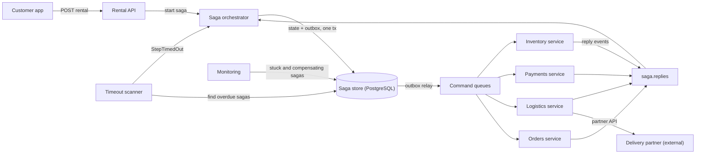
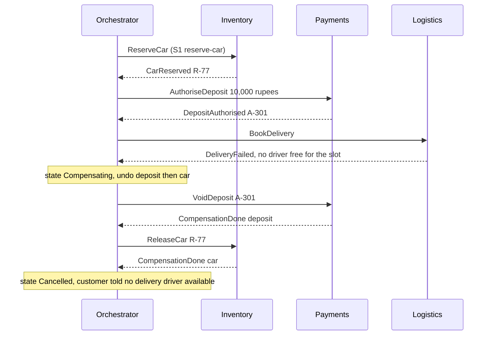
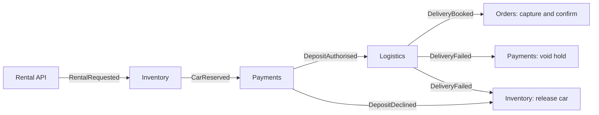
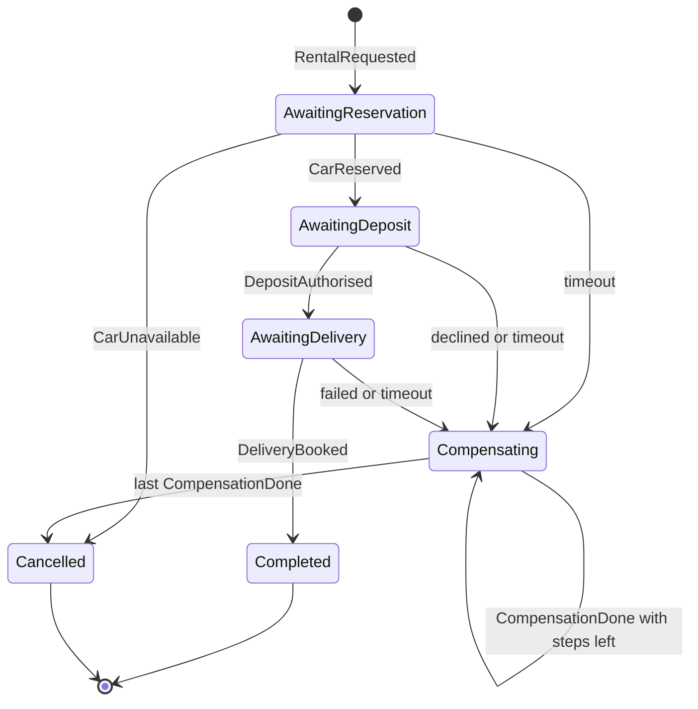

Inside one database, "do these three things or none of them" is a transaction and costs one `BEGIN` and one `COMMIT`. Across three services with three databases, there is no shared `COMMIT`. A saga is how you get the business outcome anyway: do each step as its own local transaction, and if a later step fails, run compensating actions that undo the earlier steps' effects. This lesson builds a saga as a persistent state machine in C#, and covers the parts that tutorials skip: compensations that can themselves fail, steps whose outcome is unknown, and timeouts.

## Learning objectives

By the end of this lesson you will be able to:

1. Explain why a cross-service business process cannot use one ACID transaction, and what a saga gives up instead.
2. Design compensating actions as semantic undo, and classify steps as compensatable, pivot or retriable.
3. Compare orchestration and choreography, and choose one for a given process.
4. Make every saga step and compensation idempotent, using deterministic command ids.
5. Handle timeouts and unknown outcomes safely, including late replies and "cancel before do".
6. Implement a saga as a persisted state machine with an outbox in ASP.NET Core.
7. Reduce isolation anomalies with semantic locks, step ordering and version checks.
8. Monitor sagas and know when a human must step in.

## Prerequisites

- [Transactional outbox](#/lesson/m12-outbox): a saga step changes local state and sends the next command; both must happen together.
- [Idempotent consumers and inbox deduplication](#/lesson/m12-idempotent-consumers): every step and compensation will be delivered at least once.
- [Distributed transactions and two-phase commit](#/lesson/m13-distributed-transactions): what sagas replace, and why.

## Explain it like I'm a beginner

Think about arranging a wedding in Jaipur. You book the hall, pay an advance to the caterer, and reserve rooms for guests. Three different businesses; no single "booking" covers all three.

Suppose the hall and caterer are booked, and then the hotel says it is full on that date. You cannot "roll back" time. What you do instead is **cancel** the caterer (maybe losing a small fee) and **release** the hall booking. Those cancellations are not the reverse of the bookings in a technical sense; they are new actions that undo the business effect. That is a **compensating action**.

Two ways to run this:

- **You, the planner, phone each vendor in turn** and keep a notebook of what is done. If something fails, you go back through the notebook and cancel things in reverse order. That is **orchestration**: one coordinator with a plan.
- **Each vendor tells the next** ("hall confirmed" → caterer hears it and confirms → hotel hears that), and if the hotel fails it announces "hotel failed", and the others hear that and cancel themselves. That is **choreography**: no coordinator, just reactions to events.

Also notice:

- If you phone the caterer twice by mistake, they must not take two advances. Each step must be **idempotent**.
- If the caterer does not answer for two days, you cannot wait forever. You need a **timeout**, and then you must decide what to do, even though you do not know whether they booked you or not.
- Once you have printed and posted the invitations, cancelling is no longer an option; from then on, everything must go forward. That point of no return is the **pivot**.

## First-principles explanation

### Why not one transaction?

In a single PostgreSQL database, a transaction gives you ACID: atomicity, consistency, isolation, durability. Once data lives in separate services, each with its own database (as it should, so teams can deploy and scale independently), you have three options:

1. **Two-phase commit (2PC)** across databases. Every participant must support it, a coordinator failure can leave participants blocked holding locks, and many brokers, SaaS APIs and payment gateways do not support it at all. See [two-phase commit](#/lesson/m13-distributed-transactions).
2. **Put everything in one database.** Sometimes the right answer, but it couples the services.
3. **A saga.** A sequence of local transactions T1, T2, …, Tn. Each Ti commits in its own service. If Tk fails, run compensations Ck−1, …, C1 in reverse order. Hector Garcia-Molina and Kenneth Salem described this for long-lived database transactions in 1987; microservices adopted it for cross-service processes.

A saga keeps **atomicity of the business outcome** (eventually, either all steps take effect or their effects are compensated) and **durability**. It gives up **isolation**: other transactions can see the intermediate state, such as "car reserved, deposit not yet taken".

### The running example

DriveEasy is a self-drive car rental app that delivers the car to the customer's door. Renting an SUV for a weekend trip from Bengaluru involves four services:

1. **Inventory**: reserve the car for the dates. Compensation: release the reservation.
2. **Payments**: authorise (hold) a refundable security deposit of ₹10,000 on the customer's card. Compensation: void the authorisation.
3. **Logistics**: book a delivery driver from a partner agency to bring the car to the customer's address. Compensation: cancel the booking (the partner may charge a fee).
4. **Orders**: capture the deposit (refunded after the trip) and confirm the rental to the customer. These run only after delivery is booked and must not fail permanently.

Volume estimates: 30,000 rentals a day ÷ 86,400 s ≈ 0.35 sagas/s on average, perhaps 3.5/s at a long-weekend peak. Each saga exchanges about 8 to 10 messages, so throughput is easy (≈ 35 messages/s at peak). The same design scales to an e-commerce checkout with 2 million orders a day (≈ 23 sagas/s average, about 115/s at a 5× peak, around 1,000 messages/s). **What breaks first is never throughput; it is the failure paths.** If the delivery partner's API fails 2 % of the time, that is 600 compensations a day at DriveEasy, and every one of them must work.

### Compensations are semantic undo

A compensation is a new forward action that cancels the business effect of a step. It is not a database rollback:

- **It may not restore the exact previous state.** Cancelling a delivery-driver booking may leave a ₹150 cancellation fee. Refunding a captured payment creates a new refund record; the original charge still exists in the ledger.
- **It must be idempotent.** It will sometimes be delivered twice.
- **It must be retriable until it succeeds.** A compensation that fails permanently leaves the system in a state nobody designed. If a compensation can be rejected by business rules, the process needs a human fallback.
- **It must tolerate "nothing to undo".** After a timeout you may compensate a step that never actually happened. "Release reservation" for a reservation that does not exist must succeed as a no-op.
- **Some actions cannot be compensated** (an SMS sent, a car handed over, money paid out to a third party). Put those *after* the pivot, or replace them with something that can be undone (a hold instead of a charge, a draft instead of a sent email).

### Compensatable, pivot and retriable steps

Chris Richardson's classification helps you order the steps:

- **Compensatable steps** come first. They can be undone: reserve, authorise a hold, create a pending record.
- **The pivot** is the go/no-go step. If it succeeds, the saga will complete; if it fails, compensate everything before it. Often it is the step most likely to fail or the one that cannot be undone. In DriveEasy, booking the doorstep delivery is the pivot: it is the step most likely to fail (the partner has no driver free for the slot), and once a driver is assigned to the slot, the business commits to the rental.
- **Retriable steps** come after the pivot. They cannot fail for business reasons and are retried until they succeed: capture the already-authorised deposit, confirm the order, send the notification.

**Order steps to minimise damage.** Put steps likely to fail early and cheap-to-undo steps before expensive-to-undo ones. Authorising a deposit (a hold) instead of charging it is a classic move: a hold is easy to void, a charge needs a refund.

### Orchestration versus choreography

**Orchestration.** A saga orchestrator (a component with its own state) tells each participant what to do with a command and waits for the reply event. The whole process is written in one place.

**Choreography.** There is no coordinator. Each service listens for events and reacts: Inventory publishes `CarReserved`, Payments reacts by authorising and publishes `DepositAuthorised`, Logistics reacts by booking a delivery driver, and so on. Failures are events too: Logistics publishes `DeliveryFailed`, and Payments and Inventory each react by compensating.

| | Orchestration | Choreography |
|---|---|---|
| Where the flow lives | One state machine you can read and test | Spread across services' event handlers |
| Coupling | Orchestrator knows participants' commands | Services know each other's events |
| Adding a step | Change the orchestrator | Change whoever reacts and whoever must notice |
| Visibility | Saga state table shows every instance | Needs tracing to reconstruct a process |
| Failure handling | Centralised, explicit | Each service must handle failure events correctly |
| Risk | The orchestrator becomes a "god service" with business logic | Cyclic dependencies and processes no one fully understands |
| Good fit | 4+ steps, compensations, timeouts, a business owner who asks "where is order X?" | 2–3 steps, simple reactions, teams that want full autonomy |

A practical rule: **choreography for simple notifications and fan-out ("order placed, so send email and update analytics"), orchestration for processes with compensations and deadlines.** Many systems use both: an orchestrated saga for the core flow that publishes events others react to freely.

### Idempotent steps

Every message in a saga can be delivered twice: the outbox relay can resend a command, the broker can redeliver, the orchestrator can resend after a timeout. Therefore:

- **Commands carry a deterministic id**, for example `"{sagaId}:authorise-deposit"`. A resend has the same id, so the participant can recognise it.
- **Participants store the result per command id** and return the same result for a duplicate. "Authorise ₹10,000" received twice must create one hold, not two.
- **The orchestrator ignores events it does not expect in its current state.** A duplicate `CarReserved` arriving while the saga waits for the deposit is simply dropped.
- **State changes and outgoing commands are saved together**, with an outbox, so a crash cannot leave "state advanced, command never sent".

### Timeouts and unknown outcomes

A saga waits for replies, and some never come. Every waiting state needs a **deadline**, and every deadline needs a decision.

The hard case is the **unknown outcome**: you sent "authorise deposit", the deadline passed, and you do not know whether Payments did it. There are two safe strategies:

1. **Ask before deciding.** Query the participant ("what is the status of command X?") and act on the answer. This is the right first move when the participant offers a status API.
2. **Assume it may have happened and compensate it.** Add the uncertain step to the list of things to compensate. Because compensations tolerate "nothing to undo", this is safe whether or not the step happened.

Two traps follow from strategy 2:

- **The late success.** The `DepositAuthorised` reply arrives after you started compensating. The orchestrator must not move forward; the compensation already in the plan will void it.
- **Cancel before do.** The `VoidDeposit` compensation reaches Payments *before* the delayed `AuthoriseDeposit` command does (messages on different queues have no ordering). Payments finds nothing to void and says "done". Then the old authorise command arrives and creates a hold that nobody will ever void. The fix is a **tombstone**: when a compensation finds nothing to undo, the participant records "saga S is cancelled" and refuses any later action for S. Exercise 5 implements this.

Choose deadlines from the participant's real latency. If the delivery partner API's p99 is 40 seconds, a 10-minute step deadline is generous and avoids false timeouts; a 30-second deadline would compensate perfectly good bookings. Add a **saga-level deadline** too (for example, "a rental must be confirmed or cancelled within 30 minutes") so a saga stuck in a retry loop surfaces to a human.

### The lack of isolation, and countermeasures

Because each step commits on its own, other requests can see half-finished sagas. Typical anomalies:

- **Dirty read.** A dashboard counts the car as "booked" while the saga will soon cancel it.
- **Lost update.** Saga A releases a reservation as compensation while saga B, in between, changed the same reservation.
- **Fuzzy read.** A step reads the deposit limit, another saga changes it, and the next step reads a different value.

Countermeasures:

- **Semantic lock.** Mark records touched by an unfinished saga with a status such as `PENDING`. Other requests see the flag and wait, fail fast or show "pending". The final step sets `CONFIRMED`; the compensation sets `CANCELLED`.
- **Commutative updates.** Design updates that give the same result in any order (add and subtract from a counter, rather than set a value).
- **Reorder steps.** Do the risky or visible step later (the "pessimistic view"): for example, only hide the car from search results as "booked" after the pivot.
- **Reread and version checks.** Before overwriting, check the record's version and fail if it changed.
- **Pass values, not references.** Put the agreed price in the command, so later steps do not reread a price that may have changed.

### Persisting the saga

An orchestrated saga is a **state machine** stored in a table:

```sql
CREATE TABLE rental_sagas (
    saga_id          uuid PRIMARY KEY,
    order_id         text        NOT NULL UNIQUE,     -- one saga per order: idempotent start
    state            text        NOT NULL,            -- AwaitingDeposit, Compensating, ...
    reservation_id   text,
    authorisation_id text,
    delivery_id     text,
    completed_steps  text[]      NOT NULL DEFAULT '{}',  -- what to compensate, in order
    step_deadline    timestamptz NOT NULL,
    failure_reason   text,
    version          bigint      NOT NULL DEFAULT 0,  -- optimistic concurrency
    updated_at       timestamptz NOT NULL DEFAULT now()
);
CREATE INDEX rental_sagas_due ON rental_sagas (step_deadline)
    WHERE state NOT IN ('Completed', 'Cancelled');
```

Each event is handled by: load the saga, compute the transition, then in **one transaction** update the row (`WHERE version = @expected`) and insert the next commands into the outbox. A timeout scanner queries the partial index for sagas past their deadline and feeds them a "timed out" event. Storage is small: about 2 KB per saga × 30,000 a day ≈ 60 MB a day, around 5.4 GB for 90 days of history (an estimate).

### When a saga is the wrong tool

- **The steps can live in one database.** If reserving the car and authorising the deposit are both tables in one service, use one local transaction. Do not split a service to then glue it back with a saga.
- **Nothing needs undoing.** If later steps cannot fail for business reasons, you only need reliable delivery (outbox plus retries), not compensations.
- **Strict isolation is required.** If no one may ever see the intermediate state (for example, moving money between two internal accounts), keep both accounts in one database and use a transaction.
- **A workflow engine already does it.** For long, human-in-the-loop processes, durable workflow engines (Temporal, Azure Durable Functions, AWS Step Functions) persist state, timers and retries for you. You still design the compensations; the engine runs them. The price: another piece of infrastructure to run (or pay for), workflow code that must be deterministic because the engine replays it after a crash, and explicit versioning when you change a workflow while thousands of instances are still in flight. For a handful of short sagas, the hand-rolled state machine in this lesson is often simpler; for dozens of long-running, multi-day processes, an engine usually pays for itself.

### Trade-offs

| You gain | You pay |
|---|---|
| Business-level atomicity across services without 2PC | No isolation: intermediate states are visible |
| Services keep separate databases and deploy independently | Every step needs a compensation, designed and tested |
| Long-running processes (minutes to days) are possible | Timeouts, unknown outcomes and late replies to handle |
| Clear audit of each instance's progress (orchestration) | A saga store, timeout scanner and monitoring to run |
| Works with external APIs that will never join a 2PC | Compensations may not restore the exact previous state |

## Visual explanation

### Architecture: an orchestrated saga



The API starts a saga and returns immediately. The orchestrator stores the saga's state and the next command in one transaction; the outbox relay delivers commands to each participant's queue. Participants do their local transaction and publish a reply event, which the orchestrator consumes to decide the next step. A timeout scanner finds sagas whose current step is overdue and feeds them a timeout event. Monitoring reads the saga table directly: how many sagas are compensating, how many are stuck, how old the oldest is.

### Sequence: delivery fails, compensations run in reverse



The first two steps succeed and are recorded as completed. The pivot (delivery) fails with a business reason. The orchestrator switches to compensating and works backwards through the completed steps: void the deposit hold first, then release the car. It waits for each compensation to be confirmed before starting the next, so if the orchestrator crashes midway, the saga table shows exactly which compensations remain.

### Choreography of the same flow



Each service reacts to the previous service's event; nobody holds the whole plan. On failure, Logistics publishes `DeliveryFailed` and both Payments and Inventory compensate on their own (here in parallel, which is fine because the two compensations are independent). Notice what is missing: there is no single place that knows "rental 914 is compensating, waiting for Inventory". Answering that needs distributed tracing. Adding a fifth step means changing which service reacts to which event, and failure events must be handled by every service that did work earlier. That is why this lesson's implementation uses orchestration.

### The saga as a state machine



Each waiting state has exactly the transitions the business allows. A timeout from any waiting state leads to compensation, and the uncertain step is included in what gets compensated. `Compensating` loops on itself until the list of completed steps is empty, then the saga ends as `Cancelled`. `Completed` is reached only through the pivot; after it, the retriable steps (capture, confirm) are sent as commands that are retried until they succeed. Any event not drawn here (a duplicate, or a late reply) is ignored.

## Step-by-step example

### Step 1: the naive distributed "transaction"

```csharp
public async Task<IResult> RentAsync(RentalRequest r, CancellationToken ct)
{
    var reservation = await _inventory.ReserveAsync(r.CarId, r.Dates, ct);
    var auth = await _payments.AuthoriseAsync(r.CustomerId, 10_000m, ct);
    var delivery = await _logistics.BookAsync(r.CarId, r.DeliveryAddress, ct);   // throws 2 % of the time
    await _orders.ConfirmAsync(r.OrderId, ct);
    return Results.Ok();
}
```

When `BookAsync` throws, the car stays reserved and the deposit stays held, and nobody will ever release them. If the API process crashes between calls, even a `catch` block would not run.

### Step 2: add compensations in a catch block

Wrapping the calls in `try/catch` and calling `ReleaseAsync` and `VoidAsync` handles the simple failure. It still loses everything on a crash, holds the HTTP request open for minutes when the delivery partner is slow, and retries nothing.

### Step 3: make it a persisted state machine

Store a saga row with the current state and completed steps. Each reply event moves the state forward and saves the next command in the same transaction (outbox). The HTTP request now returns `202 Accepted` with the saga id, and the customer's app shows "Confirming your booking…".

### Step 4: idempotency and timeouts

Give every command a deterministic id. Make participants store results per command id. Add a step deadline and a timeout scanner; on timeout, compensate including the uncertain step. Add tombstones for cancel-before-do.

### Step 5: monitoring and the human fallback

Alert on sagas that stay in `Compensating` for more than 15 minutes, and on any saga older than its saga-level deadline. Give operations a screen listing stuck sagas with a "retry compensation" button. The full implementation follows.

## Production-style C# implementation

The orchestrator below is a pure state machine (easy to test) wrapped in a small service that loads and saves saga state with optimistic concurrency and an outbox. Participants are simulated in memory so that the code runs anywhere.

### Messages

```csharp file=Sagas/Messages.cs
namespace DriveEasy.Sagas;

public abstract record SagaEvent(Guid SagaId)
{
    public Guid EventId { get; init; } = Guid.NewGuid();
}

public sealed record RentalRequested(Guid SagaId, string OrderId, string CarId, decimal DepositInr) : SagaEvent(SagaId);
public sealed record CarReserved(Guid SagaId, string ReservationId) : SagaEvent(SagaId);
public sealed record CarUnavailable(Guid SagaId, string Reason) : SagaEvent(SagaId);
public sealed record DepositAuthorised(Guid SagaId, string AuthorisationId) : SagaEvent(SagaId);
public sealed record DepositDeclined(Guid SagaId, string Reason) : SagaEvent(SagaId);
public sealed record DeliveryBooked(Guid SagaId, string BookingId) : SagaEvent(SagaId);
public sealed record DeliveryFailed(Guid SagaId, string Reason) : SagaEvent(SagaId);
public sealed record CompensationDone(Guid SagaId, string Step) : SagaEvent(SagaId);
public sealed record StepTimedOut(Guid SagaId, RentalSagaState InState) : SagaEvent(SagaId);

public abstract record SagaCommand(Guid SagaId, string Step)
{
    /// <summary>Deterministic: a resent command has the same id, so participants can deduplicate it.</summary>
    public string CommandId => $"{SagaId:N}:{Step}";
}

public sealed record ReserveCar(Guid SagaId, string CarId, string OrderId) : SagaCommand(SagaId, "reserve-car");
public sealed record AuthoriseDeposit(Guid SagaId, decimal AmountInr) : SagaCommand(SagaId, "authorise-deposit");
public sealed record BookDelivery(Guid SagaId, string CarId) : SagaCommand(SagaId, "book-delivery");
public sealed record CaptureDeposit(Guid SagaId, string AuthorisationId) : SagaCommand(SagaId, "capture-deposit");
public sealed record ConfirmRental(Guid SagaId, string OrderId) : SagaCommand(SagaId, "confirm-rental");

// Compensations: idempotent, and must succeed even when there is nothing to undo.
public sealed record ReleaseCar(Guid SagaId, string? ReservationId) : SagaCommand(SagaId, "release-car");
public sealed record VoidDeposit(Guid SagaId, string? AuthorisationId) : SagaCommand(SagaId, "void-deposit");
public sealed record CancelDelivery(Guid SagaId, string? BookingId) : SagaCommand(SagaId, "cancel-delivery");
```

### Saga state

```csharp file=Sagas/RentalSaga.cs
namespace DriveEasy.Sagas;

public enum RentalSagaState { AwaitingReservation, AwaitingDeposit, AwaitingDelivery, Completed, Compensating, Cancelled }

public static class SagaSteps
{
    public const string Car = "car";
    public const string Deposit = "deposit";
    public const string Delivery = "delivery";
}

public sealed class RentalSaga
{
    public required Guid SagaId { get; init; }
    public required string OrderId { get; init; }
    public required string CarId { get; init; }
    public required decimal DepositInr { get; init; }

    public RentalSagaState State { get; set; }
    public string? ReservationId { get; set; }
    public string? AuthorisationId { get; set; }
    public string? DeliveryBookingId { get; set; }
    public DateTimeOffset StepDeadline { get; set; }
    public string? FailureReason { get; set; }

    /// <summary>Steps that have (or may have) taken effect, oldest first. Compensated newest first.</summary>
    public List<string> CompletedSteps { get; init; } = new();
    public long Version { get; set; }

    public bool IsTerminal => State is RentalSagaState.Completed or RentalSagaState.Cancelled;

    public RentalSaga Clone() => new()
    {
        SagaId = SagaId, OrderId = OrderId, CarId = CarId, DepositInr = DepositInr,
        State = State, ReservationId = ReservationId, AuthorisationId = AuthorisationId,
        DeliveryBookingId = DeliveryBookingId, StepDeadline = StepDeadline, FailureReason = FailureReason,
        CompletedSteps = new List<string>(CompletedSteps), Version = Version
    };
}
```

### The state machine

```csharp file=Sagas/RentalSagaDefinition.cs
using Microsoft.Extensions.Options;

namespace DriveEasy.Sagas;

public sealed class SagaTimeoutOptions
{
    public TimeSpan Reservation { get; set; } = TimeSpan.FromSeconds(30);
    public TimeSpan Deposit { get; set; } = TimeSpan.FromMinutes(2);
    public TimeSpan Delivery { get; set; } = TimeSpan.FromMinutes(10);
    public TimeSpan Compensation { get; set; } = TimeSpan.FromMinutes(5);
}

/// <summary>Pure transition logic: no I/O, so every path is unit-testable.</summary>
public sealed class RentalSagaDefinition(IOptions<SagaTimeoutOptions> options)
{
    private SagaTimeoutOptions T => options.Value;

    public (RentalSaga Saga, IReadOnlyList<SagaCommand> Commands) Start(RentalRequested e, DateTimeOffset now)
    {
        var saga = new RentalSaga
        {
            SagaId = e.SagaId, OrderId = e.OrderId, CarId = e.CarId, DepositInr = e.DepositInr,
            State = RentalSagaState.AwaitingReservation,
            StepDeadline = now + T.Reservation
        };
        return (saga, [new ReserveCar(e.SagaId, e.CarId, e.OrderId)]);
    }

    public IReadOnlyList<SagaCommand> Handle(RentalSaga s, SagaEvent e, DateTimeOffset now)
    {
        switch (s.State, e)
        {
            // ---- forward path -------------------------------------------------------------
            case (RentalSagaState.AwaitingReservation, CarReserved r):
                s.ReservationId = r.ReservationId;
                s.CompletedSteps.Add(SagaSteps.Car);
                return MoveTo(s, RentalSagaState.AwaitingDeposit, T.Deposit, now, new AuthoriseDeposit(s.SagaId, s.DepositInr));

            case (RentalSagaState.AwaitingDeposit, DepositAuthorised a):
                s.AuthorisationId = a.AuthorisationId;
                s.CompletedSteps.Add(SagaSteps.Deposit);
                return MoveTo(s, RentalSagaState.AwaitingDelivery, T.Delivery, now, new BookDelivery(s.SagaId, s.CarId));

            case (RentalSagaState.AwaitingDelivery, DeliveryBooked b):          // the pivot succeeded
                s.DeliveryBookingId = b.BookingId;
                s.State = RentalSagaState.Completed;
                return [new CaptureDeposit(s.SagaId, s.AuthorisationId!), new ConfirmRental(s.SagaId, s.OrderId)];

            // ---- business failures ----------------------------------------------------------
            case (RentalSagaState.AwaitingReservation, CarUnavailable u):
                s.FailureReason = u.Reason;
                s.State = RentalSagaState.Cancelled;                              // nothing to undo
                return [];

            case (RentalSagaState.AwaitingDeposit, DepositDeclined d):
                return BeginCompensation(s, d.Reason, now);

            case (RentalSagaState.AwaitingDelivery, DeliveryFailed f):
                return BeginCompensation(s, f.Reason, now);

            // ---- timeouts: the in-flight step may have happened, so compensate it too -------
            case (RentalSagaState.AwaitingReservation, StepTimedOut):
                s.CompletedSteps.Add(SagaSteps.Car);
                return BeginCompensation(s, "Car reservation timed out", now);

            case (RentalSagaState.AwaitingDeposit, StepTimedOut):
                s.CompletedSteps.Add(SagaSteps.Deposit);
                return BeginCompensation(s, "Deposit authorisation timed out", now);

            case (RentalSagaState.AwaitingDelivery, StepTimedOut):
                s.CompletedSteps.Add(SagaSteps.Delivery);
                return BeginCompensation(s, "Delivery booking timed out", now);

            // ---- compensating -------------------------------------------------------------
            case (RentalSagaState.Compensating, CompensationDone c) when s.CompletedSteps.Count > 0 && c.Step == s.CompletedSteps[^1]:
                s.CompletedSteps.RemoveAt(s.CompletedSteps.Count - 1);
                return NextCompensation(s, now);

            case (RentalSagaState.Compensating, StepTimedOut):
                return NextCompensation(s, now);                                  // resend: compensations retry until done

            // Late successes while compensating: remember the ids; the planned compensation undoes them.
            case (RentalSagaState.Compensating, CarReserved r):
                s.ReservationId ??= r.ReservationId;
                return [];
            case (RentalSagaState.Compensating, DepositAuthorised a):
                s.AuthorisationId ??= a.AuthorisationId;
                return [];
            case (RentalSagaState.Compensating, DeliveryBooked b):
                s.DeliveryBookingId ??= b.BookingId;
                return [];

            default:
                return [];                                                        // duplicate or unexpected: ignore
        }
    }

    private static IReadOnlyList<SagaCommand> MoveTo(RentalSaga s, RentalSagaState next, TimeSpan timeout, DateTimeOffset now, SagaCommand command)
    {
        s.State = next;
        s.StepDeadline = now + timeout;
        return [command];
    }

    private IReadOnlyList<SagaCommand> BeginCompensation(RentalSaga s, string reason, DateTimeOffset now)
    {
        s.FailureReason = reason;
        s.State = RentalSagaState.Compensating;
        return NextCompensation(s, now);
    }

    private IReadOnlyList<SagaCommand> NextCompensation(RentalSaga s, DateTimeOffset now)
    {
        if (s.CompletedSteps.Count == 0)
        {
            s.State = RentalSagaState.Cancelled;
            return [];
        }
        s.StepDeadline = now + T.Compensation;
        return [CompensationFor(s, s.CompletedSteps[^1])];                       // newest first, one at a time
    }

    private static SagaCommand CompensationFor(RentalSaga s, string step) => step switch
    {
        SagaSteps.Car => new ReleaseCar(s.SagaId, s.ReservationId),
        SagaSteps.Deposit => new VoidDeposit(s.SagaId, s.AuthorisationId),
        SagaSteps.Delivery => new CancelDelivery(s.SagaId, s.DeliveryBookingId),
        _ => throw new InvalidOperationException($"No compensation defined for step '{step}'.")
    };
}
```

### The saga store with an outbox

```csharp file=Sagas/SagaStore.cs
using System.Threading.Channels;

namespace DriveEasy.Sagas;

public sealed class SagaConcurrencyException(Guid sagaId) : Exception($"Saga {sagaId} was modified concurrently.");

public interface ISagaStore
{
    Task<RentalSaga?> GetAsync(Guid sagaId, CancellationToken ct);

    /// <summary>
    /// Saves the saga if its stored version equals expectedVersion (0 = new) and, in the same
    /// transaction, appends the commands to the outbox.
    /// </summary>
    Task SaveAsync(RentalSaga saga, long expectedVersion, IReadOnlyList<SagaCommand> commands, CancellationToken ct);

    Task<IReadOnlyList<RentalSaga>> FindOverdueAsync(DateTimeOffset now, int max, CancellationToken ct);
}

public sealed class InMemorySagaStore : ISagaStore
{
    private readonly Lock _gate = new();
    private readonly Dictionary<Guid, RentalSaga> _sagas = new();
    private readonly Channel<SagaCommand> _outbox = Channel.CreateUnbounded<SagaCommand>();

    /// <summary>Stands in for the outbox table plus relay.</summary>
    public ChannelReader<SagaCommand> Outbox => _outbox.Reader;

    public Task<RentalSaga?> GetAsync(Guid sagaId, CancellationToken ct)
    {
        lock (_gate) return Task.FromResult(_sagas.TryGetValue(sagaId, out var s) ? s.Clone() : null);
    }

    public Task SaveAsync(RentalSaga saga, long expectedVersion, IReadOnlyList<SagaCommand> commands, CancellationToken ct)
    {
        lock (_gate)
        {
            var actual = _sagas.TryGetValue(saga.SagaId, out var stored) ? stored.Version : 0;
            if (actual != expectedVersion) throw new SagaConcurrencyException(saga.SagaId);
            saga.Version = expectedVersion + 1;
            _sagas[saga.SagaId] = saga.Clone();
            foreach (var c in commands) _outbox.Writer.TryWrite(c);       // same "transaction"
        }
        return Task.CompletedTask;
    }

    public Task<IReadOnlyList<RentalSaga>> FindOverdueAsync(DateTimeOffset now, int max, CancellationToken ct)
    {
        lock (_gate)
        {
            IReadOnlyList<RentalSaga> due = _sagas.Values
                .Where(s => !s.IsTerminal && s.StepDeadline <= now)
                .OrderBy(s => s.StepDeadline)
                .Take(max)
                .Select(s => s.Clone())
                .ToList();
            return Task.FromResult(due);
        }
    }
}
```

### The orchestrator and the timeout scanner

```csharp file=Sagas/RentalSagaOrchestrator.cs
using System.Collections.Concurrent;

namespace DriveEasy.Sagas;

public sealed class RentalSagaOrchestrator(
    ISagaStore store, RentalSagaDefinition definition, TimeProvider clock, ILogger<RentalSagaOrchestrator> logger)
{
    // Serialises handling per saga inside one process; the version check protects across processes.
    private readonly ConcurrentDictionary<Guid, SemaphoreSlim> _locks = new();

    public async Task StartAsync(RentalRequested request, CancellationToken ct)
    {
        if (await store.GetAsync(request.SagaId, ct) is not null) return;    // idempotent start
        var (saga, commands) = definition.Start(request, clock.GetUtcNow());
        await store.SaveAsync(saga, expectedVersion: 0, commands, ct);
    }

    public async Task HandleAsync(SagaEvent e, CancellationToken ct)
    {
        var gate = _locks.GetOrAdd(e.SagaId, _ => new SemaphoreSlim(1, 1));
        await gate.WaitAsync(ct);
        try
        {
            for (var attempt = 1; ; attempt++)
            {
                var saga = await store.GetAsync(e.SagaId, ct);
                if (saga is null)
                {
                    logger.LogWarning("Event {Event} for unknown saga {Saga}", e.GetType().Name, e.SagaId);
                    return;
                }
                if (saga.IsTerminal) return;                                   // late or duplicate

                var expected = saga.Version;
                var commands = definition.Handle(saga, e, clock.GetUtcNow());
                try
                {
                    await store.SaveAsync(saga, expected, commands, ct);
                    if (saga.State is RentalSagaState.Compensating && commands.Count > 0)
                        logger.LogInformation("Saga {Saga} compensating: {Command}", saga.SagaId, commands[0].GetType().Name);
                    return;
                }
                catch (SagaConcurrencyException) when (attempt < 3)
                {
                    // another process handled an event for this saga first: reload and re-evaluate
                }
            }
        }
        finally
        {
            gate.Release();
        }
    }
}

public sealed class SagaTimeoutScanner(
    ISagaStore store, RentalSagaOrchestrator orchestrator, TimeProvider clock, ILogger<SagaTimeoutScanner> logger) : BackgroundService
{
    public async Task<int> ScanOnceAsync(CancellationToken ct)
    {
        var overdue = await store.FindOverdueAsync(clock.GetUtcNow(), 100, ct);
        foreach (var saga in overdue)
        {
            logger.LogWarning("Saga {Saga} timed out in {State}", saga.SagaId, saga.State);
            await orchestrator.HandleAsync(new StepTimedOut(saga.SagaId, saga.State), ct);
        }
        return overdue.Count;
    }

    protected override async Task ExecuteAsync(CancellationToken stoppingToken)
    {
        using var timer = new PeriodicTimer(TimeSpan.FromSeconds(5), clock);
        try
        {
            while (await timer.WaitForNextTickAsync(stoppingToken)) await ScanOnceAsync(stoppingToken);
        }
        catch (OperationCanceledException) when (stoppingToken.IsCancellationRequested) { }
    }
}
```

### Simulated participants

```csharp file=Sagas/SimulatedParticipants.cs
namespace DriveEasy.Sagas;

/// <summary>
/// Plays Inventory, Payments, Logistics and Orders for the demo. Real participants are separate
/// services that deduplicate by CommandId and reply through their own outbox.
/// </summary>
public sealed class SimulatedParticipants(InMemorySagaStore store, RentalSagaOrchestrator orchestrator, ILogger<SimulatedParticipants> logger) : BackgroundService
{
    private const decimal DepositLimitInr = 50_000m;

    protected override async Task ExecuteAsync(CancellationToken stoppingToken)
    {
        try
        {
            await foreach (var command in store.Outbox.ReadAllAsync(stoppingToken))
            {
                SagaEvent? reply = command switch
                {
                    ReserveCar c => new CarReserved(c.SagaId, "R-" + c.SagaId.ToString("N")[..6]),
                    AuthoriseDeposit c when c.AmountInr > DepositLimitInr => new DepositDeclined(c.SagaId, "Deposit above credit limit"),
                    AuthoriseDeposit c => new DepositAuthorised(c.SagaId, "A-" + c.SagaId.ToString("N")[..6]),
                    BookDelivery c when Random.Shared.NextDouble() < 0.1 => new DeliveryFailed(c.SagaId, "No delivery driver free for the slot"),
                    BookDelivery c => new DeliveryBooked(c.SagaId, "T-" + c.SagaId.ToString("N")[..6]),
                    ReleaseCar c => new CompensationDone(c.SagaId, SagaSteps.Car),
                    VoidDeposit c => new CompensationDone(c.SagaId, SagaSteps.Deposit),
                    CancelDelivery c => new CompensationDone(c.SagaId, SagaSteps.Delivery),
                    _ => null                                                     // capture and confirm: no reply needed
                };
                logger.LogInformation("Handled {Command} ({CommandId})", command.GetType().Name, command.CommandId);
                if (reply is not null) await orchestrator.HandleAsync(reply, stoppingToken);
            }
        }
        catch (OperationCanceledException) when (stoppingToken.IsCancellationRequested) { }
    }
}
```

### Wiring and endpoints

```csharp file=Program.cs
using DriveEasy.Sagas;

var builder = WebApplication.CreateBuilder(args);

builder.Services.AddSingleton(TimeProvider.System);
builder.Services.Configure<SagaTimeoutOptions>(builder.Configuration.GetSection("Sagas:Rental:Timeouts"));
builder.Services.AddSingleton<RentalSagaDefinition>();
builder.Services.AddSingleton<InMemorySagaStore>();
builder.Services.AddSingleton<ISagaStore>(sp => sp.GetRequiredService<InMemorySagaStore>());
builder.Services.AddSingleton<RentalSagaOrchestrator>();
builder.Services.AddSingleton<SagaTimeoutScanner>();
builder.Services.AddHostedService(sp => sp.GetRequiredService<SagaTimeoutScanner>());
builder.Services.AddHostedService<SimulatedParticipants>();

var app = builder.Build();

app.MapPost("/rentals", async (RentalRequest req, RentalSagaOrchestrator orchestrator, CancellationToken ct) =>
{
    // One saga per order: derive the saga id from the order id so a retried POST starts nothing new.
    var sagaId = DeterministicGuid.From("rental:" + req.OrderId);
    await orchestrator.StartAsync(new RentalRequested(sagaId, req.OrderId, req.CarId, req.DepositInr), ct);
    return Results.Accepted($"/rentals/{sagaId}", new { sagaId, status = "confirming" });
});

app.MapGet("/rentals/{sagaId:guid}", async (Guid sagaId, ISagaStore store, CancellationToken ct) =>
    await store.GetAsync(sagaId, ct) is { } s
        ? Results.Ok(new { s.SagaId, s.OrderId, State = s.State.ToString(), s.FailureReason, s.CompletedSteps })
        : Results.NotFound());

app.Run();

public sealed record RentalRequest(string OrderId, string CarId, decimal DepositInr);

public static class DeterministicGuid
{
    public static Guid From(string text)
    {
        var hash = System.Security.Cryptography.SHA256.HashData(System.Text.Encoding.UTF8.GetBytes(text));
        return new Guid(hash.AsSpan(0, 16));
    }
}
```

**Real infrastructure.** With PostgreSQL, `SaveAsync` is one transaction: `UPDATE rental_sagas SET ..., version = version + 1 WHERE saga_id = @id AND version = @expected` (zero rows means a concurrent update) plus `INSERT INTO outbox ...` for each command. `FindOverdueAsync` uses the partial index on `step_deadline` with `FOR UPDATE SKIP LOCKED` so several scanner instances can share the work. .NET libraries such as MassTransit (state machine sagas) and NServiceBus (sagas with timeouts) provide this persistence and timeout plumbing; the transition logic and compensations are still yours to design. Check licensing before you adopt one: NServiceBus is commercial, and MassTransit moved to a commercial licence from version 9. Two simplifications in the demo are worth naming: the per-saga `SemaphoreSlim` dictionary is never trimmed (in production, rely on the version check alone or evict locks for terminal sagas), and a scanner row lock taken with `SKIP LOCKED` only lasts for the scanner's own transaction, so the optimistic version check is what really prevents two instances from advancing the same saga.

## Bad design vs good design

**Bad: compensating in a `catch` block of an HTTP request.** A crash, a deploy or a request timeout skips the compensation, and the saga's progress lives only in memory. **Good:** a persisted state machine; the HTTP request only starts the saga.

**Bad: compensations that can fail for business reasons.**

```csharp
public Task ReleaseAsync(string reservationId) =>
    _reservations.Find(reservationId) is { } r
        ? r.Release()
        : throw new NotFoundException("Reservation not found");   // breaks compensation after a timeout
```

After a timeout, the orchestrator compensates a step that may never have happened. A "not found" error makes the compensation fail forever. **Good:** treat "nothing to undo" as success, and record a tombstone so a late original command is refused.

**Bad: random command ids.** `Guid.NewGuid()` for each send means a resend after a timeout looks like a new request, and Payments places two holds. **Good:** deterministic ids such as `"{sagaId}:authorise-deposit"`.

**Bad: the orchestrator decides business rules.** The orchestrator checks credit limits and computes delivery fees. Now it is a god service that every team must change. **Good:** the orchestrator sequences steps and reacts to outcomes; each participant owns its rules and replies "declined" with a reason.

**Bad: non-compensatable steps before the pivot.** Sending "Your car is confirmed!" by SMS before delivery is booked, then having to send "Sorry, cancelled". **Good:** notifications are retriable steps after the pivot.

:::callout type=warning title="Compensations hide in the happy path"
Teams test the forward path daily and the compensation path almost never, so compensations are the code most likely to be broken when you need it. Write a test for every compensation, run failure-injection tests in staging (make the delivery partner fail 50 % of the time for an hour), and alert when a saga stays in `Compensating` longer than expected.
:::

## Practical playground

The graph below is DriveEasy today: the Rental API calls each service synchronously, one after another, as in step 1 of the example. Open it in the HLD canvas and turn it into an orchestrated saga:

1. Add a `worker` node for the saga orchestrator and a `database` node for the saga store (with outbox).
2. Replace the synchronous API-to-service calls with `async` edges through a `queue` for commands and a `queue` for replies.
3. Add a `scheduler` node for the timeout scanner.
4. Add `monitoring` reading the saga store (sagas compensating, sagas overdue).
5. Write next to each participant its compensation, and mark which step is the pivot.

:::playground type=hld title="Turn a synchronous chain into an orchestrated saga"
```json
{
  "nodes": [
    { "id": "app", "type": "client", "label": "Customer app", "props": { "rps": 4 } },
    { "id": "api", "type": "app-server", "label": "Rental API", "props": { "instances": 2 } },
    { "id": "inv", "type": "app-server", "label": "Inventory service" },
    { "id": "invdb", "type": "database", "label": "Inventory DB" },
    { "id": "pay", "type": "app-server", "label": "Payments service" },
    { "id": "paydb", "type": "database", "label": "Payments DB" },
    { "id": "log", "type": "app-server", "label": "Logistics service" },
    { "id": "tp", "type": "external", "label": "Delivery partner API" },
    { "id": "ord", "type": "app-server", "label": "Orders service" }
  ],
  "edges": [
    { "from": "app", "to": "api", "kind": "sync" },
    { "from": "api", "to": "inv", "kind": "sync", "label": "reserve" },
    { "from": "inv", "to": "invdb", "kind": "sync" },
    { "from": "api", "to": "pay", "kind": "sync", "label": "authorise" },
    { "from": "pay", "to": "paydb", "kind": "sync" },
    { "from": "api", "to": "log", "kind": "sync", "label": "book delivery" },
    { "from": "log", "to": "tp", "kind": "sync" },
    { "from": "api", "to": "ord", "kind": "sync", "label": "confirm" }
  ]
}
```
:::

## Exercises

:::exercise id=m12-sagas-ex1 difficulty=beginner kind=written title="Design the compensations for a made-to-order saga"
A furniture marketplace sells a made-to-order sofa (₹45,000) built by a partner workshop. Steps, in the current order: (1) send the purchase order PDF to the workshop by email; (2) place a hold for ₹45,000 on the customer's card; (3) book a delivery slot with the courier; (4) get the workshop's order acknowledgement through their API; (5) record the commitment in the accounting ledger. For each step, give its compensation (or say it has none), classify it as compensatable, pivot or retriable, and propose a better order.
::acceptance
- Sending the email is identified as non-compensatable and moved after the pivot (or replaced by a draft).
- The workshop acknowledgement is identified as the pivot, with a reason.
- Compensations are semantic (void the card hold, cancel the delivery slot), idempotent and tolerant of "nothing to undo".
- A reordered sequence is given: compensatable steps, then pivot, then retriable steps.
::hint
Which step can never be undone once it happens?
::hint
Which step is most likely to fail for a business reason outside your control?
::hint
After the workshop accepts, which steps must simply be retried until they succeed?
::hint
Order: cheap-to-undo reservations first, then the pivot, then everything that cannot fail.
::solution
| Step | Compensation | Kind |
|---|---|---|
| Hold ₹45,000 on the card | Void the hold (no-op if none) | Compensatable |
| Book delivery slot | Cancel the delivery slot (no-op if none) | Compensatable |
| Workshop acknowledgement via API | Cancelling after acceptance may need a negotiated cancellation; treat as the point of no return | **Pivot** |
| Record commitment in ledger | None needed; retried until it succeeds | Retriable |
| Email the purchase order PDF | None possible (an email cannot be unsent) | Retriable, after the pivot |

**Better order:** hold the payment → book delivery slot → workshop acknowledgement (pivot) → record ledger commitment → email the PDF as a confirmation copy.

Reasons: the original order emailed the PO first, which cannot be undone; if the card hold then failed, the workshop would have a PO for an order nobody paid for. The workshop's API is the step most likely to fail for business reasons (fabric out of stock, order book full), so it is the natural pivot; everything before it is cheap to undo. Ledger and email are made retriable: they should only fail for technical reasons and are retried with backoff, with a dead-letter alert if they keep failing.
::mistakes
- Treating "send email" as compensatable by "sending an apology email". That is a new action with a business cost, not an undo.
- Putting the ledger commitment before the pivot, which creates entries that must later be reversed.
:::

:::exercise id=m12-sagas-ex2 difficulty=beginner kind=code title="A saga log that knows what to undo"
Implement a `SagaLog` that records completed steps and produces the list of compensations to run when the saga fails. Steps are compensatable (have a compensation), a pivot, or retriable. Once the pivot has completed, the saga must roll forward, so asking for compensations is an error.
::requirements
- `Completed(step, kind, compensation)` records a step. A `Compensatable` step must have a non-empty compensation, otherwise throw `ArgumentException`.
- After a `Pivot` step completes, recording a `Compensatable` step throws `InvalidOperationException`.
- `PastPivot` is true once a pivot has completed.
- `CompensationsToRun()` returns the compensations of compensatable steps in **reverse** order of completion. If `PastPivot` is true, it throws `InvalidOperationException`.
- Recording the same step name twice is ignored (idempotent).
::acceptance
- Three compensatable steps produce their compensations in reverse order.
- A compensatable step without a compensation is rejected.
- Retriable steps before failure contribute nothing.
- After the pivot, `CompensationsToRun` throws and `PastPivot` is true.
- A duplicate step is recorded once.
::hint
Keep a `List` of (step, kind, compensation) in completion order, and a `HashSet` of step names for duplicates.
::hint
Validate the arguments first, then check the pivot rule, then record.
::hint
`Enumerable.Reverse` (or iterating backwards) gives you the compensation order.
::hint
```csharp
return _steps.Where(s => s.Kind == StepKind.Compensatable)
             .Select(s => s.Compensation!)
             .Reverse()
             .ToList();
```
::starter
```csharp file=SagaLog.cs
using System;
using System.Collections.Generic;
using System.Linq;

public enum StepKind { Compensatable, Pivot, Retriable }

public sealed class SagaLog
{
    public bool PastPivot => throw new NotImplementedException();

    public void Completed(string step, StepKind kind, string? compensation = null) => throw new NotImplementedException();

    public IReadOnlyList<string> CompensationsToRun() => throw new NotImplementedException();
}
```
::tests
```csharp file=SagaLogTests.cs
using System;
using System.Collections.Generic;
using Xunit;

public class SagaLogTests
{
    [Fact]
    public void Compensations_run_in_reverse_order()
    {
        var log = new SagaLog();
        log.Completed("reserve-car", StepKind.Compensatable, "release-car");
        log.Completed("hold-deposit", StepKind.Compensatable, "void-deposit");
        log.Completed("hold-delivery-slot", StepKind.Compensatable, "cancel-delivery-slot");
        Assert.Equal(new List<string> { "cancel-delivery-slot", "void-deposit", "release-car" }, log.CompensationsToRun());
    }

    [Fact]
    public void Compensatable_step_needs_a_compensation() =>
        Assert.Throws<ArgumentException>(() => new SagaLog().Completed("reserve-car", StepKind.Compensatable));

    [Fact]
    public void Retriable_steps_add_nothing()
    {
        var log = new SagaLog();
        log.Completed("reserve-car", StepKind.Compensatable, "release-car");
        log.Completed("audit-log", StepKind.Retriable);
        Assert.Equal(new List<string> { "release-car" }, log.CompensationsToRun());
    }

    [Fact]
    public void After_pivot_the_saga_must_roll_forward()
    {
        var log = new SagaLog();
        log.Completed("reserve-car", StepKind.Compensatable, "release-car");
        log.Completed("book-delivery", StepKind.Pivot);
        Assert.True(log.PastPivot);
        Assert.Throws<InvalidOperationException>(() => log.CompensationsToRun());
        Assert.Throws<InvalidOperationException>(() => log.Completed("hold-extra", StepKind.Compensatable, "void-extra"));
    }

    [Fact]
    public void Duplicate_steps_are_recorded_once()
    {
        var log = new SagaLog();
        log.Completed("reserve-car", StepKind.Compensatable, "release-car");
        log.Completed("reserve-car", StepKind.Compensatable, "release-car");
        Assert.Single(log.CompensationsToRun());
    }
}
```
::solution
Record in order, enforce the pivot rule, and reverse on failure.

```csharp file=SagaLog.cs
using System;
using System.Collections.Generic;
using System.Linq;

public enum StepKind { Compensatable, Pivot, Retriable }

public sealed class SagaLog
{
    private readonly List<(string Step, StepKind Kind, string? Compensation)> _steps = new();
    private readonly HashSet<string> _seen = new(StringComparer.Ordinal);

    public bool PastPivot { get; private set; }

    public void Completed(string step, StepKind kind, string? compensation = null)
    {
        if (kind == StepKind.Compensatable && string.IsNullOrWhiteSpace(compensation))
            throw new ArgumentException($"Step '{step}' is compensatable but has no compensation.", nameof(compensation));
        if (!_seen.Add(step)) return;                                     // duplicate delivery
        if (PastPivot && kind == StepKind.Compensatable)
        {
            _seen.Remove(step);
            throw new InvalidOperationException($"Step '{step}' is compensatable but the pivot has already completed.");
        }

        _steps.Add((step, kind, compensation));
        if (kind == StepKind.Pivot) PastPivot = true;
    }

    public IReadOnlyList<string> CompensationsToRun()
    {
        if (PastPivot)
            throw new InvalidOperationException("The pivot has completed; the saga must roll forward, not compensate.");
        return _steps
            .Where(s => s.Kind == StepKind.Compensatable)
            .Select(s => s.Compensation!)
            .Reverse()
            .ToList();
    }
}
```

The pivot rule is the important design idea: once the point of no return is passed, failures are handled by retrying the remaining steps (and alerting a human if they keep failing), never by compensating.
::mistakes
- Returning compensations in completion order, which releases the car before voiding the deposit that depends on it.
- Allowing compensation after the pivot, which can cancel a booking the business has committed to.
- Recording duplicates, so the same compensation runs twice (harmless only if it is idempotent).
::extensions
Store the log as JSON in the saga row, and add a test that a log serialised and deserialised mid-saga still produces the same compensations.
:::

:::exercise id=m12-sagas-ex3 difficulty=intermediate kind=code title="State machine for a seat-hold saga"
A bus-ticket booking saga has two steps: hold a seat, then charge the card. Implement its state machine as a pure class. Every event either moves the saga to a new state and returns commands, or is ignored. Timeouts must compensate steps that may have happened, and a payment that succeeds after the saga gave up must be refunded.
::requirements
Transitions (state + event → new state, commands):
- `AwaitingHold` + `SeatHeld` → `AwaitingPayment`, [`ChargeCard`]
- `AwaitingHold` + `SeatUnavailable` → `Cancelled`, []
- `AwaitingHold` + `TimedOut` → `Releasing`, [`ReleaseSeat`]
- `AwaitingPayment` + `PaymentSucceeded` → `Confirmed`, [`IssueTicket`]
- `AwaitingPayment` + `PaymentFailed` → `Releasing`, [`ReleaseSeat`]
- `AwaitingPayment` + `TimedOut` → `Releasing`, [`RefundPayment`, `ReleaseSeat`] (in that order)
- `Releasing` + `SeatReleased` → `Cancelled`, []
- `Releasing` + `TimedOut` → `Releasing`, [`ReleaseSeat`] (retry the compensation)
- `Releasing` + `PaymentSucceeded` → `Releasing`, [`RefundPayment`] (late success)
- Anything else: state unchanged, no commands, and `IgnoredEvents` increases by 1.
::acceptance
- The happy path ends in `Confirmed` with `ChargeCard` then `IssueTicket` sent.
- A payment failure releases the seat and ends in `Cancelled` after `SeatReleased`.
- A timeout while awaiting payment refunds then releases.
- A late `PaymentSucceeded` while releasing triggers a refund.
- Duplicate and unexpected events are ignored and counted.
::hint
A `switch` on the tuple `(State, evt)` keeps every rule on one line and makes missing cases obvious.
::hint
Return a new list for each case; for ignored events, return an empty array.
::hint
Increase `IgnoredEvents` only in the default branch.
::hint
```csharp
(State, var commands) = (State, evt) switch
{
    (SeatSagaState.AwaitingHold, SeatEvent.SeatHeld) => (SeatSagaState.AwaitingPayment, new[] { "ChargeCard" }),
    // ...
    _ => (State, Array.Empty<string>())
};
```
::hint
To count ignored events, detect the default case separately, for example with a nullable result from the switch.
::starter
```csharp file=SeatSaga.cs
using System;
using System.Collections.Generic;

public enum SeatSagaState { AwaitingHold, AwaitingPayment, Confirmed, Releasing, Cancelled }

public enum SeatEvent { SeatHeld, SeatUnavailable, PaymentSucceeded, PaymentFailed, TimedOut, SeatReleased }

public sealed class SeatSaga
{
    public SeatSagaState State { get; private set; } = SeatSagaState.AwaitingHold;

    public int IgnoredEvents { get; private set; }

    /// <summary>Applies the event and returns the commands to send, in order.</summary>
    public IReadOnlyList<string> Apply(SeatEvent evt) => throw new NotImplementedException();
}
```
::tests
```csharp file=SeatSagaTests.cs
using System.Collections.Generic;
using Xunit;

public class SeatSagaTests
{
    [Fact]
    public void Happy_path_confirms()
    {
        var s = new SeatSaga();
        Assert.Equal(new List<string> { "ChargeCard" }, s.Apply(SeatEvent.SeatHeld));
        Assert.Equal(new List<string> { "IssueTicket" }, s.Apply(SeatEvent.PaymentSucceeded));
        Assert.Equal(SeatSagaState.Confirmed, s.State);
    }

    [Fact]
    public void Payment_failure_releases_the_seat()
    {
        var s = new SeatSaga();
        s.Apply(SeatEvent.SeatHeld);
        Assert.Equal(new List<string> { "ReleaseSeat" }, s.Apply(SeatEvent.PaymentFailed));
        Assert.Equal(SeatSagaState.Releasing, s.State);
        Assert.Empty(s.Apply(SeatEvent.SeatReleased));
        Assert.Equal(SeatSagaState.Cancelled, s.State);
    }

    [Fact]
    public void Timeout_awaiting_payment_refunds_then_releases()
    {
        var s = new SeatSaga();
        s.Apply(SeatEvent.SeatHeld);
        Assert.Equal(new List<string> { "RefundPayment", "ReleaseSeat" }, s.Apply(SeatEvent.TimedOut));
    }

    [Fact]
    public void Late_payment_success_is_refunded()
    {
        var s = new SeatSaga();
        s.Apply(SeatEvent.SeatHeld);
        s.Apply(SeatEvent.PaymentFailed);
        Assert.Equal(new List<string> { "RefundPayment" }, s.Apply(SeatEvent.PaymentSucceeded));
        Assert.Equal(SeatSagaState.Releasing, s.State);
    }

    [Fact]
    public void Compensation_timeout_retries_release()
    {
        var s = new SeatSaga();
        s.Apply(SeatEvent.TimedOut);
        Assert.Equal(new List<string> { "ReleaseSeat" }, s.Apply(SeatEvent.TimedOut));
        Assert.Equal(SeatSagaState.Releasing, s.State);
    }

    [Fact]
    public void Duplicates_and_unexpected_events_are_ignored()
    {
        var s = new SeatSaga();
        s.Apply(SeatEvent.SeatHeld);
        Assert.Empty(s.Apply(SeatEvent.SeatHeld));            // duplicate
        s.Apply(SeatEvent.PaymentSucceeded);
        Assert.Empty(s.Apply(SeatEvent.PaymentFailed));       // after completion
        Assert.Equal(SeatSagaState.Confirmed, s.State);
        Assert.Equal(2, s.IgnoredEvents);
    }
}
```
::solution
A tuple switch expresses the transition table directly; `null` marks "no rule", which is what gets counted as ignored.

```csharp file=SeatSaga.cs
using System;
using System.Collections.Generic;

public enum SeatSagaState { AwaitingHold, AwaitingPayment, Confirmed, Releasing, Cancelled }

public enum SeatEvent { SeatHeld, SeatUnavailable, PaymentSucceeded, PaymentFailed, TimedOut, SeatReleased }

public sealed class SeatSaga
{
    public SeatSagaState State { get; private set; } = SeatSagaState.AwaitingHold;

    public int IgnoredEvents { get; private set; }

    public IReadOnlyList<string> Apply(SeatEvent evt)
    {
        (SeatSagaState Next, string[] Commands)? rule = (State, evt) switch
        {
            (SeatSagaState.AwaitingHold, SeatEvent.SeatHeld) => (SeatSagaState.AwaitingPayment, new[] { "ChargeCard" }),
            (SeatSagaState.AwaitingHold, SeatEvent.SeatUnavailable) => (SeatSagaState.Cancelled, Array.Empty<string>()),
            (SeatSagaState.AwaitingHold, SeatEvent.TimedOut) => (SeatSagaState.Releasing, new[] { "ReleaseSeat" }),

            (SeatSagaState.AwaitingPayment, SeatEvent.PaymentSucceeded) => (SeatSagaState.Confirmed, new[] { "IssueTicket" }),
            (SeatSagaState.AwaitingPayment, SeatEvent.PaymentFailed) => (SeatSagaState.Releasing, new[] { "ReleaseSeat" }),
            (SeatSagaState.AwaitingPayment, SeatEvent.TimedOut) => (SeatSagaState.Releasing, new[] { "RefundPayment", "ReleaseSeat" }),

            (SeatSagaState.Releasing, SeatEvent.SeatReleased) => (SeatSagaState.Cancelled, Array.Empty<string>()),
            (SeatSagaState.Releasing, SeatEvent.TimedOut) => (SeatSagaState.Releasing, new[] { "ReleaseSeat" }),
            (SeatSagaState.Releasing, SeatEvent.PaymentSucceeded) => (SeatSagaState.Releasing, new[] { "RefundPayment" }),

            _ => null
        };

        if (rule is null)
        {
            IgnoredEvents++;
            return Array.Empty<string>();
        }

        State = rule.Value.Next;
        return rule.Value.Commands;
    }
}
```

`RefundPayment` is sent on a payment timeout even though the charge may never have happened: the payment service must treat "refund a charge that does not exist" as success (and record a tombstone). Counting ignored events gives you a cheap metric; a sudden rise usually means a participant is sending duplicates or the state machine is missing a rule.
::alternatives
For larger sagas, express the table as data (a dictionary keyed by state and event) so it can be printed as documentation and checked for unreachable states in a test.
::mistakes
- Ignoring `PaymentSucceeded` while releasing, which keeps the customer's money for a ticket they never get.
- Throwing on unexpected events, which turns every duplicate delivery into a poison message.
- Sending `ReleaseSeat` before `RefundPayment` on a timeout; compensations run in reverse order of the steps.
::extensions
Add a `Rejected` state for when `ReleaseSeat` fails for a business reason three times, and emit a `NeedsHuman` command.
:::

:::exercise id=m12-sagas-ex4 difficulty=intermediate kind=sql ordered=true title="Find the sagas that need attention"
Operations wants a list of sagas that need attention at the fixed time `2026-10-01 12:00:00+00`. A saga needs attention if it is not in a terminal state (`Completed`, `Cancelled`) and its `step_deadline` has passed. Return `saga_id`, `state`, `overdue_minutes` (whole minutes past the deadline, as an integer, rounded down) and `needs_human` (true if `attempts >= 3` or the state is `Compensating`). Order by `overdue_minutes` descending, then `saga_id`.
::setup
```sql
CREATE TABLE saga_instances (
  saga_id text PRIMARY KEY,
  saga_type text NOT NULL,
  state text NOT NULL,
  step_deadline timestamptz NOT NULL,
  attempts int NOT NULL DEFAULT 0
);
INSERT INTO saga_instances VALUES
 ('S-101', 'rental', 'Completed',          '2026-10-01 10:00:00+00', 0),
 ('S-102', 'rental', 'AwaitingDelivery',  '2026-10-01 11:20:00+00', 1),
 ('S-103', 'rental', 'Compensating',       '2026-10-01 11:50:30+00', 0),
 ('S-104', 'rental', 'AwaitingDeposit',    '2026-10-01 12:05:00+00', 0),
 ('S-105', 'rental', 'Cancelled',          '2026-10-01 09:00:00+00', 4),
 ('S-106', 'rental', 'AwaitingDeposit',    '2026-10-01 11:20:00+00', 3),
 ('S-107', 'rental', 'AwaitingReservation','2026-10-01 11:59:00+00', 0);
```
::check
```sql
SELECT saga_id,
       state,
       floor(EXTRACT(EPOCH FROM (timestamptz '2026-10-01 12:00:00+00' - step_deadline)) / 60)::int AS overdue_minutes,
       (attempts >= 3 OR state = 'Compensating') AS needs_human
FROM saga_instances
WHERE state NOT IN ('Completed', 'Cancelled')
  AND step_deadline < timestamptz '2026-10-01 12:00:00+00'
ORDER BY overdue_minutes DESC, saga_id;
```
::acceptance
- `S-102` and `S-106` are 40 minutes overdue; `S-106` needs a human (3 attempts), `S-102` does not.
- `S-103` is 9 minutes overdue and needs a human because it is compensating.
- `S-107` is 1 minute overdue.
- `S-104` (deadline in the future) and the terminal sagas `S-101` and `S-105` are not listed.
::hint
Two filters: not terminal, and the deadline is before the reference time.
::hint
Subtract `step_deadline` from the reference time to get an interval, then `EXTRACT(EPOCH FROM ...)` gives seconds.
::hint
Divide by 60 and use `floor(...)` before casting to `int`, so 9.5 minutes becomes 9, not 10.
::hint
A boolean expression such as `(attempts >= 3 OR state = 'Compensating')` can be selected directly as a column.
::solution
```sql
SELECT saga_id,
       state,
       floor(EXTRACT(EPOCH FROM (timestamptz '2026-10-01 12:00:00+00' - step_deadline)) / 60)::int AS overdue_minutes,
       (attempts >= 3 OR state = 'Compensating') AS needs_human
FROM saga_instances
WHERE state NOT IN ('Completed', 'Cancelled')
  AND step_deadline < timestamptz '2026-10-01 12:00:00+00'
ORDER BY overdue_minutes DESC, saga_id;
```

The timeout scanner should normally pick these sagas up within seconds, so a non-empty result older than a few minutes means the scanner is down or a participant keeps failing. A saga stuck in `Compensating` is the most serious: some business effect (a held deposit, a reserved car) is waiting to be undone. On PostgreSQL, the partial index on `step_deadline` for non-terminal states keeps this query fast however many completed sagas the table holds.
::mistakes
- Casting to `int` without `floor`, which rounds 9.5 to 10.
- Forgetting to exclude terminal states, so finished sagas appear forever.
- Using `now()` in the exercise, which makes the expected result change every minute.
::extensions
Group the result by `state` with counts, which makes a good dashboard panel, and add a column for the age of the oldest overdue saga in each state.
:::

:::exercise id=m12-sagas-ex5 difficulty=advanced kind=code title="An idempotent deposit participant that survives cancel-before-do"
Implement the Payments side of the saga. `Authorise` and `Void` commands can arrive more than once, and a `Void` can arrive **before** the `Authorise` it is meant to undo (after an orchestrator timeout). The participant must never leave an orphaned hold.
::requirements
- `Authorise(sagaId, commandId, amount)`:
  - A repeated `commandId` returns the original result and changes nothing.
  - If the saga has a tombstone (it was voided before), return `RejectedCancelled`.
  - If `amount > limit`, return `Declined`.
  - Otherwise create a hold for the saga and return `Authorised`.
- `Void(sagaId, commandId)`:
  - A repeated `commandId` returns the original result.
  - If the saga has a hold, remove it and return `Voided`.
  - If it has no hold, record a tombstone for the saga and return `NothingToVoid`.
  - In both cases the saga is now tombstoned: later `Authorise` commands for it are rejected.
- `HeldTotal` is the sum of active holds.
::acceptance
- Authorise twice with the same command id creates one hold.
- Void after authorise releases the hold.
- Void before authorise returns `NothingToVoid`, and the later authorise is `RejectedCancelled` with no hold created.
- Repeated void returns the same result.
- An amount above the limit is declined.
- Different sagas do not affect each other.
::hint
You need three pieces of state: results by command id, holds by saga id, and a set of tombstoned saga ids.
::hint
Check for a duplicate command id first, before any other rule, and store every result you return.
::hint
`Void` always adds the saga to the tombstone set, whether or not there was a hold.
::hint
```csharp
if (_results.TryGetValue(commandId, out var previous)) return (AuthResult)previous;
if (_tombstones.Contains(sagaId)) return Remember(commandId, AuthResult.RejectedCancelled);
```
::hint
Store results as `object` (or use two dictionaries, one per result type) so authorise and void results can share the command-id table.
::starter
```csharp file=DepositLedger.cs
using System;
using System.Collections.Generic;
using System.Linq;

public enum AuthResult { Authorised, Declined, RejectedCancelled }
public enum VoidResult { Voided, NothingToVoid }

public sealed class DepositLedger
{
    private readonly decimal _limitInr;

    public DepositLedger(decimal limitInr) => _limitInr = limitInr;

    public decimal HeldTotal => throw new NotImplementedException();

    public AuthResult Authorise(string sagaId, string commandId, decimal amountInr) => throw new NotImplementedException();

    public VoidResult Void(string sagaId, string commandId) => throw new NotImplementedException();
}
```
::tests
```csharp file=DepositLedgerTests.cs
using Xunit;

public class DepositLedgerTests
{
    private static DepositLedger Ledger() => new(limitInr: 50_000m);

    [Fact]
    public void Duplicate_authorise_creates_one_hold()
    {
        var l = Ledger();
        Assert.Equal(AuthResult.Authorised, l.Authorise("S1", "S1:authorise", 10_000m));
        Assert.Equal(AuthResult.Authorised, l.Authorise("S1", "S1:authorise", 10_000m));
        Assert.Equal(10_000m, l.HeldTotal);
    }

    [Fact]
    public void Void_after_authorise_releases_the_hold()
    {
        var l = Ledger();
        l.Authorise("S1", "S1:authorise", 10_000m);
        Assert.Equal(VoidResult.Voided, l.Void("S1", "S1:void"));
        Assert.Equal(0m, l.HeldTotal);
    }

    [Fact]
    public void Cancel_before_do_leaves_no_orphaned_hold()
    {
        var l = Ledger();
        Assert.Equal(VoidResult.NothingToVoid, l.Void("S1", "S1:void"));
        Assert.Equal(AuthResult.RejectedCancelled, l.Authorise("S1", "S1:authorise", 10_000m));
        Assert.Equal(0m, l.HeldTotal);
    }

    [Fact]
    public void Repeated_void_returns_the_original_result()
    {
        var l = Ledger();
        l.Authorise("S1", "S1:authorise", 10_000m);
        Assert.Equal(VoidResult.Voided, l.Void("S1", "S1:void"));
        Assert.Equal(VoidResult.Voided, l.Void("S1", "S1:void"));
    }

    [Fact]
    public void Amount_above_limit_is_declined()
    {
        var l = Ledger();
        Assert.Equal(AuthResult.Declined, l.Authorise("S1", "S1:authorise", 75_000m));
        Assert.Equal(0m, l.HeldTotal);
    }

    [Fact]
    public void Sagas_are_independent()
    {
        var l = Ledger();
        l.Void("S1", "S1:void");
        Assert.Equal(AuthResult.Authorised, l.Authorise("S2", "S2:authorise", 5_000m));
        Assert.Equal(5_000m, l.HeldTotal);
    }
}
```
::solution
Check duplicates first, then tombstones, then business rules; record every result; and make `Void` tombstone the saga unconditionally.

```csharp file=DepositLedger.cs
using System;
using System.Collections.Generic;
using System.Linq;

public enum AuthResult { Authorised, Declined, RejectedCancelled }
public enum VoidResult { Voided, NothingToVoid }

public sealed class DepositLedger
{
    private readonly decimal _limitInr;
    private readonly Dictionary<string, object> _results = new(StringComparer.Ordinal);   // commandId -> result
    private readonly Dictionary<string, decimal> _holds = new(StringComparer.Ordinal);    // sagaId -> amount
    private readonly HashSet<string> _tombstones = new(StringComparer.Ordinal);          // voided sagas

    public DepositLedger(decimal limitInr) => _limitInr = limitInr;

    public decimal HeldTotal => _holds.Values.Sum();

    public AuthResult Authorise(string sagaId, string commandId, decimal amountInr)
    {
        if (_results.TryGetValue(commandId, out var previous)) return (AuthResult)previous;

        AuthResult result;
        if (_tombstones.Contains(sagaId)) result = AuthResult.RejectedCancelled;
        else if (amountInr > _limitInr) result = AuthResult.Declined;
        else
        {
            _holds[sagaId] = amountInr;
            result = AuthResult.Authorised;
        }

        _results[commandId] = result;
        return result;
    }

    public VoidResult Void(string sagaId, string commandId)
    {
        if (_results.TryGetValue(commandId, out var previous)) return (VoidResult)previous;

        var result = _holds.Remove(sagaId) ? VoidResult.Voided : VoidResult.NothingToVoid;
        _tombstones.Add(sagaId);                                    // refuse any later authorise for this saga
        _results[commandId] = result;
        return result;
    }
}
```

In PostgreSQL this is three tables written in one transaction per command: `processed_commands (command_id PRIMARY KEY, result)`, `holds (saga_id PRIMARY KEY, amount)` and `cancelled_sagas (saga_id PRIMARY KEY)`. The primary key on `command_id` makes concurrent duplicates safe: the second insert fails, and the handler returns the stored result. Tombstones can be deleted after the longest possible message delay (for example 7 days) has passed.
::alternatives
Instead of tombstones, the orchestrator could query the participant's status before compensating ("did you authorise S1?"). That avoids tombstones but needs a status API, and a query can race with an in-flight command just like a void can, so tombstones are still the safer guarantee.
::mistakes
- Checking business rules before the duplicate check, so a retried authorise after a limit change returns a different answer.
- Recording a tombstone only when there was nothing to void; then a duplicate original authorise after a successful void can create a new hold.
- Throwing "not found" on void, which makes the orchestrator's compensation fail forever.
::extensions
Add `Capture(sagaId, commandId)` as a retriable step: it succeeds only if a hold exists, is idempotent, and must never succeed for a tombstoned saga.
:::

## Automated testing

**The state machine is a pure function, so test it exhaustively.** For every state, apply every event type and assert the expected state and commands. A table-driven test (state, event, expected state, expected commands) doubles as documentation.

```csharp
[Fact]
public void Delivery_failure_compensates_deposit_then_car()
{
    var def = new RentalSagaDefinition(Options.Create(new SagaTimeoutOptions()));
    var now = DateTimeOffset.UnixEpoch;
    var id = Guid.NewGuid();
    var (saga, _) = def.Start(new RentalRequested(id, "ORD-9", "SUV-KA05-7711", 10_000m), now);

    def.Handle(saga, new CarReserved(id, "R-77"), now);
    def.Handle(saga, new DepositAuthorised(id, "A-301"), now);
    var first = def.Handle(saga, new DeliveryFailed(id, "No driver"), now);
    Assert.IsType<VoidDeposit>(Assert.Single(first));

    var second = def.Handle(saga, new CompensationDone(id, SagaSteps.Deposit), now);
    Assert.IsType<ReleaseCar>(Assert.Single(second));

    Assert.Empty(def.Handle(saga, new CompensationDone(id, SagaSteps.Car), now));
    Assert.Equal(RentalSagaState.Cancelled, saga.State);
}
```

**Test the nasty paths explicitly:** a timeout followed by a late success (the saga must stay compensating and the planned compensation must cover the late step); duplicate events in every state (ignored); a `CompensationDone` for the wrong step (ignored); and a timeout while compensating (the same compensation is resent with the same command id).

**Test the orchestrator with the in-memory store:** two concurrent handlers for one saga must not both advance it (the version check makes one retry); a start request repeated with the same order id must create one saga.

**Test each participant's idempotency:** every command handled twice gives one effect; every compensation handled with nothing to undo succeeds; cancel-before-do leaves no effect.

**End to end with failure injection.** In staging, configure the simulated (or real sandbox) delivery partner to fail 50 % of requests and to delay 10 % of replies beyond the step deadline. Run a few hundred sagas and assert invariants afterwards: no deposit hold without an active rental, no reserved car without a saga in a non-terminal state, and every saga terminal within its saga-level deadline.

## Real-world application

- **E-commerce checkout.** Reserve stock, authorise payment, create shipment, capture payment, notify. Payment authorisation-then-capture is the standard way to keep the money step compensatable until the pivot.
- **Travel booking.** Flights, hotels and cars from different providers are the textbook saga; cancellation fees are a real example of compensations that do not fully restore the earlier state.
- **Banking and UPI-style payments.** A transfer between banks debits one account and credits another through intermediaries; reversal flows and status-check requests after timeouts are compensations and "ask before deciding" in practice.
- **Ride-hailing and food delivery.** Assigning a driver, charging the customer and notifying the restaurant span services; a system like a food-delivery platform cancels and refunds automatically when a restaurant rejects an order after payment.
- **Insurance claims and loan disbursal.** Claim settlement (verify documents, inspect the damage, approve, pay the garage) and loan disbursal (KYC, credit check, sign the agreement, disburse) are long-running processes with external parties and human approvals, where durable workflow engines or orchestrated sagas keep each case's state visible.
- **Workflow engines.** Temporal, Azure Durable Functions and AWS Step Functions are commonly used to run sagas with durable timers and retries; MassTransit and NServiceBus provide saga state machines for .NET message-based systems.

## Interview questions

:::interview
::q beginner
What is a saga, and why is it used instead of a distributed transaction?
::a
A saga is a sequence of local transactions, one per service, where each step has a compensating action that undoes its business effect. If a step fails, the compensations for the completed steps run in reverse order. It is used because two-phase commit across services needs every participant to support it, can block participants holding locks when the coordinator fails, and is not offered by most brokers, SaaS APIs and payment gateways. A saga gives eventual atomicity of the business outcome without a global lock, at the cost of isolation: other requests can see intermediate states.
::q beginner
What is a compensating transaction? Give an example.
::a
It is a new action that semantically undoes a previous step's business effect, not a database rollback. Examples: release a seat reservation, void a payment authorisation, cancel a shipment booking, issue a refund for a captured payment. Compensations may not restore the exact previous state (a refund is a new ledger entry; a cancellation may carry a fee). They must be idempotent, retriable until they succeed, and must succeed when there is nothing to undo.
::q intermediate
Compare orchestration and choreography for sagas.
::a
In orchestration, a central orchestrator holds the saga state and sends commands to participants, reacting to their replies. The flow is in one place, easy to read, test and monitor, and failure handling is explicit; the risk is the orchestrator accumulating business logic. In choreography, services react to each other's events with no coordinator. It is loosely coupled and fine for two or three steps, but the flow is spread across services, adding steps touches several teams, failure events must be handled everywhere, and you need tracing to answer "where is order X?". Rule of thumb: choreography for simple fan-out reactions, orchestration for processes with compensations, timeouts and a business owner.
::q intermediate
How do you make saga steps idempotent?
::a
Give every command a deterministic id derived from the saga id and step name, so resends have the same id. Participants store the result per command id (with a primary key, in the same transaction as the effect) and return the stored result for duplicates. The orchestrator ignores events that are not expected in its current state, and saves state changes and outgoing commands together with an outbox so a crash cannot advance state without sending the command. Compensations follow the same rules and also succeed when there is nothing to undo.
::q advanced
A saga step times out. You do not know whether the participant did the work. What do you do?
::a
First, if the participant has a status API, ask before deciding. Otherwise, treat the step as possibly done: add it to the steps to compensate and start compensating, relying on compensations that succeed with nothing to undo. Then handle the two follow-on races. A late success reply must not move the saga forward; the orchestrator records any ids it carries and lets the planned compensation undo it. And the compensation may reach the participant before the original command (cancel before do), so the participant records a tombstone when it finds nothing to undo and rejects any later original command for that saga. Choose step deadlines from real participant latency (well above p99) to avoid needless compensations, and add a saga-level deadline that alerts a human.
::q advanced
Sagas lack isolation. What anomalies can that cause and how do you mitigate them?
::a
Other transactions can read uncommitted business state (dirty reads, for example showing a car as booked when the saga will cancel), overwrite each other's changes (lost updates when a compensation and another saga touch the same record), or see values change between steps (fuzzy reads). Mitigations: semantic locks (a `PENDING` status that other requests respect), commutative updates (increments instead of overwrites), ordering steps so visible or risky effects happen after the pivot, version checks before overwriting, and passing agreed values (price, deposit) in commands rather than rereading them. For data that truly needs isolation, keep it in one service and one local transaction.
:::

## Summary and revision

**Key takeaways**

- A saga is a chain of local transactions with compensations; it trades isolation for cross-service atomicity of the business outcome.
- Compensations are semantic undo: idempotent, retriable until success, and fine with "nothing to undo".
- Order steps as compensatable, then the pivot, then retriable steps; prefer holds over charges before the pivot.
- Orchestration keeps the flow in one testable state machine; choreography suits short, simple reactions.
- Deterministic command ids, per-command results at participants and ignoring unexpected events make sagas idempotent.
- Every waiting state has a deadline; on an unknown outcome, ask or compensate the uncertain step, handle late successes, and use tombstones for cancel-before-do.
- Persist saga state and outgoing commands together (outbox), with optimistic concurrency.
- Monitor sagas in `Compensating` and sagas past their deadline; give humans a way to finish what automation cannot.

**Terminology**: saga, local transaction, compensating transaction, semantic undo, compensatable step, pivot, retriable step, orchestration, choreography, saga orchestrator, saga state machine, step deadline, unknown outcome, late reply, tombstone, semantic lock.

:::flashcards
Q: What does a saga give up compared with an ACID transaction?
A: Isolation. Intermediate states are visible to other requests while the saga runs.
Q: Four properties every compensation needs?
A: Semantic (undoes the business effect), idempotent, retriable until it succeeds, and successful when there is nothing to undo.
Q: What is the pivot step?
A: The point of no return: if it succeeds the saga completes (only retriable steps follow); if it fails, everything before it is compensated.
Q: Why use a payment hold instead of a charge before the pivot?
A: A hold is easy to void; a charge needs a refund, which is slower, costlier and visible to the customer.
Q: How is a saga command made idempotent?
A: A deterministic command id (saga id plus step name) and a participant that stores and returns the result per command id.
Q: What should happen when a step times out with an unknown outcome?
A: Ask the participant if possible; otherwise compensate the step as if it happened, relying on no-op-safe compensations.
Q: What is cancel before do, and the fix?
A: The compensation arrives before the original command. The participant records a tombstone and rejects the late original command.
Q: When choose choreography over orchestration?
A: Short flows of two or three steps with simple reactions and little compensation logic.
Q: Two alerts every saga system needs?
A: Sagas in Compensating longer than expected, and sagas past their step or saga-level deadline.
:::

## Knowledge check

:::quiz pass=70
::q single
An API reserves stock, then charges a card, then books a courier, all in one HTTP request with compensations in a `catch` block. What is the most serious remaining problem?
- [ ] It is too slow.
- [x] A crash or deploy mid-request skips the compensations, leaving stock reserved and the card charged with no record of what to undo.
- [ ] `catch` blocks cannot call other services.
- [ ] The courier will be booked twice.
> Saga progress must be persisted; otherwise a process failure loses it. That is why sagas are state machines in a store, not code in a request.
::q single
Which step order is best for a rental saga?
- [ ] Send the confirmation SMS, reserve the car, authorise deposit, book delivery.
- [x] Reserve the car, authorise deposit hold, book delivery (pivot), capture deposit, send confirmation.
- [ ] Capture deposit, reserve the car, book delivery, send confirmation.
- [ ] Book delivery, send confirmation, reserve the car, authorise deposit.
> Compensatable steps first, then the pivot, then retriable steps. An SMS cannot be unsent and a captured payment needs a refund.
::q single
The orchestrator sends `AuthoriseDeposit`, the deadline passes with no reply, and it starts compensating with `VoidDeposit`. Payments receives the void first, finds nothing, and replies "done". Then the original authorise arrives. What must Payments do?
- [ ] Authorise it; the saga will compensate again.
- [x] Reject it, because the void recorded a tombstone for that saga.
- [ ] Queue it until the orchestrator confirms.
- [ ] Throw an exception so it goes to the DLQ.
> Without a tombstone the hold would be orphaned: the saga already believes the deposit is voided.
::q single
A duplicate `CarReserved` arrives while the saga is in `AwaitingDelivery`. What should the orchestrator do?
- [ ] Re-send `AuthoriseDeposit`.
- [ ] Start compensating.
- [x] Ignore it; it is not expected in the current state.
- [ ] Throw so the event is retried.
> The state machine only reacts to events valid in its current state. Throwing would make every duplicate a poison message.
::q multi
Which make a compensation safe to run after a timeout? (Select all that apply.)
- [x] It succeeds when there is nothing to undo.
- [x] It is idempotent by command id.
- [ ] It deletes the saga row.
- [x] It records a tombstone so a late original command is refused.
- [ ] It runs in the same database transaction as the forward step.
> After a timeout you may compensate a step that never happened, more than once, before the original command arrives.
::q single
A team with a 6-step order flow, 4 compensations and a 30-minute deadline asks whether to use choreography. What is the best advice?
- [ ] Choreography, because it is always more decoupled.
- [x] Orchestration: the flow, compensations and deadlines are easier to read, test and monitor in one state machine.
- [ ] Two-phase commit.
- [ ] No saga; just retry each step.
> Choreography shines for short, simple reactions. Long flows with compensation logic become hard to follow when spread across services.
::q single
A dashboard shows a car as "booked" for a few minutes, after which the saga compensates and it becomes available. Which countermeasure targets this?
- [ ] Shorter timeouts.
- [x] A semantic lock: mark the reservation `PENDING` until the pivot, and show it as pending rather than rented.
- [ ] Random command ids.
- [ ] Removing the outbox.
> Sagas lack isolation; semantic locks make the intermediate state explicit so readers can treat it correctly.
::q single
The delivery partner's API has a p99 latency of 40 seconds. Which step deadline is most sensible?
- [ ] 5 seconds.
- [ ] 30 seconds.
- [x] Several minutes (for example 10), well above p99, plus a saga-level deadline.
- [ ] No deadline; wait as long as it takes.
> Too short a deadline compensates bookings that were about to succeed; no deadline lets sagas hang forever.
:::

## Completion criteria

You have finished this lesson when you can:

- [ ] Score at least 70 % on the knowledge check.
- [ ] Complete exercises 1 and 2, with `dotnet test` passing for exercise 2.
- [ ] Complete at least two of exercises 3–5 and compare your answers with the solutions.
- [ ] Draw the rental saga's state machine from memory, including timeout and compensation transitions.
- [ ] For a process at your work, list each step's compensation, the pivot, and the timeout for each waiting state.
