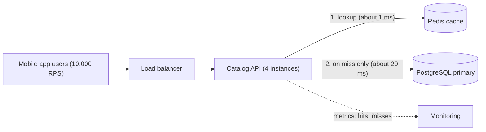
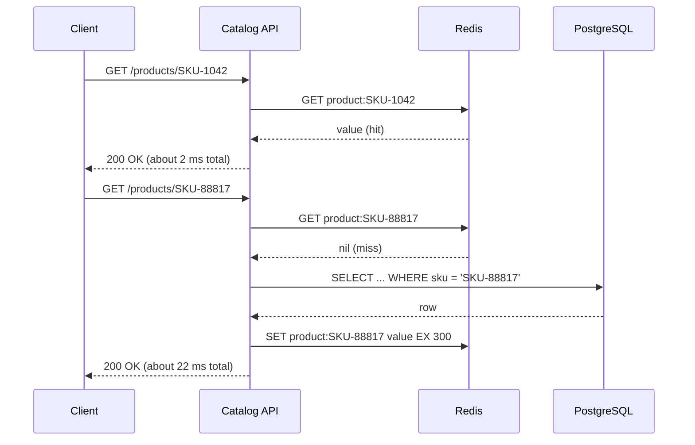

Every fast system you have used leans on caches: the CPU in your laptop, the PostgreSQL buffer pool, the CDN that serves a cricket highlights clip, the browser that does not re-download a logo. This lesson explains *why* they work, using arithmetic you can do on a whiteboard. Later lessons in this module cover *how* to use them safely.

## Learning objectives

By the end of this lesson you will be able to:

1. Explain in plain words why a small, fast copy of data can serve most requests (locality and hot sets).
2. Describe Zipf-shaped ("a few items are very popular") traffic and estimate how much of it a cache of a given size can absorb.
3. Calculate effective latency and database load from a hit ratio, and explain why going from 90 % to 99 % matters far more than it sounds.
4. Size a cache's memory with back-of-the-envelope numbers.
5. Measure hit ratio in an ASP.NET Core service with `IMemoryCache` and `System.Diagnostics.Metrics`.
6. Decide when a cache is *not* worth its cost, and name the simpler fix to try first.

## Prerequisites

- [Latency numbers and latency budgets](#/lesson/m11-latency-numbers): you should know that memory is far faster than a network hop, and a network hop is faster than a disk-backed query.
- [Caching layers in a system](#/lesson/m11-caching-layers): the map of where caches live (browser, CDN, app, database).
- [Capacity estimation](#/lesson/m11-capacity-estimation): we use the same RPS arithmetic here.

## Explain it like I'm a beginner

Think of a busy tea stall outside a railway station in Pune. The owner keeps the big milk cans and sugar sacks in a storeroom at the back. That storeroom has everything, but walking there takes a minute.

So every morning he puts one small pot of tea, a jar of sugar and a few cups right on the counter. The counter holds maybe 2 % of his stock. Yet almost every customer asks for the same thing — cutting chai — so the counter serves nearly everyone in seconds. He only walks to the storeroom when the pot runs dry or someone asks for something unusual, like black coffee.

That counter is a **cache**:

- The storeroom is the **database** (the source of truth): complete, but slow to reach.
- The counter is the **cache**: small, fast, and holding copies of what people ask for most.
- A customer served from the counter is a **cache hit**. A walk to the storeroom is a **cache miss**.
- The share of customers served from the counter is the **hit ratio**.

The trick only works because customers are *predictable*. If every customer asked for a different drink, the counter would be useless — he would walk to the storeroom every time and waste counter space too. Caching is a bet on repetition. This lesson is about when that bet pays off.

## First-principles explanation

### What a cache is

A cache is a smaller, faster store that keeps copies of data whose real home (the *source of truth*, or *backing store*) is bigger and slower. A read checks the cache first. If the data is there (a hit), you return it quickly. If not (a miss), you fetch it from the source, return it, and usually keep a copy for next time.

Two properties make this worthwhile:

1. **Speed gap.** Reading from the cache must be much faster than reading from the source. Local process memory takes well under a microsecond. A Redis call in the same data centre is roughly 0.2–1 ms including the network (an estimate; measure your own). A PostgreSQL query that touches disk or does real work often takes 5–50 ms.
2. **Repetition.** The same data must be asked for again before the copy is thrown away. That is what *locality* means.

### Locality: why repetition happens

**Temporal locality (recently used things get used again soon).** A user who opens an order page will probably refresh it, open it from a notification, and open it again after paying. A trending product is viewed thousands of times in an hour.

**Spatial locality (things near each other get used together).** When a CPU reads one byte, it fetches a whole 64-byte cache line because the next bytes are likely to be read next. PostgreSQL reads whole 8 KB pages for the same reason. In application caching, the equivalent is caching a whole "product card" object rather than ten separate fields that are always read together.

**Working set (the stuff in use right now).** Peter Denning described this in 1968 for operating-system memory: over any short window, a program touches only a small part of all its data. Web systems behave the same way. A grocery app may list 400,000 products across India, but at 8 pm on a Saturday in Bengaluru, perhaps a few thousand of them get most of the views. That active part is the **hot set**. If the hot set fits in the cache, the hit ratio is high.

### Skewed popularity: the Zipf shape

In 1999, Breslau and colleagues measured web proxy traces and found that page popularity follows a *Zipf-like* distribution: the k-th most popular item is requested with probability proportional to 1/k^s, with s often a bit below 1. Similar long-tailed shapes show up for videos, products, search terms and API keys. You do not need the exact exponent. You need the shape: **a few items are extremely popular, and a long tail of items is rarely requested.**

Let us put numbers on it. Assume s = 1 (a simple, slightly optimistic model) and a catalogue of N = 1,000,000 products. If the cache holds the K most popular items, the share of requests it can serve is the ratio of two harmonic numbers, H(K) / H(N), where H(n) ≈ ln n + 0.577.

| Cache holds | Share of catalogue | Share of requests it can serve (model) |
|---|---|---|
| Top 1,000 | 0.1 % | (6.91 + 0.58) / (13.82 + 0.58) ≈ **52 %** |
| Top 10,000 | 1 % | (9.21 + 0.58) / 14.40 ≈ **68 %** |
| Top 100,000 | 10 % | (11.51 + 0.58) / 14.40 ≈ **84 %** |

These are model estimates, not measurements. Two lessons fall out of the table:

- **A tiny cache captures a large share of traffic.** One per cent of the data serves about two-thirds of the requests.
- **Returns diminish.** Ten times more memory (1 % → 10 %) adds only 16 percentage points. Past some size, extra cache memory buys little.

Real traffic has another helpful property: popular items stay popular for a while (minutes to days), so the cache does not need to know the ranking in advance. A simple rule such as "keep what was used recently" (LRU, covered in [Cache invalidation, TTL and eviction](#/lesson/m12-invalidation-ttl)) finds the hot set on its own.

### The hit-ratio arithmetic

Let *h* be the hit ratio (between 0 and 1), *c* the cache read time and *d* the database read time. The classic formula for average (effective) latency is:

> **effective latency = h × c + (1 − h) × d**

It is a weighted average: hits cost *c*, misses cost *d*. A more honest version notices that a miss *also* paid for the cache lookup before going to the database:

> **effective latency = h × c + (1 − h) × (c + d) = c + (1 − h) × d**

Worked example: a product-detail API with c = 1 ms (Redis in the same region, estimated) and d = 20 ms (PostgreSQL query plus serialisation, measured on a hypothetical system).

| Hit ratio | Effective latency (c + (1 − h) × d) | Requests reaching the database at 10,000 RPS |
|---|---|---|
| 0 % (no cache) | 20 ms (no cache lookup at all) | 10,000 RPS |
| 50 % | 1 + 0.5 × 20 = 11 ms | 5,000 RPS |
| 90 % | 1 + 0.1 × 20 = 3 ms | 1,000 RPS |
| 95 % | 1 + 0.05 × 20 = 2 ms | 500 RPS |
| 99 % | 1 + 0.01 × 20 = 1.2 ms | 100 RPS |

Look at the right-hand column. **What matters is the miss ratio (1 − h), not the hit ratio.** Going from 90 % to 99 % sounds like a 10 % improvement. It is actually a **10× drop in database traffic** (1,000 → 100 RPS), because the miss ratio fell from 10 % to 1 %. This is why engineers care about the last few per cent.

The same arithmetic tells you how much database you need. If one PostgreSQL primary comfortably handles about 2,000 simple reads per second for this query (an estimate — load test your own), then at 10,000 RPS:

- with no cache you need about 5 database nodes' worth of read capacity (replicas);
- at 90 % hits you need a fraction of one;
- at 99 % hits the database barely notices the traffic.

### Averages hide tails

Effective latency is an *average*. Users feel the slow requests. At 90 % hits, your p50 (median) is the cache time, but every request that misses pays the full database time, so your p95 and p99 still sit near *d*. Caching improves the median enormously and the tail only if the miss ratio falls below the tail percentile: you need more than 99 % hits before p99 looks like the cache. Keep this in mind when someone says "we added a cache but p99 didn't move".

### Break-even: when is a cache faster at all?

A cache lowers average latency when c + (1 − h) × d < d, which simplifies to **h > c / d**. With c = 1 ms and d = 20 ms, any hit ratio above 5 % helps on average. For a local in-memory cache (c ≈ 0.001 ms) the break-even is almost zero.

So *latency* break-even is easy. The real costs of a cache are elsewhere:

- **Staleness.** A cached copy can be out of date. Somebody has to decide how stale is acceptable.
- **Complexity.** Invalidation logic, a new piece of infrastructure, new failure modes (stampedes, outages — see [Cache stampede, penetration and hot keys](#/lesson/m12-cache-failures)).
- **Memory cost.** Managed Redis is billed by memory size.
- **Debuggability.** "Why does the app show the old price?" becomes a common support ticket.

### Sizing memory

Back-of-the-envelope for the grocery catalogue:

- Hot set target: top 20,000 products.
- Serialized product card (name, price, image URL, stock flag, 3 variants): about 1.5 KB as JSON. Add key and overhead per entry in Redis — roughly 100 bytes or more depending on the encoding (estimate).
- 20,000 × 1.6 KB ≈ **32 MB**.

32 MB fits comfortably in the memory of a single app server, let alone a Redis instance. Most caches are smaller than people fear. Where caches get big is per-user data: 5 million active users × 4 KB session = 20 GB, which is a different conversation.

### When caching is useful

- **Read-heavy data.** Reads outnumber writes 10:1 or more (product details, city lists, tax slabs, exchange rates, feature flags).
- **Skewed access.** A hot set exists and fits in memory.
- **Expensive to compute.** Aggregations, rendered HTML, third-party API responses (think of a GST-number validation API that charges per call).
- **Tolerates some staleness.** Showing a restaurant rating that is 60 seconds old is fine.

### When caching is not worth it

- **Uniform or one-off access.** One-time OTP lookups, per-request unique reports, a batch job that scans every row once. Nothing repeats, so the hit ratio is near zero and the cache only adds a hop.
- **Write-heavy data.** If a value changes every time it is read (a live auction's current bid), the copy is stale before anyone uses it.
- **Strict correctness.** A wallet balance used to approve a UPI payment must come from the source of truth, inside a transaction. You can cache it for *display*, never for *decisions*.
- **The database is already fast and idle.** An indexed primary-key lookup on a warm PostgreSQL table often takes under a millisecond and hits PostgreSQL's own buffer cache. If the database runs at 15 % CPU, a cache adds risk without a real benefit.
- **The query is just bad.** A 900 ms query with a missing index should get the index, not a cache. Caching it hides the problem until the first cold start, when every request is slow at once.

:::callout type=tip title="Try the cheaper fixes first"
Before adding a distributed cache, check: is there an index? Is the query fetching 200 columns to show 5? Is there an N+1 loop? Would HTTP caching headers let the browser or CDN do the work for free? A cache is the right answer surprisingly often — but only after these are ruled out.
:::

### Trade-offs at a glance

| You gain | You pay |
|---|---|
| Lower median latency (often 5–20× on hits) | Data can be stale for up to the TTL or invalidation delay |
| Much lower database load (scales with the miss ratio) | A new component to run, monitor and pay for |
| Absorb traffic spikes on hot items | New failure modes: stampede on expiry, overload when the cache is down |
| Cheaper than scaling the database for reads | Cold starts: an empty cache sends all traffic to the database |

## Visual explanation

### Architecture: where the cache sits



Read it left to right. Users send 10,000 requests per second through the load balancer to four API instances. Each instance first asks Redis (arrow 1). Only when Redis does not have the item does the API go to PostgreSQL (arrow 2). The arrow to PostgreSQL carries `(1 − h) × 10,000` requests per second, so at 90 % hits it carries about 1,000. The dotted arrow is just as important: without hit and miss counters you are guessing whether the cache works at all.

### Sequence: a hit and a miss



The first request is a hit: one fast round trip to Redis. The second is a miss: the API pays for the Redis lookup, then the database query, then a write back to Redis with a 300-second expiry so the next caller gets a hit. Notice the miss is *slower* than having no cache at all, by the cost of the extra lookup and write. That is the `c + d` in the honest formula.

## Step-by-step example

**Scenario.** A city bus-tracking app in Ahmedabad shows "next bus arrival" for each stop. There are 3,200 stops. Arrival predictions are recomputed by a background job every 15 seconds. Peak traffic is 6,000 RPS in the evening rush. Each uncached request runs a query joining the predictions table with route metadata, costing about 25 ms and a noticeable share of database CPU.

### Step 1 — Is the data read-heavy?

Writes: 3,200 stops updated every 15 s ≈ 213 writes per second. Reads: 6,000 per second. Ratio ≈ 28:1. Read-heavy. ✔

### Step 2 — Is there a hot set?

Stops near metro stations and the main bus terminals get most views. Even if access were *uniform*, the whole data set is only 3,200 entries × ~800 bytes ≈ 2.6 MB. Everything fits. ✔

### Step 3 — How stale can it be?

The data itself is only refreshed every 15 s, so a TTL of 5–10 s adds little extra staleness. Riders will not notice a 5-second-old prediction. ✔

### Step 4 — Predict the hit ratio

Each stop's entry expires every 10 s (TTL). With 6,000 RPS spread over 3,200 stops, a busy stop is read many times per 10 s window. A rough upper bound on misses: at most one miss per key per TTL = 3,200 / 10 s = 320 misses per second. So h ≥ 1 − 320 / 6,000 ≈ **94.7 %**. Hot stops will hit even more; cold stops may miss on most reads, which is fine because they are rare.

### Step 5 — Predict the effect

- Database reads: from 6,000 RPS to at most ~320 RPS — roughly a 19× reduction.
- Effective latency with a local in-memory cache (c ≈ 0.01 ms): 0.01 + 0.053 × 25 ≈ **1.3 ms** average, down from 25 ms.

### Step 6 — Choose the simplest cache that works

2.6 MB fits in every API instance's memory. With 4 instances each caching independently, total misses are at most 4 × 320 = 1,280 RPS — still a big win, and no Redis to run. Start with `IMemoryCache`. Move to a shared cache only if misses or memory per instance become a problem.

### Step 7 — Measure

Add hit and miss counters and compare the real hit ratio with the 94.7 % prediction. If it is much lower, look for bugs: keys that include a timestamp, or a TTL measured in milliseconds by mistake.

## Production-style C# implementation

We build a small catalogue service that caches product cards in `IMemoryCache`, counts hits and misses with `System.Diagnostics.Metrics` (so OpenTelemetry or `dotnet-counters` can read them), and exposes a debug endpoint with the live hit ratio. The repository is an in-memory fake that simulates database latency, so everything runs offline.

```text
Catalog.Api/
  Program.cs
  Catalog/Product.cs
  Catalog/SimulatedProductRepository.cs
  Caching/CacheStatistics.cs
  Caching/CachedProductReader.cs
  Caching/CacheEconomics.cs
```

```csharp file=Catalog/Product.cs
namespace Catalog;

public sealed record Product(string Sku, string Name, decimal PriceInr, bool InStock);

public interface IProductRepository
{
    Task<Product?> FindAsync(string sku, CancellationToken ct);
}
```

```csharp file=Catalog/SimulatedProductRepository.cs
namespace Catalog;

/// <summary>Stands in for PostgreSQL. Each call waits a fixed time to mimic a real query,
/// and counts calls so we can see how much load the cache removes.</summary>
public sealed class SimulatedProductRepository : IProductRepository
{
    private readonly Dictionary<string, Product> _rows;
    private readonly TimeSpan _latency;
    private long _calls;

    public SimulatedProductRepository(int productCount = 10_000, int latencyMs = 20)
    {
        _latency = TimeSpan.FromMilliseconds(latencyMs);
        _rows = Enumerable.Range(1, productCount)
            .Select(i => new Product($"SKU-{i}", $"Product {i}", 49m + i % 500, i % 17 != 0))
            .ToDictionary(p => p.Sku, StringComparer.OrdinalIgnoreCase);
    }

    public long Calls => Interlocked.Read(ref _calls);

    public async Task<Product?> FindAsync(string sku, CancellationToken ct)
    {
        Interlocked.Increment(ref _calls);
        await Task.Delay(_latency, ct);
        return _rows.GetValueOrDefault(sku);
    }
}
```

```csharp file=Caching/CacheStatistics.cs
using System.Diagnostics.Metrics;

namespace Catalog.Caching;

/// <summary>Thread-safe hit/miss counters, exported as .NET metrics.
/// Register as a singleton: one set of counters per cache.</summary>
public sealed class CacheStatistics
{
    public const string MeterName = "Catalog.Cache";
    private readonly Counter<long> _hits;
    private readonly Counter<long> _misses;
    private long _hitCount;
    private long _missCount;

    public CacheStatistics(IMeterFactory meterFactory)
    {
        var meter = meterFactory.Create(MeterName);
        _hits = meter.CreateCounter<long>("catalog.cache.hits", description: "Reads served from the cache");
        _misses = meter.CreateCounter<long>("catalog.cache.misses", description: "Reads that went to the database");
        meter.CreateObservableGauge("catalog.cache.hit_ratio", () => HitRatio, description: "Hits / (hits + misses) since start");
    }

    public long Hits => Interlocked.Read(ref _hitCount);
    public long Misses => Interlocked.Read(ref _missCount);

    public double HitRatio
    {
        get
        {
            long h = Hits, m = Misses;
            return h + m == 0 ? 0 : (double)h / (h + m);
        }
    }

    public void RecordHit(string cacheName)
    {
        Interlocked.Increment(ref _hitCount);
        _hits.Add(1, new KeyValuePair<string, object?>("cache", cacheName));
    }

    public void RecordMiss(string cacheName)
    {
        Interlocked.Increment(ref _missCount);
        _misses.Add(1, new KeyValuePair<string, object?>("cache", cacheName));
    }
}
```

```csharp file=Caching/CachedProductReader.cs
using Microsoft.Extensions.Caching.Memory;
using Microsoft.Extensions.Options;

namespace Catalog.Caching;

public sealed class ProductCacheOptions
{
    public TimeSpan TimeToLive { get; set; } = TimeSpan.FromMinutes(5);
    /// <summary>Upper bound on entries; each entry has Size = 1.</summary>
    public long MaxEntries { get; set; } = 20_000;
}

/// <summary>Reads product cards through a local in-memory cache and records every hit and miss.</summary>
public sealed class CachedProductReader(
    IProductRepository repository,
    IMemoryCache cache,
    CacheStatistics stats,
    IOptions<ProductCacheOptions> options)
{
    private const string CacheName = "product-card";
    private readonly ProductCacheOptions _o = options.Value;

    public async Task<Product?> GetAsync(string sku, CancellationToken ct)
    {
        // Normalise the key: "sku-12" and "SKU-12" must not become two cache entries.
        var key = $"product:{sku.Trim().ToUpperInvariant()}";

        if (cache.TryGetValue(key, out Product? cached))
        {
            stats.RecordHit(CacheName);
            return cached;
        }

        stats.RecordMiss(CacheName);
        var product = await repository.FindAsync(sku, ct);
        if (product is not null)
        {
            cache.Set(key, product, new MemoryCacheEntryOptions
            {
                AbsoluteExpirationRelativeToNow = _o.TimeToLive,
                Size = 1,
            });
        }
        return product;
    }
}
```

```csharp file=Caching/CacheEconomics.cs
namespace Catalog.Caching;

/// <summary>The arithmetic from this lesson, as code you can unit-test and reuse in capacity notes.</summary>
public static class CacheEconomics
{
    /// <summary>Average latency when every miss also paid for the cache lookup: c + (1 - h) * d.</summary>
    public static double EffectiveLatencyMs(double hitRatio, double cacheMs, double dbMs)
    {
        ValidateRatio(hitRatio);
        return cacheMs + (1 - hitRatio) * dbMs;
    }

    /// <summary>Requests per second that still reach the database.</summary>
    public static double DatabaseRps(double totalRps, double hitRatio)
    {
        ValidateRatio(hitRatio);
        return totalRps * (1 - hitRatio);
    }

    /// <summary>Share of requests served if the cache holds the top K of N items under Zipf(s=1): H(K) / H(N).</summary>
    public static double ZipfTopKHitRatio(int k, int n)
    {
        if (n <= 0 || k < 0) throw new ArgumentOutOfRangeException(nameof(n));
        return Harmonic(Math.Min(k, n)) / Harmonic(n);
    }

    private static double Harmonic(int n)
    {
        double sum = 0;
        for (var i = 1; i <= n; i++) sum += 1.0 / i;
        return sum;
    }

    private static void ValidateRatio(double h)
    {
        if (h is < 0 or > 1) throw new ArgumentOutOfRangeException(nameof(h), "Hit ratio must be between 0 and 1.");
    }
}
```

```csharp file=Program.cs
using Catalog;
using Catalog.Caching;

var builder = WebApplication.CreateBuilder(args);

builder.Services.Configure<ProductCacheOptions>(builder.Configuration.GetSection("ProductCache"));
var maxEntries = builder.Configuration.GetValue<long?>("ProductCache:MaxEntries") ?? 20_000;

// SizeLimit makes the memory cache evict entries instead of growing without bound.
builder.Services.AddMemoryCache(o => o.SizeLimit = maxEntries);
builder.Services.AddMetrics();
builder.Services.AddSingleton<CacheStatistics>();
builder.Services.AddSingleton<SimulatedProductRepository>();
builder.Services.AddSingleton<IProductRepository>(sp => sp.GetRequiredService<SimulatedProductRepository>());
builder.Services.AddSingleton<CachedProductReader>();

var app = builder.Build();

app.MapGet("/products/{sku}", async (string sku, CachedProductReader reader, CancellationToken ct) =>
    await reader.GetAsync(sku, ct) is { } p ? Results.Ok(p) : Results.NotFound());

// Debug endpoint: compare the measured hit ratio with your prediction.
app.MapGet("/debug/cache", (CacheStatistics stats, SimulatedProductRepository repo) => Results.Ok(new
{
    stats.Hits,
    stats.Misses,
    HitRatio = Math.Round(stats.HitRatio, 4),
    DatabaseCalls = repo.Calls,
}));

app.Run();
```

Design notes:

- **`SizeLimit` plus `Size = 1`.** Without a size limit, `IMemoryCache` grows until the process runs out of memory. Once you set `SizeLimit`, every entry *must* declare a `Size`, or `Set` throws. Here one entry counts as one unit, so the limit is "20,000 entries".
- **Metrics, not logs.** Logging every hit at 10,000 RPS would cost more than the cache saves. Counters are cheap and can be scraped by OpenTelemetry.
- **Key normalisation.** Different spellings of the same key silently halve your hit ratio. Normalise once, in one place.
- **Negative results are not cached here.** A missing SKU goes to the database every time. That is a deliberate simplification; [Cache stampede, penetration and hot keys](#/lesson/m12-cache-failures) shows why and how to cache "not found".
- **Built-in alternatives.** `MemoryCacheOptions.TrackStatistics = true` makes `IMemoryCache.GetCurrentStatistics()` report hits, misses and entry count without your own counters (the custom class here adds per-cache tags and an OpenTelemetry gauge). For new code that needs both a local and a shared cache, `HybridCache` (`Microsoft.Extensions.Caching.Hybrid`, .NET 9 and later) combines an in-process L1 with an `IDistributedCache` L2 such as Redis and lets only one caller per key run the database query on a miss.
- **This is cache-aside.** The application code checks the cache and fills it. [Cache-aside, read-through, write-through and write-behind](#/lesson/m12-cache-patterns) compares it with the alternatives.

## Bad design vs good design

**Bad: "cache everything, forever, and hope".**

```csharp
// Anti-example: no expiry, no size limit, key includes the request time, no measurement.
var key = $"report:{userId}:{DateTime.UtcNow:O}";
if (!_cache.TryGetValue(key, out Report? r))
{
    r = await _db.BuildReportAsync(userId);
    _cache.Set(key, r);          // never expires, never evicted
}
```

Problems:

- The key contains a timestamp, so **no two requests share a key**. The hit ratio is 0 % and memory grows with every request until the process crashes.
- No expiry: if the key *were* reused, the data would be stale forever.
- No counters: nobody notices the 0 % until the out-of-memory alert at 3 am.

**Good:** the `CachedProductReader` above. It uses a stable, normalised key; a TTL that matches how stale the business can accept; a size limit; and hit/miss metrics.

**Also good — no cache at all.** If the report is per-user, generated once, and downloaded once, do not cache it. Store the generated file in object storage and hand out a link. The best cache is sometimes none.

:::callout type=mistake title="Caching hides slow queries until they bite"
A team caches a 1.2-second dashboard query and celebrates a 15 ms average. Months later, a deployment restarts every instance at once. Every cache is empty, every request runs the 1.2-second query, and the database falls over. Fix the query first. Then cache it if it is still worth it.
:::

## Practical playground

Open the cache simulator below. It models an API at 1,000 RPS in front of a database that comfortably handles 600 RPS, with a 40 ms database and a 2 ms cache.

1. Start with `hitRatio` 0.6. Watch the database load chart: 400 RPS of misses is fine.
2. Drop to 0.3. Misses rise to about 700 RPS, above the database's capacity. See how latency climbs much faster than linearly — a busy database gets slower for *everyone* (queueing).
3. Raise `hitRatio` back to 0.9 and lower the TTL to 5 seconds. The *effective* hit rate falls because each hot key now expires and misses more often.
4. Turn on `cacheDown`. For the middle third of the run every request hits the database. This is the scenario the [cache failures lesson](#/lesson/m12-cache-failures) is about.

Write down, for each step, what you predicted with `c + (1 − h) × d` before you looked.

:::playground type=sim sim=cache title="Hit ratio versus latency and database load" hitRatio=0.6 rps=1000 dbCapacityRps=600 dbLatencyMs=40 cacheLatencyMs=2 ttlSeconds=60
Adjust the hit ratio, TTL and outage switch, and compare the database load line with the database capacity line.
:::

## Exercises

:::exercise id=m12-why-caching-ex1 difficulty=beginner kind=code title="Cache arithmetic helpers"
Implement the three helpers in `CacheMath` so that a capacity planner can use them in a notebook or a test.
::requirements
- `EffectiveLatencyMs(h, cacheMs, dbMs)` returns `cacheMs + (1 - h) * dbMs` (a miss pays for the lookup too).
- `DatabaseRps(totalRps, h)` returns the requests per second that reach the database.
- `RequiredHitRatio(totalRps, dbCapacityRps)` returns the smallest hit ratio that keeps database traffic at or below capacity (0 if no cache is needed).
- Hit ratios outside 0..1 throw `ArgumentOutOfRangeException`.
::acceptance
- h = 0.9, cache 1 ms, db 20 ms gives 3 ms.
- 10,000 RPS at h = 0.99 gives 100 database RPS.
- 10,000 RPS with database capacity 2,000 RPS needs h = 0.8.
- 1,000 RPS with capacity 5,000 needs h = 0.
::hint
Every miss reaches the database. What share of requests are misses?
::hint
Database RPS = total × (1 − h). Rearrange it: for the database to get at most `capacity`, you need 1 − h ≤ capacity / total.
::hint
So `h ≥ 1 − capacity / total`. If that is negative, clamp it to 0.
::hint
```csharp
public static double RequiredHitRatio(double totalRps, double dbCapacityRps)
    => Math.Max(0, 1 - dbCapacityRps / totalRps);
```
::starter
```csharp file=CacheMath.cs
using System;

public static class CacheMath
{
    public static double EffectiveLatencyMs(double hitRatio, double cacheMs, double dbMs)
        => throw new NotImplementedException();

    public static double DatabaseRps(double totalRps, double hitRatio)
        => throw new NotImplementedException();

    public static double RequiredHitRatio(double totalRps, double dbCapacityRps)
        => throw new NotImplementedException();
}
```
::tests
```csharp file=CacheMathTests.cs
using System;
using Xunit;

public class CacheMathTests
{
    [Fact] public void Effective_latency_at_90_percent() =>
        Assert.Equal(3.0, CacheMath.EffectiveLatencyMs(0.9, 1, 20), 6);

    [Fact] public void Effective_latency_at_zero_hits_pays_lookup_plus_db() =>
        Assert.Equal(21.0, CacheMath.EffectiveLatencyMs(0, 1, 20), 6);

    [Fact] public void Database_rps_at_99_percent() =>
        Assert.Equal(100.0, CacheMath.DatabaseRps(10_000, 0.99), 6);

    [Fact] public void Required_hit_ratio_for_capacity() =>
        Assert.Equal(0.8, CacheMath.RequiredHitRatio(10_000, 2_000), 6);

    [Fact] public void No_cache_needed_when_capacity_is_enough() =>
        Assert.Equal(0.0, CacheMath.RequiredHitRatio(1_000, 5_000), 6);

    [Fact] public void Invalid_ratio_throws() =>
        Assert.Throws<ArgumentOutOfRangeException>(() => CacheMath.DatabaseRps(100, 1.5));
}
```
::solution
The key insight is that the database sees only the misses, so everything is driven by `1 − h`.

```csharp file=CacheMath.cs
using System;

public static class CacheMath
{
    public static double EffectiveLatencyMs(double hitRatio, double cacheMs, double dbMs)
    {
        Check(hitRatio);
        return cacheMs + (1 - hitRatio) * dbMs;
    }

    public static double DatabaseRps(double totalRps, double hitRatio)
    {
        Check(hitRatio);
        return totalRps * (1 - hitRatio);
    }

    public static double RequiredHitRatio(double totalRps, double dbCapacityRps)
    {
        if (totalRps <= 0) return 0;
        return Math.Max(0, 1 - dbCapacityRps / totalRps);
    }

    private static void Check(double h)
    {
        if (h < 0 || h > 1) throw new ArgumentOutOfRangeException(nameof(h));
    }
}
```

Sanity check with the lesson's table: at 10,000 RPS and capacity 2,000, you need 80 % hits. Leave headroom in real life — plan for the database to run at 50–70 % of capacity, not 100 %.
::mistakes
- Using `h × c + (1 − h) × d` and then being surprised the real system is slightly slower: misses also pay for the cache lookup.
- Forgetting to clamp `RequiredHitRatio` at zero, which returns a negative ratio.
- Planning for the database to run at exactly 100 % of capacity.
::extensions
Add `RequiredHitRatioForLatency(targetMs, cacheMs, dbMs)` and use it to answer: "what hit ratio gives a 5 ms average with a 1 ms cache and a 40 ms database?"
:::

:::exercise id=m12-why-caching-ex2 difficulty=beginner kind=written title="Cache it or not?"
For each data set below, say whether you would cache it, where (browser/CDN, in-process memory, or a shared cache like Redis), and with roughly what freshness. Give one sentence of reasoning each.

1. The list of 36 Indian states and union territories, used in an address form.
2. A user's wallet balance used to approve a ₹2,000 payment.
3. Product detail pages on a fashion site during a sale (2 million products, 50,000 RPS).
4. One-time password (OTP) verification records.
5. Live cricket score for one match, updated every ball, read by 3 million users.
6. A monthly GST report generated once per business and downloaded once.
::acceptance
- Each item has a yes/no, a location, and a freshness or TTL.
- The reasoning mentions read/write ratio, reuse (hot set) or correctness.
- At least one item is correctly marked "do not cache for decisions".
::hint
For each, ask three questions: does it repeat? How often does it change? What breaks if it is stale?
::hint
Separate "show it to a human" from "use it to make a decision". The same value can be cacheable for one and not the other.
::hint
Static reference data can live as close to the user as possible. Highly shared but fast-changing data needs a very short TTL, or push updates.
::solution
1. **Cache.** In-process memory or even bundled into the front end; changes maybe once in years. TTL of hours, or invalidate on deploy. Tiny and read on every form load.
2. **Do not cache for the approval decision.** Read it from the source of truth inside the payment transaction. You *may* cache it for display on the home screen with a short TTL and a "refresh" control.
3. **Cache.** Shared cache (Redis) plus CDN for images and possibly rendered pages; TTL of 1–5 minutes for details, shorter or event-invalidated for price and stock. Strong Zipf skew: sale items are a hot set.
4. **Do not cache.** Each record is used once or twice and must be exact; there is no reuse. Store with an expiry in the database or a key-value store as the primary store, not as a cache.
5. **Cache with a very short TTL (1–2 s) or push it.** At 3 million readers and one writer, a 1-second cache turns millions of reads into one per second per server. At this scale, pushing updates over WebSockets or Server-Sent Events may be better than polling ([see realtime lesson](#/lesson/m10-realtime)).
6. **Do not cache.** Generated once, read once — zero reuse. Store the file in object storage and send a link.
::mistakes
- Caching the wallet balance "for 5 seconds" and using it to approve payments — this allows overspending.
- Treating OTP storage as a cache: if the "cache" loses the entry, the user cannot log in. A store that must not lose data is not a cache.
- Forgetting the CDN for item 3; images are most of the bytes.
:::

:::exercise id=m12-why-caching-ex3 difficulty=intermediate kind=code title="A hit-counting cache wrapper"
Write `CountingCache<TKey, TValue>`, a small in-memory cache with `GetOrAdd(key, factory)` that records hits and misses and reports the hit ratio. It must be safe to call from many threads.
::requirements
- `GetOrAdd` returns the cached value on a hit; on a miss it calls `factory(key)`, stores the result and returns it.
- `Hits`, `Misses` and `HitRatio` (0 when there have been no calls) are exposed.
- `Reset()` clears the counters but not the data.
- Concurrent calls must not lose counts.
::acceptance
- Calling `GetOrAdd("a")` twice gives 1 miss, 1 hit, ratio 0.5.
- The factory runs once for a repeated key in single-threaded use.
- 8 threads × 1,000 calls on 10 keys give `Hits + Misses == 8,000`.
::hint
`ConcurrentDictionary<TKey, TValue>` is a good backing store. What does it give you for "get or add"?
::hint
`ConcurrentDictionary.GetOrAdd(key, factory)` does not tell you whether it called the factory. Try `TryGetValue` first, and count a miss only when you fall through.
::hint
Use `Interlocked.Increment` on `long` fields so that counts are not lost when threads race.
::hint
Under a race, two threads can both miss the same key and both call the factory. That is acceptable here (both are counted as misses). Lesson [m12-cache-failures](#/lesson/m12-cache-failures) shows how to coalesce them.
::starter
```csharp file=CountingCache.cs
using System;
using System.Collections.Concurrent;
using System.Threading;

public sealed class CountingCache<TKey, TValue> where TKey : notnull
{
    public long Hits => throw new NotImplementedException();
    public long Misses => throw new NotImplementedException();
    public double HitRatio => throw new NotImplementedException();

    public TValue GetOrAdd(TKey key, Func<TKey, TValue> factory) => throw new NotImplementedException();

    public void Reset() => throw new NotImplementedException();
}
```
::tests
```csharp file=CountingCacheTests.cs
using System;
using System.Linq;
using System.Threading.Tasks;
using Xunit;

public class CountingCacheTests
{
    [Fact]
    public void Second_read_is_a_hit()
    {
        var c = new CountingCache<string, int>();
        c.GetOrAdd("a", _ => 1);
        c.GetOrAdd("a", _ => 2);
        Assert.Equal(1L, c.Hits);
        Assert.Equal(1L, c.Misses);
        Assert.Equal(0.5, c.HitRatio, 6);
    }

    [Fact]
    public void Returns_first_value_and_runs_factory_once()
    {
        var calls = 0;
        var c = new CountingCache<string, int>();
        var first = c.GetOrAdd("k", _ => { calls++; return 42; });
        var second = c.GetOrAdd("k", _ => { calls++; return 99; });
        Assert.Equal(42, first);
        Assert.Equal(42, second);
        Assert.Equal(1, calls);
    }

    [Fact]
    public void Empty_cache_ratio_is_zero() => Assert.Equal(0.0, new CountingCache<int, int>().HitRatio, 6);

    [Fact]
    public void Reset_keeps_data_clears_counters()
    {
        var c = new CountingCache<int, int>();
        c.GetOrAdd(1, k => k);
        c.Reset();
        c.GetOrAdd(1, k => k + 100);
        Assert.Equal(1L, c.Hits);
        Assert.Equal(0L, c.Misses);
    }

    [Fact]
    public void Concurrent_calls_do_not_lose_counts()
    {
        var c = new CountingCache<int, int>();
        Parallel.For(0, 8, _ => { for (var i = 0; i < 1000; i++) c.GetOrAdd(i % 10, k => k * 2); });
        Assert.Equal(8000L, c.Hits + c.Misses);
        Assert.True(c.Misses >= 10);
    }
}
```
::solution
Check first, count, then add. `Interlocked` makes the counters exact under concurrency.

```csharp file=CountingCache.cs
using System;
using System.Collections.Concurrent;
using System.Threading;

public sealed class CountingCache<TKey, TValue> where TKey : notnull
{
    private readonly ConcurrentDictionary<TKey, TValue> _data = new();
    private long _hits;
    private long _misses;

    public long Hits => Interlocked.Read(ref _hits);
    public long Misses => Interlocked.Read(ref _misses);

    public double HitRatio
    {
        get
        {
            long h = Hits, m = Misses;
            return h + m == 0 ? 0 : (double)h / (h + m);
        }
    }

    public TValue GetOrAdd(TKey key, Func<TKey, TValue> factory)
    {
        if (_data.TryGetValue(key, out var existing))
        {
            Interlocked.Increment(ref _hits);
            return existing;
        }
        Interlocked.Increment(ref _misses);
        // If another thread added the key meanwhile, GetOrAdd returns its value: both callers see the same data.
        return _data.GetOrAdd(key, factory);
    }

    public void Reset()
    {
        Interlocked.Exchange(ref _hits, 0);
        Interlocked.Exchange(ref _misses, 0);
    }
}
```

This cache never evicts, so it suits small, bounded key sets only. In ASP.NET Core you would wrap `IMemoryCache` (with a `SizeLimit`) the same way, as the production example does.
::mistakes
- Using `_hits++` — increments are not atomic, so concurrent calls lose counts.
- Counting a miss inside the factory lambda. `ConcurrentDictionary.GetOrAdd` may call the factory more than once under contention, so counts become wrong.
- Computing `HitRatio` with integer division (`h / (h + m)` on `long` gives 0).
::extensions
Add a `Count` of entries and a `TrimTo(int max)` that removes arbitrary entries, then measure how the hit ratio drops as you shrink the cache on a skewed workload.
:::

:::exercise id=m12-why-caching-ex4 difficulty=intermediate kind=hld title="Put a cache in front of a struggling catalogue"
A fashion marketplace serves product pages at **8,000 RPS** at peak. Each page needs one product query (about 30 ms) on a single PostgreSQL primary that saturates at roughly **2,500 reads per second** (estimate from load tests). The hot set is about 30,000 products × 2 KB. Prices change a few times a day; stock flags change every few minutes.

Starting from the current architecture, add caching so the database runs below 50 % of capacity at peak. State the hit ratio you need, where caches live, the TTLs, and the memory size.
::acceptance
- The required hit ratio is computed (with arithmetic shown).
- The graph contains at least one `cache` node between the API and the database, with a `ttlSeconds` prop.
- Memory sizing is stated.
- Images go through a CDN or object storage, not the API.
- One failure mode (cold start or cache outage) is named, with a mitigation.
::hint
Target database load is 50 % of 2,500 = 1,250 RPS. What miss ratio does that allow out of 8,000?
::hint
1 − h ≤ 1,250 / 8,000 ≈ 0.156, so h ≥ about 85 %. Is that plausible for a 30,000-item hot set?
::hint
30,000 × 2 KB = 60 MB. That fits in every API instance *and* in a small Redis. Which gives fewer total misses with 6 API instances?
::hint
Consider two layers: a small in-process cache (few seconds TTL) in front of a shared Redis (minutes TTL). Stock flags may need a shorter TTL than the rest of the card.
::starter
```json
{
  "nodes": [
    { "id": "users", "type": "client", "label": "Shoppers", "props": { "rps": 8000 } },
    { "id": "lb", "type": "load-balancer", "label": "Load balancer" },
    { "id": "api", "type": "app-server", "label": "Catalog API", "props": { "instances": 6 } },
    { "id": "db", "type": "database", "label": "PostgreSQL primary", "props": { "replicas": 0 } }
  ],
  "edges": [
    { "from": "users", "to": "lb", "kind": "sync" },
    { "from": "lb", "to": "api", "kind": "sync" },
    { "from": "api", "to": "db", "kind": "sync", "label": "product query" }
  ]
}
```
::solution
**Arithmetic.** Target DB load 1,250 RPS. Miss ratio ≤ 1,250 / 8,000 = 15.6 %, so **h ≥ 85 %**. With a Zipf-shaped catalogue and a hot set that fits fully in memory, 95 %+ is realistic, giving about 400 DB RPS.

**Memory.** 30,000 × 2 KB ≈ 60 MB plus overhead → a 250 MB Redis is generous.

```json
{
  "nodes": [
    { "id": "users", "type": "client", "label": "Shoppers", "props": { "rps": 8000 } },
    { "id": "cdn", "type": "cdn", "label": "CDN (images, static assets)" },
    { "id": "blob", "type": "object-storage", "label": "Product images" },
    { "id": "lb", "type": "load-balancer", "label": "Load balancer" },
    { "id": "api", "type": "app-server", "label": "Catalog API + 10 s in-process cache", "props": { "instances": 6 } },
    { "id": "redis", "type": "cache", "label": "Redis (product cards)", "props": { "ttlSeconds": 300 } },
    { "id": "db", "type": "database", "label": "PostgreSQL primary", "props": { "replicas": 1 } },
    { "id": "mon", "type": "monitoring", "label": "Hit ratio and DB load dashboards" }
  ],
  "edges": [
    { "from": "users", "to": "cdn", "kind": "sync", "label": "images" },
    { "from": "cdn", "to": "blob", "kind": "sync", "label": "on CDN miss" },
    { "from": "users", "to": "lb", "kind": "sync" },
    { "from": "lb", "to": "api", "kind": "sync" },
    { "from": "api", "to": "redis", "kind": "sync", "label": "1. lookup" },
    { "from": "api", "to": "db", "kind": "sync", "label": "2. on miss" },
    { "from": "api", "to": "mon", "kind": "async", "label": "metrics" }
  ]
}
```

**Reasoning.**
- A 10-second in-process cache absorbs the hottest few hundred items with no network hop; Redis shares everything else across all 6 instances, so a product is loaded from the database once per 5 minutes, not once per instance.
- Stock flags: either a separate key with a 30-second TTL, or invalidate on stock change (see [invalidation](#/lesson/m12-invalidation-ttl)). The price is shown with the TTL as accepted staleness, but checkout re-reads it from the database.
- One read replica gives headroom for cold starts.
- **Failure mode:** Redis outage or a mass restart sends 8,000 RPS at a database that handles 2,500. Mitigations: the in-process layer still absorbs some load; limit concurrent database queries and shed or degrade the rest; warm the cache before shifting traffic ([cache failures](#/lesson/m12-cache-failures)).
::mistakes
- Adding Redis but serving images through the API — images are most of the bytes.
- Picking a TTL without asking the business how stale a price may be.
- Forgetting that the database must survive a cold cache, at least in a degraded mode.
:::

:::exercise id=m12-why-caching-ex5 difficulty=advanced kind=code title="Zipf workload sampler and top-K hit ratio"
To reason about caches with data rather than guesses, build a deterministic Zipf workload generator and a function for the theoretical top-K hit ratio.
::requirements
- `ZipfSampler(int n, double s, int seed)` draws item ranks 1..n, where rank k has probability proportional to 1 / k^s.
- `Next()` must be O(log n): precompute the cumulative distribution once and use binary search.
- `static double TopKHitRatio(int k, int n, double s)` returns the share of requests that hit if the cache holds exactly the k most popular items.
- Invalid arguments (n ≤ 0, s < 0, k < 0) throw `ArgumentOutOfRangeException`.
::acceptance
- `TopKHitRatio(100, 1000, 1.0)` ≈ 0.693.
- With s = 0 (uniform), `TopKHitRatio(100, 1000, 0)` = 0.1.
- Over 200,000 samples with n = 1000 and s = 1, rank 1 appears with frequency ≈ 0.1336 (±0.01).
- Two samplers with the same seed produce the same sequence.
::hint
The probability of rank k is (1/k^s) / Σ_{i=1..n} 1/i^s. The denominator is a generalised harmonic number.
::hint
Build an array `cdf` where `cdf[i]` is the probability of drawing rank ≤ i+1. The last entry is 1.0.
::hint
To sample, draw `u = random.NextDouble()` and find the first index whose `cdf` value is ≥ u. `Array.BinarySearch` returns a negative bitwise complement when the exact value is not found.
::hint
```csharp
var idx = Array.BinarySearch(_cdf, u);
if (idx < 0) idx = ~idx;           // first element greater than u
return Math.Min(idx, _cdf.Length - 1) + 1;   // ranks are 1-based
```
::hint
TopKHitRatio is Σ_{i=1..k} i^-s divided by Σ_{i=1..n} i^-s. Clamp k to n.
::starter
```csharp file=ZipfSampler.cs
using System;

public sealed class ZipfSampler
{
    public ZipfSampler(int n, double s, int seed) => throw new NotImplementedException();

    /// <summary>Returns a rank in 1..n.</summary>
    public int Next() => throw new NotImplementedException();

    public static double TopKHitRatio(int k, int n, double s) => throw new NotImplementedException();
}
```
::tests
```csharp file=ZipfSamplerTests.cs
using System;
using Xunit;

public class ZipfSamplerTests
{
    [Fact] public void Top_100_of_1000_at_s1() => Assert.Equal(0.693, ZipfSampler.TopKHitRatio(100, 1000, 1.0), 3);

    [Fact] public void Uniform_top_k_is_proportional() => Assert.Equal(0.1, ZipfSampler.TopKHitRatio(100, 1000, 0.0), 6);

    [Fact] public void K_larger_than_n_is_one() => Assert.Equal(1.0, ZipfSampler.TopKHitRatio(5000, 1000, 1.0), 6);

    [Fact]
    public void Rank_one_frequency_matches_theory()
    {
        var z = new ZipfSampler(1000, 1.0, seed: 42);
        int ones = 0, total = 200_000;
        for (var i = 0; i < total; i++) if (z.Next() == 1) ones++;
        Assert.InRange((double)ones / total, 0.1236, 0.1436);
    }

    [Fact]
    public void Samples_are_in_range_and_deterministic()
    {
        var a = new ZipfSampler(50, 0.9, seed: 7);
        var b = new ZipfSampler(50, 0.9, seed: 7);
        for (var i = 0; i < 1000; i++)
        {
            var x = a.Next();
            Assert.InRange(x, 1, 50);
            Assert.Equal(x, b.Next());
        }
    }

    [Fact] public void Invalid_n_throws() => Assert.Throws<ArgumentOutOfRangeException>(() => new ZipfSampler(0, 1, 1));
}
```
::solution
Precompute normalised cumulative weights once; sampling is a binary search.

```csharp file=ZipfSampler.cs
using System;

public sealed class ZipfSampler
{
    private readonly double[] _cdf;
    private readonly Random _random;

    public ZipfSampler(int n, double s, int seed)
    {
        if (n <= 0) throw new ArgumentOutOfRangeException(nameof(n));
        if (s < 0) throw new ArgumentOutOfRangeException(nameof(s));
        _random = new Random(seed);
        _cdf = new double[n];
        double total = 0;
        for (var i = 0; i < n; i++) { total += Math.Pow(i + 1, -s); _cdf[i] = total; }
        for (var i = 0; i < n; i++) _cdf[i] /= total;
        _cdf[n - 1] = 1.0; // guard against rounding leaving the last value at 0.9999999
    }

    public int Next()
    {
        var u = _random.NextDouble();
        var idx = Array.BinarySearch(_cdf, u);
        if (idx < 0) idx = ~idx;
        return Math.Min(idx, _cdf.Length - 1) + 1;
    }

    public static double TopKHitRatio(int k, int n, double s)
    {
        if (n <= 0) throw new ArgumentOutOfRangeException(nameof(n));
        if (k < 0) throw new ArgumentOutOfRangeException(nameof(k));
        if (s < 0) throw new ArgumentOutOfRangeException(nameof(s));
        k = Math.Min(k, n);
        double top = 0, all = 0;
        for (var i = 1; i <= n; i++)
        {
            var w = Math.Pow(i, -s);
            all += w;
            if (i <= k) top += w;
        }
        return top / all;
    }
}
```

Why this matters: you can now feed this sampler into the LRU cache you will build in [the eviction lesson](#/lesson/m12-invalidation-ttl) and compare the *measured* hit ratio of LRU with the theoretical top-K bound. LRU usually lands below the bound because it occasionally keeps tail items that were used once.
::mistakes
- Sampling by walking the array linearly: O(n) per sample, so a million samples over a million items takes far too long.
- Forgetting to normalise the CDF, so `u` can fall beyond the last bucket.
- Seeding `Random` with the time, which makes tests flaky.
::extensions
Replay 1,000,000 samples through `CountingCache` with a capacity limit (evict anything when full) and plot hit ratio against capacity for s = 0.6, 0.8 and 1.0.
:::

## Automated testing

Test three things: the arithmetic, the cache behaviour, and the wiring.

**1. The economics are pure functions**, so plain theory tests are enough:

```csharp
public class CacheEconomicsTests
{
    [Theory]
    [InlineData(0.9, 3.0)]
    [InlineData(0.99, 1.2)]
    public void Effective_latency(double h, double expected) =>
        Assert.Equal(expected, CacheEconomics.EffectiveLatencyMs(h, 1, 20), 6);

    [Fact]
    public void Ten_x_less_db_load_from_90_to_99() =>
        Assert.Equal(10.0, CacheEconomics.DatabaseRps(10_000, 0.9) / CacheEconomics.DatabaseRps(10_000, 0.99), 6);
}
```

**2. The cached reader with a counting fake repository.** Use a real `MemoryCache` — it is fast and deterministic — and a fake repository that counts calls:

```csharp
[Fact]
public async Task Second_read_does_not_touch_the_database()
{
    var repo = new SimulatedProductRepository(productCount: 10, latencyMs: 0);
    using var cache = new MemoryCache(new MemoryCacheOptions { SizeLimit = 100 });
    var stats = new CacheStatistics(new TestMeterFactory());
    var reader = new CachedProductReader(repo, cache, stats, Options.Create(new ProductCacheOptions()));

    await reader.GetAsync("SKU-3", CancellationToken.None);
    await reader.GetAsync("sku-3", CancellationToken.None);   // different case, same key

    Assert.Equal(1, repo.Calls);
    Assert.Equal(0.5, stats.HitRatio, 6);
}
```

`TestMeterFactory` is a ten-line class implementing `IMeterFactory` that returns `new Meter(options)`. The case-insensitive call checks key normalisation, the bug that most often halves real-world hit ratios.

**3. TTL behaviour.** `MemoryCache` reads the current time from `MemoryCacheOptions.Clock` (an `ISystemClock`). Give it a small fake clock in tests instead of sleeping: set an entry, advance the fake clock past the TTL, and assert the next read is a miss. Never use `Thread.Sleep` in cache tests; they become slow and flaky.

**4. Load test before and after.** A short k6 or `bombardier` run with a skewed key distribution tells you the real hit ratio and database RPS. Compare with your prediction; a big gap usually means a key bug.

## Real-world application

- **CPU caches.** L1, L2 and L3 caches exploit temporal and spatial locality at nanosecond scale. The same hit-ratio formula, with c ≈ 1 ns and d ≈ 100 ns for main memory, explains why cache-friendly data layouts matter.
- **PostgreSQL shared buffers and the OS page cache.** The database itself caches 8 KB pages. A query that is "slow the first time, fast after" is often just a cold buffer cache.
- **CDNs.** A video platform or a news site serves popular objects from edge locations near users. Zipf-shaped popularity is why a CDN with a fraction of the origin's storage can serve most bytes.
- **Product catalogues and menus.** Systems like food-delivery apps cache restaurant menus and images heavily because a few thousand popular restaurants in a city get most of the views.
- **Results and status pages.** An exam-results portal on result day, or a college's live admissions dashboard viewed by thousands of parents, is read far more than it is written; caching the computed result or seat-count summary for a minute takes heavy aggregation queries off the database at exactly the moment traffic peaks.

## Interview questions

:::interview
::q beginner
What is a cache hit ratio, and why does it matter?
::a
It is the share of reads served from the cache: hits / (hits + misses). It matters because the database only sees the misses, so database load is total RPS × (1 − hit ratio), and average latency is roughly c + (1 − h) × d. Small changes near the top are huge: 90 % → 99 % cuts database traffic by 10×.
::q beginner
Why do caches work at all, when they hold only a small fraction of the data?
::a
Because access is not uniform. Temporal locality means recently used items get reused; popularity is skewed (Zipf-like), so a small hot set receives most requests. If the hot set fits in the cache, most requests hit. If access were uniform, a cache holding 1 % of the data would serve only about 1 % of requests.
::q intermediate
Your cache has a 92 % hit ratio, but p99 latency hasn't improved. Why?
::a
p99 is determined by the slowest 1 % of requests. With 8 % misses, more than 1 % of requests still go to the database, so p99 is roughly the miss latency (cache lookup + database). To move p99, you need the miss ratio below 1 %, or you need to make misses faster (better query, index), or hide them (refresh ahead of expiry). Also check whether misses are clustered (a stampede after expiry makes misses slower than usual).
::q intermediate
How would you size a cache for 2 million products where 50,000 get most traffic?
::a
Estimate the entry size (e.g. 2 KB serialized, plus ~100 bytes key and overhead — measure with your real serializer), multiply by the hot set: 50,000 × 2.1 KB ≈ 105 MB. Add headroom (×1.5–2) for growth and fragmentation, so a ~256 MB cache. Then verify with metrics: if the eviction rate is high and hit ratio low, the hot set is larger than you thought; if memory is half empty, shrink. Caching all 2 million would need ~4 GB for a small extra gain because of diminishing returns.
::q advanced
When would you argue against adding Redis to a service?
::a
When access does not repeat (unique or one-off keys), when data changes as often as it is read, when the value is used for a correctness-critical decision, when the database is already fast and lightly loaded, or when the slowness comes from a fixable query. Also when an in-process cache is enough: a small, read-mostly data set (a few MB) with tolerant staleness is better cached in each instance, avoiding a network hop and an extra failure point. Redis earns its place when the hot set is large, many instances must share it, or you need its data structures.
::q advanced
A team reports "after adding a cache, the database load dropped only 30 %, not the 90 % we expected". How do you investigate?
::a
Measure first: hit and miss counters by key prefix. Common causes: keys that never repeat (timestamps, unbounded query strings, user-specific keys for shared data); inconsistent key normalisation (case, whitespace, parameter order); TTL too short relative to access frequency (each key misses once per TTL); cache too small so evictions dominate; large share of "not found" lookups that are not cached; multiple instances each with a local cache multiplying misses; and traffic that bypasses the cache (writes, admin paths, batch jobs). Fix the biggest contributor, then re-measure.
:::

## Summary and revision

**Key takeaways**

- Caches work because traffic repeats: temporal locality and skewed (Zipf-like) popularity create a small hot set.
- Effective latency ≈ c + (1 − h) × d. Database load = RPS × (1 − h). Think in **miss ratio**.
- 90 % → 99 % hits is a 10× reduction in database load.
- Averages improve quickly; tail latency only improves once the miss ratio is below the tail percentile.
- Memory needs are usually small: hot-set size × entry size, plus headroom.
- Do not cache when there is no reuse, when data changes as fast as it is read, or when the value drives a correctness-critical decision. Fix bad queries first.
- Always measure hits and misses.

**Terminology**: cache hit, cache miss, hit ratio, miss ratio, source of truth, temporal locality, spatial locality, working set, hot set, Zipf distribution, effective latency, cold start.

:::flashcards
Q: Formula for effective latency when misses also pay for the cache lookup?
A: c + (1 − h) × d, where c is cache time, d is database time and h is the hit ratio.
Q: Database RPS for 20,000 RPS at a 95 % hit ratio?
A: 20,000 × 0.05 = 1,000 RPS.
Q: Why is 90 % → 99 % hit ratio a big deal?
A: The miss ratio falls from 10 % to 1 %, so database traffic falls 10×.
Q: What is temporal locality?
A: Data used recently is likely to be used again soon.
Q: What does a Zipf-like distribution mean for caching?
A: A few items get most of the requests, so caching a small top fraction serves a large share of traffic, with diminishing returns as the cache grows.
Q: Why might p99 not improve after adding a cache with 95 % hits?
A: 5 % of requests still miss, which is more than 1 %, so the slowest 1 % are still database-speed.
Q: Name three cases where caching is not worth it.
A: No reuse (one-off keys), data that changes as often as it is read, values used for correctness-critical decisions (or: the database is already fast and idle).
Q: What must you set on every entry once IMemoryCache has a SizeLimit?
A: A Size for each entry; otherwise Set throws.
:::

## Knowledge check

:::quiz pass=70
::q single
An API serves 12,000 RPS. With a cache at 90 % hits, how many requests per second reach the database?
- [ ] 10,800
- [x] 1,200
- [ ] 120
- [ ] 12,000
> Database load = total × miss ratio = 12,000 × 0.10 = 1,200 RPS.
::q single
Cache lookup is 1 ms and the database is 40 ms. Using c + (1 − h) × d, what is the effective latency at 95 % hits?
- [ ] 1.95 ms
- [x] 3 ms
- [ ] 2 ms
- [ ] 38 ms
> 1 + 0.05 × 40 = 1 + 2 = 3 ms.
::q single
A team proposes to grow the cache from holding 1 % of the catalogue to 10 %. Traffic is Zipf-like. What should they expect?
- [ ] A 10× higher hit ratio.
- [x] A noticeable but much smaller improvement, because of diminishing returns.
- [ ] No change at all.
- [ ] A lower hit ratio, because larger caches are slower.
> Under a Zipf model (s = 1, one million items), 1 % of items serves about 68 % of requests and 10 % about 84 %. Ten times the memory for about 16 more percentage points.
::q multi
Which of these are good reasons NOT to cache a value? (Select all that apply.)
- [x] Each key is requested once and never again.
- [x] It is a balance used to approve a payment.
- [ ] It is read 500 times for every write.
- [x] The slowness comes from a missing index that could be added.
> Caching needs reuse, tolerates staleness, and should not hide a fixable query. A 500:1 read/write ratio is an excellent candidate.
::q single
After adding a cache, the measured hit ratio is 3 %, though the same products are viewed repeatedly. What is the most likely cause?
- [ ] Redis is too slow.
- [x] The cache key includes something that changes per request, such as a timestamp or tracking parameter.
- [ ] The database is too fast.
- [ ] The TTL is too long.
> When the same data is requested but the key differs every time, nothing ever repeats. Key bugs are the most common cause of near-zero hit ratios.
::q single
A service has 95 % hits and its median latency dropped from 30 ms to 2 ms, but p99 is still about 31 ms. Why?
- [ ] The cache is misconfigured.
- [x] 5 % of requests still miss, so the slowest 1 % are database-speed requests.
- [ ] p99 is not affected by caching in principle.
- [ ] The median calculation is wrong.
> Tail latency only reaches cache speed when the miss ratio is below the tail percentile (here, below 1 %).
::q single
A city-transit API has 3,200 stops, TTL 10 s and 6,000 RPS. What is a safe upper bound for misses per second caused by expiry, per cache?
- [ ] 6,000
- [ ] 600
- [x] 320
- [ ] 32
> At most one miss per key per TTL window: 3,200 keys / 10 s = 320 misses per second.
:::

## Completion criteria

You have finished this lesson when you can:

- [ ] Score at least 70 % on the knowledge check.
- [ ] Complete exercises 1 and 3 with all tests passing.
- [ ] Explain, with numbers, why 99 % hits is 10× better than 90 % for the database.
- [ ] Use the simulator to predict and then observe the effect of a lower hit ratio and a cache outage.
- [ ] Name three situations where you would not add a cache, and the simpler fix you would try instead.
