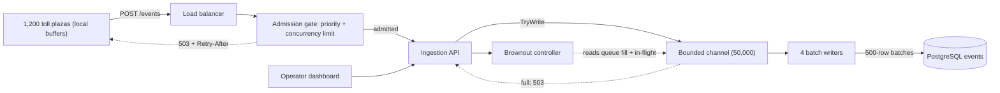
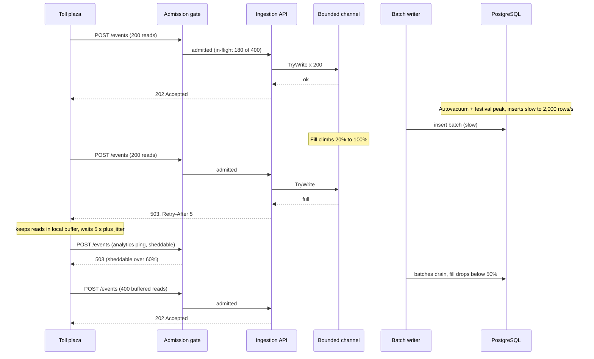

Every system has a maximum speed. The interesting question is not *whether* traffic will one day exceed it, but what your system does in that moment. A well-designed system slows its callers down, refuses some work politely, and keeps the most important work flowing. A badly designed one accepts everything, runs out of memory, and serves nobody.

## Learning objectives

By the end of this lesson you will be able to:

1. Explain why an unbounded queue turns a short overload into an outage, using Little's law with real numbers.
2. Distinguish backpressure (slow the producer down), load shedding (refuse work) and graceful degradation (do less per request).
3. Use bounded `Channel<T>` in .NET and choose between waiting and the drop modes.
4. Configure ASP.NET Core's concurrency limiter and return `503` with `Retry-After`.
5. Design priority-based admission control so payments survive while analytics is shed.
6. Plan a brownout: which optional features to turn off, at which load level, and how to turn them back on safely.
7. Recognise when a simpler fix (more capacity, a cache, a batch job) is the right answer.

## Prerequisites

- [Message queues](#/lesson/m12-message-queues): producers, consumers and acknowledgements.
- [Background services and hosted workers](#/lesson/m03-background-services): we run consumers as `BackgroundService`s fed by channels.
- [Capacity estimation](#/lesson/m11-capacity-estimation): we will do back-of-the-envelope maths on arrival and service rates.

## Explain it like I'm a beginner

Picture a popular chaat stall in Lucknow on a Sunday evening. One cook can make about **2 plates a minute**. Customers arrive at about **3 a minute**.

If the stall owner takes every order and every payment, the line of waiting orders grows by one plate a minute. After an hour, 60 people are waiting, the last one for half an hour. Most of them give up and walk away, but their orders are still in the queue, so the cook spends time making plates for people who have already left. Everyone is unhappy, including the people who stayed.

Smart stall owners do three things:

1. **Push back.** "There's a 20-minute wait, are you sure?" Some customers come back later. In software this is **backpressure**: a signal that tells the sender to slow down.
2. **Say no early.** When the line is too long, stop taking new orders for a while, but *finish* the ones already taken. In software this is **load shedding**: rejecting work at the door, cheaply, before it costs you anything.
3. **Simplify the menu.** At peak time, stop offering the special basket chaat that takes 5 minutes, and serve only the quick items. In software this is **graceful degradation**, or a **brownout**: switching off optional features so the core keeps working.

The common mistake in software is the opposite of all three: accept every request into an unlimited waiting line (an unbounded queue), and hope.

## First-principles explanation

### Overload is a rate problem

A system has an **arrival rate** λ (requests per second coming in) and a **service rate** μ (requests per second it can finish). While λ < μ, any waiting line stays short. The moment λ > μ, the line grows by (λ − μ) every second, without limit. No amount of clever code fixes that; something must give.

Our running example is a toll-plaza event platform. **1,200 toll plazas** send FASTag-style RFID read events to an ingestion API. On a normal day the average is about **3,000 events per second**. On a festival long weekend it peaks at about **3×**, so **9,000 events per second**. The PostgreSQL writer tier can insert about **5,000 rows per second** in batches (an estimate from load testing in this scenario; your number will differ).

At peak, the backlog grows by 9,000 − 5,000 = **4,000 events per second**.

- After 1 minute: 240,000 events waiting.
- After 10 minutes: 2.4 million events waiting.
- At about 200 bytes per event in memory (an estimate, objects plus overhead), that is about **480 MB** after 10 minutes, and growing.

### Little's law: queues are latency

Little's law says: **L = λ × W**. The average number of items in a system (L) equals the arrival rate (λ) times the average time each item spends there (W). Rearranged: **W = L ÷ λ**, or for a queue drained at rate μ, the wait for a new arrival is roughly **queue length ÷ μ**.

With 2.4 million events queued and a drain rate of 5,000 per second, a new event waits 2,400,000 ÷ 5,000 = **480 seconds**, eight minutes, before it is even looked at. For a toll event that drives "low balance" SMS alerts, that is useless.

This is the key insight: **a queue does not add capacity, it only converts overload into latency.** Queues are excellent for absorbing *short* bursts. They are terrible for *sustained* overload, because they hide the problem until the latency or the memory blows up.

### Unbounded queues fail in three ways

1. **Memory exhaustion.** The process runs out of memory and is killed. Every queued item is lost at once, and the restart makes the backlog worse.
2. **Latency collapse.** Everything is served, but so late that clients have given up. The system does full work for zero value. Throughput of *useful* work (called **goodput**) drops even though the servers are 100 % busy.
3. **Retries pile on.** Clients that time out retry, which adds even more arrivals. See [Retry storms](#/lesson/m13-retry-storms).

### Tool 1: backpressure

Backpressure means **the consumer's limit is communicated back to the producer**, so the producer slows down instead of piling up work. It works by having a **bounded** buffer between them: when the buffer is full, the producer has to wait (or is told "not now").

You already rely on backpressure every day:

- **TCP flow control.** The receiver advertises a window size. When its buffer is full the window is zero and the sender stops. A slow client reading a large download slows the server's writes automatically.
- **HTTP/2 and gRPC flow control.** Per-stream windows do the same at the application protocol level.
- **Kafka consumers pull.** A consumer fetches only what it can handle, so a slow consumer never gets flooded; the backlog sits safely on the broker's disk as consumer lag.
- **RabbitMQ prefetch** (`basic.qos`) limits unacknowledged messages per consumer, and the broker blocks publishers when it runs low on memory.
- **.NET bounded channels.** `Channel.CreateBounded<T>(capacity)` makes `WriteAsync` wait when full.

Backpressure is ideal *inside* a system, between components you control, where the producer can afford to wait. A worker reading files from blob storage and pushing them into a bounded channel can simply pause.

It is harder at the edge. A toll plaza cannot be told to "wait" forever on an open HTTP connection; that just moves the unbounded queue into thousands of open sockets. At the edge, backpressure becomes an explicit message: **`503 Service Unavailable`** (or `429 Too Many Requests` for per-client limits) with a **`Retry-After`** header. The plaza keeps the events in its local buffer and resends later. The buffer now lives at 1,200 plazas, each holding a few minutes of its own data, instead of in one server's RAM.

### Tool 2: load shedding and admission control

Load shedding means **deliberately refusing some work so the rest succeeds**. The decision point is called **admission control**: a gate at the entrance that decides, per request, "accept" or "reject now".

Principles:

1. **Shed early and cheaply.** Rejecting a request at the load balancer costs microseconds. Rejecting it after authentication, a database lookup and half the business logic wastes everything spent so far. Put the gate as close to the entrance as possible.
2. **Limit concurrency, not just rate.** A rate limit (100 requests per second) does not know that requests became slow. A **concurrency limit** (at most 200 requests in progress) adapts automatically: when the database slows down, requests take longer, slots free up more slowly, and fewer new requests get in. By Little's law, concurrency = throughput × latency, so capping concurrency caps the work in the system.
3. **Bound the waiting line too.** A limiter can queue a few extra requests (to smooth tiny bursts) but that queue must be small and bounded.
4. **Shed by priority.** Not all work is equal. A payment confirmation matters more than an analytics ping. Reserve headroom so lower-priority work is rejected *first*.
5. **Respect deadlines.** If a request's client will time out in 2 seconds and the queue wait is already 3 seconds, processing it is pure waste. Drop work whose deadline has passed, and propagate deadlines downstream.
6. **Say why.** Return `503` with `Retry-After`, so well-behaved clients back off (with jitter) rather than hammering you.

**Priority shedding with headroom.** Suppose an API allows at most 400 requests in flight. One simple scheme:

| Priority | Examples | Admitted while in-flight is below |
|---|---|---|
| Critical | toll payment confirmation, balance check | 400 (100 %) |
| Normal | plaza event uploads, dashboard API | 340 (85 %) |
| Sheddable | analytics, report exports, prefetch | 240 (60 %) |

As load rises, sheddable requests are refused first (at 240 in flight), then normal (at 340), leaving 60 slots that only critical work can use. Payments keep working even when the system is drowning.

**FIFO vs LIFO under overload.** Normally a queue is first-in, first-out. Under sustained overload, the oldest requests are the ones most likely to have been abandoned by their clients. Some large systems publicly describe switching to **adaptive LIFO** (serve newest first) when the queue has been non-empty for too long, together with **controlled delay**: a short timeout for queued work when the queue is persistently standing. Ben Maurer's *Fail at Scale* article describes both. The idea: during overload, serve the requests that are still alive.

### Tool 3: graceful degradation and brownouts

Graceful degradation means **doing less work per request** rather than doing no work for some requests. A **brownout** (a term from research on cloud applications, by analogy with a power brownout where the lights dim but stay on) switches off optional parts of a response when load is high.

Examples:

- A product page drops "customers also bought" recommendations and shows the product, price and buy button.
- A toll operator's dashboard stops rendering the live traffic heat map and shows only the totals.
- A search page returns results from a cache that is 5 minutes stale instead of querying fresh.
- A video service serves lower resolution.
- A news feed shows the cached top 20 instead of personalised ranking.

To degrade gracefully you must plan in advance:

1. **Classify features**: core (must work), important, optional.
2. **Define load levels** with clear signals: queue fill, in-flight requests, p99 latency, CPU. For example Normal (< 50 %), Elevated (50–80 %), Severe (> 80 %).
3. **Decide what turns off at each level**, and make every optional feature check a flag before doing work.
4. **Add hysteresis**: switch to Elevated at 50 %, but back to Normal only below 40 %, so the system does not flap on and off every second.
5. **Test it.** A degradation path that has never run is a path that will fail when you need it.

### How the tools fit together

They work at different points of the same pipeline:

- At the **edge**: rate limits per client (fairness), concurrency limit (protection), priority admission.
- Between **internal stages**: bounded channels and queues with backpressure.
- In the **request**: deadlines, brownout flags, cached fallbacks.
- Around it all: **autoscaling** adds capacity, but takes time (often 1–3 minutes to start new instances). Backpressure and shedding protect you during that gap. Autoscaling cannot help at all if the bottleneck is a single primary database.

### Failure modes of the cures

- **Shedding causes retries.** Every `503` can come back as a retry. Without `Retry-After`, jitter and retry budgets on the client side, shedding can amplify load. Design both ends together.
- **Thresholds that are too tight** reject traffic you could have served. Set them from load tests, not guesses, and watch the rejection rate.
- **Priority abuse.** If clients can set their own priority header, everyone becomes "critical". Derive priority on the server from the route and the authenticated client.
- **Hidden queues.** Thread pool queues, connection pool wait queues, socket backlogs and broker queues are all queues. Bounding one while another is unbounded just moves the pile-up.
- **Brownouts nobody notices.** If the brownout stays on for a week because the threshold is wrong, users silently lose features. Alert on time spent in degraded mode.

### When a simpler design is enough

- **The overload is predictable and rare.** If the festival spike happens three times a year and is known in advance, scheduling extra capacity (and a larger database instance) for those days may be cheaper than building elaborate shedding.
- **The work can wait.** If events are only used for a nightly report, write them to object storage or Kafka (a durable, disk-backed buffer) and process later. A durable log with consumer lag is backpressure for free.
- **Reads dominate.** If most load is repeated reads, a cache or CDN removes the overload instead of managing it.
- **Low traffic internal tools.** A team tool with 50 users does not need priority admission; a sensible timeout and a bounded connection pool are enough.

## Visual explanation

### Where each control sits



Read it left to right. Plazas send events through the load balancer to an admission gate that counts in-flight requests and admits by priority; when it says no, the dotted arrow carries a `503` with `Retry-After` back to the plaza, whose local buffer holds the events until then. Admitted events go into a **bounded** channel with room for 50,000 events. If the channel is full, `TryWrite` fails, and that failure also turns into a `503`, so pressure from the database propagates all the way back to the plazas. Four writer loops drain the channel in 500-row batches into PostgreSQL. The brownout controller watches the channel fill level and the in-flight count and tells the dashboard endpoints which optional features to skip. At a drain rate of 5,000 per second, a full channel means a worst-case queue wait of 50,000 ÷ 5,000 = 10 seconds, which is the latency budget we chose.

### An overload episode



This shows backpressure travelling upstream. First, a normal upload is admitted, written to the channel and acknowledged with `202 Accepted` (accepted for processing, not yet stored). Then the database slows down. The writers drain more slowly, the channel fills, and the next `TryWrite` fails. Instead of waiting or growing memory, the API returns `503` with `Retry-After: 5`. The plaza keeps its reads locally and backs off with some random jitter, so 1,200 plazas don't all retry in the same second. Meanwhile a sheddable analytics ping is refused at the gate before it costs anything. Once the database recovers, the plaza sends its buffered reads in one larger batch. No event was lost, memory stayed bounded, and the most important traffic kept flowing.

## Step-by-step example

### Step 1 — the naive version

```csharp
// Unbounded: accepts everything, forever.
private static readonly ConcurrentQueue<TollEvent> Pending = new();

app.MapPost("/events", (TollEvent[] events) =>
{
    foreach (var e in events) Pending.Enqueue(e);
    return Results.Accepted();
});
```

At 9,000 events per second in and 5,000 out, memory grows by about 0.8 MB per second (4,000 × 200 bytes, estimated). The pod's 2 GB memory limit is reached in about 40 minutes, the pod is killed, and every queued event is lost.

### Step 2 — bound the buffer

Replace the unbounded queue with `Channel.CreateBounded<TollEvent>(50_000)`. How big? Work backwards from latency: the events must reach the database within 10 seconds, the drain rate is 5,000 per second, so the queue may hold at most 5,000 × 10 = **50,000** events. A bigger buffer would only produce older events, not more throughput.

### Step 3 — decide what happens when it is full

For the HTTP edge, use `TryWrite`, which never waits, and turn a failure into `503` with `Retry-After`. For internal producers (for example a worker replaying events from object storage), use `WriteAsync`, which waits: that worker can afford to slow down.

The channel's full mode matters:

| `BoundedChannelFullMode` | Behaviour when full | Good for |
|---|---|---|
| `Wait` | `WriteAsync` waits; `TryWrite` returns false | Data you must not lose; edge returns 503 |
| `DropOldest` | Removes the oldest item, accepts the new one | Latest-value data: GPS positions, sensor readings, metrics |
| `DropNewest` | Removes the newest item already in the channel, accepts the new one | Rarely the right choice; keeps old data at the expense of recent |
| `DropWrite` | Silently ignores the new item | Best-effort telemetry where a gap is fine |

Toll reads are money, so we use `Wait` with `TryWrite` and an explicit `503`. A live "vehicles per minute" counter feed could use `DropOldest`.

### Step 4 — admission before work

Add a concurrency limiter at the front: at most 200 ingest requests in progress, a small queue of 100, newest first, and `503` with `Retry-After` beyond that. Add priority admission so balance-check calls from payment kiosks are never starved by bulk uploads.

### Step 5 — degrade the extras

The operator dashboard shows totals, a live heat map and "nearby plazas with spare lanes". Under Elevated load, turn off the suggestions; under Severe, also skip the heat map and return the cached totals. Each feature checks the brownout controller first.

## Production-style C# implementation

```text
Toll.Ingestion.Api/
  Program.cs
  Ingestion/TollEvent.cs
  Ingestion/TollEventQueue.cs
  Ingestion/TollEventWriter.cs
  Ingestion/InMemoryTollEventSink.cs
  Admission/PriorityAdmissionController.cs
  Admission/PriorityAdmissionMiddleware.cs
  Degradation/BrownoutController.cs
```

```csharp file=Ingestion/TollEvent.cs
namespace Toll.Ingestion;

/// <summary>One RFID read at a toll lane. (PlazaId, TagId, ReadAt) is unique, so resends are idempotent.</summary>
public sealed record TollEvent(string PlazaId, string TagId, string VehicleClass, DateTimeOffset ReadAt, long AmountPaise);

public enum RequestPriority { Critical = 0, Normal = 1, Sheddable = 2 }

public sealed class IngestionOptions
{
    /// <summary>Drain rate × latency budget: 5,000/s × 10 s.</summary>
    public int QueueCapacity { get; set; } = 50_000;
    public int BatchSize { get; set; } = 500;
    public int Writers { get; set; } = 4;
    public int MaxInFlightRequests { get; set; } = 400;
    public double NormalShare { get; set; } = 0.85;
    public double SheddableShare { get; set; } = 0.60;
    public int RetryAfterSeconds { get; set; } = 5;
}

public interface ITollEventSink
{
    Task WriteBatchAsync(IReadOnlyList<TollEvent> batch, CancellationToken ct);
}
```

```csharp file=Ingestion/TollEventQueue.cs
using System.Threading.Channels;
using Microsoft.Extensions.Options;

namespace Toll.Ingestion;

/// <summary>The bounded buffer between the HTTP edge and the database writers.</summary>
public sealed class TollEventQueue
{
    private readonly Channel<TollEvent> _channel;

    public TollEventQueue(IOptions<IngestionOptions> options)
    {
        Capacity = options.Value.QueueCapacity;
        _channel = Channel.CreateBounded<TollEvent>(new BoundedChannelOptions(Capacity)
        {
            FullMode = BoundedChannelFullMode.Wait,   // never drop money; callers decide whether to wait
            SingleReader = false,
            SingleWriter = false,
        });
    }

    public int Capacity { get; }
    public int Count => _channel.Reader.Count;
    public double Fill => (double)Count / Capacity;
    public ChannelReader<TollEvent> Reader => _channel.Reader;

    /// <summary>Edge producers: never wait. False means "shed this, tell the client to retry later".</summary>
    public bool TryEnqueue(TollEvent e) => _channel.Writer.TryWrite(e);

    /// <summary>Internal producers (replay jobs): wait for space. This is backpressure.</summary>
    public ValueTask EnqueueAsync(TollEvent e, CancellationToken ct) => _channel.Writer.WriteAsync(e, ct);

    public void Complete() => _channel.Writer.TryComplete();
}
```

```csharp file=Ingestion/TollEventWriter.cs
using Microsoft.Extensions.Hosting;
using Microsoft.Extensions.Logging;
using Microsoft.Extensions.Options;

namespace Toll.Ingestion;

/// <summary>N competing consumers that drain the channel in batches. While a batch is failing,
/// the writer stops reading, the channel fills, and the edge starts returning 503: pressure flows upstream.</summary>
public sealed class TollEventWriter(
    TollEventQueue queue,
    ITollEventSink sink,
    IOptions<IngestionOptions> options,
    ILogger<TollEventWriter> logger) : BackgroundService
{
    private readonly IngestionOptions _o = options.Value;

    protected override Task ExecuteAsync(CancellationToken stoppingToken) =>
        Task.WhenAll(Enumerable.Range(0, _o.Writers).Select(i => RunWriterAsync(i, stoppingToken)));

    private async Task RunWriterAsync(int writerId, CancellationToken ct)
    {
        var batch = new List<TollEvent>(_o.BatchSize);
        while (await queue.Reader.WaitToReadAsync(ct))
        {
            while (batch.Count < _o.BatchSize && queue.Reader.TryRead(out var e)) batch.Add(e);
            if (batch.Count == 0) continue;

            var delay = TimeSpan.FromMilliseconds(200);
            while (true)
            {
                try
                {
                    await sink.WriteBatchAsync(batch, ct);
                    break;
                }
                catch (Exception ex) when (!ct.IsCancellationRequested)
                {
                    logger.LogWarning(ex, "Writer {Writer}: batch of {Count} failed; retrying in {Delay}", writerId, batch.Count, delay);
                    await Task.Delay(delay, ct);
                    delay = TimeSpan.FromMilliseconds(Math.Min(delay.TotalMilliseconds * 2, 5_000));
                }
            }
            batch.Clear();
        }
    }
}
```

```csharp file=Ingestion/InMemoryTollEventSink.cs
using System.Collections.Concurrent;

namespace Toll.Ingestion;

/// <summary>Stand-in for a PostgreSQL COPY/batch insert with ON CONFLICT DO NOTHING on (plaza_id, tag_id, read_at).</summary>
public sealed class InMemoryTollEventSink : ITollEventSink
{
    private readonly ConcurrentDictionary<(string, string, DateTimeOffset), TollEvent> _rows = new();
    public int Count => _rows.Count;

    public async Task WriteBatchAsync(IReadOnlyList<TollEvent> batch, CancellationToken ct)
    {
        await Task.Delay(TimeSpan.FromMilliseconds(5), ct);   // simulated insert latency
        foreach (var e in batch) _rows.TryAdd((e.PlazaId, e.TagId, e.ReadAt), e);
    }
}
```

```csharp file=Admission/PriorityAdmissionController.cs
using Microsoft.Extensions.Options;
using Toll.Ingestion;

namespace Toll.Admission;

/// <summary>Counts in-flight requests and admits by priority, keeping headroom for critical work.</summary>
public sealed class PriorityAdmissionController(IOptions<IngestionOptions> options)
{
    private readonly IngestionOptions _o = options.Value;
    private int _inFlight;
    private long _rejected;

    public int InFlight => Volatile.Read(ref _inFlight);
    public long Rejected => Interlocked.Read(ref _rejected);
    public double Utilisation => (double)InFlight / _o.MaxInFlightRequests;

    public int LimitFor(RequestPriority p) => p switch
    {
        RequestPriority.Critical => _o.MaxInFlightRequests,
        RequestPriority.Normal => (int)(_o.MaxInFlightRequests * _o.NormalShare),
        _ => (int)(_o.MaxInFlightRequests * _o.SheddableShare),
    };

    /// <summary>Returns a lease to dispose when the request ends, or null if the request must be shed.</summary>
    public AdmissionLease? TryEnter(RequestPriority priority)
    {
        var limit = LimitFor(priority);
        while (true)
        {
            var current = Volatile.Read(ref _inFlight);
            if (current >= limit)
            {
                Interlocked.Increment(ref _rejected);
                return null;
            }
            // Compare-and-swap so two threads cannot both take the last slot.
            if (Interlocked.CompareExchange(ref _inFlight, current + 1, current) == current)
                return new AdmissionLease(this);
        }
    }

    internal void Exit() => Interlocked.Decrement(ref _inFlight);
}

public sealed class AdmissionLease : IDisposable
{
    private PriorityAdmissionController? _owner;
    internal AdmissionLease(PriorityAdmissionController owner) => _owner = owner;

    public void Dispose() => Interlocked.Exchange(ref _owner, null)?.Exit();   // idempotent
}
```

```csharp file=Admission/PriorityAdmissionMiddleware.cs
using Microsoft.Extensions.Options;
using Toll.Ingestion;

namespace Toll.Admission;

public sealed class PriorityAdmissionMiddleware(
    RequestDelegate next,
    PriorityAdmissionController admission,
    IOptions<IngestionOptions> options,
    ILogger<PriorityAdmissionMiddleware> logger)
{
    public async Task InvokeAsync(HttpContext context)
    {
        if (context.Request.Path.StartsWithSegments("/health"))
        {
            await next(context);   // never shed health checks, or the orchestrator kills healthy pods
            return;
        }

        var priority = Classify(context.Request);
        using var lease = admission.TryEnter(priority);
        if (lease is null)
        {
            logger.LogDebug("Shed {Priority} request to {Path}", priority, context.Request.Path);
            context.Response.StatusCode = StatusCodes.Status503ServiceUnavailable;
            context.Response.Headers.RetryAfter = options.Value.RetryAfterSeconds.ToString();
            await context.Response.WriteAsync("Server busy. Please retry later.");
            return;
        }
        await next(context);
    }

    /// <summary>Priority comes from the route, decided by the server, never from a client-supplied header.</summary>
    private static RequestPriority Classify(HttpRequest request) =>
        request.Path.StartsWithSegments("/payments") || request.Path.StartsWithSegments("/balance") ? RequestPriority.Critical
        : request.Path.StartsWithSegments("/analytics") || request.Path.StartsWithSegments("/exports") ? RequestPriority.Sheddable
        : RequestPriority.Normal;
}
```

```csharp file=Degradation/BrownoutController.cs
using Toll.Admission;
using Toll.Ingestion;

namespace Toll.Degradation;

public enum LoadLevel { Normal, Elevated, Severe }

public enum OptionalFeature { NearbyPlazaSuggestions, LiveHeatMap }

/// <summary>Turns optional features off as load rises, with hysteresis so it does not flap.</summary>
public sealed class BrownoutController(TollEventQueue queue, PriorityAdmissionController admission)
{
    private readonly object _gate = new();
    private LoadLevel _level = LoadLevel.Normal;

    public LoadLevel Current
    {
        get
        {
            var load = Math.Max(queue.Fill, admission.Utilisation);
            lock (_gate)
            {
                _level = _level switch
                {
                    LoadLevel.Normal when load >= 0.5 => load >= 0.8 ? LoadLevel.Severe : LoadLevel.Elevated,
                    LoadLevel.Elevated when load >= 0.8 => LoadLevel.Severe,
                    LoadLevel.Elevated when load < 0.4 => LoadLevel.Normal,      // step down only well below
                    LoadLevel.Severe when load < 0.7 => load < 0.4 ? LoadLevel.Normal : LoadLevel.Elevated,
                    var same => same,
                };
                return _level;
            }
        }
    }

    public bool IsEnabled(OptionalFeature feature) => (feature, Current) switch
    {
        (OptionalFeature.NearbyPlazaSuggestions, LoadLevel.Normal) => true,
        (OptionalFeature.NearbyPlazaSuggestions, _) => false,
        (OptionalFeature.LiveHeatMap, LoadLevel.Severe) => false,
        _ => true,
    };
}
```

```csharp file=Program.cs
using System.Threading.RateLimiting;
using Microsoft.AspNetCore.RateLimiting;
using Toll.Admission;
using Toll.Degradation;
using Toll.Ingestion;

var builder = WebApplication.CreateBuilder(args);

builder.Services.Configure<IngestionOptions>(builder.Configuration.GetSection("Ingestion"));
builder.Services.AddSingleton<TollEventQueue>();
builder.Services.AddSingleton<ITollEventSink, InMemoryTollEventSink>();
builder.Services.AddHostedService<TollEventWriter>();
builder.Services.AddSingleton<PriorityAdmissionController>();
builder.Services.AddSingleton<BrownoutController>();

// Concurrency limiter for the ingest endpoint: at most 200 in progress, a short newest-first queue.
builder.Services.AddRateLimiter(options =>
{
    options.RejectionStatusCode = StatusCodes.Status503ServiceUnavailable;
    options.OnRejected = (context, ct) =>
    {
        context.HttpContext.Response.Headers.RetryAfter = "5";
        return ValueTask.CompletedTask;
    };
    options.AddConcurrencyLimiter("ingest", o =>
    {
        o.PermitLimit = 200;
        o.QueueLimit = 100;
        o.QueueProcessingOrder = QueueProcessingOrder.NewestFirst;
    });
});

var app = builder.Build();

app.UseMiddleware<PriorityAdmissionMiddleware>();
app.UseRateLimiter();

app.MapGet("/health", () => Results.Ok("ok"));

app.MapPost("/events", (TollEvent[] events, TollEventQueue queue, HttpResponse response) =>
{
    // Cheap early check: if this batch clearly will not fit, refuse it before touching the channel.
    if (queue.Count + events.Length > queue.Capacity)
    {
        response.Headers.RetryAfter = "5";
        return Results.Problem("Ingestion queue is full.", statusCode: StatusCodes.Status503ServiceUnavailable);
    }

    var accepted = 0;
    foreach (var e in events)
    {
        if (!queue.TryEnqueue(e)) break;   // raced to full: the plaza resends the rest (idempotent)
        accepted++;
    }
    if (accepted == events.Length) return Results.Accepted(value: new { accepted });
    response.Headers.RetryAfter = "5";
    return Results.Json(new { accepted, rejected = events.Length - accepted }, statusCode: StatusCodes.Status503ServiceUnavailable);
}).RequireRateLimiting("ingest");

app.MapGet("/plazas/{id}/dashboard", (string id, BrownoutController brownout) =>
{
    var level = brownout.Current;
    return Results.Ok(new
    {
        plaza = id,
        loadLevel = level.ToString(),
        totals = new { vehiclesLastHour = 1_840, revenuePaise = 23_450_000 },   // core: always served
        heatMap = brownout.IsEnabled(OptionalFeature.LiveHeatMap) ? "rendered" : null,
        suggestions = brownout.IsEnabled(OptionalFeature.NearbyPlazaSuggestions) ? new[] { "PLZ-118 lane 4" } : null,
    });
});

app.Run();
```

**Notes on the implementation.**

- `PriorityAdmissionMiddleware` runs before `UseRateLimiter`, so sheddable traffic is refused before it can take a concurrency permit.
- Every `503` carries `Retry-After`: from the priority middleware, from the limiter (`OnRejected`), and from the endpoint itself when the channel is full.
- Older ASP.NET Core versions had a separate `Microsoft.AspNetCore.ConcurrencyLimiter` middleware. It is obsolete; use the rate limiting middleware's concurrency limiter shown here.
- Events are idempotent by `(PlazaId, TagId, ReadAt)`, so a plaza resending a partially accepted batch creates no duplicates. Shedding is only safe when retries are safe; see [Idempotency keys](#/lesson/m10-idempotency).

## Bad design vs good design

**Bad: "just add a bigger queue".** The team sees memory alarms and raises the in-memory queue from 1 million to 10 million items and the pod memory to 8 GB. During the next festival peak, the queue fills in 40 minutes instead of 4, every event in it is 40 minutes old, the "low balance" SMS alerts arrive after vehicles have left the plaza, and when the pod is finally killed, 10 million events are lost instead of 1 million. A bigger buffer delayed the failure and made it larger.

**Also bad: shed after the expensive part.**

```csharp
app.MapPost("/events", async (TollEvent[] events, AppDb db, ...) =>
{
    var plaza = await db.Plazas.FindAsync(events[0].PlazaId);   // DB call
    await ValidateTagsAsync(events);                            // more DB calls
    if (queue.IsFull) return Results.StatusCode(503);           // too late
    ...
});
```

Each rejected request already cost two database round trips, adding load to the very database that is overloaded.

**Good:** a small bounded buffer sized from the latency budget, a gate at the entrance, priority headroom for critical calls, `503` with `Retry-After`, client-side buffering with jittered backoff, and a brownout plan for optional features. The total memory used during overload is constant, and the latency of accepted events stays within 10 seconds.

:::callout type=tradeoff title="Rejecting is a feature, not a failure"
A `503` returned in 1 ms is a good outcome during overload: the client learns immediately and can retry later or elsewhere. A `200` returned after 45 seconds, when the client gave up after 10, is the worst outcome: you paid full cost and delivered nothing. Measure **goodput** (successful, on-time responses), not just throughput.
:::

## Practical playground

The simulator models a queue with producers, consumers and a fixed processing time. It starts at **120 messages per second** arriving and **4 consumers** at **40 ms** each, so capacity is 4 × (1000 ÷ 40) = **100 per second**.

1. Run it as is. Watch the backlog and latency climb steadily: this is sustained overload, and no queue size fixes it.
2. Lower the producer rate to 90. The backlog stays near zero: a queue absorbs only *bursts*.
3. Set the rate back to 120 and add consumers until the system is stable. How many do you need? (Compute it first: 120 ÷ 25 per consumer = 4.8, so 5.)
4. Turn on the crash option and watch how long the backlog takes to drain after consumers return. That drain time is why you bound queues by latency, not memory.

:::playground type=sim sim=queue title="Sustained overload versus a bounded budget" producerRate=120 consumers=4 processingMs=40 crash=false
:::

## Exercises

:::exercise id=m13-backpressure-ex1 difficulty=beginner kind=code title="Size a queue with Little's law"
Implement three helpers that turn rates and latency budgets into queue sizes.
::requirements
- `QueueMath.ItemsInSystem(double arrivalsPerSecond, TimeSpan averageTime)` returns L = λ × W.
- `QueueMath.ExpectedWait(int queued, double drainPerSecond)` returns how long a new arrival waits behind `queued` items.
- `QueueMath.MaxUsefulQueue(double drainPerSecond, TimeSpan latencyBudget, TimeSpan serviceTime)` returns the largest queue length that still lets an item finish within the budget: floor(drain × (budget − serviceTime)), never negative.
- Any rate ≤ 0 throws `ArgumentOutOfRangeException`.
::acceptance
- `ItemsInSystem(3000, 0.5 s)` = 1500.
- `ExpectedWait(10_000, 5_000)` = 2 seconds.
- `MaxUsefulQueue(5_000, 10 s, 0 s)` = 50,000 and `MaxUsefulQueue(5_000, 2 s, 0.2 s)` = 9,000.
- A service time longer than the budget gives 0.
::hint
Little's law: L = λW. Everything else is rearranging it.
::hint
Wait = items ahead ÷ rate at which they leave.
::hint
The queue may only use the part of the budget left after the item's own service time.
::hint
```csharp
var usable = (latencyBudget - serviceTime).TotalSeconds;
return usable <= 0 ? 0 : (int)Math.Floor(drainPerSecond * usable);
```
::starter
```csharp file=QueueMath.cs
using System;

public static class QueueMath
{
    public static double ItemsInSystem(double arrivalsPerSecond, TimeSpan averageTime) => throw new NotImplementedException();
    public static TimeSpan ExpectedWait(int queued, double drainPerSecond) => throw new NotImplementedException();
    public static int MaxUsefulQueue(double drainPerSecond, TimeSpan latencyBudget, TimeSpan serviceTime) => throw new NotImplementedException();
}
```
::tests
```csharp file=QueueMathTests.cs
using System;
using Xunit;

public class QueueMathTests
{
    [Fact] public void Littles_law() => Assert.Equal(1500.0, QueueMath.ItemsInSystem(3000, TimeSpan.FromSeconds(0.5)), 3);

    [Fact] public void Wait_behind_queue() => Assert.Equal(TimeSpan.FromSeconds(2), QueueMath.ExpectedWait(10_000, 5_000));

    [Fact] public void Max_queue_from_budget()
    {
        Assert.Equal(50_000, QueueMath.MaxUsefulQueue(5_000, TimeSpan.FromSeconds(10), TimeSpan.Zero));
        Assert.Equal(9_000, QueueMath.MaxUsefulQueue(5_000, TimeSpan.FromSeconds(2), TimeSpan.FromMilliseconds(200)));
    }

    [Fact] public void Service_time_over_budget_gives_zero() =>
        Assert.Equal(0, QueueMath.MaxUsefulQueue(100, TimeSpan.FromMilliseconds(50), TimeSpan.FromMilliseconds(80)));

    [Fact] public void Invalid_rates_throw()
    {
        Assert.Throws<ArgumentOutOfRangeException>(() => QueueMath.ItemsInSystem(0, TimeSpan.FromSeconds(1)));
        Assert.Throws<ArgumentOutOfRangeException>(() => QueueMath.ExpectedWait(10, -1));
        Assert.Throws<ArgumentOutOfRangeException>(() => QueueMath.MaxUsefulQueue(0, TimeSpan.FromSeconds(1), TimeSpan.Zero));
    }
}
```
::solution
```csharp file=QueueMath.cs
using System;

public static class QueueMath
{
    public static double ItemsInSystem(double arrivalsPerSecond, TimeSpan averageTime)
    {
        RequirePositive(arrivalsPerSecond, nameof(arrivalsPerSecond));
        return arrivalsPerSecond * averageTime.TotalSeconds;
    }

    public static TimeSpan ExpectedWait(int queued, double drainPerSecond)
    {
        RequirePositive(drainPerSecond, nameof(drainPerSecond));
        return TimeSpan.FromSeconds(queued / drainPerSecond);
    }

    public static int MaxUsefulQueue(double drainPerSecond, TimeSpan latencyBudget, TimeSpan serviceTime)
    {
        RequirePositive(drainPerSecond, nameof(drainPerSecond));
        var usable = (latencyBudget - serviceTime).TotalSeconds;
        return usable <= 0 ? 0 : (int)Math.Floor(drainPerSecond * usable);
    }

    private static void RequirePositive(double value, string name)
    {
        if (value <= 0) throw new ArgumentOutOfRangeException(name, value, "Rates must be positive.");
    }
}
```
The last helper is the one you use in design reviews: "our drain rate is 5,000/s and the budget is 10 s, so a queue longer than 50,000 only stores events that are already too late."
::mistakes
- Sizing queues from available memory instead of from the latency budget.
- Forgetting the item's own service time, which makes the queue slightly too long.
:::

:::exercise id=m13-backpressure-ex2 difficulty=beginner kind=code title="A bounded buffer with two full modes"
Wrap a bounded `Channel<T>` so callers can choose between "reject new items" (for money) and "drop the oldest" (for latest-value data such as GPS positions).
::requirements
- `BoundedIngestBuffer<T>(int capacity, bool dropOldest)`.
- `bool TryAccept(T item)`: in reject mode, returns false when full and increments `Rejected`. In drop-oldest mode, always returns true; each evicted item increments `Dropped`.
- `int Count` and `IReadOnlyList<T> DrainAvailable()` (reads everything currently buffered, in order).
- Capacity below 1 throws `ArgumentOutOfRangeException`.
::acceptance
- Capacity 3, reject mode, five items → 3 accepted, `Rejected` = 2, drain returns the first three.
- Capacity 3, drop-oldest, items 1–5 → drain returns 3, 4, 5 and `Dropped` = 2.
- After draining, new items are accepted again.
::hint
`Channel.CreateBounded<T>(BoundedChannelOptions)` lets you choose `FullMode`.
::hint
`TryWrite` on a `Wait` channel returns false when full; on a `DropOldest` channel it evicts and returns true.
::hint
There is an overload `Channel.CreateBounded<T>(options, Action<T> itemDropped)` that tells you which item was evicted.
::hint
```csharp
var opts = new BoundedChannelOptions(capacity) { FullMode = dropOldest ? BoundedChannelFullMode.DropOldest : BoundedChannelFullMode.Wait };
_channel = Channel.CreateBounded<T>(opts, _ => Interlocked.Increment(ref _dropped));
```
::starter
```csharp file=BoundedIngestBuffer.cs
using System;
using System.Collections.Generic;
using System.Threading;
using System.Threading.Channels;

public sealed class BoundedIngestBuffer<T>
{
    public BoundedIngestBuffer(int capacity, bool dropOldest) => throw new NotImplementedException();

    public int Rejected => throw new NotImplementedException();
    public int Dropped => throw new NotImplementedException();
    public int Count => throw new NotImplementedException();

    public bool TryAccept(T item) => throw new NotImplementedException();
    public IReadOnlyList<T> DrainAvailable() => throw new NotImplementedException();
}
```
::tests
```csharp file=BoundedIngestBufferTests.cs
using System;
using Xunit;

public class BoundedIngestBufferTests
{
    [Fact]
    public void Reject_mode_refuses_when_full()
    {
        var b = new BoundedIngestBuffer<int>(3, dropOldest: false);
        var accepted = 0;
        for (var i = 1; i <= 5; i++) if (b.TryAccept(i)) accepted++;
        Assert.Equal(3, accepted);
        Assert.Equal(2, b.Rejected);
        Assert.Equal(new[] { 1, 2, 3 }, b.DrainAvailable());
    }

    [Fact]
    public void Drop_oldest_keeps_latest()
    {
        var b = new BoundedIngestBuffer<int>(3, dropOldest: true);
        for (var i = 1; i <= 5; i++) Assert.True(b.TryAccept(i));
        Assert.Equal(2, b.Dropped);
        Assert.Equal(3, b.Count);
        Assert.Equal(new[] { 3, 4, 5 }, b.DrainAvailable());
    }

    [Fact]
    public void Space_returns_after_drain()
    {
        var b = new BoundedIngestBuffer<string>(1, dropOldest: false);
        Assert.True(b.TryAccept("a"));
        Assert.False(b.TryAccept("b"));
        b.DrainAvailable();
        Assert.True(b.TryAccept("c"));
        Assert.Equal(0, b.Dropped);
    }

    [Fact]
    public void Capacity_must_be_positive() =>
        Assert.Throws<ArgumentOutOfRangeException>(() => new BoundedIngestBuffer<int>(0, false));
}
```
::solution
```csharp file=BoundedIngestBuffer.cs
using System;
using System.Collections.Generic;
using System.Threading;
using System.Threading.Channels;

public sealed class BoundedIngestBuffer<T>
{
    private readonly Channel<T> _channel;
    private int _rejected;
    private int _dropped;

    public BoundedIngestBuffer(int capacity, bool dropOldest)
    {
        if (capacity < 1) throw new ArgumentOutOfRangeException(nameof(capacity), capacity, "Capacity must be at least 1.");
        var options = new BoundedChannelOptions(capacity)
        {
            FullMode = dropOldest ? BoundedChannelFullMode.DropOldest : BoundedChannelFullMode.Wait,
        };
        _channel = Channel.CreateBounded<T>(options, _ => Interlocked.Increment(ref _dropped));
    }

    public int Rejected => Volatile.Read(ref _rejected);
    public int Dropped => Volatile.Read(ref _dropped);
    public int Count => _channel.Reader.Count;

    public bool TryAccept(T item)
    {
        if (_channel.Writer.TryWrite(item)) return true;
        Interlocked.Increment(ref _rejected);
        return false;
    }

    public IReadOnlyList<T> DrainAvailable()
    {
        var items = new List<T>();
        while (_channel.Reader.TryRead(out var item)) items.Add(item);
        return items;
    }
}
```
In `Wait` mode, `TryWrite` never waits: it simply reports "full". That is the right primitive for an HTTP edge, where you would rather return `503` than hold a connection open.
::mistakes
- Using `WriteAsync` at the HTTP edge, so requests pile up as waiting tasks (an unbounded queue in disguise).
- Using `DropOldest` for financial events, silently losing money.
::extensions
Add a `TryAcceptAsync(T item, TimeSpan maxWait)` that waits at most `maxWait` for space using `WriteAsync` with a cancellation token, then gives up.
:::

:::exercise id=m13-backpressure-ex3 difficulty=intermediate kind=code title="Priority admission with headroom"
Implement an admission gate that limits in-flight work and reserves headroom for higher priorities.
::requirements
- `PriorityGate(int maxInFlight, double normalShare, double sheddableShare)`; limits are `maxInFlight` for `Critical`, `floor(maxInFlight × normalShare)` for `Normal`, `floor(maxInFlight × sheddableShare)` for `Sheddable`.
- `IDisposable? TryEnter(Priority p)` returns a lease, or null if in-flight is already at or above that priority's limit.
- Disposing a lease frees its slot exactly once, even if disposed twice.
- `InFlight` and `RejectedCount(Priority p)`.
- Thread-safe: under heavy parallel use, in-flight never exceeds `maxInFlight`.
::acceptance
- With max 10, normal 0.8, sheddable 0.5: 5 sheddable admitted then the 6th rejected; normal admitted up to 8 total; critical up to 10 total.
- Disposing one lease lets one more request in.
- Double dispose does not free two slots.
- 2,000 parallel attempts never observe more than `maxInFlight` in flight.
::hint
A single integer counter is enough; each priority just compares against a different limit.
::hint
"Check then increment" is a race. Use `Interlocked.CompareExchange` in a loop.
::hint
Make the lease a small class holding a reference to the gate; `Interlocked.Exchange(ref _gate, null)` makes `Dispose` idempotent.
::hint
```csharp
while (true)
{
    var cur = Volatile.Read(ref _inFlight);
    if (cur >= limit) { Interlocked.Increment(ref _rejected[(int)p]); return null; }
    if (Interlocked.CompareExchange(ref _inFlight, cur + 1, cur) == cur) return new Lease(this);
}
```
::starter
```csharp file=PriorityGate.cs
using System;
using System.Threading;

public enum Priority { Critical = 0, Normal = 1, Sheddable = 2 }

public sealed class PriorityGate
{
    public PriorityGate(int maxInFlight, double normalShare, double sheddableShare) => throw new NotImplementedException();

    public int InFlight => throw new NotImplementedException();
    public long RejectedCount(Priority p) => throw new NotImplementedException();
    public IDisposable? TryEnter(Priority p) => throw new NotImplementedException();
}
```
::tests
```csharp file=PriorityGateTests.cs
using System;
using System.Collections.Concurrent;
using System.Threading;
using System.Threading.Tasks;
using Xunit;

public class PriorityGateTests
{
    [Fact]
    public void Limits_per_priority()
    {
        var g = new PriorityGate(10, 0.8, 0.5);
        for (var i = 0; i < 5; i++) Assert.NotNull(g.TryEnter(Priority.Sheddable));
        Assert.Null(g.TryEnter(Priority.Sheddable));
        for (var i = 0; i < 3; i++) Assert.NotNull(g.TryEnter(Priority.Normal));
        Assert.Null(g.TryEnter(Priority.Normal));
        Assert.NotNull(g.TryEnter(Priority.Critical));
        Assert.NotNull(g.TryEnter(Priority.Critical));
        Assert.Null(g.TryEnter(Priority.Critical));
        Assert.Equal(10, g.InFlight);
        Assert.Equal(1L, g.RejectedCount(Priority.Sheddable));
        Assert.Equal(1L, g.RejectedCount(Priority.Normal));
        Assert.Equal(1L, g.RejectedCount(Priority.Critical));
    }

    [Fact]
    public void Dispose_frees_exactly_once()
    {
        var g = new PriorityGate(2, 1.0, 1.0);
        var a = g.TryEnter(Priority.Normal)!;
        var b = g.TryEnter(Priority.Normal)!;
        Assert.Null(g.TryEnter(Priority.Normal));
        a.Dispose();
        a.Dispose();
        Assert.Equal(1, g.InFlight);
        Assert.NotNull(g.TryEnter(Priority.Normal));
        Assert.Null(g.TryEnter(Priority.Normal));
        b.Dispose();
    }

    [Fact]
    public void Never_exceeds_limit_under_contention()
    {
        var g = new PriorityGate(50, 0.8, 0.5);
        var maxSeen = 0;
        Parallel.For(0, 2000, i =>
        {
            using var lease = g.TryEnter((Priority)(i % 3));
            if (lease is null) return;
            var now = g.InFlight;
            int prev;
            while ((prev = Volatile.Read(ref maxSeen)) < now && Interlocked.CompareExchange(ref maxSeen, now, prev) != prev) { }
            Thread.SpinWait(200);
        });
        Assert.True(maxSeen <= 50, $"saw {maxSeen}");
        Assert.Equal(0, g.InFlight);
    }
}
```
::solution
```csharp file=PriorityGate.cs
using System;
using System.Threading;

public enum Priority { Critical = 0, Normal = 1, Sheddable = 2 }

public sealed class PriorityGate
{
    private readonly int[] _limits;
    private readonly long[] _rejected = new long[3];
    private int _inFlight;

    public PriorityGate(int maxInFlight, double normalShare, double sheddableShare)
    {
        if (maxInFlight < 1) throw new ArgumentOutOfRangeException(nameof(maxInFlight));
        _limits = new[]
        {
            maxInFlight,
            (int)Math.Floor(maxInFlight * normalShare),
            (int)Math.Floor(maxInFlight * sheddableShare),
        };
    }

    public int InFlight => Volatile.Read(ref _inFlight);
    public long RejectedCount(Priority p) => Interlocked.Read(ref _rejected[(int)p]);

    public IDisposable? TryEnter(Priority p)
    {
        var limit = _limits[(int)p];
        while (true)
        {
            var current = Volatile.Read(ref _inFlight);
            if (current >= limit)
            {
                Interlocked.Increment(ref _rejected[(int)p]);
                return null;
            }
            if (Interlocked.CompareExchange(ref _inFlight, current + 1, current) == current)
                return new Lease(this);
        }
    }

    private void Exit() => Interlocked.Decrement(ref _inFlight);

    private sealed class Lease(PriorityGate gate) : IDisposable
    {
        private PriorityGate? _gate = gate;
        public void Dispose() => Interlocked.Exchange(ref _gate, null)?.Exit();
    }
}
```
The compare-and-swap loop is what makes "check the limit, then take a slot" atomic. With a plain `if (_inFlight < limit) _inFlight++`, two threads can both see 49 and both enter, giving 51.
::alternatives
`System.Threading.RateLimiting.ConcurrencyLimiter` instances, one per priority, are simpler but don't share a single pool: you would need nested limiters (a global one plus one per class) to get shared headroom.
::mistakes
- Letting the client choose its own priority with a header.
- Releasing the slot in a `finally` that also runs when the request was rejected, driving the counter negative.
:::

:::exercise id=m13-backpressure-ex4 difficulty=intermediate kind=hld title="Survive results day"
A state examination board publishes results for **2.8 million students** at 12:00 noon. Last year, traffic jumped from 200 requests per second to about **60,000 requests per second** within two minutes, the site went down for 90 minutes, and the SMS-alert subscription page (a write path) went down with it. Redesign the system to keep result lookups working and degrade everything else.
::acceptance
- Estimates show why the database cannot serve 60,000 lookups per second directly, and what serves them instead.
- Uses admission control with priorities: result lookup is critical; SMS subscription, re-evaluation requests and analytics are lower.
- Includes at least one bounded queue for write paths with a clear "full" behaviour.
- Describes a brownout plan with at least two optional features turned off and the signal that triggers it.
- Says what the client (web page) does on `503`.
::hint
Results are fixed once published. What does that suggest about where they can be served from?
::hint
2.8 million results × about 2 KB each is about 5.6 GB. That fits comfortably in a cache cluster or as pre-rendered files.
::hint
Writes (SMS subscriptions) can be accepted into a durable queue and processed over the next hour.
::hint
The page can show "High traffic, retrying in 10 s" with a jittered countdown instead of a browser error.
::starter
```json
{
  "nodes": [
    { "id": "users", "type": "client", "label": "Students and parents", "props": { "rps": 60000 } },
    { "id": "lb", "type": "load-balancer", "label": "Load balancer" },
    { "id": "web", "type": "app-server", "label": "Results web app", "props": { "instances": 6 } },
    { "id": "db", "type": "database", "label": "PostgreSQL (results + subscriptions)" }
  ],
  "edges": [
    { "from": "users", "to": "lb", "kind": "sync" },
    { "from": "lb", "to": "web", "kind": "sync" },
    { "from": "web", "to": "db", "kind": "sync" }
  ]
}
```
::solution
```json
{
  "nodes": [
    { "id": "users", "type": "client", "label": "Students and parents", "props": { "rps": 60000 } },
    { "id": "cdn", "type": "cdn", "label": "CDN (static page, short-TTL result JSON)" },
    { "id": "gw", "type": "api-gateway", "label": "Gateway: per-IP rate limit + priority admission" },
    { "id": "web", "type": "app-server", "label": "Results API (brownout flags)", "props": { "instances": 12 } },
    { "id": "cache", "type": "cache", "label": "Redis: all results preloaded", "props": { "replicas": 2 } },
    { "id": "obj", "type": "object-storage", "label": "Pre-rendered result PDFs" },
    { "id": "q", "type": "queue", "label": "Durable queue: SMS subscriptions, re-evaluation" },
    { "id": "worker", "type": "worker", "label": "Subscription workers", "props": { "instances": 3 } },
    { "id": "db", "type": "database", "label": "PostgreSQL (source of truth, not on read path)", "props": { "replicas": 1 } },
    { "id": "mon", "type": "monitoring", "label": "Shed rate, cache hit ratio, brownout level" }
  ],
  "edges": [
    { "from": "users", "to": "cdn", "kind": "sync" },
    { "from": "cdn", "to": "gw", "kind": "sync", "label": "cache misses only" },
    { "from": "gw", "to": "web", "kind": "sync", "label": "admitted by priority" },
    { "from": "web", "to": "cache", "kind": "sync", "label": "lookup by roll number" },
    { "from": "web", "to": "obj", "kind": "sync", "label": "presigned PDF link" },
    { "from": "web", "to": "q", "kind": "async", "label": "accept writes, 202" },
    { "from": "q", "to": "worker", "kind": "async" },
    { "from": "worker", "to": "db", "kind": "sync" },
    { "from": "web", "to": "mon", "kind": "async" }
  ]
}
```

**Estimates.** 60,000 lookups per second against PostgreSQL at, say, 1 ms of CPU each would need about 60 cores of database CPU just for lookups (an estimate), on top of connection limits; the primary is the bottleneck and cannot scale out quickly. Results are immutable once published, so preload all 2.8 million (about 5.6 GB at about 2 KB each) into Redis before noon and serve them from there; the static page and assets come from the CDN, and result JSON can be cached at the edge for 60 seconds by roll number.

**Admission.** The gateway applies a per-IP rate limit (fairness: stops one script from hammering) and a priority concurrency gate: `GET /result/{roll}` critical; `POST /sms-subscribe` and `POST /re-evaluation` normal; `/analytics` and `/school-wise-stats` sheddable. Excess returns `503` with `Retry-After: 10`.

**Bounded write queue.** Subscriptions and re-evaluation requests go to a durable queue with a cap (for example 500,000 messages); the API returns `202 Accepted` with "We'll confirm by SMS within an hour". If the queue is full, return `503` with a retry time. Workers write to PostgreSQL at a steady rate the database can handle.

**Brownout.** Trigger on gateway in-flight above 70 % or p99 above 800 ms: turn off school-wise rank charts, the "compare with last year" panel and PDF generation on demand (serve pre-rendered PDFs only). Return to normal below 40 % for 5 minutes.

**Client behaviour.** On `503`, the page shows "High traffic, retrying in N seconds" and retries with a jittered countdown (10–20 s), at most 5 times, so a million browsers don't retry in lockstep.

**Simpler alternative.** If budget is tight, publishing results as static, pre-generated files per roll-number range on a CDN removes almost all dynamic load; only subscriptions remain dynamic.
::mistakes
- Scaling app servers while every request still hits the single database.
- Letting the subscription write path share the same pool and database as lookups, so writes take lookups down with them.
- Browser auto-retry without jitter, synchronising a million retries.
:::

:::exercise id=m13-backpressure-ex5 difficulty=advanced kind=code title="A deadline-aware queue with adaptive LIFO"
Build a queue that never serves work whose deadline has passed, and that switches from FIFO to LIFO when the oldest waiting item has been queued too long.
::requirements
- `DeadlineAwareQueue<T>(TimeProvider clock, TimeSpan lifoThreshold)`.
- `Enqueue(T item, DateTimeOffset deadline)` records the enqueue time from the clock.
- `bool TryDequeue(out T item)`:
  1. First remove every item whose deadline is at or before now, incrementing `Expired` for each.
  2. If nothing is left, return false.
  3. If the oldest remaining item has waited longer than `lifoThreshold`, return the **newest** item (LIFO); otherwise return the **oldest** (FIFO).
- `Count` and `Expired`. `bool IsLifoMode` reports whether step 3 would pick LIFO right now.
- Thread-safe (a simple lock is fine).
::acceptance
- With no delay, items come out in FIFO order.
- After the clock moves past the threshold with items still queued, the newest is served first.
- Expired items are never returned and are counted.
- An item whose deadline equals now counts as expired.
::hint
A `LinkedList<Entry>` lets you remove from both ends and from the middle.
::hint
Store `(T Item, DateTimeOffset EnqueuedAt, DateTimeOffset Deadline)` for each entry.
::hint
Tests should control time. Subclass `TimeProvider` and override `GetUtcNow()`.
::hint
```csharp
var node = _items.First;
while (node is not null)
{
    var next = node.Next;
    if (node.Value.Deadline <= now) { _items.Remove(node); Expired++; }
    node = next;
}
```
::starter
```csharp file=DeadlineAwareQueue.cs
using System;
using System.Collections.Generic;

public sealed class DeadlineAwareQueue<T>
{
    public DeadlineAwareQueue(TimeProvider clock, TimeSpan lifoThreshold) => throw new NotImplementedException();

    public int Count => throw new NotImplementedException();
    public int Expired => throw new NotImplementedException();
    public bool IsLifoMode => throw new NotImplementedException();

    public void Enqueue(T item, DateTimeOffset deadline) => throw new NotImplementedException();
    public bool TryDequeue(out T item) => throw new NotImplementedException();
}
```
::tests
```csharp file=DeadlineAwareQueueTests.cs
using System;
using Xunit;

public class DeadlineAwareQueueTests
{
    private sealed class ManualClock : TimeProvider
    {
        public DateTimeOffset Now { get; set; } = new(2026, 10, 19, 12, 0, 0, TimeSpan.FromHours(5.5));
        public override DateTimeOffset GetUtcNow() => Now.ToUniversalTime();
        public void Advance(TimeSpan by) => Now += by;
    }

    [Fact]
    public void Fifo_when_fresh()
    {
        var clock = new ManualClock();
        var q = new DeadlineAwareQueue<string>(clock, TimeSpan.FromSeconds(1));
        q.Enqueue("a", clock.Now.AddSeconds(10));
        q.Enqueue("b", clock.Now.AddSeconds(10));
        Assert.False(q.IsLifoMode);
        Assert.True(q.TryDequeue(out var first));
        Assert.Equal("a", first);
    }

    [Fact]
    public void Lifo_when_oldest_waited_too_long()
    {
        var clock = new ManualClock();
        var q = new DeadlineAwareQueue<string>(clock, TimeSpan.FromSeconds(1));
        q.Enqueue("old", clock.Now.AddSeconds(30));
        clock.Advance(TimeSpan.FromSeconds(2));
        q.Enqueue("new", clock.Now.AddSeconds(30));
        Assert.True(q.IsLifoMode);
        Assert.True(q.TryDequeue(out var item));
        Assert.Equal("new", item);
    }

    [Fact]
    public void Expired_items_are_dropped_and_counted()
    {
        var clock = new ManualClock();
        var q = new DeadlineAwareQueue<int>(clock, TimeSpan.FromMinutes(1));
        q.Enqueue(1, clock.Now.AddSeconds(1));
        q.Enqueue(2, clock.Now.AddSeconds(5));
        q.Enqueue(3, clock.Now.AddSeconds(2));
        clock.Advance(TimeSpan.FromSeconds(2));   // 1 and 3 expire (3 exactly at now)
        Assert.True(q.TryDequeue(out var item));
        Assert.Equal(2, item);
        Assert.Equal(2, q.Expired);
        Assert.False(q.TryDequeue(out _));
        Assert.Equal(0, q.Count);
    }
}
```
::solution
```csharp file=DeadlineAwareQueue.cs
using System;
using System.Collections.Generic;

public sealed class DeadlineAwareQueue<T>
{
    private readonly record struct Entry(T Item, DateTimeOffset EnqueuedAt, DateTimeOffset Deadline);

    private readonly TimeProvider _clock;
    private readonly TimeSpan _lifoThreshold;
    private readonly LinkedList<Entry> _items = new();
    private readonly object _gate = new();
    private int _expired;

    public DeadlineAwareQueue(TimeProvider clock, TimeSpan lifoThreshold)
    {
        _clock = clock;
        _lifoThreshold = lifoThreshold;
    }

    public int Count { get { lock (_gate) return _items.Count; } }
    public int Expired { get { lock (_gate) return _expired; } }

    public bool IsLifoMode
    {
        get { lock (_gate) return ShouldUseLifo(_clock.GetUtcNow()); }
    }

    public void Enqueue(T item, DateTimeOffset deadline)
    {
        lock (_gate) _items.AddLast(new Entry(item, _clock.GetUtcNow(), deadline));
    }

    public bool TryDequeue(out T item)
    {
        lock (_gate)
        {
            var now = _clock.GetUtcNow();
            var node = _items.First;
            while (node is not null)
            {
                var next = node.Next;
                if (node.Value.Deadline <= now)
                {
                    _items.Remove(node);
                    _expired++;
                }
                node = next;
            }

            if (_items.Count == 0)
            {
                item = default!;
                return false;
            }

            var chosen = ShouldUseLifo(now) ? _items.Last! : _items.First!;
            _items.Remove(chosen);
            item = chosen.Value.Item;
            return true;
        }
    }

    private bool ShouldUseLifo(DateTimeOffset now) =>
        _items.First is { } oldest && now - oldest.Value.EnqueuedAt > _lifoThreshold;
}
```
Scanning the whole list on every dequeue is O(n). That is fine for a queue bounded at a few thousand items; for larger queues, keep a second structure ordered by deadline (a `PriorityQueue<TElement, TPriority>`) and remove lazily.
::alternatives
Controlled delay (CoDel-style): instead of switching order, shorten the allowed queue time to a few milliseconds whenever the queue has not been empty for a while. Both techniques target the same thing: during overload, stop spending capacity on work nobody is waiting for.
::mistakes
- Checking deadlines only when an item reaches the head, so expired items in the middle still count toward capacity.
- Using `DateTime.Now`, which makes the tests depend on the machine clock.
- Using LIFO permanently: in normal operation it is unfair and can starve old requests.
:::

## Automated testing

Overload behaviour is behaviour, so test it like any other feature.

**Unit tests** (fast, deterministic): the admission gate's limits and its thread safety; the brownout controller's levels and hysteresis (feed it fake load values and assert that it does not flap between 0.45 and 0.55); the bounded queue's full behaviour; deadline handling with a manual `TimeProvider`.

```csharp
[Fact]
public void Brownout_has_hysteresis()
{
    var load = new FakeLoadSource();                     // your own small fake exposing a settable value
    var brownout = new TestableBrownout(load);           // same logic as BrownoutController, load injected
    load.Value = 0.55; Assert.Equal(LoadLevel.Elevated, brownout.Current);
    load.Value = 0.45; Assert.Equal(LoadLevel.Elevated, brownout.Current);   // stays up
    load.Value = 0.35; Assert.Equal(LoadLevel.Normal, brownout.Current);
}
```

**Integration tests** with `WebApplicationFactory`: replace `ITollEventSink` with a fake that blocks until released. Send enough events to fill the channel, and assert the next request returns `503` with a `Retry-After` header. Release the sink, wait for the channel to drain, and assert requests succeed again.

**Load tests** (k6, JMeter, NBomber, Azure Load Testing) in a staging environment: ramp to 2× expected peak and check (1) memory stays flat, (2) accepted requests stay within the latency budget, (3) critical endpoints keep their success rate while sheddable ones are refused, and (4) the system recovers within a few minutes once load drops. Record the knee of the curve: the load at which goodput stops rising. Your limits should sit just below it.

**Chaos tests**: slow the database artificially (add latency with a proxy) and confirm pressure propagates to the edge as `503`s rather than as memory growth. See [Chaos engineering](#/lesson/m14-chaos).

## Real-world application

- **Google's SRE book** (public) describes per-customer quotas, client-side throttling and criticality levels attached to every request, with lower-criticality traffic rejected first under overload.
- **Ben Maurer's *Fail at Scale*** (ACM Queue) describes controlled delay and adaptive LIFO queues in large web services, and why concurrency limits beat static rate limits.
- **Message brokers**: Kafka's pull model, RabbitMQ's prefetch and publisher blocking, and Azure Service Bus's throttling are all backpressure mechanisms you inherit when you use them.
- **E-commerce sales and ticket launches** commonly use virtual waiting rooms: a form of admission control that lets users in at the rate the backend can handle and shows everyone else their place in line.
- **Government portals on deadline days** (tax filing, exam results, scheme registrations) are classic overload cases: static content on a CDN, critical paths protected, optional features browned out.
- **Infrastructure monitoring**: thousands of site sensors (strain gauges on bridges, piezometers on dams) reporting every few seconds should buffer locally and send in batches, with the server returning `503` and `Retry-After` when ingestion is saturated, rather than losing readings.

## Interview questions

:::interview
::q beginner
What is the difference between backpressure and load shedding?
::a
Backpressure slows the producer down: a bounded buffer fills and the producer waits or is told "not now" (TCP windows, bounded channels, Kafka's pull model). Nothing is thrown away; the work waits upstream. Load shedding refuses work outright so that the rest succeeds: the server rejects some requests (often with `503`) early and cheaply. Backpressure is ideal between components you control; at the edge, where you cannot make clients wait forever, backpressure usually becomes an explicit rejection with `Retry-After`.
::q beginner
Why is an unbounded queue dangerous?
::a
If work arrives faster than it is processed, the queue grows without limit. By Little's law the wait equals queue length divided by drain rate, so latency grows too, until items are too old to be useful and the process eventually runs out of memory and loses everything. A queue only absorbs bursts; it does not add capacity.
::q intermediate
How would you size a bounded queue?
::a
From the latency budget, not from memory. Maximum useful length ≈ drain rate × (latency budget − service time). If writers drain 5,000 events per second and events must be stored within 10 seconds, the queue should hold at most about 50,000. Beyond that you only store events that will already be late. Then check memory (50,000 × event size) fits comfortably.
::q intermediate
Why do concurrency limits often work better than fixed rate limits for protecting a service?
::a
A rate limit (N requests per second) does not react when each request becomes slower, for example when the database degrades; the same N per second now means much more work in progress. A concurrency limit caps the number of requests in flight. By Little's law, in-flight = throughput × latency, so when latency rises, the limit automatically admits fewer requests per second. Rate limits remain useful for *fairness* between clients; concurrency limits are for *protection*.
::q advanced
Design priority-based load shedding for an API that serves payments, normal app traffic and analytics. What pitfalls would you watch for?
::a
Attach a priority to each request on the server side from the route and authenticated client (payments critical, app normal, analytics sheddable). Use one shared in-flight counter with per-priority limits, for example 100 %, 85 % and 60 % of capacity, so analytics is refused first and the last 15 % is reserved for payments. Reject at the entrance with `503` and `Retry-After`. Pitfalls: clients self-declaring priority (everyone becomes critical); shedding after expensive work; retries from shed clients amplifying load (clients need jittered backoff and retry budgets); never shedding health checks; hidden unbounded queues behind the gate (thread pool, connection pool); and thresholds guessed rather than measured from load tests. Monitor rejection rate by priority and alert when critical traffic is ever shed.
::q advanced
What is a brownout and how do you implement one safely?
::a
A brownout deliberately turns off optional features under load so the core keeps working, for example dropping recommendations from a product page or serving stale cached data. Implementation: classify features as core or optional; define load levels from measurable signals (queue fill, in-flight, p99 latency); make every optional feature check a flag; add hysteresis (enter at 50 %, leave below 40 %) to avoid flapping; expose the current level in metrics and alert if it stays degraded too long; and test the degraded path regularly, since an untested fallback often fails when first used. Make sure the core path really does not depend on the optional feature's dependencies.
:::

## Summary and revision

**Key takeaways**

- If arrivals exceed service rate, something must give. Queues convert overload into latency; they do not add capacity.
- Little's law (L = λW) sizes queues from latency budgets: max length ≈ drain rate × budget.
- **Backpressure** pushes the limit upstream (bounded channels, TCP, Kafka pull). At the edge it becomes `503` + `Retry-After`.
- **Load shedding** refuses work early and cheaply. Limit concurrency, keep wait queues small, shed by server-assigned priority, and drop work past its deadline.
- **Graceful degradation** (brownouts) does less per request: switch off optional features by load level, with hysteresis.
- Shedding only works with well-behaved retries (jitter, budgets) and idempotent requests.
- Simpler answers often win: cache immutable data, push work to a durable log, or schedule capacity for known peaks.

**Terminology:** arrival rate, service rate, Little's law, goodput, backpressure, bounded queue, `BoundedChannelFullMode`, load shedding, admission control, concurrency limit, priority shedding, adaptive LIFO, controlled delay, brownout, hysteresis.

:::flashcards
Q: State Little's law.
A: L = λ × W: items in the system equal arrival rate times average time in the system.
Q: Drain rate 5,000/s, latency budget 10 s. Maximum useful queue length?
A: About 50,000 items. Longer queues only hold items that will be late.
Q: Backpressure vs load shedding?
A: Backpressure slows producers down (they wait); load shedding refuses work so the rest succeeds.
Q: What should an overloaded HTTP API return?
A: 503 Service Unavailable (or 429 for per-client limits) with a Retry-After header, as early and cheaply as possible.
Q: Which BoundedChannelFullMode suits latest-value data like GPS positions?
A: DropOldest: keep the newest readings, discard stale ones.
Q: Why prefer concurrency limits to fixed rate limits for protection?
A: In-flight = throughput × latency, so a concurrency cap automatically admits less when latency rises.
Q: What is a brownout?
A: Turning off optional features under high load so the core keeps working, with hysteresis to avoid flapping.
Q: Why must priority be assigned on the server?
A: Clients that can choose their own priority will all claim to be critical.
:::

## Knowledge check

:::quiz pass=70
::q single
An ingestion API receives 9,000 events per second at peak and its writers drain 5,000 per second into an unbounded in-memory queue. What happens if the peak lasts 30 minutes?
- [ ] Nothing; the queue absorbs it and drains afterwards with no impact.
- [x] The backlog grows by about 7.2 million events, each new event waits many minutes, and the process risks running out of memory.
- [ ] The writers automatically speed up to 9,000 per second.
- [ ] The load balancer queues the excess safely.
> 4,000 extra events per second × 1,800 s = 7.2 million. Wait time ≈ backlog ÷ drain rate, so latency grows to many minutes, and memory grows until the process is killed.
::q single
Your writers drain 2,000 jobs per second and every job must start within 3 seconds of arrival. What is a sensible maximum queue length?
- [ ] 2,000
- [x] About 6,000
- [ ] 60,000
- [ ] Unlimited, as long as memory allows
> Max useful length ≈ drain rate × budget = 2,000 × 3 = 6,000. Anything longer holds jobs that will already be late.
::q single
Where should a load-shedding decision ideally be made?
- [x] As early as possible, before authentication-heavy or database work.
- [ ] After loading the user's profile, so you know who to reject.
- [ ] Inside the database, using statement timeouts.
- [ ] In the client, by never sending requests.
> Shedding is only cheap if it happens before you spend resources. Rejecting after expensive work adds load to the overloaded parts.
::q multi
Which are forms of backpressure? (Select all that apply.)
- [x] A TCP receiver advertising a zero window.
- [x] A bounded `Channel<T>` whose `WriteAsync` waits when full.
- [x] A Kafka consumer that only fetches what it can process.
- [ ] An unbounded `ConcurrentQueue<T>`.
> An unbounded queue never pushes back; it hides overload until memory or latency fails.
::q single
An API has a 400-request concurrency limit. Analytics requests are admitted only below 240 in flight, normal requests below 340, payments up to 400. In-flight is 300. Which requests are admitted?
- [ ] All of them.
- [x] Normal and payment requests, but not analytics.
- [ ] Only payments.
- [ ] None.
> 300 is above the analytics limit (240) and below the normal limit (340), so analytics is shed while normal and critical work continue.
::q single
A brownout controller switches a product page to "Elevated" at 50 % load and back to "Normal" at 49 %. During a busy hour the recommendations panel flickers on and off every few seconds. What is the fix?
- [ ] Remove the brownout.
- [x] Add hysteresis: enter Elevated at 50 % but return to Normal only below, say, 40 %.
- [ ] Check the load less often, once a day.
- [ ] Make recommendations a critical feature.
> Hysteresis (different thresholds for going up and coming down) stops a system near a threshold from flapping.
::q single
During overload, a team returns `503` without `Retry-After`, and mobile clients immediately retry three times. What is the likely effect?
- [ ] Load drops, because rejected requests are cheap.
- [x] Each shed request can come back up to three more times, so incoming load can grow toward 4× and overload persists.
- [ ] No effect, because `503` responses are cached.
- [ ] The concurrency limiter increases its limit automatically.
> Shedding and retry policy must be designed together: `Retry-After`, jittered backoff and retry budgets on clients stop rejection from amplifying load.
:::

## Completion criteria

You have finished this lesson when you can:

- [ ] Score at least 70 % on the knowledge check.
- [ ] Complete exercises 1, 2 and 3 with all tests passing.
- [ ] Sketch the results-day design in exercise 4, including what is shed first and what is cached.
- [ ] Explain, with Little's law and one set of numbers, why a bigger queue does not fix sustained overload.
- [ ] Name one feature in a system you work on that could be browned out, and the signal that would trigger it.
