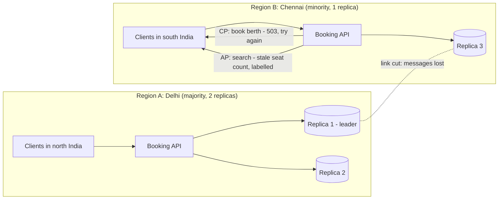
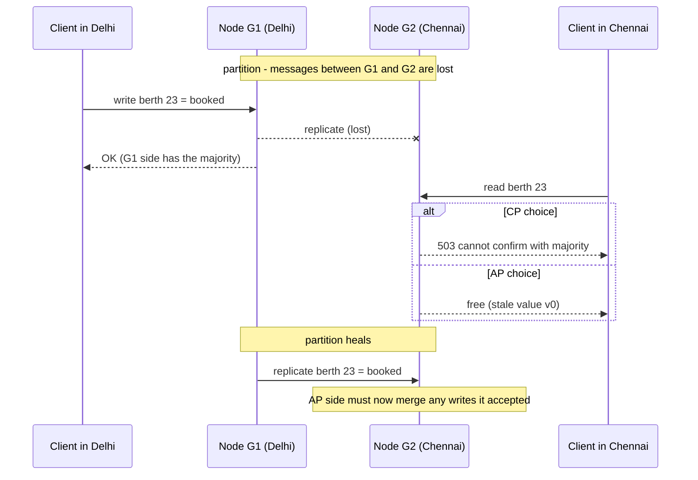

"CAP: consistency, availability, partition tolerance — pick two." You have probably heard it, and it is misleading. The theorem is narrower and more useful than the slogan. This lesson gives you the precise version, the everyday trade-off that matters more (PACELC), and a simulator to watch both choices play out.

## Learning objectives

By the end of this lesson you will be able to:

1. State the CAP theorem precisely, using the definitions of consistency and availability from the Gilbert–Lynch proof.
2. Explain why the choice only applies *during* a partition, and why "CA" is not an option for a distributed system.
3. Spot the common myths: "pick two forever", "database X is CP", "CAP availability = uptime".
4. Use PACELC to reason about the latency-versus-consistency trade-off that applies all the time.
5. Choose consistency per operation (not per system) and configure tunable databases accordingly.
6. Implement a tunable-consistency client in C# that behaves CP or AP per request.
7. Design for the AP side with mergeable data types so nothing is lost on heal.

## Prerequisites

- [Why distributed systems are difficult](#/lesson/m13-why-hard): partitions are a kind of partial failure, and timeouts can't tell you which side is alive.
- [Clock skew, ordering and logical clocks](#/lesson/m13-time-ordering): we'll need "latest write" and conflict detection.

## Explain it like I'm a beginner

A railway reservation system has two offices, one in Delhi and one in Chennai, each with a full copy of the seat chart. They phone each other after every booking to keep the charts in sync.

One afternoon the phone line is cut. A customer walks into the Chennai office and asks for the last berth on the Rajdhani. The Chennai clerk has two choices:

1. **Refuse**: "Sorry, I can't confirm right now. Please try later." The seat chart stays correct everywhere, but this customer gets no answer. *(Consistent, not available.)*
2. **Book it anyway**: The customer is happy. But Delhi might be selling the same berth at the same moment. When the line comes back, two people hold one berth. *(Available, not consistent.)*

There is no third option. The clerk can't both answer and be sure the answer is correct, because the only way to be sure is to ask Delhi, and the line is down. **That is the whole CAP theorem.** It is about what you do *while the line is cut*.

When the line works, there is a quieter choice. The clerk can phone Delhi before every booking (correct, but each booking takes longer), or book first and phone afterwards (fast, but for a few seconds the two charts disagree). That everyday choice between **speed and certainty** is what PACELC adds.

## First-principles explanation

### The theorem, precisely

Eric Brewer stated CAP as a conjecture in 2000. Seth Gilbert and Nancy Lynch proved it in 2002, and the proof needs exact definitions. In their model:

- **Consistency (C)** means **linearizability** (also called atomic consistency): the system behaves as if there is a single copy of the data, and every read returns the value of the most recent completed write. After a write succeeds, *every* later read, on any node, sees it. ([Consistency models](#/lesson/m13-consistency-models) covers this in depth.)
- **Availability (A)** means **every request received by a non-failing node gets a non-error response**. Not "most requests", not "within an SLA". Every node that is up must answer, including nodes cut off from the rest.
- **Partition tolerance (P)** means the system keeps working by its rules even if the network **loses arbitrarily many messages** between nodes.

The theorem: **in an asynchronous network, no system can guarantee both C and A when a partition occurs.**

The proof is short. Put two nodes, G1 and G2, on either side of a partition. A client writes `v1` to G1. Because G1's messages to G2 are lost, G2 cannot learn about `v1`. Now a client reads from G2. If G2 must answer (A), it can only return the old value `v0`, breaking C. If G2 must return `v1` (C), it can't, so it must wait or refuse, breaking A. Done.

### Why "pick two" is the wrong reading

The slogan suggests three equal options: CA, CP or AP. But **P is not something you choose**. Networks partition: switches fail, cables are cut, a firewall rule is pushed by mistake, a VM pauses for 30 seconds and looks dead to everyone else. If your data lives on more than one machine, partitions *will* happen. The real statement is:

> When a partition happens, choose: refuse some requests (stay consistent) or answer them with possibly stale or conflicting data (stay available).

And when there is no partition — which is most of the time — **you can have both C and A**. CAP says nothing about normal operation. Brewer himself wrote in 2012 that "2 of 3" is misleading, because partitions are rare and systems can make different choices at different times and for different operations.

**"CA" systems?** A single-node database is trivially "consistent and available" because it can't be partitioned from itself. But it isn't distributed, and when that node dies it is simply unavailable. A distributed system that claims CA is really saying "we assume partitions won't happen", and when one does, it behaves unpredictably — often split-brain, where both halves accept conflicting writes ([Split-brain and failure detection](#/lesson/m13-split-brain)).

### Failure case: the "CA" cluster in one rack

A team runs a three-node cluster in one rack and reasons: "Our nodes share a switch, so there are no partitions. We're CA." The replication setting allows any node to accept writes, and each node treats "I can't reach the others" as "the others are dead".

Then the top-of-rack switch half-fails: node 1 can no longer reach nodes 2 and 3, but clients can still reach all three through a second network path. Node 1 decides it is the survivor and keeps accepting writes. Nodes 2 and 3 decide node 1 is dead and keep accepting writes too. For 12 minutes, two independent copies of the data diverge. When the switch is fixed, there are hundreds of conflicting orders and no rule to merge them.

The system *was* partition-tolerant in the sense that it kept running. It just made no deliberate choice, so it got the worst of both: available, yes, but with data loss nobody designed for.

### CAP availability is not uptime

CAP's "A" is a strict, per-node property. Your SLA's "99.95 % availability" is a percentage over time. They are different:

- A **CP** system with a majority quorum stays fully available on the **majority** side of a partition. Only the minority side refuses requests. If partitions are rare and short, a CP system can easily reach 99.99 % measured availability.
- An **AP** system "available" in CAP terms may be returning stale stock levels, which your users may consider broken.

So "we need high availability, therefore we need an AP database" doesn't follow. Ask instead: during the rare partition, what should a minority-side node do with *this kind* of request?

### Which side keeps working?

In a CP design with majority quorums, the side with more than half of the nodes keeps accepting reads and writes. With 3 nodes, a 2–1 split leaves the pair working and the single node refusing. With 5 nodes split 3–2, the three keep working. Clients that can reach the majority see no outage at all. This is why clusters use **odd numbers** of nodes and spread them across three zones: losing any one zone still leaves a majority.

An even split (2–2 with 4 nodes) leaves *no* majority, and a CP system stops accepting writes everywhere. That is the cost of choosing 4 nodes over 3 or 5.

### Real databases are tunable, not labelled

Most real systems let you choose per request, or are neither strictly C nor strictly A:

- **Apache Cassandra** lets each query choose a consistency level (`ONE`, `QUORUM`, `ALL`, `LOCAL_QUORUM` and others). `QUORUM` reads with `QUORUM` writes give each read an overlap with the latest write; `ONE` stays available on a minority side but can be stale.
- **Amazon DynamoDB** reads are eventually consistent by default; a request can ask for `ConsistentRead`, which costs more read capacity and may fail when the data's leader can't be reached.
- **Azure Cosmos DB** offers five documented consistency levels per account (strong, bounded staleness, session, consistent prefix, eventual) that a request can relax further.
- **MongoDB** has per-operation `writeConcern` and `readConcern` options (for example `w: "majority"` and `readConcern: "linearizable"`).
- **PostgreSQL** with one primary and asynchronous read replicas is neither: reads from replicas are not linearizable (not C), and if the primary is cut off, writes stop until failover (not A). That is a perfectly sensible design for many systems; it just doesn't fit a CAP label.

This is Martin Kleppmann's point in "Please stop calling databases CP or AP": the labels hide the details that matter, such as *which* operations are linearizable and *what happens* to each request type during a partition.

### Failure case: "we bought a CP database" but read from replicas

A wallet service picks a database marketed as "strongly consistent". To cut load, a developer points balance reads at a read replica. Replication to that replica is asynchronous with typical lag of 100–300 ms (an assumed figure). A user tops up ₹500 and immediately pays ₹450 at a shop. The payment service reads the balance from the replica, sees the old ₹50, and declines. The database was "CP"; the *system* wasn't, because consistency is a property of the read path you actually use.

### PACELC: the trade-off you pay every day

Daniel Abadi (2010, published 2012) pointed out that CAP only talks about partitions, but replicated systems face a trade-off **all the time**:

> **If** there is a **P**artition, choose **A**vailability or **C**onsistency; **E**lse, choose **L**atency or **C**onsistency.

Why latency? To be consistent, a write must be confirmed by other replicas before it is acknowledged, and a read may need to check with them. Those confirmations cost network round trips. Back-of-the-envelope figures (typical, not measured; check your own cloud):

| Replicas | Round trip (estimate) | Cost of a synchronous write |
|---|---|---|
| Same availability zone | 0.1–0.5 ms | Negligible |
| Different zones, same region | 1–2 ms | Small |
| Mumbai ↔ Singapore | roughly 50–70 ms | Every write at least this slow |
| Mumbai ↔ Frankfurt | roughly 110–140 ms | Painful for interactive writes |

Example arithmetic: a checkout makes 4 sequential writes. With synchronous replication to Singapore at ~60 ms each, that is 4 × 60 = **240 ms** added to every checkout, before any other work. With asynchronous replication it is ~4 × 1 ms in-zone, but a regional outage can lose the last few seconds of writes.

Typical classifications (for *default* or *typical* configurations — all are tunable):

| System style | During partition | Else | Notes |
|---|---|---|---|
| Dynamo-style stores (Cassandra, Riak) with low consistency levels | PA | EL | Fast and available; reads may be stale |
| Spanner-style globally consistent databases | PC | EC | Pay latency on every write for linearizability |
| Single primary + synchronous standby | PC | EC | Writes wait for standby |
| Single primary + async replicas, reads on replicas | (writes stop on primary loss) | EL | Fast reads, stale reads possible |

### Failure case: synchronous replication turns latency into unavailability

A team wants zero data loss for OTP records, so it configures the primary in Mumbai to wait for a synchronous standby in Hyderabad before every commit. Normally that adds 20–30 ms (estimated) — acceptable. Then the inter-region link degrades: packets aren't lost, but latency jumps to 2 s. Every commit now takes 2 s, the connection pool fills (Little's law again: 300 writes/s × 2 s = 600 connections needed), and the OTP service is effectively down — although **no partition was ever declared**. The "else" branch of PACELC (latency) quietly became the "partition" branch (availability).

Mitigations: an application-side commit deadline with a deliberate fallback (with an alert, because durability has just been reduced) — but know your database: in PostgreSQL a commit waiting for a synchronous standby has *already been written locally*, so cancelling the wait does not undo it, and the client sees an unknown outcome; two synchronous standbys with "any one of two" acknowledgement (PostgreSQL's `synchronous_standby_names = 'ANY 1 (s1, s2)'`); or keeping the synchronous standby in the same region and replicating asynchronously across regions.

### Designing the AP side so nothing is lost

If you choose availability for an operation, you must decide **how to merge** when the partition heals. Options, from crude to clever:

1. **Last-writer-wins**: simple, silently loses concurrent writes (see the previous lesson's skew example).
2. **Keep siblings**: store both versions and let the application or user resolve.
3. **Mergeable data types (CRDTs, conflict-free replicated data types)**: data structures whose merge is mathematically guaranteed to converge without losing updates. A *grow-only counter* keeps one count per node and merges by taking the maximum per node; the value is the sum. Likes, views and download counts fit perfectly. Sets with add/remove, registers and even text have CRDT designs.
4. **Compensation**: accept the conflict and fix it in the business process. Airlines overbook and compensate; a warehouse that oversold one unit emails an apology and a voucher.

### Choose per operation, not per system

The useful question is never "is our system CP or AP?" It is "for **this operation**, during a partition, is a wrong answer worse than no answer?"

| Operation (ticketing platform) | Wrong answer cost | No answer cost | Choice |
|---|---|---|---|
| Book the last berth | Double booking, legal and refund cost | Customer retries in a minute | **C** |
| Search trains | Seat count slightly off | Users can't plan travel | **A** (stale OK, label it) |
| View my booked tickets | Showing an old ticket is confusing | Very annoying | **A**, with read-your-writes |
| Add to "favourite routes" | Harmless | Annoying | **A**, mergeable set |
| Refund to wallet | Paying twice | Refund is delayed | **C** |

### When it is unnecessary

If all your data lives in **one region** with a primary and a synchronous standby in another zone, the CAP choice is made for you: during a zone partition, the side with the primary (or the newly promoted standby, after fencing) serves, the other side doesn't. Partitions within a region are rare and short. Most business systems should simply accept "writes pause for 30–60 seconds during failover" and not reach for multi-region active-active designs, which are expensive and need conflict handling for every table.

## Visual explanation

### Architecture: two regions during a partition



How to read it: three replicas, two in Delhi and one in Chennai. The dotted line between regions is cut. Delhi holds a majority (2 of 3), so its API can still reach a quorum and keeps serving consistent reads and writes. Chennai's API can only reach replica 3. For booking (a CP operation) it refuses with `503` and a retry hint — correct but unavailable. For search (an AP operation) it answers from replica 3 and labels the result as possibly stale. The *same* system makes different CAP choices for different operations.

### Sequence: one write, one read, during a partition



This is the Gilbert–Lynch proof as a picture. G2 never received the write, so it has exactly two options: refuse or return the old value. After the partition heals, a CP system has nothing to fix. An AP system must reconcile: if G2 had also *accepted a booking* for berth 23, there are now two bookings for one berth, and the merge rule (or a human) decides.

## Step-by-step example

A stock service for a hardware chain with 3 replicas (two in Mumbai zones, one in Pune). Shop tills check stock and reserve items.

### Step 1 — the naive version

```csharp
// Read from whichever replica answers first; write to the local replica and replicate in the background.
var stock = await _nearestReplica.ReadAsync(sku);
if (stock.Quantity > 0) await _nearestReplica.WriteAsync(sku, stock with { Quantity = stock.Quantity - 1 });
```

Fast and always available. During a partition between Pune and Mumbai, both sides sell the "last" drill. Even without a partition, two tills reading the same replica 5 ms apart both see quantity 1 and both decrement it: a lost update. The design never decided what it wanted.

### Step 2 — decide per operation

- *Reserve stock*: must not oversell → consistent (C).
- *Show stock on the website*: approximate is fine → available (A), labelled "approximately 3 left".

### Step 3 — quorum reads and writes for reservations

With N = 3 replicas, require W = 2 acknowledgements for writes and R = 2 for reads. Any read quorum overlaps any write quorum in at least one replica (2 + 2 > 3), so a read sees the latest acknowledged write. Overlap alone does not stop two tills from both reading quantity 1 and both writing 0, so reservations also need an atomic compare-and-set. In a leaderless store, a per-replica version check is *not* enough (two writers can each win on different replicas); route each SKU's reservations through one leader, or use the store's consensus-backed conditional write (for example Cassandra lightweight transactions or a PostgreSQL `UPDATE ... WHERE quantity > 0`). During a partition, the Pune side (1 replica) can't form a quorum and refuses reservations; Mumbai keeps working. (This overlap idea, R + W > N, is the subject of [Quorums](#/lesson/m13-quorums). On its own it doesn't give full linearizability under all failure patterns; that needs read repair or consensus. It is enough to show the trade-off here.)

### Step 4 — one-replica reads for display

The website calls with consistency level ONE. It answers in one round trip to the nearest replica, keeps working in Pune during a partition, and shows a "stock may be out of date" hint when it couldn't reach the others.

## Production-style C# implementation

A tunable client: every call says how many replicas must respond. Replicas are in-memory fakes that can be "partitioned" (they stop answering, like a cut link — they hang rather than fail fast).

```text
Stock.Api/
  Program.cs
  Replication/
    Replicas.cs              (IReplica, VersionedValue, InMemoryReplica)
    TunableKvClient.cs       (ConsistencyLevel One / Quorum / All)
    VersionSource.cs
```

```csharp file=Replication/Replicas.cs
using System.Collections.Concurrent;

namespace Stock.Replication;

public sealed record VersionedValue(string Value, long Version);

public interface IReplica
{
    string Name { get; }
    Task<VersionedValue?> ReadAsync(string key, CancellationToken ct);
    /// <summary>Stores the value only if its version is newer than what the replica has.</summary>
    Task WriteAsync(string key, VersionedValue value, CancellationToken ct);
}

/// <summary>A replica with a fixed network latency. When partitioned it never answers,
/// exactly like a lost message: the caller only finds out through its own timeout.</summary>
public sealed class InMemoryReplica(string name, TimeSpan latency) : IReplica
{
    private readonly ConcurrentDictionary<string, VersionedValue> _data = new();
    private volatile bool _partitioned;

    public string Name { get; } = name;
    public bool Partitioned { get => _partitioned; set => _partitioned = value; }

    public async Task<VersionedValue?> ReadAsync(string key, CancellationToken ct)
    {
        await TravelAsync(ct);
        return _data.TryGetValue(key, out var v) ? v : null;
    }

    public async Task WriteAsync(string key, VersionedValue value, CancellationToken ct)
    {
        await TravelAsync(ct);
        _data.AddOrUpdate(key, value, (_, old) => value.Version > old.Version ? value : old);
    }

    private async Task TravelAsync(CancellationToken ct)
    {
        if (_partitioned) await Task.Delay(Timeout.InfiniteTimeSpan, ct);   // message lost
        await Task.Delay(latency, ct);
    }
}
```

```csharp file=Replication/VersionSource.cs
namespace Stock.Replication;

public interface IVersionSource { long Next(); }

/// <summary>Monotonic within this process. In a multi-writer system use an HLC (previous lesson)
/// or let a single leader assign versions.</summary>
public sealed class ClockVersionSource(TimeProvider time) : IVersionSource
{
    private long _last;

    public long Next()
    {
        while (true)
        {
            var last = Interlocked.Read(ref _last);
            var next = Math.Max(last + 1, time.GetUtcNow().ToUnixTimeMilliseconds() * 1000);
            if (Interlocked.CompareExchange(ref _last, next, last) == last) return next;
        }
    }
}
```

```csharp file=Replication/TunableKvClient.cs
namespace Stock.Replication;

public enum ConsistencyLevel { One, Quorum, All }

public sealed class NotEnoughReplicasException(int required, int answered)
    : Exception($"Needed {required} replica responses, got {answered} before the timeout.")
{
    public int Required { get; } = required;
    public int Answered { get; } = answered;
}

public sealed record ReadOutcome(VersionedValue? Value, int Answered, ConsistencyLevel Level);

/// <summary>Each call chooses its own CAP behaviour: One stays available on a minority side,
/// Quorum and All refuse when they cannot reach enough replicas.</summary>
public sealed class TunableKvClient(IReadOnlyList<IReplica> replicas, IVersionSource versions, TimeSpan timeout)
{
    public int Required(ConsistencyLevel level) => level switch
    {
        ConsistencyLevel.One => 1,
        ConsistencyLevel.Quorum => replicas.Count / 2 + 1,
        ConsistencyLevel.All => replicas.Count,
        _ => throw new ArgumentOutOfRangeException(nameof(level)),
    };

    public async Task<VersionedValue> WriteAsync(string key, string value, ConsistencyLevel level, CancellationToken ct)
    {
        var v = new VersionedValue(value, versions.Next());
        // Send to every replica; acknowledge the caller once enough have confirmed.
        await GatherAsync(async (r, t) => { await r.WriteAsync(key, v, t); return true; }, Required(level), ct);
        return v;
    }

    public async Task<ReadOutcome> ReadAsync(string key, ConsistencyLevel level, CancellationToken ct)
    {
        var answers = await GatherAsync((r, t) => r.ReadAsync(key, t), Required(level), ct);
        var newest = answers.Where(a => a is not null).MaxBy(a => a!.Version);
        return new ReadOutcome(newest, answers.Count, level);
    }

    private async Task<List<T>> GatherAsync<T>(Func<IReplica, CancellationToken, Task<T>> op, int required, CancellationToken ct)
    {
        // The timeout token lives until every replica call finishes, so slow replicas still
        // receive writes in the background (like real asynchronous propagation).
        var timeoutCts = new CancellationTokenSource(timeout);
        var pending = replicas.Select(r => op(r, timeoutCts.Token)).ToList();
        _ = Task.WhenAll(pending).ContinueWith(_ => timeoutCts.Dispose(), TaskScheduler.Default);

        var results = new List<T>();
        while (pending.Count > 0 && results.Count < required)
        {
            var done = await Task.WhenAny(pending).WaitAsync(ct);
            pending.Remove(done);
            if (done.IsCompletedSuccessfully) results.Add(done.Result);
        }
        if (results.Count < required) throw new NotEnoughReplicasException(required, results.Count);
        return results;
    }
}
```

```csharp file=Program.cs
using Stock.Replication;

var builder = WebApplication.CreateBuilder(args);

var replicas = new List<InMemoryReplica>
{
    new("mumbai-a", TimeSpan.FromMilliseconds(1)),
    new("mumbai-b", TimeSpan.FromMilliseconds(2)),
    new("pune", TimeSpan.FromMilliseconds(6)),
};
builder.Services.AddSingleton<IReadOnlyList<InMemoryReplica>>(replicas);
builder.Services.AddSingleton(TimeProvider.System);
builder.Services.AddSingleton<IVersionSource, ClockVersionSource>();
builder.Services.AddSingleton(sp => new TunableKvClient(
    replicas, sp.GetRequiredService<IVersionSource>(), timeout: TimeSpan.FromMilliseconds(300)));

var app = builder.Build();

// Website display: ONE by default (AP). Tills pass level=Quorum (CP).
app.MapGet("/stock/{sku}", async (string sku, ConsistencyLevel? level, TunableKvClient kv, HttpResponse resp, CancellationToken ct) =>
{
    var lvl = level ?? ConsistencyLevel.One;
    try
    {
        var r = await kv.ReadAsync(sku, lvl, ct);
        resp.Headers["X-Consistency"] = lvl == ConsistencyLevel.One ? "possibly-stale" : "quorum";
        return r.Value is null ? Results.NotFound() : Results.Ok(r.Value);
    }
    catch (NotEnoughReplicasException ex)
    {
        resp.Headers.RetryAfter = "2";
        return Results.Problem(ex.Message, statusCode: StatusCodes.Status503ServiceUnavailable);
    }
});

app.MapPut("/stock/{sku}", async (string sku, StockUpdate body, ConsistencyLevel? level, TunableKvClient kv, CancellationToken ct) =>
{
    try { return Results.Ok(await kv.WriteAsync(sku, body.Quantity.ToString(), level ?? ConsistencyLevel.Quorum, ct)); }
    catch (NotEnoughReplicasException ex)
    {
        // The write may still have reached some replicas: an unknown outcome, so tell the caller to check.
        return Results.Problem(ex.Message + " The write may be partially applied; read before retrying.",
            statusCode: StatusCodes.Status503ServiceUnavailable);
    }
});

// Demo only: cut or restore the link to one replica.
app.MapPost("/admin/replicas/{name}/partition", (string name, bool on, IReadOnlyList<InMemoryReplica> all) =>
{
    var r = all.FirstOrDefault(x => x.Name == name);
    if (r is null) return Results.NotFound();
    r.Partitioned = on;
    return Results.Ok(new { r.Name, r.Partitioned });
});

app.Run();

public sealed record StockUpdate(int Quantity);
```

Things to notice:

- **The CAP choice is a parameter.** `One` answers as long as any replica answers; `Quorum` refuses with 503 when it can't reach two of three. Partition `pune` and both still work; partition both Mumbai replicas and only `One` reads work.
- **A failed quorum write is an unknown outcome**, not a clean failure: some replicas may have stored it. The response says so. This is the lesson from [Why distributed systems are difficult](#/lesson/m13-why-hard) again.
- **Partitioned replicas hang, they don't throw.** That's realistic: the client discovers the partition only via its timeout, which sets a floor on how fast a CP system can refuse.
- **PACELC in the latencies.** `Quorum` waits for the second-fastest replica (2 ms); `All` waits for the slowest (6 ms); `One` takes the fastest (1 ms). Move `pune` to another region at 60 ms and `All` writes cost 60 ms every time, partition or not.
- **What's missing on purpose**: read repair, hinted handoff and compare-and-set. They belong in [Quorums](#/lesson/m13-quorums).

## Bad design vs good design

**Bad**: "Our system is AP because we chose Cassandra" (or "CP because we chose MongoDB"), with every query using the driver's default consistency level and no one able to say what a till does when Pune is cut off.

Problems:

- The label describes a default, not your read and write paths.
- Reservations and display reads get the same treatment, so either you oversell or the website goes down in a partition.
- No merge rule exists for writes accepted on the minority side, so the first partition causes silent data loss.

**Good**:

| Decision | Bad | Good |
|---|---|---|
| Granularity | One label for the whole system | Per operation: reserve = C, display = A |
| Configuration | Driver default | Explicit level per call, reviewed like code |
| Minority-side behaviour | Undefined | 503 + `Retry-After` for C ops; labelled stale answer for A ops |
| AP merges | Last-writer-wins by accident | CRDT or explicit rule per data type |
| Latency | Ignored | PACELC: sync replicas placed so the "else" cost is acceptable |

**Is the extra machinery worth it?** For a single-region app with one PostgreSQL primary, mostly no: you already have the C side, and failover is your partition plan. The per-operation thinking becomes essential as soon as you have replicas in two places that both serve users.

## Practical playground

The **Network partition** simulator runs two regions. Region A holds the leader and the majority; region B is the minority. A partition starts at second 20.

1. Run **CP** mode. Region B's availability drops to 0 during the partition, but stale reads and lost writes stay at zero.
2. Switch to **AP**. Every request is answered. Watch stale reads climb and count the writes discarded by last-writer-wins on heal.
3. In AP, raise the number of distinct keys from 50 to 1,000. Conflicts drop: the shape of your data changes the trade-off.
4. Make the partition 5 seconds instead of 30. How much does the AP damage shrink?

:::playground type=sim sim=partition title="CP versus AP during a partition" mode=CP partitionSec=30 requestsPerSec=20 writeShare=0.3 keys=50
:::

## Exercises

:::exercise id=m13-cap-pacelc-ex1 difficulty=beginner kind=written title="Bust the CAP myths"
For each statement, say whether it is true or false, and explain in one or two sentences using the precise definitions.

1. "CAP means a distributed database can only ever have two of the three properties."
2. "Our PostgreSQL primary with asynchronous read replicas is a CP system."
3. "An AP system has better uptime than a CP system."
4. "During a partition, a CP system with 5 nodes split 3–2 is unavailable to all clients."
5. "When there is no partition, a system can be both consistent and available."
6. "Using Cassandra with QUORUM reads and writes makes it CP for those operations."
::acceptance
- Each answer is correct, with a reason based on the Gilbert–Lynch definitions or on PACELC.
- Statement 2 identifies that reads from async replicas aren't linearizable.
- Statement 4 mentions the majority side.
::hint
C means linearizable; A means *every* non-failing node answers with a non-error response.
::hint
The choice applies only *during* a partition.
::hint
Who can still form a majority in a 3–2 split?
::hint
Statement 6: quorums give overlap with the latest *acknowledged* write. Think about what happens to the minority side, and whether "latest" is fully guaranteed without read repair.
::solution
1. **False.** P isn't optional for a distributed system; the theorem only forces a choice between C and A *while* a partition is happening. Outside partitions you can have both.
2. **False (or at least misleading).** Reads from asynchronous replicas can be stale, so they aren't linearizable (not C). And if the primary is cut off, writes stop until failover (not A). It's a reasonable design that simply doesn't fit either label.
3. **False.** CAP availability is a strict per-node property during a partition; uptime is an SLA measured over time. A CP system keeps the majority side working, and partitions are rare, so it can easily meet a 99.99 % SLA. An AP system that returns wrong data may count as "down" for users.
4. **False.** The 3-node side has a majority and keeps serving reads and writes. Only clients that can only reach the 2-node side are refused.
5. **True.** CAP says nothing about normal operation. PACELC adds that you then trade latency for consistency.
6. **Mostly true, with caveats.** With R + W > N, each read overlaps the latest acknowledged write, and the minority side can't form a quorum, so it refuses: CP-like behaviour. But Cassandra's quorum reads aren't strictly linearizable in all failure cases (a partially-applied failed write can be seen by one read and not the next, without read repair or lightweight transactions). It's "CP-ish for that operation", not a theorem-level guarantee.
::mistakes
- Treating "available" as "has good uptime".
- Calling a single-node database "CA" as if it were a distributed design choice.
- Forgetting that the majority side of a CP system keeps working.
:::

:::exercise id=m13-cap-pacelc-ex2 difficulty=beginner kind=code title="What should this node do during a partition?"
Implement `PartitionPolicy.Decide`, which tells a node how to handle a request given the operation's CAP mode and how many replicas (including itself) it can currently reach.
::requirements
- `Majority(total)` returns `total / 2 + 1`.
- If `reachable >= Majority(total)`: always `Serve`.
- Otherwise, in `Mode.CP`: `Reject`.
- Otherwise, in `Mode.AP`: reads → `ServePossiblyStale`; writes → `AcceptForLaterMerge`.
- Throw `ArgumentOutOfRangeException` if `total < 1`, `reachable < 1` (a node can always reach itself) or `reachable > total`.
::acceptance
- 3 replicas, 2 reachable: `Serve` in both modes.
- 3 replicas, 1 reachable: CP → `Reject`; AP read → `ServePossiblyStale`; AP write → `AcceptForLaterMerge`.
- 4 replicas, 2 reachable is *not* a majority.
::hint
A majority is strictly more than half.
::hint
With 4 replicas, majority = 4 / 2 + 1 = 3. A 2–2 split has no majority anywhere.
::hint
Validate the inputs first, then check majority, then branch on mode, then on read/write.
::hint
```csharp
if (reachable >= Majority(total)) return Decision.Serve;
return mode == Mode.CP ? Decision.Reject : isWrite ? Decision.AcceptForLaterMerge : Decision.ServePossiblyStale;
```
::starter
```csharp file=PartitionPolicy.cs
using System;

public enum Mode { CP, AP }

public enum Decision { Serve, ServePossiblyStale, AcceptForLaterMerge, Reject }

public static class PartitionPolicy
{
    public static int Majority(int total) => throw new NotImplementedException();

    public static Decision Decide(Mode mode, bool isWrite, int reachable, int total) => throw new NotImplementedException();
}
```
::tests
```csharp file=PartitionPolicyTests.cs
using System;
using Xunit;

public class PartitionPolicyTests
{
    [Theory]
    [InlineData(1, 1)]
    [InlineData(3, 2)]
    [InlineData(4, 3)]
    [InlineData(5, 3)]
    public void Majority(int total, int expected) => Assert.Equal(expected, PartitionPolicy.Majority(total));

    [Theory]
    [InlineData(Mode.CP, true)]
    [InlineData(Mode.CP, false)]
    [InlineData(Mode.AP, true)]
    [InlineData(Mode.AP, false)]
    public void Majority_side_serves(Mode mode, bool isWrite) =>
        Assert.Equal(Decision.Serve, PartitionPolicy.Decide(mode, isWrite, reachable: 2, total: 3));

    [Fact]
    public void Cp_minority_rejects()
    {
        Assert.Equal(Decision.Reject, PartitionPolicy.Decide(Mode.CP, isWrite: false, reachable: 1, total: 3));
        Assert.Equal(Decision.Reject, PartitionPolicy.Decide(Mode.CP, isWrite: true, reachable: 1, total: 3));
    }

    [Fact]
    public void Ap_minority_degrades()
    {
        Assert.Equal(Decision.ServePossiblyStale, PartitionPolicy.Decide(Mode.AP, isWrite: false, reachable: 1, total: 3));
        Assert.Equal(Decision.AcceptForLaterMerge, PartitionPolicy.Decide(Mode.AP, isWrite: true, reachable: 1, total: 3));
    }

    [Fact]
    public void Even_split_has_no_majority() =>
        Assert.Equal(Decision.Reject, PartitionPolicy.Decide(Mode.CP, isWrite: true, reachable: 2, total: 4));

    [Theory]
    [InlineData(0, 3)]
    [InlineData(4, 3)]
    [InlineData(1, 0)]
    public void Invalid_inputs_throw(int reachable, int total) =>
        Assert.Throws<ArgumentOutOfRangeException>(() => PartitionPolicy.Decide(Mode.CP, false, reachable, total));
}
```
::solution
```csharp file=PartitionPolicy.cs
using System;

public enum Mode { CP, AP }

public enum Decision { Serve, ServePossiblyStale, AcceptForLaterMerge, Reject }

public static class PartitionPolicy
{
    public static int Majority(int total) => total / 2 + 1;

    public static Decision Decide(Mode mode, bool isWrite, int reachable, int total)
    {
        if (total < 1) throw new ArgumentOutOfRangeException(nameof(total));
        if (reachable < 1 || reachable > total) throw new ArgumentOutOfRangeException(nameof(reachable));

        if (reachable >= Majority(total)) return Decision.Serve;
        if (mode == Mode.CP) return Decision.Reject;
        return isWrite ? Decision.AcceptForLaterMerge : Decision.ServePossiblyStale;
    }
}
```

The interesting design choice is in the names: `ServePossiblyStale` and `AcceptForLaterMerge` force the caller to *label* the response and *plan* the merge. A plain `Serve` on the minority side would hide both.
::mistakes
- Using `total / 2` (half) instead of `total / 2 + 1` (more than half), so a 2–2 split lets both sides write: split-brain.
- Counting reachable *other* nodes without the node itself.
- Returning `Serve` for AP writes on the minority side, with nothing recording that a merge is needed.
::extensions
Add a `Mode.Bounded` that serves stale reads only if the last successful sync was less than N seconds ago, otherwise rejects — similar to Cosmos DB's "bounded staleness" idea.
:::

:::exercise id=m13-cap-pacelc-ex3 difficulty=intermediate kind=code title="A grow-only counter that survives partitions"
A video platform counts views on replicas in several regions and stays available during partitions. Last-writer-wins would lose increments. Implement a **G-Counter** CRDT: each replica counts its own increments, and merging takes the per-replica maximum.
::requirements
- `Increment(int by = 1)` adds to *this* replica's own entry; `by` must be positive.
- `Value` is the sum of all entries.
- `Merge(GCounter other)` sets each entry to the max of the two; it must be commutative, associative and idempotent (merging twice changes nothing).
- `Snapshot()` returns a copy of the entries (for sending over the network).
::acceptance
- Two replicas partitioned, one increments 5 times and the other 3 times; after merging both ways, both read 8.
- Merging the same counter twice doesn't double-count.
- `Increment(0)` and negative values throw.
::hint
Why can't you just store one integer and add the other replica's integer on merge?
::hint
Store a dictionary: replica id → count. Each replica only ever increases its own entry.
::hint
Merge = entry-wise max. Max is idempotent (`max(a, a) = a`), commutative and associative, which is exactly why replicas converge.
::hint
```csharp
foreach (var (id, n) in other.Snapshot())
    _counts[id] = Math.Max(_counts.GetValueOrDefault(id), n);
```
::starter
```csharp file=GCounter.cs
using System;
using System.Collections.Generic;
using System.Linq;

public sealed class GCounter
{
    public GCounter(string replicaId) { throw new NotImplementedException(); }

    public string ReplicaId => throw new NotImplementedException();

    public long Value => throw new NotImplementedException();

    public void Increment(int by = 1) => throw new NotImplementedException();

    public void Merge(GCounter other) => throw new NotImplementedException();

    public IReadOnlyDictionary<string, long> Snapshot() => throw new NotImplementedException();
}
```
::tests
```csharp file=GCounterTests.cs
using System;
using Xunit;

public class GCounterTests
{
    [Fact]
    public void Counts_locally()
    {
        var c = new GCounter("mum");
        c.Increment(); c.Increment(4);
        Assert.Equal(5, c.Value);
    }

    [Fact]
    public void Partitioned_increments_are_not_lost()
    {
        var mum = new GCounter("mum");
        var sgp = new GCounter("sgp");
        for (var i = 0; i < 5; i++) mum.Increment();
        for (var i = 0; i < 3; i++) sgp.Increment();
        mum.Merge(sgp);
        sgp.Merge(mum);
        Assert.Equal(8, mum.Value);
        Assert.Equal(8, sgp.Value);
    }

    [Fact]
    public void Merge_is_idempotent()
    {
        var a = new GCounter("a");
        var b = new GCounter("b");
        b.Increment(10);
        a.Merge(b); a.Merge(b); a.Merge(b);
        Assert.Equal(10, a.Value);
    }

    [Fact]
    public void Merge_is_commutative()
    {
        var a = new GCounter("a"); a.Increment(2);
        var b = new GCounter("b"); b.Increment(7);
        var c = new GCounter("c"); c.Increment(1);
        var x = new GCounter("x"); x.Merge(a); x.Merge(b); x.Merge(c);
        var y = new GCounter("y"); y.Merge(c); y.Merge(a); y.Merge(b);
        Assert.Equal(x.Value, y.Value);
        Assert.Equal(10, x.Value);
    }

    [Fact]
    public void Merge_keeps_newer_local_progress()
    {
        var a = new GCounter("a");
        var b = new GCounter("b");
        a.Increment(3);
        b.Merge(a);           // b knows a:3
        a.Increment(2);       // a:5
        a.Merge(b);           // must not go back to a:3
        Assert.Equal(5, a.Value);
    }

    [Fact]
    public void Snapshot_is_a_copy()
    {
        var a = new GCounter("a");
        a.Increment();
        var snap = a.Snapshot();
        a.Increment();
        Assert.Equal(1, snap["a"]);
    }

    [Theory]
    [InlineData(0)]
    [InlineData(-1)]
    public void Rejects_non_positive(int by) =>
        Assert.Throws<ArgumentOutOfRangeException>(() => new GCounter("a").Increment(by));
}
```
::solution
```csharp file=GCounter.cs
using System;
using System.Collections.Generic;
using System.Linq;

public sealed class GCounter
{
    private readonly Dictionary<string, long> _counts = new();
    private readonly object _gate = new();

    public GCounter(string replicaId)
    {
        ArgumentException.ThrowIfNullOrWhiteSpace(replicaId);
        ReplicaId = replicaId;
    }

    public string ReplicaId { get; }

    public long Value { get { lock (_gate) return _counts.Values.Sum(); } }

    public void Increment(int by = 1)
    {
        ArgumentOutOfRangeException.ThrowIfNegativeOrZero(by);
        lock (_gate) _counts[ReplicaId] = _counts.GetValueOrDefault(ReplicaId) + by;
    }

    public void Merge(GCounter other)
    {
        ArgumentNullException.ThrowIfNull(other);
        foreach (var (id, n) in other.Snapshot())
            lock (_gate) _counts[id] = Math.Max(_counts.GetValueOrDefault(id), n);
    }

    public IReadOnlyDictionary<string, long> Snapshot()
    {
        lock (_gate) return new Dictionary<string, long>(_counts);
    }
}
```

Each replica is the only writer of its own entry, so entries only grow, and max never loses information. That's why replicas converge without coordination: an AP design with no lost updates.
::alternatives
- **PN-Counter**: two G-Counters (increments and decrements); value = P − N. Use it for likes that can be withdrawn.
- **Server-side aggregation** without CRDTs: each region appends view events to a log, and a batch job sums them. Simpler when you only need the total every few minutes.
::mistakes
- Merging by adding the other replica's total: merging twice double-counts.
- Letting a replica write another replica's entry, which breaks the "only I grow my entry" rule.
- Using one shared entry for all replicas, which turns merge into last-writer-wins.
::extensions
Implement a PN-Counter on top of two G-Counters and test that a "like" then "unlike" in different regions nets to zero after merge.
:::

:::exercise id=m13-cap-pacelc-ex4 difficulty=intermediate kind=hld title="Choose C or A per feature for a ticketing platform"
The starter graph is a ticketing platform running active-active in two regions with a multi-leader database replicating asynchronously both ways. Every feature reads and writes the local region. Redesign it so that **booking a seat and refunds never double-book or double-pay**, while **search and "my tickets" stay available** during an inter-region partition. Peak search traffic is about 20,000 requests per second; peak bookings about 500 per second (assumed).
::acceptance
- Seat inventory has a single authority per train (or a consensus-backed store), with a stated behaviour for the minority region.
- Search is served from replicas or caches that may be stale, and is labelled.
- "My tickets" provides read-your-writes for the user who just booked.
- Shows where the PACELC latency cost appears for bookings from the far region, with a number.
::hint
Which operations are harmed by a wrong answer, and which by no answer?
::hint
You don't need the whole database to be CP. Can seat inventory be partitioned by train, with each train's inventory owned by one region?
::hint
For a user in region B booking a train owned by region A, the booking call crosses regions. Estimate the extra latency.
::hint
Nodes: per region `app-server`, `read-replica` or `search`, `cache`; one `database` per inventory shard with `multiAz: true`; `queue` for confirmation emails.
::starter
```json
{
  "nodes": [
    { "id": "users", "type": "client", "label": "Travellers", "props": { "rps": 20500 } },
    { "id": "dns", "type": "dns", "label": "Geo DNS" },
    { "id": "apiN", "type": "app-server", "label": "API (north region)", "props": { "instances": 10, "region": "north" } },
    { "id": "apiS", "type": "app-server", "label": "API (south region)", "props": { "instances": 10, "region": "south" } },
    { "id": "dbN", "type": "database", "label": "Multi-leader DB (north)", "props": { "region": "north" } },
    { "id": "dbS", "type": "database", "label": "Multi-leader DB (south)", "props": { "region": "south" } }
  ],
  "edges": [
    { "from": "users", "to": "dns", "kind": "sync" },
    { "from": "dns", "to": "apiN", "kind": "sync" },
    { "from": "dns", "to": "apiS", "kind": "sync" },
    { "from": "apiN", "to": "dbN", "kind": "sync", "label": "search + book + refund" },
    { "from": "apiS", "to": "dbS", "kind": "sync", "label": "search + book + refund" },
    { "from": "dbN", "to": "dbS", "kind": "async", "label": "two-way replication" }
  ]
}
```
::solution
```json
{
  "nodes": [
    { "id": "users", "type": "client", "label": "Travellers", "props": { "rps": 20500 } },
    { "id": "dns", "type": "dns", "label": "Geo DNS" },
    { "id": "apiN", "type": "app-server", "label": "API (north)", "props": { "instances": 10, "region": "north", "multiAz": true } },
    { "id": "apiS", "type": "app-server", "label": "API (south)", "props": { "instances": 10, "region": "south", "multiAz": true } },
    { "id": "invN", "type": "database", "label": "Seat inventory - trains owned by north (primary + sync standby)", "props": { "region": "north", "multiAz": true, "replicas": 1 } },
    { "id": "invS", "type": "database", "label": "Seat inventory - trains owned by south (primary + sync standby)", "props": { "region": "south", "multiAz": true, "replicas": 1 } },
    { "id": "searchN", "type": "search", "label": "Search index (north, stale OK)", "props": { "region": "north" } },
    { "id": "searchS", "type": "search", "label": "Search index (south, stale OK)", "props": { "region": "south" } },
    { "id": "cacheN", "type": "cache", "label": "Availability cache (north)", "props": { "ttlSeconds": 30 } },
    { "id": "cacheS", "type": "cache", "label": "Availability cache (south)", "props": { "ttlSeconds": 30 } },
    { "id": "events", "type": "stream", "label": "Booking events (cross-region)" },
    { "id": "mail", "type": "worker", "label": "Ticket email and SMS" }
  ],
  "edges": [
    { "from": "users", "to": "dns", "kind": "sync" },
    { "from": "dns", "to": "apiN", "kind": "sync" },
    { "from": "dns", "to": "apiS", "kind": "sync" },
    { "from": "apiN", "to": "searchN", "kind": "sync", "label": "search (A)" },
    { "from": "apiS", "to": "searchS", "kind": "sync", "label": "search (A)" },
    { "from": "apiN", "to": "cacheN", "kind": "sync", "label": "seat counts, labelled approx" },
    { "from": "apiS", "to": "cacheS", "kind": "sync", "label": "seat counts, labelled approx" },
    { "from": "apiN", "to": "invN", "kind": "sync", "label": "book/refund north-owned trains (C)" },
    { "from": "apiN", "to": "invS", "kind": "sync", "label": "book south-owned trains, cross-region (C)" },
    { "from": "apiS", "to": "invS", "kind": "sync", "label": "book/refund south-owned trains (C)" },
    { "from": "apiS", "to": "invN", "kind": "sync", "label": "book north-owned trains, cross-region (C)" },
    { "from": "invN", "to": "events", "kind": "async", "label": "outbox" },
    { "from": "invS", "to": "events", "kind": "async", "label": "outbox" },
    { "from": "events", "to": "searchN", "kind": "async" },
    { "from": "events", "to": "searchS", "kind": "async" },
    { "from": "events", "to": "mail", "kind": "async" }
  ]
}
```

**Reasoning.**

- *Seat inventory is CP, sharded by train.* Each train's inventory has exactly one primary (in the region where most of its route lies), with a synchronous standby in another zone of the same region. There is never more than one writer for a berth, so double booking is impossible. During an inter-region partition, users in the south can't book north-owned trains: they get "booking temporarily unavailable for this train, try again" (refuse — C). Everything else keeps working.
- *Search and seat counts are AP.* Search indexes and caches are fed asynchronously from booking events and may be seconds stale. At 20,000 RPS this is where the load is, and it's all served locally. Seat counts are shown as "about 12 available"; the real check happens at booking.
- *My tickets*: right after booking, the API reads from the owning inventory database (or uses a session token, see [Consistency models](#/lesson/m13-consistency-models)) so the user always sees the ticket they just bought.
- *PACELC cost*: a south user booking a north-owned train pays one cross-region round trip per write, estimated 30–50 ms within India. At 500 bookings/s that's acceptable; it would not be for search.
- *Refunds* go through the same owning shard and carry an idempotency key.
- *Why not multi-leader for inventory?* Two regions accepting writes for the same berth during a partition is precisely the double booking we must prevent. Multi-leader is fine for user preferences (mergeable).
::mistakes
- Making the whole system CP: search would fail in the minority region for no benefit.
- Keeping multi-leader for seats and "resolving conflicts later": the conflict *is* a double-booked passenger.
- Forgetting that the cross-region booking call itself needs a timeout and an idempotency key.
:::

:::exercise id=m13-cap-pacelc-ex5 difficulty=advanced kind=code title="Pick read and write quorum sizes within a latency budget"
A store has N replicas with known round-trip latencies (some in-zone, some in another region). Waiting for k acknowledgements costs the k-th smallest latency. Write `ConsistencyPlanner.Choose`, which picks read quorum R and write quorum W such that R + W > N (every read overlaps the latest write), the write latency fits a budget, and the expected latency for the workload is as low as possible.
::requirements
- Input: `replicaLatencyMs` (any order, length N ≥ 1), `readShare` in [0, 1], `writeBudgetMs`.
- Latency of an operation needing k responses = k-th smallest latency.
- Constraints: 1 ≤ R, W ≤ N; R + W > N; latency(W) ≤ `writeBudgetMs`.
- Objective: minimise `readShare × latency(R) + (1 − readShare) × latency(W)`.
- Ties (within 1e-9): prefer smaller R, then smaller W.
- Return `null` if no (R, W) satisfies the constraints.
::acceptance
- Latencies [2, 3, 70], read share 0.9, budget 10 → (2, 2).
- Same latencies, read share 0.99, budget 100 → (1, 3).
- Budget below the fastest replica → null.
- Equal latencies [5, 5, 5] → (1, 3) by the tie rule.
::hint
N is small. Try every (R, W) pair.
::hint
Sort the latencies once; latency(k) = sorted[k − 1].
::hint
Skip pairs where R + W ≤ N or latency(W) > budget.
::hint
Keep the best so far; replace it only if the new cost is lower by more than 1e-9. Iterating R ascending, then W ascending, gives the tie rule for free.
::hint
```csharp
for (var r = 1; r <= n; r++)
for (var w = 1; w <= n; w++)
{
    if (r + w <= n || sorted[w - 1] > budget) continue;
    var cost = readShare * sorted[r - 1] + (1 - readShare) * sorted[w - 1];
    if (best is null || cost < bestCost - 1e-9) { best = new QuorumChoice(r, w, cost); bestCost = cost; }
}
```
::starter
```csharp file=ConsistencyPlanner.cs
using System;
using System.Linq;

public sealed record QuorumChoice(int R, int W, double ExpectedLatencyMs);

public static class ConsistencyPlanner
{
    public static QuorumChoice? Choose(double[] replicaLatencyMs, double readShare, double writeBudgetMs) =>
        throw new NotImplementedException();
}
```
::tests
```csharp file=ConsistencyPlannerTests.cs
using System;
using Xunit;

public class ConsistencyPlannerTests
{
    [Fact]
    public void Read_heavy_with_tight_write_budget_picks_majority_quorums()
    {
        var c = ConsistencyPlanner.Choose(new double[] { 2, 3, 70 }, 0.9, 10)!;
        Assert.Equal(2, c.R);
        Assert.Equal(2, c.W);
        Assert.Equal(3.0, c.ExpectedLatencyMs, 6);
    }

    [Fact]
    public void Very_read_heavy_with_loose_budget_reads_one_writes_all()
    {
        var c = ConsistencyPlanner.Choose(new double[] { 2, 3, 70 }, 0.99, 100)!;
        Assert.Equal(1, c.R);
        Assert.Equal(3, c.W);
    }

    [Fact]
    public void Input_order_does_not_matter()
    {
        var c = ConsistencyPlanner.Choose(new double[] { 70, 2, 3 }, 0.9, 10)!;
        Assert.Equal((2, 2), (c.R, c.W));
    }

    [Fact]
    public void Impossible_budget_returns_null() =>
        Assert.Null(ConsistencyPlanner.Choose(new double[] { 2, 3, 70 }, 0.5, 1));

    [Fact]
    public void Single_replica()
    {
        var c = ConsistencyPlanner.Choose(new double[] { 5 }, 0.5, 10)!;
        Assert.Equal((1, 1), (c.R, c.W));
    }

    [Fact]
    public void Ties_prefer_smaller_read_quorum()
    {
        var c = ConsistencyPlanner.Choose(new double[] { 5, 5, 5 }, 0.5, 10)!;
        Assert.Equal((1, 3), (c.R, c.W));
    }

    [Fact]
    public void Write_heavy_prefers_small_write_quorum()
    {
        // (5,1) costs 0.1*60 + 0.9*1 = 6.9; (4,2) costs 0.1*50 + 0.9*2 = 6.8, so (4,2) wins narrowly.
        var c = ConsistencyPlanner.Choose(new double[] { 1, 2, 40, 50, 60 }, 0.1, 100)!;
        Assert.Equal((4, 2), (c.R, c.W));
    }

    [Fact]
    public void Rejects_bad_input()
    {
        Assert.Throws<ArgumentException>(() => ConsistencyPlanner.Choose(Array.Empty<double>(), 0.5, 10));
        Assert.Throws<ArgumentOutOfRangeException>(() => ConsistencyPlanner.Choose(new double[] { 1 }, 1.5, 10));
    }
}
```
::solution
```csharp file=ConsistencyPlanner.cs
using System;
using System.Linq;

public sealed record QuorumChoice(int R, int W, double ExpectedLatencyMs);

public static class ConsistencyPlanner
{
    public static QuorumChoice? Choose(double[] replicaLatencyMs, double readShare, double writeBudgetMs)
    {
        ArgumentNullException.ThrowIfNull(replicaLatencyMs);
        if (replicaLatencyMs.Length == 0) throw new ArgumentException("Need at least one replica.", nameof(replicaLatencyMs));
        if (readShare is < 0 or > 1) throw new ArgumentOutOfRangeException(nameof(readShare));

        var sorted = replicaLatencyMs.OrderBy(x => x).ToArray();
        var n = sorted.Length;
        QuorumChoice? best = null;

        for (var r = 1; r <= n; r++)
        for (var w = 1; w <= n; w++)
        {
            if (r + w <= n) continue;                       // reads must overlap the latest write
            if (sorted[w - 1] > writeBudgetMs) continue;    // write must fit the budget
            var cost = readShare * sorted[r - 1] + (1 - readShare) * sorted[w - 1];
            if (best is null || cost < best.ExpectedLatencyMs - 1e-9) best = new QuorumChoice(r, w, cost);
        }
        return best;
    }
}
```

Check the first case by hand. Latencies sorted [2, 3, 70], budget 10, so W can be 1 or 2 (W = 3 costs 70). R + W > 3 forces (R=3, W=1), (R=2, W=2) or (R=3, W=2). Costs: 0.9 × 70 + 0.1 × 2 = 63.2; 0.9 × 3 + 0.1 × 3 = **3.0**; 0.9 × 70 + 0.1 × 3 = 63.3. So (2, 2). This is PACELC in miniature: the remote replica (70 ms) is the "latency" you pay for consistency, and the planner keeps it off the critical path.
::alternatives
Real systems also weigh **availability**: with (R=1, W=3), a single replica failure blocks all writes. Add a constraint "the system must tolerate f failures for reads and writes" (R ≤ N − f and W ≤ N − f) to the planner. Tail latency (p99) is also more useful than averages; use per-replica p99 values as input.
::mistakes
- Using the k-th *largest* latency: you wait for the fastest k, not the slowest.
- Forgetting R + W > N, which gives fast but stale reads.
- Ignoring the write budget for the read-heavy case and picking W = N with a 70 ms replica.
::extensions
Add the fault-tolerance constraint above and a test showing that with f = 1 and N = 3, (1, 3) is no longer allowed.
:::

## Automated testing

1. **Unit-test the policy.** `PartitionPolicy` and `ConsistencyPlanner` are pure functions; table-driven tests cover every split size, including the even split.
2. **Partition tests with fake replicas.** The `InMemoryReplica` above can be partitioned in a test. Assert the behaviour per level:

```csharp
[Fact]
public async Task Quorum_refuses_and_one_serves_when_two_replicas_are_cut_off()
{
    var a = new InMemoryReplica("a", TimeSpan.Zero);
    var b = new InMemoryReplica("b", TimeSpan.Zero);
    var c = new InMemoryReplica("c", TimeSpan.Zero);
    var kv = new TunableKvClient(new IReplica[] { a, b, c }, new ClockVersionSource(TimeProvider.System), TimeSpan.FromMilliseconds(100));
    await kv.WriteAsync("drill-18v", "4", ConsistencyLevel.All, CancellationToken.None);

    b.Partitioned = true; c.Partitioned = true;

    await Assert.ThrowsAsync<NotEnoughReplicasException>(() => kv.ReadAsync("drill-18v", ConsistencyLevel.Quorum, CancellationToken.None));
    var one = await kv.ReadAsync("drill-18v", ConsistencyLevel.One, CancellationToken.None);
    Assert.Equal("4", one.Value!.Value);
}
```

3. **Stale-read test.** Write at `One` while two replicas are partitioned, heal, and read at `One` from a replica that missed the write. Assert the read *can* be stale. Tests that prove the weaker guarantee is weaker are as important as tests of the strong one; they stop someone "optimising" a booking path to `One`.
4. **Convergence tests for CRDTs.** Randomly generate increments on 3 replicas and random merge orders; assert all replicas end with the same value, equal to the total number of increments.
5. **Network fault injection in integration tests.** With real databases in containers, use a proxy such as Toxiproxy (or `iptables` rules in CI) to cut the link between nodes and run the same assertions against the real driver settings. This catches the "driver default consistency level" mistake.
6. **Jepsen-style checking** for critical stores: record a history of operations under partitions and check it with a linearizability checker (the next lesson's exercise builds a tiny one).

## Real-world application

- **Booking and inventory systems** (rail, airline, cinema) typically keep the authoritative seat or stock count behind a single writer per item or a consensus-backed store, and serve search and browsing from caches and replicas that may lag.
- **Apache Cassandra users** often pick `LOCAL_QUORUM` for both reads and writes: consistent within a region, with only asynchronous cross-region replication, so a region partition doesn't stop local traffic. That is a PACELC choice: avoid paying cross-region latency on every request.
- **Azure Cosmos DB's session consistency** (its documented default) gives each client read-your-writes and monotonic reads while keeping latency low — a middle point between strong and eventual.
- **Collaborative editors and offline-first apps** use CRDTs so edits made while disconnected merge without conflicts.
- **Payment ledgers** choose C: when the ledger can't confirm a debit, refusing is cheaper than paying twice. Shopping-cart and "recently viewed" features choose A.

## Interview questions

:::interview
::q beginner
State the CAP theorem in one sentence.
::a
In a distributed system, when a network partition happens, you must choose between consistency (every read returns the latest write, as if there were one copy) and availability (every non-failing node returns a non-error response); you can't guarantee both during the partition.
::q beginner
Why isn't "CA" a real option?
::a
Because partitions aren't optional once data lives on more than one machine: links fail, switches fail, nodes pause. Claiming CA just means not deciding what to do during a partition. A single-node database is "CA" only because it isn't distributed, and when that node fails it is simply unavailable.
::q intermediate
What does PACELC add to CAP?
::a
CAP only covers partitions. PACELC says: if there is a Partition, choose Availability or Consistency; Else, choose Latency or Consistency. Keeping replicas consistent requires waiting for acknowledgements, which costs round trips on every write (and possibly every read) even when the network is healthy. For geo-distributed systems that cost — tens to hundreds of milliseconds — is often the trade-off that dominates design.
::q intermediate
Is a PostgreSQL primary with asynchronous read replicas CP or AP?
::a
Neither label fits. Reads from replicas can be stale, so the read path isn't linearizable. If the primary is unreachable, writes stop until failover, so it isn't CAP-available for writes either. It's a single-leader design with eventual consistency on replicas. The useful answer describes each operation: writes and primary reads are consistent; replica reads are fast and possibly stale; writes are unavailable during failover.
::q advanced
Design consistency for an e-commerce platform in two regions. Which operations are C and which are A?
::a
Per operation. Checkout payment, stock reservation and refunds: C — a single writer per SKU or order (sharded by key, owned by a home region) with synchronous replication inside the region; during a partition the non-owning region refuses with a retry hint. Product browsing, search, recommendations and stock display: A — local replicas and caches, labelled as approximate. Cart: A with a mergeable structure (add-wins set) so items added during a partition aren't lost. Order history: read-your-writes via session tokens. For PACELC, I'd avoid synchronous cross-region replication on the hot path; users in the far region pay one cross-region hop only when buying, not when browsing.
::q advanced
Your team says "we need 99.99 % availability, so we must use an AP database." How do you respond?
::a
That mixes two meanings of availability. CAP availability is about every node answering during a partition; an SLA is measured uptime. A CP system with 3 or 5 nodes across zones keeps the majority side fully available during a partition, and partitions are rare and short, so it can meet 99.99 %. The real question is what each operation should do on the minority side, and how often clients are stuck there. An AP database also costs you: you need merge rules for every data type and accept stale or conflicting reads. I'd choose per operation and measure.
:::

## Summary and revision

**Key takeaways**

- CAP (Gilbert–Lynch): during a partition, a system can't guarantee both linearizability and a non-error answer from every live node.
- The choice exists only during partitions; normally you can have both.
- "CA" means "we haven't decided what happens in a partition".
- CAP availability ≠ uptime. A CP system's majority side keeps working.
- Real databases are tunable per request; labels like "CP" or "AP" hide what matters.
- PACELC: when there's no partition, you trade latency for consistency on every request.
- Choose per operation: is a wrong answer worse than no answer?
- On the AP side, plan merges: CRDTs, siblings or business compensation.

**Terminology**: partition, linearizability, CAP availability, CP, AP, PACELC, quorum, majority, consistency level, CRDT, G-Counter, split-brain.

:::flashcards
Q: What does C mean in the CAP proof?
A: Linearizability: the system behaves like a single copy, and every read returns the latest completed write.
Q: What does A mean in the CAP proof?
A: Every request received by a non-failing node results in a non-error response.
Q: When does CAP force a choice?
A: Only while a network partition is happening.
Q: In a 5-node CP cluster split 3–2, who keeps working?
A: The 3-node side (majority). The 2-node side refuses requests it can't confirm.
Q: PACELC in one line?
A: If Partition: Availability or Consistency; Else: Latency or Consistency.
Q: Why is a G-Counter safe to merge in any order?
A: Each replica only grows its own entry, and merge is entry-wise max, which is commutative, associative and idempotent.
Q: Why are odd cluster sizes preferred?
A: An even split (2–2) leaves no majority anywhere; odd sizes always leave one side with a majority after a two-way split.
Q: What's wrong with "our system is AP"?
A: Consistency is a property of each operation and read path, not of a product; the label hides what each request does during a partition.
:::

## Knowledge check

:::quiz pass=70
::q single
A 3-replica store is split: replicas 1 and 2 can talk, replica 3 is isolated. A client connected only to replica 3 asks to book the last seat. The system is configured CP for bookings. What happens?
- [ ] Replica 3 books the seat and reconciles later.
- [x] Replica 3 refuses (or times out) because it can't reach a majority; replicas 1 and 2 keep taking bookings.
- [ ] The whole system stops taking bookings.
- [ ] Replica 3 forwards the booking to replica 1.
> CP means the minority side refuses. The majority side (1 and 2) keeps working. Forwarding is impossible: replica 3 can't reach replica 1.
::q single
Which statement about CAP is correct?
- [ ] A distributed database permanently has exactly two of C, A and P.
- [x] When there's no partition, a system can be both consistent and available.
- [ ] CAP availability means 99.9 % uptime.
- [ ] Partition tolerance is optional if you use a fast network.
> The theorem only constrains behaviour during partitions.
::q single
A team configures synchronous replication from Mumbai to a standby in Singapore (~60 ms round trip, estimated). There is no partition. What does PACELC predict?
- [ ] No effect, since CAP only applies to partitions.
- [x] Every write pays at least the cross-region round trip: consistency costs latency.
- [ ] Reads become stale.
- [ ] The system becomes AP.
> That's the "Else: Latency or Consistency" branch.
::q single
A wallet uses a "strongly consistent" database but reads balances from an asynchronous replica. A user tops up and immediately pays; the payment is declined. Why?
- [ ] The database isn't really strongly consistent.
- [x] The replica read path isn't linearizable; consistency depends on which copy you read from.
- [ ] The network was partitioned.
- [ ] The top-up failed.
> The guarantee applies to the primary. Reading from a lagging replica gives up linearizability.
::q multi
For which features is choosing availability (serving possibly stale data) during a partition usually acceptable? (Select all that apply.)
- [x] Product search results.
- [ ] Debiting a bank account.
- [x] A "views" counter on videos.
- [x] Showing approximate stock on a product page.
- [ ] Allocating the last seat on a flight.
> Debits and last-seat allocation are harmed by wrong answers. Search, counters and approximate stock are harmed more by no answer.
::q single
Two replicas both accept increments to a likes counter during a partition (A: +40, B: +25), starting from 1,000. Merging uses last-writer-wins on the total. What's the likely result, and the fix?
- [ ] 1,065; nothing to fix.
- [x] 1,040 or 1,025; use a G-Counter that keeps per-replica counts and merges by max.
- [ ] 2,065; use a lock.
- [ ] The merge fails.
> LWW keeps one side's total and discards the other's increments. A G-Counter merges without loss.
::q single
Why does a 4-node CP cluster have worse partition behaviour than a 3-node one in a 2–2 split?
- [ ] 4 nodes are slower.
- [x] Neither half has a majority (3 of 4), so no side can accept writes.
- [ ] 4 nodes use more storage.
- [ ] It's identical.
> Majority of 4 is 3. A 2–2 split leaves both sides refusing writes.
:::

## Completion criteria

You have finished this lesson when you can:

- [ ] Score at least 70 % on the knowledge check.
- [ ] Complete exercises 2 and 3 with all tests passing.
- [ ] Complete exercise 1 and either exercise 4 or 5.
- [ ] Run the partition simulator in CP and AP modes and explain the numbers.
- [ ] Explain CAP correctly in 60 seconds without saying "pick two".
