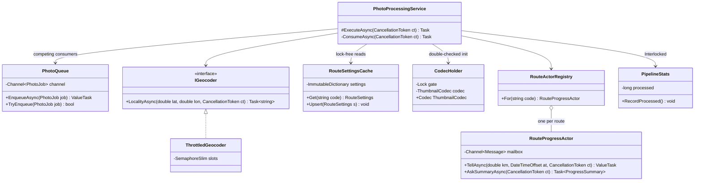
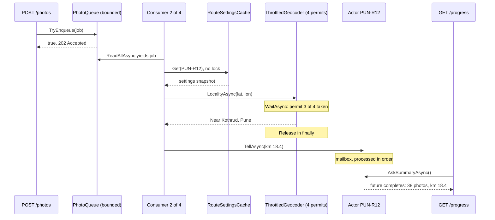

Concurrency bugs are the most expensive bugs to find: they disappear under the debugger, show up once a week in production, and corrupt data quietly. The good news is that almost every safe concurrent design in .NET is built from about a dozen well-known patterns. Learn their shapes, their tools and their failure modes, and most concurrency problems become a matter of picking the right one.

## Learning objectives

By the end of this lesson you will be able to:

1. Explain what goes wrong when two threads share mutable state, with a concrete lost-update example.
2. Build a producer-consumer pipeline with bounded `Channel<T>` and competing consumers.
3. Explain how the .NET thread pool works and why blocking it ("sync over async") starves an ASP.NET Core app.
4. Recognise and fix the common async/await pitfalls.
5. Choose between `lock`, `SemaphoreSlim`, `ReaderWriterLockSlim`, `Interlocked`, immutable snapshots and actors for a given piece of shared state.
6. Implement double-checked locking correctly, and explain why `Lazy<T>` is usually better.
7. Use futures (`Task`, `TaskCompletionSource`) and fork-join (`Parallel.ForEachAsync`, `Task.WhenAll`) with bounded parallelism.

## Prerequisites

- [How a computer executes a program](#/lesson/m01-how-programs-run): processes, threads and memory.
- [Asynchronous programming with async/await](#/lesson/m03-async-await): `Task`, `await` and the thread pool basics.
- [Background services and hosted workers](#/lesson/m03-background-services): our consumers run as `BackgroundService`s.

## Explain it like I'm a beginner

Think of a busy restaurant kitchen.

- **Waiters** take orders and pin them on a rail. **Cooks** take orders off the rail and cook them. Waiters don't wait for the food; cooks don't take orders. The rail in the middle has room for 20 tickets; when it is full, waiters must wait. That is the **producer-consumer** pattern, and the rail is a **bounded channel**.
- There is a fixed team of cooks, not one cook hired per order. When an order arrives, any free cook takes it. That is a **thread pool**.
- The kitchen has **one** tandoor. Only one cook may use it at a time; others wait their turn. That is a **lock** (mutual exclusion).
- There are **four** fryers. Up to four cooks can fry at once; the fifth waits. That is a **semaphore**.
- The menu board on the wall is read by everyone all the time, and changed once a day. When it changes, the manager writes a whole new board and swaps it in. Nobody ever reads a half-written board. That is **immutable shared state**.
- The head chef keeps the day's special-order book. Nobody else writes in it; they hand the chef a note, and the chef handles notes one at a time. That is an **actor**.
- A waiter gives a customer a token: "your order number is 47, we'll call you". The token is a promise of food later. That is a **future** (in .NET, a `Task`).
- For a wedding order of 500 plates, the head chef splits the work across all cooks, then waits until every part is done before plating. That is **fork-join**.

Every one of these exists because people (or threads) sharing a kitchen will otherwise bump into each other.

## First-principles explanation

### The root problem: shared mutable state

Two threads that only read data, or that each have their own data, never interfere. Trouble needs all three: **shared**, **mutable**, and **accessed concurrently**. Remove any one, and the problem disappears. Most patterns in this lesson remove one of the three.

The classic failure is a **lost update**. `count++` looks like one step but is three: read `count` into a register, add 1, write it back. If two threads both read 41, both write 42, one increment is lost. In the playground below, eight tasks each doing 100,000 unsynchronised increments typically finish with far fewer than 800,000.

Two more hazards hide behind that one:

- **Visibility and reordering.** The compiler, JIT and CPU may cache values in registers or reorder memory operations, as long as a *single* thread can't tell. Another thread can. Synchronisation primitives (locks, `Interlocked`, `Volatile`) include **memory barriers** that force a consistent view.
- **Compound operations.** "Check then act" (`if (!dict.ContainsKey(k)) dict.Add(k, v)`) is racy even with a thread-safe dictionary, because another thread can act between the check and the act. Use atomic operations like `GetOrAdd` or `TryAdd`.

### Pattern 1: producer-consumer with Channels

**Problem.** Work arrives in one place (HTTP requests, file uploads) and is processed somewhere else, at a different speed.

**Shape.** Producers write items into a buffer; one or more consumers read and process them. The buffer decouples their speeds, and when it is **bounded**, it pushes back on producers when consumers fall behind ([see backpressure](#/lesson/m13-backpressure)).

**.NET tool.** `System.Threading.Channels`. `Channel.CreateBounded<T>(capacity)` gives you a thread-safe, async-friendly queue: `await writer.WriteAsync(item)` waits for space; `await foreach (var item in reader.ReadAllAsync(ct))` waits for items without blocking a thread. Several consumers reading the same channel are **competing consumers**: each item goes to exactly one of them.

**Pitfalls.** Unbounded channels hide overload. Forgetting `writer.Complete()` means consumers wait forever at shutdown. An exception in a consumer loop that isn't caught kills that consumer silently, and the pipeline slowly loses capacity. Ordering is only guaranteed with a single consumer.

`BlockingCollection<T>` is the older, thread-blocking equivalent. Prefer channels in async code.

### Pattern 2: the thread pool

**Problem.** Creating a thread costs memory (about 1 MB of stack reserved by default on many platforms) and time. Creating one per request doesn't scale.

**Shape.** A pool of worker threads takes work items from a queue. The .NET thread pool has a global queue plus a local queue per worker thread (work stealing), and it adjusts its size automatically using a hill-climbing algorithm that measures throughput.

**.NET tool.** You rarely touch it directly: ASP.NET Core runs requests on it, `await` continuations run on it, `Task.Run` queues to it.

**The key failure: starvation.** The pool starts with a minimum number of threads (by default about the number of CPU cores) and adds more *gradually* when work is waiting. If request code **blocks** a pool thread, for example by calling `.Result` on an I/O task, that thread does nothing useful while it waits. Under load, every pool thread can end up blocked, waiting for I/O completions that themselves need a pool thread to run. New threads arrive slowly, so requests queue for seconds. The symptom: CPU is low, latency is terrible, and the thread count climbs steadily. The cure is to be **async all the way down**, not to raise `ThreadPool.SetMinThreads` (that only hides it for a while).

### Pattern 3: async/await, and its pitfalls

`async`/`await` lets one thread serve many operations by **releasing the thread while waiting for I/O**. A request waiting 50 ms for PostgreSQL holds no thread during those 50 ms. That is why an ASP.NET Core server can handle thousands of concurrent requests with a few dozen threads.

The pitfalls, each common in real code reviews:

| Pitfall | What happens | Fix |
|---|---|---|
| `task.Result` or `task.Wait()` in request code | Blocks a pool thread; under load, starvation. Deadlocks in apps with a synchronization context (WPF, WinForms, classic ASP.NET) | `await` it; make callers async |
| `async void` methods | Exceptions crash the process; callers can't await | Return `Task`; `async void` only for UI event handlers |
| `Parallel.ForEach(items, async x => ...)` | The lambda becomes `async void`; the loop "finishes" before the work does | `Parallel.ForEachAsync` or `Task.WhenAll` with a throttle |
| Fire-and-forget `_ = DoWorkAsync()` | Exceptions are lost; scoped services (a `DbContext`) are used after the request ends | Queue to a background channel or hosted service |
| `Task.Run` around I/O in a request | Wastes a thread hop; no scalability gain | Call the async API directly |
| `await` inside `lock` | Not allowed (compile error), because locks are thread-affine | `SemaphoreSlim.WaitAsync` |
| Ignoring `CancellationToken` | Work continues after the client left | Pass tokens down every async call |
| Awaiting a `ValueTask` twice | Undefined behaviour | Await once, or call `.AsTask()` |

`ConfigureAwait(false)` tells an `await` not to resume on the captured synchronization context. ASP.NET Core has no synchronization context, so it changes nothing there; it still matters in **libraries** that might be used from UI apps.

### Pattern 4: monitor / lock (mutual exclusion)

**Problem.** A small piece of state must be updated consistently, and several fields must change together.

**Shape.** Only one thread at a time may be inside the critical section.

**.NET tool.** The `lock` statement. Since .NET 9 there is a dedicated `System.Threading.Lock` type; `lock (myLock)` on it uses the faster `EnterScope` path. On any other object, `lock` uses `Monitor.Enter`/`Monitor.Exit`. `Monitor` also offers `Wait`/`Pulse` for condition signalling, though channels and semaphores are usually clearer.

**Rules.**

1. Lock on a **private** object you own, never on `this`, a `Type` or a string.
2. Keep critical sections **short**: no I/O, no `await`, no calling unknown code (callbacks, events) while holding the lock.
3. When you need two locks, always take them in the **same order** everywhere, or you will eventually deadlock.
4. A lock protects *data*, not *code*. Every access to that data, reads included, must take the same lock.

Uncontended `lock` costs on the order of tens of nanoseconds; contention is what's expensive.

### Pattern 5: semaphore throttling

**Problem.** A resource tolerates N concurrent users: an external API with a limit of 4 concurrent calls, a GPU with 2 inference slots, a database you must not open more than 20 connections to from one job.

**Shape.** A counter of permits. Take one before using the resource (waiting if none), give it back afterwards.

**.NET tool.** `SemaphoreSlim(initialCount: 4, maxCount: 4)` with `await WaitAsync(ct)` and `Release()` in a `finally`. It is async-friendly, which is why it is also the standard replacement for "a lock that I need to `await` inside" (`new SemaphoreSlim(1, 1)`).

**Pitfalls.** Forgetting `Release()` on an exception path leaks permits until everything hangs. `SemaphoreSlim` is not re-entrant: calling a method that takes the same semaphore again from inside deadlocks. It is not fair (no strict FIFO guarantee).

### Pattern 6: read-write lock

**Problem.** Data is read very often and written rarely, and reads take long enough that serialising them on one lock hurts throughput.

**Shape.** Many readers may hold the lock together; a writer needs it alone.

**.NET tool.** `ReaderWriterLockSlim` with `EnterReadLock`/`ExitReadLock` and `EnterWriteLock`/`ExitWriteLock` in `try`/`finally`. It is **thread-affine**, so it cannot be held across `await`.

**When it loses.** It is more expensive than a plain `lock` per acquisition. If read sections are tiny (a dictionary lookup), a plain `lock` or, better, an immutable snapshot is often faster. Measure before choosing it. Upgradeable read locks exist but are easy to misuse.

### Pattern 7: immutable shared state (copy-on-write)

**Problem.** Many threads read configuration, routing tables or price lists constantly; updates are occasional.

**Shape.** Never modify the shared object. To change it, build a new version and **swap the reference** atomically. Readers grab the current reference and use it without any lock; it can never change under them.

**.NET tool.** `record` types, `ImmutableDictionary<TKey, TValue>`, `FrozenDictionary<TKey, TValue>` (.NET 8+, very fast reads, slower to build), `Volatile.Read`/`Interlocked.Exchange` for the swap, and `ImmutableInterlocked.AddOrUpdate` for compare-and-swap updates.

**Trade-offs.** Each write allocates a new version, so this suits read-mostly data. Readers may briefly see the previous version; that's usually fine for configuration but not for, say, an account balance.

### Pattern 8: Interlocked and compare-and-swap (CAS)

**Problem.** A single counter or reference is updated by many threads, and a lock feels heavy.

**Shape.** CPU instructions that read-modify-write one memory location atomically. **Compare-and-swap** (CAS) says "set this to *new* only if it is still *expected*; tell me what it was". Lock-free algorithms loop: read, compute, CAS, retry if someone else changed it first.

**.NET tool.** `Interlocked.Increment`, `Add`, `Exchange`, `CompareExchange`, and `Interlocked.Read` for 64-bit values on 32-bit platforms.

```csharp
// "Increment only while below the limit", lock-free.
while (true)
{
    var current = Volatile.Read(ref _count);
    if (current >= limit) return false;
    if (Interlocked.CompareExchange(ref _count, current + 1, current) == current) return true;
}
```

**Pitfalls.** Only one memory location is atomic; two counters updated by two `Interlocked` calls can be seen out of step. Under heavy contention, CAS loops spin and waste CPU. Lock-free code beyond counters and reference swaps is hard to get right; use the BCL's concurrent collections instead of writing your own.

### Pattern 9: double-checked locking

**Problem.** An expensive object should be created once, lazily, and then read without locking.

**Shape.** Check without the lock; if it's missing, take the lock and check *again* (another thread may have created it while you waited), then create.

```csharp
private readonly Lock _gate = new();
private volatile ThumbnailCodec? _codec;   // volatile: publish the fully constructed object safely

public ThumbnailCodec Codec
{
    get
    {
        var c = _codec;                    // first check, no lock
        if (c is not null) return c;
        lock (_gate)
        {
            return _codec ??= new ThumbnailCodec();   // second check, under the lock
        }
    }
}
```

Without `volatile` (or equivalent barriers), another thread might see a non-null reference to an object whose constructor writes are not yet visible. In practice, .NET's memory model on x64 and ARM64 makes the naive form *usually* work, but "usually" is not a correctness argument.

**Better: don't write it.** `Lazy<T>` (default mode `ExecutionAndPublication`) and `LazyInitializer.EnsureInitialized` implement this correctly. In ASP.NET Core, a DI singleton registered with a factory is created once on first use, which is often all you need. For async initialisation, beware `Lazy<Task<T>>`: if the task fails, the failure is cached forever. Exercise 4 builds an `AsyncLazy<T>` that retries.

### Pattern 10: actor model

**Problem.** Some state has complex rules, many concurrent writers, and operations that must not interleave: a wallet balance, a game room, the live progress of one delivery route.

**Shape.** An **actor** owns its state privately and has a **mailbox**. Other code never touches the state; it sends messages. The actor processes one message at a time, so its state needs no locks. Replies come back as futures.

**.NET tools.** A hand-rolled actor is a `Channel<Message>` with a single reader loop. Frameworks: **Microsoft Orleans** ("virtual actors" called grains, activated on demand and distributed across a cluster) and **Akka.NET**.

**Trade-offs.** Every interaction is a message, so request-reply costs a queue hop. One actor is a serial bottleneck: a hot actor with 10,000 messages per second can fall behind. Two actors that wait on each other's replies can deadlock. Mailboxes need bounds. Actors are excellent for many small, independent pieces of state (one per wallet, one per route); poor for one global hot object.

### Pattern 11: futures and promises

**Problem.** Start work now, use the result later, and maybe start other work in the meantime.

**Shape.** A **future** is a placeholder for a value that will exist later. A **promise** is the write side that completes it.

**.NET tool.** `Task<T>` is the future. `TaskCompletionSource<T>` is the promise: you call `SetResult`, `SetException` or `SetCanceled`. Always create it with `TaskCreationOptions.RunContinuationsAsynchronously`, otherwise the code that awaits the task can run synchronously *inside* your `SetResult` call, on your thread, possibly while you hold a lock.

Starting two independent calls before awaiting either is the simplest concurrency win in request code:

```csharp
var summaryTask = actor.AskSummaryAsync(ct);   // both start now
var weatherTask = weather.ForRouteAsync(code, ct);
await Task.WhenAll(summaryTask, weatherTask);  // total time = the slower one, not the sum
```

### Pattern 12: fork-join

**Problem.** A big job splits into many independent pieces: re-generate 12,000 thumbnails, rank 50,000 job applications, call an API for 300 delivery hubs.

**Shape.** **Fork** the pieces into parallel work, **join** by waiting for all, then combine results.

**.NET tools.**

- `Parallel.ForEachAsync(items, new ParallelOptions { MaxDegreeOfParallelism = 8 }, async (item, ct) => ...)` for async work with a concurrency cap (.NET 6+).
- `Parallel.For`/`Parallel.ForEach` and PLINQ for CPU-bound work.
- `Task.WhenAll` for a modest, known number of async calls.

**Pitfalls.** Unbounded `Task.WhenAll(items.Select(CallApiAsync))` over 10,000 items fires 10,000 requests at once. Shared accumulators need `Interlocked` or a thread-safe collection; better, have each piece return its result and combine after the join. Don't use CPU parallelism inside ASP.NET Core request handlers under load: the requests themselves already use all cores.

### Choosing quickly

| Your shared state is… | Prefer |
|---|---|
| Work flowing between stages | Producer-consumer with a bounded channel |
| One counter or one reference | `Interlocked` / CAS |
| Read constantly, changed rarely | Immutable snapshot swap (`FrozenDictionary`, `ImmutableDictionary`) |
| A few fields that change together, short updates | `lock` (on a `Lock` object) |
| A resource with N slots, or a lock you must hold across `await` | `SemaphoreSlim` |
| Read-mostly with long synchronous reads | `ReaderWriterLockSlim` (measure first) |
| Complex per-entity rules, many writers | One actor per entity |
| Created once, lazily | `Lazy<T>` or a DI singleton |
| Many independent pieces of a batch | Fork-join with a parallelism cap |

### When a simpler design is enough

The simplest concurrency pattern is **not sharing**. Keep state local to a request; let the database handle concurrent writes with transactions and constraints ([see locking](#/lesson/m09-locking)); make objects immutable by default. Most ASP.NET Core services need nothing beyond async I/O, scoped services, a `ConcurrentDictionary` or two and a bounded channel for background work. Reach for actors, read-write locks or lock-free algorithms only when profiling or a real correctness requirement says so.

## Visual explanation

### The photo pipeline's moving parts

Our running example: a parcel-delivery company receives proof-of-delivery photos from riders' phones. Each photo is queued, a thumbnail is generated, the location is geocoded through an external API limited to 4 concurrent calls, and per-route progress (photo count, furthest distance along the route delivered so far) is tracked.



How to read it: each class is one pattern. `PhotoQueue` wraps a bounded channel (producer-consumer); `PhotoProcessingService` runs several consumer loops that compete for jobs. `ThrottledGeocoder` implements `IGeocoder` and wraps the real one with a `SemaphoreSlim` of 4 permits (semaphore throttling, as a decorator). `RouteSettingsCache` holds an immutable dictionary that readers use without locks. `CodecHolder` creates an expensive codec once with double-checked locking. `RouteActorRegistry` holds one `RouteProgressActor` per route; each actor owns its counters and processes messages one at a time. `PipelineStats` uses `Interlocked` counters. The arrows show that the service depends on all of them, but none of them depend on each other: each piece of shared state has exactly one protection strategy.

### One photo, end to end



Read it top to bottom. The API never processes the photo itself; it tries to put the job in the bounded queue and returns `202 Accepted` at once (or `503` if the queue is full). One of four consumer loops picks it up. Reading route settings needs no lock because the snapshot is immutable. The geocoding call first waits for one of 4 semaphore permits, so at most 4 calls ever reach the external API, and the permit is released in a `finally` even on failure. The consumer then *tells* the route's actor about the photo; it doesn't wait for the actor to update. Later, a dashboard request *asks* the same actor for a summary. That request is queued in the same mailbox behind the photo message, so the reply always includes it. The reply arrives through a `TaskCompletionSource`: a future.

## Step-by-step example

We start from code that "works on my machine" and fix it one pattern at a time.

### Step 1 — the naive service

```csharp
public class NaivePhotoService
{
    private static readonly Dictionary<string, int> PhotoCounts = new();  // shared, mutable, unsynchronised
    private static int _processed;

    public void Handle(PhotoJob job)
    {
        var locality = _geocoder.LocalityAsync(job.Latitude, job.Longitude, default).Result; // blocks a pool thread
        if (!PhotoCounts.ContainsKey(job.RouteCode)) PhotoCounts[job.RouteCode] = 0;   // check-then-act race
        PhotoCounts[job.RouteCode]++;                                                   // lost updates
        _processed++;                                                                       // lost updates
    }
}
```

Under 200 concurrent uploads: `Dictionary` can corrupt its internal buckets (and throw or loop) under concurrent writes; counts are wrong; the geocoder gets 200 simultaneous calls and starts returning `429`; and `.Result` blocks 200 pool threads, so the whole API slows to a crawl.

### Step 2 — move work off the request path

Requests now only enqueue into a bounded channel; four consumer loops process jobs. Concurrency is now 4, not "however many users are uploading".

### Step 3 — protect each piece of shared state with one strategy

- `_processed` → `Interlocked.Increment`.
- Per-route counts → an actor per route (or, if all you need is a count, `ConcurrentDictionary.AddOrUpdate`).
- Geocoder → `SemaphoreSlim(4)` decorator.
- Route settings → immutable snapshot.

### Step 4 — async all the way

Replace `.Result` with `await`. Consumers await I/O, so 4 consumers use far fewer than 4 threads most of the time.

### Step 5 — batch work with fork-join

A "reprocess all photos for this route" admin action uses `Parallel.ForEachAsync` with `MaxDegreeOfParallelism = 8`, and each piece returns its result for aggregation after the join.

## Production-style C# implementation

```text
DeliveryPhotos.Api/
  Program.cs
  Concurrency/PhotoModels.cs
  Concurrency/PipelineStats.cs
  Concurrency/ThrottledGeocoder.cs
  Concurrency/RouteSettingsCache.cs
  Concurrency/CodecHolder.cs
  Concurrency/RateCardTable.cs
  Concurrency/RouteProgressActor.cs
  Concurrency/PhotoPipeline.cs
  Concurrency/BatchReprocessor.cs
```

```csharp file=Concurrency/PhotoModels.cs
namespace DeliveryPhotos.Concurrency;

public sealed record PhotoJob(Guid Id, string RouteCode, string BlobPath, double RouteKm, double Latitude, double Longitude);

public sealed record ProgressSummary(string RouteCode, int Photos, double FurthestRouteKm, DateTimeOffset? LastPhotoAt);

public sealed record RouteSettings(string RouteCode, int ThumbnailWidth, bool GeocodeEnabled);

public sealed record BatchReport(long Succeeded, long Failed);

public sealed class PipelineOptions
{
    public int QueueCapacity { get; set; } = 500;
    public int Consumers { get; set; } = 4;
    public int MaxConcurrentGeocodes { get; set; } = 4;
    public int ReprocessParallelism { get; set; } = 8;
}
```

```csharp file=Concurrency/PipelineStats.cs
namespace DeliveryPhotos.Concurrency;

/// <summary>Independent counters: each one is atomic on its own, so Interlocked is enough.</summary>
public sealed class PipelineStats
{
    private long _processed;
    private long _failed;
    private int _peakQueueLength;

    public long Processed => Interlocked.Read(ref _processed);
    public long Failed => Interlocked.Read(ref _failed);
    public int PeakQueueLength => Volatile.Read(ref _peakQueueLength);

    public void RecordProcessed() => Interlocked.Increment(ref _processed);
    public void RecordFailed() => Interlocked.Increment(ref _failed);

    /// <summary>Lock-free "max": compare-and-swap until we win or someone recorded a larger value.</summary>
    public void ObserveQueueLength(int length)
    {
        while (true)
        {
            var current = Volatile.Read(ref _peakQueueLength);
            if (length <= current) return;
            if (Interlocked.CompareExchange(ref _peakQueueLength, length, current) == current) return;
        }
    }
}
```

```csharp file=Concurrency/ThrottledGeocoder.cs
namespace DeliveryPhotos.Concurrency;

public interface IGeocoder
{
    Task<string> LocalityAsync(double latitude, double longitude, CancellationToken ct);
}

/// <summary>Stand-in for an external reverse-geocoding API.</summary>
public sealed class FakeGeocoder : IGeocoder
{
    public async Task<string> LocalityAsync(double latitude, double longitude, CancellationToken ct)
    {
        await Task.Delay(TimeSpan.FromMilliseconds(30), ct);
        return $"Near {latitude:F2}, {longitude:F2}";
    }
}

/// <summary>Semaphore throttling as a decorator: at most N calls in flight to the inner geocoder.</summary>
public sealed class ThrottledGeocoder(IGeocoder inner, int maxConcurrency) : IGeocoder, IDisposable
{
    private readonly SemaphoreSlim _slots = new(maxConcurrency, maxConcurrency);

    public int AvailableSlots => _slots.CurrentCount;

    public async Task<string> LocalityAsync(double latitude, double longitude, CancellationToken ct)
    {
        await _slots.WaitAsync(ct);
        try
        {
            return await inner.LocalityAsync(latitude, longitude, ct);
        }
        finally
        {
            _slots.Release();   // always, or permits leak and the pipeline eventually hangs
        }
    }

    public void Dispose() => _slots.Dispose();
}
```

```csharp file=Concurrency/RouteSettingsCache.cs
using System.Collections.Immutable;

namespace DeliveryPhotos.Concurrency;

/// <summary>Immutable shared state: readers never lock; writers build a new dictionary and swap it in.</summary>
public sealed class RouteSettingsCache
{
    private ImmutableDictionary<string, RouteSettings> _settings =
        ImmutableDictionary.Create<string, RouteSettings>(StringComparer.OrdinalIgnoreCase);

    public RouteSettings Get(string routeCode) =>
        Volatile.Read(ref _settings).TryGetValue(routeCode, out var s)
            ? s
            : new RouteSettings(routeCode, ThumbnailWidth: 320, GeocodeEnabled: true);

    /// <summary>Compare-and-swap update: retried internally if another writer won the race.</summary>
    public void Upsert(RouteSettings settings) =>
        ImmutableInterlocked.AddOrUpdate(ref _settings, settings.RouteCode, settings, (_, _) => settings);

    /// <summary>Bulk reload, for example from the database every 5 minutes.</summary>
    public void ReplaceAll(IEnumerable<RouteSettings> all) =>
        Interlocked.Exchange(ref _settings, all.ToImmutableDictionary(s => s.RouteCode, StringComparer.OrdinalIgnoreCase));

    public int Count => Volatile.Read(ref _settings).Count;
}
```

```csharp file=Concurrency/CodecHolder.cs
namespace DeliveryPhotos.Concurrency;

/// <summary>Pretend this loads a large native library and colour profiles: expensive, created once.</summary>
public sealed class ThumbnailCodec
{
    public string MakeThumbnail(string blobPath, int width) => $"{blobPath}.w{width}.jpg";
}

/// <summary>Double-checked locking, written correctly. In real code prefer Lazy&lt;T&gt; or a DI singleton.</summary>
public sealed class CodecHolder
{
    private readonly Lock _gate = new();
    private volatile ThumbnailCodec? _codec;

    public ThumbnailCodec Codec
    {
        get
        {
            var codec = _codec;
            if (codec is not null) return codec;
            lock (_gate)
            {
                return _codec ??= new ThumbnailCodec();
            }
        }
    }
}
```

```csharp file=Concurrency/RateCardTable.cs
namespace DeliveryPhotos.Concurrency;

/// <summary>Read-write lock: billing estimates read rates constantly; finance updates them monthly.
/// Shown for completeness; an immutable snapshot would also work well here.</summary>
public sealed class RateCardTable : IDisposable
{
    private readonly ReaderWriterLockSlim _rw = new();
    private readonly Dictionary<string, decimal> _ratePerPhoto = new(StringComparer.OrdinalIgnoreCase)
    {
        ["storage"] = 0.40m,
        ["geocode"] = 0.85m,
        ["thumbnail"] = 0.10m,
    };

    public decimal EstimateRupees(long photos)
    {
        _rw.EnterReadLock();
        try
        {
            return photos * _ratePerPhoto.Values.Sum();
        }
        finally
        {
            _rw.ExitReadLock();
        }
    }

    public void SetRate(string item, decimal rupees)
    {
        _rw.EnterWriteLock();
        try
        {
            _ratePerPhoto[item] = rupees;
        }
        finally
        {
            _rw.ExitWriteLock();
        }
    }

    public void Dispose() => _rw.Dispose();
}
```

```csharp file=Concurrency/RouteProgressActor.cs
using System.Collections.Concurrent;
using System.Threading.Channels;

namespace DeliveryPhotos.Concurrency;

/// <summary>An actor: private state, a bounded mailbox, one message at a time, replies via futures.</summary>
public sealed class RouteProgressActor : IAsyncDisposable
{
    private abstract record Message;
    private sealed record PhotoRecorded(double RouteKm, DateTimeOffset At) : Message;
    private sealed record GetSummary(TaskCompletionSource<ProgressSummary> Reply) : Message;

    private readonly Channel<Message> _mailbox = Channel.CreateBounded<Message>(
        new BoundedChannelOptions(1_000) { SingleReader = true, FullMode = BoundedChannelFullMode.Wait });
    private readonly Task _loop;

    // Touched only by the loop: no locks needed.
    private int _photos;
    private double _furthestKm;
    private DateTimeOffset? _lastPhotoAt;

    public RouteProgressActor(string routeCode)
    {
        RouteCode = routeCode;
        _loop = Task.Run(RunAsync);
    }

    public string RouteCode { get; }

    public ValueTask TellAsync(double routeKm, DateTimeOffset at, CancellationToken ct) =>
        _mailbox.Writer.WriteAsync(new PhotoRecorded(routeKm, at), ct);

    public async Task<ProgressSummary> AskSummaryAsync(CancellationToken ct)
    {
        // RunContinuationsAsynchronously: the asker's continuation must not run inside the actor loop.
        var reply = new TaskCompletionSource<ProgressSummary>(TaskCreationOptions.RunContinuationsAsynchronously);
        await _mailbox.Writer.WriteAsync(new GetSummary(reply), ct);
        return await reply.Task.WaitAsync(ct);
    }

    private async Task RunAsync()
    {
        await foreach (var message in _mailbox.Reader.ReadAllAsync())
        {
            switch (message)
            {
                case PhotoRecorded p:
                    _photos++;
                    _furthestKm = Math.Max(_furthestKm, p.RouteKm);
                    _lastPhotoAt = p.At;
                    break;
                case GetSummary g:
                    g.Reply.TrySetResult(new ProgressSummary(RouteCode, _photos, _furthestKm, _lastPhotoAt));
                    break;
            }
        }
    }

    public async ValueTask DisposeAsync()
    {
        _mailbox.Writer.TryComplete();
        await _loop;
    }
}

/// <summary>One actor per route. Lazy prevents GetOrAdd from starting two actors for the same key in a race.</summary>
public sealed class RouteActorRegistry : IAsyncDisposable
{
    private readonly ConcurrentDictionary<string, Lazy<RouteProgressActor>> _actors = new(StringComparer.OrdinalIgnoreCase);

    public RouteProgressActor For(string routeCode) =>
        _actors.GetOrAdd(routeCode, code => new Lazy<RouteProgressActor>(() => new RouteProgressActor(code))).Value;

    public async ValueTask DisposeAsync()
    {
        foreach (var lazy in _actors.Values)
            if (lazy.IsValueCreated) await lazy.Value.DisposeAsync();
    }
}
```

```csharp file=Concurrency/PhotoPipeline.cs
using System.Threading.Channels;
using Microsoft.Extensions.Hosting;
using Microsoft.Extensions.Logging;
using Microsoft.Extensions.Options;

namespace DeliveryPhotos.Concurrency;

/// <summary>The producer side: a bounded channel shared by the API (producer) and the consumers.</summary>
public sealed class PhotoQueue(IOptions<PipelineOptions> options)
{
    private readonly Channel<PhotoJob> _channel = Channel.CreateBounded<PhotoJob>(
        new BoundedChannelOptions(options.Value.QueueCapacity) { FullMode = BoundedChannelFullMode.Wait });

    public ChannelReader<PhotoJob> Reader => _channel.Reader;
    public int Count => _channel.Reader.Count;
    public bool TryEnqueue(PhotoJob job) => _channel.Writer.TryWrite(job);
    public ValueTask EnqueueAsync(PhotoJob job, CancellationToken ct) => _channel.Writer.WriteAsync(job, ct);
    public void Complete() => _channel.Writer.TryComplete();
}

/// <summary>The consumer side: N competing consumer loops on the thread pool, async all the way.</summary>
public sealed class PhotoProcessingService(
    PhotoQueue queue,
    RouteSettingsCache settings,
    CodecHolder codecs,
    IGeocoder geocoder,
    RouteActorRegistry actors,
    PipelineStats stats,
    IOptions<PipelineOptions> options,
    TimeProvider clock,
    ILogger<PhotoProcessingService> logger) : BackgroundService
{
    protected override Task ExecuteAsync(CancellationToken stoppingToken) =>
        Task.WhenAll(Enumerable.Range(0, options.Value.Consumers).Select(_ => ConsumeAsync(stoppingToken)));

    private async Task ConsumeAsync(CancellationToken ct)
    {
        await foreach (var job in queue.Reader.ReadAllAsync(ct))
        {
            stats.ObserveQueueLength(queue.Count);
            try
            {
                var s = settings.Get(job.RouteCode);
                var thumbnail = codecs.Codec.MakeThumbnail(job.BlobPath, s.ThumbnailWidth);
                var locality = s.GeocodeEnabled ? await geocoder.LocalityAsync(job.Latitude, job.Longitude, ct) : null;
                await actors.For(job.RouteCode).TellAsync(job.RouteKm, clock.GetUtcNow(), ct);
                stats.RecordProcessed();
                logger.LogDebug("Processed {Job}: {Thumb} {Locality}", job.Id, thumbnail, locality);
            }
            catch (Exception ex) when (ex is not OperationCanceledException)
            {
                // One bad photo must not kill this consumer loop.
                stats.RecordFailed();
                logger.LogError(ex, "Photo {Job} failed", job.Id);
            }
        }
    }
}
```

```csharp file=Concurrency/BatchReprocessor.cs
namespace DeliveryPhotos.Concurrency;

/// <summary>Fork-join: split the batch, process with a parallelism cap, join, then combine.</summary>
public sealed class BatchReprocessor(CodecHolder codecs, RouteSettingsCache settings, IGeocoder geocoder)
{
    public async Task<BatchReport> ReprocessAsync(IReadOnlyList<PhotoJob> jobs, int maxParallel, CancellationToken ct)
    {
        var outcomes = new bool[jobs.Count];   // each piece writes only its own slot: no sharing, no locks
        var indexed = jobs.Select((job, index) => (job, index));

        await Parallel.ForEachAsync(indexed, new ParallelOptions { MaxDegreeOfParallelism = maxParallel, CancellationToken = ct },
            async (item, token) =>
            {
                try
                {
                    var s = settings.Get(item.job.RouteCode);
                    _ = codecs.Codec.MakeThumbnail(item.job.BlobPath, s.ThumbnailWidth);
                    if (s.GeocodeEnabled) await geocoder.LocalityAsync(item.job.Latitude, item.job.Longitude, token);
                    outcomes[item.index] = true;
                }
                catch (Exception) when (!token.IsCancellationRequested)
                {
                    outcomes[item.index] = false;
                }
            });

        var ok = outcomes.LongCount(o => o);   // join, then combine
        return new BatchReport(ok, jobs.Count - ok);
    }
}
```

```csharp file=Program.cs
using Microsoft.Extensions.Options;
using DeliveryPhotos.Concurrency;

var builder = WebApplication.CreateBuilder(args);

builder.Services.Configure<PipelineOptions>(builder.Configuration.GetSection("Pipeline"));
builder.Services.AddSingleton(TimeProvider.System);
builder.Services.AddSingleton<PhotoQueue>();
builder.Services.AddSingleton<PipelineStats>();
builder.Services.AddSingleton<RouteSettingsCache>();
builder.Services.AddSingleton<CodecHolder>();
builder.Services.AddSingleton<RateCardTable>();
builder.Services.AddSingleton<RouteActorRegistry>();
builder.Services.AddSingleton<FakeGeocoder>();
builder.Services.AddSingleton<IGeocoder>(sp => new ThrottledGeocoder(
    sp.GetRequiredService<FakeGeocoder>(),
    sp.GetRequiredService<IOptions<PipelineOptions>>().Value.MaxConcurrentGeocodes));
builder.Services.AddSingleton<BatchReprocessor>();
builder.Services.AddHostedService<PhotoProcessingService>();

var app = builder.Build();

app.MapPost("/photos", (PhotoJob job, PhotoQueue queue) =>
    queue.TryEnqueue(job)
        ? Results.Accepted($"/photos/{job.Id}", new { job.Id })
        : Results.Problem("Photo queue is full, retry shortly.", statusCode: StatusCodes.Status503ServiceUnavailable));

app.MapGet("/routes/{code}/progress", async (string code, RouteActorRegistry actors, CancellationToken ct) =>
    Results.Ok(await actors.For(code).AskSummaryAsync(ct)));

// Futures: start both, await both. Total latency is the slower call, not the sum.
app.MapGet("/routes/{code}/overview", async (string code, double lat, double lon,
                                               RouteActorRegistry actors, IGeocoder geocoder, CancellationToken ct) =>
{
    var summaryTask = actors.For(code).AskSummaryAsync(ct);
    var localityTask = geocoder.LocalityAsync(lat, lon, ct);
    await Task.WhenAll(summaryTask, localityTask);
    return Results.Ok(new { summary = summaryTask.Result, locality = localityTask.Result });   // safe: both completed
});

app.MapPost("/routes/{code}/reprocess", async (string code, PhotoJob[] jobs, BatchReprocessor reprocessor,
                                                 IOptions<PipelineOptions> options, CancellationToken ct) =>
    Results.Ok(await reprocessor.ReprocessAsync(jobs, options.Value.ReprocessParallelism, ct)));

app.MapGet("/stats", (PipelineStats stats, PhotoQueue queue, RateCardTable rates) => Results.Ok(new
{
    stats.Processed,
    stats.Failed,
    queued = queue.Count,
    stats.PeakQueueLength,
    estimatedCostRupees = rates.EstimateRupees(stats.Processed),
}));

app.Run();
```

Notes:

- `summaryTask.Result` after `Task.WhenAll` is not sync-over-async: both tasks are already complete, so `.Result` returns immediately. Using `await summaryTask` is equally fine and avoids the question in code review.
- `RouteActorRegistry` wraps actors in `Lazy<T>` because `ConcurrentDictionary.GetOrAdd`'s factory may run more than once in a race. For cheap values that's harmless; for an actor that starts a loop, it would leak one.
- `BatchReprocessor` avoids shared counters entirely: each piece writes its own array slot, and the counts are computed after the join.

## Bad design vs good design

**Bad: one big lock around everything.**

```csharp
private static readonly object Gate = new();

public async Task HandleAsync(PhotoJob job)
{
    lock (Gate)   // compile error if you try to await inside; so people do this instead:
    {
        var locality = _geocoder.LocalityAsync(job.Latitude, job.Longitude, default).GetAwaiter().GetResult();
        _counts[job.RouteCode] = _counts.GetValueOrDefault(job.RouteCode) + 1;
        _processed++;
    }
}
```

Correct, but every photo now waits for every other photo's 30 ms network call. Throughput is capped at about 1,000 ÷ 30 ≈ 33 photos per second for the whole server, a blocked thread is held for every one of them, and the lock is held during I/O.

**Also bad: lock-free everything.** A team replaces all locks with hand-written CAS loops over several fields "for performance". Two counters that must agree (photos and bytes) drift apart, and nobody can explain the code six months later.

**Good:** one protection strategy per piece of state, matched to its access pattern. Counters use `Interlocked`; read-mostly settings use immutable snapshots; per-route state lives in actors; the external API is throttled by a semaphore; work flows through a bounded channel; nothing holds a lock during I/O.

:::callout type=tradeoff title="Correctness first, then contention"
Start with the simplest correct option: a `lock` around a small critical section, or a `ConcurrentDictionary`. Measure. Switch to finer-grained or lock-free patterns only where profiling shows contention. Most "slow because of locks" problems are really "slow because I/O happens inside a lock".
:::

## Practical playground

The program below runs eight tasks that each increment a shared counter 100,000 times, three ways: unsynchronised, with `lock`, and with `Interlocked`. Then it runs a small producer-consumer pipeline over a bounded channel. Run it several times.

1. How many increments does the unsynchronised version lose? Does the number change between runs?
2. Change the channel capacity to 1, then to 1,000. Watch how often the producer has to wait.
3. Add a third consumer. Does the total time drop?
4. Replace the `lock` version's critical section with `await Task.Delay(1)` and see what the compiler says.

:::playground type=csharp title="Lost updates and a bounded pipeline"
```csharp file=Program.cs
using System;
using System.Diagnostics;
using System.Linq;
using System.Threading;
using System.Threading.Channels;
using System.Threading.Tasks;

public static class Program
{
    private static int _unsafeCount;
    private static int _lockedCount;
    private static int _atomicCount;
    private static readonly Lock Gate = new();

    public static async Task Main()
    {
        const int tasks = 8, perTask = 100_000;

        await Task.WhenAll(Enumerable.Range(0, tasks).Select(_ => Task.Run(() =>
        {
            for (var i = 0; i < perTask; i++) _unsafeCount++;
        })));
        await Task.WhenAll(Enumerable.Range(0, tasks).Select(_ => Task.Run(() =>
        {
            for (var i = 0; i < perTask; i++) { lock (Gate) _lockedCount++; }
        })));
        await Task.WhenAll(Enumerable.Range(0, tasks).Select(_ => Task.Run(() =>
        {
            for (var i = 0; i < perTask; i++) Interlocked.Increment(ref _atomicCount);
        })));

        Console.WriteLine($"Expected:      {tasks * perTask:N0}");
        Console.WriteLine($"Unsynchronised:{_unsafeCount,12:N0}  (lost {tasks * perTask - _unsafeCount:N0})");
        Console.WriteLine($"lock:          {_lockedCount,12:N0}");
        Console.WriteLine($"Interlocked:   {_atomicCount,12:N0}");

        // Producer-consumer over a bounded channel.
        var channel = Channel.CreateBounded<int>(new BoundedChannelOptions(10) { FullMode = BoundedChannelFullMode.Wait });
        var producerWaits = 0;
        var sw = Stopwatch.StartNew();

        var producer = Task.Run(async () =>
        {
            for (var photo = 1; photo <= 200; photo++)
            {
                if (!channel.Writer.TryWrite(photo))
                {
                    producerWaits++;
                    await channel.Writer.WriteAsync(photo);
                }
            }
            channel.Writer.Complete();
        });

        var processed = 0;
        var consumers = Enumerable.Range(1, 2).Select(id => Task.Run(async () =>
        {
            await foreach (var photo in channel.Reader.ReadAllAsync())
            {
                await Task.Delay(2);   // pretend to make a thumbnail
                Interlocked.Increment(ref processed);
            }
        })).ToArray();

        await producer;
        await Task.WhenAll(consumers);
        Console.WriteLine($"Pipeline: processed {processed} photos in {sw.ElapsedMilliseconds} ms; producer waited {producerWaits} times");
    }
}
```
:::

## Exercises

:::exercise id=m13-concurrency-patterns-ex1 difficulty=beginner kind=code title="An atomic quota counter"
A photo service allows each delivery route a daily upload quota. Implement a counter that is correct under heavy concurrency without using `lock`.
::requirements
- `QuotaCounter.Value` returns the current count.
- `Increment()` adds 1 atomically and returns the new value.
- `TryIncrementBelow(long limit)` adds 1 only if the current value is below `limit`; returns whether it did.
- `Reset()` sets the value to 0 atomically.
- Use `Interlocked` / `Volatile`, not `lock`.
::acceptance
- 8 threads × 10,000 `Increment()` calls give exactly 80,000.
- 8 threads × 1,000 `TryIncrementBelow(1000)` calls succeed exactly 1,000 times, and the value is 1,000.
- `Reset()` returns the counter to 0.
::hint
`Interlocked.Increment` solves the first method directly.
::hint
"Only if below the limit" is a check-then-act. With plain code, two threads can both see 999 and both increment.
::hint
Use a compare-and-swap loop: read, check, `CompareExchange(ref value, current + 1, current)`, and retry if the value changed meanwhile.
::hint
```csharp
while (true)
{
    var current = Interlocked.Read(ref _value);
    if (current >= limit) return false;
    if (Interlocked.CompareExchange(ref _value, current + 1, current) == current) return true;
}
```
::starter
```csharp file=QuotaCounter.cs
using System;
using System.Threading;

public sealed class QuotaCounter
{
    public long Value => throw new NotImplementedException();
    public long Increment() => throw new NotImplementedException();
    public bool TryIncrementBelow(long limit) => throw new NotImplementedException();
    public void Reset() => throw new NotImplementedException();
}
```
::tests
```csharp file=QuotaCounterTests.cs
using System.Threading;
using System.Threading.Tasks;
using Xunit;

public class QuotaCounterTests
{
    [Fact]
    public void Concurrent_increments_are_not_lost()
    {
        var c = new QuotaCounter();
        Parallel.For(0, 8, _ => { for (var i = 0; i < 10_000; i++) c.Increment(); });
        Assert.Equal(80_000L, c.Value);
    }

    [Fact]
    public void Limit_is_never_exceeded()
    {
        var c = new QuotaCounter();
        var successes = 0;
        Parallel.For(0, 8, _ =>
        {
            for (var i = 0; i < 1_000; i++)
                if (c.TryIncrementBelow(1_000)) Interlocked.Increment(ref successes);
        });
        Assert.Equal(1_000, successes);
        Assert.Equal(1_000L, c.Value);
    }

    [Fact]
    public void Reset_and_return_values()
    {
        var c = new QuotaCounter();
        Assert.Equal(1L, c.Increment());
        Assert.Equal(2L, c.Increment());
        c.Reset();
        Assert.Equal(0L, c.Value);
        Assert.True(c.TryIncrementBelow(1));
        Assert.False(c.TryIncrementBelow(1));
    }
}
```
::solution
```csharp file=QuotaCounter.cs
using System;
using System.Threading;

public sealed class QuotaCounter
{
    private long _value;

    public long Value => Interlocked.Read(ref _value);

    public long Increment() => Interlocked.Increment(ref _value);

    public bool TryIncrementBelow(long limit)
    {
        while (true)
        {
            var current = Interlocked.Read(ref _value);
            if (current >= limit) return false;
            if (Interlocked.CompareExchange(ref _value, current + 1, current) == current) return true;
            // Someone else changed the value between our read and our swap: try again.
        }
    }

    public void Reset() => Interlocked.Exchange(ref _value, 0);
}
```
`CompareExchange` returns the value that was there *before* the call. If it equals what we read, our swap happened; otherwise another thread won and we loop with the fresh value.
::mistakes
- `if (Value < limit) Increment();`: two separate atomic operations are not one atomic operation.
- Using `volatile long` and `++`: `volatile` gives visibility, not atomicity.
:::

:::exercise id=m13-concurrency-patterns-ex2 difficulty=beginner kind=code title="Throttle calls with a semaphore"
An external address-verification API allows at most N concurrent calls. Implement a runner that processes a list of items concurrently, never exceeding N in flight, and returns results in input order.
::requirements
- `ThrottledRunner(int maxConcurrency)`; values below 1 throw `ArgumentOutOfRangeException`.
- `Task<IReadOnlyList<TOut>> RunAllAsync<TIn, TOut>(IReadOnlyList<TIn> items, Func<TIn, CancellationToken, Task<TOut>> work, CancellationToken ct = default)`.
- Results are in the same order as `items`.
- `MaxObservedConcurrency` reports the highest number of `work` calls in flight at the same time.
- If any `work` call throws, `RunAllAsync` throws that exception (after the others finish).
::acceptance
- 30 items with a limit of 4: results are in order and `MaxObservedConcurrency` is between 2 and 4.
- A limit of 1 processes items one at a time.
- A failing item makes the call throw.
::hint
`SemaphoreSlim(max, max)` with `WaitAsync` before the work and `Release` after.
::hint
Start one task per item; each waits for a permit. `Task.WhenAll` keeps results in input order.
::hint
Track "in flight" with `Interlocked.Increment`/`Decrement` around the work, and record the maximum with a CAS loop.
::hint
```csharp
var tasks = items.Select(async item =>
{
    await gate.WaitAsync(ct);
    try { /* count, run work, uncount */ }
    finally { gate.Release(); }
});
return await Task.WhenAll(tasks);
```
::starter
```csharp file=ThrottledRunner.cs
using System;
using System.Collections.Generic;
using System.Linq;
using System.Threading;
using System.Threading.Tasks;

public sealed class ThrottledRunner
{
    public ThrottledRunner(int maxConcurrency) => throw new NotImplementedException();

    public int MaxObservedConcurrency => throw new NotImplementedException();

    public Task<IReadOnlyList<TOut>> RunAllAsync<TIn, TOut>(IReadOnlyList<TIn> items,
        Func<TIn, CancellationToken, Task<TOut>> work, CancellationToken ct = default) => throw new NotImplementedException();
}
```
::tests
```csharp file=ThrottledRunnerTests.cs
using System;
using System.Linq;
using System.Threading.Tasks;
using Xunit;

public class ThrottledRunnerTests
{
    [Fact]
    public async Task Respects_limit_and_order()
    {
        var runner = new ThrottledRunner(4);
        var items = Enumerable.Range(1, 30).ToList();
        var results = await runner.RunAllAsync(items, async (x, ct) => { await Task.Delay(15, ct); return x * 2; });
        Assert.Equal(items.Select(x => x * 2).ToList(), results);
        Assert.InRange(runner.MaxObservedConcurrency, 2, 4);
    }

    [Fact]
    public async Task Limit_of_one_is_sequential()
    {
        var runner = new ThrottledRunner(1);
        await runner.RunAllAsync(Enumerable.Range(1, 10).ToList(), async (x, ct) => { await Task.Delay(2, ct); return x; });
        Assert.Equal(1, runner.MaxObservedConcurrency);
    }

    [Fact]
    public async Task Failure_propagates()
    {
        var runner = new ThrottledRunner(3);
        await Assert.ThrowsAsync<InvalidOperationException>(() => runner.RunAllAsync(Enumerable.Range(1, 5).ToList(), async (x, ct) =>
        {
            await Task.Delay(1, ct);
            if (x == 3) throw new InvalidOperationException("item 3 failed");
            return x;
        }));
    }

    [Fact]
    public void Invalid_limit() => Assert.Throws<ArgumentOutOfRangeException>(() => new ThrottledRunner(0));
}
```
::solution
```csharp file=ThrottledRunner.cs
using System;
using System.Collections.Generic;
using System.Linq;
using System.Threading;
using System.Threading.Tasks;

public sealed class ThrottledRunner
{
    private readonly int _max;
    private int _inFlight;
    private int _maxObserved;

    public ThrottledRunner(int maxConcurrency)
    {
        if (maxConcurrency < 1) throw new ArgumentOutOfRangeException(nameof(maxConcurrency));
        _max = maxConcurrency;
    }

    public int MaxObservedConcurrency => Volatile.Read(ref _maxObserved);

    public async Task<IReadOnlyList<TOut>> RunAllAsync<TIn, TOut>(IReadOnlyList<TIn> items,
        Func<TIn, CancellationToken, Task<TOut>> work, CancellationToken ct = default)
    {
        using var gate = new SemaphoreSlim(_max, _max);
        var tasks = items.Select(async item =>
        {
            await gate.WaitAsync(ct);
            try
            {
                var now = Interlocked.Increment(ref _inFlight);
                RecordMax(now);
                try { return await work(item, ct); }
                finally { Interlocked.Decrement(ref _inFlight); }
            }
            finally
            {
                gate.Release();
            }
        }).ToList();

        return await Task.WhenAll(tasks);
    }

    private void RecordMax(int value)
    {
        while (true)
        {
            var current = Volatile.Read(ref _maxObserved);
            if (value <= current) return;
            if (Interlocked.CompareExchange(ref _maxObserved, value, current) == current) return;
        }
    }
}
```
`.ToList()` matters: it starts all the tasks before `WhenAll`, and it guarantees the lazy `Select` is not enumerated twice. `Parallel.ForEachAsync` with `MaxDegreeOfParallelism` is a good alternative when you don't need ordered results.
::mistakes
- Releasing the semaphore outside a `finally`, so a failing item leaks a permit.
- Creating the tasks lazily and enumerating them twice, running every item twice.
- Using `Task.WhenAll(items.Select(work))` without a throttle: all 30 run at once.
:::

:::exercise id=m13-concurrency-patterns-ex3 difficulty=intermediate kind=code title="A wallet actor"
Implement a delivery rider's earnings wallet as an actor. All state changes happen in one message loop, so no locks are needed and concurrent withdrawals can never overdraw.
::requirements
- `WalletActor(decimal openingBalance)` starts its loop.
- `Task DepositAsync(decimal amount)`, `Task<bool> TryWithdrawAsync(decimal amount)` (false if insufficient funds), `Task<decimal> GetBalanceAsync()`.
- Non-positive amounts fail with `ArgumentOutOfRangeException`.
- After `DisposeAsync()`, operations fail with `ObjectDisposedException`.
- Use a `Channel` as the mailbox and `TaskCompletionSource` for replies (with `RunContinuationsAsynchronously`).
::acceptance
- Opening balance ₹5,000; 1,000 concurrent withdrawals of ₹10 → exactly 500 succeed and the balance is 0.
- Concurrent deposits and withdrawals produce the arithmetically correct final balance.
- Operations after dispose fail with `ObjectDisposedException`.
::hint
Define message records: `Deposit(amount, reply)`, `Withdraw(amount, reply)`, `GetBalance(reply)`.
::hint
The loop is `await foreach (var m in _mailbox.Reader.ReadAllAsync())` with a `switch` on message type.
::hint
`Writer.TryWrite` returns false after `Complete()`; that is your signal to throw `ObjectDisposedException`.
::hint
```csharp
private Task<T> Send<T>(Func<TaskCompletionSource<T>, Message> make)
{
    var tcs = new TaskCompletionSource<T>(TaskCreationOptions.RunContinuationsAsynchronously);
    return _mailbox.Writer.TryWrite(make(tcs)) ? tcs.Task : Task.FromException<T>(new ObjectDisposedException(nameof(WalletActor)));
}
```
::starter
```csharp file=WalletActor.cs
using System;
using System.Threading.Channels;
using System.Threading.Tasks;

public sealed class WalletActor : IAsyncDisposable
{
    public WalletActor(decimal openingBalance) => throw new NotImplementedException();

    public Task DepositAsync(decimal amount) => throw new NotImplementedException();
    public Task<bool> TryWithdrawAsync(decimal amount) => throw new NotImplementedException();
    public Task<decimal> GetBalanceAsync() => throw new NotImplementedException();
    public ValueTask DisposeAsync() => throw new NotImplementedException();
}
```
::tests
```csharp file=WalletActorTests.cs
using System;
using System.Linq;
using System.Threading.Tasks;
using Xunit;

public class WalletActorTests
{
    [Fact]
    public async Task Concurrent_withdrawals_never_overdraw()
    {
        await using var w = new WalletActor(5_000m);
        var results = await Task.WhenAll(Enumerable.Range(0, 1_000).Select(_ => Task.Run(() => w.TryWithdrawAsync(10m))));
        Assert.Equal(500, results.Count(ok => ok));
        Assert.Equal(0m, await w.GetBalanceAsync());
    }

    [Fact]
    public async Task Mixed_operations_add_up()
    {
        await using var w = new WalletActor(1_000m);
        var deposits = Enumerable.Range(0, 200).Select(_ => Task.Run(() => w.DepositAsync(5m)));
        var withdrawals = Enumerable.Range(0, 100).Select(_ => Task.Run(() => w.TryWithdrawAsync(1m)));
        await Task.WhenAll(deposits.Concat<Task>(withdrawals));
        Assert.Equal(1_000m + 1_000m - 100m, await w.GetBalanceAsync());
    }

    [Fact]
    public async Task Invalid_amount()
    {
        await using var w = new WalletActor(100m);
        await Assert.ThrowsAsync<ArgumentOutOfRangeException>(() => w.DepositAsync(0m));
        await Assert.ThrowsAsync<ArgumentOutOfRangeException>(() => w.TryWithdrawAsync(-5m));
    }

    [Fact]
    public async Task Disposed_actor_rejects_messages()
    {
        var w = new WalletActor(100m);
        await w.DisposeAsync();
        await Assert.ThrowsAsync<ObjectDisposedException>(() => w.GetBalanceAsync());
    }
}
```
::solution
```csharp file=WalletActor.cs
using System;
using System.Threading.Channels;
using System.Threading.Tasks;

public sealed class WalletActor : IAsyncDisposable
{
    private abstract record Message;
    private sealed record Deposit(decimal Amount, TaskCompletionSource<bool> Reply) : Message;
    private sealed record Withdraw(decimal Amount, TaskCompletionSource<bool> Reply) : Message;
    private sealed record GetBalance(TaskCompletionSource<decimal> Reply) : Message;

    private readonly Channel<Message> _mailbox = Channel.CreateUnbounded<Message>(new UnboundedChannelOptions { SingleReader = true });
    private readonly Task _loop;
    private decimal _balance;   // owned by the loop

    public WalletActor(decimal openingBalance)
    {
        _balance = openingBalance;
        _loop = Task.Run(RunAsync);
    }

    public Task DepositAsync(decimal amount)
    {
        if (amount <= 0) return Task.FromException(new ArgumentOutOfRangeException(nameof(amount)));
        return Send<bool>(r => new Deposit(amount, r));
    }

    public Task<bool> TryWithdrawAsync(decimal amount)
    {
        if (amount <= 0) return Task.FromException<bool>(new ArgumentOutOfRangeException(nameof(amount)));
        return Send<bool>(r => new Withdraw(amount, r));
    }

    public Task<decimal> GetBalanceAsync() => Send<decimal>(r => new GetBalance(r));

    private Task<T> Send<T>(Func<TaskCompletionSource<T>, Message> make)
    {
        var tcs = new TaskCompletionSource<T>(TaskCreationOptions.RunContinuationsAsynchronously);
        return _mailbox.Writer.TryWrite(make(tcs))
            ? tcs.Task
            : Task.FromException<T>(new ObjectDisposedException(nameof(WalletActor)));
    }

    private async Task RunAsync()
    {
        await foreach (var m in _mailbox.Reader.ReadAllAsync())
        {
            switch (m)
            {
                case Deposit d:
                    _balance += d.Amount;
                    d.Reply.TrySetResult(true);
                    break;
                case Withdraw w:
                    var ok = _balance >= w.Amount;
                    if (ok) _balance -= w.Amount;
                    w.Reply.TrySetResult(ok);
                    break;
                case GetBalance g:
                    g.Reply.TrySetResult(_balance);
                    break;
            }
        }
    }

    public async ValueTask DisposeAsync()
    {
        _mailbox.Writer.TryComplete();
        await _loop;
    }
}
```
"Check balance, then subtract" is a check-then-act race in shared-state code. Inside the actor it is safe, because only the loop ever touches `_balance` and it handles one message at a time.
::alternatives
A `lock` around a decimal balance is simpler and faster for a single in-process wallet. The actor shape pays off when the entity has many operations and rules, or when you later distribute it (for example as an Orleans grain, one per wallet across a cluster).
::mistakes
- Creating `TaskCompletionSource` without `RunContinuationsAsynchronously`, so callers' continuations run inside the actor loop and can block it.
- Reading `_balance` directly from a public property outside the loop.
- An unbounded mailbox in production with no monitoring of its length.
:::

:::exercise id=m13-concurrency-patterns-ex4 difficulty=intermediate kind=code title="AsyncLazy that does not cache failures"
Loading the pincode-to-delivery-zone reference data takes about 2 seconds. Build an `AsyncLazy<T>` that runs the loader once even when 50 requests arrive together, but retries on the next call if the load failed.
::requirements
- `AsyncLazy<T>(Func<Task<T>> factory)`.
- `Task<T> GetValueAsync()`: concurrent callers share one in-progress load. A successful result is cached forever.
- If the load fails (throws or faults), the callers waiting on it see the exception, and the **next** call starts a new load.
- `IsValueCreated` is true only after a successful load.
- The factory must not be invoked while holding a lock for longer than it takes to start it.
::acceptance
- 50 concurrent calls invoke the factory once and all get the same value.
- A factory that fails the first time and succeeds the second: first call throws, second returns the value, factory invoked twice.
- `IsValueCreated` is false before and after a failure, true after success.
::hint
This is double-checked initialisation, but the thing you cache is a `Task<T>`, not a `T`.
::hint
Under a lock: if there is no cached task, or the cached task is faulted or canceled, start a new one.
::hint
Wrap the factory call in a small `async` method so a synchronous throw becomes a faulted task instead of escaping from inside the lock.
::hint
```csharp
lock (_gate)
{
    if (_task is null || _task.IsFaulted || _task.IsCanceled) _task = RunAsync();
    return _task;
}
```
::starter
```csharp file=AsyncLazy.cs
using System;
using System.Threading.Tasks;

public sealed class AsyncLazy<T>
{
    public AsyncLazy(Func<Task<T>> factory) => throw new NotImplementedException();
    public bool IsValueCreated => throw new NotImplementedException();
    public Task<T> GetValueAsync() => throw new NotImplementedException();
}
```
::tests
```csharp file=AsyncLazyTests.cs
using System;
using System.Linq;
using System.Threading;
using System.Threading.Tasks;
using Xunit;

public class AsyncLazyTests
{
    [Fact]
    public async Task Runs_factory_once_under_concurrency()
    {
        var calls = 0;
        var lazy = new AsyncLazy<int>(async () => { Interlocked.Increment(ref calls); await Task.Delay(50); return 42; });
        var values = await Task.WhenAll(Enumerable.Range(0, 50).Select(_ => Task.Run(() => lazy.GetValueAsync())));
        Assert.Equal(1, calls);
        Assert.All(values, v => Assert.Equal(42, v));
        Assert.True(lazy.IsValueCreated);
    }

    [Fact]
    public async Task Failure_is_not_cached()
    {
        var calls = 0;
        var lazy = new AsyncLazy<string>(async () =>
        {
            await Task.Yield();
            if (Interlocked.Increment(ref calls) == 1) throw new InvalidOperationException("reference data service down");
            return "loaded";
        });
        await Assert.ThrowsAsync<InvalidOperationException>(() => lazy.GetValueAsync());
        Assert.False(lazy.IsValueCreated);
        Assert.Equal("loaded", await lazy.GetValueAsync());
        Assert.Equal(2, calls);
        Assert.True(lazy.IsValueCreated);
    }

    [Fact]
    public async Task Synchronous_throw_is_not_cached()
    {
        var calls = 0;
        var lazy = new AsyncLazy<int>(() =>
        {
            if (++calls == 1) throw new TimeoutException();
            return Task.FromResult(7);
        });
        await Assert.ThrowsAsync<TimeoutException>(() => lazy.GetValueAsync());
        Assert.Equal(7, await lazy.GetValueAsync());
    }
}
```
::solution
```csharp file=AsyncLazy.cs
using System;
using System.Threading.Tasks;

public sealed class AsyncLazy<T>
{
    private readonly Func<Task<T>> _factory;
    private readonly object _gate = new();
    private Task<T>? _task;

    public AsyncLazy(Func<Task<T>> factory) => _factory = factory;

    public bool IsValueCreated
    {
        get { lock (_gate) return _task is { IsCompletedSuccessfully: true }; }
    }

    public Task<T> GetValueAsync()
    {
        lock (_gate)
        {
            if (_task is null || _task.IsFaulted || _task.IsCanceled) _task = RunFactoryAsync();
            return _task;
        }
    }

    private async Task<T> RunFactoryAsync() => await _factory();
}
```
The lock is held only while *starting* the load: `RunFactoryAsync` runs synchronously until the factory's first `await`, then returns a task, and the lock is released. Callers then wait on the task outside the lock. A fast path that reads `_task` without the lock (with `Volatile.Read`) is a possible optimisation once profiling shows contention.
::alternatives
`Lazy<Task<T>>` is a one-liner, but caches failures forever: one network blip at start-up and the app needs a restart. Some libraries offer an `AsyncLazy` with a "retry on failure" flag that does what this exercise builds.
::mistakes
- Calling `_factory()` directly inside the lock: a synchronous throw escapes, and a slow synchronous prefix holds the lock.
- Caching `T` with `.Result`, blocking threads.
- Treating a canceled load as success.
:::

:::exercise id=m13-concurrency-patterns-ex5 difficulty=intermediate kind=written title="Find the concurrency bugs"
This endpoint is from a job-portal service that ranks applicants. It works in development and fails intermittently in production under about 300 requests per second. Find at least five concurrency bugs, explain the failure each causes, and give the fix.

```csharp
public class JobRankingController(AppDbContext db, IEmailSender email, IScoringApi scoring) : ControllerBase
{
    private static readonly Dictionary<int, decimal> ScoreCache = new();
    private static int _requests;

    [HttpPost("jobs/{id}/score")]
    public IActionResult Score(int id)
    {
        _requests++;
        if (!ScoreCache.ContainsKey(id))
            ScoreCache[id] = scoring.ScoreAsync(id).Result;

        var applications = db.Applications.Where(a => a.JobId == id).ToList();
        Parallel.ForEach(applications, async application =>
        {
            application.Rank = await scoring.RankAsync(application.Id);
        });
        db.SaveChanges();

        Task.Run(() => email.SendAsync($"Job {id} applicants ranked"));
        return Ok(ScoreCache[id]);
    }
}
```
::acceptance
- Identifies the non-thread-safe static `Dictionary` and the check-then-act race on it.
- Identifies `_requests++` as a lost-update race.
- Identifies `.Result` as sync-over-async that can starve the thread pool.
- Identifies `Parallel.ForEach` with an `async` lambda (async void; `SaveChanges` runs before ranks are set; concurrent `DbContext` use).
- Identifies the fire-and-forget `Task.Run` (lost exceptions, work tied to request lifetime).
- Gives a concrete fix for each.
::hint
Look for anything `static` that is written to.
::hint
Which calls block a thread waiting for I/O?
::hint
What does `Parallel.ForEach` do with a lambda that returns `void`?
::hint
What happens to the `Task` returned by `Task.Run` here, and to its exceptions?
::solution
1. **`static Dictionary` written concurrently.** `Dictionary` is not thread-safe for writes; concurrent inserts can corrupt it (wrong results, exceptions, or in older runtimes infinite loops). The `ContainsKey` then assign is also a check-then-act race, so two requests may both score the same job. **Fix:** `ConcurrentDictionary<int, Lazy<Task<decimal>>>` or, better, `HybridCache`/`IMemoryCache` with `GetOrCreateAsync`, so concurrent requests share one scoring call.
2. **`_requests++` on a static field.** Lost updates under concurrency. **Fix:** `Interlocked.Increment(ref _requests)`, or better, a metrics counter (`System.Diagnostics.Metrics.Counter<long>`).
3. **`.Result` on `ScoreAsync`.** Blocks a thread-pool thread for the whole remote call. At 300 requests per second with a 200 ms scoring call, about 60 threads are blocked at any moment; bursts exhaust the pool and latency explodes. **Fix:** make the action `async Task<IActionResult>` and `await`.
4. **`Parallel.ForEach` with an `async` lambda.** The lambda becomes `async void`: `Parallel.ForEach` returns as soon as each lambda hits its first `await`, so `SaveChanges` runs before ranks are set, exceptions crash the process, and if `RankAsync` touched `db` it would use a `DbContext` concurrently (not supported). **Fix:** `await Parallel.ForEachAsync(applications, new ParallelOptions { MaxDegreeOfParallelism = 4 }, async (application, ct) => application.Rank = await scoring.RankAsync(application.Id, ct));` then `await db.SaveChangesAsync()`. (Only the rank calls run in parallel; the `DbContext` is used once, afterwards.)
5. **Fire-and-forget `Task.Run`.** The returned task is ignored, so a failing email is never logged or retried; if `IEmailSender` is scoped, it may be disposed when the request ends while the email is still sending. **Fix:** write an "email requested" message to a background channel or outbox processed by a hosted service.

Also worth noting: no `CancellationToken` is passed anywhere, so work continues after clients disconnect; and the static cache never expires.
::mistakes
- Fixing the `Dictionary` with `lock` but still calling `.Result` inside the lock, which blocks every request behind one remote call.
- Replacing `Parallel.ForEach` with unthrottled `Task.WhenAll` over thousands of applications.
:::

:::exercise id=m13-concurrency-patterns-ex6 difficulty=advanced kind=code title="Single-flight request coalescing"
When the cache entry for a popular route dashboard expires, hundreds of requests try to rebuild it at once (a cache stampede). Implement single-flight: concurrent callers with the same key share one execution of the work; callers with different keys run independently.
::requirements
- `SingleFlight<TKey, TValue>` where `TKey : notnull`.
- `Task<TValue> DoAsync(TKey key, Func<Task<TValue>> work)`:
  - If no call for `key` is in flight, start `work` and register it.
  - If one is in flight, return the same task (do not call `work` again).
  - When the work completes (success or failure), remove the key so the next call starts fresh.
  - A failure is delivered to every waiter of that flight and not cached.
- `InFlightCount` returns the number of keys currently in flight.
- Removal must not remove a *newer* flight registered for the same key.
::acceptance
- 100 concurrent calls with the same key run `work` once and all receive the same value.
- After the flight completes, a new call runs `work` again.
- Two different keys run concurrently.
- A failing flight throws for all its waiters, and the next call retries.
::hint
`ConcurrentDictionary<TKey, Lazy<Task<TValue>>>` with `GetOrAdd` gives you "register if absent" atomically; `Lazy` ensures `work` starts once.
::hint
Remove the entry when the task finishes, in a continuation or a `finally` in a wrapper `async` method.
::hint
`ICollection<KeyValuePair<TKey, TValue>>.Remove(pair)` (or `TryRemove(KeyValuePair)` in .NET 5+) removes only if both key **and** value match, so a newer flight is safe.
::hint
```csharp
var lazy = new Lazy<Task<TValue>>(() => RunAndRemoveAsync(key, work));
var actual = _flights.GetOrAdd(key, lazy);
return actual.Value;
// in RunAndRemoveAsync: try { return await work(); } finally { _flights.TryRemove(new KeyValuePair<...>(key, lazy)); }
```
::starter
```csharp file=SingleFlight.cs
using System;
using System.Collections.Concurrent;
using System.Collections.Generic;
using System.Threading.Tasks;

public sealed class SingleFlight<TKey, TValue> where TKey : notnull
{
    public int InFlightCount => throw new NotImplementedException();
    public Task<TValue> DoAsync(TKey key, Func<Task<TValue>> work) => throw new NotImplementedException();
}
```
::tests
```csharp file=SingleFlightTests.cs
using System;
using System.Linq;
using System.Threading;
using System.Threading.Tasks;
using Xunit;

public class SingleFlightTests
{
    [Fact]
    public async Task Concurrent_callers_share_one_execution()
    {
        var sf = new SingleFlight<string, int>();
        var calls = 0;
        var release = new TaskCompletionSource(TaskCreationOptions.RunContinuationsAsynchronously);
        Func<Task<int>> work = async () => { Interlocked.Increment(ref calls); await release.Task; return 99; };

        var tasks = Enumerable.Range(0, 100).Select(_ => Task.Run(() => sf.DoAsync("dash:PUN-R12", work))).ToArray();
        await Task.Delay(50);
        Assert.Equal(1, sf.InFlightCount);
        release.SetResult();
        var results = await Task.WhenAll(tasks);

        Assert.Equal(1, calls);
        Assert.All(results, r => Assert.Equal(99, r));
        Assert.Equal(0, sf.InFlightCount);
    }

    [Fact]
    public async Task New_flight_after_completion()
    {
        var sf = new SingleFlight<string, int>();
        var calls = 0;
        Func<Task<int>> work = async () => { await Task.Yield(); return Interlocked.Increment(ref calls); };
        Assert.Equal(1, await sf.DoAsync("k", work));
        Assert.Equal(2, await sf.DoAsync("k", work));
    }

    [Fact]
    public async Task Different_keys_run_independently()
    {
        var sf = new SingleFlight<int, int>();
        var gate = new TaskCompletionSource(TaskCreationOptions.RunContinuationsAsynchronously);
        var a = sf.DoAsync(1, async () => { await gate.Task; return 1; });
        var b = sf.DoAsync(2, async () => { await gate.Task; return 2; });
        Assert.Equal(2, sf.InFlightCount);
        gate.SetResult();
        Assert.Equal(new[] { 1, 2 }, await Task.WhenAll(a, b));
    }

    [Fact]
    public async Task Failure_is_shared_and_not_cached()
    {
        var sf = new SingleFlight<string, int>();
        var calls = 0;
        var release = new TaskCompletionSource(TaskCreationOptions.RunContinuationsAsynchronously);
        Func<Task<int>> failing = async () =>
        {
            Interlocked.Increment(ref calls);
            await release.Task;
            throw new InvalidOperationException("db timeout");
        };
        var t1 = sf.DoAsync("k", failing);
        var t2 = sf.DoAsync("k", failing);
        release.SetResult();
        await Assert.ThrowsAsync<InvalidOperationException>(() => t1);
        await Assert.ThrowsAsync<InvalidOperationException>(() => t2);
        Assert.Equal(1, calls);
        Assert.Equal(5, await sf.DoAsync("k", () => Task.FromResult(5)));
    }
}
```
::solution
```csharp file=SingleFlight.cs
using System;
using System.Collections.Concurrent;
using System.Collections.Generic;
using System.Threading.Tasks;

public sealed class SingleFlight<TKey, TValue> where TKey : notnull
{
    private readonly ConcurrentDictionary<TKey, Lazy<Task<TValue>>> _flights = new();

    public int InFlightCount => _flights.Count;

    public Task<TValue> DoAsync(TKey key, Func<Task<TValue>> work)
    {
        Lazy<Task<TValue>>? mine = null;
        mine = new Lazy<Task<TValue>>(() => RunAndRemoveAsync(key, work, mine!));
        var winner = _flights.GetOrAdd(key, mine);
        return winner.Value;
    }

    private async Task<TValue> RunAndRemoveAsync(TKey key, Func<Task<TValue>> work, Lazy<Task<TValue>> self)
    {
        try
        {
            return await work();
        }
        finally
        {
            // Remove only our own entry; a newer flight for the same key must survive.
            _flights.TryRemove(new KeyValuePair<TKey, Lazy<Task<TValue>>>(key, self));
        }
    }
}
```
Why `Lazy`? `GetOrAdd(key, value)` may *construct* several candidate values in a race but stores only one. Because constructing a `Lazy` does not run `work`, only the stored winner's `.Value` ever starts the work.

One subtlety: if `work` completes synchronously (for example `Task.FromResult`), `RunAndRemoveAsync` runs its `finally` while `Lazy.Value` is still being computed and before `GetOrAdd` has stored the entry. `TryRemove` then finds nothing and the entry stays until the next call. The value-matching `TryRemove` keeps that harmless for correctness, but a production version would also remove completed tasks it finds on lookup.
::alternatives
`HybridCache.GetOrCreateAsync` (.NET 9+) includes stampede protection: concurrent callers for the same key share one factory call. Use it for cache rebuilds instead of hand-rolling single-flight.
::mistakes
- `TryRemove(key)` without matching the value, which can remove a newer flight started by another caller.
- Caching the completed task forever, turning single-flight into a cache that never refreshes and caches failures.
- Running `work` inside `GetOrAdd`'s value factory, which may execute more than once.
:::

## Automated testing

Concurrency code needs tests that create contention on purpose, and tests that remove nondeterminism where they can.

- **Hammer tests.** Run many threads (`Parallel.For`, several `Task.Run`s) against the shared object and assert invariants: total count, no negative balance, limit never exceeded. Run them with enough iterations (thousands) to make races likely. They are probabilistic; a pass is evidence, not proof.
- **Gate tests.** Use `TaskCompletionSource` as a gate to hold work "in flight", assert the intermediate state (for example `InFlightCount == 1`), then release it. This turns timing-dependent scenarios into deterministic ones, as in the single-flight tests.
- **Controlled time.** Inject `TimeProvider` and use a manual clock for timeouts, leases and expiry, instead of `Task.Delay` in tests.
- **Repeat flaky-prone tests.** In CI, run the concurrency test class several times (or with a loop inside the test) so rare races show up before production.
- **Stress in staging.** Load-test background pipelines and watch thread-pool metrics: `dotnet-counters monitor System.Runtime` shows thread-pool thread count and queue length. A steadily climbing thread count with low CPU is the signature of blocking (sync-over-async).
- **Analyzers.** Enable the .NET analyzers that flag `async void`, missing `await`, and `.Result` in async methods, and treat them as errors on critical projects.

```csharp
[Fact]
public async Task Settings_reads_never_see_partial_updates()
{
    var cache = new RouteSettingsCache();
    using var cts = new CancellationTokenSource(TimeSpan.FromMilliseconds(300));
    var writer = Task.Run(() =>
    {
        var i = 0;
        while (!cts.IsCancellationRequested)
            cache.ReplaceAll(Enumerable.Range(0, 50).Select(n => new RouteSettings($"R{n}", 320 + (i++ % 2) * 320, true)));
    });
    var reader = Task.Run(() =>
    {
        while (!cts.IsCancellationRequested)
            Assert.True(cache.Count is 0 or 50);   // a snapshot is always complete
    });
    await Task.WhenAll(writer, reader);
}
```

## Real-world application

- **ASP.NET Core itself** is the thread-pool and async/await patterns in action: Kestrel accepts connections, requests run on pool threads, and `await` releases threads during I/O. Its performance guidance lists sync-over-async as one of the most common causes of poor scalability.
- **`System.Threading.Channels`** underpins producer-consumer designs across .NET, from background job pipelines to SignalR streaming.
- **Microsoft Orleans** implements the virtual-actor model and has been used publicly in large online services; each grain processes one request at a time by default.
- **`ConcurrentDictionary`, `ImmutableDictionary` and `FrozenDictionary`** cover most shared-state needs: concurrent writes, copy-on-write snapshots, and read-optimised lookups respectively.
- **Batch jobs** (thumbnail regeneration, job-application ranking, price recalculation for thousands of products) are fork-join with a parallelism cap, often `Parallel.ForEachAsync` with 4–16 concurrent operations against a database or API.
- **Parcel-tracking platforms** ingesting location pings from thousands of riders typically combine all of these: a bounded channel per ingestion stage, a semaphore around the external map API, an actor (or row lock) per shipment for its delivery state, and immutable snapshots of delivery-zone rules.

## Interview questions

:::interview
::q beginner
What is a race condition? Give an example.
::a
A race condition is a bug where the result depends on the timing of concurrent operations. Example: two threads run `count++` on a shared integer. Each reads 41, adds 1 and writes 42, so one increment is lost. Fixes: make the operation atomic (`Interlocked.Increment`), protect it with a lock, or avoid sharing the state.
::q beginner
What is the producer-consumer pattern and how do you implement it in .NET?
::a
Producers put work items into a shared buffer and consumers take them out and process them, so the two sides run at their own speeds. In .NET, use `System.Threading.Channels`: `Channel.CreateBounded<T>(capacity)`, producers call `WriteAsync` (which waits when full, giving backpressure) and consumers loop with `await foreach (var item in reader.ReadAllAsync(ct))`. Several consumers reading one channel are competing consumers. Complete the writer at shutdown so consumers finish.
::q intermediate
Why is calling `.Result` on a task inside an ASP.NET Core request handler a problem?
::a
It blocks a thread-pool thread until the task finishes. Under load, many threads end up blocked waiting for I/O, and the completions that would unblock them also need pool threads. The pool adds threads only gradually, so requests queue and latency spikes while CPU stays low: thread-pool starvation. (In apps with a synchronization context, such as WPF or classic ASP.NET, it can deadlock outright.) The fix is to make the call chain async and `await`.
::q intermediate
When would you use `SemaphoreSlim` instead of `lock`?
::a
Use `SemaphoreSlim` when more than one caller may enter at once (throttling to N concurrent calls to an external API), or when you need to hold the exclusion across an `await` (`new SemaphoreSlim(1, 1)` with `await WaitAsync()`), which `lock` does not allow. Use `lock` for short, synchronous critical sections; it is cheaper and supports re-entrancy for the same thread. Always release a semaphore in `finally`.
::q advanced
Explain double-checked locking. Why is it tricky, and what would you use instead in C#?
::a
It lazily creates an object once: check without a lock, and if it's missing, take the lock and check again before creating, so only one thread creates it and later reads don't lock. It's tricky because of memory reordering: without a barrier, another thread might see the reference before the constructor's writes are visible. In C# the field must be `volatile` (or use `Volatile.Read/Write`). Instead, use `Lazy<T>` with the default `ExecutionAndPublication` mode, `LazyInitializer.EnsureInitialized`, or a DI singleton. For async initialisation, avoid `Lazy<Task<T>>` caching failures forever; use an async-lazy that resets on failure.
::q advanced
You need per-entity state with complex rules and heavy concurrent writes, for example the live state of 50,000 delivery orders. Compare locks, database rows and actors.
::a
A lock per entity (a `ConcurrentDictionary<string, object>` of locks) works in one process but doesn't scale out, and locking during I/O is dangerous. Database rows with transactions and optimistic concurrency (a version column) are durable and work across instances; good if every update is a short transaction and contention per row is low. Actors (one per order, for example Orleans grains) keep state in memory, process one message at a time so rules need no locks, and distribute across a cluster; they suit chatty, stateful, low-latency logic. Costs: message hops, a hot actor is a bottleneck, persistence must be designed, and actors awaiting each other can deadlock. Often the answer is actors (or a single-writer service) for hot in-memory logic plus the database as the durable source of truth.
:::

## Summary and revision

**Key takeaways**

- Races need shared + mutable + concurrent. Remove one and the problem disappears.
- Producer-consumer with bounded channels decouples stages and provides backpressure.
- The thread pool is shared by everything; never block it. Be async all the way down.
- Know the async pitfalls: `.Result`, `async void`, async lambdas in `Parallel.ForEach`, fire-and-forget, `await` in `lock`.
- `lock` for short synchronous sections; `SemaphoreSlim` for N permits or async exclusion; `ReaderWriterLockSlim` only for measured read-heavy cases; immutable snapshots for read-mostly data; `Interlocked`/CAS for single values.
- Double-checked locking needs `volatile`; prefer `Lazy<T>`.
- Actors own state and process one message at a time; good per entity, bad as a single global hot spot.
- Futures (`Task`, `TaskCompletionSource` with `RunContinuationsAsynchronously`) and fork-join (`Parallel.ForEachAsync`, `Task.WhenAll`) need parallelism caps.

**Terminology:** race condition, lost update, critical section, memory barrier, producer-consumer, competing consumers, thread pool starvation, sync over async, mutual exclusion, semaphore, read-write lock, copy-on-write, compare-and-swap, double-checked locking, actor, mailbox, future, promise, fork-join, single-flight.

:::flashcards
Q: What three conditions does a data race need?
A: State that is shared, mutable, and accessed concurrently (with at least one writer).
Q: Why is count++ not thread-safe?
A: It is read, add, write; two threads can read the same value and one update is lost.
Q: What does a bounded Channel give a producer-consumer pipeline?
A: A thread-safe, async queue whose WriteAsync waits when full, providing backpressure.
Q: What is thread-pool starvation's typical signature?
A: Low CPU, high latency, and a steadily growing thread count, caused by blocking calls like .Result.
Q: Why not Parallel.ForEach with an async lambda?
A: The lambda becomes async void; the loop returns before the work finishes and exceptions are lost. Use Parallel.ForEachAsync.
Q: When use SemaphoreSlim over lock?
A: For N concurrent permits, or to hold exclusion across await (lock cannot contain await).
Q: Why must the double-checked field be volatile?
A: So other threads cannot see the reference before the object's construction is visible.
Q: What does TaskCreationOptions.RunContinuationsAsynchronously prevent?
A: Awaiting code running synchronously inside SetResult, on the completer's thread (possibly inside a lock or actor loop).
Q: What does an actor guarantee about its state?
A: Only the actor's loop touches it, one message at a time, so it needs no locks.
:::

## Knowledge check

:::quiz pass=70
::q single
Eight tasks each increment a shared `int` 100,000 times with `count++`. The final value is 612,447. What happened?
- [ ] The CPU skipped some loop iterations.
- [x] Lost updates: concurrent read-add-write sequences overwrote each other.
- [ ] Integer overflow.
- [ ] The tasks did not all start.
> `++` is not atomic. Use `Interlocked.Increment` or a lock.
::q single
An ASP.NET Core API has low CPU, very high latency under load, and its thread count climbs steadily. The code calls `httpClient.GetStringAsync(url).Result` in a controller. What is the most likely cause?
- [ ] The HTTP client is too slow.
- [x] Thread-pool starvation caused by blocking on async I/O.
- [ ] Garbage collection pauses.
- [ ] Kestrel's connection limit.
> Blocking pool threads on I/O while the pool grows slowly is the classic starvation signature. Make the call path async.
::q single
A service must call a mapping API that allows at most 4 concurrent requests, and the code awaits the call. Which primitive fits?
- [ ] `lock`
- [x] `SemaphoreSlim(4, 4)` with `WaitAsync` and `Release` in `finally`
- [ ] `ReaderWriterLockSlim`
- [ ] `Interlocked.Increment`
> A semaphore gives N permits and works across `await`. `lock` allows one holder and cannot contain `await`.
::q multi
Which are correct ways to share route settings that are read on every request and reloaded every 5 minutes? (Select all that apply.)
- [x] Build a new `FrozenDictionary` on reload and swap the reference with `Interlocked.Exchange`.
- [x] Keep an `ImmutableDictionary` and update it with `ImmutableInterlocked.AddOrUpdate`.
- [ ] Mutate a shared `Dictionary` in place while requests read it.
- [x] Protect a `Dictionary` with a `lock` on every read and write.
> Immutable snapshots give lock-free reads; a lock is also correct (just more contention). Mutating a plain `Dictionary` during reads is unsafe.
::q single
What is wrong with `Parallel.ForEach(applications, async a => a.Rank = await scoring.RankAsync(a.Id));` followed by `db.SaveChanges();`?
- [ ] Nothing; it ranks applications in parallel.
- [x] The lambda is `async void`, so the loop returns before ranks are set and `SaveChanges` saves stale data; exceptions are lost.
- [ ] `Parallel.ForEach` cannot iterate lists.
- [ ] It deadlocks immediately.
> Use `await Parallel.ForEachAsync(...)` (or a throttled `Task.WhenAll`) and save afterwards.
::q single
In a correct double-checked locking implementation in C#, why is the field `volatile`?
- [ ] To make the constructor faster.
- [ ] To allow `await` inside the lock.
- [x] To ensure other threads never see the reference before the constructed object's writes are visible.
- [ ] To make the lock re-entrant.
> `volatile` adds the memory barriers that make safe publication work. `Lazy<T>` handles this for you.
::q single
A popular dashboard's cache entry expires and 300 requests rebuild it at once, each running a 2-second database query. Which pattern addresses this directly?
- [ ] Read-write lock
- [ ] Actor per user
- [x] Single-flight (request coalescing), for example via `HybridCache` stampede protection
- [ ] Double-checked locking around `DbContext`
> Single-flight makes concurrent callers for the same key share one execution, so the query runs once.
::q single
Which design is the best fit for the state of each of 20,000 active parcel-delivery workflows, each with complex rules and frequent concurrent updates, running across several servers?
- [ ] One global `lock` in each server.
- [ ] A static `Dictionary` per server.
- [x] One actor per workflow (for example an Orleans grain), backed by durable storage.
- [ ] `ReaderWriterLockSlim` around a shared list.
> Many small independent stateful entities with concurrent updates, distributed across servers, is the actor model's sweet spot.
:::

## Completion criteria

You have finished this lesson when you can:

- [ ] Score at least 70 % on the knowledge check.
- [ ] Complete exercises 1, 2 and 3 with all tests passing, and at least one of exercises 4 and 6.
- [ ] Find all five bugs in exercise 5 and explain each in one sentence.
- [ ] Run the playground and explain why the unsynchronised count differs between runs.
- [ ] For three pieces of shared state in a system you know, name the pattern you would use for each and why.
