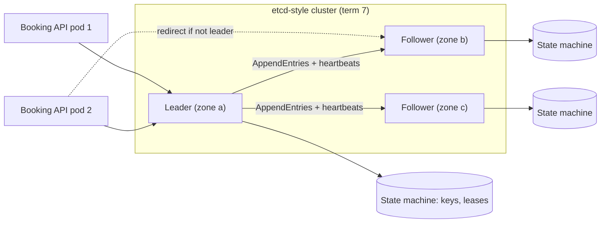
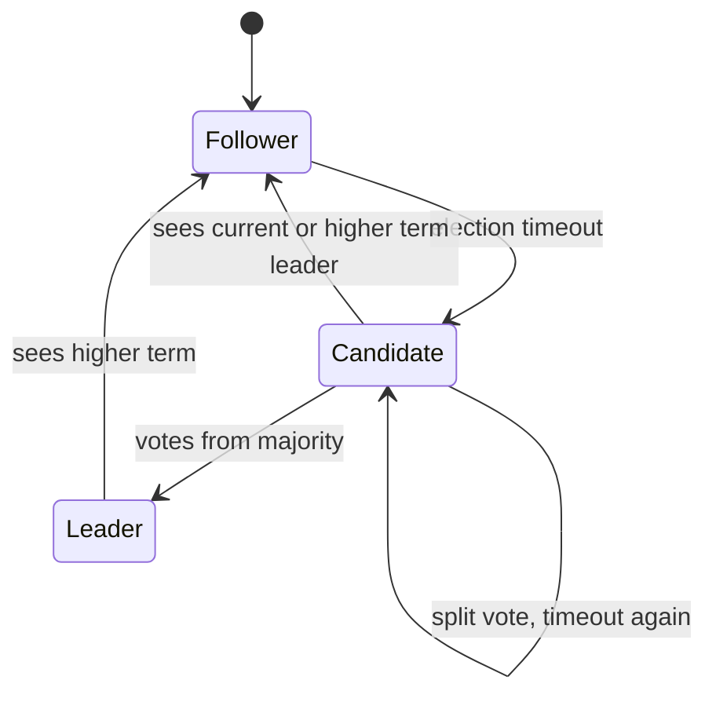
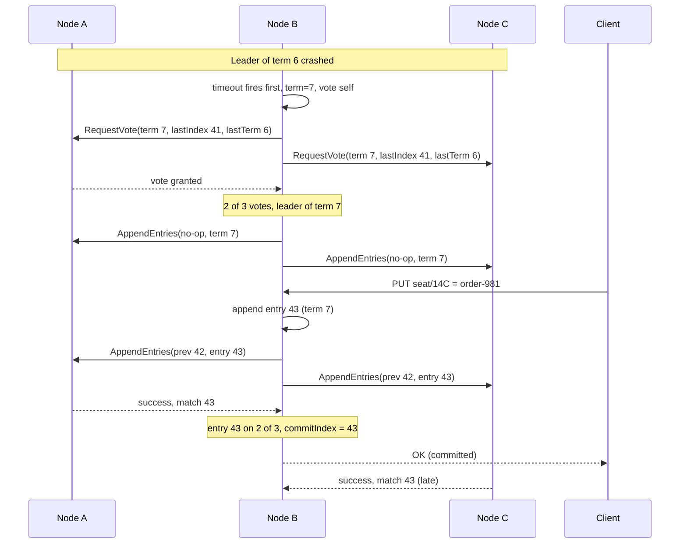

[Quorums](#/lesson/m13-quorums) let replicas overlap, but they do not give writes a single order: two concurrent writes can both "succeed" and one silently loses. Some decisions cannot tolerate that. Who is the leader right now? Has seat 14C been sold? Which configuration version is current? For these, a group of machines must **agree** on one answer and never change it, even when machines crash and messages are lost. That is consensus. This lesson teaches Raft, the algorithm behind etcd, Consul and the storage layers of CockroachDB, TiKV and YugabyteDB, deeply enough to reason about failures, and then argues firmly that you should use it, not build it.

## Learning objectives

By the end of this lesson you will be able to:

1. State what consensus guarantees (agreement, validity, termination) and why majorities are the core tool.
2. Explain Raft's roles, terms, randomised election timeouts and the two voting rules.
3. Trace log replication with `AppendEntries`, the consistency check, and how the commit index advances.
4. Explain why a leader may only commit entries from its own term by counting replicas.
5. Model a simplified Raft node in C# and run it in a simulated network with partitions.
6. Identify homemade-consensus failures: stale leaders, split votes, even-sized clusters and missing log checks.
7. Decide between etcd, ZooKeeper, a database lock, or no coordination at all.

## Prerequisites

- [Quorums](#/lesson/m13-quorums): majority overlap is the foundation of Raft.
- [Replication and leader-follower](#/lesson/m13-replication): Raft is leader-follower replication with safe, automatic failover.
- [Clock skew and logical clocks](#/lesson/m13-time-ordering): Raft's *term* is a logical clock.

## Explain it like I'm a beginner

Picture a residents' welfare committee of five members that keeps an official **minutes book**. Every decision ("repaint gate 2", "raise maintenance to ₹2,500") must be written in the same order in every member's copy.

The committee elects a **chair**. Only the chair proposes entries. The chair reads out "entry 17: repaint gate 2", members copy it into their books and say "noted". Once **three of the five** (a majority) have it, the chair declares it **final**. A final entry is never crossed out.

Now the chair's phone dies during a trip. Members wait a while, hear nothing, and one of them says, "I'll stand for chair for **meeting number 8**." Each member votes for at most one candidate per meeting number, and only for a candidate whose minutes book is at least as complete as their own. Whoever gets three votes becomes chair for meeting 8.

When the old chair comes back and announces something for "meeting 7", everyone replies, "We're on meeting 8 now." The old chair realises it is out of date and steps down.

That is Raft:

- The chair is the **leader**; members are **followers**; someone standing for election is a **candidate**.
- The meeting number is the **term**.
- The minutes book is the **replicated log**; "final" means **committed**.
- "Three of five" is a **majority quorum**.

## First-principles explanation

### What consensus promises

A consensus protocol lets a set of nodes decide on values such that:

- **Agreement:** no two nodes decide differently for the same slot.
- **Validity:** a decided value was actually proposed by someone.
- **Termination:** non-faulty nodes eventually decide (as long as the network eventually behaves).

Raft and Paxos guarantee agreement and validity **always**, even with lost, delayed or reordered messages. They guarantee termination only when a majority of nodes can talk to each other with reasonable delays. This split is unavoidable: the *FLP result* (Fischer, Lynch and Paterson, 1985) proved that no deterministic protocol can guarantee termination in a fully asynchronous network with even one crash. Real systems use timeouts so they make progress "when the network is good enough", and never violate safety when it is not.

Raft assumes **crash faults** (nodes stop or restart; messages are lost or delayed), not **Byzantine faults** (nodes lie). Byzantine-tolerant protocols exist (PBFT, and those used in some blockchains) but need `3f + 1` nodes to tolerate `f` liars and cost far more.

### The replicated state machine

The practical use of consensus is a **replicated state machine**: if every node starts from the same state and applies the same commands in the same order, every node ends up in the same state. Consensus decides the order. etcd's key-value store, a configuration service, or a lock table are state machines fed by a Raft log.

### Why majorities

A cluster of `N` nodes requires `⌊N/2⌋ + 1` to agree. Any two majorities overlap in at least one node (the quorum argument from the previous lesson with `W = R = majority`). That overlapping node is how a new leader learns about everything the old leader committed.

| Cluster size | Majority | Failures tolerated |
|---|---|---|
| 1 | 1 | 0 |
| 3 | 2 | 1 |
| 4 | 3 | 1 |
| 5 | 3 | 2 |
| 7 | 4 | 3 |

Four nodes tolerate the same one failure as three, but need one more vote per write and cost one more machine. That is why clusters are odd-sized. More nodes also mean more replication traffic per write, so etcd recommends 3 or 5 members for most deployments, and 7 is rarely worth it.

### Terms: a logical clock for leadership

Raft divides time into numbered **terms**. Each term starts with an election and has **at most one leader**. Every message carries the sender's term. Three rules follow:

1. If you receive a message with a **higher** term, adopt that term and become a follower.
2. If you receive a request with a **lower** term, reject it.
3. Each node persists its `currentTerm` and `votedFor` to disk before replying, so a restart cannot make it vote twice in one term.

Terms are what make a returning old leader harmless: its term is lower, so everyone rejects it and its own first reply tells it to step down.

### Elections

Followers expect regular **heartbeats** (empty `AppendEntries` messages) from the leader. If a follower hears nothing for its **election timeout**, it:

1. increments its term,
2. becomes a candidate and votes for itself,
3. sends `RequestVote(term, candidateId, lastLogIndex, lastLogTerm)` to every other node.

A node grants its vote only if **both** are true:

- **One vote per term:** it has not voted for someone else in this term.
- **Up-to-date log:** the candidate's log is at least as up to date as its own. Compare the term of the last entry first (higher wins); if equal, the longer log wins.

The second rule is the safety heart of Raft. A committed entry is on a majority; a winning candidate needs votes from a majority; the two majorities overlap; the overlapping voter refuses a candidate missing that entry. So **every new leader already has every committed entry** (leader completeness).

**Randomised timeouts** prevent endless split votes. If every follower timed out at exactly 150 ms, they would all become candidates at once, each vote for itself, and nobody would win. Raft picks each timeout randomly, typically in 150–300 ms, so usually one node times out first and wins before the others start. The Raft paper's guidance is `broadcastTime ≪ electionTimeout ≪ MTBF`: heartbeats take a few milliseconds, elections take hundreds, and servers fail every few months.

### Log replication

Clients send commands to the leader. The leader appends each command to its log with the current term and sends `AppendEntries(term, leaderId, prevLogIndex, prevLogTerm, entries[], leaderCommit)` to followers.

The **consistency check**: a follower accepts the entries only if its log has an entry at `prevLogIndex` whose term equals `prevLogTerm`. If not, it rejects, and the leader retries with an earlier `prevLogIndex` until the logs match, then overwrites the follower's conflicting suffix. This gives the **log matching property**: if two logs have an entry with the same index and term, they are identical up to that index.

### The commit index

An entry is **committed** once the leader knows it is stored on a majority, *and* it is from the leader's current term. The leader then advances its `commitIndex`, applies the entry to its state machine, replies to the client, and tells followers the new `leaderCommit` in the next message so they apply it too.

Why "from the current term"? Section 5.4.2 of the Raft paper shows a scenario where an entry from an *older* term is on a majority, yet a later leader can still overwrite it, because a node with a higher-term last entry can win an election without it. So a leader never commits an old-term entry by counting replicas. Instead, it commits an entry from its own term, which commits everything before it indirectly. That is why new leaders immediately append a **no-op** entry: it lets them commit any leftovers from the previous term quickly.

### Reads

Reading from the leader's local state looks safe but is not: a leader that has been partitioned away may not know a new leader exists. Linearizable reads therefore either go through the log, or use **ReadIndex** (the leader records its commit index, confirms with a heartbeat round that a majority still accepts it as leader, then serves the read), or use **lease reads** (assume leadership for a period shorter than the election timeout, which relies on bounded clock drift). etcd uses ReadIndex for linearizable reads by default and offers "serializable" reads from any member that may be stale.

### What else a real implementation needs

The core above fits in a few hundred lines. Production Raft adds much more:

- **Persistence and fsync** of term, vote and log before replying. Skipping fsync makes a crash forget a vote, which allows two leaders in one term.
- **Snapshots and log compaction**, so the log does not grow forever and a new node can catch up from a snapshot.
- **Membership changes** (adding or removing nodes) using joint consensus or one-server-at-a-time changes; doing it naively can create two disjoint majorities.
- **PreVote**: a node that was partitioned keeps incrementing its term; when it returns, its huge term forces a healthy leader to step down. PreVote asks "would you vote for me?" without bumping the term first.
- **Exactly-once client commands.** If a leader commits a command and crashes before replying, the client retries against the new leader and the command is applied twice. Section 8 of the Raft paper has clients tag each command with a client id and sequence number, and the state machine remembers the last result per client so duplicates are answered, not re-applied.
- **Leadership transfer, batching, pipelining, flow control, disk-full handling and checksums.**

Each of these has caused real bugs in mature implementations. That is the strongest argument for the final section of this explanation.

### Why use etcd or ZooKeeper instead of building it

Consensus bugs are the worst kind: they appear only under rare timing during failures, they corrupt data silently, and they are almost impossible to reproduce. Mature implementations are tested with model checkers (TLA+), fault-injection frameworks (Jepsen-style testing) and years of production failures. A team writing its own Raft for one feature is choosing to rediscover those bugs in production.

Use, in rough order of preference:

1. **What you already have.** If the state lives in PostgreSQL, a row lock, a unique constraint or an advisory lock (see [distributed locks](#/lesson/m13-distributed-locks)) gives you a single winner without a new system. PostgreSQL's primary is your "leader".
2. **Your platform's primitive.** Kubernetes `Lease` objects (backed by etcd), Azure Blob leases or a cloud lock service.
3. **etcd** (Raft, gRPC API, leases, watches, transactions) or **ZooKeeper** (ZAB protocol, ephemeral and sequential nodes, watches). Both give you leader election, locks, configuration and service discovery as building blocks.
4. **A database built on consensus** (CockroachDB, YugabyteDB, TiDB, Spanner-style systems) when your *data itself* needs consensus-ordered writes across regions.

Build your own only if consensus *is your product* and you will invest in formal verification and fault-injection testing.

### When a simpler design is enough

Many systems that "need leader election" actually need "run this job at most once at a time". A PostgreSQL advisory lock or a `SELECT ... FOR UPDATE SKIP LOCKED` job table usually does that. Many systems that "need consensus" across services actually need [a saga](#/lesson/m12-sagas) or an idempotent consumer. Reach for consensus when a wrong answer (two leaders, two owners, two versions of config) is unacceptable and you cannot route the decision through one database.

### Failure cases: homemade consensus that looks right

**Failure case 1: the stale leader still answering reads.** A team builds "leader election" with heartbeats and lets the leader serve reads from memory. The leader's network link to the other two nodes fails, but clients can still reach it. The other two elect a new leader in term 6 and accept writes. The old leader, still believing it leads term 5, keeps serving reads with old data for minutes. Every component "worked". Fix: ReadIndex or lease reads bounded below the election timeout, or route reads through the log.

**Failure case 2: voting without the log check.** A simplified implementation grants votes on "first come, first served" only. Node C was down while entries 40–45 were committed on A and B. A crashes; C times out first and B votes for it. C becomes leader with a log ending at 39 and overwrites B's entries 40–45. Committed data is lost. The up-to-date-log rule exists precisely to prevent this.

**Failure case 3: counting replicas for an old-term entry.** A leader in term 4 sees that an entry from term 2 is on a majority and marks it committed, then crashes. A node whose last entry is from term 3 wins term 5 (its log is "more up to date" by last term) and overwrites the term-2 entry that clients were told was committed. The current-term commit rule prevents this.

**Failure case 4: four nodes in two zones.** Two nodes in zone A, two in zone B. Zone B loses power. Two of four is not a majority, so the cluster stops accepting writes, even though half the nodes are perfectly healthy. Three nodes in three zones, or five in three zones (2-2-1), survive a zone loss.

**Failure case 5: election timeout shorter than a pause.** The election timeout is 100 ms, but the leader's disk occasionally takes 300 ms to fsync, or its runtime pauses for garbage collection. Followers keep electing new leaders, every election discards in-flight work, and throughput collapses (an election storm). Tune timeouts to measured disk and pause latencies; etcd's defaults are a 100 ms heartbeat and a 1,000 ms election timeout for this reason.

## Visual explanation

### Architecture: a three-member consensus cluster



Application pods send writes to the leader. If a pod contacts a follower, the follower replies with the leader's identity (dotted arrow) and the client retries there. The leader sends `AppendEntries` to both followers, which doubles as a heartbeat when there is nothing new. Each member applies committed entries, in log order, to its own copy of the state machine (keys, leases, revisions). One member per zone means a zone loss leaves two of three, a majority.

### State changes of a Raft node



Every node starts as a follower. When its randomised election timeout fires without a heartbeat, it becomes a candidate for a new term. If it wins a majority, it becomes leader. If the vote splits, it times out again and tries a higher term. A candidate that hears from a legitimate leader of its term or a higher one, or a leader that sees any higher term, steps down to follower. There is no transition from follower directly to leader: every leader is elected.

### Sequence: election, then a committed write



The leader of term 6 crashes. B's randomised timeout fires first, so it increments to term 7, votes for itself and asks A and C. A's log is not more up to date than B's (same last term 6, same index), so A grants its vote; with its own vote B has two of three and becomes leader without waiting for C. B immediately appends a no-op in term 7, which will commit any leftover entries from term 6. A client then writes; B appends entry 43, replicates it, and as soon as A confirms, the entry is on a majority and from the current term, so B advances the commit index and answers the client. C's late reply changes nothing.

## Step-by-step example

**Scenario.** A metro-rail ticketing platform runs eight API pods. Exactly one pod must run the **fare-table publisher**: every night at 02:00 it builds the next day's fares and pushes them to 300 station gates. Two publishers at once would push two different fare tables and gates would disagree.

### Step 1: is consensus needed at all?

The fare tables are stored in PostgreSQL. The publisher could take a PostgreSQL advisory lock and be done. The team checks: is the publisher's work entirely inside the database? No. It pushes to gates over HTTP, so a "lock holder" that pauses and resumes could push stale tables after a new holder starts. They need leadership **with a fencing token** that gates can check. Both a PostgreSQL sequence and an etcd lease revision can provide that; the platform already runs Kubernetes, whose control plane is etcd.

### Step 2: size the cluster

They use the managed Kubernetes control plane, which runs etcd across three zones. They do not run their own etcd. Failure tolerance: one zone.

### Step 3: elect with a lease

Each pod campaigns for leadership using a Kubernetes `Lease` object (or etcd's election API) with a 15-second lease renewed every 5 seconds. The winner gets a monotonically increasing number: the etcd revision or the lease transition count. Call it the **fencing token**.

### Step 4: carry the token everywhere

The publisher sends `fare-version: 2026-10-20` and `fencing-token: 1842` with each push. Gates store the highest token seen and reject pushes with a lower token. A pod that paused for 40 seconds and wakes up believing it is still leader is rejected by every gate.

### Step 5: estimate the cost

```text
Lease renewals: 8 pods campaign; 1 renews every 5 s → 0.2 writes/s to etcd. Negligible.
Push volume:    300 gates × 1 push/night × ~200 KB ≈ 60 MB/night. Negligible.
Failover time:  lease 15 s → worst case about 15–20 s without a publisher. Acceptable for a nightly job.
```

The design adds no new infrastructure and its failure modes are known. That is the goal.

## Production-style C# implementation

Two parts. First, a **simplified Raft model**: the election rules, replication, consistency check and commit-index rule as a deterministic class you can run in a simulated network. It omits persistence, snapshots and membership changes, so it is a teaching model, not something to deploy. Second, the **production pattern**: an ASP.NET Core background service that runs work only while it holds leadership from an external coordinator (etcd, ZooKeeper, Kubernetes Lease), with an in-memory fake behind the interface.

```text
Metro.Fares/
  Program.cs
  Raft/RaftMessages.cs
  Raft/RaftNode.cs
  Raft/RaftSimulation.cs
  Leadership/ILeaderElector.cs
  Leadership/LeaderOnlyService.cs
```

```csharp file=Raft/RaftMessages.cs
namespace Metro.Fares.Raft;

public enum RaftRole { Follower, Candidate, Leader }

public sealed record LogEntry(long Term, string Command);

public sealed record RequestVote(long Term, string CandidateId, int LastLogIndex, long LastLogTerm);

public sealed record VoteReply(long Term, bool Granted, string VoterId);

public sealed record AppendEntries(long Term, string LeaderId, int PrevLogIndex, long PrevLogTerm,
    IReadOnlyList<LogEntry> Entries, int LeaderCommit);

public sealed record AppendReply(long Term, bool Success, int MatchIndex, string FollowerId);

public sealed class NotLeaderException(string? leaderHint)
    : Exception(leaderHint is null ? "No known leader." : $"Not the leader; try {leaderHint}.")
{
    public string? LeaderHint => leaderHint;
}
```

```csharp file=Raft/RaftNode.cs
namespace Metro.Fares.Raft;

/// <summary>A simplified, single-threaded Raft node: elections, log replication and commit.
/// Teaching model only: no persistence, snapshots, membership changes or PreVote.
/// Log indices are 1-based; index 0 is an empty sentinel with term 0.</summary>
public sealed class RaftNode
{
    private readonly List<LogEntry> _log = new();
    private readonly HashSet<string> _votes = new();
    private readonly Dictionary<string, int> _nextIndex = new();
    private readonly Dictionary<string, int> _matchIndex = new();
    private readonly Random _random;
    private readonly int _minTimeoutMs;
    private readonly int _maxTimeoutMs;
    private int _elapsedMs;
    private int _timeoutMs;

    public RaftNode(string id, IReadOnlyList<string> peers, Random random, int minTimeoutMs = 150, int maxTimeoutMs = 300)
    {
        Id = id;
        Peers = peers;
        _random = random;
        _minTimeoutMs = minTimeoutMs;
        _maxTimeoutMs = maxTimeoutMs;
        ResetElectionTimer();
    }

    public string Id { get; }
    public IReadOnlyList<string> Peers { get; }
    public RaftRole Role { get; private set; } = RaftRole.Follower;
    public long CurrentTerm { get; private set; }
    public string? VotedFor { get; private set; }
    public string? LeaderId { get; private set; }
    public int CommitIndex { get; private set; }
    public IReadOnlyList<LogEntry> Log => _log;
    public int LastLogIndex => _log.Count;
    public long LastLogTerm => TermAt(_log.Count);
    public IEnumerable<string> CommittedCommands => _log.Take(CommitIndex).Select(e => e.Command);

    private int Majority => (Peers.Count + 1) / 2 + 1;
    private long TermAt(int index) => index == 0 ? 0 : _log[index - 1].Term;

    /// <summary>Advance this node's clock. Returns a vote request if its election timeout fired.</summary>
    public RequestVote? Tick(int elapsedMs)
    {
        if (Role == RaftRole.Leader) return null;   // leaders send heartbeats instead
        _elapsedMs += elapsedMs;
        return _elapsedMs >= _timeoutMs ? StartElection() : null;
    }

    public RequestVote StartElection()
    {
        CurrentTerm++;
        Role = RaftRole.Candidate;
        VotedFor = Id;           // a real node fsyncs term and vote before sending anything
        LeaderId = null;
        _votes.Clear();
        _votes.Add(Id);
        ResetElectionTimer();
        if (_votes.Count >= Majority) BecomeLeader();   // single-node cluster
        return new RequestVote(CurrentTerm, Id, LastLogIndex, LastLogTerm);
    }

    public VoteReply HandleRequestVote(RequestVote request)
    {
        if (request.Term > CurrentTerm) StepDown(request.Term);

        bool candidateLogIsUpToDate =
            request.LastLogTerm > LastLogTerm ||
            (request.LastLogTerm == LastLogTerm && request.LastLogIndex >= LastLogIndex);

        bool grant = request.Term == CurrentTerm
                     && (VotedFor is null || VotedFor == request.CandidateId)
                     && candidateLogIsUpToDate;

        if (grant)
        {
            VotedFor = request.CandidateId;
            ResetElectionTimer();
        }
        return new VoteReply(CurrentTerm, grant, Id);
    }

    public void HandleVoteReply(VoteReply reply)
    {
        if (reply.Term > CurrentTerm) { StepDown(reply.Term); return; }
        if (Role != RaftRole.Candidate || reply.Term != CurrentTerm || !reply.Granted) return;
        _votes.Add(reply.VoterId);
        if (_votes.Count >= Majority) BecomeLeader();
    }

    /// <summary>Leader only: append a client command. Returns its log index (not yet committed).</summary>
    public int Propose(string command)
    {
        if (Role != RaftRole.Leader) throw new NotLeaderException(LeaderId);
        _log.Add(new LogEntry(CurrentTerm, command));
        AdvanceCommitIndex();
        return LastLogIndex;
    }

    public AppendEntries BuildAppendEntries(string peer)
    {
        if (Role != RaftRole.Leader) throw new NotLeaderException(LeaderId);
        int prev = _nextIndex[peer] - 1;
        return new AppendEntries(CurrentTerm, Id, prev, TermAt(prev), _log.Skip(prev).ToList(), CommitIndex);
    }

    public AppendReply HandleAppendEntries(AppendEntries request)
    {
        if (request.Term < CurrentTerm) return new AppendReply(CurrentTerm, false, 0, Id);   // stale leader
        if (request.Term > CurrentTerm || Role != RaftRole.Follower) StepDown(request.Term);
        LeaderId = request.LeaderId;
        ResetElectionTimer();

        // Consistency check: our log must contain prevLogIndex with the same term.
        if (request.PrevLogIndex > LastLogIndex || TermAt(request.PrevLogIndex) != request.PrevLogTerm)
            return new AppendReply(CurrentTerm, false, 0, Id);

        int index = request.PrevLogIndex;
        foreach (var entry in request.Entries)
        {
            index++;
            if (index <= LastLogIndex)
            {
                if (TermAt(index) == entry.Term) continue;           // already have it
                _log.RemoveRange(index - 1, _log.Count - (index - 1)); // conflict: drop our suffix
            }
            _log.Add(entry);
        }

        int lastNew = request.PrevLogIndex + request.Entries.Count;
        if (request.LeaderCommit > CommitIndex) CommitIndex = Math.Min(request.LeaderCommit, lastNew);
        return new AppendReply(CurrentTerm, true, lastNew, Id);
    }

    public void HandleAppendReply(AppendReply reply)
    {
        if (reply.Term > CurrentTerm) { StepDown(reply.Term); return; }
        if (Role != RaftRole.Leader || reply.Term != CurrentTerm) return;

        string follower = reply.FollowerId;
        if (reply.Success)
        {
            _matchIndex[follower] = Math.Max(_matchIndex[follower], reply.MatchIndex);
            _nextIndex[follower] = _matchIndex[follower] + 1;
            AdvanceCommitIndex();
        }
        else
        {
            _nextIndex[follower] = Math.Max(1, _nextIndex[follower] - 1);   // back off and retry
        }
    }

    private void AdvanceCommitIndex()
    {
        for (int n = LastLogIndex; n > CommitIndex; n--)
        {
            // Raft §5.4.2: only entries from the current term are committed by counting replicas.
            if (TermAt(n) != CurrentTerm) break;
            int copies = 1 + _matchIndex.Values.Count(m => m >= n);
            if (copies >= Majority) { CommitIndex = n; break; }
        }
    }

    private void BecomeLeader()
    {
        Role = RaftRole.Leader;
        LeaderId = Id;
        foreach (var peer in Peers)
        {
            _nextIndex[peer] = LastLogIndex + 1;
            _matchIndex[peer] = 0;
        }
        // A no-op in the new term lets the leader commit leftovers from earlier terms.
        _log.Add(new LogEntry(CurrentTerm, "no-op"));
        AdvanceCommitIndex();
    }

    private void StepDown(long term)
    {
        if (term > CurrentTerm)
        {
            CurrentTerm = term;
            VotedFor = null;
        }
        Role = RaftRole.Follower;
        ResetElectionTimer();
    }

    private void ResetElectionTimer()
    {
        _elapsedMs = 0;
        _timeoutMs = _random.Next(_minTimeoutMs, _maxTimeoutMs + 1);   // randomised to avoid split votes
    }
}
```

Read `HandleRequestVote` and `AdvanceCommitIndex` slowly; they are failure cases 2 and 3 turned into code. The vote is granted only when the candidate's log is at least as up to date, and the commit loop refuses to count replicas for entries from an older term.

```csharp file=Raft/RaftSimulation.cs
namespace Metro.Fares.Raft;

/// <summary>Delivers messages synchronously between in-process nodes, with node isolation to
/// simulate partitions. Deterministic for a given seed.</summary>
public sealed class RaftSimulation
{
    private readonly Dictionary<string, RaftNode> _nodes;
    private readonly HashSet<string> _isolated = new();

    public RaftSimulation(int size, int seed)
    {
        var ids = Enumerable.Range(1, size).Select(i => $"n{i}").ToList();
        var rng = new Random(seed);
        _nodes = ids.ToDictionary(id => id, id => new RaftNode(id, ids.Where(p => p != id).ToList(), new Random(rng.Next())));
    }

    public IReadOnlyCollection<RaftNode> Nodes => _nodes.Values;
    public RaftNode this[string id] => _nodes[id];

    public void Isolate(string id) => _isolated.Add(id);
    public void Heal() => _isolated.Clear();

    private bool CanTalk(string a, string b) => !_isolated.Contains(a) && !_isolated.Contains(b);

    /// <summary>The leader with the highest term among nodes that believe they lead.</summary>
    public RaftNode? Leader => _nodes.Values.Where(n => n.Role == RaftRole.Leader).MaxBy(n => n.CurrentTerm);

    public void Step(int elapsedMs = 10)
    {
        foreach (var node in _nodes.Values.ToList())
        {
            var vote = node.Tick(elapsedMs);
            if (vote is null) continue;
            foreach (var peer in node.Peers.Where(p => CanTalk(node.Id, p)))
                node.HandleVoteReply(_nodes[peer].HandleRequestVote(vote));
        }

        // Leaders replicate (or heartbeat) to every reachable follower on each step.
        foreach (var leader in _nodes.Values.Where(n => n.Role == RaftRole.Leader).ToList())
            foreach (var peer in leader.Peers.Where(p => CanTalk(leader.Id, p)))
            {
                if (leader.Role != RaftRole.Leader) break;   // stepped down mid-round
                leader.HandleAppendReply(_nodes[peer].HandleAppendEntries(leader.BuildAppendEntries(peer)));
            }
    }

    public RaftNode RunUntilLeader(int maxSteps = 1_000)
    {
        for (int i = 0; i < maxSteps; i++)
        {
            Step();
            var leader = _nodes.Values.FirstOrDefault(n => n.Role == RaftRole.Leader && !_isolated.Contains(n.Id));
            if (leader is not null) return leader;
        }
        throw new InvalidOperationException("No leader elected; is a majority reachable?");
    }
}
```

With this you can reproduce failure case 1 in a few lines: elect a leader, `Isolate` it, run more steps, and observe two nodes with `Role == Leader` in different terms. The isolated one can still `Propose`, but its entry never commits because it cannot reach a majority. When you `Heal`, its first `AppendReply` carries the higher term and it steps down; its uncommitted entry is overwritten.

Now the production pattern. The application does not run Raft; it asks a coordinator for leadership.

```csharp file=Leadership/ILeaderElector.cs
namespace Metro.Fares.Leadership;

/// <summary>Leadership granted by an external coordinator (etcd election, ZooKeeper ephemeral
/// sequential node, Kubernetes Lease). <see cref="Term"/> increases with every new leader and is
/// used as a fencing token. <see cref="Lost"/> fires when the session or lease expires.</summary>
public sealed record Leadership(string LeaderId, long Term, CancellationToken Lost);

public interface ILeaderElector
{
    Task<Leadership> CampaignAsync(string candidateId, CancellationToken ct);
    Task ResignAsync(Leadership leadership);
}

/// <summary>Single-process fake for tests and local runs.</summary>
public sealed class InMemoryLeaderElector : ILeaderElector
{
    private readonly SemaphoreSlim _seat = new(1, 1);
    private long _term;
    private CancellationTokenSource? _current;

    public async Task<Leadership> CampaignAsync(string candidateId, CancellationToken ct)
    {
        await _seat.WaitAsync(ct);
        _current = new CancellationTokenSource();
        return new Leadership(candidateId, Interlocked.Increment(ref _term), _current.Token);
    }

    public Task ResignAsync(Leadership leadership)
    {
        _current?.Cancel();
        _current = null;
        _seat.Release();
        return Task.CompletedTask;
    }

    /// <summary>Simulates a lease or session expiring while the leader is still running.</summary>
    public void ExpireCurrentLeader() => _current?.Cancel();
}
```

```csharp file=Leadership/LeaderOnlyService.cs
using Microsoft.Extensions.Hosting;
using Microsoft.Extensions.Logging;

namespace Metro.Fares.Leadership;

public interface IFarePublisher
{
    /// <summary>Publishes fares, sending <paramref name="fencingToken"/> with every push so that
    /// gates reject pushes from an older leader.</summary>
    Task PublishAsync(long fencingToken, CancellationToken ct);
}

public sealed class LoggingFarePublisher(ILogger<LoggingFarePublisher> log) : IFarePublisher
{
    public async Task PublishAsync(long fencingToken, CancellationToken ct)
    {
        while (!ct.IsCancellationRequested)
        {
            log.LogInformation("Publishing fare table with fencing token {Token}.", fencingToken);
            await Task.Delay(TimeSpan.FromMinutes(1), ct);
        }
    }
}

/// <summary>Campaigns for leadership and runs the publisher only while leadership is held.
/// Work is cancelled the moment leadership is lost.</summary>
public sealed class LeaderOnlyService(ILeaderElector elector, IFarePublisher publisher, ILogger<LeaderOnlyService> log)
    : BackgroundService
{
    protected override async Task ExecuteAsync(CancellationToken stoppingToken)
    {
        string me = $"{Environment.MachineName}-{Environment.ProcessId}";
        while (!stoppingToken.IsCancellationRequested)
        {
            var leadership = await elector.CampaignAsync(me, stoppingToken);
            log.LogInformation("{Me} is leader for term {Term}.", me, leadership.Term);
            using var whileLeader = CancellationTokenSource.CreateLinkedTokenSource(stoppingToken, leadership.Lost);
            try
            {
                await publisher.PublishAsync(leadership.Term, whileLeader.Token);
            }
            catch (OperationCanceledException) when (!stoppingToken.IsCancellationRequested)
            {
                log.LogWarning("Lost leadership in term {Term}; stopped publishing.", leadership.Term);
            }
            finally
            {
                await elector.ResignAsync(leadership);
            }
        }
    }
}
```

```csharp file=Program.cs
using Metro.Fares.Leadership;
using Metro.Fares.Raft;

var builder = WebApplication.CreateBuilder(args);

// In production, replace with an etcd- or Kubernetes-Lease-backed elector.
builder.Services.AddSingleton<InMemoryLeaderElector>();
builder.Services.AddSingleton<ILeaderElector>(sp => sp.GetRequiredService<InMemoryLeaderElector>());
builder.Services.AddSingleton<IFarePublisher, LoggingFarePublisher>();
builder.Services.AddHostedService<LeaderOnlyService>();

var app = builder.Build();

// Teaching endpoint: run the Raft model, isolate the leader, and show what each node believes.
app.MapGet("/raft/demo", (int? seed) =>
{
    var sim = new RaftSimulation(size: 3, seed: seed ?? 42);
    var first = sim.RunUntilLeader();
    first.Propose("fare:v1");
    for (int i = 0; i < 5; i++) sim.Step();

    sim.Isolate(first.Id);
    first.Propose("fare:v2-lost");                 // accepted locally, can never commit
    var second = sim.RunUntilLeader();
    second.Propose("fare:v2");
    for (int i = 0; i < 5; i++) sim.Step();

    sim.Heal();
    for (int i = 0; i < 5; i++) sim.Step();

    return Results.Ok(sim.Nodes.Select(n => new
    {
        n.Id, Role = n.Role.ToString(), n.CurrentTerm, n.CommitIndex,
        Committed = n.CommittedCommands.ToArray()
    }));
});

app.Run();
```

Calling `/raft/demo` shows all three nodes ending with the same committed commands (`no-op`, `fare:v1`, `no-op`, `fare:v2`) and no trace of `fare:v2-lost`, which the old leader accepted but never committed. That is consensus doing its job: an uncommitted entry was never promised to anyone.

For a real cluster, leadership with etcd looks like this from the command line (each command is part of etcd's standard `etcdctl` tool):

```text
etcdctl lease grant 15                      # lease with a 15-second TTL
etcdctl elect fare-publisher pod-3          # campaign; blocks until elected, prints the key and revision
etcdctl lease keep-alive <lease-id>         # renew while working
```

The key's creation revision is a natural fencing token, because etcd revisions only increase.

## Bad design vs good design

**Bad: "we wrote a small leader election".**

- Each pod pings the others every second; the one with the lowest IP address that answered recently is leader.
- During a network partition, both halves see a "lowest live IP" and both run the publisher.
- The leader keeps a flag `IsLeader = true` and checks it once at the start of the nightly job, then runs for 20 minutes.
- No fencing token: gates accept whatever arrives last.

**Good:**

- Leadership comes from a consensus-backed coordinator (Kubernetes Lease, etcd, ZooKeeper) or from the database the work already depends on.
- A majority is required to elect, so a minority partition cannot produce a leader.
- Work runs under a cancellation token that fires when the lease is lost, and every side effect carries a fencing token checked by the receiver.
- Cluster sizes are odd and spread across zones; timeouts are tuned to measured disk and pause latency.

:::callout type=warning title="A consensus cluster is not a database for your data"
etcd keeps its whole dataset in memory and is designed for small, critical metadata (the default storage quota is 2 GB). Putting application data, logs or large blobs in it will hurt the coordinator that every other service depends on.
:::

## Practical playground

The starter graph shows a coordination cluster of **four** members in **two** zones serving a booking platform. Open it in the HLD canvas and fix it so it survives the loss of any one zone. Then annotate: majority size, failures tolerated, where the leader is, and what the API does when it cannot reach a majority.

:::playground type=hld title="Make the coordination cluster survive a zone loss"
```json
{
  "nodes": [
    { "id": "api", "type": "app-server", "label": "Booking API", "props": { "instances": 6, "multiAz": true } },
    { "id": "e1", "type": "service-registry", "label": "etcd 1 (zone a)", "props": { "region": "zone-a" } },
    { "id": "e2", "type": "service-registry", "label": "etcd 2 (zone a)", "props": { "region": "zone-a" } },
    { "id": "e3", "type": "service-registry", "label": "etcd 3 (zone b)", "props": { "region": "zone-b" } },
    { "id": "e4", "type": "service-registry", "label": "etcd 4 (zone b)", "props": { "region": "zone-b" } },
    { "id": "db", "type": "database", "label": "PostgreSQL HA", "props": { "replicas": 1, "multiAz": true } }
  ],
  "edges": [
    { "from": "api", "to": "e1", "kind": "sync", "label": "leases, config" },
    { "from": "e1", "to": "e2", "kind": "sync", "label": "Raft" },
    { "from": "e1", "to": "e3", "kind": "sync", "label": "Raft" },
    { "from": "e1", "to": "e4", "kind": "sync", "label": "Raft" },
    { "from": "api", "to": "db", "kind": "sync" }
  ]
}
```
:::

## Exercises

:::exercise id=m13-consensus-ex1 difficulty=beginner kind=code title="Majority and zone-loss calculator"
Write the arithmetic you need when sizing a consensus cluster.
::requirements
- `ClusterMath.Majority(n)` returns `⌊n/2⌋ + 1`.
- `ClusterMath.FailuresTolerated(n)` returns how many members can fail while a majority remains.
- `ClusterMath.CanMakeProgress(n, reachable)` returns true when `reachable` members form a majority.
- `ClusterMath.SurvivesAnyZoneLoss(params int[] membersPerZone)` returns true when losing any single zone still leaves a majority of the whole cluster.
- `n < 1`, negative counts or `reachable > n` throw `ArgumentOutOfRangeException`.
::acceptance
- `Majority(4)` is 3 and `FailuresTolerated(4)` is 1, the same as for 3 members.
- `SurvivesAnyZoneLoss(2, 2)` is false; `SurvivesAnyZoneLoss(1, 1, 1)` and `SurvivesAnyZoneLoss(2, 2, 1)` are true.
- `SurvivesAnyZoneLoss(3, 2)` is false.
::hint
Integer division already floors: `n / 2 + 1`.
::hint
Failures tolerated is the cluster size minus the majority.
::hint
For zones, the worst case is losing the zone with the most members.
::hint
```csharp
int total = zones.Sum();
return total - zones.Max() >= Majority(total);
```
::starter
```csharp file=ClusterMath.cs
using System;
using System.Linq;

public static class ClusterMath
{
    public static int Majority(int n) => throw new NotImplementedException();
    public static int FailuresTolerated(int n) => throw new NotImplementedException();
    public static bool CanMakeProgress(int n, int reachable) => throw new NotImplementedException();
    public static bool SurvivesAnyZoneLoss(params int[] membersPerZone) => throw new NotImplementedException();
}
```
::tests
```csharp file=ClusterMathTests.cs
using System;
using Xunit;

public class ClusterMathTests
{
    [Fact]
    public void Majorities()
    {
        Assert.Equal(1, ClusterMath.Majority(1));
        Assert.Equal(2, ClusterMath.Majority(3));
        Assert.Equal(3, ClusterMath.Majority(4));
        Assert.Equal(3, ClusterMath.Majority(5));
    }

    [Fact]
    public void Four_tolerates_no_more_than_three() =>
        Assert.Equal(ClusterMath.FailuresTolerated(3), ClusterMath.FailuresTolerated(4));

    [Fact]
    public void Progress_needs_majority()
    {
        Assert.True(ClusterMath.CanMakeProgress(5, 3));
        Assert.False(ClusterMath.CanMakeProgress(4, 2));
    }

    [Fact]
    public void Zone_layouts()
    {
        Assert.False(ClusterMath.SurvivesAnyZoneLoss(2, 2));
        Assert.True(ClusterMath.SurvivesAnyZoneLoss(1, 1, 1));
        Assert.True(ClusterMath.SurvivesAnyZoneLoss(2, 2, 1));
        Assert.False(ClusterMath.SurvivesAnyZoneLoss(3, 2));
    }

    [Fact]
    public void Invalid_inputs_throw()
    {
        Assert.Throws<ArgumentOutOfRangeException>(() => ClusterMath.Majority(0));
        Assert.Throws<ArgumentOutOfRangeException>(() => ClusterMath.CanMakeProgress(3, 4));
        Assert.Throws<ArgumentOutOfRangeException>(() => ClusterMath.SurvivesAnyZoneLoss(2, -1));
    }
}
```
::solution
```csharp file=ClusterMath.cs
using System;
using System.Linq;

public static class ClusterMath
{
    public static int Majority(int n)
    {
        if (n < 1) throw new ArgumentOutOfRangeException(nameof(n), n, "Cluster needs at least one member.");
        return n / 2 + 1;
    }

    public static int FailuresTolerated(int n) => n - Majority(n);

    public static bool CanMakeProgress(int n, int reachable)
    {
        if (reachable < 0 || reachable > n) throw new ArgumentOutOfRangeException(nameof(reachable));
        return reachable >= Majority(n);
    }

    public static bool SurvivesAnyZoneLoss(params int[] membersPerZone)
    {
        ArgumentNullException.ThrowIfNull(membersPerZone);
        if (membersPerZone.Length == 0 || membersPerZone.Any(m => m < 0))
            throw new ArgumentOutOfRangeException(nameof(membersPerZone));
        int total = membersPerZone.Sum();
        return total - membersPerZone.Max() >= Majority(total);
    }
}
```

The zone check makes the "four members in two zones" mistake visible in a unit test that can run in your infrastructure pipeline.
::mistakes
- Using `Math.Ceiling(n / 2.0)`, which gives 2 for n = 4 instead of 3.
- Checking zone loss against the majority of the *remaining* members instead of the original cluster size. Raft's majority is of the configured membership, not of whoever is alive.
:::

:::exercise id=m13-consensus-ex2 difficulty=beginner kind=written title="Three, four or five?"
Your team runs a 3-member etcd cluster in three zones. A colleague proposes adding a fourth member "for extra safety", and another proposes running 7 members "so we can lose three". Respond to both, and describe exactly what happens to reads and writes if two of the current three members are down.
::acceptance
- Shows that 4 members tolerate 1 failure, like 3, while needing 3 votes per write.
- Explains the cost of 7 members: more replication per write, slower commits, more machines, with limited benefit for most teams.
- States that with 2 of 3 down, the cluster cannot elect a leader or commit writes, and linearizable reads fail; serializable (possibly stale) reads may still work on the survivor.
- Recommends 3 for most uses and 5 when two simultaneous failures (for example one zone down plus one maintenance) must be tolerated.
::hint
Write the majority table for 3, 4, 5 and 7.
::hint
A commit waits for the majority-th fastest member. What happens to commit latency as the majority grows?
::hint
With 1 of 3 alive, can any candidate get 2 votes?
::solution
- **Four members**: majority 3, tolerates 1 failure, exactly like three, but every write now waits for three acknowledgements and there is one more machine to run. Worse in a 2+2 zone layout, where losing one zone stops the cluster. Not "extra safety".
- **Seven members**: majority 4, tolerates 3 failures. But every write waits for the 4th-fastest member, replication traffic from the leader grows to six followers, and the cluster is harder to operate. etcd's guidance is that 3 or 5 is appropriate for most deployments.
- **Two of three down**: the survivor cannot get a majority, so no leader is elected and no writes commit. Linearizable reads (which need the leader to confirm a majority) fail. Serializable reads from the survivor return possibly stale data. Applications relying on leases cannot renew them, so leaders everywhere must stop work when their leases expire.
- **Recommendation**: keep 3 across three zones. Move to 5 (2-2-1 across three zones) if you need to survive a zone outage *during* a rolling upgrade or a second simultaneous failure.
::mistakes
- Saying "more members always means more availability".
- Assuming the remaining member keeps serving writes "in degraded mode". Raft never does that.
:::

:::exercise id=m13-consensus-ex3 difficulty=intermediate kind=code title="The vote-granting rule"
Implement Raft's `RequestVote` decision as a pure function, including term updates. This is where homemade implementations most often lose committed data.
::requirements
- `VoterState(CurrentTerm, VotedFor, LastLogIndex, LastLogTerm)` and `VoteRequest(Term, CandidateId, LastLogIndex, LastLogTerm)`.
- `VoteRules.Decide(state, request)` returns `VoteDecision(Granted, NewState)`.
- A request with a lower term is rejected and the state is unchanged.
- A request with a higher term moves the voter to that term and clears `VotedFor` before deciding.
- Grant only if the voter has not voted for someone else in this term **and** the candidate's log is at least as up to date (higher last term, or equal last term and index ≥).
- When granting, set `VotedFor` to the candidate.
::acceptance
- A voter in term 5 that already voted for B rejects C in term 5 but grants B again (idempotent retry).
- A voter with last log (index 10, term 4) rejects a candidate with (index 12, term 3).
- A voter with last log (index 10, term 4) grants a candidate with (index 2, term 5).
- A higher-term request updates the voter's term even when the vote is rejected.
::hint
Handle the term comparison first; it can change the state before the vote decision.
::hint
The log comparison looks at the last entry's term first, and only uses length to break a tie.
::hint
Records support `with` expressions: `state with { CurrentTerm = request.Term, VotedFor = null }`.
::hint
```csharp
bool upToDate = r.LastLogTerm > s.LastLogTerm || (r.LastLogTerm == s.LastLogTerm && r.LastLogIndex >= s.LastLogIndex);
```
::starter
```csharp file=VoteRules.cs
using System;

public sealed record VoterState(long CurrentTerm, string? VotedFor, int LastLogIndex, long LastLogTerm);

public sealed record VoteRequest(long Term, string CandidateId, int LastLogIndex, long LastLogTerm);

public sealed record VoteDecision(bool Granted, VoterState NewState);

public static class VoteRules
{
    public static VoteDecision Decide(VoterState state, VoteRequest request) => throw new NotImplementedException();
}
```
::tests
```csharp file=VoteRulesTests.cs
using Xunit;

public class VoteRulesTests
{
    [Fact]
    public void Lower_term_is_rejected_unchanged()
    {
        var s = new VoterState(5, null, 10, 4);
        var d = VoteRules.Decide(s, new VoteRequest(4, "B", 20, 4));
        Assert.False(d.Granted);
        Assert.Equal(s, d.NewState);
    }

    [Fact]
    public void One_vote_per_term_but_retry_is_idempotent()
    {
        var s = new VoterState(5, "B", 10, 4);
        Assert.False(VoteRules.Decide(s, new VoteRequest(5, "C", 10, 4)).Granted);
        Assert.True(VoteRules.Decide(s, new VoteRequest(5, "B", 10, 4)).Granted);
    }

    [Fact]
    public void Longer_log_with_older_last_term_is_not_up_to_date()
    {
        var s = new VoterState(5, null, 10, 4);
        Assert.False(VoteRules.Decide(s, new VoteRequest(6, "C", 12, 3)).Granted);
    }

    [Fact]
    public void Shorter_log_with_newer_last_term_is_up_to_date()
    {
        var s = new VoterState(5, null, 10, 4);
        var d = VoteRules.Decide(s, new VoteRequest(6, "C", 2, 5));
        Assert.True(d.Granted);
        Assert.Equal("C", d.NewState.VotedFor);
        Assert.Equal(6L, d.NewState.CurrentTerm);
    }

    [Fact]
    public void Higher_term_updates_state_even_when_rejected()
    {
        var s = new VoterState(5, "B", 10, 4);
        var d = VoteRules.Decide(s, new VoteRequest(9, "C", 3, 2));
        Assert.False(d.Granted);
        Assert.Equal(9L, d.NewState.CurrentTerm);
        Assert.Null(d.NewState.VotedFor);
    }

    [Fact]
    public void Equal_logs_are_up_to_date()
    {
        var d = VoteRules.Decide(new VoterState(3, null, 7, 3), new VoteRequest(3, "A", 7, 3));
        Assert.True(d.Granted);
    }
}
```
::solution
```csharp file=VoteRules.cs
using System;

public sealed record VoterState(long CurrentTerm, string? VotedFor, int LastLogIndex, long LastLogTerm);

public sealed record VoteRequest(long Term, string CandidateId, int LastLogIndex, long LastLogTerm);

public sealed record VoteDecision(bool Granted, VoterState NewState);

public static class VoteRules
{
    public static VoteDecision Decide(VoterState state, VoteRequest request)
    {
        if (request.Term < state.CurrentTerm) return new VoteDecision(false, state);

        if (request.Term > state.CurrentTerm)
            state = state with { CurrentTerm = request.Term, VotedFor = null };

        bool canVote = state.VotedFor is null || state.VotedFor == request.CandidateId;
        bool upToDate = request.LastLogTerm > state.LastLogTerm
                        || (request.LastLogTerm == state.LastLogTerm && request.LastLogIndex >= state.LastLogIndex);

        if (!canVote || !upToDate) return new VoteDecision(false, state);
        return new VoteDecision(true, state with { VotedFor = request.CandidateId });
    }
}
```

In a real node, `NewState` must be written to disk (and fsynced) **before** the reply is sent. Otherwise a crash and restart can make the node vote again in the same term, and two candidates can both collect a majority.
::mistakes
- Comparing log length before last term, which elects a node with many stale entries over one with fewer, newer entries.
- Forgetting to update the term on a rejected higher-term request, so the voter keeps acting in an old term.
- Rejecting a duplicate request from the candidate it already voted for, which makes elections fail under message retries.
:::

:::exercise id=m13-consensus-ex4 difficulty=intermediate kind=hld title="Exactly one invoice generator"
A GST e-invoicing platform has 12 worker pods. Every five minutes, exactly one of them must pull new orders, generate invoice numbers in strict sequence per seller, and submit them to the government invoice registration portal. Duplicate or out-of-order invoice numbers are a compliance problem. Design the coordination.
::acceptance
- Decides whether consensus is needed or the database can serve as coordinator, with reasons.
- Uses leadership with a fencing token (or a database-native equivalent) so a paused old leader cannot submit.
- Invoice numbers come from a single source of order (database sequence per seller within a transaction, or the leader's term-fenced counter).
- Explains failover time and what happens to an in-flight batch when leadership changes.
- Calls out the external portal's own idempotency (for example the invoice reference) as a second line of defence.
::hint
Where do orders and invoice numbers live? Could the database be the "leader"?
::hint
A lease alone does not stop a paused process from finishing a submit after its lease expired.
::hint
Think about what the portal can check to reject a duplicate.
::hint
One good shape: Kubernetes Lease for leadership, a `fencing_token` column on the batch table, and `UPDATE ... WHERE token >= current` guards.
::starter
```json
{
  "nodes": [
    { "id": "w", "type": "worker", "label": "Invoice workers", "props": { "instances": 12 } },
    { "id": "db", "type": "database", "label": "PostgreSQL (orders)", "props": { "replicas": 1, "multiAz": true } },
    { "id": "irp", "type": "external", "label": "Invoice registration portal" }
  ],
  "edges": [
    { "from": "w", "to": "db", "kind": "sync" },
    { "from": "w", "to": "irp", "kind": "sync", "label": "submit invoices" }
  ]
}
```
::solution
```json
{
  "nodes": [
    { "id": "sched", "type": "scheduler", "label": "Every 5 min tick" },
    { "id": "lease", "type": "service-registry", "label": "Kubernetes Lease (etcd, 3 zones)", "props": { "multiAz": true } },
    { "id": "w", "type": "worker", "label": "Invoice workers (1 active leader)", "props": { "instances": 12, "multiAz": true } },
    { "id": "db", "type": "database", "label": "PostgreSQL HA: orders, invoice_batches, per-seller sequences", "props": { "replicas": 1, "multiAz": true } },
    { "id": "irp", "type": "external", "label": "Invoice registration portal (idempotent on invoice ref)" },
    { "id": "mon", "type": "monitoring", "label": "Leader changes, batch age, rejected tokens" }
  ],
  "edges": [
    { "from": "sched", "to": "w", "kind": "async" },
    { "from": "w", "to": "lease", "kind": "sync", "label": "campaign / renew (token)" },
    { "from": "w", "to": "db", "kind": "sync", "label": "claim batch WHERE token >= last" },
    { "from": "w", "to": "irp", "kind": "sync", "label": "submit with invoice ref" },
    { "from": "w", "to": "mon", "kind": "async" }
  ]
}
```

**Reasoning.** All state is in PostgreSQL, so the simplest correct design makes the database the arbiter. Invoice numbers are allocated inside the same transaction that marks orders as invoiced, from a per-seller counter row locked with `SELECT ... FOR UPDATE`. That gives strict sequence without any external consensus.

Leadership decides *who runs the batch*, which is about efficiency, not correctness: a Kubernetes Lease (backed by etcd, already present) elects one worker; its lease transition count is the fencing token. The worker writes the token into `invoice_batches` and every update is guarded with `WHERE fencing_token = @mine AND @mine >= (SELECT max(fencing_token) ...)`, so a paused former leader's writes affect zero rows.

**Failover.** Lease 15 s, renew every 5 s: a new leader starts within about 20 s. An in-flight batch is either committed (numbers assigned) or not; the new leader resumes unsubmitted batches. Submissions use the invoice reference as an idempotency key at the portal, so a duplicate submit after a failover is rejected rather than duplicated.

**Simpler alternative.** With one batch per five minutes, a PostgreSQL advisory lock (`pg_try_advisory_lock`) held by the worker's session would also do, as long as all side effects are guarded in the same database.
::mistakes
- Generating invoice numbers in worker memory and trusting leadership to prevent duplicates.
- Using leader election without fencing, so a GC-paused old leader submits a stale batch.
- Running a separate etcd cluster when the database and Kubernetes already provide the primitives.
:::

:::exercise id=m13-consensus-ex5 difficulty=advanced kind=code title="Advance the commit index safely"
Implement the leader's commit rule, including the current-term restriction that prevents the Raft paper's Figure 8 anomaly.
::requirements
- `CommitRules.NextCommitIndex(int commitIndex, long currentTerm, IReadOnlyList<long> leaderLogTerms, IReadOnlyList<int> followerMatchIndexes, int clusterSize)`.
- `leaderLogTerms[i]` is the term of log index `i + 1`. The leader's own match index is the length of its log.
- Return the largest `N > commitIndex` such that the entry at `N` has term `currentTerm` and at least a majority of the cluster (leader included) has `matchIndex ≥ N`. If none, return `commitIndex`.
- Throw `ArgumentException` if `followerMatchIndexes.Count != clusterSize - 1`.
- The commit index never decreases.
::acceptance
- 3 nodes, terms `[1, 1, 2]`, current term 2, followers `[3, 0]` → 3.
- 3 nodes, terms `[1, 2]`, current term 4, followers `[2, 0]`, commit 1 → stays 1 (old-term entry).
- Same, after the leader appends a term-4 entry (`[1, 2, 4]`, followers `[3, 0]`) → 3.
- 5 nodes, terms `[3, 3, 3]`, term 3, followers `[3, 2, 1, 0]` → 2.
::hint
Count the leader as one copy of every entry in its log.
::hint
Scan candidate indices from the end of the log downwards and stop at the first one that qualifies.
::hint
Terms in a log never decrease, so once you reach an entry from an older term you can stop scanning.
::hint
```csharp
for (int n = leaderLogTerms.Count; n > commitIndex; n--)
{
    if (leaderLogTerms[n - 1] != currentTerm) break;
    if (1 + followerMatchIndexes.Count(m => m >= n) >= majority) return n;
}
```
::starter
```csharp file=CommitRules.cs
using System;
using System.Collections.Generic;
using System.Linq;

public static class CommitRules
{
    public static int NextCommitIndex(int commitIndex, long currentTerm, IReadOnlyList<long> leaderLogTerms,
        IReadOnlyList<int> followerMatchIndexes, int clusterSize) => throw new NotImplementedException();
}
```
::tests
```csharp file=CommitRulesTests.cs
using System;
using Xunit;

public class CommitRulesTests
{
    [Fact]
    public void Commits_current_term_entry_on_majority() =>
        Assert.Equal(3, CommitRules.NextCommitIndex(0, 2, new long[] { 1, 1, 2 }, new[] { 3, 0 }, 3));

    [Fact]
    public void Does_not_commit_old_term_entry_by_counting() =>
        Assert.Equal(1, CommitRules.NextCommitIndex(1, 4, new long[] { 1, 2 }, new[] { 2, 0 }, 3));

    [Fact]
    public void Current_term_entry_commits_older_ones_indirectly() =>
        Assert.Equal(3, CommitRules.NextCommitIndex(1, 4, new long[] { 1, 2, 4 }, new[] { 3, 0 }, 3));

    [Fact]
    public void Five_nodes_need_three_copies() =>
        Assert.Equal(2, CommitRules.NextCommitIndex(0, 3, new long[] { 3, 3, 3 }, new[] { 3, 2, 1, 0 }, 5));

    [Fact]
    public void Never_decreases() =>
        Assert.Equal(3, CommitRules.NextCommitIndex(3, 2, new long[] { 2, 2, 2 }, new[] { 0, 0 }, 3));

    [Fact]
    public void Wrong_follower_count_throws() =>
        Assert.Throws<ArgumentException>(() => CommitRules.NextCommitIndex(0, 1, new long[] { 1 }, new[] { 1 }, 3));
}
```
::solution
```csharp file=CommitRules.cs
using System;
using System.Collections.Generic;
using System.Linq;

public static class CommitRules
{
    public static int NextCommitIndex(int commitIndex, long currentTerm, IReadOnlyList<long> leaderLogTerms,
        IReadOnlyList<int> followerMatchIndexes, int clusterSize)
    {
        ArgumentNullException.ThrowIfNull(leaderLogTerms);
        ArgumentNullException.ThrowIfNull(followerMatchIndexes);
        if (followerMatchIndexes.Count != clusterSize - 1)
            throw new ArgumentException($"Expected {clusterSize - 1} follower match indexes, got {followerMatchIndexes.Count}.");

        int majority = clusterSize / 2 + 1;
        for (int n = leaderLogTerms.Count; n > commitIndex; n--)
        {
            // Terms never decrease along a log, so an older term here means every lower index is older too.
            if (leaderLogTerms[n - 1] != currentTerm) break;
            int copies = 1 + followerMatchIndexes.Count(m => m >= n);
            if (copies >= majority) return n;
        }
        return commitIndex;
    }
}
```

The second test is the whole point. Entry 2 (term 2) is on two of three nodes, which looks committed. But a node whose last entry has term 3 could still win an election and overwrite it. Only once the leader replicates an entry from its own term (test 3) are both safe.
::mistakes
- Counting replicas for any entry regardless of term (the Figure 8 bug).
- Forgetting to count the leader itself, which makes a 3-node cluster need all three nodes.
- Returning a smaller value than `commitIndex` when followers lag after a restart.
::extensions
Feed this function from the `RaftNode` model above and write a test that reproduces the Figure 8 sequence with five nodes and partitions.
:::

## Automated testing

Consensus code is tested at three levels.

**1. Pure rules.** The vote and commit rules from exercises 3 and 5 are pure functions; test every branch, including the anomalies from the paper.

**2. Deterministic simulation.** `RaftSimulation` is seeded, so a failing schedule can be replayed exactly. Write invariant tests that run thousands of random schedules (isolate a random node, heal, propose) and check after every step:

```csharp
[Fact]
public void At_most_one_leader_per_term_and_committed_prefixes_agree()
{
    for (int seed = 0; seed < 200; seed++)
    {
        var sim = new RaftSimulation(5, seed);
        var rng = new Random(seed);
        for (int step = 0; step < 300; step++)
        {
            if (step % 40 == 0) { sim.Heal(); sim.Isolate($"n{rng.Next(1, 6)}"); }
            if (sim.Leader is { } l && rng.Next(4) == 0) l.Propose($"cmd-{step}");
            sim.Step();

            var leadersByTerm = sim.Nodes.Where(n => n.Role == RaftRole.Leader).GroupBy(n => n.CurrentTerm);
            Assert.All(leadersByTerm, g => Assert.Single(g));

            var committed = sim.Nodes.Select(n => n.CommittedCommands.ToList()).ToList();
            int shortest = committed.Min(c => c.Count);
            Assert.All(committed, c => Assert.Equal(committed[0].Take(shortest), c.Take(shortest)));
        }
    }
}
```

These two invariants (election safety and state-machine safety) are the ones the Raft paper proves. Testing them under random partitions catches most implementation bugs in a teaching model.

**3. Application level.** For `LeaderOnlyService`, use `InMemoryLeaderElector` and a fake publisher that records tokens. Call `ExpireCurrentLeader()` and assert the publisher's token was cancelled and that the next leadership has a higher term. For real systems, add fault-injection tests in staging: kill the leader, pause it with `SIGSTOP` for longer than the lease, and verify no side effect with an old fencing token is accepted.

## Real-world application

- **etcd** stores all Kubernetes cluster state. Every `kubectl apply` is a Raft write; controllers use `Lease` objects for leader election and fencing.
- **ZooKeeper** (ZAB protocol, similar in spirit to Raft) coordinated Kafka metadata for years; Kafka now uses **KRaft**, its own Raft-based controller quorum, and Kafka 4.0 removed ZooKeeper mode entirely.
- **CockroachDB, YugabyteDB and TiKV** split data into ranges, each replicated by its own Raft group, so consensus orders writes per range while many ranges spread the load.
- **Consul** uses Raft for its catalogue and key-value store, used for service discovery and configuration.
- **Single-region PostgreSQL with Patroni** uses a consensus store (etcd, Consul or ZooKeeper) to decide which PostgreSQL node is primary, so the database avoids [split-brain](#/lesson/m13-split-brain).

## Interview questions

:::interview
::q beginner
What problem does consensus solve, and why do clusters have an odd number of members?
::a
It lets several machines agree on one ordered sequence of decisions (a log) even when some crash or messages are lost, so they all apply the same commands in the same order. Decisions need a majority; any two majorities overlap, which is how the new leader learns what was committed. An odd size maximises failures tolerated per machine: 4 members tolerate 1 failure, the same as 3, but need 3 votes per write.
::q beginner
What is a term in Raft?
::a
A numbered period of leadership. Each term starts with an election and has at most one leader. Every message carries the term; nodes reject lower terms and step down when they see a higher one. Terms act as a logical clock that makes a returning old leader harmless.
::q intermediate
How does Raft prevent a node with an incomplete log from becoming leader?
::a
A voter only grants its vote if the candidate's log is at least as up to date as its own: higher last-entry term, or equal last term and at least as long. A committed entry lives on a majority; a winner needs votes from a majority; the two overlap, and the overlapping voter refuses any candidate missing the entry. So every elected leader already has all committed entries.
::q intermediate
Why are election timeouts randomised, and how do you choose them?
::a
If all followers timed out together, they would all become candidates, vote for themselves and split the vote repeatedly. Randomising (for example 150–300 ms, or around 1 s in etcd's defaults) makes one node usually start first and win. Timeouts must be much longer than heartbeat round trips and disk fsync and runtime pauses, or the cluster has election storms; and much shorter than the time between failures so failover is quick.
::q advanced
A leader has been partitioned from the rest of the cluster but can still reach clients. What can go wrong, and how does Raft or etcd handle it?
::a
The rest elect a new leader in a higher term and accept writes. The old leader still believes it leads. Its writes cannot commit (it cannot reach a majority), so clients waiting for commit time out. But if it served reads from local state, those reads would be stale. Raft-based systems avoid this with ReadIndex (confirm leadership with a majority heartbeat before serving the read) or lease-based reads bounded below the election timeout. When the partition heals, the old leader sees the higher term, steps down and its uncommitted entries are overwritten.
::q advanced
Your team wants to implement Raft in-house for a scheduling service. What do you say?
::a
Ask what single-winner decision is actually needed. Usually it is "one job runner at a time" or "one owner per resource", which a PostgreSQL lock, a Kubernetes Lease, etcd or ZooKeeper already provides with fencing. A production Raft needs durable vote and log storage with fsync, snapshots, membership changes, PreVote, flow control and years of fault-injection testing; bugs appear only during rare failures and corrupt data silently. Build it only if consensus is the product and the team will invest in formal specification (TLA+) and Jepsen-style testing. Otherwise, use etcd or ZooKeeper and spend the effort on fencing tokens and idempotent side effects.
:::

## Summary and revision

**Key takeaways**

- Consensus gives one agreed, ordered log. Safety always holds; progress needs a reachable majority.
- Majority of `N` is `⌊N/2⌋ + 1`. Use 3 or 5 members across zones; 4 is no better than 3.
- Terms are a logical clock: one leader per term, reject lower terms, step down on higher ones.
- Votes: one per term, and only for a candidate with an up-to-date log. This guarantees leader completeness.
- Randomised election timeouts avoid split votes; tune them to disk and pause latency.
- Entries commit when on a majority **and** from the leader's current term; new leaders append a no-op.
- Reads from a leader need ReadIndex or a lease to be linearizable.
- Use etcd, ZooKeeper, Kubernetes Leases or your database instead of writing consensus.

**Terminology**: consensus, agreement, validity, termination, FLP, crash fault, Byzantine fault, replicated state machine, leader, follower, candidate, term, RequestVote, AppendEntries, heartbeat, election timeout, split vote, log matching, commit index, leader completeness, no-op entry, ReadIndex, lease read, PreVote, snapshot, joint consensus, fencing token.

:::flashcards
Q: How many failures can a 5-member Raft cluster tolerate?
A: Two. Majority is 3.
Q: What two conditions must hold for a Raft node to grant a vote?
A: It has not voted for someone else in this term, and the candidate's log is at least as up to date (higher last term, or same last term and at least as long).
Q: What does a node do when it sees a higher term?
A: Adopts the term, clears its vote and becomes a follower.
Q: When is a log entry committed?
A: When the leader has stored it on a majority and it is from the leader's current term (older entries commit indirectly).
Q: Why does a new Raft leader append a no-op entry?
A: So it can commit an entry from its own term quickly, which also commits any leftover entries from earlier terms.
Q: Why randomise election timeouts?
A: To make one node usually start an election first and avoid repeated split votes.
Q: What is the log consistency check in AppendEntries?
A: The follower accepts entries only if its log has an entry at prevLogIndex with term prevLogTerm; otherwise the leader backs up and retries.
Q: Why not run a 4-member cluster across 2 zones?
A: Losing either zone leaves 2 of 4, which is not a majority, so the cluster stops.
:::

## Knowledge check

:::quiz pass=70
::q single
A 3-member etcd cluster loses two members. What happens?
- [ ] The survivor becomes leader and accepts writes in degraded mode.
- [x] No leader can be elected; writes and linearizable reads fail until a member returns.
- [ ] Writes succeed but are not durable.
- [ ] The cluster splits into two halves.
> One of three is not a majority. Raft never makes progress without a majority; it stays safe and becomes unavailable.
::q single
Node C has log (last index 12, last term 3). Node B has (last index 9, last term 4). C asks B for a vote in a new term. What does B do?
- [ ] Grants, because C's log is longer.
- [x] Rejects, because B's last term 4 is higher than C's 3.
- [ ] Grants, because any vote is fine in a new term.
- [ ] Rejects, because C's term is lower.
> Up-to-date compares last term first. Length only breaks ties.
::q single
Every follower in a cluster uses a fixed 200 ms election timeout. What is the likely symptom after a leader crash?
- [ ] Two leaders in the same term.
- [x] Repeated split votes, delaying the election.
- [ ] Lost committed entries.
- [ ] Faster elections.
> Simultaneous candidates each vote for themselves and nobody reaches a majority. Randomisation fixes it; safety is not violated.
::q single
A leader in term 5 sees that an entry from term 3 is stored on a majority. What should it do?
- [ ] Mark it committed immediately.
- [x] Not commit it by counting; commit it indirectly once an entry from term 5 reaches a majority.
- [ ] Delete it.
- [ ] Start a new election.
> Raft only commits current-term entries by counting replicas, preventing the overwrite scenario in the paper's Figure 8.
::q single
A partitioned old leader can still reach clients. Which practice prevents it serving stale reads?
- [ ] Larger heartbeat intervals.
- [ ] Randomised election timeouts.
- [x] ReadIndex: confirm leadership with a majority before answering a read.
- [ ] Appending a no-op entry.
> Only contact with a majority proves the leader has not been replaced.
::q multi
Which are good reasons to use etcd, ZooKeeper or a Kubernetes Lease instead of writing your own consensus? (Select all that apply.)
- [x] Failure-time bugs are rare, silent and hard to reproduce.
- [x] Production consensus needs persistence, snapshots and membership changes.
- [ ] Your own implementation would be faster to write than integrating a client library.
- [x] Mature systems have years of fault-injection testing.
> Consensus is a solved, hard problem. Integrate a proven implementation and spend effort on fencing and idempotency.
::q single
Two nodes in zone A and one node in zone B form a 3-member cluster. Zone A loses power. What happens?
- [ ] The zone B node keeps serving writes.
- [x] The cluster stops accepting writes because 1 of 3 is not a majority.
- [ ] Nothing; 3-member clusters tolerate one failure.
- [ ] Zone B elects itself and later merges with zone A.
> Losing a zone with two members loses two members. One member per zone across three zones avoids this.
:::

## Completion criteria

You have finished this lesson when you can:

- [ ] Score at least 70 % on the knowledge check.
- [ ] Draw the follower, candidate and leader states with their transitions from memory.
- [ ] Complete exercises 1, 3 and 5 with all tests passing.
- [ ] Explain why a leader may not commit an old-term entry by counting replicas.
- [ ] Argue in two minutes for etcd, ZooKeeper, a Kubernetes Lease or the database over a homemade election.
