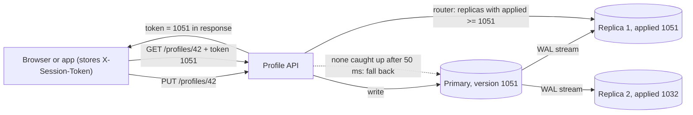
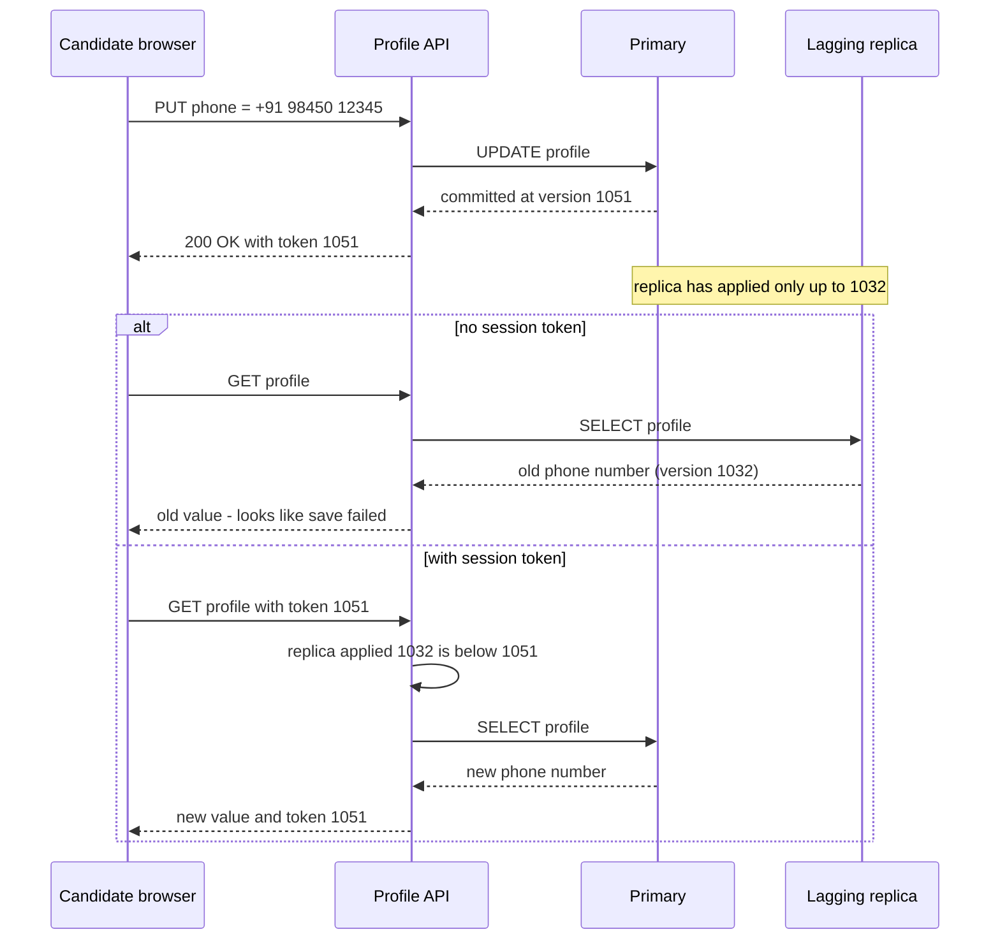

"Consistent" is one of the most overloaded words in software. In ACID it means "constraints hold". In CAP it means "linearizable". In everyday talk it means "I see what I expect". This lesson gives you precise names for the different promises a replicated system can make, the bug each weaker promise lets through, and the C# to build the guarantees most applications actually need.

## Learning objectives

By the end of this lesson you will be able to:

1. Explain what a consistency model is: a rule about which read results are allowed.
2. Define linearizable, sequential, causal and eventual consistency, and the session guarantees read-your-writes and monotonic reads.
3. Recognise the anomaly each model allows, from a short history of reads and writes.
4. Tell linearizability apart from serializability.
5. Estimate how often users hit stale reads from replica lag, with arithmetic.
6. Implement read-your-writes and monotonic reads in ASP.NET Core with session tokens.
7. Implement causal delivery and a small linearizability checker in C#.
8. Pick the weakest model that keeps each feature correct.

## Prerequisites

- [CAP theorem and PACELC](#/lesson/m13-cap-pacelc): linearizability is the "C" in CAP, and stronger models cost latency.
- [Clock skew, ordering and logical clocks](#/lesson/m13-time-ordering): causal consistency is built on happens-before.

## Explain it like I'm a beginner

Think of a cricket match and the many ways people follow the score.

- **Everyone in the stadium looks at the one big scoreboard.** The moment a run is scored, everybody sees the new score. That is **linearizable**: as if there is only one copy, always up to date.
- **TV viewers** see every ball in the same order as the stadium, but 10 seconds late, and a radio listener may be 20 seconds late. Everyone sees the *same sequence*; nobody sees it at the same moment. That is close to **sequential consistency**.
- **A live comment thread.** Someone writes "What a six!" and someone else replies "Agreed!". Nobody should ever see "Agreed!" without the comment it answers. Other unrelated comments can appear in any order. That is **causal consistency**.
- **You post a comment and refresh.** You expect to see your own comment. If it's missing, the app looks broken, even if it shows up 2 seconds later. That is **read-your-writes**.
- **You refresh twice.** The first time the score is 145/3, the second time 142/3. Time went backwards! **Monotonic reads** promises your view never goes backwards.
- **A newspaper the next morning** will have the final score for sure. Eventually everyone agrees. That is **eventual consistency**: it promises the end state, nothing about the meantime.

Stronger promises are nicer for users but cost more: more waiting, more coordination, and less ability to keep working when the network breaks.

## First-principles explanation

### What a consistency model is

When data has several copies, different reads can return different values. A **consistency model** is a contract that says which results are *allowed*. We judge it from a **history**: a list of operations, each with a start time, an end time and a result.

```text
Client A:  |--- write(x = 1) ---|
Client B:                          |-- read(x) -> 0 --|
```

Is `read(x) -> 0` allowed? Under linearizability, no: the write finished before the read began. Under eventual consistency, yes: the replica B read from hasn't caught up yet. Same history, different verdicts. The model is the rulebook.

Models form a rough hierarchy. Stronger models allow fewer histories:

```text
linearizable  >  sequential  >  causal  >  { read-your-writes, monotonic reads, ... }  >  eventual
```

Causal consistency implies all the session guarantees. The session guarantees are independent of each other: you can have read-your-writes without monotonic reads.

### Linearizability

**Definition.** Every operation appears to take effect **instantaneously at some point between its start and its end**, and all clients agree on one order of those points. If operation A *finishes* before operation B *starts* (in real time), A comes before B.

In practice: the system behaves as if there were a single copy of each object. After a write is acknowledged, every read, from any client and any replica, returns that value or a newer one.

**How it's built.** Route all reads and writes for an object through one leader that is *sure* it is still the leader (with a lease or a consensus check), or use a consensus protocol such as Raft for every operation ([Consensus fundamentals](#/lesson/m13-consensus)). Quorum reads and writes (R + W > N) alone are *not* enough in every failure pattern without extra steps such as read repair.

**Cost.** Coordination on the critical path (latency, the "EC" in PACELC) and unavailability on the minority side of a partition (CAP).

**Anomaly it prevents — and failure case.** A lock service lets nodes acquire a lease on "invoice batch 2026-10". The leader of the lock service is partitioned away; a new leader is elected on the majority side and grants the lease to node B. The old leader doesn't know it was replaced and keeps answering reads from its local copy: "the lease belongs to node A". Node A, asking the old leader, believes it still owns the batch. Two nodes now process the same invoices. The system *looked* strongly consistent — one leader, every read from the leader — but the old leader served reads without confirming it was still leader. Fixes: leader leases with bounded clock drift, a quorum round trip before each read (Raft's ReadIndex), and [fencing tokens](#/lesson/m13-distributed-locks) downstream.

**Linearizability is not serializability.** Serializability (an isolation level, see [Isolation levels](#/lesson/m09-isolation-levels)) is about *transactions* over many objects: the result equals *some* serial order of the transactions, which need not match real time. Linearizability is about *single operations on single objects* and *does* respect real time. A database that offers both is called **strictly serializable**.

### Sequential consistency

**Definition** (Lamport, 1979): the result is as if all operations ran in **some single order**, and each client's operations appear in that order **in the order the client issued them**. Unlike linearizability, the single order doesn't have to match real time across clients.

So a read may return a value that is "old" in wall-clock terms, as long as everyone agrees on one sequence and no client sees its own operations reordered.

**Anomaly allowed** (but not by linearizability): client A writes `x = 1` and gets "OK"; one second later client B reads `x = 0`. Allowed, if in the single order B's read is placed before A's write.

**Anomaly prevented**: client A writes `order_row = created`, then `paid_flag = true`. Client B must never see `paid_flag = true` and then fail to find the order. Everyone sees A's writes in A's order.

**Failure case: two shards, two lags.** An e-commerce system keeps orders and payments in different databases, each with its own asynchronous read replica. The payment flow writes `orders/881` to the orders DB, then `payments/881 = paid` to the payments DB. A dashboard reads the payment replica (lag 20 ms) and the order replica (lag 900 ms). It sees "payment 881 paid", follows the link, and gets "order 881 not found". Each database on its own is fine; *together* they don't even give sequential consistency, because nothing orders writes across shards. Fixes: write both rows in one database transaction, include the order snapshot in the payment event, or have the dashboard wait for the order replica to reach the version the payment references.

### Causal consistency

**Definition.** If write A **happened-before** write B (B's writer had seen A, directly or indirectly), every client sees A before B. **Concurrent** writes (neither saw the other) may be seen in different orders by different clients.

It is the strongest model that can stay available during partitions for clients that stick to one replica, which makes it attractive for geo-replicated apps. Implementations track dependencies: each write carries the versions it depends on (vector clocks or explicit dependency lists, see [the previous lesson](#/lesson/m13-time-ordering)), and a replica only makes a write visible after its dependencies are visible.

**Anomaly prevented.** In a team chat (Slack-style), the tech lead posts: "Tonight's 9 pm release is cancelled — the payment bug is back." An engineer replies: "OK, releasing the deploy slot." A third user must never see the reply without the message it answers — out of context, "releasing the deploy" could be read as "go ahead and ship".

**Failure case: partitioned by the wrong key.** The comment service shards comments by `comment_id` across replicas with independent replication. The reply lands on a shard whose replica is caught up; the original lands on one that lags by 3 seconds. Readers see the reply alone. Each shard is "eventually consistent" and the design passed review. The fix: shard by `thread_id` so a thread's comments replicate in order, or carry `depends_on` and hold the reply back until its parent is visible (exercise 4 builds this).

### Read-your-writes

**Definition.** After a client writes, its own later reads return that write or something newer. It says nothing about *other* clients.

**Anomaly prevented — the classic.** A candidate updates their phone number on a job portal, clicks Save, and is redirected to the profile page, which reads from a replica that is 300 ms behind. The old number appears. The candidate saves again (creating a duplicate audit entry) or calls support.

**How often does this happen?** Suppose replica lag is roughly exponential with a mean of 200 ms, and the redirect reads 100 ms after the write. The chance a replica hasn't applied the write yet is about e^(−100/200) = e^(−0.5) ≈ **61 %**. At 50,000 profile saves a day, that's about 30,000 confusing page loads. (The exponential lag model is a simplification; measure your own lag distribution.)

**Implementations.**

1. **Read from the leader for a while after writing** (for example 1 s, or until replication lag is known to be smaller). Simple, but adds load on the leader.
2. **Session token.** The write returns the version (for PostgreSQL, the WAL position, an LSN) it was committed at. The client sends it with later reads; the server reads from any replica that has applied at least that version, waits briefly, or falls back to the leader. This is how Azure Cosmos DB's documented session consistency works conceptually.

**Failure case: read-your-writes per device, not per user.** The token lives in a browser cookie. The candidate saves on their mobile, then opens the laptop. The laptop has no token, reads a lagging replica, and shows the old number. If the guarantee must hold across devices, store the token server-side per user (for example in a cache keyed by user id) or pin that user's reads to the leader for a short time.

### Monotonic reads

**Definition.** If a client has seen a value at version v, later reads never return an older version. Time never goes backwards for that client.

**Anomaly prevented.** A recruiter refreshes the dashboard for a job posting: 64 applications. They refresh again and the load balancer sends them to a more-lagged replica: 61 applications. A third refresh: 64. The numbers jump around and users stop trusting the dashboard.

**Implementations.**

1. **Sticky replica**: hash the user id to one replica. Cheap, but if that replica fails and the user is moved to a more-lagged one, time goes backwards anyway.
2. **Max-seen token**: remember the highest version the client has seen, and only read from replicas at or beyond it — the same session token as above. One mechanism gives both guarantees.

### The other session guarantees (briefly)

- **Monotonic writes**: a client's writes are applied in the order it made them everywhere. Prevents "set price to ₹500" then "apply 10 % discount" being applied in reverse on some replica.
- **Writes-follow-reads**: if a client read version v and then writes, the write is ordered after v everywhere. That is what makes a reply come after the comment it replies to.

Together, the four session guarantees give each client a causally consistent view of its own session.

### Eventual consistency

**Definition.** If no new writes are made, all replicas **eventually** return the same value. That's all. No bound on "eventually", no promise about what you read meanwhile, no ordering.

It is the right choice for data where staleness is harmless: view counters, "people also bought", DNS, CDN-cached pages. It requires that replicas resolve conflicts *deterministically*, so they converge to the same value — LWW, CRDTs or siblings (see [CAP and PACELC](#/lesson/m13-cap-pacelc)).

**Failure case: "eventually" turned out to be four hours.** A reporting replica is eventually consistent. A long-running analytics query holds back cleanup on the primary, a replication slot fills, and the replica stops applying changes. Nothing errors; the replica just keeps serving yesterday's data, and finance closes the month on stale numbers. Eventual consistency needs **monitoring of staleness** (replication lag in seconds and bytes, alerting above a threshold) or an upgrade to *bounded staleness*: "never more than 5 s or 100 versions behind, or refuse".

### Choosing a model

| Feature | Weakest safe model | Why |
|---|---|---|
| Account balance before a debit | Linearizable (read from leader) | Overdraft if stale |
| Unique username claim | Linearizable (or a unique constraint on one leader) | Two users get the same name |
| Order then payment status on a dashboard | Sequential across the two, or one transaction | "Paid" for a missing order |
| Comment threads, chat | Causal | Replies before questions |
| "My profile" after editing | Read-your-writes | Users think saving failed |
| Dashboards refreshed repeatedly | Monotonic reads | Numbers jump backwards |
| View counts, recommendations | Eventual | Staleness harmless |

**When is a simpler design enough?** If your app reads and writes one PostgreSQL primary and has no replicas, every read is already linearizable for single rows. Most of this lesson starts to matter the day you add a read replica, a cache or a second region. At that point, the cheapest fix is often *not* a weaker model plus clever tokens, but simply reading from the primary for the few screens that need it.

## Visual explanation

### Architecture: session tokens for read-your-writes and monotonic reads



How to read it: the write goes to the primary, which commits at version 1051 and returns that as the session token. Replication streams to both replicas, but replica 2 is behind (1032). On the next read the client sends its token; the router only considers replicas that have applied at least 1051, so replica 1 serves the read and replica 2 is skipped. If neither replica caught up within a short wait, the dotted arrow shows the fallback to the primary. Every response returns the highest version the client has seen, which also gives monotonic reads.

### Sequence: the stale read, then the fix



The top branch is the bug users report as "my changes didn't save". The bottom branch adds one comparison — "has this replica applied my version?" — and either uses a caught-up replica or the primary. Only the clients that just wrote pay the extra primary read; everybody else keeps reading replicas.

## Step-by-step example

A job portal: candidates edit their profile (name, city, phone number). One primary and two read replicas. Most traffic is reads.

### Step 1 — the naive version

```csharp
app.MapPut("/profiles/{id}", (string id, Profile p, IPrimaryDb db) => db.Save(p));
app.MapGet("/profiles/{id}", (string id, IReplicaPool replicas) => replicas.Next().Load(id));   // round robin
```

It works in development (no lag), passes tests (no replicas), and fails in production for roughly 6 out of 10 users who check their profile right after saving.

### Step 2 — return the version on write

The write returns the commit version. For PostgreSQL this is `pg_current_wal_lsn()` after commit; replicas expose `pg_last_wal_replay_lsn()`. Our in-memory model uses a simple counter.

### Step 3 — send it back on reads

The client stores the token (cookie, header or local storage) and sends it with every read. The API compares it with each replica's applied version and chooses a replica that has caught up, waits up to 50 ms for one, or reads from the primary.

### Step 4 — return the max seen

Every response includes `max(token, version served)`. Now a later read can't land on a replica older than anything this client has seen: monotonic reads for free.

## Production-style C# implementation

```text
Portal.Api/
  Program.cs
  Consistency/
    InMemoryCluster.cs        (primary log + replicas that lag; stands in for PostgreSQL + replicas)
    SessionToken.cs
    SessionAwareReader.cs
    SessionContext.cs
```

```csharp file=Consistency/InMemoryCluster.cs
namespace Portal.Consistency;

public sealed record Profile(string UserId, string DisplayName, string City, string Phone);

/// <summary>A primary with an append-only log and replicas that have applied a prefix of it.
/// Stands in for PostgreSQL (WAL LSN) or any leader-follower store.</summary>
public sealed class InMemoryCluster(params string[] replicaNames)
{
    private readonly object _gate = new();
    private readonly List<(long Version, Profile Profile)> _log = [];
    private readonly Dictionary<string, long> _applied = replicaNames.ToDictionary(n => n, _ => 0L);

    public IReadOnlyList<string> ReplicaNames { get; } = replicaNames;

    public long PrimaryVersion { get { lock (_gate) return _log.Count; } }

    public long AppliedVersion(string replica) { lock (_gate) return _applied[replica]; }

    public long Write(Profile p)
    {
        lock (_gate)
        {
            _log.Add((_log.Count + 1, p));
            return _log.Count;
        }
    }

    /// <summary>The state of a profile as of a given version (what a replica at that version returns).</summary>
    public Profile? ReadAt(string userId, long version)
    {
        lock (_gate)
        {
            for (var i = (int)Math.Min(version, _log.Count) - 1; i >= 0; i--)
                if (_log[i].Profile.UserId == userId) return _log[i].Profile;
            return null;
        }
    }

    public void ReplicateUpTo(string replica, long version)
    {
        lock (_gate) _applied[replica] = Math.Min(Math.Max(_applied[replica], version), _log.Count);
    }

    public void CatchUpAll()
    {
        lock (_gate) foreach (var n in ReplicaNames) _applied[n] = _log.Count;
    }
}
```

```csharp file=Consistency/SessionToken.cs
namespace Portal.Consistency;

/// <summary>The highest version this client has written or seen. Opaque to the client.</summary>
public readonly record struct SessionToken(long MinVersion)
{
    public static readonly SessionToken None = new(0);

    public SessionToken Max(long version) => version > MinVersion ? new SessionToken(version) : this;

    public override string ToString() => MinVersion.ToString(System.Globalization.CultureInfo.InvariantCulture);

    public static SessionToken Parse(string? header) =>
        long.TryParse(header, System.Globalization.NumberStyles.None, System.Globalization.CultureInfo.InvariantCulture, out var v)
            ? new SessionToken(v)
            : None;   // a missing or garbled token degrades to "no guarantee", never to an error
}
```

```csharp file=Consistency/SessionContext.cs
namespace Portal.Consistency;

/// <summary>Scoped per request: the token that arrived, updated by the endpoint, written back by middleware.</summary>
public sealed class SessionContext
{
    public const string HeaderName = "X-Session-Token";
    public SessionToken Token { get; set; } = SessionToken.None;
}
```

```csharp file=Consistency/SessionAwareReader.cs
using Microsoft.Extensions.Options;

namespace Portal.Consistency;

public sealed class SessionReadOptions
{
    /// <summary>How long to wait for a replica to catch up before reading the primary.</summary>
    public TimeSpan MaxReplicaWait { get; set; } = TimeSpan.FromMilliseconds(50);
    public TimeSpan PollInterval { get; set; } = TimeSpan.FromMilliseconds(5);
}

public sealed record SessionRead(Profile? Profile, string ServedBy, SessionToken Token);

/// <summary>Read-your-writes + monotonic reads: serve from any replica at or beyond the session's version.</summary>
public sealed class SessionAwareReader(InMemoryCluster cluster, TimeProvider time, IOptions<SessionReadOptions> options)
{
    private readonly SessionReadOptions _o = options.Value;

    public async Task<SessionRead> ReadAsync(string userId, SessionToken token, CancellationToken ct)
    {
        var started = time.GetTimestamp();
        while (true)
        {
            // Snapshot each replica's applied version once; it only grows, so a snapshot is safe to use.
            var candidates = cluster.ReplicaNames
                .Select(name => (name, applied: cluster.AppliedVersion(name)))
                .Where(r => r.applied >= token.MinVersion)
                .ToList();

            if (candidates.Count > 0)
            {
                var (name, applied) = candidates[Random.Shared.Next(candidates.Count)];
                return new SessionRead(cluster.ReadAt(userId, applied), name, token.Max(applied));
            }

            if (time.GetElapsedTime(started) >= _o.MaxReplicaWait)
            {
                var v = cluster.PrimaryVersion;
                return new SessionRead(cluster.ReadAt(userId, v), "primary", token.Max(v));
            }

            await Task.Delay(_o.PollInterval, time, ct);
        }
    }
}
```

```csharp file=Program.cs
using Portal.Consistency;

var builder = WebApplication.CreateBuilder(args);

builder.Services.AddSingleton(TimeProvider.System);
builder.Services.AddSingleton(new InMemoryCluster("replica-1", "replica-2"));
builder.Services.Configure<SessionReadOptions>(builder.Configuration.GetSection("SessionReads"));
builder.Services.AddSingleton<SessionAwareReader>();
builder.Services.AddScoped<SessionContext>();

var app = builder.Build();

// Read the token on the way in; write the (possibly advanced) token on the way out.
app.Use(async (ctx, next) =>
{
    var session = ctx.RequestServices.GetRequiredService<SessionContext>();
    session.Token = SessionToken.Parse(ctx.Request.Headers[SessionContext.HeaderName]);
    ctx.Response.OnStarting(() =>
    {
        ctx.Response.Headers[SessionContext.HeaderName] = session.Token.ToString();
        return Task.CompletedTask;
    });
    await next();
});

app.MapPut("/profiles/{id}", (string id, ProfileUpdate body, InMemoryCluster cluster, SessionContext session) =>
{
    var version = cluster.Write(new Profile(id, body.DisplayName, body.City, body.Phone));
    session.Token = session.Token.Max(version);
    return Results.Ok(new { version });
});

app.MapGet("/profiles/{id}", async (string id, SessionAwareReader reader, SessionContext session, HttpResponse resp, CancellationToken ct) =>
{
    var r = await reader.ReadAsync(id, session.Token, ct);
    session.Token = r.Token;
    resp.Headers["X-Served-By"] = r.ServedBy;
    return r.Profile is null ? Results.NotFound() : Results.Ok(r.Profile);
});

// Demo only: let replicas catch up, to watch reads move from the primary back to replicas.
app.MapPost("/admin/replicate", (InMemoryCluster cluster) => { cluster.CatchUpAll(); return Results.NoContent(); });

app.Run();

public sealed record ProfileUpdate(string DisplayName, string City, string Phone);
```

Design notes:

- **One token gives two guarantees.** Writes raise it (read-your-writes); reads raise it to the version served (monotonic reads).
- **Bounded wait, then fall back.** 50 ms of waiting is cheap compared with a confused user; reading the primary is the safety valve. Watch the fallback rate as a metric: if it climbs, replicas are lagging.
- **A missing token means "no guarantee", not an error.** First-time visitors, crawlers and other users read replicas at full speed.
- **In PostgreSQL**, the version is an LSN: return `pg_current_wal_lsn()` after the write's commit, and on each replica compare with `pg_last_wal_replay_lsn()` (see [Replication](#/lesson/m13-replication)).
- **Cross-device**: to extend read-your-writes across a user's devices, store the token server-side keyed by user id instead of only in the response header.

## Bad design vs good design

**Bad**: "We'll just make everything strongly consistent so nobody has to think about it." All reads go to the primary.

- The primary carries 100 % of read traffic; replicas sit idle. At 20,000 reads/s that may need a much larger primary.
- Cross-region users pay a round trip on every page view.
- It still doesn't fix cross-shard anomalies if data lives in two databases.

**Also bad**: "Replicas are eventually consistent, that's fine." All reads go to replicas, round robin.

- 60 % of users see stale data after saving (with the lag figures above).
- Dashboards jump backwards between refreshes.
- Balance checks before debits are wrong.

**Good**: choose per read path.

| Read path | Model | Mechanism |
|---|---|---|
| Balance before debit, uniqueness checks | Linearizable | Primary (inside the transaction) |
| User's own profile, orders, settings | Read-your-writes + monotonic | Session token routing |
| Comment threads | Causal | Shard by thread or carry dependencies |
| Public listings, search, counters | Eventual (with lag monitoring) | Any replica or cache |

## Practical playground

The playground seeds a database with writes and the reads several sessions made against replicas at different lag. Try these:

1. For each read, find the latest write made by **the same session** before it. Did the read see at least that version? (Read-your-writes violations.)
2. Find reads that returned an older version than an earlier read in the same session. (Monotonic-read violations.)
3. Which replica is responsible for most violations?

:::playground type=sql title="Hunt for read-your-writes and monotonic-read anomalies"
```sql
CREATE TABLE writes (
  version    int PRIMARY KEY,
  session_id text NOT NULL,
  seq        int  NOT NULL,      -- position in that session's sequence of operations
  value      text NOT NULL
);

CREATE TABLE reads (
  session_id   text NOT NULL,
  seq          int  NOT NULL,
  replica      text NOT NULL,
  version_seen int  NOT NULL,
  PRIMARY KEY (session_id, seq)
);

INSERT INTO writes VALUES
 (101, 'priya', 1, 'city=Patna'),
 (102, 'arjun', 1, 'city=Pune'),
 (103, 'priya', 3, 'phone=+91 98450 12345'),
 (104, 'meera', 2, 'city=Kochi');

INSERT INTO reads VALUES
 ('priya', 2, 'replica-1', 101),
 ('priya', 4, 'replica-2', 102),   -- after her write 103: stale
 ('priya', 5, 'replica-1', 103),
 ('arjun', 2, 'replica-2', 102),
 ('arjun', 3, 'replica-1', 104),
 ('arjun', 4, 'replica-2', 102),   -- went backwards
 ('meera', 1, 'replica-1', 101),
 ('meera', 3, 'replica-2', 103);   -- after her write 104: stale

-- Start: each read with the latest version its own session had written before it.
SELECT r.*, (SELECT max(w.version) FROM writes w WHERE w.session_id = r.session_id AND w.seq < r.seq) AS own_latest
FROM reads r ORDER BY session_id, seq;
```
:::

## Exercises

:::exercise id=m13-consistency-models-ex1 difficulty=beginner kind=written title="Name the anomaly"
For each history, name the guarantee that is violated (the strongest *simple* one: read-your-writes, monotonic reads, causal, sequential or linearizable), and say how you would prevent it.

1. Asha changes her display name to "Asha R", and the next page shows "Asha".
2. A stock dashboard shows 120 units, then 118, then 120 on three refreshes; no sales happened.
3. In a chat, Vikram sees "Yes, approved!" from the manager before seeing the leave request it answers.
4. Write `x = 5` completes at 10:00:00.000. Another client starts a read at 10:00:00.300 on a different replica and gets `x = 4`. Each client's own operations are always seen in order and every client sees the same overall sequence.
5. A dashboard shows "invoice INV-77 paid" (from the payments service) and then "invoice INV-77 not found" (from the invoices service).
::acceptance
- All five correctly named.
- Each has a workable prevention mechanism.
- Answer 4 explains why it violates linearizability but not sequential consistency.
::hint
Ask first: is it about one client's own writes, one client's view over time, cause and effect, or real time?
::hint
History 4: does any client see its *own* operations out of order? If not, what's left?
::hint
History 5 involves two independent data stores.
::solution
1. **Read-your-writes.** Prevent with session tokens (read from a replica that has applied her write, or the primary) or read from the primary for a few seconds after a write.
2. **Monotonic reads.** Each refresh hit a replica with different lag. Prevent with a max-seen version token or sticky replica routing.
3. **Causal consistency.** The reply depends on the request. Prevent by sharding chats by conversation so they replicate in order, or attach dependencies and delay delivery until the parent is visible.
4. **Linearizability.** The write finished before the read started in real time, yet the read returned the older value. But sequential consistency only requires one agreed order consistent with each client's own order, and placing the read before the write is such an order. So it's sequentially consistent, not linearizable. Prevent by reading from the leader with a lease or ReadIndex, or with quorum reads plus read repair.
5. **Sequential consistency across two stores** (and causal: the payment depends on the invoice). Each service is fine alone; nothing orders writes across them. Prevent by having the payment event carry the invoice id *and the version* it depends on, and make the dashboard read the invoice from a source at least that fresh (or the primary), or keep both in one database transaction.
::mistakes
- Calling everything "eventual consistency". Eventual consistency allows all five, so it's not what is *violated*.
- Confusing monotonic reads (one client's view over time) with read-your-writes (one client's own writes).
:::

:::exercise id=m13-consistency-models-ex2 difficulty=beginner kind=code title="Pick a replica that honours the session"
Implement `ReplicaSelector`, which chooses where to read from for a client with a session token, giving read-your-writes and monotonic reads.
::requirements
- `Choose(long tokenVersion, IReadOnlyList<ReplicaStatus> replicas)`: among replicas with `AppliedVersion >= tokenVersion`, return the name of the one with the **highest** applied version; on ties, the name that comes first in ordinal order. If none qualifies, return `"primary"`.
- `NextToken(long tokenVersion, long servedVersion)` returns the larger of the two.
- Negative token versions throw `ArgumentOutOfRangeException`.
::acceptance
- Token 100 with replicas (r1: 90, r2: 105, r3: 101) → `r2`.
- Token 110 with the same replicas → `primary`.
- Token 0 with ties (r2: 50, r1: 50) → `r1`.
- `NextToken(100, 90)` → 100; `NextToken(100, 120)` → 120.
::hint
Filter first, then pick.
::hint
"Highest applied, then name" is an ordering: `OrderByDescending(...).ThenBy(..., StringComparer.Ordinal)`.
::hint
`NextToken` is what gives monotonic reads: the token never decreases.
::starter
```csharp file=ReplicaSelector.cs
using System;
using System.Collections.Generic;
using System.Linq;

public sealed record ReplicaStatus(string Name, long AppliedVersion);

public static class ReplicaSelector
{
    public const string Primary = "primary";

    public static string Choose(long tokenVersion, IReadOnlyList<ReplicaStatus> replicas) => throw new NotImplementedException();

    public static long NextToken(long tokenVersion, long servedVersion) => throw new NotImplementedException();
}
```
::tests
```csharp file=ReplicaSelectorTests.cs
using System;
using System.Collections.Generic;
using Xunit;

public class ReplicaSelectorTests
{
    private static readonly List<ReplicaStatus> Three = new()
    {
        new ReplicaStatus("r1", 90), new ReplicaStatus("r2", 105), new ReplicaStatus("r3", 101),
    };

    [Fact]
    public void Picks_freshest_eligible() => Assert.Equal("r2", ReplicaSelector.Choose(100, Three));

    [Fact]
    public void Falls_back_to_primary() => Assert.Equal(ReplicaSelector.Primary, ReplicaSelector.Choose(110, Three));

    [Fact]
    public void Exact_match_is_eligible() =>
        Assert.Equal("r3", ReplicaSelector.Choose(101, new List<ReplicaStatus> { new("r1", 90), new("r3", 101) }));

    [Fact]
    public void Ties_break_by_name() =>
        Assert.Equal("r1", ReplicaSelector.Choose(0, new List<ReplicaStatus> { new("r2", 50), new("r1", 50) }));

    [Fact]
    public void No_replicas_means_primary() =>
        Assert.Equal(ReplicaSelector.Primary, ReplicaSelector.Choose(0, new List<ReplicaStatus>()));

    [Theory]
    [InlineData(100, 90, 100)]
    [InlineData(100, 120, 120)]
    [InlineData(0, 0, 0)]
    public void Token_never_decreases(long token, long served, long expected) =>
        Assert.Equal(expected, ReplicaSelector.NextToken(token, served));

    [Fact]
    public void Negative_token_throws() =>
        Assert.Throws<ArgumentOutOfRangeException>(() => ReplicaSelector.Choose(-1, Three));
}
```
::solution
```csharp file=ReplicaSelector.cs
using System;
using System.Collections.Generic;
using System.Linq;

public sealed record ReplicaStatus(string Name, long AppliedVersion);

public static class ReplicaSelector
{
    public const string Primary = "primary";

    public static string Choose(long tokenVersion, IReadOnlyList<ReplicaStatus> replicas)
    {
        ArgumentOutOfRangeException.ThrowIfNegative(tokenVersion);
        ArgumentNullException.ThrowIfNull(replicas);
        var best = replicas
            .Where(r => r.AppliedVersion >= tokenVersion)
            .OrderByDescending(r => r.AppliedVersion)
            .ThenBy(r => r.Name, StringComparer.Ordinal)
            .FirstOrDefault();
        return best?.Name ?? Primary;
    }

    public static long NextToken(long tokenVersion, long servedVersion) => Math.Max(tokenVersion, servedVersion);
}
```

Choosing the *freshest* replica reduces the chance that the client's next read finds no eligible replica. In production, you would also weigh load and network distance; the eligibility filter is the part that provides the guarantee.
::alternatives
Pick a random eligible replica (spreads load, as in the lesson's `SessionAwareReader`), or the nearest eligible replica by latency. All are correct as long as the filter `applied >= token` is applied.
::mistakes
- Using `>` instead of `>=`, which needlessly sends clients to the primary when a replica is exactly caught up.
- Not updating the token after a read, which loses monotonic reads.
- Culture-sensitive name comparison for the tie-break.
:::

:::exercise id=m13-consistency-models-ex3 difficulty=intermediate kind=sql title="Find monotonic-read violations"
Each row in `reads` is one read made by a session, in `seq` order, recording the version the replica returned. Return every read whose `version_seen` is **lower than the highest version that session had already seen** in any earlier read.
::requirements
Return columns `session_id`, `seq`. Order doesn't matter.
::acceptance
- Compares against the running maximum, not just the previous read.
- Returns exactly the violating reads.
::hint
"Earlier reads in the same session" is a window: `PARTITION BY session_id ORDER BY seq`.
::hint
`LAG()` only looks one row back. If a session saw 13, then 9, then 10, the third read (10) is still a violation, but 10 > 9.
::hint
Use `MAX(version_seen) OVER (PARTITION BY session_id ORDER BY seq ROWS BETWEEN UNBOUNDED PRECEDING AND 1 PRECEDING)`.
::hint
Window functions can't go in `WHERE` directly; compute them in a subquery or CTE first, then filter.
::setup
```sql
CREATE TABLE reads (
  session_id   text NOT NULL,
  seq          int  NOT NULL,
  replica      text NOT NULL,
  version_seen int  NOT NULL,
  PRIMARY KEY (session_id, seq)
);

INSERT INTO reads VALUES
 ('s1', 1, 'r1', 10),
 ('s1', 2, 'r2', 12),
 ('s1', 3, 'r3', 11),
 ('s1', 4, 'r1', 12),
 ('s2', 1, 'r2', 12),
 ('s2', 2, 'r2', 12),
 ('s2', 3, 'r3', 13),
 ('s3', 1, 'r3', 13),
 ('s3', 2, 'r1', 9),
 ('s3', 3, 'r1', 10),
 ('s3', 4, 'r2', 13);
```
::check
```sql
SELECT session_id, seq
FROM (
  SELECT session_id, seq, version_seen,
         MAX(version_seen) OVER (PARTITION BY session_id ORDER BY seq
                                 ROWS BETWEEN UNBOUNDED PRECEDING AND 1 PRECEDING) AS max_before
  FROM reads
) t
WHERE version_seen < max_before;
```
::solution
```sql
WITH seen AS (
  SELECT session_id, seq, version_seen,
         MAX(version_seen) OVER (PARTITION BY session_id ORDER BY seq
                                 ROWS BETWEEN UNBOUNDED PRECEDING AND 1 PRECEDING) AS max_before
  FROM reads
)
SELECT session_id, seq
FROM seen
WHERE version_seen < max_before;
```

Result: `(s1, 3)`, `(s3, 2)`, `(s3, 3)`. A `LAG`-based query would miss `(s3, 3)`: it compares 10 with 9 and sees "progress", although the session had already seen 13. Monotonic reads is about everything the client has seen, which is exactly why the session token in the lesson stores the **maximum** version, not the last one.
::mistakes
- Using `LAG(version_seen)` and missing violations after a dip.
- Comparing only with the session's *first* read, which misses dips after the session has moved forward.
- Ordering the window by `version_seen` instead of `seq`: the running maximum must follow the order the client made the reads.
- Forgetting `PARTITION BY session_id`, which compares across different users.
:::

:::exercise id=m13-consistency-models-ex4 difficulty=intermediate kind=code title="Deliver messages in causal order"
A team chat app replicates messages across regions. Messages can arrive in any order, but each one lists the ids it depends on (the message it replies to). Implement `CausalInbox`, which holds a message back until all its dependencies have been delivered, then delivers it — and any held messages that became deliverable as a result.
::requirements
- `Receive(Message m)` returns the messages delivered *because of* this call, in delivery order (possibly empty).
- A message whose dependencies are all delivered is delivered immediately.
- Otherwise it is held. When a message is delivered, keep delivering held messages whose dependencies are now satisfied, in the order they arrived, until none are left.
- Duplicate messages (same id already delivered or held) are ignored.
- `DeliveredOrder` lists delivered ids in order; `PendingCount` counts held messages.
::acceptance
- Reply arrives before its question: nothing is delivered; when the question arrives, both are delivered, question first.
- A chain c → b → a arriving as c, b, a is delivered a, b, c.
- A message with two dependencies waits for both.
- Duplicates are ignored.
::hint
You need a set of delivered ids and a list of held messages.
::hint
"Deliverable" = every id in `DependsOn` is in the delivered set.
::hint
After delivering one message, scan the held list again; one delivery can unlock another, which can unlock a third.
::hint
```csharp
bool progress = true;
while (progress)
{
    progress = false;
    for (var i = 0; i < _pending.Count; i++)
        if (Ready(_pending[i])) { Deliver(_pending[i]); _pending.RemoveAt(i); progress = true; break; }
}
```
::starter
```csharp file=CausalInbox.cs
using System;
using System.Collections.Generic;
using System.Linq;

public sealed record Message(string Id, string Body, IReadOnlyList<string> DependsOn);

public sealed class CausalInbox
{
    public IReadOnlyList<string> DeliveredOrder => throw new NotImplementedException();

    public int PendingCount => throw new NotImplementedException();

    public IReadOnlyList<Message> Receive(Message message) => throw new NotImplementedException();
}
```
::tests
```csharp file=CausalInboxTests.cs
using System;
using System.Linq;
using Xunit;

public class CausalInboxTests
{
    private static Message M(string id, params string[] deps) => new(id, "body " + id, deps);

    [Fact]
    public void Independent_message_is_delivered_immediately()
    {
        var inbox = new CausalInbox();
        var out1 = inbox.Receive(M("a"));
        Assert.Equal(new[] { "a" }, out1.Select(m => m.Id).ToArray());
    }

    [Fact]
    public void Reply_waits_for_question()
    {
        var inbox = new CausalInbox();
        Assert.Empty(inbox.Receive(M("reply", "question")));
        Assert.Equal(1, inbox.PendingCount);
        var delivered = inbox.Receive(M("question"));
        Assert.Equal(new[] { "question", "reply" }, delivered.Select(m => m.Id).ToArray());
        Assert.Equal(0, inbox.PendingCount);
    }

    [Fact]
    public void Chain_is_delivered_in_causal_order()
    {
        var inbox = new CausalInbox();
        inbox.Receive(M("c", "b"));
        inbox.Receive(M("b", "a"));
        inbox.Receive(M("a"));
        Assert.Equal(new[] { "a", "b", "c" }, inbox.DeliveredOrder.ToArray());
    }

    [Fact]
    public void Waits_for_all_dependencies()
    {
        var inbox = new CausalInbox();
        inbox.Receive(M("summary", "x", "y"));
        inbox.Receive(M("x"));
        Assert.Equal(1, inbox.PendingCount);
        inbox.Receive(M("y"));
        Assert.Equal(new[] { "x", "y", "summary" }, inbox.DeliveredOrder.ToArray());
    }

    [Fact]
    public void Duplicates_are_ignored()
    {
        var inbox = new CausalInbox();
        inbox.Receive(M("a"));
        Assert.Empty(inbox.Receive(M("a")));
        inbox.Receive(M("b", "z"));
        Assert.Empty(inbox.Receive(M("b", "z")));
        Assert.Equal(1, inbox.PendingCount);
        Assert.Equal(new[] { "a" }, inbox.DeliveredOrder.ToArray());
    }

    [Fact]
    public void Held_messages_keep_arrival_order()
    {
        var inbox = new CausalInbox();
        inbox.Receive(M("r2", "q"));
        inbox.Receive(M("r1", "q"));
        inbox.Receive(M("q"));
        Assert.Equal(new[] { "q", "r2", "r1" }, inbox.DeliveredOrder.ToArray());
    }
}
```
::solution
```csharp file=CausalInbox.cs
using System;
using System.Collections.Generic;
using System.Linq;

public sealed record Message(string Id, string Body, IReadOnlyList<string> DependsOn);

public sealed class CausalInbox
{
    private readonly HashSet<string> _delivered = new(StringComparer.Ordinal);
    private readonly List<string> _order = new();
    private readonly List<Message> _pending = new();
    private readonly object _gate = new();

    public IReadOnlyList<string> DeliveredOrder { get { lock (_gate) return _order.ToList(); } }

    public int PendingCount { get { lock (_gate) return _pending.Count; } }

    public IReadOnlyList<Message> Receive(Message message)
    {
        ArgumentNullException.ThrowIfNull(message);
        var output = new List<Message>();
        lock (_gate)
        {
            if (_delivered.Contains(message.Id) || _pending.Any(p => p.Id == message.Id)) return output;
            _pending.Add(message);

            var progress = true;
            while (progress)
            {
                progress = false;
                for (var i = 0; i < _pending.Count; i++)
                {
                    var m = _pending[i];
                    if (!m.DependsOn.All(_delivered.Contains)) continue;
                    _pending.RemoveAt(i);
                    _delivered.Add(m.Id);
                    _order.Add(m.Id);
                    output.Add(m);
                    progress = true;
                    break;   // restart the scan: earlier held messages may now be ready
                }
            }
        }
        return output;
    }
}
```

Adding the new message to the pending list first, then running one "deliver whatever is ready" loop, handles both the immediate case and the unlock cascade with the same code. The restart after each delivery keeps arrival order among messages that become ready together.
::alternatives
- **Index by missing dependency** (`Dictionary<string, List<Message>>` of waiters) to avoid rescanning: O(1) wake-ups, better for large backlogs.
- **Vector clocks** instead of explicit ids: deliver message from node j with vector V when V[j] = local[j] + 1 and V[k] ≤ local[k] for all other k (the classic causal broadcast rule).
- Add a **timeout** for messages whose dependency never arrives (lost or deleted parent), surfacing them with a "context missing" warning instead of holding them forever.
::mistakes
- Delivering only the one newly-unblocked message and forgetting the cascade (c waits on b, b waits on a).
- Allowing a message to depend on itself, which deadlocks; validate inputs in production.
- Unbounded pending list: one lost parent pins every reply to it in memory forever.
:::

:::exercise id=m13-consistency-models-ex5 difficulty=advanced kind=code title="A tiny linearizability checker"
Testing tools such as Jepsen record a history of operations against a distributed store and check whether *some* linearizable order explains it. Build a small checker for a single integer register (reads and writes), for histories up to about 10 operations.
::requirements
- Each operation has an id, a kind (`Write` or `Read`), a value (written or returned), a `Start` and an `End` time.
- `Check(history, initialValue)` returns an order of op ids that is a valid linearization, or `null` if none exists.
- Valid linearization: (1) if `a.End < b.Start` then a comes before b; (2) replaying the order on a register starting at `initialValue`, every read returns the current value.
- An empty history is linearizable (empty order). `Start > End` throws `ArgumentException`.
::acceptance
- A read that starts after a write ended and returns the old value → `null`.
- A read overlapping a write may return either the old or the new value.
- If one read returns the new value, a later non-overlapping read can't return the old one.
- Two concurrent writes followed by reads 1 then 2 (both after the writes ended) → `null`.
::hint
Think of it as a search: build the order one operation at a time.
::hint
Which operations may go next? Those that no other *remaining* operation must precede, i.e. there is no remaining p with `p.End < o.Start`.
::hint
Try each allowed candidate: a write sets the register; a read must match it. Recurse; if the branch fails, backtrack.
::hint
Depth-first search with a `HashSet<int>` of placed ids and a `List<int>` for the current order. Worst case is factorial, which is fine for 10 operations.
::hint
```csharp
foreach (var o in remaining.Where(o => !remaining.Any(p => p.Id != o.Id && p.End < o.Start)))
{
    if (o.Kind == OpKind.Read && o.Value != state) continue;
    var next = o.Kind == OpKind.Write ? o.Value : state;
    // place o, recurse with next, undo on failure
}
```
::starter
```csharp file=LinearizabilityChecker.cs
using System;
using System.Collections.Generic;
using System.Linq;

public enum OpKind { Write, Read }

public sealed record Op(int Id, OpKind Kind, int Value, long Start, long End);

public static class LinearizabilityChecker
{
    public static IReadOnlyList<int>? Check(IReadOnlyList<Op> history, int initialValue = 0) =>
        throw new NotImplementedException();
}
```
::tests
```csharp file=LinearizabilityCheckerTests.cs
using System;
using System.Collections.Generic;
using Xunit;

public class LinearizabilityCheckerTests
{
    private static Op W(int id, int v, long s, long e) => new(id, OpKind.Write, v, s, e);
    private static Op R(int id, int v, long s, long e) => new(id, OpKind.Read, v, s, e);

    [Fact]
    public void Empty_history_is_linearizable() =>
        Assert.Empty(LinearizabilityChecker.Check(new List<Op>())!);

    [Fact]
    public void Read_after_write_sees_it()
    {
        var order = LinearizabilityChecker.Check(new List<Op> { W(1, 1, 0, 1), R(2, 1, 2, 3) });
        Assert.Equal(new[] { 1, 2 }, order);
    }

    [Fact]
    public void Stale_read_after_completed_write_is_not_linearizable() =>
        Assert.Null(LinearizabilityChecker.Check(new List<Op> { W(1, 1, 0, 1), R(2, 0, 2, 3) }));

    [Fact]
    public void Overlapping_read_may_see_old_value() =>
        Assert.NotNull(LinearizabilityChecker.Check(new List<Op> { W(1, 1, 0, 10), R(2, 0, 2, 3) }));

    [Fact]
    public void Overlapping_read_may_see_new_value() =>
        Assert.NotNull(LinearizabilityChecker.Check(new List<Op> { W(1, 1, 0, 10), R(2, 1, 2, 3) }));

    [Fact]
    public void Once_new_value_is_seen_old_value_cannot_return() =>
        Assert.Null(LinearizabilityChecker.Check(new List<Op> { W(1, 1, 0, 10), R(2, 1, 1, 2), R(3, 0, 3, 4) }));

    [Fact]
    public void Concurrent_writes_then_flip_flopping_reads_are_not_linearizable() =>
        Assert.Null(LinearizabilityChecker.Check(new List<Op> { W(1, 1, 0, 5), W(2, 2, 0, 5), R(3, 1, 6, 7), R(4, 2, 8, 9) }));

    [Fact]
    public void Concurrent_writes_either_order_is_fine()
    {
        var order = LinearizabilityChecker.Check(new List<Op> { W(1, 1, 0, 5), W(2, 2, 0, 5), R(3, 1, 6, 7), R(4, 1, 8, 9) });
        Assert.Equal(new[] { 2, 1, 3, 4 }, order);
    }

    [Fact]
    public void Read_of_never_written_value_fails() =>
        Assert.Null(LinearizabilityChecker.Check(new List<Op> { W(1, 1, 0, 1), R(2, 7, 2, 3) }));

    [Fact]
    public void Initial_value_is_respected() =>
        Assert.NotNull(LinearizabilityChecker.Check(new List<Op> { R(1, 42, 0, 1) }, initialValue: 42));

    [Fact]
    public void Start_after_end_throws() =>
        Assert.Throws<ArgumentException>(() => LinearizabilityChecker.Check(new List<Op> { R(1, 0, 5, 1) }));
}
```
::solution
```csharp file=LinearizabilityChecker.cs
using System;
using System.Collections.Generic;
using System.Linq;

public enum OpKind { Write, Read }

public sealed record Op(int Id, OpKind Kind, int Value, long Start, long End);

public static class LinearizabilityChecker
{
    public static IReadOnlyList<int>? Check(IReadOnlyList<Op> history, int initialValue = 0)
    {
        ArgumentNullException.ThrowIfNull(history);
        foreach (var op in history)
            if (op.Start > op.End) throw new ArgumentException($"Op {op.Id} starts after it ends.", nameof(history));

        var remaining = history.ToList();
        var order = new List<int>(history.Count);
        return Search(remaining, initialValue, order) ? order : null;
    }

    private static bool Search(List<Op> remaining, int state, List<int> order)
    {
        if (remaining.Count == 0) return true;

        // Candidates: no other remaining op finished before this one started.
        var candidates = remaining
            .Where(o => !remaining.Any(p => !ReferenceEquals(p, o) && p.End < o.Start))
            .ToList();

        foreach (var o in candidates)
        {
            if (o.Kind == OpKind.Read && o.Value != state) continue;
            var next = o.Kind == OpKind.Write ? o.Value : state;

            remaining.Remove(o);
            order.Add(o.Id);
            if (Search(remaining, next, order)) return true;
            order.RemoveAt(order.Count - 1);
            remaining.Add(o);
        }
        return false;
    }
}
```

Why the concurrent-writes test expects `[2, 1, 3, 4]`: the candidates for the first position are the two writes (in list order, write 1 is tried first). Placing write 1 first leaves write 2 as the next forced choice (the reads must wait for it), so the register ends at 2 and read 3 (expects 1) fails. The search backtracks, places write 2 first, then write 1, and both reads see 1.

This checker is exponential, which is why real tools (Knossos, Porcupine) add pruning and memoise on (set of remaining ops, register state). The idea is the same.
::alternatives
- **Memoisation**: cache failed `(bitmask of remaining ops, state)` pairs; this makes moderately large histories tractable.
- **Per-key decomposition**: linearizability is *local* — a history is linearizable iff each object's sub-history is. Check keys independently.
- For production systems, use an existing checker rather than your own; use this one to understand what they do.
::mistakes
- Treating "starts before" as an ordering constraint. Only "ends before starts" forces order; overlapping operations may be ordered either way.
- Forgetting to undo the placement after a failed branch (both the order list and the remaining list).
- Checking only adjacent reads, which misses the "new value then old value" pattern across non-adjacent operations.
::extensions
Add `OpKind.Cas` (compare-and-set with expected and new values, returning success or failure) and test a history where two clients both report a successful CAS from the same expected value.
:::

## Automated testing

1. **Model the lag explicitly.** The `InMemoryCluster` lets a test write, leave replicas behind, and assert routing:

```csharp
[Fact]
public async Task Read_after_write_never_sees_older_version()
{
    var cluster = new InMemoryCluster("replica-1", "replica-2");
    var reader = new SessionAwareReader(cluster, TimeProvider.System,
        Options.Create(new SessionReadOptions { MaxReplicaWait = TimeSpan.Zero }));

    cluster.Write(new Profile("42", "Asha", "Patna", "+91 98450 12345"));
    cluster.CatchUpAll();
    var v2 = cluster.Write(new Profile("42", "Asha R", "Patna", "+91 98450 12345"));   // replicas lag

    var read = await reader.ReadAsync("42", new SessionToken(v2), CancellationToken.None);
    Assert.Equal("Asha R", read.Profile!.DisplayName);
    Assert.Equal("primary", read.ServedBy);

    var anonymous = await reader.ReadAsync("42", SessionToken.None, CancellationToken.None);
    Assert.Equal("Asha", anonymous.Profile!.DisplayName);   // no token: stale is allowed
}
```

2. **Property tests for session guarantees.** Generate random sequences of writes, replica catch-ups and reads for several sessions; assert that within each session versions served never decrease and are never below the session's own last write.
3. **History checking.** Record real operations against a test cluster with fault injection (paused nodes, cut links) and run them through a linearizability checker for the paths that claim linearizability. The exercise 5 checker works for small histories; Jepsen's tools work for real ones.
4. **Assert the weak paths really are weak.** A test that shows "without a token you can read stale data" stops someone from removing the token logic because "tests still pass".
5. **Monitor in production.** Emit the session-read fallback rate and replica lag; a rising fallback rate is the early warning that guarantees are costing more than planned.

## Real-world application

- **Azure Cosmos DB** documents five consistency levels — strong, bounded staleness, session, consistent prefix and eventual — and session is the default for new accounts. Its session tokens are the same idea as the lesson's.
- **PostgreSQL with replicas**: applications implement read-your-writes by capturing `pg_current_wal_lsn()` after a write and comparing with `pg_last_wal_replay_lsn()` on replicas, or simply routing a user to the primary for a short window after a write. (`pg_current_wal_lsn()` read after the commit may be slightly *ahead* of your commit record, which only makes the check conservative.) A heavier alternative is `synchronous_commit = remote_apply` for the transactions that need it: the commit does not return until a synchronous standby has *applied* it, so reads on that standby see it — at the cost of standby latency on every such commit.
- **Amazon DynamoDB** offers eventually consistent reads by default and strongly consistent reads on request (for single-region tables).
- **Chat and social apps** typically partition conversations by conversation id so messages in one thread replicate in order, which gives causal order within a thread cheaply.
- **etcd and ZooKeeper-based coordination** provide linearizable writes; etcd offers linearizable reads by default and a cheaper "serializable" read option that may be stale — two models on one API.

## Interview questions

:::interview
::q beginner
What is read-your-writes consistency, and how would you provide it with read replicas?
::a
After a client writes, its own later reads see that write or something newer. With replicas, return the commit version (for PostgreSQL, the WAL LSN) from the write; the client sends it back on reads; the server reads from a replica that has applied at least that version, waits briefly, or reads from the primary. A simpler option is to send a user's reads to the primary for a short time after they write.
::q beginner
What is eventual consistency, and when is it appropriate?
::a
If writes stop, all replicas eventually return the same value; there is no bound on when, and no guarantee about reads in the meantime. It's appropriate where staleness is harmless and availability or latency matters more: view counters, recommendations, DNS, CDN content, search indexes. It still needs deterministic conflict resolution so replicas converge, and monitoring of lag so "eventually" doesn't become hours.
::q intermediate
What's the difference between linearizability and serializability?
::a
Linearizability is about single operations on single objects: each appears to take effect at an instant between its start and end, and real-time order is respected. Serializability is about transactions over many objects: the result equals some serial execution of the transactions, which need not respect real time. A system can be serializable but return stale reads, or linearizable per key but allow write skew across keys. Having both is strict serializability.
::q intermediate
Users report that a dashboard's numbers "jump backwards" when they refresh. Diagnose and fix.
::a
That's a monotonic-reads violation: successive requests are load-balanced to replicas with different replication lag. Fix by tracking the highest version the client has seen (a session token updated on every response) and only serving from replicas at or beyond it, falling back to the primary; or by sticky routing of a user to one replica, accepting that failover can still go backwards. Also check lag monitoring: big differences between replicas indicate one is struggling.
::q advanced
Why is causal consistency attractive for geo-replicated systems, and how is it implemented?
::a
It's the strongest model that can remain available during partitions for clients that stay with one replica, while still preventing confusing anomalies like replies before questions. Each write carries its dependencies (vector clocks, or a list of versions it read). A replica buffers a remote write until its dependencies are visible locally, then applies it. Costs: dependency metadata per write, buffering, and care with garbage collection of metadata. Within a single conversation or aggregate, sharding by that key so it replicates in one stream gives causal order cheaply.
::q advanced
A team says, "Our system is strongly consistent: every write goes to the leader and every read goes to the leader." What could still go wrong?
::a
A deposed leader. If the leader is partitioned and a new one is elected, the old one may keep serving reads from its local state, returning stale data — not linearizable. Fixes: leader leases with bounded clock drift (the old leader stops serving when its lease expires, before a new leader can be elected), or confirm leadership with a quorum before answering each read (Raft ReadIndex). Writes from the old leader must also be rejected downstream using fencing tokens. And "strongly consistent" per key still doesn't prevent cross-key anomalies without transactions.
:::

## Summary and revision

**Key takeaways**

- A consistency model is a rule about which read results are allowed; judge it against histories with start and end times.
- Linearizable: one copy, real-time order. Costs coordination and partition availability.
- Sequential: one agreed order respecting each client's own order, not real time.
- Causal: causes before effects for everyone; concurrent writes may differ by client.
- Read-your-writes and monotonic reads are per-session guarantees; one max-version token provides both.
- Eventual: convergence only, with no bound — monitor lag.
- Linearizability ≠ serializability.
- Choose the weakest model that keeps each feature correct, per read path.

**Terminology**: history, linearizability, sequential consistency, causal consistency, read-your-writes, monotonic reads, monotonic writes, writes-follow-reads, eventual consistency, bounded staleness, session token, strict serializability.

:::flashcards
Q: Linearizability in one sentence?
A: Every operation appears to happen instantly at some point between its start and end, consistent with real-time order — as if there were one copy.
Q: Sequential vs linearizable?
A: Both need one agreed order; linearizable also requires that order to respect real time across clients.
Q: Which anomaly does causal consistency prevent?
A: Seeing an effect without its cause, e.g. a reply before the message it answers.
Q: Read-your-writes vs monotonic reads?
A: RYW: you see your own writes. Monotonic reads: your view never goes backwards, whoever wrote the data.
Q: How does one session token give both RYW and monotonic reads?
A: It stores the max version the client wrote or saw; reads only use replicas at or beyond it, and responses raise it.
Q: Linearizability vs serializability?
A: Linearizability: single objects, real-time order. Serializability: multi-object transactions, some serial order, not necessarily real-time.
Q: Rough stale-read chance with exponential lag mean 200 ms, read after 100 ms?
A: e^(−100/200) ≈ 61 %.
Q: Why must eventual consistency be monitored?
A: It promises no bound; a stuck replica can serve hours-old data with no errors.
:::

## Knowledge check

:::quiz pass=70
::q single
A user updates their phone number and the confirmation page shows the old one; a refresh two seconds later shows the new one. Which guarantee was missing?
- [ ] Linearizability across all users
- [x] Read-your-writes
- [ ] Monotonic writes
- [ ] Eventual consistency
> The user didn't see their own write. Eventual consistency was satisfied (it converged), which is why it isn't enough here.
::q single
Write x = 1 completes at 12:00:00.000. A read by another client starts at 12:00:00.500 and returns 0. Every client sees the same overall order of operations, and its own operations in order. Which models does this satisfy?
- [ ] Linearizable and sequential
- [x] Sequential but not linearizable
- [ ] Neither
- [ ] Linearizable but not sequential
> The read can be placed before the write in a single agreed order, so it's sequential; real time says the write finished first, so it isn't linearizable.
::q single
A recruiter dashboard shows 64 applications, then 61, then 64 on three refreshes with no new data. What's the cheapest robust fix?
- [ ] Make every read go to the primary.
- [x] Track the max version the client has seen and only read from replicas at or beyond it.
- [ ] Increase the cache TTL.
- [ ] Use vector clocks.
> That's monotonic reads via a session token. Primary-only works but moves all load to the primary.
::q multi
Which features can usually tolerate eventual consistency? (Select all that apply.)
- [x] A "views" counter
- [ ] Checking a balance before a debit
- [x] "Customers also bought" recommendations
- [ ] Claiming a unique username
- [x] A search index of products
> Debits and uniqueness need linearizable checks; the others are harmless when slightly stale.
::q single
Comments are sharded by comment id, each shard replicating independently. Users sometimes see replies without the comment they answer. Which change fixes the root cause most simply?
- [ ] Read all comments from the primary.
- [x] Shard by thread id so a thread's comments replicate in one ordered stream.
- [ ] Add a cache.
- [ ] Use last-writer-wins.
> Causal order within a thread comes for free when the thread is one replication stream.
::q single
Which statement about linearizability and serializability is correct?
- [ ] They are the same thing.
- [ ] Serializability is stronger and implies linearizability.
- [x] Serializability is about multi-object transactions and needn't respect real time; linearizability is about single operations and does.
- [ ] Linearizability applies only to SQL databases.
> Having both is called strict serializability.
::q single
A leader-only read path returns stale data after a network partition. What is the most likely cause?
- [ ] The replicas were lagging.
- [x] A deposed leader kept serving reads without confirming it was still the leader.
- [ ] Clock skew on clients.
- [ ] The cache TTL was too long.
> Use leases or a quorum check (ReadIndex) before serving linearizable reads.
:::

## Completion criteria

You have finished this lesson when you can:

- [ ] Score at least 70 % on the knowledge check.
- [ ] Complete exercises 2 and 4 with all tests passing.
- [ ] Complete exercise 3 in the SQL playground.
- [ ] Attempt exercise 5 and explain why a stale read after a completed write fails the check.
- [ ] For a feature you work on, name the weakest model that keeps it correct and how you'd provide it.
