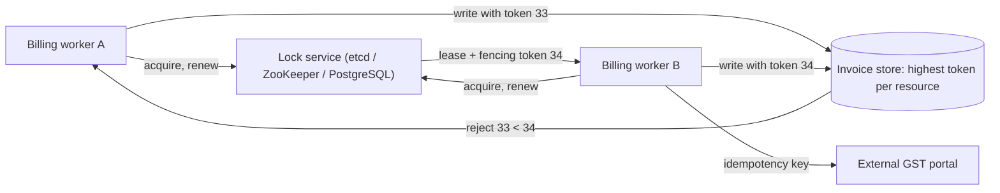
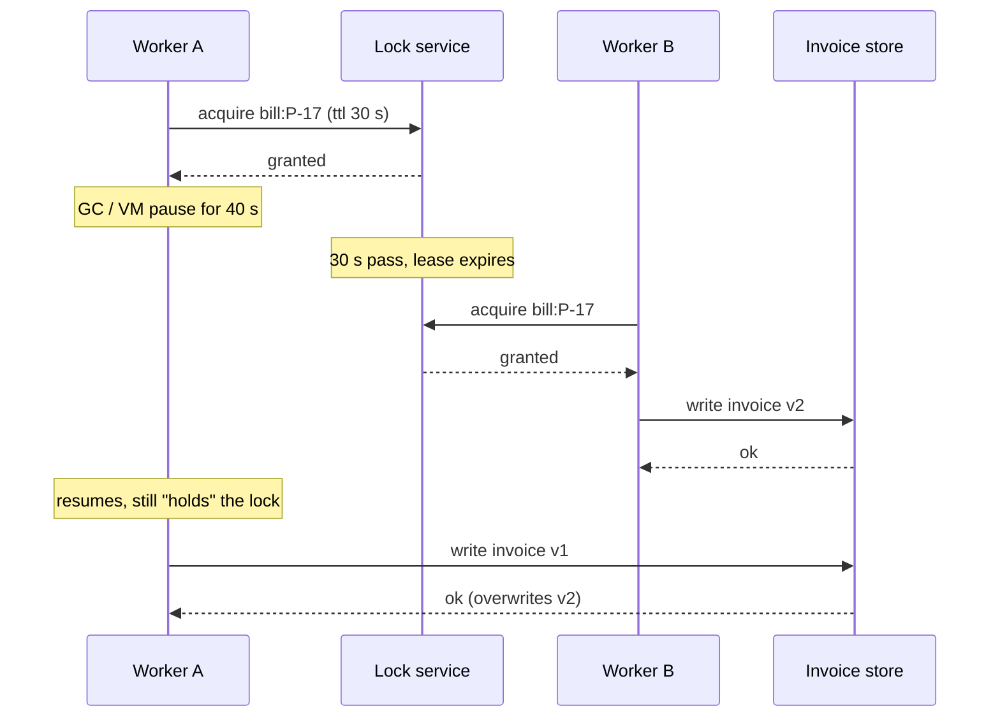
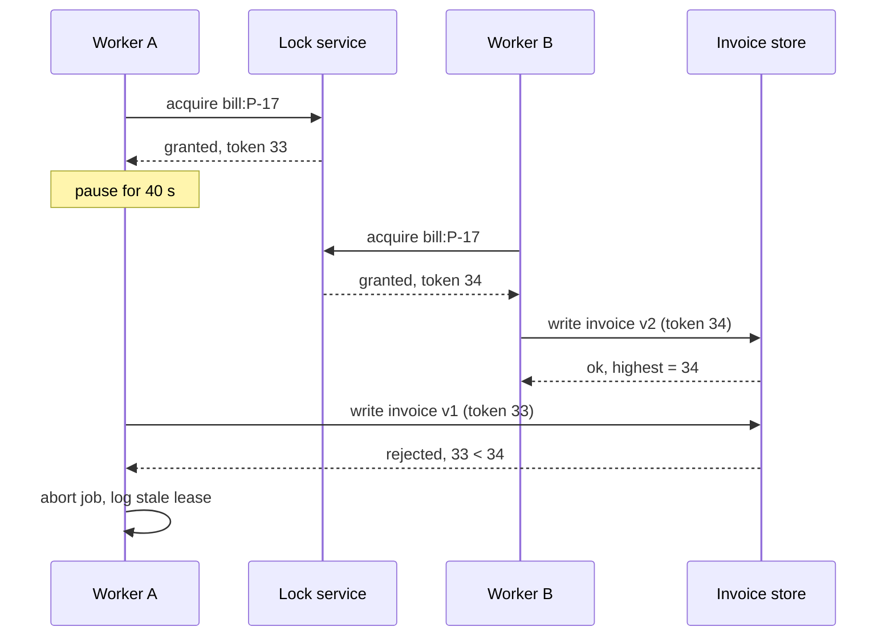

Inside one process, a `lock` statement is simple: the runtime knows which thread holds it, and if the thread dies, so does the process. Across machines none of that is true. The lock holder can crash, be cut off by the network, or simply freeze for 30 seconds while the garbage collector runs, and nobody can tell which. So every practical distributed lock has an expiry, which makes it a *lease*, and leases have a famous failure: the holder wakes up after its lease expired, still believing it holds the lock. This lesson shows that failure, the fix (fencing tokens), the Redis and Redlock debate, and the many cases where PostgreSQL already gives you a safer lock for free.

## Learning objectives

By the end of this lesson you will be able to:

1. Explain why a distributed lock must expire, and why that turns it into a lease.
2. Describe the process-pause failure step by step, and why checking "do I still hold the lock?" cannot fix it.
3. Implement fencing tokens: a lock service that issues increasing numbers and a resource that rejects older ones.
4. Distinguish locks for **efficiency** (avoid duplicate work) from locks for **correctness** (prevent corruption) and pick a tool for each.
5. Explain how a single-Redis lock and Redlock work, and summarise both sides of the Redlock debate fairly.
6. Use PostgreSQL advisory locks and guarded updates, and avoid their connection-pooling pitfalls.
7. Decide when you need no lock at all: idempotency, unique constraints or compare-and-set.

## Prerequisites

- [Consensus fundamentals](#/lesson/m13-consensus): the safest lock services (etcd, ZooKeeper) are built on consensus.
- [Clock skew and logical clocks](#/lesson/m13-time-ordering): leases depend on time, and clocks misbehave.
- [Deadlocks, optimistic and pessimistic locking](#/lesson/m09-locking): row locks and version columns are the single-database version of this lesson.

## Explain it like I'm a beginner

A co-working space in Bengaluru has one meeting room. You book it at the front desk and get a key card valid for **one hour**. Why does the card expire? Because if you leave for the airport with the card in your pocket, nobody else could ever use the room. The expiry protects everyone from a holder who vanished. A lock with an expiry is called a **lease**.

Now the problem. You book the room, go in, and fall asleep. Your hour ends. The desk gives a new card to Priya, who starts her client meeting. You wake up, see your card still in your hand, and walk back in to finish your presentation. Two meetings in one room. Your card *looked* valid to you; you had no way of feeling that an hour had passed.

The fix is not "check your watch more often", because you could fall asleep right after checking. The fix is at the **door**. Each new card gets a higher number: yours was 41, Priya's is 42. The door remembers the highest number it has seen and refuses any lower number. When you wake up and tap card 41, the door stays shut. Those numbers are **fencing tokens**, and the door is the **resource** that checks them.

Two rules to remember:

- Every distributed lock is a lease, because holders can disappear.
- Safety comes from the resource rejecting old tokens, not from the holder being careful.

## First-principles explanation

### Why a distributed lock must expire

A lock service cannot tell the difference between a holder that crashed, a holder whose network is down, and a holder that is just slow. If locks never expired, any crashed holder would block the resource forever. So locks are granted for a time-to-live (TTL), say 30 seconds, and the holder renews them while working. If it stops renewing, the lock is released automatically.

That one design choice, which every lock service makes, creates the core problem: **the lock service's idea of who holds the lock and the holder's idea can disagree**, because they are separated by time and network.

### The process-pause failure

Here is the sequence that breaks "lock, then write" with any lease-based lock:

1. Worker A acquires the lock on `project-17-monthly-bill` with a 30-second lease.
2. A starts generating the bill. Midway, A's process stops for 40 seconds. Causes include a full garbage collection, the VM being live-migrated, the container being CPU-throttled, the disk stalling on a page fault, or someone pressing `Ctrl+Z` on a debug session.
3. At 30 seconds the lease expires. Worker B acquires the lock and generates the bill, writing invoice `INV-2026-10-117` for ₹18,40,000.
4. A resumes. From A's point of view no time passed. It writes its version of the bill, overwriting B's or creating a duplicate invoice.

"Check the lock before writing" does not help: A can pause *between* the check and the write. Any finite gap between checking and acting is a window for a pause. Pauses are not rare in practice: tens of milliseconds are common, multi-second garbage-collection or VM pauses happen in large fleets, and network packets can be delayed for longer than any TTL.

### Fencing tokens

The robust fix moves the check to where the write lands:

1. The lock service returns a **fencing token** with every grant: a number that is strictly larger than any token it has issued for that lock before.
2. The holder includes the token with every write to the protected resource.
3. The resource stores the highest token it has accepted and **rejects** any write with a lower token.

Replay the failure: A got token 33, B got 34. B writes with 34; the store records 34. A wakes and writes with 33; the store rejects it. No corruption, regardless of how long A paused.

Requirements for fencing to work:

- Tokens must be **monotonic** per lock. etcd's revision numbers and ZooKeeper's `zxid` (or a sequential znode's number) are monotonic because they come from a consensus log. A PostgreSQL sequence or a `version` column also works.
- The **resource must check** the token atomically with the write. A database can do this with `UPDATE ... WHERE fencing_token <= @token`; a file store might keep the token in object metadata with a conditional put. If the resource cannot check tokens (a third-party API, an email server), fencing cannot protect it, and you need idempotency keys on that API instead.

### Efficiency locks versus correctness locks

Martin Kleppmann's distinction is the most useful question to ask before choosing a tool:

- **Efficiency lock:** if two processes occasionally both hold it, the result is wasted work or a duplicate notification. Example: "only one pod should rebuild the search index tonight". A simple single-node Redis lock is fine; an occasional double run costs some CPU.
- **Correctness lock:** if two processes both hold it, data is corrupted, money moves twice or invariants break. Example: "only one writer may update the ledger for this account". You need a lock from a consensus-backed system **plus fencing**, or better, let the database enforce the invariant directly.

### How a Redis lock works

The standard single-instance Redis lock:

```text
SET lock:bill:P-17 <random-owner-token> NX PX 30000
```

- `NX`: only set if the key does not exist (acquire).
- `PX 30000`: expire after 30,000 ms (the lease).
- The random owner token (a GUID) identifies the holder.

Release must check ownership, atomically, with a Lua script:

```text
if redis.call("get", KEYS[1]) == ARGV[1] then return redis.call("del", KEYS[1]) else return 0 end
```

Without that check, a slow holder whose lease expired would `DEL` the *next* holder's lock. That is another classic bug: the release-someone-else's-lock failure.

The weakness of a single Redis node: if it fails over to a replica, replication is asynchronous, so the replica may not have the lock key. Two clients can then hold the "same" lock. For an efficiency lock that is acceptable; for a correctness lock it is not.

### Redlock and the debate

**Redlock**, proposed by Redis's creator Salvatore Sanfilippo (antirez), uses `N` independent Redis masters (typically 5, no replication between them):

1. Record the start time.
2. Try `SET key token NX PX ttl` on each node in turn, with a short per-node timeout.
3. The lock is acquired if a majority (3 of 5) succeeded **and** the elapsed time is less than the TTL. The remaining validity is `ttl − elapsed − clock drift allowance`.
4. If not acquired, release on all nodes.

In 2016 Martin Kleppmann published a critique, and antirez replied. Both sides are worth knowing, because the disagreement is about **assumptions**, not about arithmetic.

**Kleppmann's main points:**

- Redlock does not produce fencing tokens. The random value is not monotonic, so a resource cannot tell an old holder from a new one, and the process-pause failure remains.
- Its safety depends on timing assumptions: bounded network delay, bounded process pauses and clocks that do not jump (for example, an NTP correction or an operator changing the time could make a node expire a key early). Algorithms such as Raft are designed to stay safe even when those assumptions fail, and only lose liveness.
- Therefore: for efficiency, a single Redis node is simpler and good enough; for correctness, Redlock is not sufficient, and you should use a consensus system with fencing.

**antirez's main points:**

- Redlock checks the elapsed time *after* acquiring, so delays during acquisition are accounted for; the remaining risk is a pause after the client has decided it holds the lock, which affects every lease-based lock, including ZooKeeper's.
- The timing model is explicit and reasonable in practice, and clock jumps can be avoided operationally (use monotonic time and slew, not step, clock adjustments).
- If the resource can do the check-and-set that fencing requires, it is already a linearizable store and could be used with the random token for a conditional write; fencing is not a property only consensus systems can provide.

**A fair summary.** Both agree that a lease cannot by itself stop a paused holder, and that the protected resource must take part in safety for correctness-critical work. They disagree on whether Redlock's timing assumptions are acceptable for correctness. A practical rule many teams adopt: use a single Redis lock (or Redlock) for efficiency; for correctness, rely on a store that enforces the invariant (database constraint, conditional write, fencing token check), and take the lock from a consensus-backed service if you need a lock at all.

### PostgreSQL advisory locks

If the work and the data are in PostgreSQL, you often do not need any other lock service. PostgreSQL has **advisory locks**: locks on an application-defined 64-bit number, managed by the database's own lock manager.

```sql
-- Session-level: held until explicitly unlocked or the session ends
SELECT pg_try_advisory_lock(hashtextextended('bill:P-17', 0));   -- true or false, never waits
SELECT pg_advisory_unlock(hashtextextended('bill:P-17', 0));

-- Transaction-level: released automatically at COMMIT or ROLLBACK
BEGIN;
SELECT pg_advisory_xact_lock(hashtextextended('bill:P-17', 0)); -- waits if held
-- ... do the work in this same transaction ...
COMMIT;
```

Properties and pitfalls:

- **Transaction-level locks with work in the same transaction are the safest form.** If your session dies, the transaction rolls back and its writes vanish together with the lock. There is no gap where a stale holder can write, because the writes and the lock share one fate. This is fencing for free.
- **Session-level locks are tied to a connection.** If a pooled connection is returned to the pool while still holding a session lock, another request may "inherit" the lock. With PgBouncer in transaction-pooling mode, session-level advisory locks do not work as expected at all, because consecutive statements can run on different server connections.
- **A dropped connection releases the lock, but the client may not notice.** If the network to the database breaks, the database ends the session and releases the lock; the client process may keep working for a while before its next query fails. Any side effect *outside* the database during that time is unprotected, exactly like a lease.
- Keys are numbers. Hash a resource name with `hashtextextended(name, 0)` (64-bit) to reduce collisions; two unrelated names that hash to the same key will block each other, which is safe but surprising.
- Advisory locks live on the primary only. After a failover to a standby, all advisory locks are gone and must be reacquired.

### When you need no lock at all

Many "we need a distributed lock" requests are better served by something the data store already does:

- **Unique constraint:** "only one invoice per project per month" is `UNIQUE (project_id, billing_month)`. Two workers race; one insert fails. No lock.
- **Compare-and-set / optimistic concurrency:** `UPDATE ... SET ..., version = version + 1 WHERE id = @id AND version = @expected`. Zero rows updated means someone else won.
- **Idempotency keys:** if duplicate work is harmless when de-duplicated, make it idempotent ([idempotency keys](#/lesson/m10-idempotency), [idempotent consumers](#/lesson/m12-idempotent-consumers)).
- **Job queues with `SKIP LOCKED`:** `SELECT ... FOR UPDATE SKIP LOCKED LIMIT 10` lets many workers claim different jobs without a global lock.
- **Single owner by partitioning:** route all work for a key to one consumer (a Kafka partition, a sharded actor). See [sharding](#/lesson/m13-sharding).

### Failure cases recap

1. **Pause after acquire** (GC, VM migration): a stale holder writes after its lease expired. Fix: fencing tokens checked by the resource, or do the work in the same database transaction as the lock.
2. **Unconditional release:** a slow holder deletes the next holder's lock. Fix: release only if the stored owner token matches (atomic script or compare-and-delete).
3. **Asynchronous failover** of a single Redis: the replica has no lock key; two holders. Fix: accept for efficiency locks; for correctness, use a consensus store or database constraint.
4. **Clock jump** on a lock server shortens a lease. Fix: monotonic clocks, slewed time sync, fencing.
5. **Session lock with a connection pool:** the lock leaks to another request or vanishes. Fix: transaction-level locks, or a dedicated non-pooled connection.

## Visual explanation

### Architecture: lock service, workers and a fencing-aware store



Both workers ask the lock service for the lease on the same resource and renew it while working. The service returns a fencing token that grows with each grant, here 34 for worker B. Every write to the invoice store carries the holder's token; the store keeps the highest token per resource and rejects anything lower, so worker A's late write with 33 bounces. The external portal cannot check fencing tokens, so calls to it carry an idempotency key instead. This is the important limitation: fencing protects only resources that take part in it.

### Sequence: the pause that breaks a lease without fencing



Worker A acquires a 30-second lease and then freezes for 40 seconds. The lock service, correctly, expires the lease and grants it to B, which writes version 2 of the invoice. When A resumes, nothing in its own process tells it that time has passed, so it writes version 1. The store has no way to tell the writes apart and accepts both, so the older work wins. Every component behaved "correctly"; the design was wrong.

### Sequence: the same pause with fencing tokens



The timeline is identical, but every grant carries a larger token and every write carries the holder's token. The store remembers 34 after B's write, so A's write with 33 is rejected. A treats the rejection as "I lost the lock" and aborts. The safety now depends only on the store's atomic comparison, not on timing.

## Step-by-step example

**Scenario.** An infrastructure consultancy bills 300 highway and metro projects monthly. On the 1st of each month, a job computes each project's bill from progress records and writes an invoice. Eight worker pods run the job; each project must be billed exactly once.

### Step 1: classify the lock

A duplicate bill to a government client is a correctness problem. So this is a **correctness** concern, not efficiency.

### Step 2: ask whether a constraint is enough

The invoice table gets `UNIQUE (project_id, billing_month)`. Two workers computing the same bill both try to insert; one fails. This alone prevents duplicate invoices. Is a lock still useful? Yes, for **efficiency**: computing a bill takes about 40 seconds of heavy queries (an estimate), and we would rather not compute it twice.

### Step 3: choose the lock

All data lives in PostgreSQL, so use a **transaction-level advisory lock** keyed by `hashtextextended('bill:' || project_id || ':' || month, 0)`, with `pg_try_advisory_xact_lock` so a busy project is skipped instead of waited for. The bill computation and the invoice insert run in the same transaction as the lock.

### Step 4: check the side effects outside the database

After the invoice is committed, the job submits it to the e-invoicing portal. That call is outside the transaction, so it is not protected by the lock. Make it safe with an **outbox row** ([transactional outbox](#/lesson/m12-outbox)) written in the same transaction, and a relay that submits it with the invoice number as the idempotency reference.

### Step 5: estimate

```text
300 projects × 40 s ≈ 12,000 s of work; ÷ 8 workers ≈ 1,500 s ≈ 25 minutes.
Each worker holds one connection inside a transaction for ~40 s; 8 workers → 8 connections.
```

Long transactions hold back PostgreSQL's cleanup of old row versions (vacuum). Forty seconds is fine; forty minutes would not be. If a bill took much longer, you would switch to a session-level lock on a dedicated connection plus a fencing column, or split the computation.

### Step 6: test the failure

Kill a worker's pod mid-transaction: the transaction rolls back, the lock is released, another worker picks up the project later. Pause a worker with `SIGSTOP` for two minutes: its transaction still holds the lock, so nobody else bills that project; when it resumes, it commits normally. With transaction-level locks, a pause delays work but cannot cause a double write.

## Production-style C# implementation

The code models a lock service that issues leases with fencing tokens, a fencing-aware store, and a runner that renews the lease and stops work when renewal fails. Real backends (etcd, ZooKeeper, PostgreSQL, Redis) sit behind the same interfaces; offline, in-memory fakes are used.

```text
Projects.Billing/
  Program.cs
  Locking/LockLease.cs
  Locking/InMemoryLockService.cs
  Locking/FencedStore.cs
  Locking/LockedJobRunner.cs
```

```csharp file=Locking/LockLease.cs
namespace Projects.Billing.Locking;

/// <summary>A time-limited grant. <see cref="FencingToken"/> strictly increases with every grant
/// for the same resource; <see cref="OwnerId"/> is a random value that identifies this holder.</summary>
public sealed record LockLease(string Resource, string OwnerId, long FencingToken, DateTimeOffset ExpiresAt);

public interface ILockService
{
    Task<LockLease?> TryAcquireAsync(string resource, string ownerId, TimeSpan ttl, CancellationToken ct);

    /// <summary>Extends a lease that is still held by the same owner. Returns null if it was lost.</summary>
    Task<LockLease?> RenewAsync(LockLease lease, TimeSpan ttl, CancellationToken ct);

    /// <summary>Releases only if the caller still owns the lease (compare-and-delete).</summary>
    Task<bool> ReleaseAsync(LockLease lease, CancellationToken ct);
}
```

```csharp file=Locking/InMemoryLockService.cs
namespace Projects.Billing.Locking;

/// <summary>In-memory lock server. A real one is etcd (lease + revision as token), ZooKeeper
/// (ephemeral sequential node + zxid) or PostgreSQL (a lock row with a sequence-generated token).</summary>
public sealed class InMemoryLockService(TimeProvider time) : ILockService
{
    private readonly object _gate = new();
    private readonly Dictionary<string, LockLease> _held = new(StringComparer.Ordinal);
    private readonly Dictionary<string, long> _lastToken = new(StringComparer.Ordinal);

    public Task<LockLease?> TryAcquireAsync(string resource, string ownerId, TimeSpan ttl, CancellationToken ct)
    {
        lock (_gate)
        {
            var now = time.GetUtcNow();
            if (_held.TryGetValue(resource, out var current) && current.ExpiresAt > now)
                return Task.FromResult<LockLease?>(null);

            long token = _lastToken.GetValueOrDefault(resource) + 1;
            _lastToken[resource] = token;
            var lease = new LockLease(resource, ownerId, token, now + ttl);
            _held[resource] = lease;
            return Task.FromResult<LockLease?>(lease);
        }
    }

    public Task<LockLease?> RenewAsync(LockLease lease, TimeSpan ttl, CancellationToken ct)
    {
        lock (_gate)
        {
            var now = time.GetUtcNow();
            if (!IsCurrent(lease, now)) return Task.FromResult<LockLease?>(null);
            var renewed = lease with { ExpiresAt = now + ttl };
            _held[lease.Resource] = renewed;
            return Task.FromResult<LockLease?>(renewed);
        }
    }

    public Task<bool> ReleaseAsync(LockLease lease, CancellationToken ct)
    {
        lock (_gate)
        {
            if (!_held.TryGetValue(lease.Resource, out var current)
                || current.OwnerId != lease.OwnerId || current.FencingToken != lease.FencingToken)
                return Task.FromResult(false);   // never delete someone else's lock
            _held.Remove(lease.Resource);
            return Task.FromResult(true);
        }
    }

    private bool IsCurrent(LockLease lease, DateTimeOffset now) =>
        _held.TryGetValue(lease.Resource, out var current)
        && current.OwnerId == lease.OwnerId
        && current.FencingToken == lease.FencingToken
        && current.ExpiresAt > now;
}
```

Two details carry the safety: the token per resource only ever increases (even after the lock is released or expires), and release compares both owner and token so an expired holder cannot remove its successor's lock.

```csharp file=Locking/FencedStore.cs
namespace Projects.Billing.Locking;

public sealed class StaleFencingTokenException(string resource, long token, long highest)
    : Exception($"Write to {resource} with fencing token {token} rejected; highest seen is {highest}.")
{
    public long Token => token;
    public long Highest => highest;
}

public interface IFencedStore
{
    /// <summary>Applies the write only if <paramref name="fencingToken"/> is at least the highest token
    /// already accepted for <paramref name="resource"/>. Check and write are atomic.</summary>
    Task WriteAsync(string resource, string key, string value, long fencingToken, CancellationToken ct);
    string? Read(string key);
}

/// <summary>In PostgreSQL this is one statement:
/// UPDATE invoices SET ..., fencing_token = @token WHERE id = @id AND fencing_token &lt;= @token.</summary>
public sealed class InMemoryFencedStore : IFencedStore
{
    private readonly object _gate = new();
    private readonly Dictionary<string, long> _highest = new(StringComparer.Ordinal);
    private readonly Dictionary<string, string> _data = new(StringComparer.Ordinal);

    public Task WriteAsync(string resource, string key, string value, long fencingToken, CancellationToken ct)
    {
        lock (_gate)
        {
            long highest = _highest.GetValueOrDefault(resource);
            if (fencingToken < highest) throw new StaleFencingTokenException(resource, fencingToken, highest);
            _highest[resource] = fencingToken;
            _data[key] = value;
        }
        return Task.CompletedTask;
    }

    public string? Read(string key)
    {
        lock (_gate) return _data.TryGetValue(key, out var v) ? v : null;
    }
}
```

```csharp file=Locking/LockedJobRunner.cs
using Microsoft.Extensions.Logging;

namespace Projects.Billing.Locking;

public sealed class LockedJobRunner(ILockService locks, TimeProvider time, ILogger<LockedJobRunner> log)
{
    /// <summary>Runs <paramref name="work"/> while holding the lease, renewing it every ttl/3.
    /// If renewal fails the work's token is cancelled. Cancellation is cooperative and cannot stop a
    /// paused process, so the work must still pass the fencing token to every resource it writes.</summary>
    public async Task<bool> RunExclusiveAsync(string resource, TimeSpan ttl,
        Func<LockLease, CancellationToken, Task> work, CancellationToken ct)
    {
        string owner = $"{Environment.MachineName}:{Guid.NewGuid():N}";
        var lease = await locks.TryAcquireAsync(resource, owner, ttl, ct);
        if (lease is null) return false;

        var holder = new LeaseHolder(lease);
        using var workCts = CancellationTokenSource.CreateLinkedTokenSource(ct);
        var renewal = RenewLoopAsync(holder, ttl, workCts);
        try
        {
            await work(lease, workCts.Token);
            return true;
        }
        catch (StaleFencingTokenException ex)
        {
            log.LogWarning(ex, "Lost {Resource} to a newer holder; work aborted.", resource);
            return false;
        }
        finally
        {
            await workCts.CancelAsync();
            await renewal;
            await locks.ReleaseAsync(holder.Current, CancellationToken.None);
        }
    }

    private sealed class LeaseHolder(LockLease initial)
    {
        public LockLease Current { get; set; } = initial;
    }

    private async Task RenewLoopAsync(LeaseHolder holder, TimeSpan ttl, CancellationTokenSource workCts)
    {
        var token = workCts.Token;
        try
        {
            while (!token.IsCancellationRequested)
            {
                await Task.Delay(ttl / 3, time, token);
                var renewed = await locks.RenewAsync(holder.Current, ttl, token);
                if (renewed is null)
                {
                    log.LogWarning("Lease on {Resource} lost; cancelling work.", holder.Current.Resource);
                    await workCts.CancelAsync();
                    return;
                }
                holder.Current = renewed;
            }
        }
        catch (OperationCanceledException)
        {
            // normal shutdown of the renewal loop
        }
    }
}
```

The runner's comment is the lesson in one sentence. Renewal and cancellation make the common case tidy: a worker that loses its lease usually stops promptly. They cannot make the rare case safe, because a paused process does not run its cancellation checks. That is why `work` receives the `LockLease` and passes `FencingToken` to the store.

```csharp file=Program.cs
using Projects.Billing.Locking;

var builder = WebApplication.CreateBuilder(args);

builder.Services.AddSingleton(TimeProvider.System);
builder.Services.AddSingleton<ILockService, InMemoryLockService>();   // etcd / PostgreSQL in production
builder.Services.AddSingleton<IFencedStore, InMemoryFencedStore>();
builder.Services.AddSingleton<LockedJobRunner>();

var app = builder.Build();

app.MapPost("/projects/{projectId}/bills/{month}", async (string projectId, string month,
    LockedJobRunner runner, IFencedStore store, CancellationToken ct) =>
{
    string resource = $"bill:{projectId}:{month}";
    bool ran = await runner.RunExclusiveAsync(resource, TimeSpan.FromSeconds(30), async (lease, workCt) =>
    {
        await Task.Delay(TimeSpan.FromMilliseconds(200), workCt);   // compute the bill
        string invoice = $"INV-{month}-{projectId} by token {lease.FencingToken}";
        await store.WriteAsync(resource, $"invoice:{projectId}:{month}", invoice, lease.FencingToken, workCt);
    }, ct);

    return ran
        ? Results.Ok(new { invoice = store.Read($"invoice:{projectId}:{month}") })
        : Results.Conflict(new { message = "Another worker holds this bill, or lost it mid-way." });
});

app.Run();
```

For real backends, the shapes are short snippets (not compiled, because the client libraries are not available offline). A single-Redis efficiency lock with StackExchange.Redis:

```csharp
string owner = Guid.NewGuid().ToString("N");
bool acquired = await db.StringSetAsync("lock:reindex", owner, TimeSpan.FromSeconds(30), When.NotExists);
// ... work ...
const string release = "if redis.call('get', KEYS[1]) == ARGV[1] then return redis.call('del', KEYS[1]) else return 0 end";
await db.ScriptEvaluateAsync(release, new RedisKey[] { "lock:reindex" }, new RedisValue[] { owner });
```

A PostgreSQL transaction-level advisory lock with Npgsql, with the work in the same transaction:

```csharp
await using var tx = await conn.BeginTransactionAsync(ct);
await using var cmd = new NpgsqlCommand("SELECT pg_try_advisory_xact_lock(hashtextextended(@k, 0))", conn, tx);
cmd.Parameters.AddWithValue("k", $"bill:{projectId}:{month}");
if (!(bool)(await cmd.ExecuteScalarAsync(ct))!) return;   // someone else is billing it
// ... compute and INSERT the invoice using conn and tx ...
await tx.CommitAsync(ct);                                 // lock released here, together with the writes
```

## Bad design vs good design

**Bad:**

- `SET lock NX` with no expiry: one crashed pod blocks billing forever.
- `SET lock NX PX 30000` and then `DEL lock` at the end without checking ownership.
- "Correctness" locking with a single Redis node that fails over asynchronously.
- The worker checks `IsLockStillHeld()` before every write and believes that makes it safe.
- Session-level advisory locks through PgBouncer in transaction mode.

**Good:**

- Decide first: efficiency or correctness. Efficiency: one Redis node, owner token, compare-and-delete. Correctness: let the store enforce it (constraint, compare-and-set, fencing token check), and take the lock from etcd, ZooKeeper or the database itself.
- Every grant comes with a monotonic fencing token, and every protected write carries it.
- Prefer transaction-level advisory locks when the work and data live in PostgreSQL.
- External side effects use idempotency keys, because they cannot check fencing tokens.

:::callout type=mistake title="Longer TTLs do not fix pauses"
Raising the lease from 30 seconds to 10 minutes makes the pause failure rarer but makes crash recovery 20 times slower, and a long enough pause still breaks it. TTL is a trade-off between failover time and false expiry, never a safety mechanism.
:::

:::callout type=tradeoff title="A lock is a single point of serialisation"
Every lock adds latency (a round trip to acquire) and a dependency (if the lock service is down, the work stops). Prefer designs where ownership comes from partitioning (one consumer per partition) or where the data store resolves conflicts, and keep locks for the few places that truly need them.
:::

## Practical playground

The SQL playground below has a `fare_tables` table with a fencing column and a `jobs` table. Try:

1. `SELECT pg_try_advisory_lock(hashtextextended('fares:BLUE', 0));` twice in the same session. Note that session locks are re-entrant for the same session (both return true, and you need two unlocks).
2. Write a guarded update that only applies when your token is at least the stored one: `UPDATE fare_tables SET fare_paise = 3300, fencing_token = 41 WHERE route = 'BLUE-1' AND fencing_token <= 41 RETURNING *;` and observe zero rows.
3. Claim two jobs with `SELECT * FROM jobs WHERE status = 'pending' ORDER BY id LIMIT 2 FOR UPDATE SKIP LOCKED;` and explain why this needs no global lock.

:::playground type=sql title="Advisory locks, fencing columns and SKIP LOCKED"
```sql
CREATE TABLE fare_tables (route text PRIMARY KEY, fare_paise int NOT NULL, fencing_token bigint NOT NULL);
INSERT INTO fare_tables VALUES ('BLUE-1', 3000, 42), ('BLUE-2', 4000, 40), ('RED-1', 2000, 50);
CREATE TABLE jobs (id int PRIMARY KEY, project text NOT NULL, status text NOT NULL DEFAULT 'pending');
INSERT INTO jobs VALUES (1, 'P-17', 'pending'), (2, 'P-18', 'pending'), (3, 'P-19', 'done'), (4, 'P-20', 'pending');
```
:::

## Exercises

:::exercise id=m13-distributed-locks-ex1 difficulty=beginner kind=code title="A store that rejects stale holders"
Implement the resource side of fencing: a ledger that accepts writes only from the newest lock holder.
::requirements
- `FencedLedger.TryWrite(resource, value, token)` applies the write and returns true if `token` is at least the highest token seen for that resource; otherwise returns false and increments `Rejected`.
- `Read(resource)` returns the last accepted value or null.
- `HighestToken(resource)` returns the highest accepted token, or 0 if none.
- Tokens must be positive; otherwise throw `ArgumentOutOfRangeException`.
- Resources are independent: a high token on one does not affect another.
::acceptance
- Token 33 then 34 both succeed; then 33 fails and `Rejected` is 1.
- The same holder can write twice with the same token.
- `HighestToken` of an unknown resource is 0.
::hint
You need one dictionary for highest tokens and one for values.
::hint
"At least" means `>=`, so a holder can make several writes.
::hint
Compare before you change anything, so a rejected write leaves no trace.
::hint
```csharp
long highest = _highest.GetValueOrDefault(resource);
if (token < highest) { Rejected++; return false; }
```
::starter
```csharp file=FencedLedger.cs
using System;
using System.Collections.Generic;

public sealed class FencedLedger
{
    public int Rejected => throw new NotImplementedException();
    public bool TryWrite(string resource, string value, long token) => throw new NotImplementedException();
    public string? Read(string resource) => throw new NotImplementedException();
    public long HighestToken(string resource) => throw new NotImplementedException();
}
```
::tests
```csharp file=FencedLedgerTests.cs
using System;
using Xunit;

public class FencedLedgerTests
{
    [Fact]
    public void Stale_token_is_rejected_after_newer_write()
    {
        var l = new FencedLedger();
        Assert.True(l.TryWrite("bill:P-17", "v1", 33));
        Assert.True(l.TryWrite("bill:P-17", "v2", 34));
        Assert.False(l.TryWrite("bill:P-17", "v1-late", 33));
        Assert.Equal("v2", l.Read("bill:P-17"));
        Assert.Equal(1, l.Rejected);
    }

    [Fact]
    public void Same_holder_can_write_again() 
    {
        var l = new FencedLedger();
        Assert.True(l.TryWrite("r", "a", 5));
        Assert.True(l.TryWrite("r", "b", 5));
        Assert.Equal("b", l.Read("r"));
    }

    [Fact]
    public void Resources_are_independent()
    {
        var l = new FencedLedger();
        l.TryWrite("a", "x", 100);
        Assert.True(l.TryWrite("b", "y", 1));
        Assert.Equal(1L, l.HighestToken("b"));
    }

    [Fact]
    public void Unknown_resource()
    {
        var l = new FencedLedger();
        Assert.Equal(0L, l.HighestToken("nope"));
        Assert.Null(l.Read("nope"));
    }

    [Fact]
    public void Non_positive_token_throws() =>
        Assert.Throws<ArgumentOutOfRangeException>(() => new FencedLedger().TryWrite("r", "v", 0));
}
```
::solution
```csharp file=FencedLedger.cs
using System;
using System.Collections.Generic;

public sealed class FencedLedger
{
    private readonly object _gate = new();
    private readonly Dictionary<string, long> _highest = new(StringComparer.Ordinal);
    private readonly Dictionary<string, string> _values = new(StringComparer.Ordinal);
    private int _rejected;

    public int Rejected { get { lock (_gate) return _rejected; } }

    public bool TryWrite(string resource, string value, long token)
    {
        if (token <= 0) throw new ArgumentOutOfRangeException(nameof(token), token, "Fencing tokens are positive.");
        lock (_gate)
        {
            if (token < _highest.GetValueOrDefault(resource))
            {
                _rejected++;
                return false;
            }
            _highest[resource] = token;
            _values[resource] = value;
            return true;
        }
    }

    public string? Read(string resource)
    {
        lock (_gate) return _values.TryGetValue(resource, out var v) ? v : null;
    }

    public long HighestToken(string resource)
    {
        lock (_gate) return _highest.GetValueOrDefault(resource);
    }
}
```

The lock makes check-and-write atomic inside this process. In a database, the equivalent is a single conditional `UPDATE`, never a `SELECT` followed by an `UPDATE`.
::mistakes
- Using `>` instead of `>=`, which blocks the current holder's second write.
- Reading the highest token, then writing in a separate step without atomicity.
- Sharing one global highest token across resources, which makes unrelated locks block each other.
:::

:::exercise id=m13-distributed-locks-ex2 difficulty=beginner kind=written title="Efficiency or correctness?"
For each case, say whether the lock is for efficiency or correctness, what goes wrong if two holders overlap, and which tool you would use.

1. Only one pod should regenerate the nightly sitemap for a news site.
2. Only one worker should debit a UPI merchant's settlement account for a given batch.
3. Only one instance should send the "your order shipped" push notification.
4. Only one process should compact a shared log file stored on a network file system.
::acceptance
- Correctly classifies 1 and 3 as efficiency, 2 and 4 as correctness (or argues clearly otherwise).
- For each correctness case, names a mechanism that does not rely on timing alone (constraint, compare-and-set, transaction-level advisory lock, fencing checked by the storage).
- Mentions idempotency for the notification case.
::hint
Ask: "If this ran twice at the same time, what is the worst outcome?"
::hint
A duplicate push notification is annoying, not corrupting. Can you de-duplicate it anyway?
::hint
Can a network file system check fencing tokens? If not, what are the options?
::solution
1. **Efficiency.** Two sitemap builds waste CPU and the last write wins with identical content. A single Redis lock with a TTL, or no lock at all if the build is cheap.
2. **Correctness.** A double debit moves money twice. Do the debit in the ledger database with a unique constraint on `(merchant_id, batch_id)` and a transaction-level advisory lock or row lock on the account; the database is the arbiter. Do not rely on an external lease alone.
3. **Efficiency** with a twist: a duplicate notification annoys a customer. Use an idempotency key per `(order_id, event)` in the notification service so duplicates are dropped; the lock becomes optional.
4. **Correctness.** Two compactors can interleave and corrupt the file. If the file system cannot check fencing tokens, use a store that can (object storage with conditional writes on a version/ETag, write the compacted output to a new object and atomically swap a pointer with compare-and-set), or move compaction to a single owner chosen by a consensus-backed lease plus a token stored next to the data.
::mistakes
- Calling every lock "correctness" and using heavyweight coordination for sitemaps.
- Using a longer TTL as the answer for the correctness cases.
:::

:::exercise id=m13-distributed-locks-ex3 difficulty=intermediate kind=code title="Lease table with tokens and safe release"
Implement the lock-service side: leases that expire, increasing fencing tokens per resource, renewal only by the current holder, and release that cannot delete someone else's lease.
::requirements
- `LeaseTable.TryAcquire(resource, owner, ttl, now)` returns a `Lease` or null if a non-expired lease exists.
- Each successful acquire for a resource gets a token one higher than the previous grant for that resource (tokens never reset, even after release).
- `Renew(lease, ttl, now)` returns an extended lease only if `lease` is still the current, non-expired lease (same owner and token); otherwise null.
- `Release(lease)` removes the lease only if owner and token match the current one; returns whether it did.
- `Holder(resource, now)` returns the current non-expired lease or null.
::acceptance
- A second acquire while held returns null; after expiry it succeeds with token 2.
- Renewing an expired lease returns null even if nobody else acquired.
- An old holder's `Release` does not remove the new holder's lease.
- Tokens keep increasing after release: acquire, release, acquire gives token 2.
::hint
Store two dictionaries: current lease per resource and last token per resource.
::hint
"Current" means same owner **and** same token. Owner alone is not enough if the same owner acquires twice.
::hint
Expiry is `ExpiresAt <= now`. Write one helper `IsCurrent(lease, now)`.
::hint
```csharp
long token = _lastToken.GetValueOrDefault(resource) + 1;
_lastToken[resource] = token;
var lease = new Lease(resource, owner, token, now + ttl);
```
::starter
```csharp file=LeaseTable.cs
using System;
using System.Collections.Generic;

public sealed record Lease(string Resource, string Owner, long Token, DateTimeOffset ExpiresAt);

public sealed class LeaseTable
{
    public Lease? TryAcquire(string resource, string owner, TimeSpan ttl, DateTimeOffset now) => throw new NotImplementedException();
    public Lease? Renew(Lease lease, TimeSpan ttl, DateTimeOffset now) => throw new NotImplementedException();
    public bool Release(Lease lease) => throw new NotImplementedException();
    public Lease? Holder(string resource, DateTimeOffset now) => throw new NotImplementedException();
}
```
::tests
```csharp file=LeaseTableTests.cs
using System;
using Xunit;

public class LeaseTableTests
{
    private static readonly DateTimeOffset T0 = new DateTimeOffset(2026, 11, 1, 2, 0, 0, TimeSpan.Zero);
    private static readonly TimeSpan Ttl = TimeSpan.FromSeconds(30);

    [Fact]
    public void Held_lease_blocks_until_expiry()
    {
        var t = new LeaseTable();
        var a = t.TryAcquire("bill", "A", Ttl, T0);
        Assert.NotNull(a);
        Assert.Null(t.TryAcquire("bill", "B", Ttl, T0.AddSeconds(10)));
        var b = t.TryAcquire("bill", "B", Ttl, T0.AddSeconds(31));
        Assert.NotNull(b);
        Assert.Equal(2L, b!.Token);
    }

    [Fact]
    public void Expired_lease_cannot_be_renewed()
    {
        var t = new LeaseTable();
        var a = t.TryAcquire("bill", "A", Ttl, T0)!;
        Assert.Null(t.Renew(a, Ttl, T0.AddSeconds(40)));
    }

    [Fact]
    public void Renewal_extends_expiry()
    {
        var t = new LeaseTable();
        var a = t.TryAcquire("bill", "A", Ttl, T0)!;
        var r = t.Renew(a, Ttl, T0.AddSeconds(20));
        Assert.NotNull(r);
        Assert.Equal(T0.AddSeconds(50), r!.ExpiresAt);
        Assert.Null(t.TryAcquire("bill", "B", Ttl, T0.AddSeconds(40)));
    }

    [Fact]
    public void Old_holder_cannot_release_new_holders_lease()
    {
        var t = new LeaseTable();
        var a = t.TryAcquire("bill", "A", Ttl, T0)!;
        var b = t.TryAcquire("bill", "B", Ttl, T0.AddSeconds(31))!;
        Assert.False(t.Release(a));
        Assert.Equal(b, t.Holder("bill", T0.AddSeconds(32)));
    }

    [Fact]
    public void Tokens_never_reset()
    {
        var t = new LeaseTable();
        var a = t.TryAcquire("bill", "A", Ttl, T0)!;
        Assert.True(t.Release(a));
        var again = t.TryAcquire("bill", "A", Ttl, T0.AddSeconds(1))!;
        Assert.Equal(2L, again.Token);
    }

    [Fact]
    public void Holder_is_null_after_expiry()
    {
        var t = new LeaseTable();
        t.TryAcquire("bill", "A", Ttl, T0);
        Assert.Null(t.Holder("bill", T0.AddSeconds(30)));
    }
}
```
::solution
```csharp file=LeaseTable.cs
using System;
using System.Collections.Generic;

public sealed record Lease(string Resource, string Owner, long Token, DateTimeOffset ExpiresAt);

public sealed class LeaseTable
{
    private readonly object _gate = new();
    private readonly Dictionary<string, Lease> _current = new(StringComparer.Ordinal);
    private readonly Dictionary<string, long> _lastToken = new(StringComparer.Ordinal);

    public Lease? TryAcquire(string resource, string owner, TimeSpan ttl, DateTimeOffset now)
    {
        if (ttl <= TimeSpan.Zero) throw new ArgumentOutOfRangeException(nameof(ttl));
        lock (_gate)
        {
            if (_current.TryGetValue(resource, out var held) && held.ExpiresAt > now) return null;
            long token = _lastToken.GetValueOrDefault(resource) + 1;
            _lastToken[resource] = token;
            var lease = new Lease(resource, owner, token, now + ttl);
            _current[resource] = lease;
            return lease;
        }
    }

    public Lease? Renew(Lease lease, TimeSpan ttl, DateTimeOffset now)
    {
        lock (_gate)
        {
            if (!IsCurrent(lease, now)) return null;
            var renewed = lease with { ExpiresAt = now + ttl };
            _current[lease.Resource] = renewed;
            return renewed;
        }
    }

    public bool Release(Lease lease)
    {
        lock (_gate)
        {
            if (!_current.TryGetValue(lease.Resource, out var held)
                || held.Owner != lease.Owner || held.Token != lease.Token) return false;
            _current.Remove(lease.Resource);
            return true;
        }
    }

    public Lease? Holder(string resource, DateTimeOffset now)
    {
        lock (_gate) return _current.TryGetValue(resource, out var held) && held.ExpiresAt > now ? held : null;
    }

    private bool IsCurrent(Lease lease, DateTimeOffset now) =>
        _current.TryGetValue(lease.Resource, out var held)
        && held.Owner == lease.Owner && held.Token == lease.Token && held.ExpiresAt > now;
}
```

Passing `now` explicitly makes expiry deterministic in tests. In production you would take a `TimeProvider`, and the lock server's clock, not the client's, decides expiry.
::mistakes
- Resetting the token counter when a lease is released, which lets an old holder's token look current again.
- Comparing only the owner on release, so a holder that re-acquired could release a newer lease with an old handle.
- Letting an expired lease renew "because nobody else took it": the holder cannot know whether someone acquired and released in between.
:::

:::exercise id=m13-distributed-locks-ex4 difficulty=intermediate kind=sql ordered=true title="Apply only fenced writes"
Several workers produced fare updates, each with the fencing token of the lease it held. Apply each pending write to `fare_tables` **only if its token is at least the stored token**, in a single statement, and return the rows actually updated (`route`, `fare_paise`, `fencing_token`) ordered by route.
::setup
```sql
CREATE TABLE fare_tables (route text PRIMARY KEY, fare_paise int NOT NULL, fencing_token bigint NOT NULL);
INSERT INTO fare_tables VALUES ('BLUE-1', 3000, 42), ('BLUE-2', 4000, 40), ('RED-1', 2000, 50);
CREATE TABLE pending_writes (route text NOT NULL, fare_paise int NOT NULL, fencing_token bigint NOT NULL);
INSERT INTO pending_writes VALUES ('BLUE-1', 3200, 41), ('BLUE-2', 4500, 43), ('RED-1', 2100, 50), ('RED-9', 999, 99);
```
::check
```sql
WITH applied AS (
  UPDATE fare_tables f
     SET fare_paise = p.fare_paise, fencing_token = p.fencing_token
    FROM pending_writes p
   WHERE p.route = f.route
     AND p.fencing_token >= f.fencing_token
  RETURNING f.route, f.fare_paise, f.fencing_token
)
SELECT route, fare_paise, fencing_token FROM applied ORDER BY route;
```
::acceptance
- `BLUE-1` is not updated (token 41 is older than 42).
- `BLUE-2` is updated to 4500 with token 43.
- `RED-1` is updated (equal token 50 is the same holder).
- `RED-9` does not exist and is not inserted.
::hint
`UPDATE ... FROM other_table` joins the target table to a source table.
::hint
Put the token comparison in the `WHERE` clause so check and write are one atomic statement.
::hint
`RETURNING` gives the updated rows; wrap the update in a CTE to sort them.
::hint
```sql
WITH applied AS (UPDATE fare_tables f SET ... FROM pending_writes p WHERE ... RETURNING ...)
SELECT ... FROM applied ORDER BY route;
```
::solution
```sql
WITH applied AS (
  UPDATE fare_tables f
     SET fare_paise = p.fare_paise, fencing_token = p.fencing_token
    FROM pending_writes p
   WHERE p.route = f.route
     AND p.fencing_token >= f.fencing_token
  RETURNING f.route, f.fare_paise, f.fencing_token
)
SELECT route, fare_paise, fencing_token FROM applied ORDER BY route;
```

The token check sits in the same statement as the write, so no other transaction can slip between "check" and "update". PostgreSQL row locks taken by the `UPDATE` serialise concurrent writers to the same route. If two pending writes for the same route existed, you would first pick the highest token per route (`DISTINCT ON (route) ... ORDER BY route, fencing_token DESC`), because `UPDATE ... FROM` with several matching source rows updates the target once with an unpredictable one.
::mistakes
- Using `>` and rejecting the current holder's own repeated write.
- Selecting first, checking in application code, then updating: the gap is exactly where a stale holder sneaks in.
- Using `INSERT ... ON CONFLICT` and accidentally creating `RED-9`.
:::

:::exercise id=m13-distributed-locks-ex5 difficulty=advanced kind=code title="Majority lock with a validity window (Redlock mechanics)"
Implement the acquisition step of a Redlock-style lock over independent nodes, so you can reason concretely about its timing assumptions.
::requirements
- `ILockNode` has `bool TrySetIfAbsent(string key, string value, TimeSpan ttl)` and `void DeleteIfValue(string key, string value)`. A node may throw if it is down.
- `MajorityLock.TryAcquire(nodes, key, value, ttl, elapsed, driftFactor)`: record `elapsed()` at start, try every node (an exception counts as failure), then compute `took = elapsed() − start` and `validity = ttl − took − (ttl × driftFactor + 2 ms)`.
- Acquired only if successes ≥ majority **and** `validity > 0`. Return `MajorityLockResult(Acquired, NodesLocked, Validity)`.
- If not acquired, call `DeleteIfValue` on **every** node (ignore exceptions) and return `Validity = TimeSpan.Zero`.
::acceptance
- 5 healthy nodes → acquired, `NodesLocked = 5`, validity slightly under the TTL.
- 5 nodes with 2 down → acquired with 3.
- 3 down → not acquired, and the 2 nodes that were set are cleaned up.
- Slow nodes that make acquisition take longer than the TTL → not acquired even with a majority, and cleaned up.
::hint
The majority of 5 is 3.
::hint
`elapsed` is injected so tests can control time; call it once before and once after the loop.
::hint
Wrap each node call in `try/catch` and count only `true` results.
::hint
Clean up on all nodes, not only those that returned true: a node may have set the key but its reply was lost.
::hint
```csharp
var drift = TimeSpan.FromTicks((long)(ttl.Ticks * driftFactor)) + TimeSpan.FromMilliseconds(2);
var validity = ttl - took - drift;
```
::starter
```csharp file=MajorityLock.cs
using System;
using System.Collections.Generic;

public interface ILockNode
{
    bool TrySetIfAbsent(string key, string value, TimeSpan ttl);
    void DeleteIfValue(string key, string value);
}

public sealed record MajorityLockResult(bool Acquired, int NodesLocked, TimeSpan Validity);

public static class MajorityLock
{
    public static MajorityLockResult TryAcquire(IReadOnlyList<ILockNode> nodes, string key, string value,
        TimeSpan ttl, Func<TimeSpan> elapsed, double driftFactor = 0.01) => throw new NotImplementedException();
}
```
::tests
```csharp file=MajorityLockTests.cs
using System;
using System.Collections.Generic;
using System.Linq;
using Xunit;

public class MajorityLockTests
{
    private sealed class Clock { public TimeSpan Now; }

    private sealed class FakeNode(Clock clock, TimeSpan latency, bool down = false) : ILockNode
    {
        public readonly Dictionary<string, string> Keys = new();
        public bool Down { get; set; } = down;

        public bool TrySetIfAbsent(string key, string value, TimeSpan ttl)
        {
            clock.Now += latency;
            if (Down) throw new InvalidOperationException("node down");
            if (Keys.ContainsKey(key)) return false;
            Keys[key] = value;
            return true;
        }

        public void DeleteIfValue(string key, string value)
        {
            if (Down) throw new InvalidOperationException("node down");
            if (Keys.TryGetValue(key, out var v) && v == value) Keys.Remove(key);
        }
    }

    private static (List<FakeNode> nodes, Clock clock) Cluster(int healthy, int down, int latencyMs = 2)
    {
        var clock = new Clock();
        var nodes = Enumerable.Range(0, healthy).Select(_ => new FakeNode(clock, TimeSpan.FromMilliseconds(latencyMs)))
            .Concat(Enumerable.Range(0, down).Select(_ => new FakeNode(clock, TimeSpan.FromMilliseconds(latencyMs), down: true)))
            .ToList();
        return (nodes, clock);
    }

    [Fact]
    public void All_healthy_acquires_with_validity_below_ttl()
    {
        var (nodes, clock) = Cluster(5, 0);
        var r = MajorityLock.TryAcquire(nodes, "lock:fares", "me", TimeSpan.FromSeconds(10), () => clock.Now);
        Assert.True(r.Acquired);
        Assert.Equal(5, r.NodesLocked);
        Assert.True(r.Validity > TimeSpan.FromSeconds(9.8) && r.Validity < TimeSpan.FromSeconds(10));
    }

    [Fact]
    public void Two_down_still_has_majority()
    {
        var (nodes, clock) = Cluster(3, 2);
        Assert.True(MajorityLock.TryAcquire(nodes, "k", "me", TimeSpan.FromSeconds(10), () => clock.Now).Acquired);
    }

    [Fact]
    public void Minority_fails_and_cleans_up()
    {
        var (nodes, clock) = Cluster(2, 3);
        var r = MajorityLock.TryAcquire(nodes, "k", "me", TimeSpan.FromSeconds(10), () => clock.Now);
        Assert.False(r.Acquired);
        Assert.Equal(TimeSpan.Zero, r.Validity);
        Assert.All(nodes.Where(n => !n.Down), n => Assert.Empty(n.Keys));
    }

    [Fact]
    public void Slow_acquisition_exhausts_validity()
    {
        var (nodes, clock) = Cluster(5, 0, latencyMs: 300);
        var r = MajorityLock.TryAcquire(nodes, "k", "me", TimeSpan.FromSeconds(1), () => clock.Now);
        Assert.False(r.Acquired);
        Assert.All(nodes, n => Assert.Empty(n.Keys));
    }

    [Fact]
    public void Held_by_someone_else_is_not_acquired()
    {
        var (nodes, clock) = Cluster(5, 0);
        foreach (var n in nodes.Take(3)) n.Keys["k"] = "other";
        var r = MajorityLock.TryAcquire(nodes, "k", "me", TimeSpan.FromSeconds(10), () => clock.Now);
        Assert.False(r.Acquired);
        Assert.All(nodes.Take(3), n => Assert.Equal("other", n.Keys["k"]));
    }
}
```
::solution
```csharp file=MajorityLock.cs
using System;
using System.Collections.Generic;

public interface ILockNode
{
    bool TrySetIfAbsent(string key, string value, TimeSpan ttl);
    void DeleteIfValue(string key, string value);
}

public sealed record MajorityLockResult(bool Acquired, int NodesLocked, TimeSpan Validity);

public static class MajorityLock
{
    public static MajorityLockResult TryAcquire(IReadOnlyList<ILockNode> nodes, string key, string value,
        TimeSpan ttl, Func<TimeSpan> elapsed, double driftFactor = 0.01)
    {
        ArgumentNullException.ThrowIfNull(nodes);
        if (nodes.Count == 0) throw new ArgumentException("At least one node is required.", nameof(nodes));
        if (ttl <= TimeSpan.Zero) throw new ArgumentOutOfRangeException(nameof(ttl));

        TimeSpan start = elapsed();
        int locked = 0;
        foreach (var node in nodes)
        {
            try { if (node.TrySetIfAbsent(key, value, ttl)) locked++; }
            catch (Exception) { /* a down node counts as a failure */ }
        }

        TimeSpan took = elapsed() - start;
        TimeSpan drift = TimeSpan.FromTicks((long)(ttl.Ticks * driftFactor)) + TimeSpan.FromMilliseconds(2);
        TimeSpan validity = ttl - took - drift;
        int majority = nodes.Count / 2 + 1;

        if (locked >= majority && validity > TimeSpan.Zero)
            return new MajorityLockResult(true, locked, validity);

        foreach (var node in nodes)
        {
            try { node.DeleteIfValue(key, value); }
            catch (Exception) { /* best effort; the TTL cleans up the rest */ }
        }
        return new MajorityLockResult(false, locked, TimeSpan.Zero);
    }
}
```

Notice what this code can and cannot know. It measures time *during* acquisition and refuses a lock whose validity is already gone. It cannot know about a pause that happens *after* it returns `Acquired = true`, nor about a node whose clock jumps forward and expires the key early. Those are exactly the two points of the Kleppmann–antirez debate. Whatever you conclude, the protected resource still needs a way to reject stale holders for correctness-critical work.
::alternatives
Real Redlock clients send requests to all nodes in parallel with a short per-node timeout, and retry after a random delay on failure. Some libraries also extend the lock (renewal) on a majority.
::mistakes
- Cleaning up only nodes that returned true; a node whose reply was lost may hold the key until TTL.
- Measuring time with `DateTime.Now`, which can jump; use a monotonic source such as `Stopwatch`.
- Treating `Validity` as a guarantee that no one else can hold the lock, rather than an estimate under timing assumptions.
::extensions
Add a `Stopwatch`-based overload and a parallel version that uses `Task.WhenAll` with per-node timeouts.
:::

## Automated testing

- **Deterministic time.** Pass `now` explicitly (as in the lease table) or inject a `TimeProvider`. A small subclass that overrides `GetUtcNow()` and lets tests advance time is enough to test expiry, renewal and the lost-lease cancellation path in `LockedJobRunner` without sleeping.
- **Reproduce the pause.** Test the full failure: acquire as A, advance time past the TTL, acquire as B and write with B's token, then write with A's token and assert `StaleFencingTokenException`. This test documents *why* fencing exists, so nobody removes it later.
- **Release safety.** Assert that releasing with an expired lease handle returns false and leaves the new holder in place.
- **Database tests.** Against a real PostgreSQL (in CI with a container), open two connections and assert `pg_try_advisory_xact_lock` returns true on one and false on the other until the first commits; then assert it is released on rollback and on connection close.
- **Chaos in staging.** Send `SIGSTOP` to a worker for longer than the lease, resume it, and verify every one of its writes is rejected or harmless.

## Real-world application

- **Google's Chubby** (2006 paper) introduced lock *sequencers*, which are fencing tokens, precisely because of delayed requests from old holders. ZooKeeper and etcd offer equivalents: `zxid` / sequential node numbers and revisions.
- **Kubernetes controllers** use `Lease` objects for leader election. The lease is held by renewing it; controllers that lose it are expected to exit.
- **Redis locks** are widely used for efficiency, for example to stop several pods from refreshing the same cache entry ([cache stampede](#/lesson/m12-cache-failures)).
- **PostgreSQL advisory locks** are used by migration tools to ensure only one instance runs schema migrations at a time, and by job schedulers to avoid running the same scheduled job twice.
- **Object stores** with conditional writes (ETag or generation match) let you implement fencing-like compare-and-set on files.

## Interview questions

:::interview
::q beginner
Why do distributed locks need an expiry?
::a
The lock service cannot tell a crashed holder from a slow or disconnected one. Without expiry, a crashed holder would block the resource forever. With expiry the lock becomes a lease: the holder must renew it, and if it stops, the lock is freed automatically.
::q beginner
What is a fencing token?
::a
A number issued with each lock grant that is strictly larger than any earlier grant for that lock. The holder sends it with every write, and the protected resource rejects writes with a token lower than the highest it has seen. It makes stale holders harmless even if they do not know they lost the lock.
::q intermediate
Describe how a process pause breaks a lease-based lock, and why checking the lock before writing does not help.
::a
The holder acquires a 30-second lease and then pauses (GC, VM migration) for 40 seconds. The lease expires; another process acquires it and writes. The first process resumes, unaware time passed, and writes too. Checking before writing does not help because the pause can occur between the check and the write. Only a check at the resource, atomically with the write (fencing), closes the gap.
::q intermediate
How do you implement a correct single-node Redis lock, and what are its limits?
::a
Acquire with `SET key <random owner> NX PX <ttl>`; release with a Lua script that deletes only if the value equals the owner, so you never delete another holder's lock. Renew by extending the TTL if you still own it. Limits: it provides no fencing token; on asynchronous failover the replica may not have the key, so two clients can hold it; and process pauses still break it. Good for efficiency locks, not for correctness on its own.
::q advanced
Summarise the Redlock debate.
::a
Redlock acquires a lock on a majority of independent Redis nodes within a validity window. Kleppmann argued it is unsafe for correctness because it depends on bounded network delay, process pauses and clock behaviour, and it produces no monotonic fencing token, so a paused holder can still corrupt data; he recommended a single Redis for efficiency and a consensus system with fencing for correctness. antirez replied that Redlock measures elapsed time after acquisition, that its timing assumptions are explicit and practical with monotonic clocks, that pauses after acquisition affect all lease systems, and that a resource able to check fencing tokens could equally check the random token. Both agree a lease alone cannot stop a paused holder; they disagree on whether Redlock's assumptions are acceptable for correctness.
::q advanced
When would you use a PostgreSQL advisory lock instead of etcd or Redis, and what are the pitfalls?
::a
When the work and the data it changes are in PostgreSQL. A transaction-level advisory lock with the work in the same transaction is safe even under pauses, because the lock and the writes commit or roll back together, and it needs no extra infrastructure. Pitfalls: session-level locks with connection pools (locks leak or vanish, and PgBouncer transaction mode breaks them); long transactions holding back vacuum; locks lost on failover; key collisions from hashing; and no protection for side effects outside the database, which need an outbox and idempotency keys.
:::

## Summary and revision

**Key takeaways**

- Every distributed lock is a lease, because holders can crash or vanish.
- A paused holder can act after its lease expired; checking first does not help.
- Fencing tokens (monotonic per lock, checked atomically by the resource) make stale holders harmless.
- Ask first: efficiency or correctness? Efficiency tolerates a simple Redis lock; correctness needs the store to enforce safety.
- Release only if you still own the lock (compare-and-delete).
- Redlock: majority of independent Redis nodes plus a validity window. The debate is about timing assumptions and fencing; both sides agree leases alone cannot stop pauses.
- PostgreSQL transaction-level advisory locks, with the work in the same transaction, are often the simplest safe lock.
- Often the best lock is none: unique constraints, compare-and-set, idempotency keys, `SKIP LOCKED` queues, or single-owner partitioning.

**Terminology**: distributed lock, lease, TTL, renewal, process pause, fencing token, sequencer, monotonic, efficiency lock, correctness lock, compare-and-delete, Redlock, validity time, clock drift, advisory lock, session-level lock, transaction-level lock, SKIP LOCKED, compare-and-set.

:::flashcards
Q: Why is every distributed lock really a lease?
A: Because the lock service cannot distinguish a crashed holder from a slow one, so locks must expire to avoid blocking forever.
Q: What is the process-pause failure?
A: A holder pauses past its lease expiry, another process acquires the lock, and the first resumes and writes, unaware it lost the lock.
Q: What makes fencing tokens work?
A: Tokens strictly increase per lock, every write carries one, and the resource atomically rejects tokens lower than the highest it has seen.
Q: Why must Redis lock release use a compare-and-delete script?
A: So a holder whose lease expired cannot delete the next holder's lock.
Q: Efficiency lock vs correctness lock?
A: Efficiency: overlap only wastes work. Correctness: overlap corrupts data; needs enforcement at the resource.
Q: What does Redlock require to acquire a lock?
A: Success on a majority of independent nodes within a time shorter than the TTL, leaving positive validity after a drift allowance.
Q: Why are transaction-level advisory locks safe against pauses?
A: The lock and the writes share one transaction, so they commit or roll back together; a stale holder cannot write after losing the lock.
Q: Name two pitfalls of session-level advisory locks.
A: They leak or vanish with connection pools (PgBouncer transaction mode), and they are released silently if the connection drops.
:::

## Knowledge check

:::quiz pass=70
::q single
A worker acquires a 30 s lease, checks `IsHeld()` (true), then pauses for 45 s in a garbage collection, then writes. Another worker acquired the lease at 30 s. What prevents corruption?
- [ ] Checking `IsHeld()` again after the write.
- [ ] A longer TTL.
- [x] The store rejecting the write because its fencing token is lower than the new holder's.
- [ ] Releasing the lock with a Lua script.
> The pause sits between check and write. Only the resource can reject the stale write.
::q single
A team uses `SET lock NX PX 30000` and releases with `DEL lock`. Under load, two workers sometimes run together. What is the most likely cause?
- [x] A slow worker's lease expired, another acquired it, and the slow worker's `DEL` removed the new holder's lock.
- [ ] Redis lost the key on restart.
- [ ] `NX` is not atomic.
- [ ] The TTL is too long.
> Release must check the owner value atomically; otherwise you delete someone else's lock.
::q single
Which lock is a good fit for a single Redis instance with no fencing?
- [x] Preventing two pods from rebuilding the same cache entry at once.
- [ ] Preventing double debits of a merchant account.
- [ ] Ensuring a unique invoice number sequence.
- [ ] Choosing the primary database node.
> Overlap in the cache case only wastes work. The others need correctness guarantees.
::q single
Which statement about the Redlock debate is accurate?
- [ ] Both sides agreed Redlock is safe for all uses.
- [ ] antirez agreed Redlock should never be used.
- [x] Both agreed a lease alone cannot stop a paused holder; they disagreed on whether Redlock's timing assumptions are acceptable for correctness.
- [ ] Kleppmann showed a bug in Redlock's majority arithmetic.
> The disagreement is about system-model assumptions and fencing, not arithmetic.
::q single
Your app uses PgBouncer in transaction-pooling mode and takes `pg_advisory_lock` (session level) at the start of a job. What happens?
- [ ] It works normally.
- [x] Later statements may run on different server connections, so the lock may be held by a connection you are not using, or leak to another client.
- [ ] PostgreSQL rejects the call.
- [ ] The lock becomes transaction-level automatically.
> Session state does not survive transaction pooling. Use `pg_advisory_xact_lock` inside the transaction that does the work.
::q multi
"Only one invoice per project per month." Which mechanisms enforce this without a distributed lock? (Select all that apply.)
- [x] `UNIQUE (project_id, billing_month)` on the invoices table.
- [x] `INSERT ... ON CONFLICT DO NOTHING` with that unique key.
- [ ] A cron job that runs on only one server.
- [x] A transaction-level advisory lock with the insert in the same transaction.
> The database enforces the invariant. A single cron host is a hope, not a guarantee.
::q single
A Redlock-style client acquires 3 of 5 nodes, but acquisition took 9.5 s with a 10 s TTL and 0.1 s drift allowance. What should it do?
- [ ] Use the lock for 10 s.
- [x] Treat the lock as acquired with only about 0.4 s of validity, or give up and release if that is not enough for the work.
- [ ] Retry on the remaining 2 nodes.
- [ ] Extend the TTL locally.
> Validity is TTL minus elapsed minus drift. Most of the lease was spent acquiring it.
:::

## Completion criteria

You have finished this lesson when you can:

- [ ] Score at least 70 % on the knowledge check.
- [ ] Draw the pause failure and the fenced version as sequence diagrams from memory.
- [ ] Complete exercises 1, 3 and 5 with all tests passing, and exercise 4 in the SQL playground.
- [ ] Classify any lock request as efficiency or correctness and name a tool for each.
- [ ] Present both sides of the Redlock debate in two minutes without taking sides unfairly.
