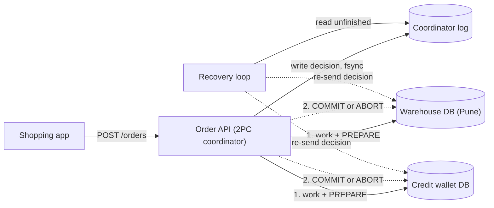
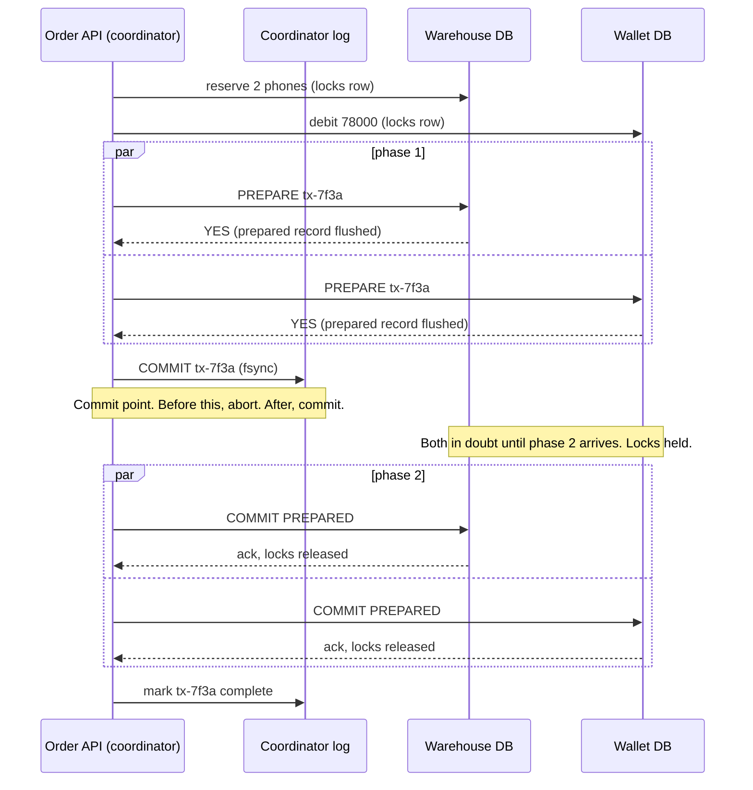
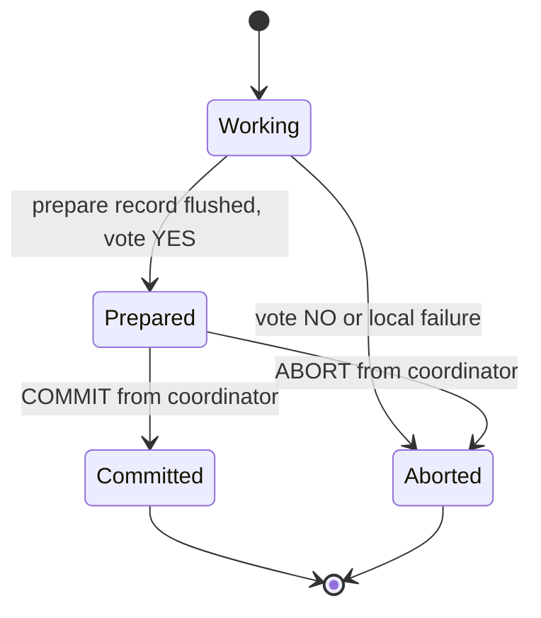

A single database gives you a gift you rarely notice: `COMMIT` either makes all your changes visible or none of them. The moment one business action touches two databases, that gift is gone. This lesson is about the classic protocol that tries to get it back, two-phase commit, what it really costs, and why most teams building services choose a different tool.

## Learning objectives

By the end of this lesson you will be able to:

1. Explain the atomic commitment problem: why two local `COMMIT`s in a row are not atomic.
2. Walk through two-phase commit (2PC): the coordinator, the prepare phase, the commit phase and the durable decision record.
3. Explain the blocking problem: why a participant that voted "yes" cannot decide on its own when the coordinator disappears.
4. Describe XA, PostgreSQL `PREPARE TRANSACTION`, and what `System.Transactions` does (and does not do) in .NET on Linux.
5. Estimate the latency, lock-hold and availability cost of 2PC with back-of-the-envelope numbers.
6. Argue, with trade-offs, why sagas with an outbox are usually preferred across service boundaries, and name the cases where 2PC is still the right answer.
7. Implement a simplified coordinator with presumed abort and a recovery loop in C#.

## Prerequisites

- [Transactions and ACID](#/lesson/m09-transactions-acid): you should know what atomicity and durability mean inside one database.
- [Why distributed systems are difficult](#/lesson/m13-why-hard): partial failure and "the network may lose the reply" are the root of everything here.
- [Sagas and compensating transactions](#/lesson/m12-sagas): we compare 2PC against sagas in detail. If you have not read it yet, read the beginner section there first.

## Explain it like I'm a beginner

Think of a wedding. The person running the ceremony (the officiant) asks each partner, "Do you take this person?" Nothing is final while the questions are being asked. Either partner can still say "no", and then nobody is married.

Once **both** have said "I do", the officiant announces "You are now married". That announcement is the moment it becomes real, and it is real for both people at the same time.

Two-phase commit is the same ceremony for databases:

- The officiant is the **coordinator** (the process running the transaction).
- Each partner is a **participant** (each database that holds part of the change).
- "Do you take…?" is the **prepare** message. A participant that answers "yes" promises that it *can* commit, no matter what happens next, even if it crashes and restarts.
- "You are now married" is the **commit** message.

Now the uncomfortable part. Suppose both partners have said "I do", and the officiant faints before making the announcement. Are they married? Neither partner can decide alone. If one walks off assuming "no", while the officiant later wakes up and writes "yes" in the register, the two records disagree. So both must stand at the altar and wait. In databases this waiting is called **blocking**, and it is the central weakness of 2PC: participants hold locks on rows while they wait, and other work queues up behind them.

A concrete example we will use all lesson. During a festival sale, an online electronics store takes an order from a customer in Pune: **2 phones at ₹39,000 = ₹78,000**, paid with the store's pay-later credit line. Two things must happen together:

1. The warehouse database reserves 2 phones.
2. The credit wallet database debits ₹78,000 from the customer's pay-later credit line.

If only the first happens, stock is stuck for an order nobody paid for. If only the second happens, the customer paid for phones that will never ship. We need "both or neither" across two databases.

## First-principles explanation

### The atomic commitment problem

Inside one PostgreSQL database, atomicity comes from the write-ahead log (WAL). The commit record is written and flushed once, and that single flush is the instant the whole transaction becomes durable. There is exactly one decision point.

With two databases there are two decision points. Try the obvious approach:

```csharp
await inventoryTx.CommitAsync();   // succeeds
await walletTx.CommitAsync();      // process crashes here, or the wallet DB is down
```

The first commit is permanent. The second never happens. You cannot "un-commit" the first one, because other transactions may already have read the new stock level. This is the **atomic commitment problem**: get several independent participants to agree on one outcome, commit or abort, such that:

1. **Agreement:** all participants that decide reach the same decision.
2. **Validity:** commit is only possible if every participant voted yes.
3. **Non-triviality:** if everyone votes yes and nothing fails, the outcome is commit.
4. **Termination (ideally):** every participant eventually decides.

2PC guarantees the first three. It guarantees termination only if the coordinator eventually recovers. That gap is the blocking problem.

### The protocol, step by step

**Phase 0 — do the work.** The coordinator runs the normal statements on each participant inside a local transaction: `UPDATE stock SET available = available - 2 ...` on the warehouse and `UPDATE credit SET balance = balance - 78000 ...` on the wallet. Row locks are taken as usual. Nothing is committed.

**Phase 1 — prepare (voting).** The coordinator sends `PREPARE` to every participant. Each participant:

1. Checks it can commit (constraints pass, no deadlock victim, disk has space).
2. Writes everything needed to commit later, *plus* a "prepared" record, to its log and flushes it to disk. After this, a crash and restart will bring the transaction back in the prepared state, locks included.
3. Replies **YES**. Or replies **NO** and rolls back locally.

A YES vote is a promise: "I give up my right to abort on my own. I will do whatever you decide."

**The decision.** If every vote is YES, the coordinator decides COMMIT. Any NO, or any participant that does not answer within a timeout, means ABORT. Then the coordinator writes the decision to *its own* durable log and flushes it. **This flush is the real commit point of the distributed transaction.** Before it, the answer is abort. After it, the answer is commit, forever.

**Phase 2 — commit (completion).** The coordinator sends COMMIT (or ABORT) to every participant. Each one applies it, releases its locks and acknowledges. When all acknowledgements arrive, the coordinator can mark the transaction finished and eventually forget it.

Phase 2 messages must be retried until they succeed. A participant that misses the COMMIT message stays prepared, holding locks, until it gets the message. That is why phase-2 handlers must be idempotent: "commit tx 42" sent twice must be harmless.

### Why "prepared" is the dangerous state

Look at each participant's states:

- **Working:** it may abort on its own for any reason (timeout, deadlock, restart).
- **Prepared:** it may *not* abort on its own. It does not know the decision. It holds its locks.
- **Committed / Aborted:** done, locks released.

If the coordinator crashes after the participants voted YES and before they hear the decision, they are **in doubt**. They cannot commit (maybe the coordinator decided abort because a third participant voted no). They cannot abort (maybe the coordinator logged commit and another participant already committed). They can only wait for the coordinator to come back, or for a human to look at the coordinator's log and resolve it.

While they wait, the stock row for that phone model in the Pune warehouse is locked. Every other order for that SKU in that warehouse blocks behind the lock. If the coordinator's machine is gone for 20 minutes, the warehouse is partially frozen for 20 minutes. This is the **blocking problem**.

:::callout type=warning title="Participants asking each other does not fully fix it"
A cooperative termination protocol lets an in-doubt participant ask the others: "Did you get a decision?" If any one of them knows, everyone learns it. If any one of them never voted, it can safely abort. But if *all* reachable participants are prepared and none knows the decision, they are still stuck. Only the coordinator's log knows.
:::

### Presumed abort

A small but important optimisation. If a participant asks the coordinator about a transaction and the coordinator has **no record** of it, the coordinator answers "abort". This is called **presumed abort**. It is safe because the coordinator writes a COMMIT record *before* telling anyone to commit; a missing record therefore means commit was never decided. It also means the coordinator does not need to force-flush ABORT records or wait for abort acknowledgements, which saves disk writes on the failure path.

### Why not three-phase commit?

Three-phase commit (3PC) adds a "pre-commit" round so that participants can always decide without the coordinator. It only works if you can trust timeouts to mean "that node has crashed". On real networks a slow node and a dead node look the same, so a network partition can make 3PC reach different decisions on each side. Practical systems that need non-blocking commit instead **replicate the coordinator** with a consensus protocol like Raft or Paxos: if the coordinator's leader dies, a follower that has the same decision log takes over in seconds. Gray and Lamport's paper *Consensus on Transaction Commit* formalises this ("Paxos Commit"). Several distributed SQL databases publicly describe using 2PC across shards with each shard and the transaction record replicated by consensus. See [Consensus fundamentals (Raft)](#/lesson/m13-consensus).

### XA: the standard interface

XA is an old X/Open standard (from 1991) that lets a **transaction manager** (TM) drive 2PC across several **resource managers** (RMs), such as databases and message brokers. Its verbs map directly onto the protocol: `xa_start`/`xa_end` around the work, `xa_prepare` for phase 1, `xa_commit` or `xa_rollback` for phase 2, and `xa_recover` to list in-doubt transactions after a crash.

Java EE application servers made XA common in enterprise systems. On Windows, the Microsoft Distributed Transaction Coordinator (MSDTC) plays the TM role.

### What PostgreSQL gives you

PostgreSQL exposes the participant side of 2PC directly in SQL:

```sql
BEGIN;
UPDATE stock SET available = available - 2 WHERE warehouse = 'PUN-1' AND sku = 'PH-128';
PREPARE TRANSACTION 'order-7f3a-inventory';   -- phase 1: durable, survives restart, keeps locks

-- later, from any session:
COMMIT PREPARED 'order-7f3a-inventory';        -- phase 2
-- or
ROLLBACK PREPARED 'order-7f3a-inventory';

-- after a crash, find in-doubt transactions:
SELECT gid, prepared, owner FROM pg_prepared_xacts;
```

Important facts from the PostgreSQL documentation:

- PostgreSQL implements only the participant side; it does not speak the XA protocol itself. Java's JDBC driver maps XA calls onto these commands (`PGXADataSource`); Npgsql offers no XA transaction manager.
- `max_prepared_transactions` defaults to **0**, which disables `PREPARE TRANSACTION`. You must set it (and restart) on purpose.
- PostgreSQL does **not** include a coordinator. Something outside must remember the decision and call `COMMIT PREPARED`.
- A prepared transaction keeps its locks and also holds back the "oldest running transaction" horizon, so `VACUUM` cannot clean up dead rows behind it. A forgotten prepared transaction slowly bloats tables. The docs recommend not leaving them open for long.

### What .NET gives you

`System.Transactions.TransactionScope` lets ADO.NET connections enlist in an ambient transaction. With a single connection it stays a cheap local transaction. If a second durable resource enlists, the transaction **escalates** to a distributed one coordinated by MSDTC. Since .NET 7 this escalation works again on **Windows only**. On Linux containers, which is where most ASP.NET Core services run, escalation throws `PlatformNotSupportedException`. In practice: do not design a cross-database workflow for a Linux-hosted .NET service on top of `TransactionScope` escalation.

```csharp
// Works on Windows with MSDTC; throws on Linux once the second connection enlists.
using var scope = new TransactionScope(TransactionScopeAsyncFlowOption.Enabled);
await using (var inv = new NpgsqlConnection(inventoryCs)) { await inv.OpenAsync(); /* ... */ }
await using (var wal = new NpgsqlConnection(walletCs))    { await wal.OpenAsync(); /* escalates here */ }
scope.Complete();
```

### What 2PC costs: back-of-the-envelope

Assume, as estimates: network round trip between services in one region about **1 ms**, a durable log flush (fsync) on cloud SSD about **2 ms**, and two participants.

| Step | Local transaction | 2PC with 2 participants |
|---|---|---|
| Work statements | same | same |
| Prepare round trip | – | 1 ms |
| Participant prepare flush | – | 2 ms (in parallel) |
| Coordinator decision flush | – | 2 ms |
| Commit round trip | – | 1 ms |
| Participant commit flush | 2 ms | 2 ms (in parallel) |
| **Commit overhead** | **≈ 2 ms** | **≈ 8 ms** |

So the commit path is roughly **4× longer** in this estimate. The more painful number is **lock hold time**. Locks are taken in phase 0 and released only after phase 2. If a hot row (one popular SKU in one warehouse) is locked for 10 ms per order, that row can serve at most about 1,000 ms ÷ 10 ms = **100 orders per second**, no matter how many servers you add. Under a festival-season spike that ceiling is real.

**Availability multiplies.** Every participant must be up for any transaction to commit. With three participants at 99.9 % each, the chance all three are up is 0.999³ ≈ **99.7 %**. That is about 26 hours of "cannot commit" per year instead of about 9. Add the coordinator, and it gets worse.

**Blast radius.** One slow participant slows every transaction it is part of, and its locks slow everyone else who touches the same rows. 2PC couples the latency and availability of everything it touches.

### Why sagas are preferred across services

In a service-oriented system, each service owns its data ([see microservices](#/lesson/m02-microservices)). 2PC across services runs into several walls at once:

1. **Not everything can prepare.** A payment gateway's HTTP API, an SMS provider, Kafka (outside its own transactions), Redis and most SaaS APIs do not speak XA. You cannot ask Razorpay or Stripe to "prepare" a charge and hold it in a promised state on your behalf.
2. **Coupled availability.** The order service cannot commit if the loyalty-points service is deploying. Teams lose the ability to deploy and fail independently, which was the point of separate services.
3. **Locks across team boundaries.** Your transaction holds rows in another team's database while waiting on your coordinator. Their latency now depends on your code.
4. **Operational burden.** Someone must run a highly available coordinator, monitor in-doubt transactions, and know how to resolve them by hand at 3 a.m.
5. **Platform support.** As above, .NET on Linux does not escalate `TransactionScope`. Many managed cloud databases restrict or discourage prepared transactions.

A **saga** replaces one big atomic transaction with a sequence of local transactions, each committed immediately, plus a **compensating** action for each step that can undo it semantically ("release the 2 phones", "refund ₹78,000"). Each step publishes an event or command reliably using the [transactional outbox](#/lesson/m12-outbox). Each consumer is [idempotent](#/lesson/m12-idempotent-consumers). Nothing holds locks across services, and a service that is down simply processes its messages later.

The price you pay with sagas:

| You gain with a saga | You pay |
|---|---|
| No cross-service locks, no blocking coordinator | No isolation: other requests can see intermediate states ("reserved but unpaid") |
| Each service commits on its own, deploys on its own | You must design and test compensations for every step |
| Works with HTTP APIs, brokers and third parties | Eventual consistency: the order is "pending" for a while |
| Failures become business states you can show users | More states to model, monitor and explain |

To handle the missing isolation, sagas use countermeasures: a **semantic lock** (the order row says `PENDING_PAYMENT`, and other flows respect it), **commutative updates** (increment and decrement counters rather than overwrite), and a **pivot step** (the point after which the saga only moves forward, such as "payment captured").

### When 2PC is still the right answer

- **Inside one database product that does it for you.** Sharded databases such as Citus (a PostgreSQL extension) use 2PC internally for multi-shard writes, with recovery built in. You get atomicity without running a coordinator yourself.
- **Within one team's infrastructure**, for short transactions, at modest volume, between resources that all support it, and when the business truly cannot tolerate an intermediate state.
- **Kafka transactions** use a coordinator and a two-phase protocol internally to make "consume, process, produce" atomic across partitions, inside one Kafka cluster.
- **Legacy enterprise integrations** where XA between a database and a message broker already works and is understood.

### When a simpler design is enough

Before reaching for either 2PC or a saga, ask whether the two tables really need to be in two databases. If the warehouse stock and the credit wallet live in the **same PostgreSQL database** (perhaps in different schemas of a [modular monolith](#/lesson/m02-modular-monolith)), one local transaction solves the problem completely, with none of the costs above. Splitting data is a decision with a price; distributed transactions are one of the bills.

## Visual explanation

### Architecture: who talks to whom



How to read it. The customer's shopping app sends one order request to the Order API, which acts as the coordinator. The solid arrows to the two databases are phase 1: run the work and ask each one to prepare. The arrow to the coordinator log is the single most important write in the diagram: the decision is flushed there **before** any phase-2 message goes out. The dotted arrows are phase 2: the decision is delivered to each database, and retried until acknowledged. The recovery loop is a background worker that reads decisions that were never fully delivered (for example because the API process crashed half-way) and sends them again. If the coordinator log is lost, in-doubt participants can never be resolved automatically, which is why it must be durable and ideally replicated.

### The happy path and the blocking window



Read it top to bottom. The two `reserve` and `debit` messages are the ordinary work; they take row locks. The `par` blocks show that prepares (and later commits) go to both participants in parallel, so the latency is one round trip per phase, not one per participant. Each YES is sent only after the participant has flushed a prepared record, so the promise survives a crash. The note between the phases marks the **blocking window**: if the coordinator dies right after writing the log, both databases sit prepared, holding locks, until the coordinator (or the recovery loop on another machine reading the same log) delivers the commit. The final "mark complete" lets the coordinator garbage-collect the record later.

### A participant's life



The only way out of **Prepared** is a message from the coordinator. There is no "timeout" arrow from Prepared to Aborted. That missing arrow *is* the blocking problem, drawn as a picture. Compare it with Working, which may abort for any local reason.

## Step-by-step example

Let us trace the phone order through four scenarios, using the numbers from the beginner section.

### Scenario 1 — everything works

1. Order API generates `txId = 7f3a…`.
2. Warehouse: `UPDATE stock SET available = available - 2 WHERE sku = 'PH-128' AND warehouse = 'PUN-1' AND available >= 2` affects 1 row. Wallet: `UPDATE credit SET balance = balance - 78000 WHERE customer = 'U-881' AND balance >= 78000` affects 1 row.
3. `PREPARE TRANSACTION 'tx-7f3a-wh'` and `PREPARE TRANSACTION 'tx-7f3a-wal'` both succeed. Two YES votes.
4. Coordinator log: insert `(7f3a, COMMIT, [warehouse, wallet])` and flush.
5. `COMMIT PREPARED` on both. Both acknowledge. Mark complete.

Total: about 8 ms of commit overhead (estimate), and the stock row was locked from step 2 to step 5.

### Scenario 2 — the wallet says no

The customer's remaining pay-later limit is only ₹60,000. The wallet's `UPDATE` affects 0 rows, so the wallet participant votes NO. The coordinator decides ABORT. With presumed abort, it may skip force-flushing the abort record. It sends ABORT to the warehouse, which runs `ROLLBACK PREPARED` (or a plain rollback if it was not prepared yet). Stock is untouched. The user sees "insufficient credit". This is the easy case: **2PC handles "no" votes cleanly.**

### Scenario 3 — the coordinator crashes after deciding

Both voted YES. The coordinator flushed COMMIT to its log and crashed before sending anything. Now:

- Both databases show the transaction in `pg_prepared_xacts`. Rows are locked.
- Another order for PH-128 in Pune blocks on the stock row. Its HTTP request times out after 5 s.
- The Order API restarts after 40 s (a pod reschedule). The recovery loop reads the log, finds `7f3a: COMMIT, not complete`, and sends `COMMIT PREPARED` to both. Locks release.

The data is correct, but the warehouse row was frozen for 40 seconds. If the coordinator's disk had been lost, an operator would have to decide by hand, using business evidence, whether to commit or roll back.

### Scenario 4 — the coordinator crashes before deciding

Both voted YES, but the coordinator crashed *before* flushing a decision. On restart, the log has no record of 7f3a. With presumed abort, the recovery logic (or an operator script) lists prepared transactions on each participant whose ids start with the coordinator's prefix and have no log record, and rolls them back. The user's request failed with a timeout; the app can retry with the same [idempotency key](#/lesson/m10-idempotency) and get a fresh, clean attempt.

### What the same order looks like as a saga

1. **Order service** (local tx): insert order `PENDING`, insert `ReserveStock` command into outbox. Commit.
2. **Warehouse service** (local tx): reserve 2 phones with status `HELD`, outbox `StockReserved`. Commit.
3. **Wallet service** (local tx): debit ₹78,000, outbox `CreditDebited`. Commit. *(Pivot: from here we only go forward.)*
4. **Order service**: mark order `CONFIRMED`; warehouse marks the hold `ALLOCATED`.

If step 3 fails with "insufficient credit", the wallet publishes `CreditDebitFailed`; the warehouse runs the compensation **release 2 phones**; the order becomes `REJECTED`. No row was ever locked for longer than one local transaction (a few milliseconds). The cost: for a second or two, a stock report shows 2 phones "held" for an order that will be rejected. Most businesses are comfortable with that; they already deal with it in the physical world.

## Production-style C# implementation

Production systems should not hand-roll a 2PC coordinator. But building a small, honest model is the best way to understand what a real one must do: parallel prepare with timeouts, a durable decision **before** phase 2, idempotent and retried phase 2, presumed abort, and a recovery loop. The participants here are in-memory fakes behind an interface; a real participant would wrap `PREPARE TRANSACTION` and `COMMIT PREPARED` on a PostgreSQL connection.

```text
Shop.Api/
  Program.cs
  TwoPhase/Contracts.cs
  TwoPhase/InMemoryCoordinatorLog.cs
  TwoPhase/TwoPhaseCommitCoordinator.cs
  TwoPhase/CoordinatorRecoveryService.cs
  Participants/InMemoryStockParticipant.cs
  Participants/InMemoryWalletParticipant.cs
```

```csharp file=TwoPhase/Contracts.cs
namespace Shop.TwoPhase;

public enum Vote { Yes, No }

public enum Decision { Commit, Abort }

/// <summary>One resource that can take part in two-phase commit.
/// Commit and Abort must be idempotent: the coordinator retries them.</summary>
public interface ITwoPhaseParticipant
{
    string Name { get; }
    Task<Vote> PrepareAsync(Guid txId, CancellationToken ct);
    Task CommitAsync(Guid txId, CancellationToken ct);
    Task AbortAsync(Guid txId, CancellationToken ct);
}

public sealed record CoordinatorRecord(
    Guid TxId,
    Decision Decision,
    IReadOnlyList<string> Participants,
    DateTimeOffset DecidedAt,
    bool Completed);

/// <summary>The coordinator's durable decision log. In production this is a replicated table
/// or a consensus-backed store; losing it means in-doubt transactions need a human.</summary>
public interface ICoordinatorLog
{
    Task WriteDecisionAsync(Guid txId, Decision decision, IReadOnlyList<string> participants, CancellationToken ct);
    Task MarkCompletedAsync(Guid txId, CancellationToken ct);
    Task<CoordinatorRecord?> FindAsync(Guid txId, CancellationToken ct);
    Task<IReadOnlyList<CoordinatorRecord>> FindUnfinishedAsync(CancellationToken ct);
}

public sealed class TwoPhaseCommitOptions
{
    public TimeSpan PrepareTimeout { get; set; } = TimeSpan.FromSeconds(2);
    public int PhaseTwoAttempts { get; set; } = 5;
    public TimeSpan PhaseTwoBaseDelay { get; set; } = TimeSpan.FromMilliseconds(100);
    public TimeSpan RecoveryInterval { get; set; } = TimeSpan.FromSeconds(10);
}
```

```csharp file=TwoPhase/InMemoryCoordinatorLog.cs
using System.Collections.Concurrent;

namespace Shop.TwoPhase;

/// <summary>Stand-in for a durable table such as
/// coordinator_log(tx_id uuid primary key, decision text, participants text[], decided_at timestamptz, completed bool).</summary>
public sealed class InMemoryCoordinatorLog(TimeProvider clock) : ICoordinatorLog
{
    private readonly ConcurrentDictionary<Guid, CoordinatorRecord> _records = new();

    public Task WriteDecisionAsync(Guid txId, Decision decision, IReadOnlyList<string> participants, CancellationToken ct)
    {
        var record = new CoordinatorRecord(txId, decision, participants.ToArray(), clock.GetUtcNow(), Completed: false);
        // A decision, once written, must never change.
        var stored = _records.GetOrAdd(txId, record);
        if (stored.Decision != decision)
            throw new InvalidOperationException($"Transaction {txId} already decided {stored.Decision}.");
        return Task.CompletedTask;
    }

    public Task MarkCompletedAsync(Guid txId, CancellationToken ct)
    {
        if (_records.TryGetValue(txId, out var r)) _records[txId] = r with { Completed = true };
        return Task.CompletedTask;
    }

    public Task<CoordinatorRecord?> FindAsync(Guid txId, CancellationToken ct) =>
        Task.FromResult(_records.TryGetValue(txId, out var r) ? r : null);

    public Task<IReadOnlyList<CoordinatorRecord>> FindUnfinishedAsync(CancellationToken ct) =>
        Task.FromResult<IReadOnlyList<CoordinatorRecord>>(_records.Values.Where(r => !r.Completed).ToList());
}
```

```csharp file=TwoPhase/TwoPhaseCommitCoordinator.cs
using Microsoft.Extensions.Logging;
using Microsoft.Extensions.Options;

namespace Shop.TwoPhase;

public sealed class TwoPhaseCommitCoordinator(
    IEnumerable<ITwoPhaseParticipant> registered,
    ICoordinatorLog log,
    IOptions<TwoPhaseCommitOptions> options,
    TimeProvider clock,
    ILogger<TwoPhaseCommitCoordinator> logger)
{
    private readonly Dictionary<string, ITwoPhaseParticipant> _byName =
        registered.ToDictionary(p => p.Name, StringComparer.Ordinal);
    private readonly TwoPhaseCommitOptions _o = options.Value;

    /// <summary>Runs phase 1 and phase 2 for work that has already been staged on each participant.</summary>
    public async Task<Decision> ExecuteAsync(Guid txId, IReadOnlyList<string> participantNames, CancellationToken ct)
    {
        if (participantNames.Count == 0) throw new ArgumentException("At least one participant is required.", nameof(participantNames));
        var participants = participantNames.Select(n => _byName[n]).ToList();

        // Phase 1: ask everyone in parallel. A timeout or exception counts as NO.
        var votes = await Task.WhenAll(participants.Select(p => PrepareOneAsync(p, txId, ct)));
        var decision = votes.All(v => v == Vote.Yes) ? Decision.Commit : Decision.Abort;

        // The commit point. Under presumed abort only COMMIT strictly needs a forced write,
        // but logging both keeps recovery and auditing simple.
        await log.WriteDecisionAsync(txId, decision, participantNames, CancellationToken.None);
        logger.LogInformation("2PC {TxId} decided {Decision}", txId, decision);

        // Phase 2 must not be abandoned because the HTTP caller went away, so it ignores ct.
        await DeliverAsync(txId, decision, participants, CancellationToken.None);
        return decision;
    }

    /// <summary>Called by an in-doubt participant. No record means the coordinator never decided commit.</summary>
    public async Task<Decision> ResolveAsync(Guid txId, CancellationToken ct) =>
        (await log.FindAsync(txId, ct))?.Decision ?? Decision.Abort;

    /// <summary>Used by the recovery loop for decisions that were not fully delivered.</summary>
    public Task RedeliverAsync(CoordinatorRecord record, CancellationToken ct) =>
        DeliverAsync(record.TxId, record.Decision, record.Participants.Select(n => _byName[n]).ToList(), ct);

    private async Task<Vote> PrepareOneAsync(ITwoPhaseParticipant p, Guid txId, CancellationToken ct)
    {
        using var timeout = CancellationTokenSource.CreateLinkedTokenSource(ct);
        timeout.CancelAfter(_o.PrepareTimeout);
        try
        {
            return await p.PrepareAsync(txId, timeout.Token);
        }
        catch (Exception ex) when (!ct.IsCancellationRequested)
        {
            logger.LogWarning(ex, "Prepare failed on {Participant} for {TxId}; voting NO", p.Name, txId);
            return Vote.No;
        }
    }

    private async Task DeliverAsync(Guid txId, Decision decision, IReadOnlyList<ITwoPhaseParticipant> participants, CancellationToken ct)
    {
        var results = await Task.WhenAll(participants.Select(p => DeliverOneAsync(p, txId, decision, ct)));
        if (results.All(ok => ok)) await log.MarkCompletedAsync(txId, ct);
        else logger.LogWarning("2PC {TxId}: {Decision} not yet delivered to all participants; recovery will retry", txId, decision);
    }

    private async Task<bool> DeliverOneAsync(ITwoPhaseParticipant p, Guid txId, Decision decision, CancellationToken ct)
    {
        for (var attempt = 1; attempt <= _o.PhaseTwoAttempts; attempt++)
        {
            try
            {
                if (decision == Decision.Commit) await p.CommitAsync(txId, ct);
                else await p.AbortAsync(txId, ct);
                return true;
            }
            catch (Exception ex) when (!ct.IsCancellationRequested)
            {
                logger.LogWarning(ex, "Phase 2 {Decision} to {Participant} failed (attempt {Attempt})", decision, p.Name, attempt);
                var delay = TimeSpan.FromMilliseconds(_o.PhaseTwoBaseDelay.TotalMilliseconds * Math.Pow(2, attempt - 1));
                await Task.Delay(delay, clock, ct);
            }
        }
        return false;
    }
}
```

```csharp file=TwoPhase/CoordinatorRecoveryService.cs
using Microsoft.Extensions.Hosting;
using Microsoft.Extensions.Logging;
using Microsoft.Extensions.Options;

namespace Shop.TwoPhase;

/// <summary>Re-drives decisions that were logged but not acknowledged by every participant,
/// for example after the coordinator process crashed between the log write and phase 2.</summary>
public sealed class CoordinatorRecoveryService(
    ICoordinatorLog log,
    TwoPhaseCommitCoordinator coordinator,
    IOptions<TwoPhaseCommitOptions> options,
    TimeProvider clock,
    ILogger<CoordinatorRecoveryService> logger) : BackgroundService
{
    protected override async Task ExecuteAsync(CancellationToken stoppingToken)
    {
        using var timer = new PeriodicTimer(options.Value.RecoveryInterval, clock);
        do
        {
            try
            {
                foreach (var record in await log.FindUnfinishedAsync(stoppingToken))
                {
                    logger.LogInformation("Recovering 2PC {TxId} ({Decision})", record.TxId, record.Decision);
                    await coordinator.RedeliverAsync(record, stoppingToken);
                }
            }
            catch (Exception ex) when (!stoppingToken.IsCancellationRequested)
            {
                logger.LogError(ex, "2PC recovery pass failed");
            }
        }
        while (await timer.WaitForNextTickAsync(stoppingToken));
    }
}
```

```csharp file=Participants/InMemoryStockParticipant.cs
using Shop.TwoPhase;

namespace Shop.Participants;

/// <summary>Models a warehouse database. Stage = phase-0 work (takes the "lock" by moving stock aside),
/// Prepare = durable promise, Commit/Abort = idempotent completion.</summary>
public sealed class InMemoryStockParticipant : ITwoPhaseParticipant
{
    private readonly object _gate = new();
    private readonly Dictionary<string, int> _available = new(StringComparer.Ordinal) { ["PUN-1:PH-128"] = 1_000 };
    private readonly Dictionary<Guid, (string Key, int Quantity, bool Prepared)> _pending = new();
    private readonly HashSet<Guid> _finished = new();

    public string Name => "warehouse";

    public int Available(string key) { lock (_gate) return _available.GetValueOrDefault(key); }

    public bool Stage(Guid txId, string warehouse, string sku, int quantity)
    {
        var key = $"{warehouse}:{sku}";
        lock (_gate)
        {
            if (_available.GetValueOrDefault(key) < quantity) return false;
            _available[key] -= quantity;               // held aside, like a row lock plus a pending update
            _pending[txId] = (key, quantity, false);
            return true;
        }
    }

    public Task<Vote> PrepareAsync(Guid txId, CancellationToken ct)
    {
        lock (_gate)
        {
            if (!_pending.TryGetValue(txId, out var p)) return Task.FromResult(Vote.No);
            _pending[txId] = p with { Prepared = true };   // real DB: PREPARE TRANSACTION 'tx-...'
            return Task.FromResult(Vote.Yes);
        }
    }

    public Task CommitAsync(Guid txId, CancellationToken ct)
    {
        lock (_gate)
        {
            if (_finished.Contains(txId)) return Task.CompletedTask;   // idempotent
            _pending.Remove(txId);                                     // the held stock is now sold
            _finished.Add(txId);
        }
        return Task.CompletedTask;
    }

    public Task AbortAsync(Guid txId, CancellationToken ct)
    {
        lock (_gate)
        {
            if (_finished.Contains(txId)) return Task.CompletedTask;
            if (_pending.Remove(txId, out var p)) _available[p.Key] += p.Quantity;   // give the stock back
            _finished.Add(txId);
        }
        return Task.CompletedTask;
    }
}
```

```csharp file=Participants/InMemoryWalletParticipant.cs
using Shop.TwoPhase;

namespace Shop.Participants;

public sealed class InMemoryWalletParticipant : ITwoPhaseParticipant
{
    private readonly object _gate = new();
    private readonly Dictionary<string, decimal> _balance = new(StringComparer.Ordinal) { ["U-881"] = 100_000m };
    private readonly Dictionary<Guid, (string Customer, decimal Amount)> _pending = new();
    private readonly HashSet<Guid> _finished = new();

    public string Name => "wallet";

    public decimal Balance(string customer) { lock (_gate) return _balance.GetValueOrDefault(customer); }

    public bool Stage(Guid txId, string customer, decimal amount)
    {
        lock (_gate)
        {
            if (_balance.GetValueOrDefault(customer) < amount) return false;
            _balance[customer] -= amount;
            _pending[txId] = (customer, amount);
            return true;
        }
    }

    public Task<Vote> PrepareAsync(Guid txId, CancellationToken ct)
    {
        lock (_gate) return Task.FromResult(_pending.ContainsKey(txId) ? Vote.Yes : Vote.No);
    }

    public Task CommitAsync(Guid txId, CancellationToken ct)
    {
        lock (_gate) { if (_finished.Add(txId)) _pending.Remove(txId); }
        return Task.CompletedTask;
    }

    public Task AbortAsync(Guid txId, CancellationToken ct)
    {
        lock (_gate)
        {
            if (!_finished.Add(txId)) return Task.CompletedTask;
            if (_pending.Remove(txId, out var p)) _balance[p.Customer] += p.Amount;
        }
        return Task.CompletedTask;
    }
}
```

```csharp file=Program.cs
using Shop.Participants;
using Shop.TwoPhase;

var builder = WebApplication.CreateBuilder(args);

builder.Services.Configure<TwoPhaseCommitOptions>(builder.Configuration.GetSection("TwoPhaseCommit"));
builder.Services.AddSingleton(TimeProvider.System);
builder.Services.AddSingleton<ICoordinatorLog, InMemoryCoordinatorLog>();
builder.Services.AddSingleton<InMemoryStockParticipant>();
builder.Services.AddSingleton<InMemoryWalletParticipant>();
builder.Services.AddSingleton<ITwoPhaseParticipant>(sp => sp.GetRequiredService<InMemoryStockParticipant>());
builder.Services.AddSingleton<ITwoPhaseParticipant>(sp => sp.GetRequiredService<InMemoryWalletParticipant>());
builder.Services.AddSingleton<TwoPhaseCommitCoordinator>();
builder.Services.AddHostedService<CoordinatorRecoveryService>();

var app = builder.Build();

app.MapPost("/orders", async (PlaceOrder cmd, InMemoryStockParticipant stock, InMemoryWalletParticipant wallet,
                              TwoPhaseCommitCoordinator coordinator, CancellationToken ct) =>
{
    var txId = Guid.NewGuid();
    var amount = cmd.Quantity * cmd.UnitPrice;

    // Phase 0: do the work on each participant. A failed stage simply leads to a NO vote.
    stock.Stage(txId, cmd.Warehouse, cmd.Sku, cmd.Quantity);
    wallet.Stage(txId, cmd.CustomerId, amount);

    var decision = await coordinator.ExecuteAsync(txId, new[] { "warehouse", "wallet" }, ct);
    return decision == Decision.Commit
        ? Results.Ok(new { txId, status = "confirmed", amount })
        : Results.Problem("Order could not be placed (stock or credit unavailable).", statusCode: StatusCodes.Status409Conflict);
});

app.Run();

public sealed record PlaceOrder(string CustomerId, string Warehouse, string Sku, int Quantity, decimal UnitPrice);
```

**What a real participant would look like.** With Npgsql (not compiled here), each participant wraps one connection:

```csharp
// Phase 0 + 1 on the warehouse database
await using var conn = await dataSource.OpenConnectionAsync(ct);
await using (var cmd = new NpgsqlCommand("BEGIN; UPDATE stock SET available = available - @qty WHERE ...;", conn)) { /* ... */ }
await new NpgsqlCommand($"PREPARE TRANSACTION 'tx-{txId:N}-wh'", conn).ExecuteNonQueryAsync(ct);

// Phase 2, from any connection, even after a restart
await new NpgsqlCommand($"COMMIT PREPARED 'tx-{txId:N}-wh'", conn).ExecuteNonQueryAsync(ct);
```

Note that `COMMIT PREPARED` for a gid that no longer exists raises an error; an idempotent wrapper checks `pg_prepared_xacts` (or catches the "does not exist" error and confirms the work is visible) before treating that as success.

## Bad design vs good design

**Bad: "commit, then commit".**

```csharp
await inventoryDb.SaveChangesAsync(ct);   // stock reserved and committed
await walletDb.SaveChangesAsync(ct);      // may throw; stock is now stuck
```

There is a window, every single time, where one side is committed and the other is not. A crash, a deploy or a timeout in that window leaves the system inconsistent, with no record of what to fix. Wrapping it in `try/catch` and "undoing" the first write in the catch block is a half-saga with no durability: if the process dies inside the catch, the undo never happens.

**Also bad: 2PC across microservices you don't control.** An order service that tries to hold an XA transaction open across the warehouse team's database, the wallet team's database and a message broker. Every deploy of any of them risks in-doubt transactions; every slow query in one blocks the others; and on Linux .NET the escalation is not even available.

**Good, option A: don't distribute the data.** If one team owns stock and credit for this flow, keep them in one PostgreSQL database and use one local transaction. Cheapest, simplest, strongest.

**Good, option B: a saga with an outbox.** Each service commits locally, publishes reliably, consumes idempotently, and has a compensation. Pending states are visible and explained to the user ("Order received, confirming credit…").

**Good, option C: 2PC inside a platform that owns it.** A sharded database (for example Citus) that runs 2PC across its own shards with built-in recovery, or Kafka transactions inside one cluster. You get the atomicity without operating the coordinator.

:::callout type=tradeoff title="Isolation is the real thing you give up"
People often say sagas give up atomicity. They don't, eventually: every saga ends fully done or fully compensated. What they give up is **isolation**. For a few seconds, others can see "2 phones held" before the payment result is known. Decide, per flow, whether that visible intermediate state is acceptable. For phone stock in an online store, yes. For a bank's internal ledger postings, usually not, which is why ledgers keep both sides of a posting in one database.
:::

## Practical playground

The canvas below starts with a 2PC design across three services: Order, Warehouse and Wallet, with the Order service as coordinator. Try these changes:

1. Add a message queue and turn the synchronous prepare calls into asynchronous commands and events (a saga).
2. Add an outbox worker to each service and a monitoring node that alerts on "orders pending for more than 2 minutes".
3. Ask yourself which edges would block the whole flow if one service were down for 10 minutes, before and after your change.

:::playground type=hld title="From 2PC across services to a saga"
```json
{
  "nodes": [
    { "id": "app", "type": "client", "label": "Shopping app", "props": { "rps": 40 } },
    { "id": "gw", "type": "api-gateway", "label": "API gateway" },
    { "id": "order", "type": "app-server", "label": "Order service (2PC coordinator)", "props": { "instances": 3 } },
    { "id": "orderdb", "type": "database", "label": "Orders DB + coordinator log", "props": { "multiAz": true } },
    { "id": "wh", "type": "app-server", "label": "Warehouse service", "props": { "instances": 2 } },
    { "id": "whdb", "type": "database", "label": "Warehouse DB (prepared txns)" },
    { "id": "wal", "type": "app-server", "label": "Wallet service", "props": { "instances": 2 } },
    { "id": "waldb", "type": "database", "label": "Wallet DB (prepared txns)" }
  ],
  "edges": [
    { "from": "app", "to": "gw", "kind": "sync" },
    { "from": "gw", "to": "order", "kind": "sync" },
    { "from": "order", "to": "orderdb", "kind": "sync", "label": "decision log" },
    { "from": "order", "to": "wh", "kind": "sync", "label": "prepare / commit" },
    { "from": "order", "to": "wal", "kind": "sync", "label": "prepare / commit" },
    { "from": "wh", "to": "whdb", "kind": "sync" },
    { "from": "wal", "to": "waldb", "kind": "sync" }
  ]
}
```
:::

## Exercises

:::exercise id=m13-distributed-transactions-ex1 difficulty=beginner kind=code title="A participant that knows when it must wait"
Implement the participant state machine from the diagram. The key rule: once prepared, a participant may not abort on its own.
::requirements
- `ParticipantTx` starts in `Active`.
- `Prepare(bool canCommit)`: from `Active`, moves to `Prepared` and returns `Vote.Yes` if `canCommit`, otherwise moves to `Aborted` and returns `Vote.No`. Calling it again while `Prepared` returns `Vote.Yes` (idempotent). From `Committed` or `Aborted`, throw `InvalidOperationException`.
- `Commit()`: `Prepared → Committed`. Already `Committed` is a no-op. From `Active` or `Aborted`, throw `InvalidOperationException`.
- `Abort()`: `Active` or `Prepared → Aborted` (this is the coordinator's ABORT). Already `Aborted` is a no-op. From `Committed`, throw.
- `TryAbortLocally()`: the participant's own timeout. Returns `true` and moves to `Aborted` only from `Active`. Returns `false` and changes nothing when `Prepared`. Returns `true` if already `Aborted`, `false` if `Committed`.
::acceptance
- A prepared participant refuses to abort on its own.
- Commit and abort messages are idempotent when repeated.
- Illegal transitions throw `InvalidOperationException`.
::hint
Write the four states as an enum and draw a 4×4 table of "current state × operation" before coding.
::hint
`TryAbortLocally` is different from `Abort`: one is the participant's own decision, the other is an instruction from the coordinator.
::hint
A `switch` on `State` inside each method keeps every transition explicit.
::hint
```csharp
public bool TryAbortLocally() => State switch
{
    ParticipantState.Active => SetAndReturn(ParticipantState.Aborted, true),
    ParticipantState.Aborted => true,
    _ => false,
};
```
::starter
```csharp file=ParticipantTx.cs
using System;

public enum Vote { Yes, No }
public enum ParticipantState { Active, Prepared, Committed, Aborted }

public sealed class ParticipantTx
{
    public ParticipantState State { get; private set; } = ParticipantState.Active;

    public Vote Prepare(bool canCommit) => throw new NotImplementedException();
    public void Commit() => throw new NotImplementedException();
    public void Abort() => throw new NotImplementedException();
    public bool TryAbortLocally() => throw new NotImplementedException();
}
```
::tests
```csharp file=ParticipantTxTests.cs
using System;
using Xunit;

public class ParticipantTxTests
{
    [Fact]
    public void Prepare_yes_then_commit()
    {
        var p = new ParticipantTx();
        Assert.Equal(Vote.Yes, p.Prepare(true));
        Assert.Equal(ParticipantState.Prepared, p.State);
        p.Commit();
        p.Commit();
        Assert.Equal(ParticipantState.Committed, p.State);
    }

    [Fact]
    public void Prepare_no_aborts()
    {
        var p = new ParticipantTx();
        Assert.Equal(Vote.No, p.Prepare(false));
        Assert.Equal(ParticipantState.Aborted, p.State);
    }

    [Fact]
    public void Prepared_participant_cannot_abort_locally()
    {
        var p = new ParticipantTx();
        p.Prepare(true);
        Assert.False(p.TryAbortLocally());
        Assert.Equal(ParticipantState.Prepared, p.State);
    }

    [Fact]
    public void Active_participant_can_abort_locally()
    {
        var p = new ParticipantTx();
        Assert.True(p.TryAbortLocally());
        Assert.True(p.TryAbortLocally());
        Assert.Equal(ParticipantState.Aborted, p.State);
    }

    [Fact]
    public void Coordinator_abort_works_from_prepared_and_is_idempotent()
    {
        var p = new ParticipantTx();
        p.Prepare(true);
        p.Abort();
        p.Abort();
        Assert.Equal(ParticipantState.Aborted, p.State);
    }

    [Fact]
    public void Repeated_prepare_is_idempotent() 
    {
        var p = new ParticipantTx();
        p.Prepare(true);
        Assert.Equal(Vote.Yes, p.Prepare(true));
    }

    [Fact]
    public void Illegal_transitions_throw()
    {
        Assert.Throws<InvalidOperationException>(() => new ParticipantTx().Commit());
        var committed = new ParticipantTx(); committed.Prepare(true); committed.Commit();
        Assert.Throws<InvalidOperationException>(() => committed.Abort());
        Assert.Throws<InvalidOperationException>(() => committed.Prepare(true));
        Assert.False(committed.TryAbortLocally());
        var aborted = new ParticipantTx(); aborted.Abort();
        Assert.Throws<InvalidOperationException>(() => aborted.Commit());
    }
}
```
::solution
Each operation is a `switch` over the current state. The important line is in `TryAbortLocally`: `Prepared` returns `false`. That one line is the blocking problem.

```csharp file=ParticipantTx.cs
using System;

public enum Vote { Yes, No }
public enum ParticipantState { Active, Prepared, Committed, Aborted }

public sealed class ParticipantTx
{
    public ParticipantState State { get; private set; } = ParticipantState.Active;

    public Vote Prepare(bool canCommit)
    {
        switch (State)
        {
            case ParticipantState.Active:
                State = canCommit ? ParticipantState.Prepared : ParticipantState.Aborted;
                return canCommit ? Vote.Yes : Vote.No;
            case ParticipantState.Prepared:
                return Vote.Yes;
            default:
                throw new InvalidOperationException($"Cannot prepare in state {State}.");
        }
    }

    public void Commit()
    {
        switch (State)
        {
            case ParticipantState.Prepared: State = ParticipantState.Committed; break;
            case ParticipantState.Committed: break;
            default: throw new InvalidOperationException($"Cannot commit in state {State}.");
        }
    }

    public void Abort()
    {
        switch (State)
        {
            case ParticipantState.Active:
            case ParticipantState.Prepared: State = ParticipantState.Aborted; break;
            case ParticipantState.Aborted: break;
            default: throw new InvalidOperationException("A committed transaction cannot be aborted.");
        }
    }

    public bool TryAbortLocally()
    {
        switch (State)
        {
            case ParticipantState.Active: State = ParticipantState.Aborted; return true;
            case ParticipantState.Aborted: return true;
            default: return false;   // Prepared: must wait for the coordinator. Committed: too late.
        }
    }
}
```
::mistakes
- Letting `TryAbortLocally` succeed from `Prepared` "after a long timeout". That breaks agreement: the coordinator may have logged commit.
- Throwing on a repeated `Commit()`. Phase 2 is retried, so duplicates are normal.
- Allowing `Commit()` from `Active`: a participant must have promised (prepared) first.
::extensions
Add a `PreparedAt` timestamp using an injected `TimeProvider` and a method that reports "in doubt for longer than N seconds" so an operator dashboard can show stuck transactions.
:::

:::exercise id=m13-distributed-transactions-ex2 difficulty=beginner kind=written title="Put numbers on the cost of 2PC"
A team wants 2PC across three databases for every order: Orders, Inventory and Payments. Each database is available 99.95 % of the time. The network round trip is about 1 ms, a log flush about 2 ms (estimates). The hottest inventory row (one popular product) is touched by every order for that product, and orders hold its lock from the start of the work until phase 2 finishes, about 12 ms in total.

Answer:
1. What is the best-case availability of "can commit an order", ignoring the coordinator?
2. Roughly how many orders per second can the hottest product sustain?
3. If the coordinator crashes and takes 3 minutes to come back, what do customers of that product experience?
4. Suggest two design changes and the trade-off of each.
::acceptance
- Availability computed as a product: 0.9995³ ≈ 99.85 %, about 13 hours a year unavailable versus about 4.4 hours for one database.
- Hot-row ceiling computed from lock time: 1000 ms ÷ 12 ms ≈ 83 orders per second, regardless of servers.
- Explains that in-doubt participants hold the lock for the full 3 minutes, so requests for that product block and time out.
- Two concrete alternatives with trade-offs (for example a saga with a held-stock state; splitting stock into buckets; keeping Orders and Inventory in one database).
::hint
Availability of components in series multiplies.
::hint
One row, one lock, one transaction at a time: throughput is 1 ÷ lock time.
::hint
What happens to a prepared participant when the coordinator is not there to send phase 2?
::hint
For alternatives, think about what removes the cross-database lock: fewer databases, no locks across services, or less contention on one row.
::solution
1. 0.9995 × 0.9995 × 0.9995 ≈ 0.9985 → **99.85 %**. That is about 0.0015 × 8,760 h ≈ **13 hours** per year when orders cannot commit, versus about 4.4 hours for a single 99.95 % database. The coordinator's own availability makes it worse.
2. 1,000 ms ÷ 12 ms ≈ **83 orders per second** for that product. More app servers do not help; the row lock serialises them.
3. Participants that voted YES are in doubt for 3 minutes, holding the hot row lock. Every other order for that product blocks on the lock, then times out (typically after the HTTP or statement timeout, say 5–30 s). For 3 minutes the product is effectively unorderable, and timed-out clients may retry, piling up more blocked requests.
4. Options:
   - **Saga with a held-stock state.** Inventory reserves in a local transaction (milliseconds), payment happens separately, compensation releases the hold. Trade-off: intermediate "held" state visible; compensation logic to build and test.
   - **Keep Orders and Inventory in one database.** Turns two of the three participants into one local transaction. Trade-off: less independent scaling and ownership of those two areas.
   - **Split hot stock into buckets** (for example 10 rows of 100 units each, pick one at random). Raises the hot-row ceiling about 10×. Trade-off: more complex "is anything left?" queries and rebalancing.
::mistakes
- Adding availabilities instead of multiplying them.
- Assuming more servers raise the hot-row throughput.
- Saying the participants will "time out and roll back": prepared participants may not.
:::

:::exercise id=m13-distributed-transactions-ex3 difficulty=intermediate kind=code title="A coordinator with presumed abort"
Implement a synchronous 2PC coordinator. It must log the decision before phase 2, stop asking for votes after the first NO, treat exceptions as NO, and answer in-doubt questions using presumed abort.
::requirements
- `Coordinator(DecisionLog log)`.
- `Decision Execute(string txId, IReadOnlyList<IParticipant> participants)`:
  - Throw `ArgumentException` if the list is empty.
  - Call `Prepare` on participants in order. A thrown exception counts as `Vote.No`. After the first NO, do not call `Prepare` on the rest.
  - If every vote is YES: record `Commit` in the log, then call `Commit` on every participant.
  - Otherwise: record `Abort`, then call `Abort` on every participant that was asked to prepare (including the one that voted NO).
- `Decision Resolve(string txId)`: return the logged decision, or `Decision.Abort` if there is none.
- `DecisionLog.Record` must refuse to change an existing decision (throw `InvalidOperationException`).
::acceptance
- All YES → `Commit`, every participant committed, and the log already said `Commit` when the first participant's `Commit` ran.
- A NO from the second of three → `Abort`; the third participant was never asked; the first two were aborted; nobody committed.
- A participant whose `Prepare` throws is treated as NO.
- `Resolve` on an unknown transaction returns `Abort`.
::hint
The ordering "log first, then phase 2" is the whole point. Your test fake can check the log when its `Commit` is called.
::hint
Keep a list of participants you have asked so far; that is exactly the list to abort.
::hint
Wrap each `Prepare` in `try/catch` and convert an exception into `Vote.No`.
::hint
```csharp
var asked = new List<IParticipant>();
foreach (var p in participants)
{
    asked.Add(p);
    Vote v;
    try { v = p.Prepare(txId); } catch { v = Vote.No; }
    if (v == Vote.No) { _log.Record(txId, Decision.Abort); foreach (var a in asked) a.Abort(txId); return Decision.Abort; }
}
```
::starter
```csharp file=Coordinator.cs
using System;
using System.Collections.Generic;

public enum Vote { Yes, No }
public enum Decision { Commit, Abort }

public interface IParticipant
{
    string Name { get; }
    Vote Prepare(string txId);
    void Commit(string txId);
    void Abort(string txId);
}

public sealed class DecisionLog
{
    public void Record(string txId, Decision decision) => throw new NotImplementedException();
    public Decision? Find(string txId) => throw new NotImplementedException();
}

public sealed class Coordinator
{
    public Coordinator(DecisionLog log) { }
    public Decision Execute(string txId, IReadOnlyList<IParticipant> participants) => throw new NotImplementedException();
    public Decision Resolve(string txId) => throw new NotImplementedException();
}
```
::tests
```csharp file=CoordinatorTests.cs
using System;
using System.Collections.Generic;
using Xunit;

public class CoordinatorTests
{
    private sealed class FakeParticipant(string name, Func<Vote> vote, DecisionLog log) : IParticipant
    {
        public string Name => name;
        public bool Asked, Committed, Aborted;
        public Decision? LogAtCommit;
        public Vote Prepare(string txId) { Asked = true; return vote(); }
        public void Commit(string txId) { LogAtCommit = log.Find(txId); Committed = true; }
        public void Abort(string txId) => Aborted = true;
    }

    [Fact]
    public void All_yes_commits_after_logging()
    {
        var log = new DecisionLog();
        var a = new FakeParticipant("a", () => Vote.Yes, log);
        var b = new FakeParticipant("b", () => Vote.Yes, log);
        var result = new Coordinator(log).Execute("t1", new IParticipant[] { a, b });
        Assert.Equal(Decision.Commit, result);
        Assert.True(a.Committed && b.Committed);
        Assert.Equal(Decision.Commit, a.LogAtCommit);
        Assert.Equal(Decision.Commit, log.Find("t1"));
    }

    [Fact]
    public void No_vote_aborts_asked_participants_and_skips_the_rest()
    {
        var log = new DecisionLog();
        var a = new FakeParticipant("a", () => Vote.Yes, log);
        var b = new FakeParticipant("b", () => Vote.No, log);
        var c = new FakeParticipant("c", () => Vote.Yes, log);
        var result = new Coordinator(log).Execute("t2", new IParticipant[] { a, b, c });
        Assert.Equal(Decision.Abort, result);
        Assert.True(a.Aborted && b.Aborted);
        Assert.False(c.Asked);
        Assert.False(a.Committed || b.Committed || c.Committed);
        Assert.Equal(Decision.Abort, log.Find("t2"));
    }

    [Fact]
    public void Exception_counts_as_no()
    {
        var log = new DecisionLog();
        var a = new FakeParticipant("a", () => throw new TimeoutException(), log);
        Assert.Equal(Decision.Abort, new Coordinator(log).Execute("t3", new IParticipant[] { a }));
        Assert.True(a.Aborted);
    }

    [Fact]
    public void Resolve_uses_presumed_abort()
    {
        var log = new DecisionLog();
        var coord = new Coordinator(log);
        Assert.Equal(Decision.Abort, coord.Resolve("never-seen"));
        coord.Execute("t4", new IParticipant[] { new FakeParticipant("a", () => Vote.Yes, log) });
        Assert.Equal(Decision.Commit, coord.Resolve("t4"));
    }

    [Fact]
    public void Decision_cannot_change()
    {
        var log = new DecisionLog();
        log.Record("t5", Decision.Commit);
        log.Record("t5", Decision.Commit);
        Assert.Throws<InvalidOperationException>(() => log.Record("t5", Decision.Abort));
    }

    [Fact]
    public void Empty_participants_rejected() =>
        Assert.Throws<ArgumentException>(() => new Coordinator(new DecisionLog()).Execute("t6", new List<IParticipant>()));
}
```
::solution
The coordinator walks the participants in order, remembers who it asked, and decides on the first NO. Logging happens before any phase-2 call, so a fake that inspects the log during `Commit` sees `Commit`.

```csharp file=Coordinator.cs
using System;
using System.Collections.Generic;

public enum Vote { Yes, No }
public enum Decision { Commit, Abort }

public interface IParticipant
{
    string Name { get; }
    Vote Prepare(string txId);
    void Commit(string txId);
    void Abort(string txId);
}

public sealed class DecisionLog
{
    private readonly Dictionary<string, Decision> _decisions = new(StringComparer.Ordinal);
    private readonly object _gate = new();

    public void Record(string txId, Decision decision)
    {
        lock (_gate)
        {
            if (_decisions.TryGetValue(txId, out var existing))
            {
                if (existing != decision) throw new InvalidOperationException($"{txId} already decided {existing}.");
                return;
            }
            _decisions[txId] = decision;
        }
    }

    public Decision? Find(string txId)
    {
        lock (_gate) return _decisions.TryGetValue(txId, out var d) ? d : null;
    }
}

public sealed class Coordinator
{
    private readonly DecisionLog _log;
    public Coordinator(DecisionLog log) => _log = log;

    public Decision Execute(string txId, IReadOnlyList<IParticipant> participants)
    {
        if (participants.Count == 0) throw new ArgumentException("No participants.", nameof(participants));

        var asked = new List<IParticipant>();
        foreach (var p in participants)
        {
            asked.Add(p);
            Vote vote;
            try { vote = p.Prepare(txId); }
            catch (Exception) { vote = Vote.No; }

            if (vote == Vote.No)
            {
                _log.Record(txId, Decision.Abort);
                foreach (var a in asked) a.Abort(txId);
                return Decision.Abort;
            }
        }

        _log.Record(txId, Decision.Commit);   // commit point: must happen before phase 2
        foreach (var p in participants) p.Commit(txId);
        return Decision.Commit;
    }

    public Decision Resolve(string txId) => _log.Find(txId) ?? Decision.Abort;
}
```

A production coordinator prepares in parallel (one round trip instead of N), retries phase 2 until acknowledged, and runs a recovery loop, as in the lesson's implementation.
::alternatives
Preparing in parallel is faster but you can no longer "skip the rest" after a NO; you abort everyone instead. Both are correct.
::mistakes
- Calling `Commit` on participants before writing the log. A crash in between leaves some committed and no record saying so.
- Aborting only the participant that voted NO, leaving earlier ones prepared and holding locks.
- Returning `Commit` from `Resolve` for unknown transactions.
::extensions
Make `Commit` on one participant throw once, and add retry logic so the coordinator keeps trying until it succeeds, without ever changing the decision.
:::

:::exercise id=m13-distributed-transactions-ex4 difficulty=intermediate kind=sql ordered=true title="Find in-doubt participants"
The coordinator stores votes and decisions in PostgreSQL. At **10:00:00 IST on 19 October 2026** an operator wants every participant that voted `yes` more than **30 seconds** ago for a transaction that still has **no decision**. These are in-doubt and holding locks.

Return columns `tx_id, participant`, ordered by `tx_id`, then `participant`.
::acceptance
- Only `yes` votes are included.
- Transactions with any decision (commit or abort) are excluded.
- Votes newer than 09:59:30 IST are excluded.
- Correct ordering.
::hint
You need the votes that have no matching row in the decisions table.
::hint
`NOT EXISTS (SELECT 1 FROM tx_decisions d WHERE d.tx_id = v.tx_id)` is the cleanest way to say "no decision".
::hint
Write the cut-off as a literal: `timestamptz '2026-10-19 10:00:00+05:30' - interval '30 seconds'`.
::hint
```sql
SELECT v.tx_id, v.participant FROM tx_votes v
WHERE v.vote = 'yes' AND v.voted_at < ... AND NOT EXISTS (...)
ORDER BY ...;
```
::setup
```sql
CREATE TABLE tx_votes (
  tx_id text NOT NULL,
  participant text NOT NULL,
  vote text NOT NULL CHECK (vote IN ('yes', 'no')),
  voted_at timestamptz NOT NULL,
  PRIMARY KEY (tx_id, participant)
);
CREATE TABLE tx_decisions (
  tx_id text PRIMARY KEY,
  decision text NOT NULL CHECK (decision IN ('commit', 'abort')),
  decided_at timestamptz NOT NULL
);
INSERT INTO tx_votes VALUES
  ('tx-101', 'warehouse', 'yes', '2026-10-19 09:58:00+05:30'),
  ('tx-101', 'wallet',    'yes', '2026-10-19 09:58:00+05:30'),
  ('tx-102', 'warehouse', 'yes', '2026-10-19 09:57:10+05:30'),
  ('tx-102', 'wallet',    'yes', '2026-10-19 09:57:11+05:30'),
  ('tx-103', 'warehouse', 'yes', '2026-10-19 09:56:00+05:30'),
  ('tx-103', 'wallet',    'no',  '2026-10-19 09:56:01+05:30'),
  ('tx-104', 'warehouse', 'yes', '2026-10-19 09:59:50+05:30'),
  ('tx-105', 'wallet',    'yes', '2026-10-19 09:40:00+05:30'),
  ('tx-105', 'warehouse', 'yes', '2026-10-19 09:40:00+05:30');
INSERT INTO tx_decisions VALUES
  ('tx-102', 'commit', '2026-10-19 09:57:12+05:30'),
  ('tx-103', 'abort',  '2026-10-19 09:56:02+05:30');
```
::check
```sql
SELECT v.tx_id, v.participant
FROM tx_votes v
WHERE v.vote = 'yes'
  AND v.voted_at < timestamptz '2026-10-19 10:00:00+05:30' - interval '30 seconds'
  AND NOT EXISTS (SELECT 1 FROM tx_decisions d WHERE d.tx_id = v.tx_id)
ORDER BY v.tx_id, v.participant;
```
::solution
```sql
SELECT v.tx_id, v.participant
FROM tx_votes v
WHERE v.vote = 'yes'
  AND v.voted_at < timestamptz '2026-10-19 10:00:00+05:30' - interval '30 seconds'
  AND NOT EXISTS (SELECT 1 FROM tx_decisions d WHERE d.tx_id = v.tx_id)
ORDER BY v.tx_id, v.participant;
```

Expected rows: `tx-101 / wallet`, `tx-101 / warehouse`, `tx-105 / wallet`, `tx-105 / warehouse`. `tx-102` and `tx-103` have decisions; `tx-104` voted only 10 seconds ago.

`tx-105` has been in doubt for 20 minutes. Under presumed abort, if the coordinator is healthy and has no record, the safe action is `ROLLBACK PREPARED` on both. If the coordinator's log might be incomplete (it was restored from backup, say), a human must check business evidence first.
::mistakes
- Using a `LEFT JOIN ... WHERE d.decision <> 'commit'`, which keeps aborted transactions and drops undecided ones (NULL comparisons are never true).
- Using `now()`, which makes the answer change every time the query runs.
:::

:::exercise id=m13-distributed-transactions-ex5 difficulty=advanced kind=hld title="Replace cross-service 2PC with a saga"
A furniture and home-decor marketplace places about 300 orders per minute at peak (5 per second) across Orders, Inventory and Payments services, each with its own PostgreSQL database. Today the Orders service drives 2PC over all three. Incidents: when Payments deploys, orders fail; once a coordinator crash froze a best-selling SKU for 11 minutes. Redesign it as a saga.
::acceptance
- Each step is a local transaction with a named compensation (or marked as the pivot).
- Messages are published with a transactional outbox, and every consumer is idempotent.
- Explains how intermediate states (for example stock "held") are shown to users and protected from other flows.
- Describes timeouts: what happens if Payments does not answer for 15 minutes.
- Names when 2PC (or one database) would still be the better choice.
::hint
List the steps in order and, next to each, write the action that undoes it.
::hint
Which step, once done, should never be undone automatically? That is the pivot.
::hint
A held reservation needs an expiry, or crashed sagas leak stock.
::hint
Use orchestration (an Order saga state machine) if you want one place to see the status of every order; choreography if the flow is short and stable.
::starter
```json
{
  "nodes": [
    { "id": "app", "type": "client", "label": "Buyer app", "props": { "rps": 5 } },
    { "id": "order", "type": "app-server", "label": "Order service (2PC coordinator)", "props": { "instances": 3 } },
    { "id": "odb", "type": "database", "label": "Orders DB" },
    { "id": "inv", "type": "app-server", "label": "Inventory service" },
    { "id": "idb", "type": "database", "label": "Inventory DB" },
    { "id": "pay", "type": "app-server", "label": "Payments service" },
    { "id": "pdb", "type": "database", "label": "Payments DB" }
  ],
  "edges": [
    { "from": "app", "to": "order", "kind": "sync" },
    { "from": "order", "to": "odb", "kind": "sync" },
    { "from": "order", "to": "inv", "kind": "sync", "label": "XA prepare/commit" },
    { "from": "order", "to": "pay", "kind": "sync", "label": "XA prepare/commit" },
    { "from": "inv", "to": "idb", "kind": "sync" },
    { "from": "pay", "to": "pdb", "kind": "sync" }
  ]
}
```
::solution
```json
{
  "nodes": [
    { "id": "app", "type": "client", "label": "Buyer app", "props": { "rps": 5 } },
    { "id": "gw", "type": "api-gateway", "label": "API gateway (Idempotency-Key)" },
    { "id": "order", "type": "app-server", "label": "Order service + saga orchestrator", "props": { "instances": 3 } },
    { "id": "odb", "type": "database", "label": "Orders DB (orders, saga_state, outbox, inbox)", "props": { "multiAz": true } },
    { "id": "bus", "type": "queue", "label": "Message broker (commands + events)" },
    { "id": "inv", "type": "worker", "label": "Inventory service (consumer)", "props": { "instances": 2 } },
    { "id": "idb", "type": "database", "label": "Inventory DB (holds with expiry, outbox, inbox)" },
    { "id": "pay", "type": "worker", "label": "Payments service (consumer)", "props": { "instances": 2 } },
    { "id": "pdb", "type": "database", "label": "Payments DB (outbox, inbox)" },
    { "id": "psp", "type": "external", "label": "Payment gateway (idempotency key)" },
    { "id": "sched", "type": "scheduler", "label": "Saga timeouts + hold expiry" },
    { "id": "mon", "type": "monitoring", "label": "Stuck-saga and compensation alerts" }
  ],
  "edges": [
    { "from": "app", "to": "gw", "kind": "sync" },
    { "from": "gw", "to": "order", "kind": "sync", "label": "202 Accepted, order PENDING" },
    { "from": "order", "to": "odb", "kind": "sync", "label": "order + outbox in one tx" },
    { "from": "order", "to": "bus", "kind": "async", "label": "ReserveStock, ChargePayment" },
    { "from": "bus", "to": "inv", "kind": "async" },
    { "from": "inv", "to": "idb", "kind": "sync" },
    { "from": "inv", "to": "bus", "kind": "async", "label": "StockHeld / StockUnavailable" },
    { "from": "bus", "to": "pay", "kind": "async" },
    { "from": "pay", "to": "pdb", "kind": "sync" },
    { "from": "pay", "to": "psp", "kind": "sync", "label": "charge with key" },
    { "from": "pay", "to": "bus", "kind": "async", "label": "PaymentCaptured / PaymentFailed" },
    { "from": "bus", "to": "order", "kind": "async", "label": "events update saga_state" },
    { "from": "sched", "to": "order", "kind": "async", "label": "timeouts" },
    { "from": "order", "to": "mon", "kind": "async" }
  ]
}
```

**Steps and compensations (orchestrated saga):**

| # | Service | Local transaction | Compensation |
|---|---|---|---|
| 1 | Orders | insert order `PENDING`, saga state `STARTED`, outbox `ReserveStock` | mark order `CANCELLED` |
| 2 | Inventory | insert hold (qty, expires in 15 min), decrement available, outbox `StockHeld` | release hold |
| 3 | Payments | charge via gateway with idempotency key = order id, outbox `PaymentCaptured` | refund (rarely needed; see pivot) |
| 4 | Orders + Inventory | order `CONFIRMED`; hold → `ALLOCATED` | none (forward-only) |

**Pivot:** step 3, payment captured. After it, the saga only moves forward (allocate stock, ship). If allocation somehow fails after payment, the business process is "refund and apologise", raised as an alert rather than an automatic silent undo.

**Isolation countermeasures.** Held stock is a semantic lock: available stock excludes holds, so no other order can take those units. The buyer sees "Order received, confirming payment". Holds expire after 15 minutes, so a crashed saga cannot leak stock forever.

**Timeouts.** The scheduler wakes the orchestrator. If Payments has not answered within 15 minutes, the orchestrator first *queries* the payment status (the charge may have succeeded and the reply been lost), then either continues or compensates (release hold, cancel order). Never compensate a payment without checking its true status.

**Why this fixes the incidents.** A Payments deploy now only delays step 3; messages wait in the broker. No row in Inventory is locked longer than one local transaction (milliseconds), so a crash cannot freeze a SKU.

**When 2PC or one database is better.** If Orders and Inventory are owned by the same team and must never show a held state, put them in one database and use one local transaction; keep only Payments as an asynchronous step. 2PC itself fits only inside a platform that manages it (for example a sharded database's internal multi-shard commit).
::mistakes
- Compensating a payment on timeout without checking whether it actually succeeded.
- Holds without expiry, so failed sagas slowly drain available stock.
- Publishing events directly after commit instead of through an outbox, reintroducing the dual-write problem.
:::

## Automated testing

Distributed-commit code fails in the gaps between steps, so tests must create those gaps deliberately.

**1. Unit-test the coordinator with scripted fakes.** A fake participant takes a script: "vote yes", "vote no", "throw", "hang until cancelled", "fail commit twice then succeed". Assert on the decision, on which participants received which phase-2 message, and on the **ordering** between the log write and phase 2.

```csharp
public sealed class ScriptedParticipant(string name, Func<CancellationToken, Task<Vote>> prepare) : ITwoPhaseParticipant
{
    public int CommitCalls, AbortCalls;
    public int FailCommits;   // fail this many times before succeeding
    public string Name => name;
    public Task<Vote> PrepareAsync(Guid txId, CancellationToken ct) => prepare(ct);
    public Task CommitAsync(Guid txId, CancellationToken ct)
    {
        CommitCalls++;
        if (FailCommits-- > 0) throw new IOException("network");
        return Task.CompletedTask;
    }
    public Task AbortAsync(Guid txId, CancellationToken ct) { AbortCalls++; return Task.CompletedTask; }
}
```

Test cases worth having:

- A participant that hangs past `PrepareTimeout` produces `Abort` (use a short timeout in tests, or a fake `TimeProvider`).
- A participant that fails commit twice is still committed on attempt 3, and the record is marked complete.
- A participant that fails commit more times than allowed leaves the record unfinished, and one call of the recovery logic completes it.
- `WriteDecisionAsync` throwing means **no** phase-2 message is sent and `ResolveAsync` returns `Abort`.

**2. Crash tests.** Wrap the coordinator log in a decorator that throws after the write succeeds, simulating "crash after commit point". Then build a new coordinator on the same log and run recovery. Assert all participants end committed.

**3. Integration tests against real PostgreSQL** (in CI with a container): set `max_prepared_transactions` to a small number, run `PREPARE TRANSACTION`, kill the connection, reconnect, check `pg_prepared_xacts`, and run `COMMIT PREPARED`. This proves your participant wrapper's recovery query and idempotency.

**4. Invariant checks.** After a randomized run of 1,000 orders with injected failures, check the business invariant: total stock + held + sold = initial stock, and total credit + debited = initial credit. Invariant tests catch bugs that example tests miss.

## Real-world application

- **Sharded relational databases.** Citus documents using 2PC for transactions that modify multiple shards, with automatic recovery of prepared transactions on worker nodes. Distributed SQL systems in the Spanner family publicly describe 2PC across shards with each participant replicated by consensus, so a coordinator failure does not block.
- **Kafka exactly-once.** Kafka's transactional producer uses a transaction coordinator and a two-phase protocol (with transaction markers written to partitions) so that a consume-transform-produce step is atomic inside one cluster.
- **Enterprise integration.** Java EE and .NET Framework applications on Windows used XA or MSDTC between a relational database and a message queue (for example IBM MQ or MSMQ). Many of these still run in banks and government systems.
- **Microservice platforms.** Payments, ride-hailing, food-delivery and e-commerce systems publicly describe sagas, outboxes and idempotency keys rather than cross-service 2PC. A system like an online travel booking site, which must book a flight, a hotel and a cab from three different suppliers' APIs, has no choice: none of the suppliers will "prepare" for it.
- **Hospital billing and insurance.** A hospital system that settles a cashless insurance claim (the insurer's system) and closes the patient's bill (the hospital's own database) typically uses a saga with explicit states ("claim submitted", "bill on hold", "claim approved") rather than 2PC, because the insurer exposes only an HTTP API and approvals can take hours.

## Interview questions

:::interview
::q beginner
What problem does two-phase commit solve?
::a
It makes a transaction that changes data in several independent databases (participants) atomic: either all of them commit or all of them abort. A coordinator first asks every participant to *prepare* (make the change durable but not visible, and promise to commit if asked). If all vote yes, the coordinator durably logs "commit" and tells everyone to commit; if any votes no or does not answer, it tells everyone to abort.
::q beginner
What is the "blocking problem" in 2PC?
::a
Once a participant has voted yes, it has given up the right to abort on its own. If the coordinator crashes after collecting the votes but before the participant learns the decision, the participant is *in doubt*: it cannot commit (the decision might be abort) or abort (the decision might be commit, and others may have committed). It must wait, holding its locks, until the coordinator recovers or an operator resolves it. Other transactions that need those rows wait too.
::q intermediate
Why is writing the decision to the coordinator's log the real commit point?
::a
Before that write, no participant has been told to commit, so if the coordinator crashes, the safe answer is abort (presumed abort: no record means abort). After the write is durable, the decision is commit forever: on recovery the coordinator re-reads its log and re-sends commit until every participant acknowledges. If the coordinator sent commit messages before logging, a crash could leave some participants committed and no record of it, and recovery might wrongly abort the rest.
::q intermediate
Your .NET service runs in Linux containers and uses two PostgreSQL databases. A colleague proposes `TransactionScope` to make writes to both atomic. What do you say?
::a
On Linux, `System.Transactions` cannot escalate to a distributed transaction; when the second connection enlists, it throws `PlatformNotSupportedException` (distributed transactions via MSDTC are supported only on Windows, since .NET 7). Even on Windows, I'd question it: it couples both databases' availability and lock times. I'd first ask whether the two tables can live in one database (one local transaction). If not, I'd use a saga with an outbox and idempotent consumers, or, if only one side is "ours", write locally plus an outbox message to the other side.
::q advanced
Why are sagas usually preferred over 2PC across microservices, and what do you lose?
::a
2PC requires every participant to support prepare (most HTTP APIs, SaaS products and brokers don't), couples availability (every participant must be up to commit), holds locks across team boundaries for network round trips, and needs an operated, highly available coordinator with in-doubt resolution procedures. Sagas commit each step locally and immediately, use compensations to undo, and tolerate a participant being down by waiting in a queue. What you lose is *isolation*: intermediate states are visible (stock held, payment pending), so you add countermeasures such as semantic locks (status fields that other flows respect), commutative updates, reservation expiry, and a clear pivot step after which the saga only moves forward. You also take on designing and testing compensations.
::q advanced
How do modern distributed databases avoid the 2PC blocking problem?
::a
They keep 2PC but make the coordinator (and each participant) a replicated state machine. The transaction record and each shard's prepared state are replicated with Raft or Paxos across several machines. If the machine acting as coordinator dies, another replica of the same group already has the decision (or the lack of one) and continues phase 2 within seconds. The protocol still blocks in theory if a majority of a group is lost, but losing a single machine no longer stalls in-doubt transactions. Gray and Lamport's "Paxos Commit" describes this formally. Three-phase commit is not used because it assumes timeouts reliably detect crashes, which fails under network partitions.
:::

## Summary and revision

**Key takeaways**

- Two local commits in a row are not atomic. Two-phase commit adds a coordinator, a prepare vote and a durable decision.
- Prepared participants have promised to obey the coordinator. If the coordinator disappears, they block while holding locks. That is the defining weakness of 2PC.
- The coordinator's durable decision write is the commit point. Presumed abort means "no record = abort".
- XA is the standard API; PostgreSQL exposes `PREPARE TRANSACTION` / `COMMIT PREPARED` (disabled by default with `max_prepared_transactions = 0`); .NET's `TransactionScope` escalation works only on Windows.
- Costs: extra round trips and fsyncs, longer lock holds (hot-row ceilings), multiplied availability, and an operated coordinator.
- Across services, sagas with an outbox and idempotent consumers are usually better. They trade away isolation, which you handle with semantic locks, expiries and a pivot step.
- The simplest fix is often to keep data that must change together in one database.

**Terminology:** coordinator, participant, prepare, vote, commit point, in doubt, blocking, presumed abort, XA, transaction manager, resource manager, prepared transaction, saga, compensation, pivot, semantic lock.

:::flashcards
Q: What does a participant promise when it votes YES in 2PC?
A: That it can and will commit if told to, even after a crash and restart; it gives up the right to abort on its own.
Q: What is the commit point of a 2PC transaction?
A: The moment the coordinator durably writes the COMMIT decision to its log.
Q: What is presumed abort?
A: If the coordinator has no record of a transaction, the answer is abort; so abort records need not be force-written.
Q: Why does 2PC block?
A: Prepared participants cannot decide alone; if the coordinator is unavailable they wait, holding locks.
Q: What is PostgreSQL's default for max_prepared_transactions, and why does it matter?
A: 0, which disables PREPARE TRANSACTION. Forgotten prepared transactions also hold locks and block VACUUM cleanup.
Q: Does TransactionScope escalate to a distributed transaction on Linux in .NET?
A: No. Distributed transactions (MSDTC) are supported on Windows only (since .NET 7); on Linux escalation throws.
Q: What do sagas give up compared to 2PC?
A: Isolation: intermediate states are visible to other transactions until the saga completes or compensates.
Q: Name three saga countermeasures for missing isolation.
A: Semantic locks (status fields), commutative updates, and a pivot step (plus reservation expiry).
:::

## Knowledge check

:::quiz pass=70
::q single
An Order API commits a stock reservation in the Inventory database, then calls the Wallet database to debit credit. The Wallet call times out. What is the most accurate description of the state?
- [ ] Both changes were rolled back automatically.
- [x] The stock change is committed; the debit may or may not have happened, and nothing records what to fix.
- [ ] The debit definitely did not happen, so retrying is safe.
- [ ] PostgreSQL will reconcile the two databases on the next VACUUM.
> Two sequential local commits are not atomic. A timeout means "unknown outcome", not "failed". This is exactly the gap 2PC or a saga must close.
::q single
In 2PC, the coordinator receives YES from both participants and crashes before writing anything to its log. On restart, what should happen to the prepared participants?
- [ ] Commit, because everyone voted yes.
- [x] Abort, because no commit decision was recorded (presumed abort).
- [ ] Leave them prepared forever.
- [ ] Ask the user which they prefer.
> No durable commit record means commit was never decided, and no participant was told to commit. Aborting is safe and releases locks.
::q single
Which participant state cannot be left by the participant's own timeout?
- [ ] Working
- [x] Prepared
- [ ] Committed
- [ ] Aborted
> Prepared participants have promised to follow the coordinator's decision. Leaving on their own could contradict a commit that the coordinator already logged.
::q multi
Which are real costs of 2PC across three services? (Select all that apply.)
- [x] Overall commit availability is roughly the product of each participant's availability.
- [x] Row locks are held across network round trips, lowering throughput on hot rows.
- [ ] It removes the need for idempotent phase-2 handlers.
- [x] Someone must operate a durable coordinator and resolve in-doubt transactions.
> Phase-2 messages are retried, so handlers *must* be idempotent. The other three are the main reasons teams avoid 2PC across services.
::q single
A team's ASP.NET Core service runs on Linux and uses `TransactionScope` around two `NpgsqlConnection`s to different servers. What happens?
- [ ] It works through MSDTC automatically.
- [x] Escalation to a distributed transaction is not supported on Linux and throws.
- [ ] PostgreSQL coordinates the two servers itself.
- [ ] Both connections silently use separate local transactions with no error.
> Distributed transactions in `System.Transactions` require MSDTC, which is Windows-only. PostgreSQL provides participant commands but no built-in cross-server coordinator.
::q single
A phone order saga reserves stock, then charges credit. Credit fails. What is the correct next step?
- [ ] Roll back the stock reservation's database transaction.
- [x] Run the compensation: release the held stock in a new local transaction.
- [ ] Leave the stock held; it will be used by the next order.
- [ ] Retry the credit charge forever.
> The stock reservation already committed locally. Sagas undo it semantically with a compensating transaction, not a rollback.
::q single
When is two-phase commit the most reasonable choice?
- [ ] Between your order service and a third-party payment gateway's REST API.
- [ ] Across five microservices owned by five teams.
- [x] Inside a sharded database that runs 2PC across its own shards with built-in recovery.
- [ ] Between a database and an SMS provider.
> 2PC works best when one platform owns all participants and the coordinator, and handles recovery for you. Third-party APIs cannot prepare.
::q single
Your stock and wallet tables are owned by one team, change together on every order, and are currently in two databases "for future scale". The simplest correct fix?
- [ ] Introduce XA with MSDTC.
- [ ] Build a saga with five events.
- [x] Move them into one database and use a single local transaction.
- [ ] Add a cache in front of both.
> Splitting data creates the distributed-transaction problem. If the split is not buying anything today, undo it.
:::

## Completion criteria

You have finished this lesson when you can:

- [ ] Score at least 70 % on the knowledge check.
- [ ] Complete exercises 1 and 3 with all tests passing.
- [ ] Complete exercise 4 in the SQL playground and exercise 2 with numbers you can explain.
- [ ] Sketch the saga in exercise 5 with a compensation for every step and a clearly marked pivot.
- [ ] Explain the blocking problem in under a minute, using the "prepared" state as your example.
