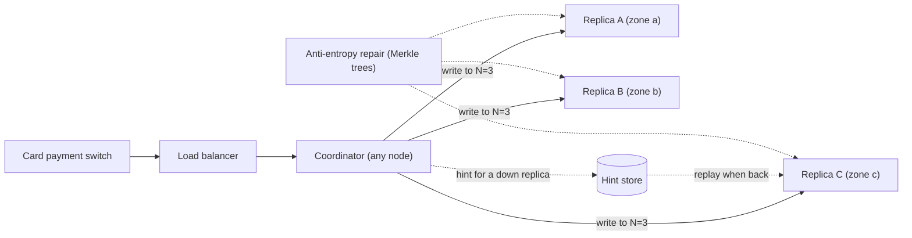
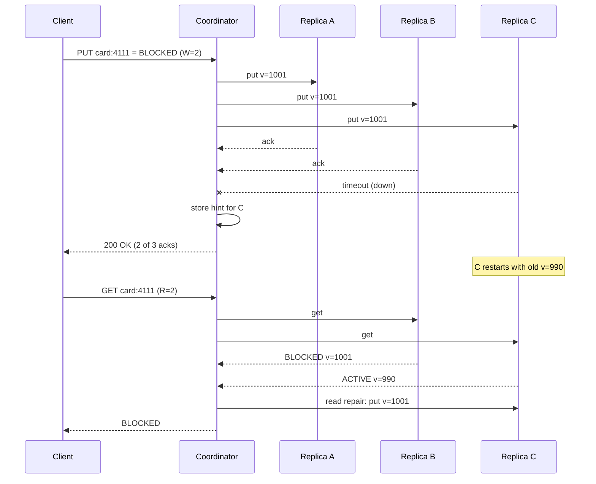
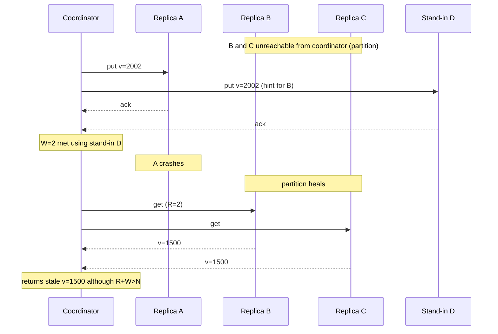

When you keep three copies of your data, you must decide how many of them have to agree before you call a write "done" and a read "correct". Ask all three and one slow server makes every request slow. Ask one and you may read old data. A quorum is the middle path: ask *enough* copies that the readers and the writers are guaranteed to meet. This lesson shows the arithmetic, the C# code for a small quorum coordinator, and the failure cases where a system that "uses quorums" still returns stale or lost data.

## Learning objectives

By the end of this lesson you will be able to:

1. Explain N, R and W, and prove why `R + W > N` makes every read quorum overlap every write quorum.
2. Choose R and W for a workload, and calculate how many replica failures reads and writes can each survive.
3. Calculate the chance of a stale read when `R + W ≤ N`.
4. Explain sloppy quorums and hinted handoff, and why a sloppy quorum breaks the overlap guarantee.
5. Implement read repair and hinted handoff in C# behind interfaces, with a background service that replays hints.
6. Identify three failure cases where `R + W > N` is not enough: failed partial writes, last-writer-wins with clock skew, and concurrent writes.
7. Decide when a quorum store is the wrong tool and a single primary database or a consensus system is better.

## Prerequisites

- [Replication and leader-follower](#/lesson/m13-replication): you should know what a replica is and why replicas lag.
- [CAP and PACELC](#/lesson/m13-cap-pacelc): quorums are a dial between consistency, availability and latency.
- [Consistency models](#/lesson/m13-consistency-models): we use the words *linearizable* and *eventual* precisely.
- Helpful: [Clock skew and logical clocks](#/lesson/m13-time-ordering), because one failure case depends on wall clocks.

## Explain it like I'm a beginner

Imagine a housing society in Pune with **five** notice boards, one at each gate. The secretary has to post a notice "Water supply off on Saturday". Walking to all five gates takes too long, so the rule is: **post it on at least three boards** before calling it done.

A resident who wants to know the latest news does not walk to all five boards either. The rule for readers is: **read at least three boards** and trust the newest notice you find (each notice is dated).

Why does this work? Three boards for posting plus three for reading is six, but there are only five boards. So whichever three the secretary chose and whichever three the reader chose, **at least one board is in both groups**. The reader is guaranteed to see the new notice on that board.

Now change the rules to "post on two, read on two". Two plus two is four, which is less than five. The secretary might post at gates 1 and 2 while the reader checks gates 4 and 5. The reader sees only the old notice and goes home thinking water will be fine on Saturday.

That is the whole idea:

- The number of copies is **N** (replication factor).
- The number that must accept a write is **W** (write quorum).
- The number you must hear from on a read is **R** (read quorum).
- If **R + W > N**, every reader meets at least one writer (quorum intersection).

Two more ideas complete the picture. If a board is being repainted, the secretary can leave the notice with the guard to pin up later (hinted handoff). And when a reader notices one board has an old notice, they can replace it on the way out (read repair).

## First-principles explanation

### Replication without a leader

In [leader-follower replication](#/lesson/m13-replication) one node, the leader, orders every write and followers copy it. That gives a clear "latest value" but the leader is a bottleneck and its failure needs failover.

Systems in the Dynamo family (Amazon's 2007 Dynamo paper, Apache Cassandra, ScyllaDB, Riak) take a different route: **leaderless replication**. Any replica can accept a write. A client, or a coordinator node acting for the client, sends each write to all N replicas responsible for the key and waits for W of them to acknowledge. It sends each read to the replicas and waits for R replies, then returns the newest version among them.

The N replicas for a key are chosen by hashing the key onto a ring (see [sharding and consistent hashing](#/lesson/m13-sharding)); the ordered list of replicas responsible for a key is called its **preference list**.

### Why R + W > N guarantees overlap

Pick any set of W replicas (the write set) and any set of R replicas (the read set) out of N. If the two sets had nothing in common, together they would contain `R + W` distinct replicas. But only N exist. So if `R + W > N`, they *must* share at least one replica. That shared replica holds the acknowledged write, and the reader picks the newest version, so the reader sees it.

This is the pigeonhole principle, and it was formalised for replicated data by David Gifford's *weighted voting* paper in 1979. Two corollaries matter in practice:

- **`W > N / 2`** means two write quorums always overlap. Two concurrent writers cannot both "win" on disjoint sets of replicas without at least one replica seeing both. This alone does not order them, but it is the basis of majority-based protocols such as [Raft](#/lesson/m13-consensus).
- **`R + W > N` is about acknowledged writes only.** It says nothing about writes that failed, writes still in flight, or which of two concurrent writes is "newer".

### The dial: common settings for N = 3

| Setting | Overlap? | Write survives | Read survives | Typical use |
|---|---|---|---|---|
| W=3, R=1 | Yes (4 > 3) | 0 failures | 2 failures | Read-heavy, rare writes, writes may stall |
| W=2, R=2 | Yes (4 > 3) | 1 failure | 1 failure | Balanced default ("QUORUM" in Cassandra) |
| W=1, R=3 | Yes (4 > 3) | 2 failures | 0 failures | Write-heavy logging, reads rare |
| W=1, R=1 | No (2 ≤ 3) | 2 failures | 2 failures | Fastest, eventual consistency only |

The "survives" columns come from simple subtraction: a write needs W live replicas, so it survives `N − W` failures; a read survives `N − R`.

With **N = 5**, `W = 3, R = 3` survives two failures for both reads and writes. That is why five replicas spread across zones is a common choice when the data really matters.

### Latency: you wait for the slowest of the quorum, not the slowest of all

A coordinator sends requests to all N replicas but replies after the fastest R (or W) answer. If the three replicas usually reply in 2 ms, 3 ms and 40 ms (one is in a busy zone), then:

- R = 1 waits about 2 ms (the fastest).
- R = 2 waits about 3 ms (the second fastest).
- R = 3 waits about 40 ms (the slowest).

So quorums also hide tail latency. Raising R from 2 to 3 does not just reduce availability; it makes every read wait for the worst replica. These numbers are illustrative; measure your own percentiles.

### How stale is "eventual" when R + W ≤ N?

If you choose `R + W ≤ N` for speed, it helps to know how often a read misses the latest write. In the worst moment, right after the write is acknowledged, only W replicas have the new value. A read that picks R replicas at random misses all of them with probability:

```text
P(stale) = C(N − W, R) / C(N, R)

N=3, W=1, R=1:  C(2,1) / C(3,1) = 2/3  ≈ 67 %
N=3, W=2, R=1:  C(1,1) / C(3,1) = 1/3  ≈ 33 %
N=5, W=2, R=2:  C(3,2) / C(5,2) = 3/10 = 30 %
N=3, W=2, R=2:  C(1,2) = 0             →  0 %
```

Real systems are usually better than this worst case because the other replicas catch up within milliseconds, but during a network problem the window can be minutes. Treat the formula as an upper bound for the instant after a write.

### Versions: how the reader knows which copy is newest

Each stored value carries a **version**. The reader compares the versions in its R replies and returns the highest. There are two common ways to create versions:

1. **Timestamps (last-writer-wins, LWW).** The coordinator stamps each write with its wall clock. Simple, cheap, and used by Cassandra. Danger: clocks drift (see failure case 2 below).
2. **Version vectors (vector clocks).** Each replica keeps a counter; a version is a set of counters. They can tell "A happened before B" from "A and B happened at the same time" (concurrent), and return *both* versions to the application to merge. Dynamo's shopping cart did this. More correct, more work. See [logical clocks](#/lesson/m13-time-ordering).

### Read repair: fixing stale copies as you read

When a coordinator's R replies disagree, it knows which replicas are stale. **Read repair** writes the newest version back to them. Two flavours:

- **Blocking read repair:** repair the stale replicas among the R before answering. Slower, but a subsequent read at the same consistency level cannot see the older value again (monotonic reads for that key).
- **Background read repair:** answer first, repair afterwards, and optionally also check replicas you did not wait for. Faster, weaker.

Read repair only fixes keys that are read. Data that is written once and rarely read (audit records, old orders) needs **anti-entropy**: a background job that compares replicas, typically using Merkle trees (hash trees) so two replicas can find differing ranges without sending all their data. Cassandra exposes this as `nodetool repair`.

### Hinted handoff: holding a write for a replica that is down

If one of the N replicas is down during a write, the coordinator can keep a **hint**: "replica C missed key K version V". When C comes back, the coordinator replays the hint. This shortens the time C is stale without waiting for a full anti-entropy repair.

Hints are not free. If a replica is down for hours, hints pile up on the other nodes and replaying them creates a burst of load. Systems therefore cap the hint window (Cassandra's default `max_hint_window` is 3 hours) and fall back to anti-entropy repair for longer outages.

Important: in a **strict quorum**, a hint does *not* count towards W. The write still needs W real replicas from the preference list to acknowledge.

### Sloppy quorums: counting a stand-in

Dynamo introduced a more available variant. If a preferred replica is unreachable, the coordinator writes to the next healthy node on the ring *outside* the preference list, a stand-in, and **counts it towards W**. The stand-in holds the data as a hint and hands it off later. This is a **sloppy quorum**: the write can succeed as long as any W nodes in the cluster are reachable.

The price: the stand-in is not one of the N replicas a reader asks. A reader can contact R replicas from the preference list and find none that holds the write, even though `R + W > N`. A sloppy quorum is a durability promise ("W nodes have it"), not a read-your-writes promise.

### Three ways a "correct" quorum system breaks

These are the cases interviewers and production incidents love.

**Failure case 1: the write that failed, but did not.** N = 3, W = 2. The client writes `status = BLOCKED`. Replica A accepts it; B and C time out. The coordinator returns an error to the client: "quorum not met". The client shows "Blocking failed, please retry". But A still has `BLOCKED`. A later read with R = 2 that happens to include A returns `BLOCKED` and read repair spreads it to B. A write the client was told had failed has become the truth. Quorum stores do **not** roll back partial writes. Treat a failed quorum write as "unknown outcome" and make retries idempotent ([idempotency keys](#/lesson/m10-idempotency)).

**Failure case 2: last-writer-wins with a fast clock.** Coordinator X's clock is 4 seconds fast. At real time 10:00:00 it writes `status = ACTIVE` stamped 10:00:04. At real time 10:00:02 coordinator Y, with a correct clock, writes `status = BLOCKED` stamped 10:00:02. Both writes reach W = 2 replicas. Every reader, forever, picks `ACTIVE` because 10:00:04 > 10:00:02. The later write is silently lost, and `R + W > N` did nothing to prevent it. Mitigations: version vectors, conditional writes using lightweight transactions (Cassandra's Paxos-based `IF` clauses), or routing all writes for a key through one place.

**Failure case 3: concurrent writes and "newest" ambiguity.** Two users edit the same document at once. Each write reaches a different majority. Overlap guarantees that some replica sees both, but if versions are timestamps, one write is discarded; if versions are vectors, the reader gets *siblings* and the application must merge them. Neither option is "the database handles it". If the business needs a single serial order (bank balances, seat booking), use [consensus](#/lesson/m13-consensus) or a single-primary database with transactions.

### Quorums are not linearizability

Even with strict quorums and correct versions, a quorum store is not automatically linearizable (behaves like one copy). Example: a write is in flight and has reached replica A only. Reader 1 asks A and B, sees the new value, and read repair has not yet run. Reader 2, a moment later, asks B and C and sees the old value. Reader 2 started *after* Reader 1 finished but saw an older value. Blocking read repair fixes this particular anomaly for reads that go through repair; full linearizability needs consensus-style ordering.

### When a simpler design is enough

Most business applications do not need a leaderless quorum store. A single managed PostgreSQL primary with a synchronous standby gives you one clear order of writes, transactions and constraints, and handles thousands of writes per second. Reach for a Dynamo-style store when you need:

- writes that must keep succeeding during a zone or node failure (shopping carts, session data, device telemetry);
- multi-region writes with low latency;
- very large write volumes spread across many nodes.

If what you need is "exactly one winner" (leases, configuration, money), you want consensus, not a tunable quorum.

## Visual explanation

### Architecture: a coordinator in front of a replica set



The card payment switch sends a request through the load balancer to any node, which acts as the **coordinator** for that request. The coordinator hashes the key to find its three replicas, one per availability zone, and sends the write to all three (solid arrows). It replies to the client once W of them acknowledge. If replica C is down, the coordinator records a hint (dotted arrow to the hint store) and replays it when C returns. Separately, an anti-entropy job compares replicas using Merkle trees to fix anything that hints and read repair missed, such as data written long ago and never read.

### Sequence: a write with one replica down, then a read that repairs



The write goes to all three replicas. A and B acknowledge; C times out. Two acknowledgements meet W = 2, so the client gets success, and the coordinator keeps a hint for C. C restarts before the hint is replayed and still holds the old version 990. The next read asks B and C (any two would do). Because `R + W = 4 > 3`, at least one of them, here B, has version 1001. The coordinator returns the newest value and, before answering, writes it back to C (blocking read repair). C is now up to date even though the hint has not yet been replayed.

### Sequence: how a sloppy quorum misses a read



During a partition, B and C are unreachable. With a sloppy quorum the coordinator writes to A and to stand-in D, which is not one of the key's three replicas, and counts both. Then A crashes, and the partition heals before D hands off its hint. A read asks B and C, the two reachable home replicas, and both return version 1500. The read quorum and write quorum did not overlap because D was never part of the preference list. This is the failure the Dynamo paper accepted in exchange for "always writable".

## Step-by-step example

**Scenario.** A card payment switch keeps the status of every debit and credit card it routes (`ACTIVE`, `LOCKED` by the customer in their banking app, `BLOCKED` after a stolen-card report) so that a checkout can decline a blocked card in milliseconds, before the request even reaches the issuer. The issuing banks update status; the switch reads it on every payment.

### Step 1: estimate the load

Assume (illustrative figures) 80 million active cards and 25 million card payments per day, with a strong evening and festival-sale peak.

```text
Reads:  25 M ÷ 86,400 s ≈ 290 reads/s average; × 4 for peak ≈ 1,200 reads/s
Writes: assume 1 M status changes/day (new cards, app locks and unlocks, blocks) ÷ 86,400 ≈ 12 writes/s; × 4 ≈ 46 writes/s
Data:   80 M cards × ~200 bytes ≈ 16 GB per copy; × N=3 ≈ 48 GB
```

This is a small dataset and a modest load. A single PostgreSQL primary could serve it. The reason to consider a quorum store is not volume; it is that card payments must keep working if one zone fails, and a checkout must never wait on a slow zone.

### Step 2: choose N

Three zones in the region, one replica per zone: **N = 3**. Losing a zone loses one replica.

### Step 3: choose R and W from the business risk

- A missed `BLOCKED` means a card reported stolen is approved for one more payment. Costly but bounded by the card's transaction limits and chargeback rules.
- A false `BLOCKED` declines a genuine customer at the checkout. Embarrassing, recoverable by retrying or paying another way.
- Writes come from banks through an API that can retry.

Choose **W = 2, R = 2** (`2 + 2 > 3`). Both reads and writes survive one zone failure. Switch reads wait for the second-fastest replica, so a slow zone does not slow checkouts.

### Step 4: decide on versions

Status changes come from the issuing bank, which already keeps an ordered event log per card. So instead of the coordinator's clock, use the **bank's sequence number** as the version. This avoids failure case 2 (clock skew) entirely, because the order comes from one authority per card.

### Step 5: decide on hints and repair

- Hinted handoff on, with a 3-hour window, so a replica that restarts is fixed in seconds.
- Strict quorum (no sloppy quorum): a write that cannot reach two real replicas fails and the bank retries. The bank's retry is idempotent because the version is the bank's sequence number.
- Blocking read repair on payment-time reads.
- Nightly anti-entropy repair for cards that were not read.

### Step 6: check the failure cases

One zone down: reads and writes continue. Two zones down: both fail, and the switch falls back to its local cached hot list of blocked cards. Partial write: the bank retries the same sequence number, which is harmless.

## Production-style C# implementation

The code below is a small, complete quorum coordinator you can run in-process. Replicas are in-memory fakes behind `IReplica`, so the same coordinator could later talk to real nodes over gRPC. It shows preference lists with a stable hash, quorum writes with hints, first-R reads with blocking read repair, a hinted-handoff background service, and a Monte Carlo stale-read simulation.

```text
Cards.Store/
  Program.cs
  Quorums/ItemVersion.cs
  Quorums/Replicas.cs
  Quorums/QuorumOptions.cs
  Quorums/Hints.cs
  Quorums/StableHash.cs
  Quorums/QuorumCoordinator.cs
  Quorums/HintedHandoffService.cs
  Quorums/StaleReadSimulation.cs
```

```csharp file=Quorums/ItemVersion.cs
namespace Cards.Store.Quorums;

/// <summary>A totally ordered version. In this lesson the coordinator uses the issuer's sequence
/// number or a clock reading as <see cref="Sequence"/>; ties are broken by writer id so every
/// replica picks the same winner.</summary>
public readonly record struct ItemVersion(long Sequence, string WriterId) : IComparable<ItemVersion>
{
    public int CompareTo(ItemVersion other)
    {
        int bySequence = Sequence.CompareTo(other.Sequence);
        return bySequence != 0 ? bySequence : string.CompareOrdinal(WriterId, other.WriterId);
    }

    public static bool operator >(ItemVersion a, ItemVersion b) => a.CompareTo(b) > 0;
    public static bool operator <(ItemVersion a, ItemVersion b) => a.CompareTo(b) < 0;

    public override string ToString() => $"{Sequence}@{WriterId}";
}

public sealed record VersionedValue(string Value, ItemVersion Version);
```

`ItemVersion` is a value type with a total order. The tie-breaker matters: if two writes ever carry the same sequence, every replica must pick the same winner, or replicas diverge forever. (The type is not called `Version` to avoid clashing with `System.Version`.)

```csharp file=Quorums/Replicas.cs
using System.Collections.Concurrent;

namespace Cards.Store.Quorums;

public interface IReplica
{
    string Id { get; }
    Task<VersionedValue?> GetAsync(string key, CancellationToken ct);

    /// <summary>Stores the value only if it is newer than the replica's current copy.
    /// This makes puts idempotent and safe to replay (hints, read repair, retries).</summary>
    Task PutAsync(string key, VersionedValue value, CancellationToken ct);
}

public sealed class ReplicaUnavailableException(string replicaId)
    : Exception($"Replica {replicaId} is unavailable.");

/// <summary>An in-memory replica with fault injection, standing in for a real storage node.</summary>
public sealed class InMemoryReplica(string id) : IReplica
{
    private readonly ConcurrentDictionary<string, VersionedValue> _data = new();

    public string Id => id;
    public bool IsDown { get; set; }
    public TimeSpan Delay { get; set; } = TimeSpan.Zero;

    public async Task<VersionedValue?> GetAsync(string key, CancellationToken ct)
    {
        await SimulateNetworkAsync(ct);
        return _data.TryGetValue(key, out var value) ? value : null;
    }

    public async Task PutAsync(string key, VersionedValue value, CancellationToken ct)
    {
        await SimulateNetworkAsync(ct);
        _data.AddOrUpdate(key, value, (_, existing) => value.Version > existing.Version ? value : existing);
    }

    /// <summary>Test helper: look at local state without the simulated network.</summary>
    public VersionedValue? Peek(string key) => _data.TryGetValue(key, out var value) ? value : null;

    private async Task SimulateNetworkAsync(CancellationToken ct)
    {
        if (Delay > TimeSpan.Zero) await Task.Delay(Delay, ct);
        if (IsDown) throw new ReplicaUnavailableException(id);
    }
}
```

The most important line is the `AddOrUpdate` merge: a replica never replaces a newer value with an older one. That single rule is what makes hints, read repair and client retries safe to apply in any order and any number of times.

```csharp file=Quorums/QuorumOptions.cs
namespace Cards.Store.Quorums;

public sealed class QuorumOptions
{
    public int N { get; set; } = 3;
    public int R { get; set; } = 2;
    public int W { get; set; } = 2;
    public TimeSpan ReplicaTimeout { get; set; } = TimeSpan.FromMilliseconds(200);

    /// <summary>Dynamo-style: count a stand-in node outside the preference list towards W.
    /// Higher write availability, but reads are no longer guaranteed to see the write.</summary>
    public bool SloppyQuorum { get; set; }

    public string CoordinatorId { get; set; } = "coord-1";

    public bool ReadsOverlapWrites => R + W > N;

    public void Validate(int clusterSize)
    {
        if (N < 1 || N > clusterSize)
            throw new ArgumentOutOfRangeException(nameof(N), N, $"N must be between 1 and the cluster size ({clusterSize}).");
        if (R < 1 || R > N) throw new ArgumentOutOfRangeException(nameof(R), R, "R must be between 1 and N.");
        if (W < 1 || W > N) throw new ArgumentOutOfRangeException(nameof(W), W, "W must be between 1 and N.");
    }
}
```

```csharp file=Quorums/Hints.cs
using System.Collections.Concurrent;

namespace Cards.Store.Quorums;

public sealed record Hint(string TargetReplicaId, string Key, VersionedValue Value, DateTimeOffset CreatedAt);

public interface IHintStore
{
    void Add(Hint hint);
    IReadOnlyList<Hint> TakeFor(string targetReplicaId);
    int Count { get; }
}

/// <summary>In a real system hints live on disk on the coordinator or stand-in node.</summary>
public sealed class InMemoryHintStore : IHintStore
{
    private readonly ConcurrentDictionary<string, ConcurrentQueue<Hint>> _byTarget = new();

    public void Add(Hint hint) =>
        _byTarget.GetOrAdd(hint.TargetReplicaId, _ => new ConcurrentQueue<Hint>()).Enqueue(hint);

    public IReadOnlyList<Hint> TakeFor(string targetReplicaId)
    {
        var taken = new List<Hint>();
        if (_byTarget.TryGetValue(targetReplicaId, out var queue))
            while (queue.TryDequeue(out var hint)) taken.Add(hint);
        return taken;
    }

    public int Count => _byTarget.Values.Sum(q => q.Count);
}
```

```csharp file=Quorums/StableHash.cs
namespace Cards.Store.Quorums;

/// <summary>FNV-1a. Never use string.GetHashCode() for placement: it is randomised per process
/// in .NET, so two coordinators would disagree about which replicas own a key.</summary>
public static class StableHash
{
    public static uint Fnv1a(string text)
    {
        uint hash = 2166136261;
        foreach (char c in text)
        {
            hash ^= c;
            hash *= 16777619;
        }
        return hash;
    }
}
```

That comment describes a real and nasty bug. `string.GetHashCode()` in .NET Core and later returns different values in different processes. If you place keys with it, every restart reshuffles ownership and every coordinator has its own idea of where data lives.

```csharp file=Quorums/QuorumCoordinator.cs
using Microsoft.Extensions.Logging;
using Microsoft.Extensions.Options;

namespace Cards.Store.Quorums;

public sealed record WriteResult(bool QuorumMet, int Acks, int Required, ItemVersion Version, IReadOnlyList<string> HintedFor);

public sealed record ReadResult(VersionedValue? Value, bool QuorumMet, int Responses, int Required, IReadOnlyList<string> Repaired);

public sealed class QuorumCoordinator
{
    private readonly IReadOnlyList<IReplica> _cluster;
    private readonly QuorumOptions _options;
    private readonly IHintStore _hints;
    private readonly TimeProvider _time;
    private readonly ILogger<QuorumCoordinator> _log;

    public QuorumCoordinator(IEnumerable<IReplica> cluster, IOptions<QuorumOptions> options, IHintStore hints,
        TimeProvider time, ILogger<QuorumCoordinator> log)
    {
        _cluster = cluster.ToList();
        _options = options.Value;
        _options.Validate(_cluster.Count);
        _hints = hints;
        _time = time;
        _log = log;
        if (!_options.ReadsOverlapWrites)
            _log.LogWarning("R + W <= N ({R} + {W} <= {N}): reads may miss acknowledged writes.", _options.R, _options.W, _options.N);
    }

    /// <summary>The whole cluster in ring order starting at the key's home. The first N entries
    /// are the key's replicas; the rest are stand-ins for sloppy quorums.</summary>
    public IReadOnlyList<IReplica> PreferenceList(string key)
    {
        int start = (int)(StableHash.Fnv1a(key) % (uint)_cluster.Count);
        return Enumerable.Range(0, _cluster.Count).Select(i => _cluster[(start + i) % _cluster.Count]).ToList();
    }

    /// <summary>Writes with a caller-supplied sequence (for example the issuer's event number).</summary>
    public Task<WriteResult> WriteAsync(string key, string value, long sequence, CancellationToken ct = default) =>
        WriteVersionAsync(key, new VersionedValue(value, new ItemVersion(sequence, _options.CoordinatorId)), ct);

    /// <summary>Writes with a clock-based version (last-writer-wins). Simple, but see failure case 2.</summary>
    public Task<WriteResult> WriteAsync(string key, string value, CancellationToken ct = default) =>
        WriteAsync(key, value, _time.GetUtcNow().UtcTicks, ct);

    private async Task<WriteResult> WriteVersionAsync(string key, VersionedValue item, CancellationToken ct)
    {
        var ring = PreferenceList(key);
        var home = ring.Take(_options.N).ToList();
        var standIns = new Queue<IReplica>(ring.Skip(_options.N));

        // Send to all N in parallel. Each call has its own timeout, so this waits at most ReplicaTimeout.
        // A production coordinator would answer as soon as W acks arrive and let the rest finish.
        bool[] outcomes = await Task.WhenAll(home.Select(r => TryAsync(t => r.PutAsync(key, item, t), ct)));

        int acks = outcomes.Count(ok => ok);
        var hinted = new List<string>();
        for (int i = 0; i < home.Count; i++)
        {
            if (outcomes[i]) continue;
            hinted.Add(home[i].Id);
            _hints.Add(new Hint(home[i].Id, key, item, _time.GetUtcNow()));

            // Strict quorum: the hint does NOT count. Sloppy quorum: a stand-in counts towards W.
            if (_options.SloppyQuorum && standIns.Count > 0)
            {
                var standIn = standIns.Dequeue();
                if (await TryAsync(t => standIn.PutAsync(key, item, t), ct)) acks++;
            }
        }

        bool met = acks >= _options.W;
        if (!met)
            _log.LogWarning("Write {Key} reached {Acks}/{W}. Outcome is UNKNOWN to the client: some replicas may keep it.",
                key, acks, _options.W);
        return new WriteResult(met, acks, _options.W, item.Version, hinted);
    }

    public async Task<ReadResult> ReadAsync(string key, CancellationToken ct = default)
    {
        var home = PreferenceList(key).Take(_options.N).ToList();
        var pending = home.Select(r => ReadOneAsync(r, key, ct)).ToList();
        var replies = new List<ReplicaReply>();

        // Wait only for the fastest R successful replies.
        while (pending.Count > 0 && replies.Count < _options.R)
        {
            var finished = await Task.WhenAny(pending);
            pending.Remove(finished);
            var reply = await finished;
            if (reply.Ok) replies.Add(reply);
        }

        if (replies.Count < _options.R)
            return new ReadResult(null, false, replies.Count, _options.R, []);

        var newest = replies.Where(r => r.Value is not null).Select(r => r.Value!).MaxBy(v => v.Version);
        var repaired = new List<string>();
        if (newest is not null)
        {
            // Blocking read repair: fix stale replicas we heard from before answering.
            foreach (var stale in replies.Where(r => r.Value is null || r.Value.Version < newest.Version))
                if (await TryAsync(t => stale.Replica.PutAsync(key, newest, t), ct))
                    repaired.Add(stale.Replica.Id);
        }
        return new ReadResult(newest, true, replies.Count, _options.R, repaired);
    }

    private sealed record ReplicaReply(IReplica Replica, bool Ok, VersionedValue? Value);

    private async Task<ReplicaReply> ReadOneAsync(IReplica replica, string key, CancellationToken ct)
    {
        using var cts = CancellationTokenSource.CreateLinkedTokenSource(ct);
        cts.CancelAfter(_options.ReplicaTimeout);
        try
        {
            return new ReplicaReply(replica, true, await replica.GetAsync(key, cts.Token));
        }
        catch (Exception) when (!ct.IsCancellationRequested)
        {
            return new ReplicaReply(replica, false, null);
        }
    }

    private async Task<bool> TryAsync(Func<CancellationToken, Task> call, CancellationToken ct)
    {
        using var cts = CancellationTokenSource.CreateLinkedTokenSource(ct);
        cts.CancelAfter(_options.ReplicaTimeout);
        try
        {
            await call(cts.Token);
            return true;
        }
        catch (Exception) when (!ct.IsCancellationRequested)
        {
            return false;
        }
    }
}
```

Two decisions worth defending: every replica call has its own timeout (otherwise one hung replica turns the quorum into "all"), and the read loop uses `Task.WhenAny` so it returns after the fastest R successes. A failed write is logged as "unknown outcome", not "rolled back", which is failure case 1 in code.

```csharp file=Quorums/HintedHandoffService.cs
using Microsoft.Extensions.Hosting;
using Microsoft.Extensions.Logging;

namespace Cards.Store.Quorums;

/// <summary>Replays hints to replicas that have come back. Puts are idempotent (newer wins),
/// so replaying a hint that read repair already applied is harmless.</summary>
public sealed class HintedHandoffService(IHintStore hints, IEnumerable<IReplica> cluster, ILogger<HintedHandoffService> log)
    : BackgroundService
{
    private readonly IReadOnlyList<IReplica> _cluster = cluster.ToList();

    protected override async Task ExecuteAsync(CancellationToken stoppingToken)
    {
        using var timer = new PeriodicTimer(TimeSpan.FromSeconds(10));
        while (await timer.WaitForNextTickAsync(stoppingToken))
        {
            int delivered = await ReplayOnceAsync(stoppingToken);
            if (delivered > 0) log.LogInformation("Handed off {Count} hints.", delivered);
        }
    }

    public async Task<int> ReplayOnceAsync(CancellationToken ct)
    {
        int delivered = 0;
        foreach (var replica in _cluster)
        {
            var batch = hints.TakeFor(replica.Id);
            for (int i = 0; i < batch.Count; i++)
            {
                try
                {
                    await replica.PutAsync(batch[i].Key, batch[i].Value, ct);
                    delivered++;
                }
                catch (Exception) when (!ct.IsCancellationRequested)
                {
                    // Still down: put this and the remaining hints back and try next tick.
                    foreach (var h in batch.Skip(i)) hints.Add(h);
                    break;
                }
            }
        }
        return delivered;
    }
}
```

```csharp file=Quorums/StaleReadSimulation.cs
namespace Cards.Store.Quorums;

/// <summary>Worst-case model: right after a write is acknowledged, only W random replicas have it.
/// A read contacts R random replicas. How often does it see none of the fresh ones?</summary>
public static class StaleReadSimulation
{
    public static double Simulate(int n, int r, int w, int trials, int seed)
    {
        var rng = new Random(seed);
        var nodes = Enumerable.Range(0, n).ToArray();
        int stale = 0;
        for (int t = 0; t < trials; t++)
        {
            var fresh = nodes.OrderBy(_ => rng.Next()).Take(w).ToHashSet();
            var asked = nodes.OrderBy(_ => rng.Next()).Take(r);
            if (!asked.Any(fresh.Contains)) stale++;
        }
        return (double)stale / trials;
    }

    /// <summary>Closed form: C(N − W, R) / C(N, R).</summary>
    public static double Exact(int n, int r, int w) => r + w > n ? 0.0 : Choose(n - w, r) / Choose(n, r);

    private static double Choose(int n, int k)
    {
        if (k < 0 || k > n) return 0.0;
        double c = 1.0;
        for (int i = 1; i <= k; i++) c = c * (n - k + i) / i;
        return c;
    }
}
```

Running `Simulate(3, 1, 1, 100_000, seed: 7)` gives a value close to 0.667, matching `Exact(3, 1, 1)`. `Simulate(3, 2, 2, ...)` returns exactly 0. The simulation is useful in a design review: it turns "eventual consistency" into a number the product owner can react to.

```csharp file=Program.cs
using Microsoft.AspNetCore.Mvc;
using Cards.Store.Quorums;

var builder = WebApplication.CreateBuilder(args);

builder.Services.Configure<QuorumOptions>(builder.Configuration.GetSection("Quorum"));

// Five nodes in two regions; each key lives on N = 3 of them.
InMemoryReplica[] nodes = new[] { "mum-a", "mum-b", "mum-c", "hyd-a", "hyd-b" }.Select(id => new InMemoryReplica(id)).ToArray();
foreach (var node in nodes) builder.Services.AddSingleton<IReplica>(node);
builder.Services.AddSingleton(nodes);

builder.Services.AddSingleton<IHintStore, InMemoryHintStore>();
builder.Services.AddSingleton(TimeProvider.System);
builder.Services.AddSingleton<QuorumCoordinator>();
builder.Services.AddSingleton<HintedHandoffService>();
builder.Services.AddHostedService(sp => sp.GetRequiredService<HintedHandoffService>());

var app = builder.Build();

app.MapPut("/cards/{cardId}/status", async (string cardId, StatusUpdate body, QuorumCoordinator store, CancellationToken ct) =>
{
    var result = await store.WriteAsync($"card:{cardId}", body.Status, body.IssuerSequence, ct);
    return result.QuorumMet
        ? Results.Ok(result)
        : Results.Problem(statusCode: 503, title: "Write quorum not met",
            detail: "Outcome unknown. Retry with the same issuerSequence; replicas ignore older or equal versions.");
});

app.MapGet("/cards/{cardId}/status", async (string cardId, QuorumCoordinator store, CancellationToken ct) =>
{
    var result = await store.ReadAsync($"card:{cardId}", ct);
    if (!result.QuorumMet) return Results.Problem(statusCode: 503, title: "Read quorum not met");
    return result.Value is null ? Results.NotFound() : Results.Ok(result);
});

// Fault injection for local experiments. Never expose this in production.
app.MapPost("/chaos/{nodeId}/{state}", (string nodeId, string state, [FromServices] InMemoryReplica[] all) =>
{
    var node = all.FirstOrDefault(n => n.Id == nodeId);
    if (node is null) return Results.NotFound();
    node.IsDown = state == "down";
    return Results.Ok(new { node.Id, node.IsDown });
});

app.Run();

public sealed record StatusUpdate(string Status, long IssuerSequence);
```

Try it locally: write a status, take `mum-b` down, write again, bring it back, and read. Watch the `Repaired` list in the read result, and the hint count drop after the next handoff tick.

For a real cluster, the `IReplica` implementation would be a gRPC client to each storage node, and the Cassandra C# driver would let you set the consistency level per statement. The shape is a short snippet (not compiled here because the driver is not available offline):

```csharp
var statement = new SimpleStatement("SELECT status FROM cards WHERE card_id = ?", cardId)
    .SetConsistencyLevel(ConsistencyLevel.LocalQuorum);
var row = (await session.ExecuteAsync(statement)).FirstOrDefault();
```

`LOCAL_QUORUM` means "a majority of replicas in the local data centre", which keeps cross-region latency off the read path while preserving overlap within the region.

## Bad design vs good design

**Bad: "we use quorums, so we are consistent".**

- R = 1, W = 1 "for speed", while the product requirement says a blocked card must be blocked everywhere within a second.
- Versions come from each coordinator's wall clock, and coordinator VMs are not monitored for clock drift.
- Sloppy quorums are on by default, and the team assumes reads see writes.
- A write that returns "quorum not met" is shown to the user as "nothing happened".
- Placement uses `string.GetHashCode()`.
- No anti-entropy job; read repair is the only healing, so rarely read keys stay inconsistent for months.

**Good:**

- R and W are chosen from the business consequence of a stale read, and `R + W > N` is checked at start-up (with a loud warning otherwise).
- Versions come from a single authority per key (issuer sequence), or from version vectors with an explicit merge.
- Strict quorums for data where readers must see writes; sloppy only where durability is the goal and staleness is acceptable.
- Failed writes are "unknown outcome"; clients retry idempotently with the same version.
- Stable hashing, hint windows with limits, and scheduled anti-entropy repair with alerts when it falls behind.

:::callout type=mistake title="Raising R and W to the maximum to be safe"
`R = N` and `W = N` overlap, but now one slow or failed replica blocks every request. You have built a system that is less available than a single server and as slow as the slowest of three. Majority quorums give overlap while tolerating minority failures.
:::

## Practical playground

The network-partition simulator shows the core trade-off a quorum makes. In **CP** mode, nodes on the minority side refuse requests (they cannot gather a quorum), so availability drops but reads are never stale. In **AP** mode, both sides keep serving, like `R = 1, W = 1` or a sloppy quorum, so availability stays high but stale reads and conflicting writes appear.

1. Run CP with a 30-second partition and note availability on side B.
2. Switch to AP. Compare stale reads and conflicting keys.
3. Raise the write share from 0.3 to 0.6. Which mode's damage grows faster, and why?
4. Write down which of your own system's data types belong in each mode.

:::playground type=sim sim=partition title="Quorum (CP) versus always-writable (AP) during a partition" mode=CP partitionSec=30 writeShare=0.3
:::

## Exercises

:::exercise id=m13-quorums-ex1 difficulty=beginner kind=code title="Quorum arithmetic helper"
Build a small helper that a design-review tool can use to check quorum settings before they reach production.
::requirements
- `QuorumMath.Overlaps(n, r, w)` returns true when every read quorum must meet every write quorum.
- `QuorumMath.WriteFailuresTolerated(n, w)` and `QuorumMath.ReadFailuresTolerated(n, r)` return how many replicas can be down.
- `QuorumMath.MinimumReadQuorum(n, w)` returns the smallest R that still overlaps with W.
- `QuorumMath.WritesAlwaysOverlap(n, w)` returns true when any two write quorums share a replica.
- `n < 1`, or `r`/`w` outside `1..n`, throws `ArgumentOutOfRangeException`.
::acceptance
- `Overlaps(3, 2, 2)` is true; `Overlaps(3, 1, 2)` is false.
- `WriteFailuresTolerated(5, 3)` is 2.
- `MinimumReadQuorum(3, 1)` is 3 and `MinimumReadQuorum(5, 3)` is 3.
- `WritesAlwaysOverlap(4, 2)` is false; `WritesAlwaysOverlap(5, 3)` is true.
::hint
Think about how many distinct replicas two disjoint groups would need.
::hint
Two groups of sizes R and W can avoid each other only if `R + W ≤ N`.
::hint
A write needs W live replicas, so `N − W` may be dead. For the minimum R, solve `R + W > N` for the smallest integer R.
::hint
Two write quorums overlap when `W + W > N`.
::hint
```csharp
public static int MinimumReadQuorum(int n, int w) { Validate(n, w, w); return n - w + 1; }
```
::starter
```csharp file=QuorumMath.cs
using System;

public static class QuorumMath
{
    public static bool Overlaps(int n, int r, int w) => throw new NotImplementedException();
    public static int WriteFailuresTolerated(int n, int w) => throw new NotImplementedException();
    public static int ReadFailuresTolerated(int n, int r) => throw new NotImplementedException();
    public static int MinimumReadQuorum(int n, int w) => throw new NotImplementedException();
    public static bool WritesAlwaysOverlap(int n, int w) => throw new NotImplementedException();
}
```
::tests
```csharp file=QuorumMathTests.cs
using System;
using Xunit;

public class QuorumMathTests
{
    [Fact]
    public void Majority_quorums_overlap() => Assert.True(QuorumMath.Overlaps(3, 2, 2));

    [Fact]
    public void One_plus_two_of_three_does_not_overlap() => Assert.False(QuorumMath.Overlaps(3, 1, 2));

    [Fact]
    public void Five_replicas_write_three_tolerates_two() => Assert.Equal(2, QuorumMath.WriteFailuresTolerated(5, 3));

    [Fact]
    public void Read_failures() => Assert.Equal(2, QuorumMath.ReadFailuresTolerated(3, 1));

    [Fact]
    public void Minimum_read_quorum()
    {
        Assert.Equal(3, QuorumMath.MinimumReadQuorum(3, 1));
        Assert.Equal(3, QuorumMath.MinimumReadQuorum(5, 3));
        Assert.Equal(1, QuorumMath.MinimumReadQuorum(3, 3));
    }

    [Fact]
    public void Write_write_overlap()
    {
        Assert.False(QuorumMath.WritesAlwaysOverlap(4, 2));
        Assert.True(QuorumMath.WritesAlwaysOverlap(5, 3));
    }

    [Fact]
    public void Invalid_inputs_throw()
    {
        Assert.Throws<ArgumentOutOfRangeException>(() => QuorumMath.Overlaps(0, 1, 1));
        Assert.Throws<ArgumentOutOfRangeException>(() => QuorumMath.Overlaps(3, 4, 1));
        Assert.Throws<ArgumentOutOfRangeException>(() => QuorumMath.WriteFailuresTolerated(3, 0));
    }
}
```
::solution
Each method is one line of arithmetic plus validation. The value is in naming the rules so nobody has to rederive them under pressure.

```csharp file=QuorumMath.cs
using System;

public static class QuorumMath
{
    public static bool Overlaps(int n, int r, int w) { Validate(n, r, w); return r + w > n; }

    public static int WriteFailuresTolerated(int n, int w) { Validate(n, w, w); return n - w; }

    public static int ReadFailuresTolerated(int n, int r) { Validate(n, r, r); return n - r; }

    public static int MinimumReadQuorum(int n, int w) { Validate(n, w, w); return n - w + 1; }

    public static bool WritesAlwaysOverlap(int n, int w) { Validate(n, w, w); return 2 * w > n; }

    private static void Validate(int n, int r, int w)
    {
        if (n < 1) throw new ArgumentOutOfRangeException(nameof(n), n, "N must be at least 1.");
        if (r < 1 || r > n) throw new ArgumentOutOfRangeException(nameof(r), r, "R must be in 1..N.");
        if (w < 1 || w > n) throw new ArgumentOutOfRangeException(nameof(w), w, "W must be in 1..N.");
    }
}
```
::mistakes
- Writing `r + w >= n`. With N = 4, R = 2, W = 2 the groups {1,2} and {3,4} do not overlap.
- Forgetting that `MinimumReadQuorum` can equal N, which means reads tolerate zero failures.
- Assuming `Overlaps` also means "concurrent writes are ordered". It does not; see `WritesAlwaysOverlap`, and even that does not pick a winner.
::extensions
Add weighted voting: each replica has a weight, and quorums are measured in total weight rather than count (Gifford's original scheme).
:::

:::exercise id=m13-quorums-ex2 difficulty=beginner kind=written title="Pick R and W for three data types"
A food-delivery platform stores three kinds of data in a Dynamo-style store with N = 3 across three zones:

1. **Restaurant menu items**: edited a few times a day by restaurant owners, read about 5,000 times per second.
2. **Rider GPS pings**: written 20,000 times per second, read only by an analytics job every five minutes.
3. **Coupon redemption flag** (`used = true` after a customer redeems a one-time ₹150 coupon): written once, read at checkout.

For each, choose R and W, say how many zone failures reads and writes each survive, and say whether the store is the right tool at all.
::acceptance
- Gives R and W for each data type with the overlap check written out.
- States the failures tolerated for reads and writes.
- Recognises that the coupon flag needs a single winner (no double redemption), which a quorum alone does not give.
- Proposes an alternative for the coupon (conditional write / consensus / relational unique constraint).
::hint
Start from what a stale read *costs* the business for each type.
::hint
Read-heavy data with rare writes can afford a slower, stricter write.
::hint
For GPS pings, does anyone read a ping a millisecond after it is written?
::hint
For the coupon, think about two checkouts at the same moment on different coordinators. Does `R + W > N` stop both from reading `used = false`?
::solution
1. **Menu items:** W = 2, R = 2 (overlap 4 > 3). Reads and writes each survive one zone failure. W = 3, R = 1 would make reads cheaper but block menu edits whenever any zone is down, which owners would notice. A CDN or app cache in front will dominate read latency anyway.
2. **GPS pings:** W = 1, R = 1 (no overlap). Writes survive two zone failures and are fastest. Analytics reads minutes later, after replicas have converged; an occasional missing ping does not matter. Many teams would put this in a log/stream (Kafka) instead of a key-value store.
3. **Coupon flag:** W = 2, R = 2 gives overlap, but two checkouts can both read `used = false` *before* either writes. Overlap orders reads against completed writes, not concurrent read-then-write sequences. Use a conditional write (compare-and-set, such as Cassandra's `INSERT ... IF NOT EXISTS`, which runs Paxos), or a PostgreSQL table with a unique constraint on `(coupon_id)` in the redemption insert. The quorum store alone is the wrong tool.
::mistakes
- Choosing R = W = 3 "to be safe", which makes every request fail when one zone is down.
- Believing that `R + W > N` prevents double redemption.
- Ignoring that menu reads probably come from a cache, so R barely matters for latency.
:::

:::exercise id=m13-quorums-ex3 difficulty=intermediate kind=code title="Read repair planner"
Write the decision logic a coordinator runs after collecting replies: which value wins, which replicas need repairing, and whether there is a conflict.
::requirements
- Input: a list of `ReplicaReply(string ReplicaId, string? Value, long Version)`. A missing key is `Value = null, Version = 0`.
- `ReadRepairPlanner.Plan(replies, r)` throws `InvalidOperationException` if fewer than `r` replies are given.
- The winner is the reply with the highest version. If all replies are missing, the winner is `null` and nothing is stale.
- `StaleReplicas` lists replicas whose version is lower than the winner's, sorted by id (ordinal).
- If two replies share the highest version but have different values, set `Conflict = true` and choose the ordinally greater value so every coordinator picks the same one.
::acceptance
- Replies `(a, X, 5)`, `(b, Y, 3)` → winner X, version 5, stale `[b]`.
- Replies `(c, null, 0)`, `(a, X, 5)` → stale `[c]`.
- Replies `(a, P, 7)`, `(b, Q, 7)` → conflict, winner Q, stale empty.
- Two replies with `r = 3` throws.
::hint
Find the maximum version first; everything else follows from it.
::hint
Collect the distinct values that carry the maximum version. More than one means a conflict.
::hint
The deterministic tie-break must not depend on reply order, or two coordinators that saw replies in different orders would repair replicas in opposite directions.
::hint
```csharp
long top = replies.Max(x => x.Version);
var topValues = replies.Where(x => x.Version == top && x.Value is not null)
                       .Select(x => x.Value!).Distinct().OrderBy(v => v, StringComparer.Ordinal).ToList();
```
::starter
```csharp file=ReadRepairPlanner.cs
using System;
using System.Collections.Generic;
using System.Linq;

public sealed record ReplicaReply(string ReplicaId, string? Value, long Version);

public sealed record RepairPlan(string? Winner, long WinnerVersion, bool Conflict, IReadOnlyList<string> StaleReplicas);

public static class ReadRepairPlanner
{
    public static RepairPlan Plan(IReadOnlyList<ReplicaReply> replies, int r) => throw new NotImplementedException();
}
```
::tests
```csharp file=ReadRepairPlannerTests.cs
using System;
using System.Collections.Generic;
using Xunit;

public class ReadRepairPlannerTests
{
    private static List<ReplicaReply> Replies(params ReplicaReply[] r) => new List<ReplicaReply>(r);

    [Fact]
    public void Newest_wins_and_older_is_stale()
    {
        var plan = ReadRepairPlanner.Plan(Replies(new ReplicaReply("a", "X", 5), new ReplicaReply("b", "Y", 3)), 2);
        Assert.Equal("X", plan.Winner);
        Assert.Equal(5L, plan.WinnerVersion);
        Assert.False(plan.Conflict);
        Assert.Equal(new[] { "b" }, plan.StaleReplicas);
    }

    [Fact]
    public void Missing_key_is_stale()
    {
        var plan = ReadRepairPlanner.Plan(Replies(new ReplicaReply("c", null, 0), new ReplicaReply("a", "X", 5)), 2);
        Assert.Equal(new[] { "c" }, plan.StaleReplicas);
    }

    [Fact]
    public void Same_version_different_values_is_a_conflict()
    {
        var plan = ReadRepairPlanner.Plan(Replies(new ReplicaReply("a", "P", 7), new ReplicaReply("b", "Q", 7)), 2);
        Assert.True(plan.Conflict);
        Assert.Equal("Q", plan.Winner);
        Assert.Empty(plan.StaleReplicas);
    }

    [Fact]
    public void Tie_break_does_not_depend_on_order()
    {
        var plan = ReadRepairPlanner.Plan(Replies(new ReplicaReply("b", "Q", 7), new ReplicaReply("a", "P", 7)), 2);
        Assert.Equal("Q", plan.Winner);
    }

    [Fact]
    public void All_missing_means_no_winner()
    {
        var plan = ReadRepairPlanner.Plan(Replies(new ReplicaReply("a", null, 0), new ReplicaReply("b", null, 0)), 2);
        Assert.Null(plan.Winner);
        Assert.Empty(plan.StaleReplicas);
    }

    [Fact]
    public void Stale_replicas_are_sorted()
    {
        var plan = ReadRepairPlanner.Plan(Replies(
            new ReplicaReply("z", "old", 1), new ReplicaReply("m", "new", 9), new ReplicaReply("b", "old", 1)), 3);
        Assert.Equal(new[] { "b", "z" }, plan.StaleReplicas);
    }

    [Fact]
    public void Too_few_replies_throw() =>
        Assert.Throws<InvalidOperationException>(() =>
            ReadRepairPlanner.Plan(Replies(new ReplicaReply("a", "X", 1), new ReplicaReply("b", "X", 1)), 3));
}
```
::solution
Compute the maximum version, collect the values at that version, break ties deterministically, then list everything older.

```csharp file=ReadRepairPlanner.cs
using System;
using System.Collections.Generic;
using System.Linq;

public sealed record ReplicaReply(string ReplicaId, string? Value, long Version);

public sealed record RepairPlan(string? Winner, long WinnerVersion, bool Conflict, IReadOnlyList<string> StaleReplicas);

public static class ReadRepairPlanner
{
    public static RepairPlan Plan(IReadOnlyList<ReplicaReply> replies, int r)
    {
        ArgumentNullException.ThrowIfNull(replies);
        if (replies.Count < r)
            throw new InvalidOperationException($"Read quorum not met: {replies.Count} of {r} replies.");

        var present = replies.Where(x => x.Value is not null).ToList();
        if (present.Count == 0) return new RepairPlan(null, 0, false, []);

        long top = present.Max(x => x.Version);
        var topValues = present.Where(x => x.Version == top)
            .Select(x => x.Value!)
            .Distinct(StringComparer.Ordinal)
            .OrderBy(v => v, StringComparer.Ordinal)
            .ToList();

        string winner = topValues[^1];
        var stale = replies.Where(x => x.Value is null || x.Version < top)
            .Select(x => x.ReplicaId)
            .OrderBy(id => id, StringComparer.Ordinal)
            .ToList();

        return new RepairPlan(winner, top, topValues.Count > 1, stale);
    }
}
```

A conflict at equal versions means your versioning scheme has failed (two writers produced the same version). The deterministic tie-break keeps replicas convergent, but you should also log and alert, because some user's write was just discarded.
::alternatives
With version vectors, `Plan` would return a list of sibling values when versions are concurrent, and leave the merge to the application (for a shopping cart: the union of items).
::mistakes
- Treating a missing key as "no opinion" and not repairing it, so a replica that lost data never heals.
- Breaking ties by the first reply received, which differs between coordinators and makes replicas flip-flop.
- Repairing replicas that already hold the winning version, which wastes writes on hot keys.
::extensions
Add a `Deleted` flag (a tombstone) with its own version, so a delete can win over an older value instead of being "resurrected" by read repair.
:::

:::exercise id=m13-quorums-ex4 difficulty=intermediate kind=hld title="Session store that survives a zone failure"
A ticket-booking site for a cricket final expects 2 million concurrent users. It keeps login sessions (about 1 KB each) in a single Redis instance. During the last big sale that instance failed and every user was logged out. Redesign the session tier as a quorum-replicated store across three zones. Explain N, R, W, versions, hints and what users see when one zone fails.
::acceptance
- Session data has N = 3 replicas, one per zone, with R and W chosen and justified.
- The design handles a zone outage without logging users out.
- Explains where versions come from and what happens on a concurrent update (two tabs).
- Shows capacity arithmetic for storage and request rate.
- States what is *not* stored here (payments, seat inventory) and where that goes instead.
::hint
How much data is 2 million sessions of 1 KB, times three copies?
::hint
Sessions are read on every request and written rarely (login, logout, cart change). Which quorum setting fits?
::hint
Is it acceptable for a session write (logout) to be briefly invisible in one zone? What about a login?
::hint
Seats are a single-winner problem. Keep them out of the session store.
::starter
```json
{
  "nodes": [
    { "id": "fans", "type": "client", "label": "Fans (2 M concurrent)", "props": { "rps": 60000 } },
    { "id": "lb", "type": "load-balancer", "label": "Load balancer" },
    { "id": "web", "type": "app-server", "label": "Booking web/API", "props": { "instances": 20 } },
    { "id": "sess", "type": "cache", "label": "Redis (sessions, single instance)" },
    { "id": "db", "type": "database", "label": "PostgreSQL (orders, seats)", "props": { "replicas": 1 } }
  ],
  "edges": [
    { "from": "fans", "to": "lb", "kind": "sync" },
    { "from": "lb", "to": "web", "kind": "sync" },
    { "from": "web", "to": "sess", "kind": "sync", "label": "session lookup" },
    { "from": "web", "to": "db", "kind": "sync", "label": "book seat" }
  ]
}
```
::solution
```json
{
  "nodes": [
    { "id": "fans", "type": "client", "label": "Fans (2 M concurrent)", "props": { "rps": 60000 } },
    { "id": "cdn", "type": "cdn", "label": "CDN (static, match pages)" },
    { "id": "lb", "type": "load-balancer", "label": "Zone-redundant load balancer", "props": { "multiAz": true } },
    { "id": "web", "type": "app-server", "label": "Booking web/API (coordinator client)", "props": { "instances": 30, "multiAz": true } },
    { "id": "sess", "type": "database", "label": "Session store N=3 (1 per zone), W=2 R=2", "props": { "replicas": 3, "multiAz": true } },
    { "id": "db", "type": "database", "label": "PostgreSQL HA (seats, orders)", "props": { "replicas": 1, "multiAz": true } },
    { "id": "q", "type": "queue", "label": "Booking queue (waiting room)" },
    { "id": "mon", "type": "monitoring", "label": "Quorum failures, hint backlog, repair lag" }
  ],
  "edges": [
    { "from": "fans", "to": "cdn", "kind": "sync" },
    { "from": "fans", "to": "lb", "kind": "sync" },
    { "from": "lb", "to": "web", "kind": "sync" },
    { "from": "web", "to": "sess", "kind": "sync", "label": "R=2 read / W=2 write" },
    { "from": "web", "to": "q", "kind": "async", "label": "seat request" },
    { "from": "q", "to": "db", "kind": "async", "label": "single-winner booking" },
    { "from": "sess", "to": "mon", "kind": "async" }
  ]
}
```

**Capacity (estimates).** 2 M sessions × 1 KB = 2 GB per copy, 6 GB for three copies: small. If each user makes one request every 30 s, that is 2 M ÷ 30 ≈ 67,000 session reads/s at peak; writes are perhaps 5 % of that, about 3,300/s. Spread across nodes in three zones, this is comfortable for a Cassandra- or Redis-Cluster-class store; verify with a load test.

**Quorum choice.** N = 3, W = 2, R = 2. One zone down: both reads and writes keep working, so nobody is logged out. Each read waits for the second-fastest zone, hiding a slow zone.

**Versions.** The session is owned by one user; use a per-session counter incremented by the web tier on each change, carried in the session itself (compare-and-set on write). Two tabs updating the cart at once: the second write sees a newer counter and retries with a merge (cart union). Logout writes a tombstone with a higher version so read repair cannot resurrect the session.

**Not here.** Seat inventory is a single-winner problem; it stays in PostgreSQL behind a queue (waiting room) with row locks or a unique constraint. Payment state lives in the order database.

::mistakes
- Using R = 1 for speed: a user who just logged in is bounced to the login page because their new session has not reached the replica that was read, or worse, a logged-out session stays alive because the logout tombstone has not arrived.
- Putting seat inventory in the same quorum store and selling the same seat twice.
- Forgetting that three copies across zones also triple cross-zone traffic costs for writes.
:::

:::exercise id=m13-quorums-ex5 difficulty=advanced kind=code title="Bounded hinted-handoff queue"
Hints protect short outages, but unbounded hints exhaust memory and disk during long ones. Implement a hint queue with a per-target cap, a time window, de-duplication by key, and ordered replay that stops at the first failure.
::requirements
- `PendingHint(string Target, string Key, string Value, long Version, DateTimeOffset CreatedAt)`.
- `HintQueue(int maxPerTarget, TimeSpan window)`.
- `TryAdd(hint)`: if a hint for the same target and key exists, keep only the one with the higher version (return true). Otherwise, if the target already has `maxPerTarget` hints, reject it (return false, increment `Dropped`).
- `Replay(target, now, deliver)`: process the target's hints oldest first. Hints older than `window` at `now` are discarded and counted in `Expired`. Call `deliver(hint)`; if it returns false, stop and keep that hint and all later ones. Return the hints delivered.
- `Pending(target)` returns how many hints are waiting.
::acceptance
- A newer hint for the same key replaces the older one without counting against the cap.
- With `maxPerTarget = 2`, a third distinct key is rejected and `Dropped` is 1.
- A hint older than the window is never delivered and increases `Expired`.
- If delivery fails on the second of three hints, one is delivered and two remain pending.
::hint
Store hints per target in an ordered structure; a `List<PendingHint>` per target is fine for this exercise.
::hint
De-duplicate before checking the cap: an update to an existing key does not add a new entry.
::hint
For replay, walk the list in `CreatedAt` order. Expired hints are removed but not delivered; the first false from `deliver` ends the walk.
::hint
When replacing a hint with a newer version, keep the *original* `CreatedAt`? Decide and test it: using the new hint's time keeps it alive longer, which is what you want because it carries newer data.
::hint
```csharp
var list = _byTarget.TryGetValue(target, out var l) ? l : new List<PendingHint>();
var ordered = list.OrderBy(h => h.CreatedAt).ToList();
foreach (var h in ordered) { if (now - h.CreatedAt > _window) { expired++; continue; } if (!deliver(h)) break; ... }
```
::starter
```csharp file=HintQueue.cs
using System;
using System.Collections.Generic;
using System.Linq;

public sealed record PendingHint(string Target, string Key, string Value, long Version, DateTimeOffset CreatedAt);

public sealed class HintQueue
{
    public HintQueue(int maxPerTarget, TimeSpan window) => throw new NotImplementedException();

    public int Dropped => throw new NotImplementedException();
    public int Expired => throw new NotImplementedException();

    public bool TryAdd(PendingHint hint) => throw new NotImplementedException();

    public IReadOnlyList<PendingHint> Replay(string target, DateTimeOffset now, Func<PendingHint, bool> deliver) =>
        throw new NotImplementedException();

    public int Pending(string target) => throw new NotImplementedException();
}
```
::tests
```csharp file=HintQueueTests.cs
using System;
using System.Collections.Generic;
using Xunit;

public class HintQueueTests
{
    private static readonly DateTimeOffset T0 = new DateTimeOffset(2026, 10, 1, 10, 0, 0, TimeSpan.Zero);

    private static PendingHint H(string key, long version, int minute) =>
        new PendingHint("node-c", key, "v" + version, version, T0.AddMinutes(minute));

    [Fact]
    public void Newer_hint_for_same_key_replaces_older()
    {
        var q = new HintQueue(maxPerTarget: 1, window: TimeSpan.FromHours(3));
        Assert.True(q.TryAdd(H("card:1", 1, 0)));
        Assert.True(q.TryAdd(H("card:1", 2, 1)));
        Assert.Equal(1, q.Pending("node-c"));
        var delivered = q.Replay("node-c", T0.AddMinutes(5), _ => true);
        Assert.Equal(2L, Assert.Single(delivered).Version);
    }

    [Fact]
    public void Older_hint_for_same_key_is_ignored()
    {
        var q = new HintQueue(5, TimeSpan.FromHours(3));
        q.TryAdd(H("card:1", 5, 0));
        q.TryAdd(H("card:1", 3, 1));
        var delivered = q.Replay("node-c", T0.AddMinutes(5), _ => true);
        Assert.Equal(5L, Assert.Single(delivered).Version);
    }

    [Fact]
    public void Cap_rejects_new_keys()
    {
        var q = new HintQueue(2, TimeSpan.FromHours(3));
        Assert.True(q.TryAdd(H("a", 1, 0)));
        Assert.True(q.TryAdd(H("b", 1, 0)));
        Assert.False(q.TryAdd(H("c", 1, 0)));
        Assert.Equal(1, q.Dropped);
        Assert.Equal(2, q.Pending("node-c"));
    }

    [Fact]
    public void Expired_hints_are_not_delivered()
    {
        var q = new HintQueue(10, TimeSpan.FromHours(3));
        q.TryAdd(H("old", 1, 0));
        q.TryAdd(H("new", 1, 200));
        var delivered = q.Replay("node-c", T0.AddMinutes(200), _ => true);
        Assert.Equal("new", Assert.Single(delivered).Key);
        Assert.Equal(1, q.Expired);
        Assert.Equal(0, q.Pending("node-c"));
    }

    [Fact]
    public void Replay_stops_at_first_failure_and_keeps_the_rest()
    {
        var q = new HintQueue(10, TimeSpan.FromHours(3));
        q.TryAdd(H("a", 1, 0));
        q.TryAdd(H("b", 1, 1));
        q.TryAdd(H("c", 1, 2));
        int calls = 0;
        var delivered = q.Replay("node-c", T0.AddMinutes(10), _ => ++calls == 1);
        Assert.Equal("a", Assert.Single(delivered).Key);
        Assert.Equal(2, q.Pending("node-c"));
    }

    [Fact]
    public void Unknown_target_has_nothing_pending() =>
        Assert.Equal(0, new HintQueue(1, TimeSpan.FromMinutes(1)).Pending("nobody"));
}
```
::solution
Keep a list per target. De-duplicate on add, enforce the cap only for new keys, and replay in time order with expiry and stop-on-failure.

```csharp file=HintQueue.cs
using System;
using System.Collections.Generic;
using System.Linq;

public sealed record PendingHint(string Target, string Key, string Value, long Version, DateTimeOffset CreatedAt);

public sealed class HintQueue
{
    private readonly int _maxPerTarget;
    private readonly TimeSpan _window;
    private readonly Dictionary<string, List<PendingHint>> _byTarget = new(StringComparer.Ordinal);
    private readonly object _gate = new();
    private int _dropped;
    private int _expired;

    public HintQueue(int maxPerTarget, TimeSpan window)
    {
        if (maxPerTarget < 1) throw new ArgumentOutOfRangeException(nameof(maxPerTarget));
        if (window <= TimeSpan.Zero) throw new ArgumentOutOfRangeException(nameof(window));
        _maxPerTarget = maxPerTarget;
        _window = window;
    }

    public int Dropped { get { lock (_gate) return _dropped; } }
    public int Expired { get { lock (_gate) return _expired; } }

    public bool TryAdd(PendingHint hint)
    {
        ArgumentNullException.ThrowIfNull(hint);
        lock (_gate)
        {
            if (!_byTarget.TryGetValue(hint.Target, out var list))
                _byTarget[hint.Target] = list = new List<PendingHint>();

            int existing = list.FindIndex(h => h.Key == hint.Key);
            if (existing >= 0)
            {
                // Newer data wins; it also refreshes the hint's age because it is newer information.
                if (hint.Version > list[existing].Version) list[existing] = hint;
                return true;
            }

            if (list.Count >= _maxPerTarget)
            {
                _dropped++;   // anti-entropy repair must cover this key later
                return false;
            }

            list.Add(hint);
            return true;
        }
    }

    public IReadOnlyList<PendingHint> Replay(string target, DateTimeOffset now, Func<PendingHint, bool> deliver)
    {
        ArgumentNullException.ThrowIfNull(deliver);
        lock (_gate)
        {
            var delivered = new List<PendingHint>();
            if (!_byTarget.TryGetValue(target, out var list)) return delivered;

            var ordered = list.OrderBy(h => h.CreatedAt).ToList();
            var remaining = new List<PendingHint>();
            bool stopped = false;

            foreach (var hint in ordered)
            {
                if (stopped) { remaining.Add(hint); continue; }
                if (now - hint.CreatedAt > _window) { _expired++; continue; }
                if (deliver(hint)) delivered.Add(hint);
                else { stopped = true; remaining.Add(hint); }
            }

            _byTarget[target] = remaining;
            return delivered;
        }
    }

    public int Pending(string target)
    {
        lock (_gate) return _byTarget.TryGetValue(target, out var list) ? list.Count : 0;
    }
}
```

`Dropped` and `Expired` are not just counters: each one is a key that only anti-entropy repair will fix. Export them as metrics and alert when they rise, because that is the moment your "eventual" consistency stops being eventual on its own.
::alternatives
Store hints in an append-only file per target (like a write-ahead log) so they survive a coordinator restart; replay by reading from a saved offset.
::mistakes
- Checking the cap before de-duplicating, which rejects a newer version of a key that is already queued.
- Delivering hints in insertion order after replacement, which can deliver a key's update before older unrelated keys; acceptable here because puts are idempotent, but be explicit about it.
- Deleting all hints after a failed delivery instead of keeping the undelivered ones.
- Holding the lock while calling a slow network `deliver`; in production, copy the batch out, release the lock, then deliver.
::extensions
Add per-target replay throttling (at most K hints per second) so a recovering replica is not flooded by a burst of hints on top of its normal traffic.
:::

## Automated testing

Quorum logic is easy to get subtly wrong, and in-memory fakes make the important cases quick to test.

**1. Overlap holds with one replica down.** Take a replica down, write, bring it back, read many times, and assert every read returns the new value.

```csharp
[Fact]
public async Task Read_after_write_sees_value_with_one_replica_down()
{
    var nodes = new[] { new InMemoryReplica("a"), new InMemoryReplica("b"), new InMemoryReplica("c") };
    var store = NewCoordinator(nodes, n: 3, r: 2, w: 2);
    nodes[2].IsDown = true;
    var write = await store.WriteAsync("card:1", "BLOCKED", sequence: 10);
    Assert.True(write.QuorumMet);
    nodes[2].IsDown = false;
    for (int i = 0; i < 50; i++)
        Assert.Equal("BLOCKED", (await store.ReadAsync("card:1")).Value?.Value);
}
```

**2. Other cases worth a test.** Read repair heals the stale replica (`Peek` shows the new version). A write with two replicas down returns `QuorumMet = false` while the live replica *keeps* the value, documenting failure case 1. A replica with `Delay = 5 s` does not slow an R = 2 read. A property test applies random puts to two replicas in different orders and asserts they converge, which proves the "newer wins" merge is safe for hints and repair.

`NewCoordinator` builds a `QuorumCoordinator` with `Options.Create(new QuorumOptions { ... })`, an `InMemoryHintStore`, `TimeProvider.System` and `NullLogger<QuorumCoordinator>.Instance`.

## Real-world application

- **Apache Cassandra and ScyllaDB** let you set the consistency level per query: `ONE`, `QUORUM`, `LOCAL_QUORUM`, `ALL`, and others. `LOCAL_QUORUM` for both reads and writes is a common choice for multi-region deployments because it keeps overlap within a region without cross-region latency. They use last-writer-wins timestamps, hinted handoff with a time window, read repair and `nodetool repair` (Merkle-tree anti-entropy).
- **The Dynamo paper (2007)** described sloppy quorums, hinted handoff, vector clocks with application-level merge (the shopping cart that merges siblings) and Merkle-tree anti-entropy. Amazon DynamoDB, the managed service, is a different system; do not assume it works like the paper internally.
- **Consensus systems** such as etcd, ZooKeeper and the Raft groups inside CockroachDB and YugabyteDB use *majority* quorums too, but add a leader and a log so that writes have a single order. That is the next lesson, [consensus](#/lesson/m13-consensus).

## Interview questions

:::interview
::q beginner
What do N, R and W mean, and why does R + W > N matter?
::a
N is the number of replicas of each item, W is how many must acknowledge a write, and R is how many must answer a read. If R + W > N, any read set and any write set share at least one replica (pigeonhole), so a read sees at least one copy of the latest acknowledged write and, by picking the highest version, returns it. With N = 3, W = 2, R = 2 is the usual balanced choice.
::q beginner
With N = 3, how many replica failures can reads and writes survive at W = 2, R = 2? What about W = 3, R = 1?
::a
At W = 2, R = 2, each survives one failure (3 − 2). At W = 3, R = 1, writes survive zero failures, so one dead replica blocks all writes, while reads survive two. The choice moves availability between reads and writes.
::q intermediate
What is read repair and what does it not fix?
::a
When a coordinator's R replies disagree, it writes the newest version back to the stale replicas, either before answering (blocking) or after (background). It only fixes keys that are read, and only replicas the coordinator contacted. Rarely read data needs anti-entropy repair (Merkle-tree comparison between replicas) on a schedule, and long outages beyond the hint window always need it.
::q intermediate
Explain sloppy quorums and hinted handoff. Why is a sloppy quorum not a "real" quorum?
::a
Hinted handoff: when a home replica is down, a node stores a hint for it and replays the write when it returns. In a strict quorum, hints do not count towards W. In a sloppy quorum, a stand-in node outside the key's preference list accepts the write and counts towards W, so writes succeed as long as any W nodes are reachable. But readers ask the home replicas, not the stand-in, so a read quorum can miss the write even when R + W > N. It improves write availability and durability, at the cost of read-your-writes.
::q advanced
A quorum write returns "quorum not met". What state is the data in, and how should the client behave?
::a
Unknown. Some replicas may have accepted the write; quorum stores do not roll back. A later read can return it and read repair can spread it, so a "failed" write may become visible. The client must treat the outcome as unknown and retry idempotently with the same version (or the same idempotency key), or read back to check. The API should return a 503 or similar that says "retry", never "nothing happened".
::q advanced
Your Cassandra-style store uses QUORUM reads and writes, yet a later update was permanently lost. How?
::a
Most likely last-writer-wins with clock skew: the earlier write was stamped by a node whose clock was ahead, so it carries a larger timestamp and beats the later write on every replica. Quorum overlap guarantees you read the winning version, not that the winner is the real latest. Other causes: two concurrent writes where LWW discards one; a delete whose tombstone expired (garbage-collected) before a stale replica was repaired, resurrecting old data. Fixes: externally ordered versions, conditional writes using consensus, version vectors with merges, running repair within the tombstone grace period, and monitoring clock skew.
:::

## Summary and revision

**Key takeaways**

- N copies, W acknowledgements to write, R replies to read. `R + W > N` means read and write sets always overlap.
- Writes survive `N − W` failures, reads survive `N − R`. Majorities (W = R = 2 of 3, 3 of 5) balance both.
- When `R + W ≤ N`, worst-case stale-read probability is `C(N − W, R) / C(N, R)`.
- Quorums also hide slow replicas: you wait for the R-th fastest, not the slowest.
- Read repair heals keys that are read; hinted handoff covers short outages; anti-entropy (Merkle trees) covers the rest.
- Sloppy quorums count stand-ins and break the overlap guarantee for reads.
- Overlap does not fix: failed partial writes (unknown outcome), clock-skewed last-writer-wins, or concurrent writes. For a single winner, use consensus or a transactional database.
- Use a stable hash for placement, never `string.GetHashCode()`.

**Terminology**: replication factor (N), read quorum (R), write quorum (W), quorum intersection, preference list, coordinator, strict quorum, sloppy quorum, hinted handoff, read repair, anti-entropy, Merkle tree, last-writer-wins, version vector, siblings, tombstone, tunable consistency, LOCAL_QUORUM.

:::flashcards
Q: What does R + W > N guarantee?
A: Every read quorum overlaps every write quorum, so a read contacts at least one replica that has the latest acknowledged write.
Q: N = 3, W = 2, R = 2. How many failures can reads and writes each survive?
A: One each (N − W and N − R).
Q: Worst-case stale-read probability when R + W ≤ N?
A: C(N − W, R) / C(N, R). For N=3, R=1, W=1 it is 2/3.
Q: What is read repair?
A: After a read, the coordinator writes the newest version back to replicas that returned an older or missing value.
Q: What is hinted handoff?
A: A node keeps a note of a write missed by a down replica and replays it when that replica returns. In a strict quorum, hints do not count towards W.
Q: Why does a sloppy quorum break read-your-writes?
A: The stand-in that counted towards W is outside the key's preference list, so a read from the home replicas can miss it.
Q: What state is a "quorum not met" write in?
A: Unknown. Some replicas may keep it and it may later become visible. Retry idempotently.
Q: Why can last-writer-wins lose a later write?
A: Versions come from clocks; a node with a fast clock stamps an earlier write with a larger timestamp, so it wins forever.
Q: What fixes data that is never read and missed its hints?
A: Anti-entropy repair, usually comparing Merkle trees between replicas.
:::

## Knowledge check

:::quiz pass=70
::q single
A store has N = 5. The team wants writes to survive two node failures and reads to always see the latest acknowledged write. Which setting fits with the fastest reads?
- [ ] W = 2, R = 3
- [x] W = 3, R = 3
- [ ] W = 3, R = 2
- [ ] W = 5, R = 1
> Writes surviving two failures needs W ≤ 3. Overlap needs R > 5 − W = 2, so R = 3 is the minimum. W = 3, R = 2 gives 5, which is not greater than 5.
::q single
N = 3, W = 1, R = 1. Right after a write is acknowledged, roughly how often can a read return the old value in the worst case?
- [ ] Never
- [ ] About 1 in 3
- [x] About 2 in 3
- [ ] Always
> Only one replica has the write; a read picks one of three, missing it with probability 2/3. Replication usually catches up quickly, so this is the worst instant.
::q single
A write with W = 2 gets one acknowledgement and fails. Ten seconds later a read returns the new value. What is the most accurate explanation?
- [ ] A bug: failed writes are always rolled back.
- [x] The one replica that accepted it was in the read set and read repair or replication spread it; quorum writes are not atomic.
- [ ] The client retried without being told.
- [ ] The read used a sloppy quorum.
> Quorum stores do not undo partial writes. A failed write has an unknown outcome.
::q single
Sloppy quorums are enabled. During a partition a write succeeds via a stand-in node. Why can a later read with R + W > N still miss it?
- [ ] Because R is too small.
- [x] Because the stand-in is not in the key's preference list, so the read and write sets may not overlap.
- [ ] Because read repair is disabled.
- [ ] Because hinted handoff always loses data.
> Overlap is only guaranteed among the N home replicas. A stand-in counted towards W breaks that.
::q multi
Which problems does R + W > N NOT solve? (Select all that apply.)
- [x] Two concurrent writes where one must win (double booking).
- [x] A later write losing to an earlier one because of clock skew.
- [ ] Reading an old value after a write was acknowledged by W replicas.
- [x] Partial writes from a failed quorum write becoming visible.
> Overlap only guarantees that reads see acknowledged writes. Ordering, concurrency and atomicity need other tools.
::q single
Reads take 2 ms, 3 ms and 45 ms from the three replicas. Moving from R = 2 to R = 3 changes typical read latency from about:
- [ ] 2 ms to 3 ms
- [x] 3 ms to 45 ms
- [ ] 45 ms to 50 ms
- [ ] It does not change; requests go to all replicas anyway.
> The coordinator waits for the R-th fastest reply. R = 3 waits for the slowest replica.
::q single
A team places keys on replicas using `key.GetHashCode() % nodes.Count` in .NET. After a deploy, reads return "not found" for existing keys. Why?
- [ ] The modulo is wrong.
- [x] `string.GetHashCode()` is randomised per process, so different processes compute different placements.
- [ ] Hash collisions.
- [ ] The cluster lost data.
> .NET randomises string hash codes per process. Placement needs a stable hash such as FNV-1a, xxHash or MurmurHash.
::q single
Which data is the best fit for a leaderless quorum store with W = 2, R = 2?
- [ ] Wallet balances that must never go negative.
- [x] User sessions and carts that must survive a zone failure.
- [ ] Seat inventory for a stadium.
- [ ] Unique username registration.
> Sessions tolerate merges and benefit from availability. The others need a single winner, which needs consensus or transactions.
:::

## Completion criteria

You have finished this lesson when you can:

- [ ] Score at least 70 % on the knowledge check.
- [ ] Prove `R + W > N` on a whiteboard in one minute and compute failures tolerated for any setting.
- [ ] Complete exercises 1, 3 and 5 with all tests passing.
- [ ] Explain, with timestamps, how clock skew loses a write under last-writer-wins even with quorums.
- [ ] Say when you would choose a quorum store, a consensus system or a single PostgreSQL primary.
