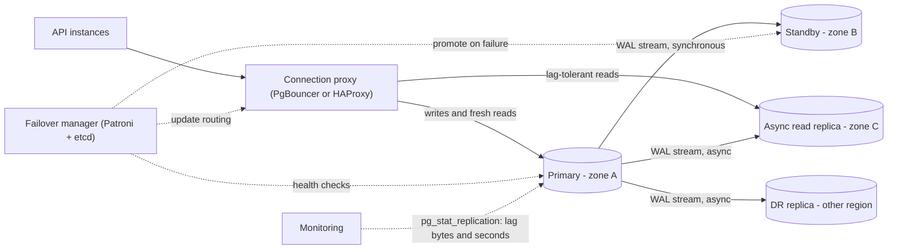
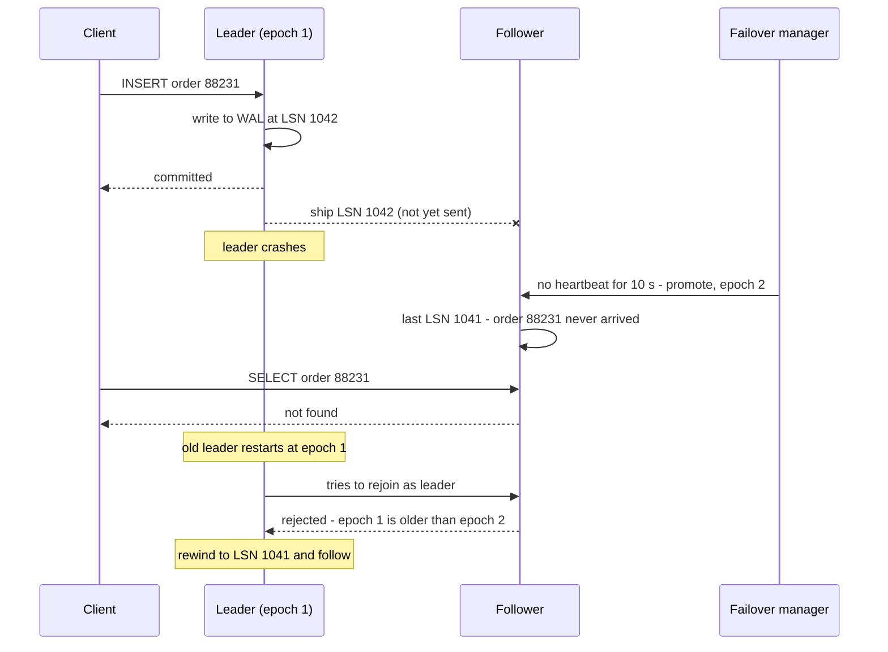

Every serious database setup has more than one copy of the data. The copies protect you from a dead disk, let you spread read traffic, and keep you running when a zone fails. But each copy is a little behind the original, and the moment you switch to a copy, anything it hadn't received is gone. This lesson is about getting those trade-offs right on purpose.

## Learning objectives

By the end of this lesson you will be able to:

1. Explain the four reasons to replicate: durability, availability, read scaling and latency.
2. Describe how leader-follower replication works, using PostgreSQL's write-ahead log as the example.
3. Compare synchronous, asynchronous and semi-synchronous commits by latency, durability (RPO) and availability.
4. Measure replication lag, explain its causes, and route reads around it.
5. Walk through a failover step by step and name what goes wrong: lost writes, split-brain, stale connections and reused ids.
6. Implement epoch-based fencing and a lag-aware read router in C#.
7. Explain multi-leader and leaderless replication, their conflicts, and when each is worth it.
8. Recognise when one primary with a standby is all you need.

## Prerequisites

- [CAP theorem and PACELC](#/lesson/m13-cap-pacelc): synchronous replication is the "latency for consistency" trade.
- [Consistency models](#/lesson/m13-consistency-models): replication lag is where read-your-writes and monotonic reads break.
- [Read replicas and replication lag](#/lesson/m09-replicas): the database-side view of the same topic.

## Explain it like I'm a beginner

Picture a busy cloud kitchen in Bengaluru that takes phone and app orders. One person at the front desk keeps the official order book. Every order goes in it: "Order 4417, 2 × chicken biryani, Koramangala, ₹540". Only the desk keeps the official book — that's the **leader**.

The kitchen and the rider dispatch counter each keep a **copy**, so cooks and dispatchers can check orders without shouting across the room. After every new entry, the desk snaps a photo of the page and sends it to both counters on the team chat. These copies are the **followers**.

Now three questions:

1. **When does the desk tell the customer "order placed"?**
   - Right after writing it in the official book (fast, but if someone spills tea on the book in the next minute, the order exists nowhere else) — **asynchronous**.
   - Only after at least one counter confirms it received the photo (slower, but the order survives a spilled book) — **synchronous** or **semi-synchronous**.
2. **What if a dispatcher checks their copy before the latest photo arrives?** They don't see the newest order yet — **replication lag**.
3. **What if the desk person goes home sick?** The dispatch counter's copy becomes the new official book — **failover**. If its copy was missing the last few photos, those orders are lost: the customer was told "placed" but nobody cooks it. And if the original desk person comes back after lunch and keeps writing orders in the old book, you now have two "official" books that disagree — **split-brain**.

That's all of leader-follower replication. The rest of this lesson is the engineering detail.

## First-principles explanation

### Why replicate

| Goal | What replication gives | What it doesn't |
|---|---|---|
| **Durability** | Data survives a lost disk or machine | Protection from bad writes: a `DELETE` without `WHERE` replicates too. You still need backups ([Backups and DR](#/lesson/m14-dr)) |
| **Availability** | A standby can take over in seconds to minutes | Zero downtime: failover itself takes time |
| **Read scaling** | Replicas serve read queries | Write scaling: all writes still go to one leader |
| **Latency** | A replica near users answers fast | Fresh data: nearby replicas may lag |

### Leader-follower (single-leader) replication

One node, the **leader** (primary), accepts all writes. Every change is written to its log first. **Followers** (replicas, standbys) receive the log and apply it in the same order, so each follower is an exact copy of the leader as of some point in the past.

In PostgreSQL:

- Every change is first written to the **write-ahead log (WAL)**. Each position in it is a **log sequence number (LSN)**, like `3/2A000000`.
- **Physical streaming replication** sends WAL records to standbys over a replication connection. Standbys replay them and can serve read-only queries (*hot standby*).
- **Logical replication** sends row-level changes for chosen tables, which allows different versions, partial copies and feeding other systems — at the cost of not replicating schema changes automatically.
- **Replication slots** make the primary keep WAL until a standby has received it. Useful, but an abandoned slot keeps WAL forever and can fill the primary's disk. Set `max_slot_wal_keep_size` so a dead slot is invalidated instead of taking the primary down, and alert on slot retention. Since PostgreSQL 17, logical replication slots can be marked `failover` and synchronised to a physical standby (`sync_replication_slots`), so logical subscribers (CDC pipelines, search indexers) survive a primary failover.

Because one node orders all writes, leader-follower gives you a single, total order of changes for free (the WAL), which is why it's the default for relational databases.

### Synchronous, asynchronous, semi-synchronous

The key question is **when the leader tells the client "committed"**.

**Asynchronous.** The leader commits locally, replies to the client, and ships the change to followers in the background.

- Latency: only the local disk flush.
- Durability: if the leader dies, anything not yet shipped is **lost even though clients were told "committed"**. The amount lost is your **RPO** (recovery point objective).
- Availability: followers can be slow or down without affecting writes.

Arithmetic (an estimate, to show the shape): at 2,000 writes per second and an average lag of 1.5 s at the moment the leader fails, about 2,000 × 1.5 = **3,000 acknowledged writes** are lost on failover.

**Synchronous.** The leader waits for a follower to confirm before replying. In PostgreSQL, `synchronous_standby_names` lists the standbys that count, and `synchronous_commit` sets what "confirm" means: `remote_write` (standby received it and handed it to its operating system, not yet flushed to disk), `on` (standby flushed it to disk) or `remote_apply` (standby replayed it, so reads there see it). `synchronous_commit` can also be changed per transaction (`SET LOCAL synchronous_commit = local`), so a low-value write such as a "last seen" timestamp can skip the wait while payments keep it.

- Latency: every commit pays a round trip to the standby. Same region, different zone: about 1–2 ms (estimate). Another region: tens of milliseconds.
- Durability: failing over to that standby loses no acknowledged write.
- Availability: if the synchronous standby is slow, **every commit is slow**; if it's down, commits **wait indefinitely** (PostgreSQL does not silently give up).

**Semi-synchronous / quorum commit.** Wait for *some* followers, not all.

- PostgreSQL: `synchronous_standby_names = 'ANY 1 (s1, s2)'` waits for any one of two standbys (quorum). `'FIRST 1 (s1, s2)'` is priority-based: s1 is synchronous and s2 takes over the role only if s1 disconnects. Either way, one standby can fail without blocking writes.
- MySQL's semi-synchronous replication waits until at least one replica has *received* the change, with a timeout (`rpl_semi_sync_source_timeout`) after which the source **falls back to asynchronous** until a replica catches up.

**Failure case: the silent fallback.** A team turns on semi-synchronous replication "for zero data loss". During a network blip the replica stops acknowledging, the source waits for the timeout (a configurable number of seconds), then switches to asynchronous mode — and keeps running like that. A week later the source dies. The last 40 seconds of writes are gone, despite the "zero data loss" setting. Nobody noticed the fallback because there was no alert on it. The setting was correct; the monitoring wasn't. Treat "replication mode degraded" as a paging alert.

**Failure case: the committed-but-cancelled write.** In PostgreSQL with a synchronous standby that is down, a commit waits. An impatient client times out and cancels. PostgreSQL warns that the transaction "has already committed locally" — it's in the leader's WAL, just not confirmed by the standby. The client thinks it failed; it actually happened. This is the unknown outcome from [Why distributed systems are difficult](#/lesson/m13-why-hard), inside your own database.

| Mode | Commit latency | Lost on leader failure | Writes when standby is down |
|---|---|---|---|
| Async | Local flush only | Up to the lag (seconds) | Unaffected |
| Sync (1 named standby) | + 1 round trip | None (if you fail over to that standby) | **Blocked** |
| Quorum (ANY 1 of 2) | + fastest round trip | None (if you fail over to the acknowledging standby) | Unaffected unless both are down |
| Semi-sync with fallback | + 1 round trip, normally | None normally, **up to the lag after a silent fallback** | Unaffected (degrades) |

### Replication lag

**Lag** is how far a follower is behind the leader, in bytes of WAL or in seconds. Typical causes:

- **Network** between zones or regions, or a saturated link (a bulk import on the leader can generate WAL faster than the link carries it).
- **Apply speed**: replay of physical WAL in PostgreSQL is single-process per standby, so a write-heavy leader can outrun a standby with the same hardware.
- **Long queries on the standby**: when replay would remove rows a running query still needs, PostgreSQL pauses replay for up to `max_standby_streaming_delay` (default 30 s) and then cancels the query. Set it to `-1` and a 10-minute report can hold replay back for 10 minutes. Turning on `hot_standby_feedback` avoids most cancellations, but the primary then keeps old row versions for the standby's queries, which causes table bloat on the primary. A dedicated reporting replica with a large delay and a separate low-lag replica for user traffic is a common split.
- **Big transactions and migrations**: an `ALTER TABLE` rewriting a 50 GB table produces a burst of WAL.

How to see it on PostgreSQL:

```sql
-- On the primary: one row per standby
SELECT application_name, state, sync_state,
       pg_wal_lsn_diff(pg_current_wal_lsn(), replay_lsn) AS lag_bytes,
       replay_lag
FROM pg_stat_replication;

-- On a standby: how old is the last replayed transaction?
SELECT now() - pg_last_xact_replay_timestamp() AS replay_delay;
```

Watch out: `now() - pg_last_xact_replay_timestamp()` grows when the primary is *idle*, even with zero lag. Bytes behind is the more honest number; time is what users feel.

Effects on users are the anomalies from [Consistency models](#/lesson/m13-consistency-models): users don't see their own writes, dashboards go backwards, reports are stale. Mitigations: route a user's reads to the primary right after they write, use session tokens with LSNs, and route away from replicas whose lag exceeds a threshold.

Bandwidth and cost (estimate): 2,000 writes per second × about 2 KB of WAL each ≈ 4 MB/s per replica. Over a day: 4 MB × 86,400 ≈ **346 GB per replica**. Cross-zone and cross-region transfer is usually billed, so a cross-region replica can be a visible line in the cloud bill ([Cost estimation](#/lesson/m11-cost-estimation)).

### Failover, step by step

When the leader fails, someone must:

1. **Detect** the failure. Usually: heartbeats missed for N seconds. As you saw in the first lesson, a slow leader and a dead leader look the same, so detection is a guess. Too short a timeout → unnecessary failovers during a GC pause or network blip. Too long → minutes of write downtime.
2. **Choose** a new leader: the follower with the most up-to-date log, so the fewest writes are lost. With a synchronous standby, choose that one.
3. **Promote** it, so it accepts writes.
4. **Fence** the old leader so it can't accept writes if it comes back: shut it down, revoke its network access, or have storage reject writes from an old **epoch** (also called term or generation number). The blunt version is called STONITH: "shoot the other node in the head".
5. **Redirect** clients: update DNS, a virtual IP, a proxy (PgBouncer, HAProxy) or the connection string. Connection pools that hold open connections to the old leader must be drained.
6. **Rejoin** the old leader as a follower later, after discarding any writes it had that the new leader doesn't (PostgreSQL's `pg_rewind` does this; it needs `wal_log_hints = on` or data checksums enabled on the cluster beforehand, otherwise you rebuild the old leader from a fresh base backup).

Managed services (Azure Database for PostgreSQL flexible server with high availability, Amazon RDS Multi-AZ) and tools like Patroni (which uses etcd or similar for leader election) automate these steps. Failover usually takes from tens of seconds to a couple of minutes, depending on detection timeouts and DNS caching — an estimate; test your own.

### What goes wrong in failover

**Lost acknowledged writes (async).** The customer got "Order #88231 confirmed" by SMS. The order never reached the new leader. The customer calls; support can't find it.

**Split-brain.** The old leader was only *partitioned*, not dead. It keeps accepting writes from clients that can still reach it, while the new leader accepts writes from everyone else. Two diverging histories. Prevention: fencing, and requiring a **majority** to agree on the new leader so a minority side can never elect one ([Split-brain](#/lesson/m13-split-brain)).

**Stale connections and DNS.** DNS is switched, but app instances cached the old IP or hold pooled connections. They keep writing to the old leader for minutes. Prevention: fence at the database (the old leader refuses writes), short DNS TTLs, and pools that validate connections and reconnect on read-only errors.

**Reused ids.** A failure pattern described in public postmortems: an out-of-date follower is promoted and its auto-increment counter is behind. New rows get ids that the old leader had already handed out. Other systems (a cache, a search index, an external partner) still hold data for the old ids, and now associate it with *different* rows — one customer sees another's data. Prevention: don't let ids from a primary key leak as the only identity into other systems after failover with data loss, or use UUIDs; and after a lossy failover, invalidate caches keyed by recent ids.

**Unnecessary failover.** A 15-second GC pause or a network blip triggers promotion; then the old leader recovers. If fencing works, you lost 30 seconds of writes to a pointless failover. If it doesn't, split-brain. Tune detection with care and prefer failure detectors that require multiple observers to agree.

### Multi-leader replication

Several nodes accept writes, typically **one leader per region**, replicating to each other asynchronously.

Why: users in each region get local write latency, and each region keeps working if the inter-region link fails. Offline-first apps are a special case: every device is a "leader" that syncs later. So are collaborative editors.

The cost is **write conflicts**: the same record changed in two regions before they synchronised.

- **Avoid conflicts** where possible: home each record (a user, a restaurant, a tenant) in one region and route all its writes there. Most "multi-leader" systems are really "single leader per record".
- **Resolve deterministically**: last-writer-wins (loses data, see [logical clocks](#/lesson/m13-time-ordering)), merge functions, CRDTs, or keep both and ask a human.
- **Constraints break**: a unique constraint (username, invoice number) can't be enforced across leaders without coordination. Two users in two regions both claim `@kumar`. Use a single authority for unique claims, or per-region number ranges.
- **Auto-increment ids collide**: use UUIDs, ULIDs or per-leader id ranges.
- **Topology matters** with three or more leaders: in a ring, one failed node breaks replication for others; in all-to-all, changes can arrive out of order (an update before the insert it modifies), which needs causal ordering.

**Failure case.** A team adds a second write region "for availability" with built-in multi-leader replication and LWW. Everything works for months. During a 20-minute inter-region partition, finance staff in both regions edit the same purchase order's line items. On heal, LWW keeps one region's version of each row; the purchase order's total no longer matches its lines, because different rows won in different regions. The fix needed a *whole-document* merge rule (or homing the purchase order to one region), not row-level LWW.

### Leaderless replication (an introduction)

Dynamo-style systems (Amazon's 2007 Dynamo paper; Cassandra; Riak) have no leader. A client, or a coordinator node acting for it, sends each write to **N** replicas and considers it successful after **W** acknowledge; reads ask **R** replicas and take the newest version. If R + W > N, every read set overlaps every write set in at least one replica ([Quorums](#/lesson/m13-quorums) covers this properly).

Repair mechanisms keep replicas converging:

- **Read repair**: when a read sees an old version on one replica, it writes the newer one back.
- **Hinted handoff**: if a replica is down, another node holds the write as a "hint" and delivers it later.
- **Anti-entropy**: background comparison (often with Merkle trees) to find and fix differences.

Why choose leaderless: no failover step at all (any replica can serve), good availability, tunable consistency per request. Costs: conflict handling (versions, siblings or LWW), weaker guarantees than they appear — with *sloppy quorums* and hinted handoff, R + W > N no longer guarantees you see the latest write — and harder reasoning about edge cases.

### When it is unnecessary — the simpler alternative

For most business applications, this is enough:

- **One primary** in zone A.
- **One synchronous standby** in zone B, with automated failover (managed HA or Patroni). RPO zero, RTO in tens of seconds to minutes.
- Optionally **one asynchronous read replica** for reports and dashboards, with lag monitoring, never used for read-after-write paths.
- **Backups** with point-in-time recovery, tested.

Add multi-region replicas when you have users or regulations that require it. Add multi-leader only when a single write region is genuinely unacceptable, and plan conflict handling for every table before you switch it on.

## Visual explanation

### Architecture: a typical PostgreSQL replication setup



How to read it: the API talks to a proxy, not to a database IP, so failover only needs the proxy re-pointed. Writes and reads that must be fresh go to the primary. The primary streams WAL to three followers. The zone-B standby is **synchronous**: commits wait for it, so it can take over with no data loss. The zone-C replica and the other-region DR replica are **asynchronous**: the first serves reports, the second protects against a region-wide disaster with a small RPO. The failover manager watches the primary, promotes the synchronous standby when the primary fails, and updates the proxy. Monitoring reads lag from `pg_stat_replication` on the primary.

### Sequence: an asynchronous failover that loses a write



The client was told "committed" at LSN 1042, but the follower only had 1041 when it was promoted. That one write is the RPO in action. Notice the epoch: the new leader runs at epoch 2, so when the old leader comes back claiming leadership at epoch 1, it is rejected and must discard its divergent tail (LSN 1042) before following. Without epochs, it might start accepting writes again: split-brain. With synchronous replication to the follower, the leader wouldn't have replied "committed" until LSN 1042 reached the follower, and nothing would be lost.

## Step-by-step example

A food-delivery platform for one country: restaurants and riders update order status ("accepted", "picked up", "delivered"), customers track their orders, and restaurant owners watch sales dashboards. Peak about 400 writes per second and 6,000 reads per second (assumed: most reads are customers refreshing the tracking page).

### Step 1 — the naive version

One PostgreSQL VM, nightly backups. If the VM's disk fails at 6 p.m., you restore last night's backup: **RPO ≈ 18 hours**, RTO = however long the restore takes (hours). Every read hits the same machine.

### Step 2 — add an asynchronous replica for reads

Restaurant sales dashboards move to a replica; the primary's load drops. Lag is usually under a second. But a customer who places an order and is redirected to "Track my order" sometimes sees "order not found" (a read-your-writes violation). Route the tracking page for a just-placed order to the primary (for example, for 30 seconds after the customer's last write); leave sales dashboards on the replica with a "data as of 12:01:05" label.

### Step 3 — add a synchronous standby in another zone, with automated failover

Now a zone failure loses no acknowledged write (RPO 0) and the standby takes over within about a minute. Each commit pays an extra 1–2 ms (estimate). Use `ANY 1 (standby_b, standby_c)` if you can afford two standbys, so one can be down without blocking writes.

### Step 4 — fence and test

Configure fencing so an old primary can never accept writes after failover, put a proxy in front so apps don't need new connection strings, and **run a failover drill** every quarter: kill the primary during load and measure RTO, lost writes (should be zero) and the error rate seen by apps.

## Production-style C# implementation

Real replication lives in the database. What application code owns is: choosing where to send a read, handling failover gracefully, and rejecting writes from a stale leader. The in-memory cluster below models leader-follower replication with commit modes, lag, failover and epoch fencing, so you can test application behaviour against it.

```text
Delivery.Api/
  Program.cs
  Replication/
    LogModel.cs
    LeaderFollowerCluster.cs
    LagAwareReadRouter.cs
    ReplicationLagMonitor.cs
```

```csharp file=Replication/LogModel.cs
namespace Delivery.Replication;

public enum NodeRole { Leader, Follower, Fenced }

public enum CommitMode { Async, SemiSync, Sync }

/// <summary>One WAL-like record. Lsn is the position in the log; Epoch is the leader term that wrote it.</summary>
public sealed record LogEntry(long Lsn, long Epoch, string Key, string Value);

public sealed class ReplicaNode(string name)
{
    internal readonly List<LogEntry> Log = [];

    public string Name { get; } = name;
    public NodeRole Role { get; internal set; } = NodeRole.Follower;
    public long Epoch { get; internal set; } = 1;
    public bool Reachable { get; set; } = true;

    public long LastLsn => Log.Count == 0 ? 0 : Log[^1].Lsn;
    public long LastEpoch => Log.Count == 0 ? 0 : Log[^1].Epoch;

    public string? Read(string key)
    {
        for (var i = Log.Count - 1; i >= 0; i--)
            if (Log[i].Key == key) return Log[i].Value;
        return null;
    }
}

public sealed class StaleEpochException(string message) : Exception(message);

/// <summary>The leader wrote the entry locally but couldn't get the required acknowledgements:
/// the outcome is unknown to the client, exactly like PostgreSQL's "committed locally" warning.</summary>
public sealed class ReplicationTimeoutException(long lsn, string message) : Exception(message)
{
    public long Lsn { get; } = lsn;
}

public sealed record WriteResult(long Lsn, long Epoch, IReadOnlyList<string> AckedBy, bool DegradedToAsync);

public sealed record FailoverReport(string OldLeader, string NewLeader, long NewEpoch, long LostWrites);

public sealed record NodeStatus(string Name, NodeRole Role, long Epoch, long LastLsn, long LagEntries, bool Reachable);
```

```csharp file=Replication/LeaderFollowerCluster.cs
namespace Delivery.Replication;

/// <summary>An in-memory model of single-leader replication: commit modes, lag, failover with
/// epoch fencing, and rejoin with log truncation (like pg_rewind).</summary>
public sealed class LeaderFollowerCluster
{
    private readonly object _gate = new();
    private readonly List<ReplicaNode> _nodes;
    private readonly ILogger<LeaderFollowerCluster> _log;

    public LeaderFollowerCluster(IEnumerable<string> nodeNames, ILogger<LeaderFollowerCluster> log)
    {
        _nodes = nodeNames.Select(n => new ReplicaNode(n)).ToList();
        if (_nodes.Count < 1) throw new ArgumentException("Need at least one node.", nameof(nodeNames));
        _nodes[0].Role = NodeRole.Leader;
        _log = log;
    }

    public ReplicaNode Leader { get { lock (_gate) return _nodes.Single(n => n.Role == NodeRole.Leader); } }

    public IReadOnlyList<NodeStatus> Status()
    {
        lock (_gate)
        {
            var leaderLsn = _nodes.Single(n => n.Role == NodeRole.Leader).LastLsn;
            return _nodes.Select(n => new NodeStatus(n.Name, n.Role, n.Epoch, n.LastLsn, Math.Max(0, leaderLsn - n.LastLsn), n.Reachable)).ToList();
        }
    }

    public ReplicaNode Node(string name)
    {
        lock (_gate) return _nodes.Single(n => n.Name == name);
    }

    /// <param name="viaNode">Which node the client is connected to. A fenced old leader refuses.</param>
    public WriteResult Write(string key, string value, CommitMode mode, string? viaNode = null)
    {
        lock (_gate)
        {
            var leader = _nodes.Single(n => n.Role == NodeRole.Leader);
            if (viaNode is not null && viaNode != leader.Name)
            {
                var target = _nodes.Single(n => n.Name == viaNode);
                throw new StaleEpochException($"{target.Name} is {target.Role} at epoch {target.Epoch}; current leader is {leader.Name} at epoch {leader.Epoch}.");
            }
            if (!leader.Reachable) throw new ReplicationTimeoutException(0, "Leader unreachable.");

            var entry = new LogEntry(leader.LastLsn + 1, leader.Epoch, key, value);
            leader.Log.Add(entry);   // committed locally first, as every real leader does

            if (mode == CommitMode.Async) return new WriteResult(entry.Lsn, leader.Epoch, [], DegradedToAsync: false);

            var acked = new List<string>();
            foreach (var f in _nodes.Where(n => n.Role == NodeRole.Follower && n.Reachable))
            {
                CatchUp(f, leader, int.MaxValue);
                acked.Add(f.Name);
            }

            var followers = _nodes.Count(n => n.Role == NodeRole.Follower);
            if (mode == CommitMode.Sync && acked.Count < followers)
                throw new ReplicationTimeoutException(entry.Lsn,
                    $"LSN {entry.Lsn} committed on the leader but only {acked.Count}/{followers} followers confirmed.");

            if (mode == CommitMode.SemiSync && acked.Count == 0)
            {
                // The dangerous part of semi-sync: carry on asynchronously. Make it loud.
                _log.LogWarning("Semi-sync degraded to async at LSN {Lsn}: no follower acknowledged", entry.Lsn);
                return new WriteResult(entry.Lsn, leader.Epoch, acked, DegradedToAsync: true);
            }
            return new WriteResult(entry.Lsn, leader.Epoch, acked, DegradedToAsync: false);
        }
    }

    /// <summary>Background shipping of the log. Limiting entries per call simulates lag.</summary>
    public int ReplicateTick(int maxEntriesPerFollower = int.MaxValue)
    {
        lock (_gate)
        {
            var leader = _nodes.Single(n => n.Role == NodeRole.Leader);
            if (!leader.Reachable) return 0;
            return _nodes.Where(n => n.Role == NodeRole.Follower && n.Reachable)
                         .Sum(f => CatchUp(f, leader, maxEntriesPerFollower));
        }
    }

    /// <summary>Promote the most up-to-date reachable follower, only if a majority of nodes is reachable.</summary>
    public FailoverReport FailOver()
    {
        lock (_gate)
        {
            var old = _nodes.Single(n => n.Role == NodeRole.Leader);
            var candidates = _nodes.Where(n => n != old && n.Role == NodeRole.Follower && n.Reachable).ToList();
            var majority = _nodes.Count / 2 + 1;
            if (candidates.Count < majority)
                throw new InvalidOperationException($"Only {candidates.Count} of {_nodes.Count} nodes reachable; need {majority} to fail over safely.");

            // Most up-to-date log wins: compare the epoch of the last entry first, then its position.
            var next = candidates.OrderByDescending(n => n.LastEpoch).ThenByDescending(n => n.LastLsn)
                                 .ThenBy(n => n.Name, StringComparer.Ordinal).First();
            var newEpoch = _nodes.Max(n => n.Epoch) + 1;
            var lost = Math.Max(0, old.LastLsn - next.LastLsn);

            old.Role = NodeRole.Fenced;   // in production: STONITH, revoke its VIP, or storage-level fencing
            next.Role = NodeRole.Leader;
            foreach (var n in candidates) n.Epoch = newEpoch;

            if (lost > 0) _log.LogError("Failover {Old} -> {New} lost {Lost} acknowledged writes", old.Name, next.Name, lost);
            return new FailoverReport(old.Name, next.Name, newEpoch, lost);
        }
    }

    /// <summary>Bring a fenced old leader back as a follower, discarding entries the new leader never had.</summary>
    public int Rejoin(string name)
    {
        lock (_gate)
        {
            var node = _nodes.Single(n => n.Name == name);
            var leader = _nodes.Single(n => n.Role == NodeRole.Leader);
            var common = 0;
            while (common < node.Log.Count && common < leader.Log.Count && node.Log[common] == leader.Log[common]) common++;
            var discarded = node.Log.Count - common;
            node.Log.RemoveRange(common, discarded);
            node.Role = NodeRole.Follower;
            node.Epoch = leader.Epoch;
            node.Reachable = true;
            return discarded;
        }
    }

    private static int CatchUp(ReplicaNode follower, ReplicaNode leader, int max)
    {
        var copied = 0;
        while (copied < max && follower.LastLsn < leader.LastLsn)
        {
            follower.Log.Add(leader.Log[(int)follower.LastLsn]);   // LSN n lives at index n-1
            copied++;
        }
        return copied;
    }
}
```

```csharp file=Replication/LagAwareReadRouter.cs
using Microsoft.Extensions.Options;

namespace Delivery.Replication;

public sealed class ReadRoutingOptions
{
    /// <summary>Replicas further behind than this are skipped for reads.</summary>
    public long MaxLagEntries { get; set; } = 100;
}

public sealed record RoutedRead(string? Value, string ServedBy);

/// <summary>Fresh reads go to the leader; lag-tolerant reads go to the least-lagged healthy follower.</summary>
public sealed class LagAwareReadRouter(LeaderFollowerCluster cluster, IOptions<ReadRoutingOptions> options)
{
    public RoutedRead Read(string key, bool requireFresh)
    {
        var status = cluster.Status();
        var leader = status.Single(s => s.Role == NodeRole.Leader);
        if (!requireFresh)
        {
            var replica = status
                .Where(s => s.Role == NodeRole.Follower && s.Reachable && s.LagEntries <= options.Value.MaxLagEntries)
                .OrderBy(s => s.LagEntries).ThenBy(s => s.Name, StringComparer.Ordinal)
                .FirstOrDefault();
            if (replica is not null) return new RoutedRead(cluster.Node(replica.Name).Read(key), replica.Name);
        }
        return new RoutedRead(cluster.Node(leader.Name).Read(key), leader.Name);
    }
}
```

```csharp file=Replication/ReplicationLagMonitor.cs
using Microsoft.Extensions.Options;

namespace Delivery.Replication;

/// <summary>Ships the log and reports lag every second. In production, the database ships the log
/// and this service would read pg_stat_replication and publish metrics instead.</summary>
public sealed class ReplicationLagMonitor(
    LeaderFollowerCluster cluster,
    IOptions<ReadRoutingOptions> options,
    TimeProvider time,
    ILogger<ReplicationLagMonitor> log) : BackgroundService
{
    protected override async Task ExecuteAsync(CancellationToken stoppingToken)
    {
        using var timer = new PeriodicTimer(TimeSpan.FromSeconds(1), time);
        while (await timer.WaitForNextTickAsync(stoppingToken))
        {
            cluster.ReplicateTick(maxEntriesPerFollower: 50);   // a deliberately slow link
            foreach (var s in cluster.Status().Where(s => s.Role == NodeRole.Follower && s.LagEntries > options.Value.MaxLagEntries))
                log.LogWarning("Replica {Replica} is {Lag} entries behind and is excluded from reads", s.Name, s.LagEntries);
        }
    }
}
```

```csharp file=Program.cs
using Delivery.Replication;

var builder = WebApplication.CreateBuilder(args);

builder.Services.AddSingleton(TimeProvider.System);
builder.Services.Configure<ReadRoutingOptions>(builder.Configuration.GetSection("ReadRouting"));
builder.Services.AddSingleton(sp => new LeaderFollowerCluster(
    ["pg-zone-a", "pg-zone-b", "pg-zone-c"], sp.GetRequiredService<ILogger<LeaderFollowerCluster>>()));
builder.Services.AddSingleton<LagAwareReadRouter>();
builder.Services.AddHostedService<ReplicationLagMonitor>();

var app = builder.Build();

app.MapPut("/orders/{key}/status", (string key, OrderStatusWrite body, CommitMode? mode, LeaderFollowerCluster cluster) =>
{
    try
    {
        var r = cluster.Write(key, body.Value, mode ?? CommitMode.SemiSync);
        return Results.Ok(r);
    }
    catch (ReplicationTimeoutException ex)
    {
        // Committed on the leader, not confirmed elsewhere: tell the client the truth.
        return Results.Problem(ex.Message + " Read before retrying.", statusCode: StatusCodes.Status503ServiceUnavailable);
    }
    catch (StaleEpochException ex)
    {
        return Results.Problem(ex.Message, statusCode: StatusCodes.Status409Conflict);
    }
});

app.MapGet("/orders/{key}/status", (string key, bool? fresh, LagAwareReadRouter router, HttpResponse resp) =>
{
    var r = router.Read(key, requireFresh: fresh ?? false);
    resp.Headers["X-Served-By"] = r.ServedBy;
    return r.Value is null ? Results.NotFound() : Results.Ok(new { key, value = r.Value });
});

// Demo controls for failure drills.
app.MapGet("/admin/replication", (LeaderFollowerCluster c) => Results.Ok(c.Status()));
app.MapPost("/admin/nodes/{name}/reachable", (string name, bool on, LeaderFollowerCluster c) =>
{
    c.Node(name).Reachable = on;
    return Results.NoContent();
});
app.MapPost("/admin/failover", (LeaderFollowerCluster c) =>
{
    try { return Results.Ok(c.FailOver()); }
    catch (InvalidOperationException ex) { return Results.Problem(ex.Message, statusCode: StatusCodes.Status409Conflict); }
});
app.MapPost("/admin/nodes/{name}/rejoin", (string name, LeaderFollowerCluster c) => Results.Ok(new { discarded = c.Rejoin(name) }));

app.Run();

public sealed record OrderStatusWrite(string Value);
```

What to take from it:

- **The leader always writes locally first.** A sync or semi-sync failure means "committed here, not confirmed there" — an unknown outcome, reported as such.
- **Semi-sync degradation is logged as a warning.** In production it should page someone, because the system has silently changed its RPO.
- **Failover requires a majority** of nodes to be reachable, so a minority side can never elect its own leader.
- **Choosing the new leader compares the last entry's epoch, then its position.** A follower with a longer log from an *older* epoch may hold writes that a later leader never committed.
- **Fencing is explicit.** The old leader becomes `Fenced`; writes routed to it get `409` with the current leader's name.
- **Rejoin truncates to the common prefix**, which is what `pg_rewind` does for PostgreSQL. The discarded count is the data you lost — log it and reconcile it.

## Bad design vs good design

**Bad**: "We have a replica, so we have high availability."

- The replica is asynchronous; failover loses recent acknowledged writes, and nobody has measured how many.
- Failover is manual; the runbook was last tested two years ago.
- The app connects to the primary by IP; after failover someone edits `appsettings.json` and redeploys.
- Some reads go to the replica, including "my orders" right after checkout.
- No alert on replication lag or on a stuck replication slot.

**Good**:

| Concern | Bad | Good |
|---|---|---|
| RPO | Unknown | Sync or quorum standby → 0 for acknowledged writes; async DR replica with measured lag |
| RTO | "Someone will fix it" | Automated failover, drilled quarterly, measured |
| Fencing | None | Old leader fenced; storage or proxy rejects old epoch |
| Routing | IP in config | Proxy or DNS with short TTL; pools reconnect on read-only errors |
| Reads | Random replica | Fresh paths → primary; tolerant paths → replica under a lag threshold |
| Monitoring | None | Lag bytes and seconds, sync state, slot retention, semi-sync fallbacks |

**When is the simple version fine?** An internal tool with an RPO of "a day" and RTO of "a few hours" can live with one database and tested backups. Be honest about the requirement, and write it down.

## Practical playground

The **Replication lag** simulator models users who write and then read their own change back from a replica with exponentially distributed lag.

1. Lag 200 ms, read after 100 ms, read from replica: about 60 % of users don't see their own write (e^(−0.5) ≈ 0.61).
2. Switch to **read-your-writes** routing: stale reads drop to 0 %, and the primary's share of reads rises.
3. Back on replica with a 1 s read delay, turn on the **lag spike** (10× lag for 15 s, like a migration on the primary). A replica that is "usually fine" becomes stale exactly when the system is busiest.
4. Find the read delay at which the stale share falls below 1 % for 200 ms mean lag. (Hint: e^(−d/200) < 0.01.)

:::playground type=sim sim=replication title="Read-after-write on a lagging replica" lagMs=200 readDelayMs=100 readFrom=replica writesPerSec=50
:::

## Exercises

:::exercise id=m13-replication-ex1 difficulty=beginner kind=code title="Route reads around a lagging replica"
Implement `LagAwareRouter.ChooseForRead`, which decides where a read goes.
::requirements
- If `requiresFresh` is true, return `"primary"`.
- Otherwise, among replicas that are `Healthy` and whose `Lag <= maxLag`, return the name of the one with the **lowest** lag; ties by name, ordinal.
- If no replica qualifies, return `"primary"`.
- A negative `maxLag` throws `ArgumentOutOfRangeException`.
::acceptance
- Replicas (r1: healthy, 2 s), (r2: healthy, 0.3 s), (r3: unhealthy, 0.1 s) with max lag 1 s → `r2`.
- Same with max lag 0.2 s → `primary`.
- `requiresFresh: true` → `primary` regardless.
::hint
Three filters: freshness requirement, health, lag threshold.
::hint
An unhealthy replica with low lag must still be skipped: its lag figure may be stale too.
::hint
`Where(...).OrderBy(r => r.Lag).ThenBy(r => r.Name, StringComparer.Ordinal).FirstOrDefault()`.
::starter
```csharp file=LagAwareRouter.cs
using System;
using System.Collections.Generic;
using System.Linq;

public sealed record ReplicaHealth(string Name, bool Healthy, TimeSpan Lag);

public static class LagAwareRouter
{
    public const string Primary = "primary";

    public static string ChooseForRead(IReadOnlyList<ReplicaHealth> replicas, TimeSpan maxLag, bool requiresFresh) =>
        throw new NotImplementedException();
}
```
::tests
```csharp file=LagAwareRouterTests.cs
using System;
using System.Collections.Generic;
using Xunit;

public class LagAwareRouterTests
{
    private static readonly List<ReplicaHealth> Replicas = new()
    {
        new ReplicaHealth("r1", true, TimeSpan.FromSeconds(2)),
        new ReplicaHealth("r2", true, TimeSpan.FromMilliseconds(300)),
        new ReplicaHealth("r3", false, TimeSpan.FromMilliseconds(100)),
    };

    [Fact]
    public void Picks_least_lagged_healthy_replica() =>
        Assert.Equal("r2", LagAwareRouter.ChooseForRead(Replicas, TimeSpan.FromSeconds(1), requiresFresh: false));

    [Fact]
    public void Falls_back_when_all_too_far_behind() =>
        Assert.Equal(LagAwareRouter.Primary, LagAwareRouter.ChooseForRead(Replicas, TimeSpan.FromMilliseconds(200), requiresFresh: false));

    [Fact]
    public void Fresh_reads_go_to_primary() =>
        Assert.Equal(LagAwareRouter.Primary, LagAwareRouter.ChooseForRead(Replicas, TimeSpan.FromSeconds(10), requiresFresh: true));

    [Fact]
    public void Lag_equal_to_threshold_is_allowed() =>
        Assert.Equal("r2", LagAwareRouter.ChooseForRead(Replicas, TimeSpan.FromMilliseconds(300), requiresFresh: false));

    [Fact]
    public void Ties_break_by_name()
    {
        var tied = new List<ReplicaHealth> { new("rb", true, TimeSpan.Zero), new("ra", true, TimeSpan.Zero) };
        Assert.Equal("ra", LagAwareRouter.ChooseForRead(tied, TimeSpan.FromSeconds(1), false));
    }

    [Fact]
    public void Negative_threshold_throws() =>
        Assert.Throws<ArgumentOutOfRangeException>(() => LagAwareRouter.ChooseForRead(Replicas, TimeSpan.FromSeconds(-1), false));
}
```
::solution
```csharp file=LagAwareRouter.cs
using System;
using System.Collections.Generic;
using System.Linq;

public sealed record ReplicaHealth(string Name, bool Healthy, TimeSpan Lag);

public static class LagAwareRouter
{
    public const string Primary = "primary";

    public static string ChooseForRead(IReadOnlyList<ReplicaHealth> replicas, TimeSpan maxLag, bool requiresFresh)
    {
        ArgumentNullException.ThrowIfNull(replicas);
        if (maxLag < TimeSpan.Zero) throw new ArgumentOutOfRangeException(nameof(maxLag));
        if (requiresFresh) return Primary;

        return replicas
            .Where(r => r.Healthy && r.Lag <= maxLag)
            .OrderBy(r => r.Lag)
            .ThenBy(r => r.Name, StringComparer.Ordinal)
            .Select(r => r.Name)
            .FirstOrDefault() ?? Primary;
    }
}
```

Falling back to the primary is a *capacity* decision too: if every replica lags during a spike, all reads land on the primary at the worst moment. In production, cap the fallback rate or serve some lag-tolerant pages from a cache instead.
::mistakes
- Trusting a lag figure from an unhealthy replica.
- Falling back to "any replica" instead of the primary when none qualify, which serves stale data silently.
- Forgetting that the primary itself may be overloaded by the fallback.
:::

:::exercise id=m13-replication-ex2 difficulty=beginner kind=written title="Choose a commit mode with numbers"
The wallet-payments service of a food-delivery app in Mumbai (customer payments, refunds and restaurant payouts) writes about 600 payment records per second at peak. Options:

- (A) asynchronous replication to a standby in another Mumbai zone (typical lag 200 ms, spikes to 5 s during batch jobs);
- (B) synchronous replication to that standby (adds an estimated 1.5 ms per commit);
- (C) synchronous replication to a standby in Hyderabad (adds an estimated 25 ms per commit);
- (D) quorum commit `ANY 1` of two standbys in different Mumbai zones.

For each option, estimate the writes lost if the primary fails at peak (typical and worst case), the added commit latency, and what happens to writes if a standby goes down. Recommend one, and say what you'd add for a region-wide disaster.
::acceptance
- Correct RPO arithmetic for the async option in both cases.
- Recognises that a single synchronous standby blocks writes when it's down.
- Recommends a design with justification, plus a DR answer.
::hint
Lost writes ≈ write rate × lag at the moment of failure.
::hint
600 × 0.2 s and 600 × 5 s.
::hint
Which options keep accepting writes when one standby is down?
::hint
A region-wide disaster takes out both Mumbai zones. What protects you then, and at what RPO?
::solution
| Option | Lost on primary failure | Added latency | Standby down |
|---|---|---|---|
| A: async, same region | 600 × 0.2 = **120** typical; 600 × 5 = **3,000** worst case | ≈ 0 | Writes continue |
| B: sync, same region | 0 (fail over to that standby) | ≈ 1.5 ms | **Writes block** until it returns or config changes |
| C: sync, Hyderabad | 0 | ≈ 25 ms | **Writes block** |
| D: ANY 1 of 2, same region | 0 (fail over to the acknowledging standby) | ≈ the faster standby's round trip, ~1.5 ms | Writes continue while one standby is up |

**Recommendation: D.** Payments shouldn't lose acknowledged records, so A is out (3,000 lost payments in a bad moment means reconciliation with banks, payment gateways and restaurants). B makes the primary's availability depend on one extra machine. C pays 25 ms on every payment and still blocks on one standby. D gives RPO 0 for acknowledged writes with small latency and tolerates one standby failure. Failover must promote the standby that acknowledged the latest writes (failover tools check LSNs).

**Disaster recovery**: add an **asynchronous** replica in another region (Hyderabad or Chennai) plus WAL archiving to object storage in that region. Region-wide RPO is then the async lag (seconds; measure it) and RTO is the time to promote and redirect (minutes, drilled). Combined with idempotent payment processing and daily reconciliation with the bank, the few seconds of exposure are recoverable.
::mistakes
- Treating synchronous replication as free: it moves the risk from data loss to write availability.
- Forgetting the worst-case lag; averages hide the moments that matter.
- Using the cross-region standby as the *only* synchronous one, paying latency on every write to cover a rare event.
:::

:::exercise id=m13-replication-ex3 difficulty=intermediate kind=code title="Apply a replication stream that arrives out of order"
A follower receives log records over a network that can reorder and duplicate them. It must apply them **strictly in LSN order**, never skip one, and never apply one twice. Implement `FollowerApplier`.
::requirements
- Starts with `AppliedLsn = 0`; the next expected record is LSN 1.
- `Receive(record)`: if `Lsn <= AppliedLsn` or the LSN is already buffered, ignore it (return 0). If it is the next expected LSN, apply it, then apply any buffered records that are now contiguous. Otherwise buffer it. Return the number of records applied by this call.
- Applying a record sets `State[key] = value`.
- `MissingLsns()` returns the LSNs between `AppliedLsn + 1` and the highest buffered LSN that haven't been received, ascending.
- `Lsn <= 0` throws `ArgumentOutOfRangeException`.
::acceptance
- Records 1, 3, 4, 2 → returns 1, 0, 0, 3; `AppliedLsn` = 4.
- A duplicate of an applied or buffered record returns 0 and changes nothing.
- After receiving 1, 4 and 6: `MissingLsns()` = [2, 3, 5].
- Later records overwrite earlier values for the same key.
::hint
Keep a dictionary (or `SortedDictionary`) of buffered records keyed by LSN.
::hint
After applying record n, check whether n + 1 is buffered; keep going until there's a gap.
::hint
Missing = every LSN from `AppliedLsn + 1` to `max(buffered)` that isn't in the buffer.
::hint
```csharp
while (_buffer.Remove(AppliedLsn + 1, out var next)) { Apply(next); applied++; }
```
::starter
```csharp file=FollowerApplier.cs
using System;
using System.Collections.Generic;
using System.Linq;

public sealed record WalRecord(long Lsn, string Key, string Value);

public sealed class FollowerApplier
{
    public long AppliedLsn => throw new NotImplementedException();

    public IReadOnlyDictionary<string, string> State => throw new NotImplementedException();

    public int BufferedCount => throw new NotImplementedException();

    public int Receive(WalRecord record) => throw new NotImplementedException();

    public IReadOnlyList<long> MissingLsns() => throw new NotImplementedException();
}
```
::tests
```csharp file=FollowerApplierTests.cs
using System;
using Xunit;

public class FollowerApplierTests
{
    private static WalRecord R(long lsn, string key = "k", string? value = null) => new(lsn, key, value ?? $"v{lsn}");

    [Fact]
    public void Applies_in_order()
    {
        var f = new FollowerApplier();
        Assert.Equal(1, f.Receive(R(1)));
        Assert.Equal(1, f.Receive(R(2)));
        Assert.Equal(2, f.AppliedLsn);
        Assert.Equal("v2", f.State["k"]);
    }

    [Fact]
    public void Buffers_until_gap_is_filled()
    {
        var f = new FollowerApplier();
        Assert.Equal(1, f.Receive(R(1)));
        Assert.Equal(0, f.Receive(R(3)));
        Assert.Equal(0, f.Receive(R(4)));
        Assert.Equal(2, f.BufferedCount);
        Assert.Equal(3, f.Receive(R(2)));
        Assert.Equal(4, f.AppliedLsn);
        Assert.Equal(0, f.BufferedCount);
        Assert.Equal("v4", f.State["k"]);
    }

    [Fact]
    public void Duplicates_are_ignored()
    {
        var f = new FollowerApplier();
        f.Receive(R(1, "a", "first"));
        Assert.Equal(0, f.Receive(R(1, "a", "replayed")));
        f.Receive(R(3));
        Assert.Equal(0, f.Receive(R(3)));
        Assert.Equal("first", f.State["a"]);
        Assert.Equal(1, f.BufferedCount);
    }

    [Fact]
    public void Reports_missing_lsns()
    {
        var f = new FollowerApplier();
        f.Receive(R(1)); f.Receive(R(4)); f.Receive(R(6));
        Assert.Equal(new long[] { 2, 3, 5 }, f.MissingLsns());
    }

    [Fact]
    public void Nothing_missing_when_caught_up()
    {
        var f = new FollowerApplier();
        f.Receive(R(1));
        Assert.Empty(f.MissingLsns());
    }

    [Fact]
    public void Separate_keys_are_tracked()
    {
        var f = new FollowerApplier();
        f.Receive(R(2, "b", "B"));
        f.Receive(R(1, "a", "A"));
        Assert.Equal("A", f.State["a"]);
        Assert.Equal("B", f.State["b"]);
    }

    [Fact]
    public void Invalid_lsn_throws() =>
        Assert.Throws<ArgumentOutOfRangeException>(() => new FollowerApplier().Receive(R(0)));
}
```
::solution
```csharp file=FollowerApplier.cs
using System;
using System.Collections.Generic;
using System.Linq;

public sealed record WalRecord(long Lsn, string Key, string Value);

public sealed class FollowerApplier
{
    private readonly Dictionary<string, string> _state = new();
    private readonly SortedDictionary<long, WalRecord> _buffer = new();
    private readonly object _gate = new();
    private long _applied;

    public long AppliedLsn { get { lock (_gate) return _applied; } }

    public IReadOnlyDictionary<string, string> State { get { lock (_gate) return new Dictionary<string, string>(_state); } }

    public int BufferedCount { get { lock (_gate) return _buffer.Count; } }

    public int Receive(WalRecord record)
    {
        ArgumentNullException.ThrowIfNull(record);
        ArgumentOutOfRangeException.ThrowIfNegativeOrZero(record.Lsn);
        lock (_gate)
        {
            if (record.Lsn <= _applied || _buffer.ContainsKey(record.Lsn)) return 0;   // duplicate
            if (record.Lsn != _applied + 1) { _buffer[record.Lsn] = record; return 0; } // gap: wait

            Apply(record);
            var applied = 1;
            while (_buffer.Remove(_applied + 1, out var next)) { Apply(next); applied++; }
            return applied;
        }
    }

    public IReadOnlyList<long> MissingLsns()
    {
        lock (_gate)
        {
            if (_buffer.Count == 0) return Array.Empty<long>();
            var max = _buffer.Keys.Last();
            var missing = new List<long>();
            for (var lsn = _applied + 1; lsn < max; lsn++)
                if (!_buffer.ContainsKey(lsn)) missing.Add(lsn);
            return missing;
        }
    }

    private void Apply(WalRecord r)
    {
        _state[r.Key] = r.Value;
        _applied = r.Lsn;
    }
}
```

Applying strictly in order is what keeps a follower an exact copy of the leader *at some point in time*. Applying record 4 before 2 might produce a state that never existed on the leader — for example a row update applied before the insert that created it.
::alternatives
- In real systems the transport (TCP within one replication connection) already gives order, and gaps mean the connection broke; the follower reconnects and asks for "everything after LSN n". `MissingLsns` is what it would request.
- Batch apply: collect contiguous records and apply them in one local transaction for throughput.
::mistakes
- Applying out-of-order records "because they're for a different key": the leader's order is part of the data (constraints, foreign keys, triggers).
- Treating a duplicate as an error and stopping replication; at-least-once delivery makes duplicates normal.
- An unbounded buffer: if LSN 2 never arrives, memory grows forever. Cap it and resync from a snapshot.
::extensions
Add `Snapshot(long lsn, IReadOnlyDictionary<string,string> state)` to bootstrap a new follower from a backup, discarding buffered records at or below that LSN.
:::

:::exercise id=m13-replication-ex4 difficulty=intermediate kind=sql title="Which replicas need attention?"
The table `replication_snapshot` holds a copy of `pg_stat_replication` taken on the primary, and `primary_status` holds the primary's current WAL position. Return every replica that needs attention, with how many bytes it is behind.
::requirements
A replica needs attention if **any** of these hold:
- it is more than 16 MB (16 × 1024 × 1024 bytes) behind in replay (`current_lsn` minus `replay_lsn`);
- its `replay_lag` is more than 5 seconds;
- its `state` is not `streaming`.

Return `application_name` and `lag_bytes` (use `pg_wal_lsn_diff`). Order doesn't matter.
::acceptance
- Uses `pg_wal_lsn_diff(current_lsn, replay_lsn)` for bytes.
- Catches a replica that is behind in time but not in bytes, and one that isn't streaming.
- Doesn't flag healthy replicas.
::hint
`primary_status` has one row; `CROSS JOIN` it.
::hint
`pg_wal_lsn_diff(a, b)` returns the number of bytes from b to a.
::hint
A `NULL` `replay_lag` makes `replay_lag > interval '5 seconds'` NULL, not true. That's fine here because another condition catches that replica — but think about why it's NULL.
::hint
Combine the three conditions with `OR`.
::setup
```sql
CREATE TABLE primary_status (current_lsn pg_lsn NOT NULL);
INSERT INTO primary_status VALUES ('3/2A000000');

CREATE TABLE replication_snapshot (
  application_name text PRIMARY KEY,
  state            text NOT NULL,
  sync_state       text NOT NULL,
  replay_lsn       pg_lsn NOT NULL,
  replay_lag       interval
);

INSERT INTO replication_snapshot VALUES
 ('standby-zone-b', 'streaming', 'sync',  '3/29FFF000', interval '0.004 seconds'),
 ('reports-zone-c', 'streaming', 'async', '3/27000000', interval '41 seconds'),
 ('dr-hyderabad',   'streaming', 'async', '3/29F00000', interval '0.9 seconds'),
 ('analytics',      'streaming', 'async', '3/29E00000', interval '12 seconds'),
 ('replica-new',    'catchup',   'async', '3/10000000', NULL);
```
::check
```sql
SELECT r.application_name, pg_wal_lsn_diff(p.current_lsn, r.replay_lsn) AS lag_bytes
FROM replication_snapshot r
CROSS JOIN primary_status p
WHERE pg_wal_lsn_diff(p.current_lsn, r.replay_lsn) > 16 * 1024 * 1024
   OR r.replay_lag > interval '5 seconds'
   OR r.state <> 'streaming';
```
::solution
```sql
SELECT r.application_name,
       pg_wal_lsn_diff(p.current_lsn, r.replay_lsn) AS lag_bytes
FROM replication_snapshot r
CROSS JOIN primary_status p
WHERE pg_wal_lsn_diff(p.current_lsn, r.replay_lsn) > 16 * 1024 * 1024
   OR r.replay_lag > interval '5 seconds'
   OR r.state <> 'streaming';
```

Results:

- `reports-zone-c`: 0x2A000000 − 0x27000000 = 50,331,648 bytes (48 MB) and 41 s behind. Probably long report queries delaying replay.
- `analytics`: only 2,097,152 bytes (2 MB) behind, but 12 s of replay lag. Few bytes, many seconds: replay is *paused or slow*, not the network — typical of a query conflict on a hot standby.
- `replica-new`: 436,207,616 bytes behind and still in `catchup`: it was just created and is copying WAL. Its `replay_lag` is NULL because it hasn't reported replay timing yet. Don't route reads to it.

`standby-zone-b` (4,096 bytes, 4 ms) and `dr-hyderabad` (1 MB, 0.9 s) are healthy. Note that the synchronous standby is the freshest, as it must be.
::mistakes
- Using only one signal. Bytes catch network or volume problems; seconds catch paused replay.
- Writing `replay_lag > '5'`, which compares with an interval of 5 *seconds* only by accident of casting rules; be explicit with `interval '5 seconds'`.
- Subtracting LSNs as text.
:::

:::exercise id=m13-replication-ex5 difficulty=advanced kind=code title="Plan a safe failover and fence the old leader"
Implement two pieces of a failover controller. `FailoverPlanner.Plan` chooses the new leader and the new epoch, refusing to proceed without a majority. `FencedLedger` is the downstream store that rejects writes from any leader whose epoch is older than the newest it has seen.
::requirements
**`FailoverPlanner.Plan(nodes, lastKnownLeaderLsn)`**
- `nodes` includes every cluster member (including the failed leader, flagged `IsOldLeader`).
- Count reachable nodes **excluding** the old leader. If that count is below the majority of `nodes.Count` (`n / 2 + 1`), throw `NoQuorumException`.
- Among reachable non-old-leader nodes, choose the most up-to-date: highest `LastEpoch` (epoch of its last log entry), then highest `LastLsn`, then name (ordinal).
- `NewEpoch` = the maximum `CurrentEpoch` of all nodes + 1.
- `LostWrites` = `max(0, lastKnownLeaderLsn − chosen.LastLsn)`.

**`FencedLedger.Write(epoch, key, value)`**
- Reject with `StaleEpochException` if `epoch` is lower than the highest epoch seen so far; otherwise store the value and remember the epoch. Equal epochs are allowed (same leader).
::acceptance
- 3 nodes, leader down, followers at LSN 100 and 97 → choose the LSN-100 follower; lost = 103 − 100 = 3.
- Only 1 of 3 reachable → `NoQuorumException`.
- A follower whose last entry has a newer epoch beats one with a longer log from an older epoch.
- After epoch 5 has written, a write with epoch 4 is rejected; a write with epoch 5 or 6 succeeds.
::hint
The majority rule protects you from split-brain: a minority can never elect a leader.
::hint
Why compare `LastEpoch` before `LastLsn`? A log that is longer but ends in an older epoch may contain entries the newer leader never committed.
::hint
`OrderByDescending(n => n.LastEpoch).ThenByDescending(n => n.LastLsn).ThenBy(n => n.Name, StringComparer.Ordinal)`.
::hint
For the ledger, a single `long _highestEpoch` under a lock is enough.
::hint
```csharp
lock (_gate)
{
    if (epoch < _highest) throw new StaleEpochException(epoch, _highest);
    _highest = epoch;
    _data[key] = value;
}
```
::starter
```csharp file=Failover.cs
using System;
using System.Collections.Generic;
using System.Linq;

public sealed record NodeState(string Name, bool Reachable, bool IsOldLeader, long CurrentEpoch, long LastEpoch, long LastLsn);

public sealed record FailoverPlan(string NewLeader, long NewEpoch, long LostWrites);

public sealed class NoQuorumException(string message) : Exception(message);

public sealed class StaleEpochException(long epoch, long highest)
    : Exception($"Write from epoch {epoch} rejected; epoch {highest} has already written.");

public static class FailoverPlanner
{
    public static FailoverPlan Plan(IReadOnlyList<NodeState> nodes, long lastKnownLeaderLsn) =>
        throw new NotImplementedException();
}

public sealed class FencedLedger
{
    public long HighestEpoch => throw new NotImplementedException();

    public string? Read(string key) => throw new NotImplementedException();

    public void Write(long epoch, string key, string value) => throw new NotImplementedException();
}
```
::tests
```csharp file=FailoverTests.cs
using System;
using System.Collections.Generic;
using Xunit;

public class FailoverTests
{
    [Fact]
    public void Chooses_most_up_to_date_follower()
    {
        var nodes = new List<NodeState>
        {
            new("pg-a", false, true, 4, 4, 103),
            new("pg-b", true, false, 4, 4, 100),
            new("pg-c", true, false, 4, 4, 97),
        };
        var plan = FailoverPlanner.Plan(nodes, lastKnownLeaderLsn: 103);
        Assert.Equal("pg-b", plan.NewLeader);
        Assert.Equal(5, plan.NewEpoch);
        Assert.Equal(3, plan.LostWrites);
    }

    [Fact]
    public void Refuses_without_majority()
    {
        var nodes = new List<NodeState>
        {
            new("pg-a", false, true, 4, 4, 103),
            new("pg-b", true, false, 4, 4, 100),
            new("pg-c", false, false, 4, 4, 97),
        };
        Assert.Throws<NoQuorumException>(() => FailoverPlanner.Plan(nodes, 103));
    }

    [Fact]
    public void Newer_epoch_beats_longer_log()
    {
        var nodes = new List<NodeState>
        {
            new("old", false, true, 3, 3, 90),
            new("f1", true, false, 3, 3, 90),
            new("f2", true, false, 3, 2, 120),
        };
        Assert.Equal("f1", FailoverPlanner.Plan(nodes, 90).NewLeader);
    }

    [Fact]
    public void Ties_break_by_name()
    {
        var nodes = new List<NodeState>
        {
            new("x", false, true, 1, 1, 10),
            new("n2", true, false, 1, 1, 10),
            new("n1", true, false, 1, 1, 10),
        };
        var plan = FailoverPlanner.Plan(nodes, 10);
        Assert.Equal("n1", plan.NewLeader);
        Assert.Equal(0, plan.LostWrites);
    }

    [Fact]
    public void New_epoch_exceeds_every_known_epoch()
    {
        var nodes = new List<NodeState>
        {
            new("a", false, true, 7, 7, 50),
            new("b", true, false, 6, 6, 49),
            new("c", true, false, 6, 6, 48),
        };
        Assert.Equal(8, FailoverPlanner.Plan(nodes, 50).NewEpoch);
    }

    [Fact]
    public void Ledger_rejects_older_epochs()
    {
        var ledger = new FencedLedger();
        ledger.Write(4, "inv-1", "draft");
        ledger.Write(5, "inv-1", "approved");
        Assert.Throws<StaleEpochException>(() => ledger.Write(4, "inv-1", "rejected"));
        Assert.Equal("approved", ledger.Read("inv-1"));
        ledger.Write(5, "inv-2", "draft");
        ledger.Write(6, "inv-2", "paid");
        Assert.Equal(6, ledger.HighestEpoch);
    }

    [Fact]
    public void Empty_ledger()
    {
        var ledger = new FencedLedger();
        Assert.Equal(0, ledger.HighestEpoch);
        Assert.Null(ledger.Read("x"));
    }
}
```
::solution
```csharp file=Failover.cs
using System;
using System.Collections.Generic;
using System.Linq;

public sealed record NodeState(string Name, bool Reachable, bool IsOldLeader, long CurrentEpoch, long LastEpoch, long LastLsn);

public sealed record FailoverPlan(string NewLeader, long NewEpoch, long LostWrites);

public sealed class NoQuorumException(string message) : Exception(message);

public sealed class StaleEpochException(long epoch, long highest)
    : Exception($"Write from epoch {epoch} rejected; epoch {highest} has already written.");

public static class FailoverPlanner
{
    public static FailoverPlan Plan(IReadOnlyList<NodeState> nodes, long lastKnownLeaderLsn)
    {
        ArgumentNullException.ThrowIfNull(nodes);
        if (nodes.Count == 0) throw new ArgumentException("No nodes.", nameof(nodes));

        var candidates = nodes.Where(n => n.Reachable && !n.IsOldLeader).ToList();
        var majority = nodes.Count / 2 + 1;
        if (candidates.Count < majority)
            throw new NoQuorumException($"{candidates.Count} of {nodes.Count} nodes reachable; {majority} required.");

        var chosen = candidates
            .OrderByDescending(n => n.LastEpoch)
            .ThenByDescending(n => n.LastLsn)
            .ThenBy(n => n.Name, StringComparer.Ordinal)
            .First();

        var newEpoch = nodes.Max(n => n.CurrentEpoch) + 1;
        return new FailoverPlan(chosen.Name, newEpoch, Math.Max(0, lastKnownLeaderLsn - chosen.LastLsn));
    }
}

public sealed class FencedLedger
{
    private readonly Dictionary<string, string> _data = new();
    private readonly object _gate = new();
    private long _highest;

    public long HighestEpoch { get { lock (_gate) return _highest; } }

    public string? Read(string key)
    {
        lock (_gate) return _data.TryGetValue(key, out var v) ? v : null;
    }

    public void Write(long epoch, string key, string value)
    {
        lock (_gate)
        {
            if (epoch < _highest) throw new StaleEpochException(epoch, _highest);
            _highest = epoch;
            _data[key] = value;
        }
    }
}
```

Two independent safety nets: the **majority rule** stops a minority side from electing a second leader, and the **epoch check** at the storage stops an old leader that hasn't noticed it was replaced. You want both, because failure detectors are wrong sometimes. The `FencedLedger` is the same idea as a fencing token for distributed locks ([Distributed locks and fencing tokens](#/lesson/m13-distributed-locks)).
::alternatives
- **Raft-style elections** do the same with votes: a candidate needs votes from a majority, and voters refuse candidates whose log is less up to date by (last term, last index). See [Consensus fundamentals](#/lesson/m13-consensus).
- **External coordination** (etcd, ZooKeeper, a cloud's managed lock) can hold the leader key with a lease; Patroni uses this approach for PostgreSQL.
- **Manual failover** with a runbook is acceptable for low-stakes systems, but the majority and fencing checks still apply — a human can also create split-brain.
::mistakes
- Counting the old leader as a reachable voter when it's the node that failed.
- Choosing by `LastLsn` alone and promoting a node whose long tail came from a deposed leader.
- Rejecting *equal* epochs in the ledger, which blocks the legitimate current leader's second write.
- Fencing only in the failover tool and not in the storage: a stale client connection can still reach the old leader.
::extensions
Add a `MinSyncLsn` input: if the cluster runs synchronous replication, refuse to promote any candidate whose `LastLsn` is below it unless an operator passes `acceptDataLoss: true`.
:::

## Automated testing

1. **Model-based tests against the in-memory cluster.** Script failure scenarios and assert invariants:

```csharp
[Fact]
public void Async_failover_reports_lost_writes_and_fences_old_leader()
{
    var c = new LeaderFollowerCluster(new[] { "a", "b", "c" }, NullLogger<LeaderFollowerCluster>.Instance);
    c.Write("order-4417", "PLACED", CommitMode.Async);
    c.ReplicateTick();
    c.Write("order-4418", "PLACED", CommitMode.Async);   // not replicated yet
    c.Node("a").Reachable = false;

    var report = c.FailOver();
    Assert.Equal(1, report.LostWrites);
    Assert.Throws<StaleEpochException>(() => c.Write("order-4419", "PLACED", CommitMode.Async, viaNode: "a"));

    Assert.Equal(1, c.Rejoin("a"));   // its divergent tail is discarded
}
```

2. **Semi-sync degradation test.** Partition both followers, write with `SemiSync`, and assert `DegradedToAsync` is true and a warning was logged (use a fake `ILogger` that records entries). This is the test that would have caught the "silent fallback" incident.
3. **Router tests.** Assert that `requireFresh` paths never hit a follower, and that a follower above the lag threshold is never chosen.
4. **Real database drills in CI.** Use containers to run a PostgreSQL primary and standby, write continuously, kill the primary, promote the standby, and verify with a checker that every write the client saw acknowledged exists after failover (for synchronous mode) or count the missing ones (for async). Test that the application's connection pool recovers.
5. **Production game days.** Quarterly failover drills under real load, measuring RTO, errors seen by users, and lost writes, are the only way to know your numbers.

## Real-world application

- **Managed PostgreSQL high availability** (Azure Database for PostgreSQL flexible server with zone-redundant HA, Amazon RDS Multi-AZ) runs a synchronous standby in another zone and automates failover; read replicas are separate and asynchronous. Their documentation describes both.
- **Patroni** is a widely used open-source tool that manages PostgreSQL leader election through a distributed configuration store (etcd, Consul or ZooKeeper) and handles promotion and fencing.
- **MySQL** offers asynchronous, semi-synchronous and group replication; the semi-synchronous timeout fallback described above is documented behaviour that teams must monitor.
- **Dynamo-style databases** (Cassandra, Riak, and the design in Amazon's Dynamo paper) use leaderless replication with tunable N, R and W, read repair and hinted handoff.
- **Offline-first mobile and field apps** behave like multi-leader systems: each device writes locally and syncs later, needing conflict resolution for every record type.
- **Food-delivery and e-commerce platforms** commonly put seller and restaurant dashboards and finance reports on a read replica while order placement and tracking-after-checkout stay on the primary — exactly the "fresh path vs lag-tolerant path" split in this lesson.

## Interview questions

:::interview
::q beginner
What's the difference between synchronous and asynchronous replication?
::a
With synchronous replication, the leader waits for a follower to confirm a write before telling the client it's committed; no acknowledged write is lost if you fail over to that follower, but every commit pays a round trip, and if the follower is down, writes block. With asynchronous replication, the leader replies as soon as it has committed locally and ships changes in the background; commits are fast and followers can fail freely, but a leader failure loses whatever hadn't been shipped yet.
::q beginner
What is replication lag and how does it affect users?
::a
It's how far a follower is behind the leader, in bytes of log or seconds. Users reading from a lagging replica see old data: they don't see their own just-saved changes, dashboards can go backwards between refreshes, and reports are stale. Mitigate by reading fresh paths from the primary, using session tokens, routing away from replicas above a lag threshold, and monitoring lag in both bytes and seconds.
::q intermediate
Walk me through a database failover and what can go wrong.
::a
Detect the leader failure (missed heartbeats — which can't distinguish slow from dead), choose the most up-to-date follower, promote it with a new epoch, fence the old leader, redirect clients through DNS, a VIP or a proxy, and later rejoin the old leader after rewinding its divergent writes. Problems: async replication loses acknowledged writes; a partitioned old leader can keep accepting writes (split-brain) without fencing and majority agreement; apps with cached IPs or pooled connections keep writing to the old leader; a promoted lagging follower can reuse auto-increment ids that other systems already saw; and false detections cause unnecessary failovers.
::q intermediate
When would you choose semi-synchronous or quorum commit over plain synchronous?
::a
When I want no acknowledged-write loss but can't let one standby's failure block all writes. With PostgreSQL's `ANY 1 (s1, s2)`, any one of two standbys can acknowledge, so one can be down or slow. MySQL's semi-sync waits for one replica to receive the change but falls back to async after a timeout, so I'd alert on that fallback because the RPO silently changes. Either way, failover must promote a standby that has the latest acknowledged writes.
::q advanced
A company wants active-active writes in two regions on PostgreSQL-compatible infrastructure. What do you advise?
::a
First, challenge the need: most systems are fine with one write region, a synchronous standby in another zone, and an async DR replica in the second region. If active-active is required, avoid conflicts by homing each record (tenant, user, restaurant) to one region and routing its writes there — that's single-leader per record. For data that genuinely can be written in both, decide conflict handling per table: mergeable types, explicit merge rules, or manual resolution; never default row-level LWW on multi-row business documents. Replace unique constraints and sequences that span regions with a single authority, UUIDs or id ranges. Budget for cross-region egress, test partitions, and monitor replication conflicts as a metric.
::q advanced
How does leaderless replication differ from leader-follower, and what are its pitfalls?
::a
There is no single node ordering writes; clients or coordinators send each write to N replicas and wait for W acknowledgements, and reads query R replicas and take the newest version. With R + W > N, read and write sets overlap. There's no failover step, and availability is high. Pitfalls: concurrent writes need versioning and conflict resolution (siblings or LWW, with LWW losing data); sloppy quorums with hinted handoff break the R + W > N guarantee; replicas need read repair and anti-entropy to converge; and quorum reads alone don't give linearizability in all failure cases.
:::

## Summary and revision

**Key takeaways**

- Replicate for durability, availability, read scaling and latency — but replication is not a backup.
- Leader-follower: one node orders all writes in a log (PostgreSQL WAL, LSNs); followers replay it.
- Async: fast, loses up to the lag on failover. Sync: no loss, pays latency, blocks if the standby is down. Quorum/semi-sync: a middle ground — alert on fallbacks.
- Lag is measured in bytes and seconds; route fresh reads to the primary.
- Failover = detect, choose, promote, fence, redirect, rejoin. Each step has its own failure mode.
- Majority agreement and epoch fencing prevent split-brain.
- Multi-leader buys local writes at the cost of conflicts and broken uniqueness; home records where you can.
- Leaderless uses N, R, W, read repair and hinted handoff; covered in Quorums.
- One primary + synchronous standby + optional async replica fits most systems.

**Terminology**: leader, follower, WAL, LSN, streaming replication, logical replication, replication slot, synchronous commit, semi-synchronous, quorum commit, RPO, RTO, replication lag, failover, fencing, STONITH, epoch, split-brain, pg_rewind, multi-leader, leaderless, read repair, hinted handoff.

:::flashcards
Q: What does "RPO" mean, and how does async replication affect it?
A: Recovery point objective: how much recent data you can lose. With async replication it's roughly the lag at the moment of failure.
Q: Lost writes for 2,000 writes/s and 1.5 s lag at failover?
A: About 3,000 acknowledged writes.
Q: What happens to PostgreSQL writes if the only synchronous standby is down?
A: Commits wait (block) until it returns or the configuration changes.
Q: Why alert on MySQL semi-sync fallback?
A: After the timeout it silently runs asynchronously, so acknowledged writes can be lost on failover.
Q: Two ways to measure replication lag in PostgreSQL?
A: Bytes: pg_wal_lsn_diff(pg_current_wal_lsn(), replay_lsn). Time: replay_lag, or now() − pg_last_xact_replay_timestamp() on the standby.
Q: What is fencing?
A: Making sure an old leader can't accept writes after a new one is promoted — STONITH, revoking access, or rejecting writes with an old epoch.
Q: Why choose the new leader by last entry's epoch before LSN?
A: A longer log from an older epoch may contain entries the newer leader never committed.
Q: Biggest practical problem with multi-leader replication?
A: Write conflicts (and unique constraints that can't be enforced across leaders).
:::

## Knowledge check

:::quiz pass=70
::q single
A primary replicates asynchronously. At 800 writes/s with 2.5 s of lag, the primary's disk dies and a follower is promoted. About how many acknowledged writes are lost?
- [ ] 0
- [ ] 320
- [x] 2,000
- [ ] 80,000
> 800 × 2.5 = 2,000. They were acknowledged to clients but never reached the follower.
::q single
PostgreSQL is configured with one synchronous standby. The standby's VM is stopped for maintenance. What happens to writes?
- [ ] They continue asynchronously.
- [x] Commits wait until the standby returns or the synchronous configuration is changed.
- [ ] They fail immediately with an error.
- [ ] They're written to the standby's WAL archive.
> PostgreSQL doesn't silently downgrade. Use `ANY 1 (s1, s2)` with two standbys to tolerate one being down.
::q single
After a failover, some app instances keep writing to the old primary for 3 minutes. What would have prevented the damage?
- [ ] More replicas.
- [x] Fencing the old primary so it refuses writes, plus clients that reconnect on read-only or epoch errors.
- [ ] Asynchronous replication.
- [ ] A longer DNS TTL.
> DNS changes and connection pools take time. Fencing at the database makes stale clients fail fast instead of writing to the wrong node.
::q multi
Which are reasons a PostgreSQL hot standby falls behind? (Select all that apply.)
- [x] A long-running query on the standby delaying replay.
- [x] A large table rewrite on the primary producing a burst of WAL.
- [x] A saturated network link between zones.
- [ ] The primary using synchronous_commit = off.
> `synchronous_commit = off` affects local durability on the primary, not how fast standbys replay.
::q single
In a 3-node cluster, the leader fails and only one follower is reachable from the failover controller. What should the controller do?
- [ ] Promote the reachable follower immediately.
- [x] Refuse to promote; one of three isn't a majority, so the other follower might be promoted elsewhere.
- [ ] Promote both followers.
- [ ] Restart the old leader as a follower.
> Requiring a majority is what prevents two sides of a partition from each electing a leader.
::q single
Two regions run multi-leader replication. Users in each region register usernames. What problem appears?
- [ ] Slower reads.
- [x] The same username can be claimed in both regions before replication, because uniqueness can't be checked across leaders without coordination.
- [ ] Replication stops.
- [ ] Nothing; unique constraints replicate.
> Use a single authority for unique claims (one region or a consensus-backed service), or region-scoped names.
::q single
A reporting replica is only 2 MB behind in bytes but 30 s behind in replay time. What's the most likely cause?
- [ ] The network link is saturated.
- [x] Replay is paused or slowed on the replica, for example by a conflicting long query.
- [ ] The primary is idle.
- [ ] The WAL archive is full.
> Few bytes but many seconds means data has arrived but isn't being applied.
:::

## Completion criteria

You have finished this lesson when you can:

- [ ] Score at least 70 % on the knowledge check.
- [ ] Complete exercises 1 and 3 with all tests passing.
- [ ] Complete exercise 4 in the SQL playground and explain each flagged replica.
- [ ] Complete exercise 2 or 5 and compare with the solution.
- [ ] Explain the six steps of failover and one failure mode of each, without notes.
