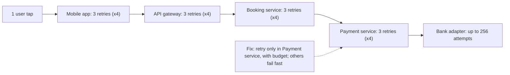
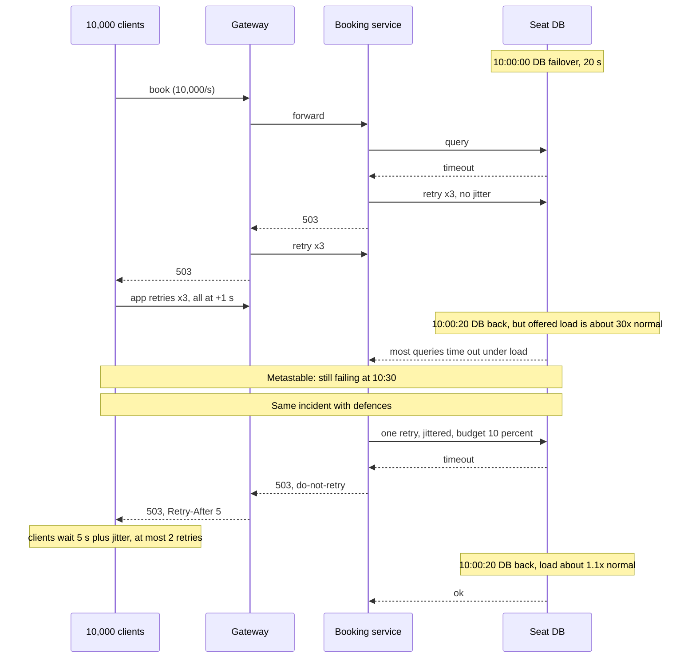
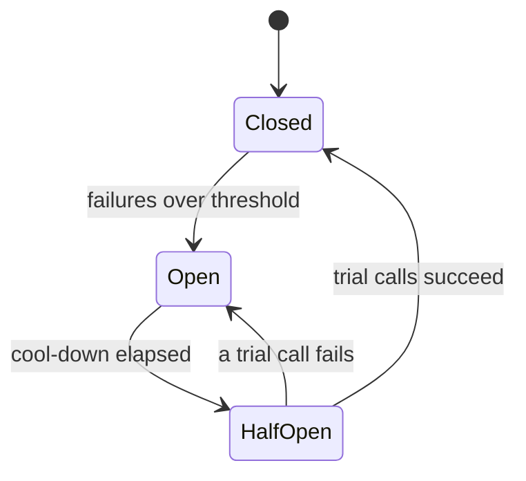

A retry is the most natural reaction to a failure: "it didn't work, try again". For one client and one blip, that is exactly right. For a hundred thousand clients and a struggling server, it is how a 30-second hiccup becomes a two-hour outage. This lesson is about that transformation and how to engineer systems that don't fall into it.

## Learning objectives

By the end of this lesson you will be able to:

1. Explain how retries amplify load, and calculate the worst-case amplification across several layers.
2. Describe a metastable failure: why a system can stay down after the original trigger is gone.
3. Apply the main defences: retry at one layer, retry budgets, exponential backoff with jitter, deadlines, overload signals and circuit breakers.
4. Decide which errors and which operations are safe to retry.
5. Implement a retry budget, jittered backoff and a resilient `DelegatingHandler` for `HttpClient` in C#.
6. Plan resilience tests (load, fault injection, game days) that would catch a retry storm before production does.

## Prerequisites

- [Timeouts, retries and backoff with jitter](#/lesson/m10-timeouts-retries): the basics of a single retry policy.
- [Circuit breaker](#/lesson/m10-circuit-breaker): closed, open and half-open states.
- [Backpressure, load shedding and graceful degradation](#/lesson/m13-backpressure): retries are the other half of the overload story.

## Explain it like I'm a beginner

Imagine a railway reservation counter that opens at 10:00 a.m. for last-minute tickets. Usually 50 people queue. Today the clerk's printer jams for one minute.

Each person in the line has a helper. When the clerk says "sorry, try again", the person doesn't just ask once more; they also send their helper to the next counter, and the helper's cousin calls the station on the phone. Each of those "tries again" twice too. One failed request has become a crowd of requests. When the printer is fixed one minute later, the clerk faces not 50 people but several hundred, all shouting at once. The clerk is so overwhelmed that most of them fail again, and each failure sends out another round of helpers. The printer is fine. The counter is still down.

That is a **retry storm**: retries, each sensible on its own, multiply into far more work than the original traffic, and keep the system overloaded even after the original problem has been fixed.

The fixes are things a sensible counter would do:

- **Only one person retries** for each ticket, not the person, the helper and the cousin. (Retry at one layer.)
- **Wait a random amount of time** before trying again, so everyone doesn't come back at the same moment. (Backoff with jitter.)
- **Limit the total number of second attempts**, for example "retries can be at most 1 in 10 requests". (A retry budget.)
- **The clerk can say "the counter is overloaded, don't send anyone back"**. (An overload signal.)
- **If the counter has failed five times in a row, stop sending people there for a minute.** (A circuit breaker.)

## First-principles explanation

### Why we retry at all

Many failures are **transient**: a dropped TCP connection, a pod restarting during a deploy, a database failover that takes 20 seconds, a brief packet loss. A retry a moment later often succeeds. Retries convert a transient fault into a slightly slower success, which users never notice. That is valuable, and the reason every HTTP library and SDK offers retries.

The problem is that retries treat every failure as transient. **Overload is not transient in the same way.** If a server fails because it has too much work, sending it more work makes it worse.

### Amplification within one layer

If a call fails with probability *p* and the client makes up to *r* retries, each attempt failing independently, the expected number of attempts per call is:

1 + p + p² + … + pʳ

With *r* = 3:

| Failure rate *p* | Expected attempts per call |
|---|---|
| 1 % | ≈ 1.01 |
| 10 % | ≈ 1.11 |
| 50 % | 1.875 |
| 100 % | 4 |

In normal operation retries cost almost nothing. When the dependency is completely down, load quadruples, precisely when the dependency can least afford it.

### Amplification across layers

Real requests pass through several layers, and each layer often has its own retry policy, written by a different team. Picture a train-booking request at 10:00 a.m.:

```text
Mobile app (3 retries) → API gateway (3) → Booking service (3) → Payment service (3) → Bank adapter
```

If the bank adapter is failing every request, each layer multiplies the attempts below it by (3 + 1) = 4. At the bank adapter that is **4 × 4 × 4 × 4 = 256 attempts** for one user tap. 10,000 users tapping "Pay" in the first second can become 2.56 million attempts against the struggling component. In general, worst-case attempts at the bottom = **Π (rᵢ + 1)** over all layers.

Nobody designed 256× amplification. Each team chose "3 retries, that seems reasonable" in isolation. That is why retry policy must be decided **across the whole call path**, not per library.

### Synchronised retries: the thundering herd

Even one layer of retries is dangerous if every client retries at the same time. If 50,000 clients fail at 10:00:00 and all retry after exactly 1 second, the server gets a spike at 10:00:01, another at 10:00:03 (with 2-second backoff), and so on. Exponential backoff spaces the retries out *in time per client*, but without randomness they stay **synchronised across clients**. The cure is **jitter**: add randomness so retries spread evenly over the waiting window.

The AWS Architecture Blog's analysis compared variants and found adding jitter dramatically reduced total work and completion time compared with plain exponential backoff. The common variants:

- **Full jitter:** wait a random time between 0 and min(cap, base × 2ⁿ).
- **Equal jitter:** wait half the exponential delay, plus a random amount up to the other half.
- **Decorrelated jitter:** wait a random time between base and 3 × the previous wait, capped.

Full jitter is a simple, strong default.

### Metastable failures

A **metastable failure** is a state in which a system stays broken after the original trigger is removed, because the system's own reaction keeps it overloaded. Researchers (Bronson et al., HotOS 2021, and a follow-up study of real incidents) describe the pattern: a **trigger** (a deploy, a failover, a traffic spike) pushes the system into overload; a **sustaining effect** (usually retries, sometimes cache misses or queue build-up) keeps load above capacity; the system stays down until someone removes the sustaining load, for example by shedding traffic or blocking retries.

You can see it in this lesson's simulator: a 15-second incident with retries on and no backoff can leave the load above capacity long after the incident ends.

Two signs you are in one:

1. The original fault is fixed (the database is back, the deploy is rolled back) but error rates stay high.
2. Incoming request volume is far higher than normal user traffic would explain.

The usual way out is to **cut the load sharply**: shed a large share of traffic at the edge, disable client retries via a remote config flag, or drain and restart with admission limits in place. Then restore traffic gradually.

### Defence 1: retry at one layer

Pick **one** layer in the call path to own retries, and make the others fail fast. Common choices:

- Retry at the **layer closest to the user** (the mobile app or the gateway) for read-only calls, so the user-facing timeout covers the whole attempt sequence.
- Or retry at the **layer immediately above the failing dependency** (the payment service calling the bank), because it knows the most about which errors are transient.

Either way, the layers in between pass errors upward without retrying. The Google SRE book recommends exactly this: decide holistically where retries happen, and avoid retrying at multiple levels.

### Defence 2: retry budgets

A per-request limit ("at most 2 retries") caps the damage per call, but not overall. During an outage, *every* call retries twice, so total load still triples. A **retry budget** caps retries **as a fraction of total traffic**: for example, "retries may be at most 10 % of requests". When the dependency is healthy, the rare retry fits the budget easily. When it is failing, the budget runs out after a few retries and the client stops retrying, so the extra load is at most 10 %.

Two common implementations:

- **Token bucket (gRPC retry throttling).** The client keeps a token count, starting at a maximum (for example 10). Each failed call removes 1 token; each success adds a fraction (for example 0.1). Retries are allowed only while tokens exceed half the maximum. Under sustained failure, tokens drain and retries stop; as successes return, tokens refill.
- **Deposit and withdraw.** Each request deposits 0.1 tokens (capped); each retry withdraws 1. So retries can be at most about 10 % of requests over time, plus a small reserve for low-traffic clients.

The SRE book also describes a **per-client** budget (retries at most 10 % of requests per client) and a **per-request** limit (at most 3 attempts) used together.

### Defence 3: deadlines, not just timeouts

A **timeout** says "wait at most 2 s for this attempt". A **deadline** says "this whole user request must finish by 10:00:04.500". Pass the deadline downstream (gRPC does this automatically; with HTTP you can send a header such as the remaining milliseconds). Each layer then:

- does not start a retry that cannot finish before the deadline,
- sets its own per-attempt timeout to fit the time remaining,
- stops working on requests whose deadline has passed, because the user has already given up.

Also keep timeouts **decreasing as you go deeper**: if the mobile app gives up after 10 s, the gateway should give up after about 9 s, the booking service after 8 s, and so on. Otherwise inner layers keep working, and retrying, for requests nobody is waiting for.

### Defence 4: overload signals and "don't retry"

An overloaded server should say so, clearly and cheaply:

- `429 Too Many Requests` or `503 Service Unavailable`, with `Retry-After`.
- A distinguishable "overloaded, do not retry" signal for internal calls (a header or gRPC status detail). When a deep layer has already retried and failed, it returns this to its caller, so the layers above don't retry again. The SRE book describes using exactly this kind of signal to stop amplification.

Clients must **honour** these signals: wait at least `Retry-After`, and never retry an explicit "don't retry".

### Defence 5: circuit breakers

A circuit breaker watches calls to one dependency. After enough failures (for example 50 % of at least 20 calls in 30 seconds, or 5 consecutive failures), it **opens** and fails calls immediately for a cool-down period, without touching the dependency. Then it goes **half-open**, lets a few trial calls through, and closes again if they succeed. Breakers protect the dependency from the caller's load (including its retries) and protect the caller from wasting threads and time on calls that will fail. See [the circuit breaker lesson](#/lesson/m10-circuit-breaker).

Breakers and budgets complement each other: a budget limits retries smoothly; a breaker cuts all traffic sharply when a dependency is clearly down.

### What is safe to retry?

1. **The operation must be idempotent**, or made idempotent with an [idempotency key](#/lesson/m10-idempotency). `GET`, `PUT` and `DELETE` are idempotent by HTTP semantics; `POST /payments` is not, unless it carries a key the server deduplicates on. Retrying a non-idempotent payment can charge a customer twice.
2. **The error must be plausibly transient**: connection failures, timeouts, `408`, `429`, `502`, `503`, `504`. Not `400`, `401`, `403`, `404`, `409` or `422`: retrying a bad request just repeats it.
3. **`500` is ambiguous.** It may be a bug (retrying is useless) or a transient fault. Many teams retry `500` at most once, or not at all.
4. **Timeouts are ambiguous too**: the server may have completed the work. Only retry timeouts for idempotent operations.

### Hedging is a retry too

**Hedged requests** (described publicly in Dean and Barroso's *The Tail at Scale*) send a second copy of a slow request to another replica after, say, the 95th-percentile latency, and use whichever answers first. This cuts tail latency, but it is extra load by design, so it needs the same budget discipline: hedge only a small fraction of requests, and stop hedging when the backend is overloaded.

### Resilience engineering: beyond the retry policy

Retry storms are a **system property**, not a library setting. Resilience engineering means designing, measuring and practising how the whole system behaves under stress:

- **Inventory retry policies** along each critical call path, including SDK defaults (many cloud SDKs retry by default).
- **Load test past capacity** and watch whether the system recovers when load drops. A system that recovers is stable; one that stays down is metastable.
- **Inject faults** (latency, errors, a failed dependency) in staging and, carefully, in production ([chaos engineering](#/lesson/m14-chaos)).
- **Run game days**: practise the response to a retry storm, including the "big red button" that disables client retries or sheds traffic.
- **Measure** retry rate, attempts per request, breaker state changes and shed rate as first-class metrics, with alerts when retries exceed, say, 10 % of traffic.

### When a simpler design is enough

- **A single internal client** calling a single service at low volume (a nightly batch job) can use a plain "3 retries with exponential backoff and jitter" without budgets or breakers. Amplification needs many clients to hurt.
- **Asynchronous work** belongs in a queue. Let the broker handle redelivery with delays and a [dead-letter queue](#/lesson/m12-retries-dlq) instead of tight in-process retry loops.
- **If the dependency is a managed service with its own SDK retries**, the simplest good choice may be to keep the SDK's (jittered, bounded) retries and add *none* of your own.

## Visual explanation

### How retries multiply down the call path



Each arrow carries the attempts produced by the layer to its left. If the bank adapter fails every call, the app makes 4 attempts, each of which makes the gateway make 4, and so on: 4⁴ = 256 attempts at the bottom for one tap. The dotted "fix" note points at the single layer that should own retries in this design: the payment service, because it knows which bank errors are transient. With the other three layers failing fast, the worst case drops to 4 attempts per tap, and a retry budget caps the overall extra load at about 10 %.

### A storm, then the same incident with defences



The first half shows the storm. The database fails over for 20 seconds. Every layer retries without jitter, so each client request turns into dozens of attempts, all arriving in synchronised waves. When the database returns at 10:00:20, it faces far more than its normal load, so most queries still time out and trigger more retries. The trigger is gone, but the failure continues: that is the metastable state. The second half replays the same incident with defences. Only the booking service retries, once, with jitter and within a 10 % budget. When that fails, it tells the gateway "do not retry", and the gateway tells clients "retry after 5 seconds". Clients spread their retries out. When the database returns, it sees about 1.1× its normal load and recovers immediately.

### The breaker that cuts load when a dependency is clearly down



While **Closed**, calls flow normally and failures are counted. Crossing the threshold **opens** the breaker: calls fail instantly, so neither first attempts nor retries reach the dependency. After the cool-down, **HalfOpen** lets a few trial calls through. Success closes the breaker; failure re-opens it for another cool-down. During a storm, an open breaker turns thousands of doomed attempts per second into zero.

## Step-by-step example

We will fix the booking flow's payment call step by step. Numbers: 2,000 bookings per second at the 10:00 a.m. peak; the bank adapter can handle about 2,500 calls per second.

### Step 1 — the inherited policy

```csharp
// Payment service: 3 retries, fixed 1 s delay, retries everything.
for (var attempt = 0; attempt <= 3; attempt++)
{
    try { return await bank.ChargeAsync(req, ct); }
    catch (Exception) when (attempt < 3) { await Task.Delay(1000, ct); }
}
```

When the bank returns errors for 30 seconds, load becomes 2,000 × 4 = 8,000 calls per second, synchronised in 1-second waves, against a capacity of 2,500. Worse, `ChargeAsync` is a `POST` without an idempotency key, so a timeout followed by a retry can charge twice.

### Step 2 — retry only safe things

Retry only on connection errors, timeouts, `429`, `502`, `503` and `504`. Send an `Idempotency-Key` (the booking id) so the bank deduplicates retried charges. Never retry `4xx` validation errors.

### Step 3 — backoff with full jitter

Replace the fixed delay with full jitter: retry *n* waits a random time between 0 and min(5 s, 200 ms × 2ⁿ⁻¹). Retries now spread over time instead of arriving in waves.

### Step 4 — a retry budget

Allow retries only while the budget has tokens: each request deposits 0.1; each retry costs 1. During the 30-second outage the budget is spent within the first second; after that, load is 2,000 per second plus at most about 200 retries per second, about 2,200, which is under the bank's 2,500 capacity. When the bank recovers, it recovers immediately.

### Step 5 — a breaker and a "don't retry" answer

If 50 % of calls fail over 10 seconds (with at least 100 calls), open the breaker for 15 seconds. While open, return `503` with a "do not retry" hint to the booking service, and make sure the gateway and app honour it. Now even the 2,000 first attempts per second stop hitting the bank while it is clearly down.

### Step 6 — remove the other layers' retries

Audit the gateway and the app. The gateway's 3 retries are removed for `POST` routes and the booking service stops retrying; the app keeps 1 jittered retry for network errors only (no response at all), sends the same idempotency key on that retry, and honours `Retry-After`. The payment service keeps at most 2 retries to the bank. Worst-case amplification on the pay path drops from 256× to 2 (app) × 1 (gateway) × 1 (booking) × 3 (payment) = 6×, and in practice the budget keeps it near 1.1×.

## Production-style C# implementation

Libraries such as Polly (through `Microsoft.Extensions.Http.Resilience`) implement most of this well, and you should usually use them. The hand-rolled version below exists to show the moving parts, and to compile in this course's offline checker. It combines a per-destination retry budget, full jitter, a circuit breaker, deadlines, `Retry-After` and a "do not retry" hint in one `DelegatingHandler`.

```text
Booking.Api/
  Program.cs
  Resilience/ResilienceOptions.cs
  Resilience/RetryBudget.cs
  Resilience/FullJitterBackoff.cs
  Resilience/SimpleCircuitBreaker.cs
  Resilience/ResilientHttpHandler.cs
```

```csharp file=Resilience/ResilienceOptions.cs
namespace Booking.Resilience;

public sealed class ResilienceOptions
{
    public int MaxRetries { get; set; } = 2;
    public TimeSpan BaseDelay { get; set; } = TimeSpan.FromMilliseconds(200);
    public TimeSpan MaxDelay { get; set; } = TimeSpan.FromSeconds(5);
    public TimeSpan AttemptTimeout { get; set; } = TimeSpan.FromSeconds(2);
    public TimeSpan TotalTimeout { get; set; } = TimeSpan.FromSeconds(8);
    public double RetryBudgetMaxTokens { get; set; } = 10;
    public double RetryBudgetTokenRatio { get; set; } = 0.1;
    public int BreakerFailureThreshold { get; set; } = 5;
    public TimeSpan BreakerOpenFor { get; set; } = TimeSpan.FromSeconds(15);

    /// <summary>Header a server sends when it is overloaded and has already retried: callers must not retry.</summary>
    public const string DoNotRetryHeader = "X-Retry-Hint";
    public const string DoNotRetryValue = "do-not-retry";
}
```

```csharp file=Resilience/RetryBudget.cs
namespace Booking.Resilience;

/// <summary>gRPC-style retry throttling: failures cost 1 token, successes earn tokenRatio,
/// and retries are allowed only while tokens are above half the maximum.</summary>
public sealed class RetryBudget(double maxTokens = 10, double tokenRatio = 0.1)
{
    private readonly object _gate = new();
    private double _tokens = maxTokens;

    public double Tokens { get { lock (_gate) return _tokens; } }

    public bool CanRetry { get { lock (_gate) return _tokens > maxTokens / 2; } }

    public void RecordSuccess() { lock (_gate) _tokens = Math.Min(maxTokens, _tokens + tokenRatio); }

    public void RecordFailure() { lock (_gate) _tokens = Math.Max(0, _tokens - 1); }
}
```

```csharp file=Resilience/FullJitterBackoff.cs
namespace Booking.Resilience;

/// <summary>Full jitter: a uniformly random delay between 0 and min(cap, base × 2^(n-1)).</summary>
public sealed class FullJitterBackoff(TimeSpan baseDelay, TimeSpan cap, Func<double>? random = null)
{
    private readonly Func<double> _random = random ?? Random.Shared.NextDouble;

    public TimeSpan DelayFor(int retryNumber)
    {
        ArgumentOutOfRangeException.ThrowIfLessThan(retryNumber, 1);
        var ceilingMs = Math.Min(cap.TotalMilliseconds, baseDelay.TotalMilliseconds * Math.Pow(2, retryNumber - 1));
        return TimeSpan.FromMilliseconds(ceilingMs * _random());
    }
}
```

```csharp file=Resilience/SimpleCircuitBreaker.cs
namespace Booking.Resilience;

public enum BreakerState { Closed, Open, HalfOpen }

/// <summary>Consecutive-failure breaker. Production breakers usually use a failure ratio over a sliding window.</summary>
public sealed class SimpleCircuitBreaker(int failureThreshold, TimeSpan openFor, TimeProvider clock)
{
    private readonly object _gate = new();
    private int _consecutiveFailures;
    private DateTimeOffset _openedAt;
    private BreakerState _state = BreakerState.Closed;
    private bool _trialInFlight;

    public BreakerState State { get { lock (_gate) return Refresh(); } }

    /// <summary>True if a call may proceed. In half-open, only one trial call at a time is allowed.</summary>
    public bool TryAcquire()
    {
        lock (_gate)
        {
            switch (Refresh())
            {
                case BreakerState.Closed: return true;
                case BreakerState.HalfOpen when !_trialInFlight: _trialInFlight = true; return true;
                default: return false;
            }
        }
    }

    public void RecordSuccess()
    {
        lock (_gate) { _consecutiveFailures = 0; _state = BreakerState.Closed; _trialInFlight = false; }
    }

    public void RecordFailure()
    {
        lock (_gate)
        {
            _trialInFlight = false;
            if (_state == BreakerState.HalfOpen || ++_consecutiveFailures >= failureThreshold)
            {
                _state = BreakerState.Open;
                _openedAt = clock.GetUtcNow();
            }
        }
    }

    private BreakerState Refresh()
    {
        if (_state == BreakerState.Open && clock.GetUtcNow() - _openedAt >= openFor) _state = BreakerState.HalfOpen;
        return _state;
    }
}

public sealed class CircuitOpenException(string destination)
    : Exception($"Circuit for {destination} is open; failing fast.");
```

```csharp file=Resilience/ResilientHttpHandler.cs
using System.Net;
using Microsoft.Extensions.Logging;
using Microsoft.Extensions.Options;

namespace Booking.Resilience;

/// <summary>One retry owner for one destination: budget, jittered backoff, breaker, deadline, Retry-After
/// and "do not retry" hints. Register exactly one of these per call path.</summary>
public sealed class ResilientHttpHandler(
    RetryBudget budget,
    SimpleCircuitBreaker breaker,
    IOptions<ResilienceOptions> options,
    TimeProvider clock,
    ILogger<ResilientHttpHandler> logger) : DelegatingHandler
{
    private readonly ResilienceOptions _o = options.Value;
    private readonly FullJitterBackoff _backoff = new(options.Value.BaseDelay, options.Value.MaxDelay);

    private static readonly HashSet<HttpStatusCode> Transient = new()
    {
        HttpStatusCode.RequestTimeout, HttpStatusCode.TooManyRequests, HttpStatusCode.BadGateway,
        HttpStatusCode.ServiceUnavailable, HttpStatusCode.GatewayTimeout,
    };

    protected override async Task<HttpResponseMessage> SendAsync(HttpRequestMessage request, CancellationToken ct)
    {
        var deadline = clock.GetUtcNow() + _o.TotalTimeout;
        var canRetry = IsIdempotent(request);

        for (var attempt = 1; ; attempt++)
        {
            if (!breaker.TryAcquire()) throw new CircuitOpenException(request.RequestUri?.Host ?? "unknown");

            HttpResponseMessage? response = null;
            Exception? error = null;
            using (var attemptCts = CancellationTokenSource.CreateLinkedTokenSource(ct))
            {
                var remaining = deadline - clock.GetUtcNow();
                attemptCts.CancelAfter(remaining < _o.AttemptTimeout ? remaining : _o.AttemptTimeout);
                try { response = await base.SendAsync(request, attemptCts.Token); }
                catch (Exception ex) when (!ct.IsCancellationRequested && ex is HttpRequestException or OperationCanceledException)
                {
                    error = ex;   // connection failure or per-attempt timeout
                }
            }

            var failed = error is not null || Transient.Contains(response!.StatusCode);
            if (!failed)
            {
                breaker.RecordSuccess();
                budget.RecordSuccess();
                return response!;
            }

            breaker.RecordFailure();
            budget.RecordFailure();

            var doNotRetry = response is not null &&
                response.Headers.TryGetValues(ResilienceOptions.DoNotRetryHeader, out var hints) &&
                hints.Contains(ResilienceOptions.DoNotRetryValue);
            var delay = _backoff.DelayFor(attempt);
            if (response?.Headers.RetryAfter?.Delta is { } retryAfter && retryAfter > delay) delay = retryAfter;

            var stop = !canRetry ? "operation not idempotent"
                : doNotRetry ? "downstream said do-not-retry"
                : attempt > _o.MaxRetries ? "retries exhausted"
                : !budget.CanRetry ? "retry budget exhausted"
                : clock.GetUtcNow() + delay >= deadline ? "deadline would be exceeded"
                : null;

            if (stop is not null)
            {
                logger.LogWarning("Not retrying {Method} {Uri} after attempt {Attempt}: {Reason}", request.Method, request.RequestUri, attempt, stop);
                if (response is not null)
                {
                    // Tell our own callers not to retry either: we already did.
                    response.Headers.TryAddWithoutValidation(ResilienceOptions.DoNotRetryHeader, ResilienceOptions.DoNotRetryValue);
                    return response;
                }
                throw error!;
            }

            response?.Dispose();
            logger.LogInformation("Retry {Attempt} for {Uri} in {Delay}", attempt, request.RequestUri, delay);
            await Task.Delay(delay, clock, ct);
        }
    }

    /// <summary>GET/HEAD/PUT/DELETE/OPTIONS are idempotent by HTTP semantics; POST only with an idempotency key.</summary>
    private static bool IsIdempotent(HttpRequestMessage r) =>
        r.Method == HttpMethod.Get || r.Method == HttpMethod.Head || r.Method == HttpMethod.Put ||
        r.Method == HttpMethod.Delete || r.Method == HttpMethod.Options || r.Headers.Contains("Idempotency-Key");
}
```

```csharp file=Program.cs
using Booking.Resilience;
using Microsoft.Extensions.Options;

var builder = WebApplication.CreateBuilder(args);

builder.Services.Configure<ResilienceOptions>(builder.Configuration.GetSection("Resilience:Bank"));
builder.Services.AddSingleton(TimeProvider.System);

// Budget and breaker are per destination and shared by all requests, so they are singletons.
builder.Services.AddSingleton(sp =>
{
    var o = sp.GetRequiredService<IOptions<ResilienceOptions>>().Value;
    return new RetryBudget(o.RetryBudgetMaxTokens, o.RetryBudgetTokenRatio);
});
builder.Services.AddSingleton(sp =>
{
    var o = sp.GetRequiredService<IOptions<ResilienceOptions>>().Value;
    return new SimpleCircuitBreaker(o.BreakerFailureThreshold, o.BreakerOpenFor, sp.GetRequiredService<TimeProvider>());
});
builder.Services.AddTransient<ResilientHttpHandler>();

builder.Services.AddHttpClient("bank", c =>
{
    c.BaseAddress = new Uri("https://bank-adapter.internal/");
    c.Timeout = TimeSpan.FromSeconds(10);   // outer safety net, longer than ResilienceOptions.TotalTimeout
}).AddHttpMessageHandler<ResilientHttpHandler>();

var app = builder.Build();

app.MapPost("/bookings/{id}/pay", async (string id, decimal amount, IHttpClientFactory factory, CancellationToken ct) =>
{
    var client = factory.CreateClient("bank");
    using var request = new HttpRequestMessage(HttpMethod.Post, "charges")
    {
        Content = JsonContent.Create(new { bookingId = id, amountPaise = (long)(amount * 100) }),
    };
    request.Headers.Add("Idempotency-Key", $"booking-{id}");   // makes the POST safe to retry

    try
    {
        using var response = await client.SendAsync(request, ct);
        return response.IsSuccessStatusCode
            ? Results.Ok(new { id, status = "paid" })
            : Results.Problem("Payment failed. Please try again shortly.", statusCode: StatusCodes.Status503ServiceUnavailable);
    }
    catch (CircuitOpenException)
    {
        return Results.Problem("Payments are temporarily unavailable.", statusCode: StatusCodes.Status503ServiceUnavailable);
    }
});

app.Run();
```

**The library version.** With the `Microsoft.Extensions.Http.Resilience` package (built on Polly v8), the standard pipeline adds a rate limiter, total timeout, retry with exponential backoff and jitter, circuit breaker and per-attempt timeout in one line. This snippet is not compiled by the course checker:

```csharp
builder.Services.AddHttpClient("bank")
    .AddStandardResilienceHandler(o =>
    {
        o.Retry.MaxRetryAttempts = 2;
        o.Retry.BackoffType = DelayBackoffType.Exponential;
        o.Retry.UseJitter = true;
        o.CircuitBreaker.FailureRatio = 0.5;
        o.TotalRequestTimeout.Timeout = TimeSpan.FromSeconds(8);
    });
```

Two cautions with any library: check what is retried by default, and remember that a per-client policy still multiplies across layers. The standard handler's retry strategy retries transient failures for every HTTP method unless you call `o.Retry.DisableForUnsafeHttpMethods()` (or send an idempotency key the server honours), so a `POST /payments` behind it is retried by default. It also honours `Retry-After` by default (`ShouldRetryAfterHeader`). It has no retry budget; if you need one, add a custom strategy or rely on the circuit breaker plus a low retry count. The library protects one hop; you design the path.

## Bad design vs good design

**Bad: every layer "just adds Polly".**

```text
App:     3 retries, 1 s fixed
Gateway: 3 retries, exponential, no jitter
Booking: 3 retries on all exceptions, including 400 and 409
Payment: SDK default retries (3) + team's own 3 retries
```

Worst case: 4 × 4 × 4 × 16 = 1,024 attempts per tap; synchronised waves; validation errors retried pointlessly; duplicated payments because nobody sends an idempotency key. Each team's choice looked reasonable in its own pull request.

**Good:**

```text
App:     1 retry on network errors only, honours Retry-After, full jitter
Gateway: no retries on POST; 1 retry on GET for connection errors
Booking: no retries; passes deadline and do-not-retry hints through
Payment: owns retries to the bank: max 2, full jitter, 10 % budget, breaker, idempotency key
```

Worst case on the pay path (a `POST`, so the gateway does not retry): 2 × 1 × 1 × 3 = 6 attempts per tap at the bank, and the budget keeps typical extra load near 10 %. Every policy is written down in one place (an architecture decision record) for the whole path.

:::callout type=mistake title="Retrying inside a retry"
A common hidden multiplier is retrying around a client that already retries: an SDK with built-in retries wrapped in your own retry loop, or an `HttpClient` with a resilience handler called from a method that also retries. Read the defaults of every SDK on a critical path.
:::

## Practical playground

The simulator models 500 clients each sending one new request per second to a dependency with a capacity of 1,000 requests per second. Between seconds 10 and 25 the dependency fails a share of requests (the incident).

1. Run the defaults: 40 % failure, 3 retries, no backoff, no jitter. Note the amplification and whether the storm continues after second 25.
2. Turn on backoff. Do the waves get smaller, or just further apart?
3. Turn on jitter as well. Compare peak load.
4. Set retries to 1. Then set the failure rate to 0.9 and compare 1 retry with 3. Which setting would you choose if you could not add a retry budget?
5. Raise clients to 900 (close to capacity) and repeat. Systems running near capacity have far less room for retries.

:::playground type=sim sim=retry title="Retries, backoff and jitter during a 15-second incident" failureRate=0.4 maxRetries=3 backoff=false jitter=false clients=500 capacityRps=1000
:::

## Exercises

:::exercise id=m13-retry-storms-ex1 difficulty=beginner kind=code title="Calculate retry amplification"
Write two helpers that put numbers on retry amplification.
::requirements
- `RetryMath.WorstCaseAttempts(params int[] retriesPerLayer)` returns the product of (rᵢ + 1) across layers as a `long`. No layers means 1. Any negative value throws `ArgumentOutOfRangeException`.
- `RetryMath.ExpectedAttempts(int maxRetries, double failureProbability)` returns 1 + p + p² + … + p^maxRetries. `p` must be in [0, 1] and `maxRetries` ≥ 0, else throw `ArgumentOutOfRangeException`.
::acceptance
- Three layers with 3 retries each → 64. Four layers → 256.
- `ExpectedAttempts(3, 0.5)` = 1.875; with p = 1 it is 4; with p = 0 it is 1.
- Invalid inputs throw.
::hint
Each layer multiplies the attempts of everything below it.
::hint
Use a `long` accumulator; products grow fast.
::hint
For the expected value, add p⁰, p¹, … pʳ in a loop, keeping a running power.
::hint
```csharp
double total = 0, power = 1;
for (var k = 0; k <= maxRetries; k++) { total += power; power *= p; }
```
::starter
```csharp file=RetryMath.cs
using System;

public static class RetryMath
{
    public static long WorstCaseAttempts(params int[] retriesPerLayer) => throw new NotImplementedException();
    public static double ExpectedAttempts(int maxRetries, double failureProbability) => throw new NotImplementedException();
}
```
::tests
```csharp file=RetryMathTests.cs
using System;
using Xunit;

public class RetryMathTests
{
    [Fact] public void Three_layers() => Assert.Equal(64L, RetryMath.WorstCaseAttempts(3, 3, 3));
    [Fact] public void Four_layers() => Assert.Equal(256L, RetryMath.WorstCaseAttempts(3, 3, 3, 3));
    [Fact] public void Mixed_layers() => Assert.Equal(12L, RetryMath.WorstCaseAttempts(1, 1, 0, 2));
    [Fact] public void No_layers_is_one_attempt() => Assert.Equal(1L, RetryMath.WorstCaseAttempts());
    [Fact] public void Negative_throws() => Assert.Throws<ArgumentOutOfRangeException>(() => RetryMath.WorstCaseAttempts(3, -1));

    [Fact] public void Expected_half() => Assert.Equal(1.875, RetryMath.ExpectedAttempts(3, 0.5), 6);
    [Fact] public void Expected_always_failing() => Assert.Equal(4.0, RetryMath.ExpectedAttempts(3, 1.0), 6);
    [Fact] public void Expected_never_failing() => Assert.Equal(1.0, RetryMath.ExpectedAttempts(3, 0.0), 6);

    [Fact]
    public void Expected_invalid()
    {
        Assert.Throws<ArgumentOutOfRangeException>(() => RetryMath.ExpectedAttempts(-1, 0.5));
        Assert.Throws<ArgumentOutOfRangeException>(() => RetryMath.ExpectedAttempts(3, 1.5));
    }
}
```
::solution
```csharp file=RetryMath.cs
using System;

public static class RetryMath
{
    public static long WorstCaseAttempts(params int[] retriesPerLayer)
    {
        long attempts = 1;
        foreach (var r in retriesPerLayer)
        {
            if (r < 0) throw new ArgumentOutOfRangeException(nameof(retriesPerLayer), r, "Retries cannot be negative.");
            attempts = checked(attempts * (r + 1));
        }
        return attempts;
    }

    public static double ExpectedAttempts(int maxRetries, double failureProbability)
    {
        if (maxRetries < 0) throw new ArgumentOutOfRangeException(nameof(maxRetries));
        if (failureProbability is < 0 or > 1) throw new ArgumentOutOfRangeException(nameof(failureProbability));
        double total = 0, power = 1;
        for (var k = 0; k <= maxRetries; k++)
        {
            total += power;
            power *= failureProbability;
        }
        return total;
    }
}
```
The two numbers tell different stories. `ExpectedAttempts` at a 1 % failure rate is about 1.01: retries look free. `WorstCaseAttempts` shows what happens when the dependency is fully down. Design for the second number.
::mistakes
- Adding retries across layers (3 + 3 + 3) instead of multiplying (4 × 4 × 4).
- Using `int` and overflowing silently on deep call paths; `checked` makes overflow loud.
:::

:::exercise id=m13-retry-storms-ex2 difficulty=beginner kind=code title="Full-jitter backoff"
Implement exponential backoff with full jitter, with an injectable random source so it can be tested.
::requirements
- `JitterBackoff(TimeSpan baseDelay, TimeSpan cap, Func<double> random)`; `random` returns a value in [0, 1).
- `TimeSpan DelayFor(int retryNumber)`: retry 1 uses ceiling = base; retry 2 uses 2 × base; retry n uses base × 2ⁿ⁻¹; the ceiling never exceeds `cap`. The delay is ceiling × random().
- `retryNumber < 1` throws `ArgumentOutOfRangeException`.
- Very large retry numbers (for example 200) must return a capped delay, not overflow.
::acceptance
- Base 100 ms, cap 5 s, random 0.5: retry 1 → 50 ms, retry 3 → 200 ms, retry 10 → 2.5 s.
- Random 0 → zero delay.
- Retry 200 → at most the cap.
::hint
Compute the ceiling in milliseconds as a `double`.
::hint
`Math.Pow(2, n - 1)` gets huge but stays finite for n = 200 (about 8 × 10⁵⁹); `Math.Min` with the cap then fixes it.
::hint
`TimeSpan.FromMilliseconds(ceilingMs * random())`.
::starter
```csharp file=JitterBackoff.cs
using System;

public sealed class JitterBackoff
{
    public JitterBackoff(TimeSpan baseDelay, TimeSpan cap, Func<double> random) => throw new NotImplementedException();
    public TimeSpan DelayFor(int retryNumber) => throw new NotImplementedException();
}
```
::tests
```csharp file=JitterBackoffTests.cs
using System;
using Xunit;

public class JitterBackoffTests
{
    private static JitterBackoff Make(double r) => new(TimeSpan.FromMilliseconds(100), TimeSpan.FromSeconds(5), () => r);

    [Fact] public void First_retry() => Assert.Equal(TimeSpan.FromMilliseconds(50), Make(0.5).DelayFor(1));
    [Fact] public void Third_retry() => Assert.Equal(TimeSpan.FromMilliseconds(200), Make(0.5).DelayFor(3));
    [Fact] public void Capped() => Assert.Equal(TimeSpan.FromMilliseconds(2500), Make(0.5).DelayFor(10));
    [Fact] public void Zero_random() => Assert.Equal(TimeSpan.Zero, Make(0).DelayFor(4));
    [Fact] public void Huge_retry_number_is_capped() => Assert.True(Make(0.999).DelayFor(200) <= TimeSpan.FromSeconds(5));
    [Fact] public void Invalid_retry_number() => Assert.Throws<ArgumentOutOfRangeException>(() => Make(0.5).DelayFor(0));

    [Fact]
    public void Real_random_stays_in_range()
    {
        var b = new JitterBackoff(TimeSpan.FromMilliseconds(100), TimeSpan.FromSeconds(5), new Random(42).NextDouble);
        for (var i = 0; i < 200; i++)
        {
            var d = b.DelayFor(3);
            Assert.True(d >= TimeSpan.Zero && d < TimeSpan.FromMilliseconds(400));
        }
    }
}
```
::solution
```csharp file=JitterBackoff.cs
using System;

public sealed class JitterBackoff
{
    private readonly TimeSpan _base;
    private readonly TimeSpan _cap;
    private readonly Func<double> _random;

    public JitterBackoff(TimeSpan baseDelay, TimeSpan cap, Func<double> random)
    {
        _base = baseDelay;
        _cap = cap;
        _random = random;
    }

    public TimeSpan DelayFor(int retryNumber)
    {
        if (retryNumber < 1) throw new ArgumentOutOfRangeException(nameof(retryNumber), retryNumber, "Retries are numbered from 1.");
        var ceilingMs = Math.Min(_cap.TotalMilliseconds, _base.TotalMilliseconds * Math.Pow(2, retryNumber - 1));
        return TimeSpan.FromMilliseconds(ceilingMs * _random());
    }
}
```
Injecting `Func<double>` instead of calling `Random.Shared` directly keeps the class deterministic in tests. In production, pass `Random.Shared.NextDouble`, which is thread-safe.
::mistakes
- Multiplying the delay by a random factor between 0.9 and 1.1 ("a little jitter"). Clients stay mostly synchronised; full jitter spreads them across the whole window.
- Computing `1 << retryNumber` with integers, which overflows after 31.
- Sharing one `new Random()` across threads (not thread-safe); use `Random.Shared`.
:::

:::exercise id=m13-retry-storms-ex3 difficulty=intermediate kind=code title="A deposit-and-withdraw retry budget"
Implement a retry budget that keeps retries to a fraction of total requests, with a cap and an initial reserve.
::requirements
- `RetryBudget(double depositPerRequest, double maxBalance, double initialBalance)`.
- `OnRequest()` adds `depositPerRequest`, never exceeding `maxBalance`.
- `bool TryWithdrawForRetry()` returns true and subtracts 1 if the balance is at least 1; otherwise returns false and increments `Denied`.
- `Balance` and `Denied` properties. Thread-safe.
- Negative arguments, or `initialBalance > maxBalance`, throw `ArgumentOutOfRangeException`.
::acceptance
- Deposit 0.1, max 10, initial 0: after 100 requests, exactly 10 retries are allowed and the 11th is denied.
- After 1,000 requests the balance is capped at 10.
- Initial balance 2 allows two retries before any requests.
- 8 threads × 10,000 requests and withdrawals never let the balance go negative.
::hint
This is a token bucket where "time" is replaced by "requests".
::hint
Floating-point sums like 0.1 × 100 may land at 9.9999999. Decide how you handle that (for example compare with a small epsilon, or count in integer tenths).
::hint
A `lock` around the balance is simple and fast enough here; contention is only on the retry path.
::hint
```csharp
lock (_gate)
{
    if (_balance + 1e-9 < 1) { _denied++; return false; }
    _balance = Math.Max(0, _balance - 1);
    return true;
}
```
::starter
```csharp file=RetryBudget.cs
using System;

public sealed class RetryBudget
{
    public RetryBudget(double depositPerRequest, double maxBalance, double initialBalance) => throw new NotImplementedException();

    public double Balance => throw new NotImplementedException();
    public long Denied => throw new NotImplementedException();

    public void OnRequest() => throw new NotImplementedException();
    public bool TryWithdrawForRetry() => throw new NotImplementedException();
}
```
::tests
```csharp file=RetryBudgetTests.cs
using System;
using System.Threading.Tasks;
using Xunit;

public class RetryBudgetTests
{
    [Fact]
    public void Ten_percent_of_requests()
    {
        var b = new RetryBudget(0.1, 10, 0);
        for (var i = 0; i < 100; i++) b.OnRequest();
        var allowed = 0;
        for (var i = 0; i < 11; i++) if (b.TryWithdrawForRetry()) allowed++;
        Assert.Equal(10, allowed);
        Assert.Equal(1L, b.Denied);
    }

    [Fact]
    public void Balance_is_capped()
    {
        var b = new RetryBudget(0.1, 10, 0);
        for (var i = 0; i < 1000; i++) b.OnRequest();
        Assert.Equal(10.0, b.Balance, 6);
    }

    [Fact]
    public void Initial_reserve()
    {
        var b = new RetryBudget(0.1, 10, 2);
        Assert.True(b.TryWithdrawForRetry());
        Assert.True(b.TryWithdrawForRetry());
        Assert.False(b.TryWithdrawForRetry());
    }

    [Fact]
    public void Invalid_arguments()
    {
        Assert.Throws<ArgumentOutOfRangeException>(() => new RetryBudget(-0.1, 10, 0));
        Assert.Throws<ArgumentOutOfRangeException>(() => new RetryBudget(0.1, 10, 11));
    }

    [Fact]
    public void Thread_safe()
    {
        var b = new RetryBudget(0.1, 50, 0);
        Parallel.For(0, 8, _ =>
        {
            for (var i = 0; i < 10_000; i++)
            {
                b.OnRequest();
                if (i % 5 == 0) b.TryWithdrawForRetry();
            }
        });
        Assert.True(b.Balance >= 0);
        Assert.True(b.Balance <= 50);
    }
}
```
::solution
```csharp file=RetryBudget.cs
using System;

public sealed class RetryBudget
{
    private const double Epsilon = 1e-9;
    private readonly object _gate = new();
    private readonly double _deposit;
    private readonly double _max;
    private double _balance;
    private long _denied;

    public RetryBudget(double depositPerRequest, double maxBalance, double initialBalance)
    {
        if (depositPerRequest < 0) throw new ArgumentOutOfRangeException(nameof(depositPerRequest));
        if (maxBalance < 0) throw new ArgumentOutOfRangeException(nameof(maxBalance));
        if (initialBalance < 0 || initialBalance > maxBalance) throw new ArgumentOutOfRangeException(nameof(initialBalance));
        _deposit = depositPerRequest;
        _max = maxBalance;
        _balance = initialBalance;
    }

    public double Balance { get { lock (_gate) return _balance; } }
    public long Denied { get { lock (_gate) return _denied; } }

    public void OnRequest()
    {
        lock (_gate) _balance = Math.Min(_max, _balance + _deposit);
    }

    public bool TryWithdrawForRetry()
    {
        lock (_gate)
        {
            if (_balance + Epsilon < 1)
            {
                _denied++;
                return false;
            }
            _balance = Math.Max(0, _balance - 1);
            return true;
        }
    }
}
```
The cap matters: without it, a long quiet period would build up thousands of tokens, and the next outage could spend them all at once, which is exactly the burst you wanted to avoid. The initial reserve lets low-traffic clients retry occasionally.
::alternatives
gRPC's retry throttling inverts the bookkeeping: tokens start full, failures cost 1, successes earn a fraction, and retries are allowed only while tokens are above half the maximum. It reacts to the *failure rate*, while deposit-and-withdraw reacts to the *retry rate*; both cap extra load during outages.
::mistakes
- Depositing on retries as well as first attempts, so retries fund themselves.
- No cap on the balance.
- Ignoring floating-point drift so the 10th retry is unexpectedly denied.
:::

:::exercise id=m13-retry-storms-ex4 difficulty=intermediate kind=hld title="Stop the 10 a.m. booking storm"
An intercity bus-ticket platform opens bookings for festival dates at 10:00 a.m. Peak traffic is about **15,000 booking attempts per second** for two minutes. Last year, the seat-inventory database failed over (about 25 seconds), and the platform stayed down for 70 minutes. The post-incident review found: the Android app retries 3 times with a fixed 2 s delay, the API gateway retries 2 times, the booking service retries every exception 3 times, and the payment SDK retries 3 times by default. Redesign the retry and resilience strategy.
::acceptance
- Calculates the worst-case amplification before and after.
- Names exactly one retry owner per hop, with a reason, and makes the others fail fast.
- Includes jittered backoff, a retry budget and a circuit breaker, with example numbers.
- Explains deadline propagation and decreasing timeouts.
- Describes how to get out of a metastable state if it happens anyway (the "big red button").
::hint
Multiply (r + 1) across the four layers first.
::hint
Which layer knows whether a seat-database error is transient?
::hint
The app can show "Busy, retrying in N seconds" instead of retrying silently.
::hint
A remote config flag that sets client retries to 0 is a powerful emergency tool. So is shedding a percentage of traffic at the edge.
::starter
```json
{
  "nodes": [
    { "id": "app", "type": "client", "label": "Android app (3 retries, fixed 2 s)", "props": { "rps": 15000 } },
    { "id": "gw", "type": "api-gateway", "label": "API gateway (2 retries)" },
    { "id": "bk", "type": "app-server", "label": "Booking service (3 retries, all errors)", "props": { "instances": 20 } },
    { "id": "inv", "type": "database", "label": "Seat inventory DB", "props": { "replicas": 1 } },
    { "id": "pay", "type": "external", "label": "Payment gateway (SDK 3 retries)" }
  ],
  "edges": [
    { "from": "app", "to": "gw", "kind": "sync" },
    { "from": "gw", "to": "bk", "kind": "sync" },
    { "from": "bk", "to": "inv", "kind": "sync" },
    { "from": "bk", "to": "pay", "kind": "sync" }
  ]
}
```
::solution
```json
{
  "nodes": [
    { "id": "app", "type": "client", "label": "Android app: 1 retry on network error, honours Retry-After, remote retry switch", "props": { "rps": 15000 } },
    { "id": "cfg", "type": "external", "label": "Remote config (retry kill switch)" },
    { "id": "gw", "type": "api-gateway", "label": "Gateway: no retries on POST, admission control, sets deadline" },
    { "id": "rl", "type": "rate-limiter", "label": "Per-user limit + global concurrency cap" },
    { "id": "bk", "type": "app-server", "label": "Booking service: owns DB retries (max 2, full jitter, 10% budget, breaker)", "props": { "instances": 20 } },
    { "id": "inv", "type": "database", "label": "Seat inventory DB (HA)", "props": { "replicas": 1, "multiAz": true } },
    { "id": "pay", "type": "external", "label": "Payment gateway (SDK retries 1, idempotency key)" },
    { "id": "mon", "type": "monitoring", "label": "Retry rate, attempts per request, breaker state" }
  ],
  "edges": [
    { "from": "app", "to": "cfg", "kind": "async", "label": "fetch retry policy" },
    { "from": "app", "to": "gw", "kind": "sync" },
    { "from": "gw", "to": "rl", "kind": "sync" },
    { "from": "rl", "to": "bk", "kind": "sync", "label": "deadline header" },
    { "from": "bk", "to": "inv", "kind": "sync", "label": "attempt timeout 300 ms" },
    { "from": "bk", "to": "pay", "kind": "sync", "label": "Idempotency-Key" },
    { "from": "bk", "to": "mon", "kind": "async" }
  ]
}
```

**Amplification.** Before: app × 4, gateway × 3, booking service × 4 gives 4 × 3 × 4 = **48** attempts per tap at the seat database. On the payment hop the SDK multiplies by another 4, so up to **192** attempts at the payment gateway. After: app 2 × gateway 1 × booking 3 = **6** worst case at the database, and the 10 % budget keeps typical extra load near 1.1×.

**Retry owners.** The booking service owns retries to the seat database because it knows which errors are transient (serialization failures, connection resets during failover) and which are not (seat already taken). The payment SDK keeps 1 retry with the booking id as idempotency key; the booking service does **not** wrap it in its own retries. The gateway does not retry `POST`. The app retries once, only when no response arrived at all.

**Backoff, budget, breaker.** Database retries: full jitter, base 100 ms, cap 1 s, max 2. Budget: 10 % of requests per booking-service instance (deposit 0.1, cap 20). Breaker: open when more than 50 % of at least 200 calls fail in 10 s; stay open 10 s; half-open with a few trial calls. While open, return `503` with `Retry-After: 10` and the do-not-retry hint.

**Deadlines.** App timeout 10 s. Gateway sets a deadline of now + 9 s in a header; booking service computes remaining time, uses at most 300 ms per database attempt, and skips retries that cannot finish before the deadline. Timeouts shrink at each hop so inner layers never work for a user who has gone.

**If it happens anyway.** Dashboards show attempts per request; an alert fires when retries exceed 20 % of traffic. The runbook's big red button: flip remote config to set app retries to 0 and show "High demand, please try in a minute"; shed 50 % of sheddable traffic at the gateway; once error rates fall, restore traffic in steps of 10 % per minute.

**Also consider** a virtual waiting room at 10:00 a.m. so the platform admits users at the rate it can serve; it removes the cliff that made the failover so damaging.
::mistakes
- Removing all retries everywhere: transient blips (one dropped connection) then fail user requests needlessly.
- Keeping the payment SDK's default retries *and* adding your own around it.
- Retrying `POST /bookings` without an idempotency key, creating duplicate bookings.
:::

:::exercise id=m13-retry-storms-ex5 difficulty=advanced kind=code title="A retry executor that knows when to stop"
Implement a retry loop that stops for the right reasons: success, non-retryable status, a do-not-retry hint, exhausted retries, an empty budget, or a deadline it cannot meet. It honours `Retry-After`.
::requirements
- `AttemptResult(bool Success, int StatusCode, TimeSpan? RetryAfter, bool DoNotRetry)`. `StatusCode` 0 means "no response" (network error or timeout).
- Retryable status codes: 0, 408, 429, 502, 503, 504.
- `RetryExecutor(int maxRetries, Func<int, TimeSpan> backoff, IRetryBudget budget, TimeProvider clock, Func<TimeSpan, Task> delay)`.
- `Task<RetryOutcome> ExecuteAsync(Func<int, Task<AttemptResult>> attempt, DateTimeOffset deadline)`. Attempts are numbered from 1.
- After a failed attempt, check in this order: not retryable → `NotRetryable`; `DoNotRetry` → `DownstreamOverloaded`; attempts used > `maxRetries` → `RetriesExhausted`; `!budget.TryWithdraw()` → `BudgetExhausted`; delay = max(backoff(retryNumber), RetryAfter ?? 0); if now + delay ≥ deadline → `DeadlineExceeded`. Otherwise await `delay(d)` and try again.
- `RetryOutcome(StopReason Reason, int Attempts, IReadOnlyList<TimeSpan> Delays)`; success gives `StopReason.Succeeded`.
::acceptance
- 503, 503, then success → `Succeeded`, 3 attempts, two delays.
- 400 → `NotRetryable` after 1 attempt; the budget is not touched.
- `Retry-After` of 3 s overrides a 100 ms backoff.
- A 2 s backoff with 1 s left until the deadline → `DeadlineExceeded` after 1 attempt.
- A budget that says no → `BudgetExhausted`.
- `maxRetries` 2 and always 503 → `RetriesExhausted` after 3 attempts.
::hint
Keep a `List<TimeSpan>` of delays you actually waited; it makes the tests easy to read.
::hint
The retry number for the backoff is the number of attempts so far (after attempt 1 fails, it is retry 1).
::hint
In tests, the injected `delay` function advances a manual clock instead of really waiting.
::hint
```csharp
for (var n = 1; ; n++)
{
    var r = await attempt(n);
    if (r.Success) return new(StopReason.Succeeded, n, delays);
    if (!Retryable.Contains(r.StatusCode)) return new(StopReason.NotRetryable, n, delays);
    // ... remaining checks in order ...
}
```
::starter
```csharp file=RetryExecutor.cs
using System;
using System.Collections.Generic;
using System.Threading.Tasks;

public enum StopReason { Succeeded, NotRetryable, DownstreamOverloaded, RetriesExhausted, BudgetExhausted, DeadlineExceeded }

public sealed record AttemptResult(bool Success, int StatusCode, TimeSpan? RetryAfter = null, bool DoNotRetry = false);

public sealed record RetryOutcome(StopReason Reason, int Attempts, IReadOnlyList<TimeSpan> Delays);

public interface IRetryBudget { bool TryWithdraw(); }

public sealed class RetryExecutor
{
    public RetryExecutor(int maxRetries, Func<int, TimeSpan> backoff, IRetryBudget budget, TimeProvider clock, Func<TimeSpan, Task> delay)
        => throw new NotImplementedException();

    public Task<RetryOutcome> ExecuteAsync(Func<int, Task<AttemptResult>> attempt, DateTimeOffset deadline)
        => throw new NotImplementedException();
}
```
::tests
```csharp file=RetryExecutorTests.cs
using System;
using System.Collections.Generic;
using System.Threading.Tasks;
using Xunit;

public class RetryExecutorTests
{
    private sealed class ManualClock : TimeProvider
    {
        public DateTimeOffset Now = new(2026, 10, 19, 4, 30, 0, TimeSpan.Zero);
        public override DateTimeOffset GetUtcNow() => Now;
    }

    private sealed class FakeBudget(bool allow) : IRetryBudget
    {
        public int Calls;
        public bool TryWithdraw() { Calls++; return allow; }
    }

    private static (RetryExecutor Exec, ManualClock Clock, FakeBudget Budget) Make(int maxRetries = 3, TimeSpan? backoff = null, bool budgetAllows = true)
    {
        var clock = new ManualClock();
        var budget = new FakeBudget(budgetAllows);
        var b = backoff ?? TimeSpan.FromMilliseconds(100);
        var exec = new RetryExecutor(maxRetries, _ => b, budget, clock, d => { clock.Now += d; return Task.CompletedTask; });
        return (exec, clock, budget);
    }

    private static Func<int, Task<AttemptResult>> Script(params AttemptResult[] results) =>
        n => Task.FromResult(results[Math.Min(n - 1, results.Length - 1)]);

    [Fact]
    public async Task Succeeds_on_third_attempt()
    {
        var (exec, clock, _) = Make();
        var outcome = await exec.ExecuteAsync(Script(new AttemptResult(false, 503), new AttemptResult(false, 503), new AttemptResult(true, 200)), clock.Now.AddSeconds(10));
        Assert.Equal(StopReason.Succeeded, outcome.Reason);
        Assert.Equal(3, outcome.Attempts);
        Assert.Equal(2, outcome.Delays.Count);
    }

    [Fact]
    public async Task Bad_request_is_not_retried()
    {
        var (exec, clock, budget) = Make();
        var outcome = await exec.ExecuteAsync(Script(new AttemptResult(false, 400)), clock.Now.AddSeconds(10));
        Assert.Equal(StopReason.NotRetryable, outcome.Reason);
        Assert.Equal(1, outcome.Attempts);
        Assert.Equal(0, budget.Calls);
    }

    [Fact]
    public async Task Do_not_retry_hint_is_honoured()
    {
        var (exec, clock, _) = Make();
        var outcome = await exec.ExecuteAsync(Script(new AttemptResult(false, 503, null, true)), clock.Now.AddSeconds(10));
        Assert.Equal(StopReason.DownstreamOverloaded, outcome.Reason);
    }

    [Fact]
    public async Task Retry_after_overrides_backoff()
    {
        var (exec, clock, _) = Make();
        var outcome = await exec.ExecuteAsync(Script(new AttemptResult(false, 429, TimeSpan.FromSeconds(3)), new AttemptResult(true, 200)), clock.Now.AddSeconds(10));
        Assert.Equal(StopReason.Succeeded, outcome.Reason);
        Assert.Equal(TimeSpan.FromSeconds(3), outcome.Delays[0]);
    }

    [Fact]
    public async Task Deadline_stops_retries()
    {
        var (exec, clock, _) = Make(backoff: TimeSpan.FromSeconds(2));
        var outcome = await exec.ExecuteAsync(Script(new AttemptResult(false, 0)), clock.Now.AddSeconds(1));
        Assert.Equal(StopReason.DeadlineExceeded, outcome.Reason);
        Assert.Equal(1, outcome.Attempts);
    }

    [Fact]
    public async Task Budget_stops_retries()
    {
        var (exec, clock, _) = Make(budgetAllows: false);
        var outcome = await exec.ExecuteAsync(Script(new AttemptResult(false, 503)), clock.Now.AddSeconds(10));
        Assert.Equal(StopReason.BudgetExhausted, outcome.Reason);
    }

    [Fact]
    public async Task Retries_exhausted()
    {
        var (exec, clock, _) = Make(maxRetries: 2);
        var outcome = await exec.ExecuteAsync(Script(new AttemptResult(false, 503)), clock.Now.AddSeconds(10));
        Assert.Equal(StopReason.RetriesExhausted, outcome.Reason);
        Assert.Equal(3, outcome.Attempts);
        Assert.Equal(2, outcome.Delays.Count);
    }
}
```
::solution
```csharp file=RetryExecutor.cs
using System;
using System.Collections.Generic;
using System.Threading.Tasks;

public enum StopReason { Succeeded, NotRetryable, DownstreamOverloaded, RetriesExhausted, BudgetExhausted, DeadlineExceeded }

public sealed record AttemptResult(bool Success, int StatusCode, TimeSpan? RetryAfter = null, bool DoNotRetry = false);

public sealed record RetryOutcome(StopReason Reason, int Attempts, IReadOnlyList<TimeSpan> Delays);

public interface IRetryBudget { bool TryWithdraw(); }

public sealed class RetryExecutor
{
    private static readonly HashSet<int> Retryable = new() { 0, 408, 429, 502, 503, 504 };

    private readonly int _maxRetries;
    private readonly Func<int, TimeSpan> _backoff;
    private readonly IRetryBudget _budget;
    private readonly TimeProvider _clock;
    private readonly Func<TimeSpan, Task> _delay;

    public RetryExecutor(int maxRetries, Func<int, TimeSpan> backoff, IRetryBudget budget, TimeProvider clock, Func<TimeSpan, Task> delay)
    {
        if (maxRetries < 0) throw new ArgumentOutOfRangeException(nameof(maxRetries));
        _maxRetries = maxRetries;
        _backoff = backoff;
        _budget = budget;
        _clock = clock;
        _delay = delay;
    }

    public async Task<RetryOutcome> ExecuteAsync(Func<int, Task<AttemptResult>> attempt, DateTimeOffset deadline)
    {
        var delays = new List<TimeSpan>();
        for (var n = 1; ; n++)
        {
            var r = await attempt(n);
            if (r.Success) return new RetryOutcome(StopReason.Succeeded, n, delays);
            if (!Retryable.Contains(r.StatusCode)) return new RetryOutcome(StopReason.NotRetryable, n, delays);
            if (r.DoNotRetry) return new RetryOutcome(StopReason.DownstreamOverloaded, n, delays);
            if (n > _maxRetries) return new RetryOutcome(StopReason.RetriesExhausted, n, delays);
            if (!_budget.TryWithdraw()) return new RetryOutcome(StopReason.BudgetExhausted, n, delays);

            var wait = _backoff(n);
            if (r.RetryAfter is { } ra && ra > wait) wait = ra;
            if (_clock.GetUtcNow() + wait >= deadline) return new RetryOutcome(StopReason.DeadlineExceeded, n, delays);

            delays.Add(wait);
            await _delay(wait);
        }
    }
}
```
The order of the checks is deliberate. Cheap, definitive reasons (not retryable, told not to) come first and never spend budget. The budget is only withdrawn when a retry is otherwise allowed. The deadline check uses the *actual* delay, including `Retry-After`, so a server asking for 30 s correctly ends the attempt sequence when only 5 s remain.
::alternatives
Instead of stopping at the deadline, some clients shorten the delay to fit. That is only reasonable if the server did not send `Retry-After`; ignoring an explicit `Retry-After` defeats the server's protection.
::mistakes
- Withdrawing from the budget before checking whether the error is retryable, wasting budget on `400`s.
- Ignoring `Retry-After` when it is longer than your backoff.
- Retrying status 0 (timeout) on a non-idempotent operation; the executor assumes the caller only uses it for safe operations.
::extensions
Add a `StopReason.CallerCancelled` path using a `CancellationToken`, and make the executor emit a metric for each stop reason so dashboards show *why* retries stop during incidents.
:::

## Automated testing

**Unit tests** for each building block, all deterministic:

- Backoff: inject the random source; assert the ceiling, the cap and no overflow.
- Budgets: drive them with request and retry counts; assert the ratio and the cap; hammer them from several threads.
- Breakers: inject a manual `TimeProvider`; assert Closed → Open after the threshold, Open → HalfOpen after the cool-down, and only one trial call in half-open.
- Executors and handlers: script the downstream (`503`, `503`, `200`); assert attempts, delays and stop reasons.

**Handler tests without a network.** A `DelegatingHandler` can be tested by putting a scripted `HttpMessageHandler` underneath it:

```csharp
sealed class ScriptedHandler(params HttpStatusCode[] codes) : HttpMessageHandler
{
    private int _i;
    public int Calls => _i;
    protected override Task<HttpResponseMessage> SendAsync(HttpRequestMessage r, CancellationToken ct) =>
        Task.FromResult(new HttpResponseMessage(codes[Math.Min(_i++, codes.Length - 1)]));
}

// var handler = new ResilientHttpHandler(budget, breaker, options, clock, NullLogger<ResilientHttpHandler>.Instance)
//     { InnerHandler = new ScriptedHandler(HttpStatusCode.ServiceUnavailable, HttpStatusCode.OK) };
// var client = new HttpClient(handler);
```

Assert that a `GET` is retried, that a `POST` without `Idempotency-Key` is not, and that a response carrying the do-not-retry header ends the loop.

**System tests.** In a staging environment, run a load test at about 80 % of capacity, then inject a 30-second failure into a dependency (kill its pods, or add 100 % errors at a proxy). Measure: total attempts per user request during the incident; whether error rates return to baseline within, say, 60 seconds after the fault ends (if not, you have a metastable failure); and whether the breaker opened. Repeat at 95 % of capacity: margins shrink near the limit.

**Policy tests.** Write a test (or a CI script) that reads the resilience configuration of each service on a critical path and computes the worst-case amplification. Fail the build if it exceeds an agreed limit, say 10×. This turns "every team picks 3 retries" into a reviewed, system-level decision.

## Real-world application

- **Google SRE practices** (public) include per-request retry limits, per-client retry budgets of about 10 %, retrying at a single layer, and an explicit "overloaded; don't retry" response used to stop amplification in deep call graphs.
- **gRPC** has built-in, configurable retry throttling (token bucket) and deadline propagation, so a client library can enforce budgets and deadlines without application code.
- **AWS SDKs** use exponential backoff with jitter and client-side retry quotas by default; AWS's public architecture writing explains why jitter is essential for many clients.
- **Microsoft's resilience libraries** (`Microsoft.Extensions.Http.Resilience`, Polly v8) package timeout, retry with jitter, circuit breaker and rate limiting into a standard pipeline for `HttpClient`.
- **Mobile apps** often ship a remote-config "retry kill switch": during an incident, operators can set client retries to zero or lengthen backoff for millions of devices within minutes.
- **Smart-home and IoT devices**: hundreds of thousands of smart meters, doorbell cameras or fitness bands that lost connectivity during an internet-provider outage should reconnect with randomized delays, or the upload service sees every device reconnect in the same second.

## Interview questions

:::interview
::q beginner
What is a retry storm?
::a
A retry storm happens when many clients (or many layers) retry failed requests at the same time, multiplying load on a struggling service. The extra load causes more failures, which cause more retries. It can keep a system down even after the original problem (a failover, a deploy) is fixed.
::q beginner
Why add jitter to exponential backoff?
::a
Exponential backoff spaces out one client's retries, but if thousands of clients failed at the same moment, they all retry at the same moments too, causing synchronised spikes. Jitter adds randomness (for example a random delay between 0 and the exponential ceiling) so retries spread evenly over time, giving the server a steady, lower load instead of waves.
::q intermediate
Each of four services in a call chain retries 3 times. The bottom service is down. How many attempts can one user request cause at the bottom, and what would you change?
::a
Each layer multiplies attempts by (3 + 1), so 4⁴ = 256 attempts. I would choose one layer to own retries (usually the one directly above the failing dependency, since it knows which errors are transient), make the others fail fast, propagate a "do not retry" signal upward, add a retry budget (for example 10 % of requests), use full jitter, and add a circuit breaker so a clearly-down dependency gets no traffic at all.
::q intermediate
What is a retry budget and why is it better than a fixed retry count alone?
::a
A retry budget limits retries as a fraction of overall traffic, for example "at most 10 % of requests may be retries". A fixed count (max 3 retries) limits damage per request, but during an outage *every* request retries 3 times, so load quadruples. With a budget, the first few retries are allowed, then the budget runs out and extra load is capped near 10 %. Implementations include gRPC's token-bucket throttling (failures cost a token, successes earn a fraction) and deposit-and-withdraw budgets (each request deposits 0.1, each retry costs 1).
::q advanced
What is a metastable failure, and how do you recover from one?
::a
A metastable failure is a state where the system stays overloaded after the trigger is gone, because a sustaining effect (usually retries, sometimes cold caches or queue backlogs) keeps load above capacity. Signs: the fault is fixed but errors stay high, and request volume is far above organic traffic. Recovery requires removing the sustaining load: shed a large share of traffic at the edge, switch client retries off via remote config, or block retries at the gateway, then restore traffic gradually while watching error rates. Prevention: budgets, jitter, single-layer retries, admission control and load tests that check the system recovers after overload.
::q advanced
How do deadlines differ from timeouts, and how do they help prevent retry storms?
::a
A timeout bounds one attempt ("wait 2 s"). A deadline bounds the whole operation ("must finish by 10:00:04.5"). When the deadline is propagated downstream, every layer knows how much time is left: it can skip retries that cannot finish in time, size its per-attempt timeout to the remaining time, and drop work whose deadline has passed. That stops inner layers from retrying, or doing work at all, for users who have already given up, which is a big source of wasted load during incidents. gRPC propagates deadlines natively; over HTTP you send the remaining time in a header and set timeouts that shrink at each hop.
:::

## Summary and revision

**Key takeaways**

- Retries are great for transient faults and dangerous under overload, because they add load exactly when capacity is lowest.
- Amplification multiplies across layers: worst case Π(rᵢ + 1). Four layers of 3 retries is 256×.
- Metastable failures persist after the trigger because retries sustain overload; recovery means cutting load sharply.
- Defences: retry at one layer; retry budgets (about 10 %); full-jitter backoff; deadlines with shrinking timeouts; honour `Retry-After` and "do not retry"; circuit breakers.
- Only retry idempotent operations (or ones with idempotency keys) and transient errors.
- Resilience is a system property: inventory policies on each path, load and fault test past capacity, and keep a kill switch for client retries.

**Terminology:** transient fault, retry amplification, thundering herd, jitter (full, equal, decorrelated), retry budget, retry throttling, deadline propagation, overload signal, circuit breaker, hedged request, metastable failure, game day.

:::flashcards
Q: Worst-case attempts at the bottom of a call path where each layer retries r times?
A: The product of (r + 1) across layers; 4 layers × 3 retries = 4⁴ = 256.
Q: What does full jitter do?
A: Waits a random time between 0 and min(cap, base × 2ⁿ), spreading retries evenly instead of in waves.
Q: What is a retry budget?
A: A cap on retries as a fraction of traffic (e.g. 10 %), so extra load during an outage stays bounded.
Q: How does gRPC retry throttling work?
A: Token bucket: failures cost 1 token, successes add a fraction; retries allowed only while tokens exceed half the maximum.
Q: What is a metastable failure?
A: A system that stays failed after the trigger is removed, because its own reaction (often retries) sustains the overload.
Q: Which HTTP status codes are usually safe to retry?
A: 408, 429, 502, 503, 504 and connection failures, for idempotent operations; not 400, 401, 403, 404, 409 or 422.
Q: Why should timeouts get shorter at each deeper layer?
A: So inner layers stop working and retrying once the outer caller has given up.
Q: Retry at how many layers of a call path?
A: One, chosen deliberately; the others fail fast and pass overload signals upward.
:::

## Knowledge check

:::quiz pass=70
::q single
A mobile app, a gateway and a backend service each retry failed calls 2 times. The database behind the backend is down. How many attempts can one user tap cause at the database?
- [ ] 6
- [ ] 9
- [x] 27
- [ ] 8
> Each layer multiplies by (2 + 1) = 3, so 3 × 3 × 3 = 27.
::q single
After a 20-second database failover is complete, error rates stay high for 40 minutes, and incoming request volume is five times normal user traffic. What is the most likely explanation?
- [ ] The failover did not really complete.
- [x] A metastable failure sustained by retries; load must be cut to recover.
- [ ] Users are booking five times more tickets than usual.
- [ ] The database is still replaying its write-ahead log.
> High volume far beyond organic traffic after the trigger is gone is the classic sign of retries sustaining overload.
::q single
Ten thousand clients all fail at 10:00:00 and use exponential backoff (1 s, 2 s, 4 s) without jitter. What does the server see?
- [ ] Evenly spread retries.
- [x] Spikes of retries at 10:00:01, 10:00:03 and 10:00:07.
- [ ] No retries, because backoff prevents them.
- [ ] One retry per client per minute.
> Backoff spaces each client's retries, but without jitter all clients stay synchronised and arrive in waves.
::q multi
Which requests are reasonable to retry automatically? (Select all that apply.)
- [x] `GET /trains/123/availability` that failed with a connection reset.
- [x] `POST /payments` with an `Idempotency-Key` header, after a `503`.
- [ ] `POST /payments` without an idempotency key, after a timeout.
- [ ] `PUT /profile` that returned `422 Unprocessable Content`.
> Retry idempotent operations (or keyed ones) on transient errors. A timed-out un-keyed payment may have succeeded; a `422` will fail again.
::q single
A service uses "max 3 retries" and no budget. During a full outage of its dependency, what is the load on that dependency?
- [ ] Unchanged.
- [ ] About 10 % higher.
- [x] About 4× the normal rate of first attempts.
- [ ] Zero, because retries stop after 3.
> Every request makes 1 + 3 attempts. A retry budget is what caps total extra load during an outage.
::q single
A deep service has already retried a failing database twice and is giving up. What should it return so its callers don't multiply the attempts?
- [ ] `200 OK` with an empty body.
- [ ] `400 Bad Request`.
- [x] `503` with `Retry-After` and an explicit "do not retry" hint that callers honour.
- [ ] Nothing; let the connection time out.
> An explicit overload signal lets upper layers fail fast instead of retrying again. Timing out wastes time and invites more retries.
::q single
Which statement about circuit breakers and retry budgets is accurate?
- [ ] They do the same thing, so use only one.
- [x] A budget smoothly limits extra retry load; a breaker sharply stops all calls to a dependency that is clearly failing.
- [ ] A breaker makes retries safe for non-idempotent operations.
- [ ] A budget should be per request, not per client.
> They are complementary: budgets cap amplification, breakers cut traffic (first attempts included) during clear outages.
:::

## Completion criteria

You have finished this lesson when you can:

- [ ] Score at least 70 % on the knowledge check.
- [ ] Complete exercises 1, 2 and 3 with all tests passing, and attempt exercise 5.
- [ ] Run the retry simulator and explain, with its numbers, what backoff and jitter each change.
- [ ] Compute the worst-case amplification of one real call path you work on, and name its retry owner.
- [ ] Describe the "big red button" you would press to escape a metastable failure.
