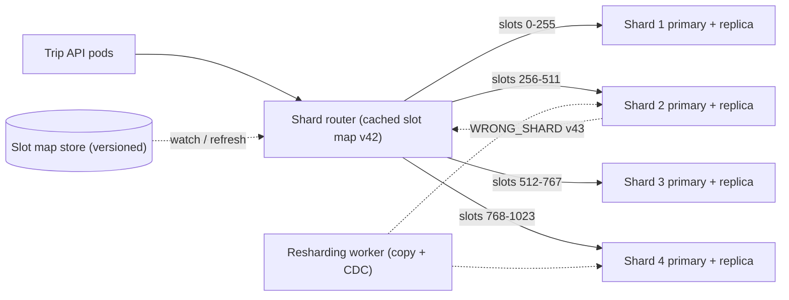
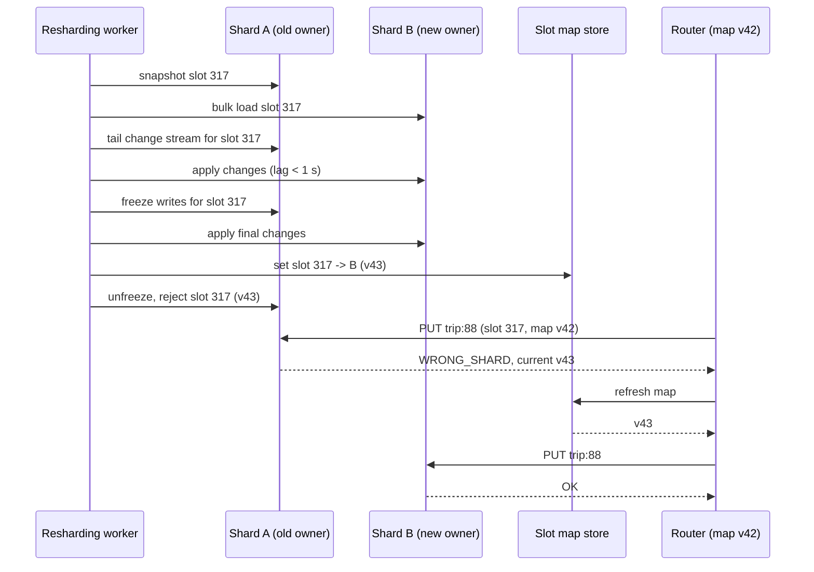

A single PostgreSQL server on good hardware goes a long way: replicas spread reads, caches absorb hot lookups, and [table partitioning](#/lesson/m09-partitioning-sharding) keeps big tables manageable. But writes still land on one primary, and one machine's disk, memory and write throughput are finite. When you outgrow it, you split the data across several independent databases, each owning a subset of the keys. That is **sharding**. It buys near-linear write scaling and costs you cross-shard queries, cross-shard transactions and a new class of operational problems. This lesson focuses on the parts that break: the shard key, the mapping from key to shard, hot partitions, and moving data while the system is live.

## Learning objectives

By the end of this lesson you will be able to:

1. Decide when sharding is justified, and list the cheaper options to exhaust first.
2. Choose a shard key from access patterns, and compare range, hash, directory and geographic sharding.
3. Calculate how many keys move under modulo hashing versus consistent hashing when a node is added.
4. Implement a consistent-hash ring with virtual nodes in C#, including replica placement.
5. Explain fixed hash slots (as in Redis Cluster) and why they make resharding easier.
6. Detect and mitigate hot partitions: celebrity keys, monotonic keys and noisy tenants.
7. Plan an online resharding with copy, catch-up, cutover and stale-router protection.

## Prerequisites

- [Partitioning and sharding](#/lesson/m09-partitioning-sharding): the PostgreSQL view of range, list and hash partitioning inside one server.
- [Replication and leader-follower](#/lesson/m13-replication): every shard is usually itself a replicated group.
- [Choosing and scaling the database tier](#/lesson/m11-database-architecture): sharding is the last step on that ladder.

## Explain it like I'm a beginner

A city library has grown so big that one building cannot hold all its books. The library opens **four branches**. Now every book must belong to exactly one branch, and everyone must be able to work out *which* branch without phoning around.

**Rule 1, by first letter (range sharding).** A–F go to branch 1, G–L to branch 2, and so on. Easy to understand, and "all authors starting with S" sits in one branch. But if half the popular authors start with S, one branch is mobbed while the others are empty.

**Rule 2, by a scrambled number (hash sharding).** Turn each title into a number using a fixed recipe that scatters similar titles far apart, then take `number mod 4`. Books spread evenly. But when the library opens a **fifth** branch and switches to `mod 5`, four out of five books suddenly belong to a different branch. Everyone spends a month carrying books between buildings.

**Rule 3, a clock face (consistent hashing).** Put the branches at positions around a clock face. Put each book at its number's position on the same clock. A book belongs to the next branch clockwise. When a fifth branch opens, it takes over only the books between it and its neighbour; about one in five books moves, not four in five. To keep branches evenly loaded, each branch gets many positions on the clock (virtual nodes) instead of one.

And one more problem no rule can fix: when a famous author releases a new book, **everyone** wants that one book. It lives in exactly one branch, and that branch is overwhelmed no matter how evenly the other books are spread. That is a **hot partition**.

## First-principles explanation

### When to shard, and when not to

Sharding is a big step. Before taking it, check the cheaper options:

1. **Vertical scaling.** Modern database servers have many cores, hundreds of gigabytes of RAM and fast NVMe disks. Many systems with "big data" fit comfortably on one primary.
2. **Read replicas** for read-heavy load ([replicas](#/lesson/m09-replicas)).
3. **Caching** hot reads ([caching layers](#/lesson/m11-caching-layers)).
4. **Table partitioning** inside one server for very large tables and easy retention (drop old partitions).
5. **Archiving** cold data to cheaper storage.
6. **Splitting by service**: moving one domain's tables (for example notifications) to its own database is sharding by function, and often enough.

Shard when **write throughput, storage size or working-set memory** exceed what one primary can handle with headroom, or when data must live in specific regions. A back-of-the-envelope check:

```text
A ride platform: 3 M trips/day; each trip ≈ 25 location and status writes
3 M × 25 ÷ 86,400 s ≈ 870 writes/s average; × 5 for evening peak ≈ 4,300 writes/s
Trip rows: 3 M/day × 2 KB × 365 × 3 years ≈ 6.6 TB (before indexes)
```

4,300 writes/s may be achievable on one well-tuned primary, but 6.6 TB plus indexes and the growth curve make a single node uncomfortable. These figures are estimates; measure your own write rate and row sizes before deciding.

### The shard key decides everything

The **shard key** (partition key, distribution column) is the field used to choose a shard. A good shard key:

- **Spreads load evenly**: many distinct values, none dominating.
- **Keeps related data together**: the queries you run most often should touch one shard. For a multi-tenant SaaS, `tenant_id` puts all of one customer's rows together, so joins and transactions stay on one shard.
- **Is present in most queries**: a query without the shard key must be sent to every shard (scatter-gather).
- **Does not change**: moving a row because its key changed is expensive and error-prone.

Typical trade-off: for trips, `rider_id` makes "my trips" a one-shard query but "all trips by driver D" a scatter-gather; `trip_id` spreads perfectly but makes both history queries scatter-gather. Many systems pick the key for the dominant query and build a secondary index (a separate table sharded by the other key) for the other.

### Four ways to map keys to shards

| Strategy | How | Good at | Weakness |
|---|---|---|---|
| Range | Key ranges per shard (A–F, dates) | Range scans, time-ordered data | Hot spots on popular or newest ranges |
| Hash | `hash(key)` decides | Even spread | Range queries scatter; naive modulo resharding moves most keys |
| Directory (lookup) | A table maps key or tenant → shard | Flexible, can move one tenant | The directory is a dependency that must be fast and highly available |
| Geographic | Region decides | Data residency, latency | Uneven regions; cross-region users |

Real systems combine them: geographic at the top (Indian users' data stays in India), then hash slots within a region, with a directory override for very large tenants.

### Why modulo hashing hurts

`shard = hash(key) mod N` is the obvious hash scheme. It spreads keys evenly, but look at what happens when `N` changes from 4 to 5. A key stays put only if `h mod 4 == h mod 5`, which holds for `4` out of every `20` consecutive hash values (those where `h mod 20 < 4`). So:

```text
Fraction moved, N → N + 1  =  N / (N + 1)
4 → 5:   80 % of keys move
10 → 11: about 91 % of keys move
```

A quick run of the lesson's C# code over 10,000 keys gave 80.1 % and 91.3 %. Moving 80 % of a 6 TB dataset is weeks of copying, and if the shards are caches, it is an instant 80 % miss rate that can take down the database behind them ([cache stampede](#/lesson/m12-cache-failures)).

### Consistent hashing

**Consistent hashing** (Karger et al., 1997) maps both keys and nodes onto the same circular space, for example 0 to 2⁶⁴ − 1. A key belongs to the first node clockwise from its position.

- Adding a node takes over only the arc between it and the previous node: on average `1 / (N + 1)` of keys move, all of them *to* the new node.
- Removing a node hands its arc to the next node clockwise: only the removed node's keys move.

With one position per node, arcs are wildly uneven: with 5 nodes, the lesson's ring gave one node 2.3 times the average share and another less than a tenth. **Virtual nodes** fix this: each physical node is placed at many positions (`node-1#0`, `node-1#1`, …). Each node's share becomes the sum of many small arcs, which evens out. In one run over 20,000 keys and 5 nodes, the busiest node held about 1.06 times the average with 200 virtual nodes each. Results vary with the hash and the names; a common rule of thumb is 100–200 virtual nodes per physical node.

Virtual nodes also give you **weights**: a node with twice the hardware gets twice the virtual nodes. And when a node leaves, its many small arcs are spread across many neighbours, rather than dumping its whole load on one.

For **replication**, walk clockwise from the key and take the first N *distinct* physical nodes. That is the preference list from the [quorums lesson](#/lesson/m13-quorums).

### Alternatives to a ring

- **Rendezvous (highest random weight) hashing:** for each key, compute `hash(key, node)` for every node and pick the highest. Minimal movement and no ring to store, at O(nodes) per lookup.
- **Jump consistent hash** (Lamping and Veach, 2014): a few lines of arithmetic map a key to one of N buckets with minimal movement, but only when buckets are numbered 0..N−1 and you only add or remove at the end.
- **Fixed hash slots:** split the hash space into a fixed number of slots, say 1,024 (Redis Cluster uses 16,384), and keep a small table `slot → node`. A key's slot never changes (`hash(key) mod 1024`); only the slot table changes. Moving one slot moves about 0.1 % of the data, and you can move slots one at a time, throttle the copy, and verify each. This is the most common production design because resharding becomes a controlled list of slot moves.

### Hot partitions

Even spreading of *keys* does not guarantee even spreading of *load*. Three common shapes:

1. **Celebrity key.** One key gets a large share of traffic: a viral post, a cricket match's live score, a flash-sale product. It hashes to one shard no matter how good the hash is.
2. **Monotonic key under range sharding.** If the shard key is `created_at` or an increasing order number with range sharding, every new write goes to the last shard. The "hot tail".
3. **Noisy tenant.** In multi-tenant sharding by `tenant_id`, one customer with 100 times the traffic of the rest overloads its shard.

Mitigations, roughly from simplest:

- **Cache** hot reads in front of the shard (with request coalescing).
- **Split the hot key for writes** (write sharding): store `like_count:post42:0` … `like_count:post42:15` and pick a suffix at random on write, then sum all 16 on read. You trade a 16-way read for spreading writes.
- **Use a hashed or composite key** instead of a monotonic one: `hash(order_id)` or `(customer_id, created_at)`.
- **Isolate big tenants:** a directory override puts a large tenant on its own shard (or several, sharded by a second key).
- **Split hot slots or ranges** adaptively (many systems split a range when it gets too hot or too big).
- **Rate-limit or queue** writes to the hot key when the business allows.

Detect hot partitions with per-shard and per-key metrics: requests per second, CPU, and the top keys by traffic. A shard at 3 times the average is a warning; one at 70 % of total traffic is an incident.

### Cross-shard queries and transactions

Once data is split, some operations cross shards:

- **Scatter-gather queries** go to every shard and merge results. Latency is set by the slowest shard, and load on every shard grows with every new query type. Keep them for rare reports, or maintain a separate analytical store.
- **Global secondary indexes**: a second table sharded by the other key ("trips by driver"), updated asynchronously (eventually consistent) or in the same transaction if both rows live on one shard.
- **Cross-shard transactions** need [two-phase commit](#/lesson/m13-distributed-transactions) or a [saga](#/lesson/m12-sagas). Prefer choosing a shard key that makes the important transactions single-shard.
- **Unique constraints across shards** (unique email) cannot be enforced by one shard. Use a separate lookup table sharded by the unique value.

### Resharding a live system

Moving a slot (or range) from shard A to shard B while writes continue:

1. **Copy** a snapshot of the slot's rows from A to B.
2. **Catch up** using A's change stream (logical replication or CDC) until B is seconds behind.
3. **Freeze briefly**: block writes for that slot on A for a moment, apply the last changes to B.
4. **Flip** the routing table: slot → B, with a new **map version**.
5. **Reject** stale routes: A now refuses writes for keys in that slot and tells the client to refresh its map (Redis Cluster calls this a `MOVED` redirection).
6. **Clean up** the slot's rows from A after a safety period.

Step 5 is the one teams forget. Routers cache the map; a router with the old map keeps sending writes to A. If A accepts them, those writes are stranded on a shard nobody reads from: they are silently lost.

### Failure cases that look correct

**Failure case 1: modulo resharding.** A cache cluster of 4 nodes uses `hash mod 4`. Adding a fifth node to handle Diwali traffic remaps 80 % of keys. The cache hit ratio drops from 95 % to about 20 %, the database behind it receives four times its normal load, and the "scale-up" causes the outage.

**Failure case 2: perfect hashing, one hot key.** Orders are hash-sharded by `product_id` across 16 shards with an even key spread. A flash sale sends 60 % of checkout writes to one product. One shard is at 100 % CPU while 15 sit idle. Fix: key splitting for the stock counter, a queue in front of the sale item, or a dedicated stock-reservation service.

**Failure case 3: monotonic range key.** Invoices are range-sharded by `invoice_date`. All of today's writes go to the newest shard; older shards are idle. Fix: hash the shard key, or use a composite key whose leading part spreads load.

**Failure case 4: no virtual nodes.** A consistent-hash ring with one point per node. One of five nodes owns 40 % of the ring by bad luck; when it fails, its whole share moves to a single neighbour, which then fails too (a cascading failure).

**Failure case 5: stale router during a slot move.** The slot moves to shard B, but one API pod's cached map still says A. A has not been told to reject keys it no longer owns. Writes from that pod land on A and are never read. Fix: shards check ownership against the authoritative map version and reject with "wrong shard, refresh".

**Failure case 6: unstable hash.** Using `string.GetHashCode()` in .NET to choose a shard. It is randomised per process, so two pods disagree about where a key lives. Use a stable hash such as FNV-1a, MurmurHash or xxHash.

### When a simpler design is enough

If one primary plus replicas handles your peak with 50 % headroom, do not shard. If one tenant dominates, moving that tenant to its own database is simpler than sharding everyone. If you need sharding, consider a database that shards for you (Citus for PostgreSQL, or a distributed SQL database) before building application-level routing.

## Visual explanation

### Architecture: routers, a versioned slot map and replicated shards



API pods call a shard router library (or proxy), which hashes each key to one of 1,024 slots and looks up the slot's shard in its cached map, version 42. Each shard is a primary with a replica. The slot map lives in a small, highly available store; routers watch it for changes. During a slot move, the resharding worker copies the slot from shard 2 to shard 4 and follows shard 2's change stream. After the flip to version 43, shard 2 rejects writes for that slot with "wrong shard", which tells any router still on version 42 to refresh before retrying.

### Sequence: moving one slot without losing writes



The worker copies a snapshot of slot 317, then applies A's ongoing changes to B until B is nearly caught up. It freezes writes for that one slot on A for a moment, applies the last changes, and publishes the new map (version 43) with slot 317 owned by B. A is told that it no longer owns slot 317. A router that still has version 42 sends a write to A, which refuses it and returns the current version; the router refreshes and retries on B. The only cost is one extra round trip, and no write is stranded.

## Step-by-step example

**Scenario.** A multi-tenant construction project management SaaS stores daily progress reports, photos metadata and measurements for about 2,000 contractor tenants. One tenant (a large national highway contractor) produces 25 % of all writes.

### Step 1: measure and estimate

```text
Writes: 6 M rows/day ÷ 86,400 ≈ 70 writes/s average; month-end peak × 10 ≈ 700 writes/s
Data:   6 M × 1.5 KB × 365 ≈ 3.3 TB/year; 3-year retention ≈ 10 TB with indexes (estimate)
```

The write rate is fine for one primary; the **storage growth** is the driver.

### Step 2: choose the shard key

Every query is scoped to one tenant, and reports join project, site and measurement tables within a tenant. So **`tenant_id`** is the shard key: one tenant's data stays on one shard and all joins and transactions are local.

### Step 3: choose the mapping

Use **1,024 hash slots** (`slot = hash(tenant_id) mod 1024`) mapped to 4 shards initially (256 slots each), plus a **directory override**: tenants listed in a `tenant_placement` table go to a named shard regardless of slot.

### Step 4: handle the hot tenant

The highway contractor alone is 25 % of writes and would make its shard 2× busier than the others. Place it on a **dedicated shard** via the directory override. Its own data can later be sharded by `project_id` if it keeps growing.

### Step 5: plan growth

When shards reach about 60 % of disk or CPU, add a shard and move about a fifth of the slots to it, one slot at a time, during low-traffic hours. Each slot is about 0.1 % of the data: 10 TB ÷ 1,024 ≈ 10 GB per slot, which copies in minutes.

### Step 6: plan cross-tenant queries

The platform's internal analytics ("total measured concrete across all tenants this month") are scatter-gather. Instead of running them against the shards, stream changes into an analytics store nightly.

## Production-style C# implementation

The code includes a stable 64-bit hash, a generic consistent-hash ring with virtual nodes and replica placement, a versioned slot map, an in-memory shard cluster whose shards reject keys they do not own, and a router that refreshes its cached map on a wrong-shard error.

```text
Trips.Sharding/
  Program.cs
  Sharding/StableHash.cs
  Sharding/ConsistentHashRing.cs
  Sharding/SlotMap.cs
  Sharding/ShardCluster.cs
  Sharding/ShardRouter.cs
  Sharding/HotKeySpreading.cs
```

```csharp file=Sharding/StableHash.cs
namespace Trips.Sharding;

/// <summary>64-bit FNV-1a followed by the MurmurHash3 finaliser for good bit mixing.
/// Stable across processes and machines, unlike string.GetHashCode().</summary>
public static class StableHash
{
    public static ulong Hash64(string text)
    {
        ulong h = 14695981039346656037UL;
        foreach (char c in text)
        {
            h ^= c;
            h *= 1099511628211UL;
        }
        h ^= h >> 33;
        h *= 0xff51afd7ed558ccdUL;
        h ^= h >> 33;
        h *= 0xc4ceb9fe1a85ec53UL;
        h ^= h >> 33;
        return h;
    }
}
```

```csharp file=Sharding/ConsistentHashRing.cs
namespace Trips.Sharding;

/// <summary>Consistent-hash ring with virtual nodes. Reads use an immutable snapshot, so lookups
/// are lock-free; changes rebuild the snapshot (copy-on-write).</summary>
public sealed class ConsistentHashRing<TNode> where TNode : notnull
{
    private sealed record Snapshot(ulong[] Points, TNode[] Owners, int DistinctNodes);

    private readonly object _writeGate = new();
    private readonly Func<TNode, string> _nameOf;
    private readonly Dictionary<TNode, int> _virtualNodes = new();
    private Snapshot _snapshot = new([], [], 0);

    public ConsistentHashRing(Func<TNode, string>? nameOf = null) =>
        _nameOf = nameOf ?? (n => n.ToString() ?? throw new ArgumentException("Node has no name."));

    public int NodeCount => Volatile.Read(ref _snapshot).DistinctNodes;

    /// <summary>Adds or re-weights a node. More virtual nodes means a larger share of keys.</summary>
    public void AddNode(TNode node, int virtualNodes = 160)
    {
        if (virtualNodes < 1) throw new ArgumentOutOfRangeException(nameof(virtualNodes));
        lock (_writeGate)
        {
            _virtualNodes[node] = virtualNodes;
            Rebuild();
        }
    }

    public bool RemoveNode(TNode node)
    {
        lock (_writeGate)
        {
            if (!_virtualNodes.Remove(node)) return false;
            Rebuild();
            return true;
        }
    }

    public TNode GetNode(string key)
    {
        var s = Volatile.Read(ref _snapshot);
        if (s.Points.Length == 0) throw new InvalidOperationException("The ring has no nodes.");
        return s.Owners[IndexFor(s, StableHash.Hash64(key))];
    }

    /// <summary>The first <paramref name="count"/> distinct physical nodes clockwise from the key:
    /// its replica set (preference list).</summary>
    public IReadOnlyList<TNode> GetNodes(string key, int count)
    {
        var s = Volatile.Read(ref _snapshot);
        if (s.Points.Length == 0) throw new InvalidOperationException("The ring has no nodes.");
        int wanted = Math.Min(count, s.DistinctNodes);
        var result = new List<TNode>(wanted);
        var seen = new HashSet<TNode>();
        int start = IndexFor(s, StableHash.Hash64(key));
        for (int i = 0; i < s.Points.Length && result.Count < wanted; i++)
        {
            var owner = s.Owners[(start + i) % s.Points.Length];
            if (seen.Add(owner)) result.Add(owner);
        }
        return result;
    }

    private static int IndexFor(Snapshot s, ulong hash)
    {
        int index = Array.BinarySearch(s.Points, hash);
        if (index < 0) index = ~index;               // first point clockwise
        return index == s.Points.Length ? 0 : index; // wrap around the ring
    }

    private void Rebuild()
    {
        var points = new List<(ulong Point, string Name, TNode Node)>();
        foreach (var (node, count) in _virtualNodes)
        {
            string name = _nameOf(node);
            for (int i = 0; i < count; i++) points.Add((StableHash.Hash64($"{name}#{i}"), name, node));
        }
        points.Sort((a, b) => a.Point != b.Point ? a.Point.CompareTo(b.Point) : string.CompareOrdinal(a.Name, b.Name));
        Volatile.Write(ref _snapshot, new Snapshot(
            points.Select(p => p.Point).ToArray(),
            points.Select(p => p.Node).ToArray(),
            _virtualNodes.Count));
    }
}
```

Three details matter in production. Lookups read an immutable snapshot, so thousands of concurrent requests never contend on a lock. Ties between equal hash points are broken by name, so every process builds the identical ring. And `GetNodes` skips virtual nodes of a physical node already chosen, so replicas land on distinct machines.

```csharp file=Sharding/SlotMap.cs
namespace Trips.Sharding;

/// <summary>Fixed hash slots: a key's slot never changes; only the slot → shard table does.
/// Every change produces a new <see cref="Version"/>.</summary>
public sealed record SlotMap(long Version, IReadOnlyList<string> Owners)
{
    public const int SlotCount = 1024;

    public static int SlotOf(string key) => (int)(StableHash.Hash64(key) % SlotCount);

    public string OwnerOf(string key) => Owners[SlotOf(key)];

    public static SlotMap Even(IReadOnlyList<string> shards)
    {
        if (shards.Count == 0) throw new ArgumentException("At least one shard is required.", nameof(shards));
        return new SlotMap(1, Enumerable.Range(0, SlotCount).Select(slot => shards[slot * shards.Count / SlotCount]).ToArray());
    }

    public SlotMap WithOwner(int slot, string shard)
    {
        var owners = Owners.ToArray();
        owners[slot] = shard;
        return new SlotMap(Version + 1, owners);
    }
}
```

`Even` assigns contiguous blocks of slots (0–255 to the first shard, and so on), which keeps the table easy to read in dashboards.

```csharp file=Sharding/ShardCluster.cs
using System.Collections.Concurrent;

namespace Trips.Sharding;

public sealed class WrongShardException(string key, string shard, long currentVersion)
    : Exception($"Shard {shard} does not own key {key}; current slot map is v{currentVersion}.")
{
    public long CurrentVersion => currentVersion;
}

public interface IShardMapProvider
{
    SlotMap Current { get; }
}

public interface IShardClient
{
    void Put(string shard, string key, string value);
    string? Get(string shard, string key);
}

/// <summary>In-memory shards that enforce ownership against the authoritative slot map, so a router
/// with a stale map is told to refresh instead of silently writing to the wrong shard.</summary>
public sealed class InMemoryShardCluster : IShardMapProvider, IShardClient
{
    private readonly object _gate = new();
    private readonly Dictionary<string, ConcurrentDictionary<string, string>> _shards;
    private SlotMap _map;

    public InMemoryShardCluster(IReadOnlyList<string> shardIds)
    {
        _shards = shardIds.ToDictionary(id => id, _ => new ConcurrentDictionary<string, string>(StringComparer.Ordinal));
        _map = SlotMap.Even(shardIds);
    }

    public SlotMap Current => Volatile.Read(ref _map);

    public void Put(string shard, string key, string value)
    {
        lock (_gate)
        {
            EnsureOwner(shard, key);
            _shards[shard][key] = value;
        }
    }

    public string? Get(string shard, string key)
    {
        lock (_gate)
        {
            EnsureOwner(shard, key);
            return _shards[shard].TryGetValue(key, out var v) ? v : null;
        }
    }

    public int KeysOn(string shard) => _shards[shard].Count;

    /// <summary>Moves one slot. Simplified: holds the lock for copy and flip, which is the "freeze" step.
    /// A real migration copies a snapshot and follows the change stream first, freezing only briefly.</summary>
    public SlotMap MoveSlot(int slot, string toShard)
    {
        lock (_gate)
        {
            string from = _map.Owners[slot];
            if (from == toShard) return _map;
            foreach (var (key, value) in _shards[from].Where(kv => SlotMap.SlotOf(kv.Key) == slot).ToList())
            {
                _shards[toShard][key] = value;
                _shards[from].TryRemove(key, out _);
            }
            Volatile.Write(ref _map, _map.WithOwner(slot, toShard));
            return _map;
        }
    }

    private void EnsureOwner(string shard, string key)
    {
        if (_map.OwnerOf(key) != shard) throw new WrongShardException(key, shard, _map.Version);
    }
}
```

```csharp file=Sharding/ShardRouter.cs
using Microsoft.Extensions.Logging;

namespace Trips.Sharding;

/// <summary>Routes by a cached slot map. On WRONG_SHARD it refreshes the map and retries once.</summary>
public sealed class ShardRouter(IShardMapProvider maps, IShardClient shards, ILogger<ShardRouter> log)
{
    private SlotMap _cached = maps.Current;

    public long CachedVersion => Volatile.Read(ref _cached).Version;

    public void Put(string key, string value) =>
        WithRefresh(key, map => { shards.Put(map.OwnerOf(key), key, value); return true; });

    public string? Get(string key) => WithRefresh(key, map => shards.Get(map.OwnerOf(key), key));

    public string ShardFor(string key) => Volatile.Read(ref _cached).OwnerOf(key);

    private T WithRefresh<T>(string key, Func<SlotMap, T> operation)
    {
        try
        {
            return operation(Volatile.Read(ref _cached));
        }
        catch (WrongShardException ex)
        {
            log.LogInformation("Stale slot map for {Key}; refreshing to v{Version}.", key, ex.CurrentVersion);
            var fresh = maps.Current;
            Volatile.Write(ref _cached, fresh);
            return operation(fresh);
        }
    }
}
```

The router does not need to be told about migrations. Correctness comes from the shard's ownership check; the router simply reacts to a rejection. That is the same "the resource enforces it" principle as fencing tokens in [distributed locks](#/lesson/m13-distributed-locks).

```csharp file=Sharding/HotKeySpreading.cs
namespace Trips.Sharding;

/// <summary>Write sharding for a hot counter: spread writes over N sub-keys, read by summing them.</summary>
public static class HotKeySpreading
{
    public static string WriteKey(string hotKey, int fanOut, Random random)
    {
        if (fanOut < 1) throw new ArgumentOutOfRangeException(nameof(fanOut));
        return $"{hotKey}:{random.Next(fanOut)}";
    }

    public static IEnumerable<string> ReadKeys(string hotKey, int fanOut) =>
        Enumerable.Range(0, fanOut).Select(i => $"{hotKey}:{i}");
}
```

With a fan-out of 16, a counter that received 8,000 increments per second now spreads about 500 per second to each sub-key, landing on up to 16 different slots. Reads cost 16 lookups, which is why this is reserved for the few keys that need it.

```csharp file=Program.cs
using Trips.Sharding;

var builder = WebApplication.CreateBuilder(args);

builder.Services.AddSingleton(new InMemoryShardCluster(["shard-1", "shard-2", "shard-3", "shard-4"]));
builder.Services.AddSingleton<IShardMapProvider>(sp => sp.GetRequiredService<InMemoryShardCluster>());
builder.Services.AddSingleton<IShardClient>(sp => sp.GetRequiredService<InMemoryShardCluster>());
builder.Services.AddSingleton<ShardRouter>();

var app = builder.Build();

app.MapPut("/trips/{tripId}", (string tripId, TripUpdate body, ShardRouter router) =>
{
    router.Put($"trip:{tripId}", body.Status);
    return Results.Ok(new { tripId, shard = router.ShardFor($"trip:{tripId}"), mapVersion = router.CachedVersion });
});

app.MapGet("/trips/{tripId}", (string tripId, ShardRouter router) =>
    router.Get($"trip:{tripId}") is { } status ? Results.Ok(new { tripId, status }) : Results.NotFound());

// Admin: move one slot and watch routers recover via WRONG_SHARD.
app.MapPost("/admin/slots/{slot:int}/move/{shard}", (int slot, string shard, InMemoryShardCluster cluster) =>
    slot is >= 0 and < SlotMap.SlotCount
        ? Results.Ok(new { cluster.MoveSlot(slot, shard).Version })
        : Results.BadRequest());

app.MapGet("/admin/ring-demo", () =>
{
    var ring = new ConsistentHashRing<string>();
    foreach (var n in new[] { "cache-1", "cache-2", "cache-3", "cache-4" }) ring.AddNode(n, 160);
    var keys = Enumerable.Range(0, 10_000).Select(i => $"trip:{i}").ToList();
    var before = keys.ToDictionary(k => k, ring.GetNode);
    ring.AddNode("cache-5", 160);
    int moved = keys.Count(k => before[k] != ring.GetNode(k));
    return Results.Ok(new { movedPercent = Math.Round(100.0 * moved / keys.Count, 1), idealPercent = 20.0 });
});

app.Run();

public sealed record TripUpdate(string Status);
```

`/admin/ring-demo` adds a fifth node to a four-node ring and reports how many of 10,000 keys moved. Expect a figure near the ideal 20 %, compared with 80 % for modulo hashing.

## Bad design vs good design

**Bad:**

- `shard = Math.Abs(key.GetHashCode()) % shards.Count` in application code.
- Shard key `created_at` with range sharding for an append-heavy table.
- No plan for adding shards; "we'll reshard when we need to".
- Routers cache the shard map forever; shards accept any key they are sent.
- Every dashboard query is a scatter-gather across 32 shards.

**Good:**

- A stable hash into fixed slots, with a versioned slot map and a directory override for large tenants.
- A shard key chosen from the dominant query, present in nearly every request, immutable.
- Shards enforce ownership and return "wrong shard, map version N" so stale routers self-correct.
- Resharding as a sequence of small, throttled, verified slot moves with copy, catch-up, brief freeze and flip.
- Per-shard and per-key metrics with alerts on skew; key splitting and caching ready for hot keys.
- Analytics on a separate store fed by change streams.

:::callout type=tradeoff title="Sharding is a one-way door"
Once data is sharded, cross-shard joins, global unique constraints and multi-shard transactions become expensive forever. Before sharding, try vertical scaling, replicas, caching, partitioning and splitting by service. When you do shard, prefer a database that does it for you over hand-written routing.
:::

## Practical playground

The consistent-hashing simulator places nodes and keys on a ring and compares key movement with modulo hashing as nodes join and leave.

1. Start with 5 nodes and 1 virtual node each. Note the load spread between the busiest and quietest node.
2. Raise virtual nodes to 100, then 200. How does the spread change?
3. Step through the join and leave operations. Compare keys moved by the ring with keys moved by modulo hashing on each step.
4. Explain why removing a node with many virtual nodes spreads its load across many neighbours instead of one.

:::playground type=sim sim=consistent-hash title="Consistent hashing versus modulo, with virtual nodes" nodes=5 vnodes=1 keys=10000
:::

## Exercises

:::exercise id=m13-sharding-ex1 difficulty=beginner kind=code title="How much does modulo resharding move?"
Measure what fraction of keys change shard when a modulo-hashed cluster grows, and compare it with the formula.
::requirements
- `KeyMovement.ModuloMovedFraction(IReadOnlyList<string> keys, int fromShards, int toShards, Func<string, ulong> hash)` returns the fraction of keys whose `hash % shards` changes.
- `KeyMovement.ExpectedModuloMovedFraction(int n)` returns the theoretical fraction for growing from `n` to `n + 1` shards: `n / (n + 1)`.
- Shard counts below 1 throw `ArgumentOutOfRangeException`; an empty key list throws `ArgumentException`.
::acceptance
- With 10,000 keys and the provided stable hash, 4 → 5 moves between 77 % and 83 %.
- `ExpectedModuloMovedFraction(4)` is 0.8 and `ExpectedModuloMovedFraction(9)` is 0.9.
- Growing from 4 to 8 moves about half the keys (between 45 % and 55 %).
::hint
For each key compute the shard before and after; count the differences.
::hint
Use the `hash` function passed in, not `GetHashCode()`.
::hint
Doubling from 4 to 8: a key stays if bit 2 of its hash is 0, which is half the keys.
::hint
```csharp
int moved = keys.Count(k => { ulong h = hash(k); return h % (ulong)fromShards != h % (ulong)toShards; });
```
::starter
```csharp file=KeyMovement.cs
using System;
using System.Collections.Generic;
using System.Linq;

public static class KeyMovement
{
    public static double ModuloMovedFraction(IReadOnlyList<string> keys, int fromShards, int toShards, Func<string, ulong> hash) =>
        throw new NotImplementedException();

    public static double ExpectedModuloMovedFraction(int n) => throw new NotImplementedException();
}

public static class Fnv
{
    public static ulong Hash64(string text)
    {
        ulong h = 14695981039346656037UL;
        foreach (char c in text) { h ^= c; h *= 1099511628211UL; }
        h ^= h >> 33; h *= 0xff51afd7ed558ccdUL; h ^= h >> 33; h *= 0xc4ceb9fe1a85ec53UL; h ^= h >> 33;
        return h;
    }
}
```
::tests
```csharp file=KeyMovementTests.cs
using System;
using System.Linq;
using Xunit;

public class KeyMovementTests
{
    private static readonly string[] Keys = Enumerable.Range(0, 10_000).Select(i => $"order:{i}").ToArray();

    [Fact]
    public void Four_to_five_moves_about_eighty_percent() =>
        Assert.InRange(KeyMovement.ModuloMovedFraction(Keys, 4, 5, Fnv.Hash64), 0.77, 0.83);

    [Fact]
    public void Doubling_moves_about_half() =>
        Assert.InRange(KeyMovement.ModuloMovedFraction(Keys, 4, 8, Fnv.Hash64), 0.45, 0.55);

    [Fact]
    public void Expected_fraction()
    {
        Assert.Equal(0.8, KeyMovement.ExpectedModuloMovedFraction(4), 6);
        Assert.Equal(0.9, KeyMovement.ExpectedModuloMovedFraction(9), 6);
    }

    [Fact]
    public void Same_count_moves_nothing() =>
        Assert.Equal(0.0, KeyMovement.ModuloMovedFraction(Keys, 6, 6, Fnv.Hash64), 6);

    [Fact]
    public void Invalid_inputs_throw()
    {
        Assert.Throws<ArgumentOutOfRangeException>(() => KeyMovement.ModuloMovedFraction(Keys, 0, 5, Fnv.Hash64));
        Assert.Throws<ArgumentException>(() => KeyMovement.ModuloMovedFraction(Array.Empty<string>(), 4, 5, Fnv.Hash64));
        Assert.Throws<ArgumentOutOfRangeException>(() => KeyMovement.ExpectedModuloMovedFraction(0));
    }
}
```
::solution
```csharp file=KeyMovement.cs
using System;
using System.Collections.Generic;
using System.Linq;

public static class KeyMovement
{
    public static double ModuloMovedFraction(IReadOnlyList<string> keys, int fromShards, int toShards, Func<string, ulong> hash)
    {
        ArgumentNullException.ThrowIfNull(keys);
        ArgumentNullException.ThrowIfNull(hash);
        if (fromShards < 1) throw new ArgumentOutOfRangeException(nameof(fromShards));
        if (toShards < 1) throw new ArgumentOutOfRangeException(nameof(toShards));
        if (keys.Count == 0) throw new ArgumentException("At least one key is required.", nameof(keys));

        int moved = keys.Count(k =>
        {
            ulong h = hash(k);
            return h % (ulong)fromShards != h % (ulong)toShards;
        });
        return (double)moved / keys.Count;
    }

    public static double ExpectedModuloMovedFraction(int n)
    {
        if (n < 1) throw new ArgumentOutOfRangeException(nameof(n));
        return (double)n / (n + 1);
    }
}

public static class Fnv
{
    public static ulong Hash64(string text)
    {
        ulong h = 14695981039346656037UL;
        foreach (char c in text) { h ^= c; h *= 1099511628211UL; }
        h ^= h >> 33; h *= 0xff51afd7ed558ccdUL; h ^= h >> 33; h *= 0xc4ceb9fe1a85ec53UL; h ^= h >> 33;
        return h;
    }
}
```

Doubling is the "least bad" modulo change (half the keys move), which is why some systems only ever double their shard count. Consistent hashing or fixed slots avoid the problem entirely.
::mistakes
- Using `GetHashCode()`, which changes between runs and makes the measurement meaningless.
- Casting the hash to `int` and getting negative remainders.
:::

:::exercise id=m13-sharding-ex2 difficulty=beginner kind=written title="Choose a shard key for trips"
A ride-hailing platform stores trips: `trip_id`, `rider_id`, `driver_id`, `city`, `started_at`, `fare`, `status`. The main queries are: (a) rider app "my last 20 trips" (very frequent), (b) driver app "today's earnings" (frequent), (c) support agents look up a trip by `trip_id` (occasional), (d) finance's monthly city-wise revenue report (rare). Choose a shard key and mapping, and explain how each query is served.
::acceptance
- Picks a shard key and justifies it with query frequency.
- Rejects `started_at` range sharding with the hot-tail argument.
- Rejects `city` alone with the skew argument (Mumbai vs a small city).
- Explains how the other queries are served (secondary index table, embedding the shard in `trip_id`, analytics store).
::hint
Which query runs most often, and which key does it filter on?
::hint
What fraction of trips might come from the largest city?
::hint
Can you make `trip_id` itself tell you the shard?
::solution
**Shard key: `rider_id`**, hashed into fixed slots. Query (a), the most frequent, becomes a single-shard index scan on `(rider_id, started_at DESC)`.

- **(b) driver earnings**: maintain a `driver_trips` table sharded by `driver_id`, written in the same flow (eventually consistent within seconds via an outbox or change stream). Driver earnings tolerate a few seconds' lag.
- **(c) by trip_id**: embed the slot in the ID, for example `trip_id = <slot>-<ulid>`, so the router can find the shard without a lookup. Alternatively keep a small `trip_id → rider_id` lookup table.
- **(d) monthly revenue**: never against the shards; stream trips into an analytical store and query there.

**Rejected:** `started_at` range sharding puts all new trips on the newest shard (hot tail). `city` alone is badly skewed: the largest metro could have dozens of times the trips of a small city, and one shard would carry it. `trip_id` hashing spreads well but turns the most frequent query into a scatter-gather.
::mistakes
- Choosing `trip_id` because it is "the primary key" without looking at queries.
- Sharding by `city` to keep data local without checking skew.
:::

:::exercise id=m13-sharding-ex3 difficulty=intermediate kind=code title="Consistent-hash ring with virtual nodes"
Implement a string-based consistent-hash ring and prove its key properties with tests.
::requirements
- `HashRing` with `AddNode(name, virtualNodes)`, `RemoveNode(name)`, `GetNode(key)` and `Nodes`.
- Place virtual node `i` of node `name` at `Fnv.Hash64($"{name}#{i}")` (the hash is provided). Break equal points by node name (ordinal).
- `GetNode(key)` returns the owner of the first point clockwise from `Fnv.Hash64(key)`, wrapping around.
- An empty ring throws `InvalidOperationException`; `virtualNodes < 1` throws `ArgumentOutOfRangeException`.
::acceptance
- Removing a node moves only keys that were on that node.
- Adding a sixth node to five moves between 10 % and 25 % of keys, all to the new node.
- With 200 virtual nodes per node, 5 nodes and 20,000 keys, the busiest node holds less than 1.25 times the average.
- With 1 virtual node each, the busiest node holds more than 1.5 times the average.
::hint
Keep two parallel sorted arrays: points and owners.
::hint
`Array.BinarySearch` returns the bitwise complement of the insertion point when the value is not found.
::hint
Rebuild the arrays whenever a node is added or removed; lookups are far more frequent than changes.
::hint
```csharp
int i = Array.BinarySearch(_points, Fnv.Hash64(key));
if (i < 0) i = ~i;
if (i == _points.Length) i = 0;
return _owners[i];
```
::starter
```csharp file=HashRing.cs
using System;
using System.Collections.Generic;
using System.Linq;

public sealed class HashRing
{
    public IReadOnlyCollection<string> Nodes => throw new NotImplementedException();
    public void AddNode(string name, int virtualNodes) => throw new NotImplementedException();
    public bool RemoveNode(string name) => throw new NotImplementedException();
    public string GetNode(string key) => throw new NotImplementedException();
}

public static class Fnv
{
    public static ulong Hash64(string text)
    {
        ulong h = 14695981039346656037UL;
        foreach (char c in text) { h ^= c; h *= 1099511628211UL; }
        h ^= h >> 33; h *= 0xff51afd7ed558ccdUL; h ^= h >> 33; h *= 0xc4ceb9fe1a85ec53UL; h ^= h >> 33;
        return h;
    }
}
```
::tests
```csharp file=HashRingTests.cs
using System;
using System.Linq;
using Xunit;

public class HashRingTests
{
    private static readonly string[] Keys = Enumerable.Range(0, 20_000).Select(i => $"order:{i}").ToArray();

    private static HashRing Ring(int nodes, int vnodes)
    {
        var r = new HashRing();
        for (int n = 1; n <= nodes; n++) r.AddNode($"node-{n}", vnodes);
        return r;
    }

    [Fact]
    public void Removing_a_node_moves_only_its_keys()
    {
        var r = Ring(5, 160);
        var before = Keys.ToDictionary(k => k, r.GetNode);
        r.RemoveNode("node-3");
        Assert.All(Keys, k => { if (before[k] != "node-3") Assert.Equal(before[k], r.GetNode(k)); });
        Assert.DoesNotContain("node-3", Keys.Select(r.GetNode).Distinct());
    }

    [Fact]
    public void Adding_a_node_moves_a_fair_share_to_it()
    {
        var r = Ring(5, 160);
        var before = Keys.ToDictionary(k => k, r.GetNode);
        r.AddNode("node-6", 160);
        var moved = Keys.Where(k => before[k] != r.GetNode(k)).ToList();
        Assert.InRange((double)moved.Count / Keys.Length, 0.10, 0.25);
        Assert.All(moved, k => Assert.Equal("node-6", r.GetNode(k)));
    }

    [Fact]
    public void Virtual_nodes_balance_load()
    {
        var counts = Keys.GroupBy(Ring(5, 200).GetNode).Select(g => g.Count()).ToList();
        Assert.Equal(5, counts.Count);
        Assert.True(counts.Max() / (Keys.Length / 5.0) < 1.25);
    }

    [Fact]
    public void One_point_per_node_is_unbalanced()
    {
        var counts = Keys.GroupBy(Ring(5, 1).GetNode).Select(g => g.Count()).ToList();
        Assert.True(counts.Max() / (Keys.Length / 5.0) > 1.5);
    }

    [Fact]
    public void Lookups_are_deterministic() =>
        Assert.Equal(Ring(4, 50).GetNode("trip:42"), Ring(4, 50).GetNode("trip:42"));

    [Fact]
    public void Invalid_use_throws()
    {
        Assert.Throws<InvalidOperationException>(() => new HashRing().GetNode("x"));
        Assert.Throws<ArgumentOutOfRangeException>(() => new HashRing().AddNode("a", 0));
    }
}
```
::solution
```csharp file=HashRing.cs
using System;
using System.Collections.Generic;
using System.Linq;

public sealed class HashRing
{
    private readonly Dictionary<string, int> _weights = new(StringComparer.Ordinal);
    private ulong[] _points = Array.Empty<ulong>();
    private string[] _owners = Array.Empty<string>();

    public IReadOnlyCollection<string> Nodes => _weights.Keys;

    public void AddNode(string name, int virtualNodes)
    {
        if (virtualNodes < 1) throw new ArgumentOutOfRangeException(nameof(virtualNodes));
        _weights[name] = virtualNodes;
        Rebuild();
    }

    public bool RemoveNode(string name)
    {
        if (!_weights.Remove(name)) return false;
        Rebuild();
        return true;
    }

    public string GetNode(string key)
    {
        if (_points.Length == 0) throw new InvalidOperationException("The ring has no nodes.");
        int i = Array.BinarySearch(_points, Fnv.Hash64(key));
        if (i < 0) i = ~i;
        if (i == _points.Length) i = 0;
        return _owners[i];
    }

    private void Rebuild()
    {
        var all = new List<(ulong Point, string Owner)>();
        foreach (var (name, count) in _weights)
            for (int i = 0; i < count; i++) all.Add((Fnv.Hash64($"{name}#{i}"), name));
        all.Sort((a, b) => a.Point != b.Point ? a.Point.CompareTo(b.Point) : string.CompareOrdinal(a.Owner, b.Owner));
        _points = all.Select(p => p.Point).ToArray();
        _owners = all.Select(p => p.Owner).ToArray();
    }
}

public static class Fnv
{
    public static ulong Hash64(string text)
    {
        ulong h = 14695981039346656037UL;
        foreach (char c in text) { h ^= c; h *= 1099511628211UL; }
        h ^= h >> 33; h *= 0xff51afd7ed558ccdUL; h ^= h >> 33; h *= 0xc4ceb9fe1a85ec53UL; h ^= h >> 33;
        return h;
    }
}
```

The two movement tests are the defining properties of consistent hashing: removal only touches the removed node's keys, and addition only moves keys *to* the new node. Balance depends on the number of virtual nodes, which is why the last two tests compare 200 with 1.
::alternatives
Rendezvous hashing gives the same movement properties without a ring: `GetNode(key) = nodes.MaxBy(n => Hash64(key + "|" + n))`. It is O(nodes) per lookup, which is fine for tens of nodes.
::mistakes
- Forgetting the wrap-around, so keys hashing beyond the last point throw an index error.
- Using a linear scan for lookups; with 1,000 points and 50,000 lookups per second this becomes measurable CPU.
- Non-deterministic tie-breaking when two points collide.
::extensions
Add `GetNodes(key, n)` returning `n` distinct physical nodes clockwise, for replica placement.
:::

:::exercise id=m13-sharding-ex4 difficulty=intermediate kind=sql ordered=true title="Find the hot shard"
The `request_log` table has per-shard, per-tenant request counts for the last hour. Write a query returning, for each shard ordered by `shard_id`: `shard_id`, total `requests`, `share_pct` (percentage of all requests, rounded to one decimal place) and `is_hot` (true if the shard's requests exceed twice the average per shard).
::setup
```sql
CREATE TABLE request_log (shard_id int NOT NULL, tenant text NOT NULL, requests int NOT NULL);
INSERT INTO request_log VALUES
 (1, 'acme-builders', 1200), (1, 'bharat-steel', 300),
 (2, 'cityrail', 800), (2, 'acme-roads', 100),
 (3, 'megamart', 9000), (3, 'tiny-co', 50),
 (4, 'shree-infra', 700), (4, 'cityrail-ops', 150);
```
::check
```sql
WITH per_shard AS (
  SELECT shard_id, SUM(requests)::int AS requests
  FROM request_log
  GROUP BY shard_id
)
SELECT shard_id,
       requests,
       ROUND(100.0 * requests / SUM(requests) OVER (), 1) AS share_pct,
       requests > 2 * AVG(requests) OVER () AS is_hot
FROM per_shard
ORDER BY shard_id;
```
::acceptance
- Four rows, one per shard, in shard order.
- Shard 3 has 9,050 requests, about 73.6 % of the total, and is the only hot shard.
- Shard totals are 1,500, 900, 9,050 and 850.
::hint
First aggregate per shard, then compare each shard to the totals across shards.
::hint
Window functions with an empty `OVER ()` compute across all rows of the result: `SUM(requests) OVER ()`.
::hint
Multiply by `100.0` (not `100`) to avoid integer division.
::hint
```sql
WITH per_shard AS (SELECT shard_id, SUM(requests)::int AS requests FROM request_log GROUP BY shard_id)
SELECT shard_id, requests, ROUND(100.0 * requests / SUM(requests) OVER (), 1) AS share_pct, ...
```
::solution
```sql
WITH per_shard AS (
  SELECT shard_id, SUM(requests)::int AS requests
  FROM request_log
  GROUP BY shard_id
)
SELECT shard_id,
       requests,
       ROUND(100.0 * requests / SUM(requests) OVER (), 1) AS share_pct,
       requests > 2 * AVG(requests) OVER () AS is_hot
FROM per_shard
ORDER BY shard_id;
```

Shard 3 carries 73.6 % of traffic, almost all from one tenant, `megamart`. Even perfect hashing of tenants cannot fix this: the fix is a directory override that moves `megamart` to a dedicated shard, or sharding `megamart`'s own data by a second key. The next query to write is the per-tenant breakdown of the hot shard, to confirm which tenant to move.
::mistakes
- Integer division (`100 * requests / total`) producing 73 instead of 73.6.
- Comparing to the average *tenant* instead of the average *shard*.
- Filtering `WHERE requests > ...` and losing the non-hot rows the report needs.
:::

:::exercise id=m13-sharding-ex5 difficulty=advanced kind=code title="Minimal-movement slot rebalancing"
When a shard is added or removed, compute a new slot assignment that is balanced and moves as few slots as possible.
::requirements
- `SlotRebalancer.Rebalance(IReadOnlyList<string> owners, IReadOnlyList<string> shards)`: `owners[slot]` is the current shard of each slot; `shards` is the new shard list.
- Each shard ends with either `⌊S/k⌋` or `⌈S/k⌉` slots (`S` slots, `k` shards).
- Slots owned by shards not in the new list must move. Give the extra `+1` targets to shards that currently own the most slots (ties by ordinal name), to minimise movement.
- An over-target shard gives up its highest-numbered slots. Assign moved slots (in ascending slot order) to under-target shards (in ordinal name order).
- Return `RebalancePlan(NewOwners, Moves)` with moves sorted by slot. Duplicate or empty shard lists throw `ArgumentException`.
::acceptance
- 1,024 slots over 4 shards, adding a fifth: exactly 204 moves, all to the new shard; final counts four × 205 and one × 204.
- Removing one of 4 shards: exactly 256 moves, all from the removed shard.
- An already balanced assignment produces no moves.
- The same input always produces the same plan.
::hint
Compute target counts first; everything else follows.
::hint
Moved slots = slots from removed shards + each remaining shard's excess over its target.
::hint
Giving the `+1` targets to the currently largest shards means fewer of their slots have to leave.
::hint
Collect a pool of slots to move, sort it, then fill under-target shards in name order.
::hint
```csharp
int baseCount = S / k, extra = S % k;
var ordered = shards.OrderByDescending(s => current[s].Count).ThenBy(s => s, StringComparer.Ordinal).ToList();
for (int i = 0; i < ordered.Count; i++) target[ordered[i]] = baseCount + (i < extra ? 1 : 0);
```
::starter
```csharp file=SlotRebalancer.cs
using System;
using System.Collections.Generic;
using System.Linq;

public sealed record SlotMove(int Slot, string From, string To);

public sealed record RebalancePlan(IReadOnlyList<string> NewOwners, IReadOnlyList<SlotMove> Moves);

public static class SlotRebalancer
{
    public static RebalancePlan Rebalance(IReadOnlyList<string> owners, IReadOnlyList<string> shards) =>
        throw new NotImplementedException();
}
```
::tests
```csharp file=SlotRebalancerTests.cs
using System;
using System.Linq;
using Xunit;

public class SlotRebalancerTests
{
    private static string[] Even(int slots, params string[] shards) =>
        Enumerable.Range(0, slots).Select(i => shards[i * shards.Length / slots]).ToArray();

    [Fact]
    public void Adding_a_shard_moves_only_its_share()
    {
        var owners = Even(1024, "s1", "s2", "s3", "s4");
        var plan = SlotRebalancer.Rebalance(owners, new[] { "s1", "s2", "s3", "s4", "s5" });
        Assert.Equal(204, plan.Moves.Count);
        Assert.All(plan.Moves, m => Assert.Equal("s5", m.To));
        var counts = plan.NewOwners.GroupBy(o => o).ToDictionary(g => g.Key, g => g.Count());
        Assert.Equal(204, counts["s5"]);
        Assert.All(new[] { "s1", "s2", "s3", "s4" }, s => Assert.Equal(205, counts[s]));
    }

    [Fact]
    public void Removing_a_shard_moves_only_its_slots()
    {
        var owners = Even(1024, "s1", "s2", "s3", "s4");
        var plan = SlotRebalancer.Rebalance(owners, new[] { "s1", "s3", "s4" });
        Assert.Equal(256, plan.Moves.Count);
        Assert.All(plan.Moves, m => Assert.Equal("s2", m.From));
        Assert.DoesNotContain("s2", plan.NewOwners);
        var counts = plan.NewOwners.GroupBy(o => o).Select(g => g.Count()).OrderBy(c => c).ToArray();
        Assert.Equal(new[] { 341, 341, 342 }, counts);
    }

    [Fact]
    public void Balanced_input_needs_no_moves() =>
        Assert.Empty(SlotRebalancer.Rebalance(Even(12, "a", "b", "c"), new[] { "a", "b", "c" }).Moves);

    [Fact]
    public void Plans_are_deterministic()
    {
        var owners = Even(100, "a", "b");
        var p1 = SlotRebalancer.Rebalance(owners, new[] { "a", "b", "c" });
        var p2 = SlotRebalancer.Rebalance(owners, new[] { "a", "b", "c" });
        Assert.Equal(p1.Moves.Select(m => m.Slot).ToArray(), p2.Moves.Select(m => m.Slot).ToArray());
        Assert.Equal(p1.NewOwners.ToArray(), p2.NewOwners.ToArray());
    }

    [Fact]
    public void Moves_are_sorted_by_slot()
    {
        var plan = SlotRebalancer.Rebalance(Even(64, "a", "b"), new[] { "a", "b", "c", "d" });
        var slots = plan.Moves.Select(m => m.Slot).ToArray();
        Assert.Equal(slots.OrderBy(s => s).ToArray(), slots);
    }

    [Fact]
    public void Invalid_shard_lists_throw()
    {
        Assert.Throws<ArgumentException>(() => SlotRebalancer.Rebalance(Even(8, "a"), new[] { "a", "a" }));
        Assert.Throws<ArgumentException>(() => SlotRebalancer.Rebalance(Even(8, "a"), Array.Empty<string>()));
    }
}
```
::solution
```csharp file=SlotRebalancer.cs
using System;
using System.Collections.Generic;
using System.Linq;

public sealed record SlotMove(int Slot, string From, string To);

public sealed record RebalancePlan(IReadOnlyList<string> NewOwners, IReadOnlyList<SlotMove> Moves);

public static class SlotRebalancer
{
    public static RebalancePlan Rebalance(IReadOnlyList<string> owners, IReadOnlyList<string> shards)
    {
        ArgumentNullException.ThrowIfNull(owners);
        ArgumentNullException.ThrowIfNull(shards);
        if (shards.Count == 0) throw new ArgumentException("At least one shard is required.", nameof(shards));
        if (shards.Distinct(StringComparer.Ordinal).Count() != shards.Count)
            throw new ArgumentException("Shard names must be unique.", nameof(shards));

        int slotCount = owners.Count;
        var current = shards.ToDictionary(s => s, _ => new List<int>(), StringComparer.Ordinal);
        var pool = new List<int>();
        for (int slot = 0; slot < slotCount; slot++)
        {
            if (current.TryGetValue(owners[slot], out var list)) list.Add(slot);
            else pool.Add(slot);                                  // owned by a removed shard
        }

        int baseCount = slotCount / shards.Count, extra = slotCount % shards.Count;
        var target = new Dictionary<string, int>(StringComparer.Ordinal);
        var bySize = shards.OrderByDescending(s => current[s].Count).ThenBy(s => s, StringComparer.Ordinal).ToList();
        for (int i = 0; i < bySize.Count; i++) target[bySize[i]] = baseCount + (i < extra ? 1 : 0);

        foreach (var shard in shards.OrderBy(s => s, StringComparer.Ordinal))
        {
            var list = current[shard];
            int excess = list.Count - target[shard];
            if (excess <= 0) continue;
            var giveUp = list.OrderByDescending(s => s).Take(excess).ToList();   // highest-numbered slots
            pool.AddRange(giveUp);
            list.RemoveAll(giveUp.Contains);
        }
        pool.Sort();

        var newOwners = owners.ToArray();
        var moves = new List<SlotMove>();
        int next = 0;
        foreach (var shard in shards.OrderBy(s => s, StringComparer.Ordinal))
        {
            while (current[shard].Count < target[shard])
            {
                int slot = pool[next++];
                moves.Add(new SlotMove(slot, owners[slot], shard));
                newOwners[slot] = shard;
                current[shard].Add(slot);
            }
        }

        return new RebalancePlan(newOwners, moves.OrderBy(m => m.Slot).ToList());
    }
}
```

The plan is a list of independent slot moves. An operator (or the resharding worker) executes them one at a time with copy, catch-up, freeze and flip, pausing if latency rises. Because the plan is deterministic, two coordinators computing it from the same map agree, and a restarted migration can resume where it stopped by skipping slots whose owner already matches.
::alternatives
Weighted rebalancing assigns targets in proportion to shard capacity (for example a larger machine gets twice the slots). The same pool-and-fill approach works with weighted targets.
::mistakes
- Recomputing the assignment from scratch (for example `slot % k`), which moves most slots.
- Giving the `+1` targets to the new shard, which forces existing shards to give up extra slots.
- Non-deterministic ordering (iterating a `Dictionary` without sorting), so two runs disagree.
::extensions
Add a `maxMoves` limit that returns a partial plan for the next maintenance window, prioritising slots from removed shards.
:::

## Automated testing

- **Placement stability.** A test with a fixed list of keys and a recorded expected shard for each ("golden" placements) catches accidental hash or naming changes that would silently remap production data. Any change to the hash function must fail this test loudly.
- **Movement properties.** As in exercise 3: removal touches only the removed node's keys; addition moves only to the new node; the moved fraction is near `1 / (N + 1)`.
- **Balance.** With your production virtual-node count, assert the busiest node is within your agreed tolerance (for example 1.25 × average) for a realistic key sample.
- **Wrong-shard recovery.** With `InMemoryShardCluster` and two `ShardRouter` instances: write through router 1, move the key's slot, write and read through router 2 (stale map); assert the router's version advanced and the value is on the new shard, and that the old shard has none of that slot's keys.
- **Rebalance plans.** Property tests over random assignments: every shard ends within one slot of the target, no slot is lost or duplicated, and moved slots equal removed-shard slots plus excess.
- **Migration rehearsal.** In staging, move slots under synthetic load and compare row counts and checksums per slot before and after.

## Real-world application

- **Redis Cluster** splits keys into 16,384 hash slots (CRC16 of the key, or of a `{hash tag}` so related keys share a slot) and returns `MOVED` and `ASK` redirections during slot migration.
- **Apache Cassandra** and **ScyllaDB** place data on a token ring with virtual nodes (`num_tokens`) and replicate to the next distinct nodes clockwise.
- **Citus** (PostgreSQL extension) distributes tables by a distribution column into hash-range shards and co-locates tables with the same key so joins stay local; it also supports isolating a large tenant to its own shard.
- **Kafka** partitions topics by key hash; the number of partitions is effectively a fixed slot count, which is why adding partitions changes key-to-partition mapping and breaks per-key ordering for existing keys.
- **CDNs and caches** commonly use consistent hashing so adding or removing a cache server invalidates only a small share of objects.
- **DynamoDB-style managed stores** split partitions that become too hot or too large; a single hot key can still exceed one partition's throughput, so key design remains the user's job.

## Interview questions

:::interview
::q beginner
What is sharding, and how is it different from replication?
::a
Sharding splits the data so each node holds a different subset of keys; it scales writes and storage. Replication copies the same data to several nodes; it scales reads and improves availability. Production systems usually do both: each shard is a replicated group.
::q beginner
Why does `hash(key) mod N` cause problems when N changes?
::a
Almost every key's remainder changes. Going from N to N + 1 moves about N/(N + 1) of keys: 80 % when growing 4 to 5. For a database that means copying most of the data; for a cache it means most lookups miss at once, which can overload the database behind it.
::q intermediate
How does consistent hashing reduce data movement, and why are virtual nodes needed?
::a
Nodes and keys are hashed onto the same ring; a key belongs to the next node clockwise. Adding a node only takes over the arc before it, about 1/(N + 1) of keys, and removing a node only moves its own keys. With one point per node, arc sizes vary wildly, so loads are uneven and a failed node dumps all its load on one neighbour. Virtual nodes give each physical node many small arcs, which evens out load, spreads a failed node's load across many neighbours, and allows weighting by capacity.
::q intermediate
How do you choose a shard key?
::a
Start from the most frequent and most important queries and transactions: the key should appear in them so they hit one shard. It should have high cardinality and an even load distribution, should not change, and should keep data that is joined or updated together on the same shard (for SaaS, usually tenant ID). Check skew with real data: one huge tenant or one popular city can make a shard hot. Plan how secondary access paths will work (secondary index tables, IDs that embed the shard, an analytics store).
::q advanced
A flash sale makes one product's stock row receive 20,000 writes per second, all on one shard. What do you do?
::a
Hashing cannot help because it is one key. Options: split the counter into N sub-counters on different slots and allocate stock in chunks per sub-counter (write sharding); put a queue in front so reservations are processed at a sustainable rate with users seeing "you're in line"; move stock reservation into a dedicated in-memory service with periodic persistence and idempotent reservation records; and cache everything read-only (product page, price). Also apply admission control so the hot shard's overload does not affect other products on the same shard.
::q advanced
Describe how to move a shard's slot to a new node without losing writes.
::a
Snapshot-copy the slot to the target; follow the source's change stream (logical replication or CDC) until the lag is small; briefly freeze writes for that slot on the source; apply the remaining changes; publish a new slot map version assigning the slot to the target; have the source reject keys of that slot with a "wrong shard, current version" error so routers with stale maps refresh and retry; then delete the slot's data from the source after a safety period. Verify with per-slot row counts or checksums. Move one slot at a time and throttle to protect latency.
:::

## Summary and revision

**Key takeaways**

- Shard only after vertical scaling, replicas, caching, partitioning and splitting by service are not enough.
- The shard key should match the dominant queries, spread load evenly, and never change.
- Modulo hashing moves `N/(N+1)` of keys when growing by one shard; consistent hashing moves about `1/(N+1)`.
- Virtual nodes even out load, spread failover load and allow weighting; 100–200 per node is a common starting point.
- Fixed hash slots with a versioned map make resharding a series of small, safe moves.
- Hot partitions come from celebrity keys, monotonic range keys and noisy tenants; fix them with caching, key splitting, hashed keys and tenant isolation.
- Shards must reject keys they do not own so stale routers refresh instead of writing to the wrong place.
- Use a stable hash; never `string.GetHashCode()`.

**Terminology**: shard, shard key, partition key, range sharding, hash sharding, directory sharding, consistent hashing, hash ring, virtual node, token, preference list, rendezvous hashing, jump hash, hash slot, slot map, resharding, rebalancing, scatter-gather, global secondary index, hot partition, celebrity key, write sharding, MOVED redirection.

:::flashcards
Q: Fraction of keys moved by modulo hashing when growing from N to N + 1 shards?
A: N / (N + 1). For 4 → 5 that is 80 %.
Q: Fraction moved by consistent hashing when adding one node to N?
A: About 1 / (N + 1), all moving to the new node.
Q: Why use virtual nodes?
A: To even out load, spread a failed node's keys across many neighbours, and weight nodes by capacity.
Q: What is a hash slot?
A: A fixed bucket of the hash space (for example 1,024 or 16,384). Keys map to slots permanently; only the slot-to-shard table changes.
Q: Three causes of hot partitions?
A: A celebrity key, a monotonic key with range sharding, and a noisy tenant.
Q: What is write sharding for a hot counter?
A: Splitting it into N sub-keys, writing to a random one and summing all N on read.
Q: How do stale routers avoid writing to the wrong shard during resharding?
A: Shards check ownership against the current map version and reject with "wrong shard", prompting a map refresh and retry.
Q: Properties of a good shard key?
A: In most queries, high cardinality, even load, immutable, keeps data used together on one shard.
:::

## Knowledge check

:::quiz pass=70
::q single
A 4-node cache cluster uses `hash mod 4`. The team adds a fifth node during peak traffic. What is the most likely immediate effect?
- [ ] About 20 % of cache lookups miss.
- [x] About 80 % of lookups miss, and the database behind the cache is flooded.
- [ ] No effect; caches rebuild in the background.
- [ ] Only the new node is empty.
> Modulo remaps N/(N+1) of keys. Consistent hashing or fixed slots would move about 20 %.
::q single
A consistent-hash ring has one point per node. One node fails. What is the main risk?
- [ ] All keys move.
- [x] Its whole share moves to one neighbour, which may be overloaded and fail too.
- [ ] Keys are lost.
- [ ] The ring cannot route any requests.
> Virtual nodes spread a failed node's arcs across many neighbours.
::q single
Invoices are range-sharded by `invoice_date`. What happens on a busy day?
- [ ] Load spreads across all shards.
- [x] All new writes go to the newest shard while older shards are idle.
- [ ] Reads become scatter-gather.
- [ ] Shards rebalance automatically.
> A monotonic key with range sharding creates a hot tail.
::q single
A SaaS platform shards by `tenant_id`. One tenant produces 40 % of all writes. What is the best first step?
- [ ] Switch to sharding by `row_id`.
- [ ] Add more shards.
- [x] Move that tenant to a dedicated shard via a directory override, and consider sharding its data by a second key.
- [ ] Increase the cache TTL.
> Adding shards does not split one tenant. Isolating it keeps everyone else's shards healthy.
::q single
During a slot move, one router still has the old slot map and sends a write to the old shard. What should happen?
- [ ] The old shard accepts it and forwards it later.
- [x] The old shard rejects it with the current map version; the router refreshes and retries on the new shard.
- [ ] The router is restarted.
- [ ] The write is dropped silently.
> Ownership checks at the shard prevent stranded writes, like Redis Cluster's MOVED.
::q multi
Which are reasonable ways to handle a celebrity key with very high write rates? (Select all that apply.)
- [x] Split it into sub-keys and sum on read.
- [x] Queue writes and process them at a sustainable rate.
- [ ] Add more shards, since hashing spreads load.
- [x] Cache reads of the key in front of the shard.
> One key always hashes to one place. Splitting, queuing and caching address it.
::q single
Why do many production systems use fixed hash slots rather than a ring directly?
- [ ] Slots give better load balance than any ring.
- [x] Resharding becomes a controlled list of small slot moves with a versioned map.
- [ ] Slots avoid the need for a hash function.
- [ ] Slots allow range queries.
> A key's slot never changes; moving one slot moves a small, verifiable unit of data.
:::

## Completion criteria

You have finished this lesson when you can:

- [ ] Score at least 70 % on the knowledge check.
- [ ] Calculate key movement for modulo and consistent hashing for any N.
- [ ] Complete exercises 1, 3 and 5 with all tests passing, and exercise 4 in the SQL playground.
- [ ] Choose and defend a shard key for a given set of queries, including how non-key queries are served.
- [ ] Explain an online slot move step by step, including how stale routers are handled.
