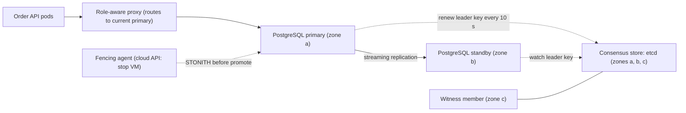
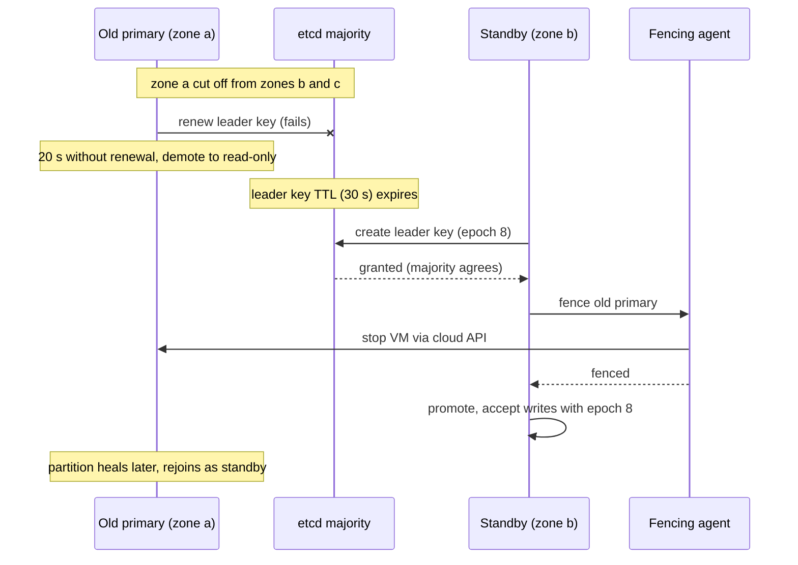

Every high-availability design eventually says "if the primary dies, promote the standby". The hard part is the word *if*. A node that stops answering might be dead, or merely slow, or cut off from you but not from its clients. If you promote the standby while the old primary is alive and still accepting writes, you have two primaries, two diverging copies of the truth, and an incident that ends with someone choosing which customers' writes to throw away. That situation is **split-brain**. This lesson covers how failure detectors work, why they can never be perfect, and the fencing techniques that make a wrong guess safe.

## Learning objectives

By the end of this lesson you will be able to:

1. Define split-brain and list the common causes: partitions, asymmetric links, pauses and false suspicion.
2. Explain why no failure detector can be both fast and always right in an asynchronous network.
3. Choose heartbeat intervals and timeouts from measured latency, and calculate detection time.
4. Explain and implement a phi accrual failure detector, and interpret a phi threshold.
5. Apply quorum fencing, witnesses, STONITH and self-fencing so that only one side can act.
6. Build an ASP.NET Core write gate that closes when a primary cannot renew its leadership lease.
7. Plan recovery after a split-brain, and decide when manual failover is the better choice.

## Prerequisites

- [Consensus fundamentals](#/lesson/m13-consensus): majorities and terms are the main defence against two leaders.
- [Replication and leader-follower](#/lesson/m13-replication): failover promotes a follower.
- [Distributed locks and fencing tokens](#/lesson/m13-distributed-locks): fencing tokens appear again here at the storage layer.

## Explain it like I'm a beginner

A bank branch has two cashiers sharing one ledger book. The rule: only the cashier holding the **ledger** may record deposits. Cashier A holds it. Cashier B sits in the back office and every minute shouts "All good?"; A shouts back "Yes!".

One day the back-office door is closed and B stops hearing A. B thinks, "A must have fainted," takes a spare copy of the ledger and starts recording deposits at the back counter. But A is fine, still recording deposits at the front. Now the branch has **two ledgers** with different entries. At closing time nobody knows the real balance. That is split-brain.

How do real systems stop this?

1. **Do not decide alone.** Before taking over, B must get agreement from the branch manager and the security guard: a majority of three people (a **quorum**). A, who also cannot reach them, must stop recording on his own (**self-fencing**).
2. **Make sure the old one has really stopped.** Before B starts, the manager takes the pen out of A's hand (**fencing**). In data centres this is literally switching off the old server's power, called **STONITH**: Shoot The Other Node In The Head.
3. **Be careful about "fainted".** If A sometimes takes 20 seconds to reply because he is busy, B should not panic after 5 seconds. Good systems learn how quickly someone usually replies and judge silence against that (**phi accrual failure detection**).

## First-principles explanation

### What split-brain is

**Split-brain** is any state where two or more nodes each believe they hold an exclusive role (primary database, cluster leader, lock owner) and act on it at the same time. The consequences depend on the role:

- Two database primaries: both accept writes; data diverges; one side's writes will be lost or must be merged by hand.
- Two schedulers: jobs run twice (double billing, double emails).
- Two storage controllers writing to one disk: file system corruption.

Split-brain is not caused by a bug in replication. It is caused by a **wrong decision that a node has failed**, followed by an action (promotion) that was not fenced.

### Why failure detection is fundamentally uncertain

In an asynchronous network (no upper bound on message delay or processing time), a missing reply has many explanations:

- the node crashed;
- the node is paused (garbage collection, VM migration, CPU starvation, disk stall);
- the network dropped or delayed the message in one direction only;
- the reply is queued behind a large transfer;
- *your* node is the one that is slow or cut off.

Chandra and Toueg's work on unreliable failure detectors (1996) formalised the consequence: a detector can be **complete** (eventually suspects every crashed node) but cannot also be perfectly **accurate** (never suspects a live node) unless you assume timing bounds. Every practical detector is therefore a trade-off between:

- **Detection time:** how long after a real crash you notice.
- **False-positive rate:** how often you suspect a node that is alive.

Short timeouts give fast failover and frequent false alarms; long timeouts give few false alarms and slow failover. A false alarm in a system without fencing is a split-brain. So the design goal is not a perfect detector; it is **making a wrong suspicion harmless**.

### Heartbeats and timeouts

The simplest detector: every node sends a heartbeat every `interval`; a peer is suspected if no heartbeat arrived for `timeout`.

```text
Heartbeat interval: 1 s
Timeout:            5 s  (5 missed heartbeats)
Detection time:     between 4 and 5 s after the crash, plus processing
Failover time:      detection + election + promotion + client reconnection
                    ≈ 5 s + 1 s + 2 s + 5–30 s (DNS / pool refresh) ≈ 13–38 s (estimate)
```

How to pick the timeout: measure the distribution of heartbeat delays under real load, including the worst pauses you see (p99.9 and maximum over a week), and set the timeout comfortably above the realistic worst case. If your service has 2-second garbage collection pauses under peak load, a 1.5-second timeout guarantees false failovers at peak, which is the worst moment.

Two refinements:

- **Indirect probing** (used by the SWIM protocol and HashiCorp's memberlist): before suspecting B, A asks C and D to ping B. If they can reach B, the problem is A's link, not B.
- **Suspicion with confirmation:** mark a node *suspect* first, broadcast the suspicion, and only declare it *dead* if it does not refute the suspicion within a grace period.

### Phi accrual failure detection

A fixed timeout ignores context: 5 seconds of silence means something different for a peer that normally replies every 100 ms over a LAN than for one that replies every 2 seconds across regions. The **phi accrual failure detector** (Hayashibara et al., 2004), used in Cassandra and Akka, outputs a *suspicion level* instead of yes/no.

It keeps a sliding window of recent heartbeat inter-arrival times and estimates the probability that a heartbeat would arrive *even later* than the current silence, given that history. Then:

```text
φ = −log10( P(next heartbeat arrives later than now) )
```

Interpretation: φ = 1 means about a 10 % chance the node is fine and just late; φ = 2 means 1 %; φ = 8 means about one in 100 million. You choose a threshold; Cassandra's default `phi_convict_threshold` is 8.

With an exponential model of inter-arrival times (the approximation Cassandra uses), the formula becomes simple:

```text
P(later than t) = e^(−t / mean)
φ(t)            = t / mean × log10(e) ≈ 0.434 × t / mean

mean = 1 s:  t = 1 s  → φ ≈ 0.43
             t = 5 s  → φ ≈ 2.17
             t = 18.4 s → φ ≈ 8.0   (convicted at threshold 8)
mean = 100 ms: φ = 8 after ≈ 1.84 s
```

Akka's implementation uses a normal distribution with the observed mean and standard deviation, plus an "acceptable heartbeat pause" allowance, so a peer with very regular heartbeats is convicted quickly while a jittery one gets more slack. Both versions share the key property: **the detector adapts to the network it observes**, so one threshold works across fast and slow links.

Phi accrual does not remove the fundamental trade-off. It makes the threshold mean the same thing everywhere.

### Defence 1: quorum fencing

The most important rule: **a node may act in an exclusive role only while it can talk to a majority of the cluster**.

- In a partition, at most one side has a majority, so at most one side may elect a primary.
- The side without a majority must **stop** acting as primary even if it was primary before. That is **self-fencing**.
- Raft builds this in: a leader cut off from the majority cannot commit, and leases expire.

Odd numbers matter here exactly as in [consensus](#/lesson/m13-consensus). Two nodes cannot form a majority after a partition (1 of 2 is not a majority), so **two-node clusters need a third vote**: a lightweight **witness** or **tiebreaker** (an arbiter VM, a quorum device, a cloud storage blob, or a consensus store in a third zone) that holds no data but breaks ties.

How a typical PostgreSQL HA setup (Patroni with etcd) applies quorum fencing:

1. The primary holds a **leader key** in etcd with a TTL (say 30 s) and renews it every 10 s.
2. Standbys watch the key. If it expires, they race to create it; etcd (a Raft majority) guarantees one winner.
3. If the primary cannot renew the key (it lost contact with the etcd majority), it **demotes itself** to read-only before the TTL ends.
4. Optionally a **watchdog** (a hardware or kernel timer) reboots the primary's machine if the HA agent itself hangs and stops renewing, so even a frozen agent cannot keep a primary running.

### Defence 2: STONITH and other fencing

Self-fencing relies on the old primary noticing it should stop. A paused process does not notice anything. **Fencing** stops the old node from the outside before the new one starts:

- **Power fencing (STONITH):** power off or reset the old node via its management controller (IPMI, iLO, iDRAC), a smart power switch, or the cloud provider's API (stop or terminate the VM). Pacemaker clusters treat this as mandatory: a node that cannot be fenced is not failed over.
- **Storage fencing:** revoke the old node's access to shared storage (SCSI persistent reservations, or detaching the cloud disk from the old VM).
- **Network fencing:** remove the old node from the load balancer, revoke its security-group access to clients and replicas.
- **Fencing tokens at the storage layer:** as in [distributed locks](#/lesson/m13-distributed-locks), the storage accepts writes only from the highest epoch. This works even if the old node keeps running.

The rule Pacemaker documentation states plainly: **if fencing fails, do not promote**. A cluster that is down is a bad day; a cluster with two primaries is a much worse week.

### Defence 3: make clients follow the epoch

Fencing the server is not enough if clients keep talking to it. After a failover:

- DNS records with a 300-second TTL keep sending some clients to the old IP for up to five minutes.
- Connection pools keep open connections to the old primary.

Mitigations: a floating virtual IP or load balancer that moves with the role; short DNS TTLs for database endpoints; having the old primary close all client connections when it demotes; and having writes carry an **epoch** (the term of the primary they expect) so that a write landing on the wrong node is rejected.

### Failure cases that look correct

**Failure case 1: the two-node cluster with a heartbeat cable.** Two database servers, active and passive, connected by a dedicated heartbeat link. The link is unplugged during maintenance. Each node sees the other as dead. The passive one promotes itself. Both serve writes from different application servers for 40 minutes. Fix: a third vote (witness) and mandatory fencing.

**Failure case 2: the asymmetric partition.** The primary can reach the application servers but not the standby or the consensus store. The standby gets the leader key and promotes. The old primary, with no self-fencing, keeps accepting writes from applications that still have connections to it. Fix: the primary demotes itself when it cannot renew its lease, and applications get connections through a role-aware proxy.

**Failure case 3: the flapping failover.** The timeout is 2 s. Under peak load, the primary's 3-second garbage-collection pauses trigger failover; the new primary is now hot and also pauses; failover again. Each failover drops in-flight transactions and refills caches. Fix: timeouts based on measured pauses, phi accrual, a minimum time between failovers, and fixing the pauses themselves.

**Failure case 4: STONITH that never worked.** Fencing was configured with an IPMI password that was rotated a year ago. The first real partition triggers fencing, fencing fails, and an operator overrides the cluster to "just promote". Fix: test fencing regularly (game days), alert on fencing-agent health checks, and never automate around a failed fence.

**Failure case 5: recovery that silently drops data.** After a split-brain, the old primary is rejoined as a standby with `pg_rewind`, which discards its diverged writes. Twenty minutes of orders vanish. Fix: before rewinding, export the diverged transactions (from the old primary's WAL or the application's audit log), reconcile them, and tell the business.

### When manual failover is better

Automatic failover pays off when the cost of minutes of downtime is high and you have quorum, fencing and tested runbooks. For a small system with one primary and one standby and no third site, **manual failover** after a human confirms the primary is dead is often safer: a 15-minute outage instead of a split-brain. Managed database services (cloud PostgreSQL with zone-redundant HA) handle quorum and fencing for you and are usually the best option.

## Visual explanation

### Architecture: primary, standby and a witness in a third zone



Application pods connect through a role-aware proxy that always routes to the node holding the leader key. The primary streams changes to the standby and renews its leader key in a three-member etcd cluster spread across three zones; the third member in zone c is the witness that makes a majority possible when zone a and zone b cannot see each other. The standby watches the key. Before the standby promotes, the fencing agent stops the old primary's VM through the cloud API (dotted arrow). Every arrow that grants a role goes through the majority or the fence.

### Sequence: a partition handled with quorum and STONITH



Zone a loses contact with the rest. The old primary's renewals fail; after 20 seconds, well before the 30-second TTL ends, it demotes itself so it stops accepting writes even before anyone else acts (self-fencing). When the key expires, the standby asks the etcd majority for it and gets epoch 8. It does not promote yet: it first asks the fencing agent to stop the old primary's VM and waits for confirmation. Only then does it accept writes. Two independent safeties (self-demotion and STONITH) must both fail for split-brain to happen.

## Step-by-step example

**Scenario.** A state-wide public grievance portal runs PostgreSQL in one cloud region with three zones. It receives about 40,000 grievances a day, with peaks after public announcements. A lost or duplicated grievance is a serious problem; a few minutes of downtime is acceptable.

### Step 1: set the targets

```text
Writes:  40,000/day ÷ 86,400 ≈ 0.5/s average; peaks maybe 50/s (estimate after a TV announcement)
RTO:     5 minutes is acceptable
RPO:     zero lost acknowledged grievances
```

Zero data loss means the standby must be **synchronous** (each commit waits for the standby) or the HA tool must refuse to promote a standby that is behind.

### Step 2: choose failure detection numbers

Measure first. Suppose the team's monitoring shows heartbeat round trips of 1–3 ms within the region and occasional pauses up to 4 s during backups. They choose:

```text
Leader key TTL:      30 s
Renew interval:      10 s
Self-demote after:   20 s without successful renewal (TTL − 10 s margin)
Detection + promote: ≈ 30 s TTL + ≈ 5 s fencing + ≈ 5 s promotion ≈ 40 s
Client reconnect:    proxy health check every 2 s → ≈ 45 s total (estimate)
```

Well inside the 5-minute RTO, with plenty of margin over the 4-second pauses.

### Step 3: provide a majority

Three etcd members, one per zone. The database runs on two zones; the third zone holds only an etcd member (the witness). Any single zone failure leaves a majority of the consensus store.

### Step 4: fence

Configure the HA tool's fencing to stop the old primary VM via the cloud API, and enable the kernel watchdog so a hung HA agent reboots its own machine. Promotion is blocked if fencing fails.

### Step 5: protect against the asymmetric partition

The primary closes all client connections and goes read-only when it cannot renew. Applications connect through a proxy that routes by role, not by a fixed host name, so stale DNS cannot send writes to the old primary.

### Step 6: rehearse

Quarterly game day: cut zone a's network, verify the timings above, verify only one primary accepts writes at every moment (a script writes a row every 100 ms to both addresses and checks which succeed), and practise rejoining the old primary.

## Production-style C# implementation

The code below implements a phi accrual detector for peers, a **write gate** that closes when this node loses its leadership lease (self-fencing in the application tier), and middleware that rejects writes while the gate is closed. The lease store and fencing agent are interfaces with in-memory fakes; in production they would wrap etcd and a cloud API.

```text
Grievance.Api/
  Program.cs
  Ha/HaOptions.cs
  Ha/PhiAccrualFailureDetector.cs
  Ha/PeerDetectors.cs
  Ha/WriteGate.cs
  Ha/LeaderLease.cs
  Ha/PrimaryLeaseGuard.cs
```

```csharp file=Ha/HaOptions.cs
namespace Grievance.Api.Ha;

public sealed class HaOptions
{
    public string NodeId { get; set; } = "node-a";
    public TimeSpan LeaseTtl { get; set; } = TimeSpan.FromSeconds(30);
    public TimeSpan RenewInterval { get; set; } = TimeSpan.FromSeconds(10);

    /// <summary>Stop acting as primary this long before the lease could expire elsewhere.
    /// Covers clock drift between this node and the lease store, and the renew round trip.</summary>
    public TimeSpan SafetyMargin { get; set; } = TimeSpan.FromSeconds(10);

    public double PhiThreshold { get; set; } = 8.0;
}
```

```csharp file=Ha/PhiAccrualFailureDetector.cs
namespace Grievance.Api.Ha;

/// <summary>Phi accrual failure detector using an exponential model of heartbeat intervals
/// (the approximation Cassandra uses): phi = elapsed / mean * log10(e).</summary>
public sealed class PhiAccrualFailureDetector(TimeProvider time, int windowSize = 1000, double minMeanMs = 50)
{
    private readonly object _gate = new();
    private readonly Queue<double> _intervalsMs = new();
    private double _sumMs;
    private DateTimeOffset? _last;

    public void Heartbeat()
    {
        var now = time.GetUtcNow();
        lock (_gate)
        {
            if (_last is { } previous)
            {
                double interval = (now - previous).TotalMilliseconds;
                _intervalsMs.Enqueue(interval);
                _sumMs += interval;
                if (_intervalsMs.Count > windowSize) _sumMs -= _intervalsMs.Dequeue();
            }
            _last = now;
        }
    }

    /// <summary>Suspicion level. 0 when there is not enough history yet.</summary>
    public double Phi()
    {
        var now = time.GetUtcNow();
        lock (_gate)
        {
            if (_last is null || _intervalsMs.Count == 0) return 0.0;
            double elapsed = (now - _last.Value).TotalMilliseconds;
            double mean = Math.Max(_sumMs / _intervalsMs.Count, minMeanMs);
            return elapsed / mean * Math.Log10(Math.E);
        }
    }

    public bool IsAvailable(double threshold) => Phi() < threshold;
}
```

The `minMeanMs` floor prevents a pathological case: if heartbeats arrive in bursts a millisecond apart, the mean collapses towards zero and a tiny gap produces an enormous phi.

```csharp file=Ha/PeerDetectors.cs
using System.Collections.Concurrent;

namespace Grievance.Api.Ha;

/// <summary>One detector per peer. Peers call POST /ha/heartbeat/{peer} (or a gossip layer feeds this).</summary>
public sealed class PeerDetectors(TimeProvider time)
{
    private readonly ConcurrentDictionary<string, PhiAccrualFailureDetector> _peers = new(StringComparer.Ordinal);

    public void Heartbeat(string peer) => _peers.GetOrAdd(peer, _ => new PhiAccrualFailureDetector(time)).Heartbeat();

    public IReadOnlyDictionary<string, double> PhiByPeer() =>
        _peers.ToDictionary(kv => kv.Key, kv => Math.Round(kv.Value.Phi(), 2));

    public IReadOnlyList<string> Reachable(double threshold) =>
        _peers.Where(kv => kv.Value.IsAvailable(threshold)).Select(kv => kv.Key).OrderBy(k => k, StringComparer.Ordinal).ToList();
}
```

```csharp file=Ha/WriteGate.cs
namespace Grievance.Api.Ha;

/// <summary>Application-level self-fencing: writes are allowed only while this node holds the lease.
/// <see cref="Epoch"/> is the lease's fencing token and should be stored with every write.</summary>
public interface IWriteGate
{
    bool IsOpen { get; }
    long Epoch { get; }
    string Reason { get; }
    void Open(long epoch);
    void Close(string reason);
}

public sealed class WriteGate : IWriteGate
{
    private readonly object _gate = new();
    private bool _open;
    private long _epoch;
    private string _reason = "not yet elected";

    public bool IsOpen { get { lock (_gate) return _open; } }
    public long Epoch { get { lock (_gate) return _epoch; } }
    public string Reason { get { lock (_gate) return _reason; } }

    public void Open(long epoch)
    {
        lock (_gate)
        {
            if (epoch < _epoch) throw new InvalidOperationException($"Epoch {epoch} is older than {_epoch}.");
            _open = true;
            _epoch = epoch;
            _reason = "lease held";
        }
    }

    public void Close(string reason)
    {
        lock (_gate)
        {
            _open = false;
            _reason = reason;
        }
    }
}

public sealed class WriteGateMiddleware(RequestDelegate next, IWriteGate gate)
{
    public async Task InvokeAsync(HttpContext context)
    {
        bool isWrite = !(HttpMethods.IsGet(context.Request.Method) || HttpMethods.IsHead(context.Request.Method)
                         || HttpMethods.IsOptions(context.Request.Method));
        bool isHaEndpoint = context.Request.Path.StartsWithSegments("/ha");

        if (isWrite && !isHaEndpoint && !gate.IsOpen)
        {
            context.Response.StatusCode = StatusCodes.Status503ServiceUnavailable;
            context.Response.Headers.RetryAfter = "5";
            await context.Response.WriteAsJsonAsync(new { error = "not primary", reason = gate.Reason });
            return;
        }
        await next(context);
    }
}
```

```csharp file=Ha/LeaderLease.cs
namespace Grievance.Api.Ha;

/// <summary>A leader key with a TTL in a consensus store (etcd, Consul, ZooKeeper).
/// Returns the epoch (monotonic per new holder) while this node holds the key, or null.</summary>
public interface ILeaderLeaseStore
{
    Task<long?> TryAcquireOrRenewAsync(string nodeId, TimeSpan ttl, CancellationToken ct);
}

/// <summary>STONITH: make sure a node can no longer act (stop the VM, cut its storage).</summary>
public interface IFencingAgent
{
    Task<bool> FenceAsync(string nodeId, CancellationToken ct);
}

public sealed class InMemoryLeaderLeaseStore(TimeProvider time) : ILeaderLeaseStore
{
    private readonly object _gate = new();
    private string? _holder;
    private DateTimeOffset _expiresAt;
    private long _epoch;

    /// <summary>Test hook: simulate this node losing contact with the store's majority.</summary>
    public bool Unreachable { get; set; }

    public Task<long?> TryAcquireOrRenewAsync(string nodeId, TimeSpan ttl, CancellationToken ct)
    {
        if (Unreachable) throw new TimeoutException("Lease store majority unreachable.");
        lock (_gate)
        {
            var now = time.GetUtcNow();
            if (_holder == nodeId && _expiresAt > now)
            {
                _expiresAt = now + ttl;                      // renew, same epoch
                return Task.FromResult<long?>(_epoch);
            }
            if (_holder is null || _expiresAt <= now)
            {
                _holder = nodeId;                            // new holder, new epoch
                _expiresAt = now + ttl;
                _epoch++;
                return Task.FromResult<long?>(_epoch);
            }
            return Task.FromResult<long?>(null);             // someone else holds it
        }
    }
}

public sealed class LoggingFencingAgent(ILogger<LoggingFencingAgent> log) : IFencingAgent
{
    public Task<bool> FenceAsync(string nodeId, CancellationToken ct)
    {
        log.LogWarning("STONITH requested for {Node}. Wire this to the cloud API (stop VM) in production.", nodeId);
        return Task.FromResult(false);   // fail closed: an unconfigured agent must never allow promotion
    }
}
```

Notice that the placeholder fencing agent returns **false**. An agent that pretends to succeed is worse than none, because it lets the cluster promote while the old primary may still be running.

```csharp file=Ha/PrimaryLeaseGuard.cs
using Microsoft.Extensions.Hosting;
using Microsoft.Extensions.Logging;
using Microsoft.Extensions.Options;

namespace Grievance.Api.Ha;

/// <summary>Renews the leader lease and opens or closes the write gate. Closes the gate
/// SafetyMargin before the lease could expire, measured from when the last successful renewal was SENT.</summary>
public sealed class PrimaryLeaseGuard(ILeaderLeaseStore store, IWriteGate gate, TimeProvider time,
    IOptions<HaOptions> options, ILogger<PrimaryLeaseGuard> log) : BackgroundService
{
    private readonly HaOptions _o = options.Value;
    private DateTimeOffset? _lastRenewSentAt;

    protected override async Task ExecuteAsync(CancellationToken stoppingToken)
    {
        while (!stoppingToken.IsCancellationRequested)
        {
            await TickAsync(stoppingToken);
            await Task.Delay(_o.RenewInterval, time, stoppingToken);
        }
    }

    public async Task TickAsync(CancellationToken ct)
    {
        var sentAt = time.GetUtcNow();
        long? epoch = null;
        try
        {
            using var timeout = CancellationTokenSource.CreateLinkedTokenSource(ct);
            timeout.CancelAfter(_o.RenewInterval);
            epoch = await store.TryAcquireOrRenewAsync(_o.NodeId, _o.LeaseTtl, timeout.Token);
        }
        catch (Exception ex) when (!ct.IsCancellationRequested)
        {
            log.LogWarning(ex, "Lease renewal failed.");
        }

        if (epoch is { } e)
        {
            _lastRenewSentAt = sentAt;
            if (!gate.IsOpen || gate.Epoch != e)
            {
                gate.Open(e);
                log.LogInformation("{Node} is primary with epoch {Epoch}.", _o.NodeId, e);
            }
            return;
        }

        bool deadlinePassed = _lastRenewSentAt is null
            || time.GetUtcNow() - _lastRenewSentAt.Value >= _o.LeaseTtl - _o.SafetyMargin;
        if (gate.IsOpen && deadlinePassed)
        {
            gate.Close("lease not renewed before safety deadline");
            log.LogError("{Node} self-fenced: closed writes before its lease could expire.", _o.NodeId);
        }
    }
}
```

Two subtle choices protect against split-brain at the boundary:

- The deadline is measured from when the successful renewal was **sent**, not when the reply arrived. The lease store started the TTL somewhere between those two moments, so the send time is the conservative choice.
- The gate closes at `TTL − SafetyMargin`, so this node stops writing before any standby can possibly hold the lease, even with some clock drift. This is still a timing assumption, which is why storage-level epoch checks and STONITH remain necessary.

```csharp file=Program.cs
using Grievance.Api.Ha;

var builder = WebApplication.CreateBuilder(args);

builder.Services.Configure<HaOptions>(builder.Configuration.GetSection("Ha"));
builder.Services.AddSingleton(TimeProvider.System);
builder.Services.AddSingleton<PeerDetectors>();
builder.Services.AddSingleton<IWriteGate, WriteGate>();
builder.Services.AddSingleton<InMemoryLeaderLeaseStore>();
builder.Services.AddSingleton<ILeaderLeaseStore>(sp => sp.GetRequiredService<InMemoryLeaderLeaseStore>());
builder.Services.AddSingleton<IFencingAgent, LoggingFencingAgent>();
builder.Services.AddHostedService<PrimaryLeaseGuard>();

var app = builder.Build();

app.UseMiddleware<WriteGateMiddleware>();

app.MapPost("/grievances", (GrievanceRequest req, IWriteGate gate) =>
    // Store gate.Epoch with the row; the database can reject writes from an older epoch.
    Results.Created($"/grievances/{Guid.NewGuid()}", new { req.Subject, epoch = gate.Epoch }));

app.MapPost("/ha/heartbeat/{peer}", (string peer, PeerDetectors peers) =>
{
    peers.Heartbeat(peer);
    return Results.NoContent();
});

app.MapGet("/ha/status", (IWriteGate gate, PeerDetectors peers, Microsoft.Extensions.Options.IOptions<HaOptions> o) =>
    Results.Ok(new
    {
        gate.IsOpen, gate.Epoch, gate.Reason,
        phi = peers.PhiByPeer(),
        reachable = peers.Reachable(o.Value.PhiThreshold)
    }));

// Local experiment only: simulate losing the lease store's majority.
app.MapPost("/ha/chaos/partition/{on}", (bool on, InMemoryLeaderLeaseStore store) =>
{
    store.Unreachable = on;
    return Results.Ok(new { partitioned = on });
});

app.Run();

public sealed record GrievanceRequest(string Subject, string District, string Description);
```

Try it locally: post a grievance (accepted, epoch 1), turn the partition on, wait 20 seconds and post again. The write gate returns 503 with `reason = "lease not renewed before safety deadline"`. That is self-fencing in the application tier.

## Bad design vs good design

**Bad:**

- Two database nodes, a heartbeat over one cable, automatic promotion on 3 missed heartbeats, no third vote, no fencing.
- The timeout is 1 second because "faster failover is better", in a service with 2-second GC pauses.
- After failover, applications reach the database by a DNS name with a 1-hour TTL.
- A fencing script that "returns success" when the IPMI call times out.
- After the incident, the old primary is rewound without saving its diverged writes.

**Good:**

- An odd number of voters across failure domains, with a witness where the data nodes are only two.
- Only the majority side may hold the leader role; the minority side self-fences before its lease ends.
- STONITH or storage fencing must succeed before promotion; a failed fence blocks promotion and pages a human.
- Timeouts come from measured latency and pauses; phi accrual or indirect probing reduces false suspicion.
- Writes carry an epoch that storage checks; clients route by role through a proxy or virtual IP.
- Split-brain recovery has a runbook that preserves diverged writes for reconciliation.

:::callout type=warning title="Fail closed"
Every safety mechanism in this lesson should fail *closed*: no lease means no writes, failed fencing means no promotion, unknown epoch means reject. Systems that fail open ("we could not check, so we assumed it was fine") are how split-brain happens in practice.
:::

## Practical playground

The network-partition simulator compares two policies during a partition. **CP** behaves like quorum fencing: the minority side refuses requests. **AP** behaves like a cluster without fencing: both sides keep accepting writes, which is split-brain.

1. Run AP with a 30-second partition. Read off conflicting keys and lost writes: that is what a split-brain recovery would have to reconcile.
2. Switch to CP. Note side B's availability during the partition.
3. Increase the partition to 120 seconds in AP mode. How does the number of conflicting keys grow?
4. For the grievance portal, which mode would you choose, and what would you tell users during the outage?

:::playground type=sim sim=partition title="Split-brain (AP) versus quorum fencing (CP)" mode=AP partitionSec=30 writeShare=0.4
:::

## Exercises

:::exercise id=m13-split-brain-ex1 difficulty=beginner kind=code title="Fixed-timeout heartbeat detector"
Implement the simplest failure detector and see its behaviour in tests before moving to phi accrual.
::requirements
- `HeartbeatTimeoutDetector(TimeSpan timeout)`.
- `Heartbeat(node, at)`: records the latest heartbeat time; a heartbeat older than the one already recorded (delivered out of order) is ignored.
- `IsSuspected(node, now)`: true if `now − last > timeout`. Unknown nodes throw `ArgumentException`.
- `Suspected(now)` returns all suspected nodes sorted by name (ordinal).
- A timeout of zero or less throws `ArgumentOutOfRangeException`.
::acceptance
- With a 5 s timeout, a node last heard at 10:00:00 is not suspected at 10:00:05 but is at 10:00:05.001.
- An out-of-order heartbeat does not make a node look older.
- `Suspected` lists only silent nodes, sorted.
::hint
A dictionary from node name to last heartbeat time is all the state you need.
::hint
Use `Math.Max`-style logic for out-of-order heartbeats: keep the later time.
::hint
"Strictly longer than the timeout" means `>`, not `>=`.
::hint
```csharp
if (!_last.TryGetValue(node, out var prev) || at > prev) _last[node] = at;
```
::starter
```csharp file=HeartbeatTimeoutDetector.cs
using System;
using System.Collections.Generic;
using System.Linq;

public sealed class HeartbeatTimeoutDetector
{
    public HeartbeatTimeoutDetector(TimeSpan timeout) => throw new NotImplementedException();
    public void Heartbeat(string node, DateTimeOffset at) => throw new NotImplementedException();
    public bool IsSuspected(string node, DateTimeOffset now) => throw new NotImplementedException();
    public IReadOnlyList<string> Suspected(DateTimeOffset now) => throw new NotImplementedException();
}
```
::tests
```csharp file=HeartbeatTimeoutDetectorTests.cs
using System;
using Xunit;

public class HeartbeatTimeoutDetectorTests
{
    private static readonly DateTimeOffset T0 = new DateTimeOffset(2026, 10, 19, 10, 0, 0, TimeSpan.Zero);

    [Fact]
    public void Suspected_only_after_strictly_longer_than_timeout()
    {
        var d = new HeartbeatTimeoutDetector(TimeSpan.FromSeconds(5));
        d.Heartbeat("db-b", T0);
        Assert.False(d.IsSuspected("db-b", T0.AddSeconds(5)));
        Assert.True(d.IsSuspected("db-b", T0.AddSeconds(5).AddMilliseconds(1)));
    }

    [Fact]
    public void Out_of_order_heartbeat_is_ignored()
    {
        var d = new HeartbeatTimeoutDetector(TimeSpan.FromSeconds(5));
        d.Heartbeat("db-b", T0.AddSeconds(10));
        d.Heartbeat("db-b", T0);
        Assert.False(d.IsSuspected("db-b", T0.AddSeconds(14)));
    }

    [Fact]
    public void Suspected_list_is_sorted()
    {
        var d = new HeartbeatTimeoutDetector(TimeSpan.FromSeconds(5));
        d.Heartbeat("z", T0);
        d.Heartbeat("a", T0);
        d.Heartbeat("m", T0.AddSeconds(8));
        Assert.Equal(new[] { "a", "z" }, d.Suspected(T0.AddSeconds(9)));
    }

    [Fact]
    public void Unknown_node_throws() =>
        Assert.Throws<ArgumentException>(() => new HeartbeatTimeoutDetector(TimeSpan.FromSeconds(1)).IsSuspected("x", T0));

    [Fact]
    public void Invalid_timeout_throws() =>
        Assert.Throws<ArgumentOutOfRangeException>(() => new HeartbeatTimeoutDetector(TimeSpan.Zero));
}
```
::solution
```csharp file=HeartbeatTimeoutDetector.cs
using System;
using System.Collections.Generic;
using System.Linq;

public sealed class HeartbeatTimeoutDetector
{
    private readonly TimeSpan _timeout;
    private readonly Dictionary<string, DateTimeOffset> _last = new(StringComparer.Ordinal);

    public HeartbeatTimeoutDetector(TimeSpan timeout)
    {
        if (timeout <= TimeSpan.Zero) throw new ArgumentOutOfRangeException(nameof(timeout));
        _timeout = timeout;
    }

    public void Heartbeat(string node, DateTimeOffset at)
    {
        if (!_last.TryGetValue(node, out var previous) || at > previous) _last[node] = at;
    }

    public bool IsSuspected(string node, DateTimeOffset now)
    {
        if (!_last.TryGetValue(node, out var last)) throw new ArgumentException($"Unknown node '{node}'.", nameof(node));
        return now - last > _timeout;
    }

    public IReadOnlyList<string> Suspected(DateTimeOffset now) =>
        _last.Where(kv => now - kv.Value > _timeout).Select(kv => kv.Key).OrderBy(k => k, StringComparer.Ordinal).ToList();
}
```

Run a thought experiment with this detector: if `db-b` pauses for 6 seconds during a backup, it is suspected. Nothing in the detector can tell a pause from a crash. That is why the next exercises add adaptivity and, more importantly, fencing.
::mistakes
- Overwriting the last heartbeat with an out-of-order older one, which makes a healthy node look dead.
- Treating unknown nodes as "not suspected", which hides misconfigured peers.
:::

:::exercise id=m13-split-brain-ex2 difficulty=beginner kind=written title="Two nodes, one cable"
A logistics company runs its shipment database on two servers in two buildings of one campus, active and passive, with a heartbeat over a dedicated fibre link. Failover is automatic after 3 missed heartbeats (1 s apart). A contractor cuts the fibre. Describe what happens minute by minute, what data problems appear, and propose a design that prevents split-brain while keeping automatic failover.
::acceptance
- Explains that each node sees the other as dead and the passive promotes itself while the active keeps serving.
- Describes divergence (both accept writes) and the reconciliation problem.
- Proposes a third vote (witness in a third location or cloud) and explains why it breaks the tie.
- Adds fencing (power or storage) and self-fencing on loss of quorum, with "no fence, no promote".
::hint
After the cut, can either node tell "the other one died" from "the link died"?
::hint
Which applications are still connected to the active server?
::hint
How many votes does each side have after the cut, if you add a small third voter?
::solution
**Timeline.** At t = 0 the fibre is cut. By t ≈ 3 s both nodes have missed three heartbeats. The passive promotes itself and starts accepting connections; the active, seeing the passive as dead, carries on as primary. Application servers in building A still use the active; those that reconnect (or resolve DNS afresh) reach the new primary in building B. Both accept shipment updates. Over the next 40 minutes until someone notices, the same shipments get conflicting status updates and new shipments get IDs that may collide.

**Data problems.** Two divergent histories. Reconnecting them needs choosing a winner and replaying or merging the other side's transactions by hand, with business review.

**Design.**
- Add a **third voter**: a small witness VM in a cloud region (or a quorum device) reachable by both buildings over separate network paths. Now each node needs 2 of 3 votes to be primary. After a fibre cut, at most one building still reaches the witness.
- **Self-fencing**: the active demotes itself if it loses the majority for longer than a safe margin.
- **Fencing before promotion**: the passive must power off the active via its management controller or remove its storage/network access, and must not promote if that fails.
- **Epoch on writes** and a role-aware connection endpoint, so stray writes to the old primary are rejected.
::mistakes
- Proposing a second fibre link only. Redundant links reduce the probability but a two-voter cluster can still split.
- Proposing a longer timeout as the fix. It delays split-brain; it does not prevent it.
:::

:::exercise id=m13-split-brain-ex3 difficulty=intermediate kind=code title="Phi from heartbeat history"
Implement the phi calculation with a sliding window, using the exponential model from the lesson.
::requirements
- `PhiCalculator(int windowSize, double minMeanMs)`.
- `AddInterval(double ms)` records an inter-arrival time; only the last `windowSize` intervals count.
- `Phi(double msSinceLastHeartbeat)` returns `elapsed / mean × log10(e)`, where `mean` is the window average but never less than `minMeanMs`. With no intervals, return 0.
- `MillisecondsToReach(double phi)` returns the silence needed to reach a given phi with the current mean.
- Negative intervals or elapsed values throw `ArgumentOutOfRangeException`.
::acceptance
- Five intervals of 1,000 ms: `Phi(1000)` ≈ 0.434 and `Phi(5000)` ≈ 2.171.
- `MillisecondsToReach(8)` ≈ 18,421 ms for a 1,000 ms mean.
- With window 3, intervals 5000, 1000, 1000, 1000 give a mean of 1,000 ms.
- Intervals of 1 ms with `minMeanMs = 100` behave as a 100 ms mean.
::hint
Keep a queue of intervals and a running sum, so the mean is O(1).
::hint
`Math.Log10(Math.E)` ≈ 0.4343.
::hint
Inverting `phi = t / mean × log10(e)` gives `t = phi × mean / log10(e)`.
::hint
```csharp
_q.Enqueue(ms); _sum += ms;
if (_q.Count > _window) _sum -= _q.Dequeue();
```
::starter
```csharp file=PhiCalculator.cs
using System;
using System.Collections.Generic;

public sealed class PhiCalculator
{
    public PhiCalculator(int windowSize, double minMeanMs) => throw new NotImplementedException();
    public void AddInterval(double ms) => throw new NotImplementedException();
    public double MeanMs => throw new NotImplementedException();
    public double Phi(double msSinceLastHeartbeat) => throw new NotImplementedException();
    public double MillisecondsToReach(double phi) => throw new NotImplementedException();
}
```
::tests
```csharp file=PhiCalculatorTests.cs
using System;
using Xunit;

public class PhiCalculatorTests
{
    private static PhiCalculator Steady(double ms, int count, int window = 100, double minMean = 10)
    {
        var p = new PhiCalculator(window, minMean);
        for (int i = 0; i < count; i++) p.AddInterval(ms);
        return p;
    }

    [Fact]
    public void Phi_for_one_second_mean()
    {
        var p = Steady(1000, 5);
        Assert.Equal(0.434, p.Phi(1000), 3);
        Assert.Equal(2.171, p.Phi(5000), 3);
    }

    [Fact]
    public void Time_to_reach_threshold_eight() =>
        Assert.Equal(18421, Steady(1000, 5).MillisecondsToReach(8), 0);

    [Fact]
    public void Window_drops_old_intervals()
    {
        var p = new PhiCalculator(3, 10);
        p.AddInterval(5000);
        p.AddInterval(1000);
        p.AddInterval(1000);
        p.AddInterval(1000);
        Assert.Equal(1000, p.MeanMs, 6);
    }

    [Fact]
    public void Mean_has_a_floor()
    {
        var p = Steady(1, 10, minMean: 100);
        Assert.Equal(100, p.MeanMs, 6);
        Assert.Equal(0.434, p.Phi(100), 3);
    }

    [Fact]
    public void No_history_means_zero() => Assert.Equal(0.0, new PhiCalculator(10, 10).Phi(99999), 6);

    [Fact]
    public void Negative_values_throw()
    {
        var p = new PhiCalculator(10, 10);
        Assert.Throws<ArgumentOutOfRangeException>(() => p.AddInterval(-1));
        Assert.Throws<ArgumentOutOfRangeException>(() => p.Phi(-1));
    }
}
```
::solution
```csharp file=PhiCalculator.cs
using System;
using System.Collections.Generic;

public sealed class PhiCalculator
{
    private static readonly double Log10E = Math.Log10(Math.E);
    private readonly int _window;
    private readonly double _minMeanMs;
    private readonly Queue<double> _intervals = new();
    private double _sum;

    public PhiCalculator(int windowSize, double minMeanMs)
    {
        if (windowSize < 1) throw new ArgumentOutOfRangeException(nameof(windowSize));
        if (minMeanMs <= 0) throw new ArgumentOutOfRangeException(nameof(minMeanMs));
        _window = windowSize;
        _minMeanMs = minMeanMs;
    }

    public void AddInterval(double ms)
    {
        if (ms < 0 || double.IsNaN(ms)) throw new ArgumentOutOfRangeException(nameof(ms));
        _intervals.Enqueue(ms);
        _sum += ms;
        if (_intervals.Count > _window) _sum -= _intervals.Dequeue();
    }

    public double MeanMs => _intervals.Count == 0 ? 0 : Math.Max(_sum / _intervals.Count, _minMeanMs);

    public double Phi(double msSinceLastHeartbeat)
    {
        if (msSinceLastHeartbeat < 0) throw new ArgumentOutOfRangeException(nameof(msSinceLastHeartbeat));
        if (_intervals.Count == 0) return 0.0;
        return msSinceLastHeartbeat / MeanMs * Log10E;
    }

    public double MillisecondsToReach(double phi)
    {
        if (phi < 0) throw new ArgumentOutOfRangeException(nameof(phi));
        return _intervals.Count == 0 ? double.PositiveInfinity : phi * MeanMs / Log10E;
    }
}
```

`MillisecondsToReach` is the number to show in a design review: "with our heartbeat rate and threshold 8, a dead node is convicted after about 18 seconds". If that is too slow, send heartbeats more often (smaller mean) rather than lowering the threshold, which increases false positives.
::alternatives
Akka's detector models intervals with a normal distribution using mean and standard deviation, and adds an acceptable-pause allowance. It convicts regular peers faster and tolerates jittery ones better, at the cost of a slightly more complex formula.
::mistakes
- Recomputing the mean over the whole history, which never adapts when the network changes.
- No floor on the mean: bursty heartbeats produce a near-zero mean and false convictions.
- Treating phi as a probability. It is a logarithmic suspicion level: phi 8 means about a 10⁻⁸ chance that the delay is normal under the model.
:::

:::exercise id=m13-split-brain-ex4 difficulty=intermediate kind=hld title="PostgreSQL HA across two data centres"
A state transport department runs its ticketing database in two government data centres, DC-1 (primary) and DC-2 (standby), 300 km apart with 6 ms round-trip latency. They want automatic failover with no split-brain and no lost acknowledged tickets. They have no third data centre but can use a public cloud region. Design it.
::acceptance
- Provides an odd number of voters, with the tiebreaker outside both data centres.
- Chooses synchronous or asynchronous replication with the RPO/latency trade-off stated (6 ms added per commit for synchronous).
- Includes self-fencing on the primary and STONITH or storage/network fencing before promotion.
- Explains how applications find the current primary after failover.
- States the failover time estimate and what happens if the cloud witness is unreachable.
::hint
With two sites, who breaks a tie when the link between them fails?
::hint
Zero lost acknowledged tickets means a commit must be on both sites before success. What does that cost per transaction?
::hint
If the witness is down but both DCs are fine, should anything change?
::hint
Consider three consensus-store members: one in each DC and one in the cloud region.
::starter
```json
{
  "nodes": [
    { "id": "apps", "type": "app-server", "label": "Ticketing API (both DCs)", "props": { "instances": 8 } },
    { "id": "pg1", "type": "database", "label": "PostgreSQL primary (DC-1)", "props": { "region": "dc-1" } },
    { "id": "pg2", "type": "read-replica", "label": "PostgreSQL standby (DC-2)", "props": { "region": "dc-2" } }
  ],
  "edges": [
    { "from": "apps", "to": "pg1", "kind": "sync", "label": "SQL" },
    { "from": "pg1", "to": "pg2", "kind": "async", "label": "replication" }
  ]
}
```
::solution
```json
{
  "nodes": [
    { "id": "apps", "type": "app-server", "label": "Ticketing API (both DCs)", "props": { "instances": 8 } },
    { "id": "proxy", "type": "load-balancer", "label": "Role-aware DB proxy / VIP per DC (routes to leader)" },
    { "id": "pg1", "type": "database", "label": "PostgreSQL + HA agent (DC-1)", "props": { "region": "dc-1" } },
    { "id": "pg2", "type": "database", "label": "PostgreSQL + HA agent (DC-2)", "props": { "region": "dc-2" } },
    { "id": "e1", "type": "service-registry", "label": "etcd member (DC-1)", "props": { "region": "dc-1" } },
    { "id": "e2", "type": "service-registry", "label": "etcd member (DC-2)", "props": { "region": "dc-2" } },
    { "id": "e3", "type": "service-registry", "label": "etcd witness (cloud region)", "props": { "region": "cloud" } },
    { "id": "fence", "type": "external", "label": "Fencing: out-of-band power / switch port shutdown" },
    { "id": "mon", "type": "monitoring", "label": "Lease age, replication lag, fence agent health" }
  ],
  "edges": [
    { "from": "apps", "to": "proxy", "kind": "sync" },
    { "from": "proxy", "to": "pg1", "kind": "sync", "label": "current leader" },
    { "from": "pg1", "to": "pg2", "kind": "sync", "label": "synchronous replication" },
    { "from": "pg1", "to": "e1", "kind": "sync", "label": "leader key" },
    { "from": "pg2", "to": "e2", "kind": "sync", "label": "watch" },
    { "from": "e1", "to": "e3", "kind": "sync", "label": "Raft" },
    { "from": "e2", "to": "e3", "kind": "sync", "label": "Raft" },
    { "from": "pg2", "to": "fence", "kind": "sync", "label": "fence DC-1 before promote" },
    { "from": "pg1", "to": "mon", "kind": "async" }
  ]
}
```

**Voters.** Three etcd members: DC-1, DC-2 and a witness in a cloud region, each reached over separate network paths. If the DC-1 to DC-2 link fails, the side that still reaches the witness has 2 of 3 and keeps (or takes) the leader key.

**Replication.** Synchronous replication to DC-2 adds roughly the 6 ms round trip to each commit (plus the standby's flush), which is acceptable for ticketing at, say, 200 commits/s. In exchange, every acknowledged ticket exists in both DCs (RPO 0). The HA agent must be configured to fall back sensibly if the standby is down (for example allow the primary to continue alone only while it holds the leader key, accepting reduced durability, or block writes; this is a business decision to document).

**Fencing.** The primary demotes itself if it cannot renew the leader key within TTL minus a margin; a watchdog reboots it if the agent hangs. Before promotion, DC-2 fences DC-1's database host via an out-of-band power controller or by shutting its switch ports; no fence, no promote.

**Clients.** Applications connect via a role-aware proxy that follows the leader key, so DNS caching cannot send writes to the old primary.

**Timings (estimate).** TTL 30 s, renew 10 s, fencing ≈ 10 s, promotion ≈ 5 s → about 45–60 s.

**Witness down.** Both DCs still form a majority (2 of 3); nothing changes, but an alert fires because the next failure would stop automatic failover.
::mistakes
- Putting the witness in DC-1 "because that is where the primary is", which makes a DC-1 outage lose the majority.
- Asynchronous replication with an RPO 0 requirement.
- Relying on DNS failover with long TTLs.
:::

:::exercise id=m13-split-brain-ex5 difficulty=advanced kind=code title="Failover decision with quorum and fencing"
Write the decision function an HA agent runs on each node. It must never allow two primaries, even under asymmetric partitions or failed fencing.
::requirements
- `ClusterView(Self, Primary, Members, Reachable, SuspectingPrimary)`. `Reachable` is the set of members this node can reach (excluding itself). `SuspectingPrimary` is the set of members (possibly including self) that report the primary as down.
- `FailoverPlanner.Plan(view, fence)` returns a `FailoverPlan(Action, Reason)`.
- Visible set = `Reachable ∪ {Self}`, restricted to `Members`. Majority = `Members.Count / 2 + 1`.
- If `Self == Primary`: `StayPrimary` when visible ≥ majority, otherwise `StepDown`.
- If `Self != Primary`: `Wait` when visible < majority; `Wait` when this node can reach the primary; `Wait` when fewer than a majority of *visible* members suspect the primary. Otherwise call `fence(Primary)`: `Promote` if it returns true, else `Wait`.
- `fence` must not be called unless every other condition for promotion holds.
- `Self` or `Primary` not in `Members` throws `ArgumentException`.
::acceptance
- A primary that can see only itself in a 3-node cluster steps down.
- A standby with a majority, all suspecting the primary, and a successful fence promotes.
- A standby that can still reach the primary waits (asymmetric partition).
- Failed fencing means wait, never promote.
- `fence` is not called when the standby lacks quorum.
::hint
Build the visible set first; nearly every rule uses it.
::hint
Only count suspicions from members you can actually see; a suspicion you heard about second-hand from an unreachable node is not reliable.
::hint
Order the checks so that the side effect (`fence`) comes last.
::hint
```csharp
var visible = new HashSet<string>(view.Reachable.Where(view.Members.Contains)) { view.Self };
int majority = view.Members.Count / 2 + 1;
```
::starter
```csharp file=FailoverPlanner.cs
using System;
using System.Collections.Generic;
using System.Linq;

public enum FailoverAction { StayPrimary, StepDown, Wait, Promote }

public sealed record ClusterView(string Self, string Primary, IReadOnlyList<string> Members,
    IReadOnlySet<string> Reachable, IReadOnlySet<string> SuspectingPrimary);

public sealed record FailoverPlan(FailoverAction Action, string Reason);

public static class FailoverPlanner
{
    public static FailoverPlan Plan(ClusterView view, Func<string, bool> fence) => throw new NotImplementedException();
}
```
::tests
```csharp file=FailoverPlannerTests.cs
using System;
using System.Collections.Generic;
using Xunit;

public class FailoverPlannerTests
{
    private static readonly string[] Three = { "a", "b", "c" };
    private static HashSet<string> Set(params string[] items) => new HashSet<string>(items);

    [Fact]
    public void Isolated_primary_steps_down()
    {
        var v = new ClusterView("a", "a", Three, Set(), Set());
        Assert.Equal(FailoverAction.StepDown, FailoverPlanner.Plan(v, _ => true).Action);
    }

    [Fact]
    public void Primary_with_majority_stays()
    {
        var v = new ClusterView("a", "a", Three, Set("b"), Set());
        Assert.Equal(FailoverAction.StayPrimary, FailoverPlanner.Plan(v, _ => true).Action);
    }

    [Fact]
    public void Standby_with_quorum_suspicion_and_fence_promotes()
    {
        string? fenced = null;
        var v = new ClusterView("b", "a", Three, Set("c"), Set("b", "c"));
        var plan = FailoverPlanner.Plan(v, n => { fenced = n; return true; });
        Assert.Equal(FailoverAction.Promote, plan.Action);
        Assert.Equal("a", fenced);
    }

    [Fact]
    public void Standby_that_reaches_primary_waits()
    {
        var v = new ClusterView("b", "a", Three, Set("a", "c"), Set("c"));
        Assert.Equal(FailoverAction.Wait, FailoverPlanner.Plan(v, _ => true).Action);
    }

    [Fact]
    public void Failed_fence_never_promotes()
    {
        var v = new ClusterView("b", "a", Three, Set("c"), Set("b", "c"));
        Assert.Equal(FailoverAction.Wait, FailoverPlanner.Plan(v, _ => false).Action);
    }

    [Fact]
    public void Fence_not_called_without_quorum()
    {
        int calls = 0;
        var v = new ClusterView("b", "a", Three, Set(), Set("b"));
        Assert.Equal(FailoverAction.Wait, FailoverPlanner.Plan(v, _ => { calls++; return true; }).Action);
        Assert.Equal(0, calls);
    }

    [Fact]
    public void Suspicion_from_unreachable_member_does_not_count()
    {
        var five = new[] { "a", "b", "c", "d", "e" };
        var v = new ClusterView("b", "a", five, Set("c", "d"), Set("b", "d", "e"));
        Assert.Equal(FailoverAction.Wait, FailoverPlanner.Plan(v, _ => true).Action);
    }

    [Fact]
    public void Unknown_self_throws() =>
        Assert.Throws<ArgumentException>(() => FailoverPlanner.Plan(new ClusterView("x", "a", Three, Set(), Set()), _ => true));
}
```
::solution
```csharp file=FailoverPlanner.cs
using System;
using System.Collections.Generic;
using System.Linq;

public enum FailoverAction { StayPrimary, StepDown, Wait, Promote }

public sealed record ClusterView(string Self, string Primary, IReadOnlyList<string> Members,
    IReadOnlySet<string> Reachable, IReadOnlySet<string> SuspectingPrimary);

public sealed record FailoverPlan(FailoverAction Action, string Reason);

public static class FailoverPlanner
{
    public static FailoverPlan Plan(ClusterView view, Func<string, bool> fence)
    {
        ArgumentNullException.ThrowIfNull(view);
        ArgumentNullException.ThrowIfNull(fence);
        if (!view.Members.Contains(view.Self)) throw new ArgumentException($"Self '{view.Self}' is not a member.");
        if (!view.Members.Contains(view.Primary)) throw new ArgumentException($"Primary '{view.Primary}' is not a member.");

        var visible = new HashSet<string>(view.Reachable.Where(view.Members.Contains), StringComparer.Ordinal) { view.Self };
        int majority = view.Members.Count / 2 + 1;

        if (view.Self == view.Primary)
            return visible.Count >= majority
                ? new FailoverPlan(FailoverAction.StayPrimary, $"sees {visible.Count} of {view.Members.Count}")
                : new FailoverPlan(FailoverAction.StepDown, "lost quorum: self-fence");

        if (visible.Count < majority)
            return new FailoverPlan(FailoverAction.Wait, "no quorum on this side");

        if (visible.Contains(view.Primary))
            return new FailoverPlan(FailoverAction.Wait, "primary is reachable from here");

        int suspecting = view.SuspectingPrimary.Count(visible.Contains);
        if (suspecting < majority)
            return new FailoverPlan(FailoverAction.Wait, $"only {suspecting} visible members suspect the primary");

        return fence(view.Primary)
            ? new FailoverPlan(FailoverAction.Promote, "quorum agrees and old primary is fenced")
            : new FailoverPlan(FailoverAction.Wait, "fencing failed: never promote without a fence");
    }
}
```

Every branch that can create a second primary is guarded twice: by quorum (only one side can have a majority) and by fencing (the old primary is stopped first). The primary branch is the mirror image: without quorum, it steps down on its own.

A real agent adds one more rule: among standbys, only the one with the most advanced replication position may promote, so no acknowledged write is lost. Consensus-based election (one leader key per term) ensures only one standby wins the race.
::mistakes
- Counting suspicions from members you cannot reach, which lets stale gossip drive a promotion.
- Calling `fence` early "just in case", which powers off a healthy primary whenever one standby has a bad link.
- Treating a fencing timeout as success.
::extensions
Add `ReplicationLsn` per member and require the promoting node to have the highest LSN among visible standbys.
:::

## Automated testing

- **Detector unit tests** with explicit times, as in exercises 1 and 3, including out-of-order heartbeats and bursty intervals.
- **Write-gate tests.** Use a `TimeProvider` subclass that tests can advance. Call `PrimaryLeaseGuard.TickAsync` directly: first with a reachable store (gate opens with epoch 1), then with `Unreachable = true` and time advanced by 15 s (gate still open), then by 21 s (gate closed). Assert the gate closes *before* the lease TTL, which is the property that prevents overlap.
- **Middleware tests** with `WebApplicationFactory`: with the gate closed, `POST /grievances` returns 503 and `GET` still works.
- **Planner property tests.** Generate random cluster views for the same partition (one view per node, consistent with a random partition of the network) and assert that at most one node ends with `StayPrimary` or `Promote`.
- **Game days.** Cut network links (including one-directional ones with firewall rules), pause the primary with `SIGSTOP`, break the fencing agent's credentials, and verify: one primary at all times, failover within the RTO, and alerts for fencing-agent failures. A test that writes to every node every 100 ms and checks how many accept writes at each moment is the most direct split-brain detector.

## Real-world application

- **Patroni** manages PostgreSQL HA using a leader key in etcd, Consul or ZooKeeper, demotes a primary that cannot renew, supports a watchdog, and uses synchronous replication modes to avoid promoting a standby that would lose data.
- **Pacemaker/Corosync** clusters require fencing (STONITH) and use quorum devices to break ties in two-node clusters.
- **Cassandra** and **Akka Cluster** use phi accrual failure detectors; Cassandra's `phi_convict_threshold` defaults to 8.
- **HashiCorp memberlist** (used by Consul and Nomad) implements SWIM-style gossip with indirect probes and suspicion to reduce false positives.
- **Managed cloud databases** with zone-redundant HA run these mechanisms for you; for most teams that is the right answer.
- **Elasticsearch** historically suffered split-brain from a misconfigured minimum master count; newer versions manage the voting configuration automatically to keep a majority rule.

## Interview questions

:::interview
::q beginner
What is split-brain?
::a
A state where two nodes both believe they hold an exclusive role, such as primary database, and both act on it. Typically a network partition or a pause makes a standby think the primary is dead; it promotes itself while the old primary keeps accepting writes, and the data diverges.
::q beginner
Why are two-node clusters prone to split-brain, and what fixes it?
::a
When the two nodes lose contact, each sees 1 of 2, and neither can tell whether the other died or the link did. Without a tie-breaker, either both act or neither does. Add a third vote, a witness or quorum device in a separate failure domain, so only the side with 2 of 3 may act, and fence the other side before promoting.
::q intermediate
How do you choose heartbeat timeouts?
::a
Measure heartbeat delay and pause distributions under real peak load, including GC, backups and VM migrations, and set the timeout well above the realistic worst case. Then estimate total failover time (detection, election, fencing, promotion, client reconnect) and check it against the RTO. Too short causes false failovers at peak; too long extends outages. Adaptive detectors such as phi accrual and indirect probing reduce false positives for the same detection speed.
::q intermediate
What does a phi accrual failure detector output, and how do you interpret a threshold of 8?
::a
A continuous suspicion level φ = −log10 of the probability that a heartbeat would arrive later than the current silence, given recent inter-arrival history. A threshold of 8 means you convict when, under the model, there is about a one-in-10⁸ chance the delay is normal. With an exponential model and 1-second heartbeats, that is about 18 seconds of silence. The detector adapts to each link's normal behaviour.
::q advanced
What is STONITH, and why would a cluster refuse to fail over when fencing fails?
::a
Shoot The Other Node In The Head: forcibly power off or isolate the old primary (via IPMI, a power switch, the cloud API, or storage reservations) before promoting a replacement. A cluster refuses to promote without a confirmed fence because it cannot otherwise rule out that the old primary is alive and accepting writes. Being down is recoverable; two primaries create divergent data that may be impossible to reconcile cleanly.
::q advanced
After a split-brain, two PostgreSQL nodes accepted writes for ten minutes. How do you recover?
::a
Stop writes on one side immediately (fence it). Decide which side becomes authoritative, usually the one with the majority and more writes. Before rejoining the other node, extract its diverged transactions since the fork point (from WAL with logical decoding, audit tables or application logs). Rejoin it with `pg_rewind` or a fresh base backup. Reconcile the extracted writes: replay non-conflicting ones, flag conflicts (same row changed on both sides) for business review, and notify affected users. Then fix the root cause: quorum, fencing, timeouts, and client routing.
:::

## Summary and revision

**Key takeaways**

- Split-brain happens when a node is wrongly declared dead and the replacement is not fenced.
- No failure detector is both fast and always right; design so a wrong suspicion is harmless.
- Pick timeouts from measured delays and pauses; estimate end-to-end failover time.
- Phi accrual outputs a suspicion level that adapts to each link; threshold 8 ≈ 18 s at 1 s heartbeats (exponential model).
- Only a side with a majority may act; the minority self-fences. Two data nodes need a witness.
- STONITH or storage fencing must succeed before promotion; fail closed.
- Clients must follow the role (proxy, VIP, short TTLs), and writes should carry an epoch.
- Recovery must preserve diverged writes for reconciliation.

**Terminology**: split-brain, failure detector, completeness, accuracy, heartbeat, timeout, indirect probe, suspicion, phi accrual, convict threshold, quorum, witness, tiebreaker, self-fencing, watchdog, STONITH, power fencing, storage fencing, epoch, leader key, asymmetric partition, pg_rewind.

:::flashcards
Q: What causes split-brain?
A: A node is wrongly judged dead (partition, pause, asymmetric link) and a replacement takes over without the old one being fenced.
Q: Why can no failure detector be both fast and perfectly accurate?
A: In an asynchronous network a slow or partitioned node is indistinguishable from a crashed one within any finite timeout.
Q: What does phi = 8 mean?
A: Under the detector's model, about a 10⁻⁸ chance that the current silence is normal; used as the conviction threshold.
Q: Phi formula with an exponential model?
A: φ = elapsed / mean × log10(e) ≈ 0.434 × elapsed / mean.
Q: What is self-fencing?
A: A node that loses quorum or cannot renew its lease stops acting in its exclusive role on its own, before its lease could pass to someone else.
Q: What is STONITH?
A: Shoot The Other Node In The Head: forcibly powering off or isolating the old primary before promoting a new one.
Q: What should a cluster do if fencing fails?
A: Not promote. Stay down and alert a human.
Q: Why do two-node clusters need a witness?
A: After a partition neither node has a majority of two, so a third vote is needed to break the tie.
:::

## Knowledge check

:::quiz pass=70
::q single
A primary loses its link to the standby and the consensus store, but application servers can still reach it. What should happen to keep the system safe?
- [ ] The primary keeps accepting writes because clients can reach it.
- [x] The primary demotes itself when it cannot renew its leader lease, and the standby is promoted only after fencing it.
- [ ] Both accept writes and merge later.
- [ ] The standby promotes immediately without fencing.
> This is an asymmetric partition. Self-fencing on the primary plus fencing before promotion prevents two writers.
::q single
Heartbeats arrive every 1 s and the phi threshold is 8 with an exponential model. Roughly how long after a crash is the node convicted?
- [ ] 1 s
- [ ] 8 s
- [x] About 18 s
- [ ] About 80 s
> t = φ × mean / log10(e) = 8 × 1 s / 0.434 ≈ 18.4 s.
::q single
A team lowers the failover timeout from 10 s to 1 s. Their JVM services have 2 s GC pauses at peak. What is the most likely result?
- [ ] Faster recovery with no downside.
- [x] False failovers at peak load, possibly flapping, and split-brain if fencing is weak.
- [ ] Fewer false positives.
- [ ] No change because GC does not affect heartbeats.
> A pause longer than the timeout looks like a crash. Timeouts must exceed realistic pauses.
::q single
Fencing via the cloud API times out during a failover. What should the standby do?
- [ ] Assume success and promote.
- [ ] Promote but in read-only mode.
- [x] Not promote; keep retrying the fence and page an operator.
- [ ] Promote and fence later.
> Fail closed. Without a confirmed fence the old primary may still be writing.
::q multi
Which reduce the risk of split-brain? (Select all that apply.)
- [x] A witness in a third failure domain.
- [x] Writes carrying an epoch that storage checks.
- [ ] A DNS record with a 1-hour TTL for the database endpoint.
- [x] A watchdog that reboots a primary whose HA agent stops renewing.
> Long DNS TTLs keep clients pointed at an old primary after failover, which increases risk.
::q single
A 5-node cluster splits into groups of 3 and 2. The current primary is in the group of 2. What should happen?
- [ ] Both groups elect primaries and reconcile later.
- [x] The primary steps down; the group of 3 may elect a new primary after fencing.
- [ ] The primary stays because it was primary first.
- [ ] No group may act until the partition heals.
> Only a majority may hold the role. The minority self-fences.
::q single
Why does the write gate in this lesson measure the safety deadline from when a successful renewal was sent, not received?
- [ ] Sending is faster to measure.
- [x] The lease store may have started the TTL as early as the send time, so it is the conservative bound.
- [ ] Received times are not available in .NET.
- [ ] It makes no difference.
> Using the receive time could keep the gate open after the lease expired on the store.
:::

## Completion criteria

You have finished this lesson when you can:

- [ ] Score at least 70 % on the knowledge check.
- [ ] Explain, with a timeline, how a two-node cluster splits and how a witness plus fencing prevents it.
- [ ] Complete exercises 1, 3 and 5 with all tests passing.
- [ ] Calculate detection and failover time for a given heartbeat rate, phi threshold and fencing delay.
- [ ] Describe a split-brain recovery that does not silently discard data.
