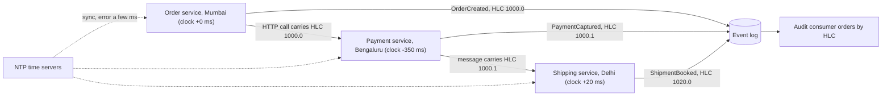
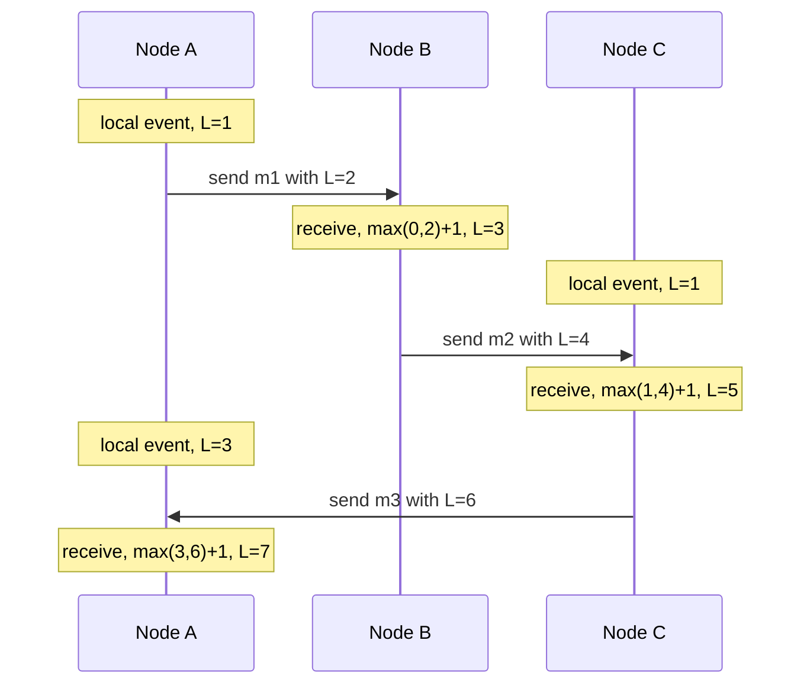

"Which happened first?" sounds like the easiest question in computing. On one machine it is. Across machines, the answer from timestamps is sometimes wrong, and wrong ordering silently loses data. This lesson explains why, and gives you three tools — Lamport clocks, vector clocks and hybrid logical clocks — that you will implement in C#.

## Learning objectives

By the end of this lesson you will be able to:

1. Explain clock drift and skew with real magnitudes, and what NTP can and cannot guarantee.
2. Choose between a wall clock and a monotonic clock in .NET, and explain why durations must never use `DateTime.UtcNow`.
3. Show, with numbers, how last-writer-wins with skewed clocks loses a newer write.
4. Define the happens-before relation and concurrency between events.
5. Implement Lamport clocks and explain what they can and cannot tell you.
6. Implement vector clocks, compare them, and use them to detect conflicting writes.
7. Implement a hybrid logical clock (HLC) with a maximum-offset guard, and explain why databases use it.
8. Know when a single sequence number from one leader is the simpler answer.

## Prerequisites

- [Why distributed systems are difficult](#/lesson/m13-why-hard): "no global clock" is one of the three core facts from that lesson.

You should be comfortable with C# classes, `lock` and dictionaries. No maths beyond comparison and `max`.

## Explain it like I'm a beginner

In a hospital, two people keep paper logbooks. Priya is a nurse on ward 3; Arjun runs the lab on the ground floor. Each writes the time from their own wristwatch next to each entry.

- Priya writes: **10:02** — "Blood sample taken from the patient in bed 7, sent to the lab."
- The sample reaches Arjun. He writes: **10:01** — "Sample for bed 7 received, test started."

Read the logbooks later and the lab appears to have started testing the sample *before* it was taken. Impossible. Arjun's watch is simply two minutes slow.

Now imagine a computer deciding "the latest entry wins" by looking at those times. It would throw away Priya's entry as "older". That is exactly what happens in databases that resolve conflicts by timestamp.

A smarter rule: **count instead of reading the watch.** Every entry gets a number. When you tell someone something, you tell them your number, and they make sure their next number is bigger. Now "the lab received the sample after it was taken" is guaranteed by the numbers, whatever the watches say. That counting trick is a **Lamport clock** (a logical clock).

If you also want to know when two entries were made *without knowing about each other* — two doctors changing the same patient's medication chart independently — you keep one counter per person. That is a **vector clock**.

And if you want numbers that still look like times of day, so people can read them, you mix the watch time with a small counter. That is a **hybrid logical clock**.

## First-principles explanation

### Physical clocks drift

Every server keeps time with a quartz oscillator. Quartz frequency varies with temperature and manufacturing; ordinary oscillators are commonly specified at a few tens of parts per million (ppm). Take 50 ppm as an example figure:

- 50 ppm × 86,400 s per day = **4.3 seconds of drift per day**.
- Two servers drifting in opposite directions could diverge by about 8.6 s in a day with no correction.

Two words:

- **Drift**: how fast a clock gains or loses time (for example 50 ppm).
- **Skew** (or offset): how far apart two clocks are at a given moment (for example "B is 350 ms behind A").

### NTP helps, but has limits

The Network Time Protocol (NTP) periodically asks time servers for the time and adjusts the local clock. Over a good data-centre network it commonly keeps servers within a millisecond or so of each other; over the public internet, errors of tens of milliseconds are common. Exact figures depend on network and configuration, so treat these as typical, not guaranteed. The limits matter more than the averages:

1. **Error is bounded by network delay.** NTP assumes the request and the reply take equal time. If the path is asymmetric (say 5 ms one way, 45 ms back), the estimate can be wrong by up to half the round trip — here 20 ms — and NTP cannot detect it.
2. **Clocks can jump.** If a clock is far off, NTP may *step* it — move it instantly, possibly backwards. Smaller errors are *slewed* (sped up or slowed down gradually). A step backwards means `DateTime.UtcNow` can return a smaller value than a moment ago.
3. **Things go wrong.** A VM paused for live migration, a misconfigured NTP server, a blocked UDP port 123, or a leap second (handled by "smearing" it over hours on some clouds, and by a step on others) can each create skew of seconds.
4. **No proof.** NTP tells you its *estimate* of the error, not a guarantee. A process cannot know for sure how wrong its clock is.

Google's Spanner database is the famous exception that proves the rule: it uses GPS receivers and atomic clocks in each data centre so that its TrueTime API can return an *interval* `[earliest, latest]` that is guaranteed to contain true time. The Spanner paper reports that uncertainty is usually a few milliseconds, and Spanner deliberately *waits out* the uncertainty before committing. Most of us don't have atomic clocks, so we need other tools.

### Wall clock versus monotonic clock

.NET gives you two kinds of clock:

| Clock | .NET API | Use it for | Can go backwards? |
|---|---|---|---|
| Wall clock (time of day) | `DateTime.UtcNow`, `TimeProvider.GetUtcNow()` | Timestamps people read, expiry dates, log times | **Yes**, when NTP steps it |
| Monotonic clock | `Stopwatch.GetTimestamp()`, `TimeProvider.GetTimestamp()` | Measuring durations, timeouts, rate limits | No (within one machine) |

**Failure case.** A rate limiter computes `elapsed = DateTime.UtcNow - windowStart`. NTP steps the clock back 2 seconds. `elapsed` is negative, the window never "ends", and every request is rejected for two seconds. Using `Stopwatch` avoids this. Note: monotonic values are only meaningful *on the machine that produced them*. Never send them to another server.

### The failure that matters most: last-writer-wins with skew

Many replicated stores resolve conflicting writes with **last-writer-wins (LWW)**: each write carries a wall-clock timestamp and the highest timestamp wins. It sounds fair. Here is how it loses data.

A customer-profile service runs in two regions. The Bengaluru node's clock is 350 ms behind the Mumbai node's.

| Real time | Node | Node's clock reads | Action |
|---|---|---|---|
| 10:00:00.000 | Mumbai | 10:00:00.000 | Customer sets delivery address to "Andheri" |
| 10:00:00.200 | Bengaluru | 09:59:59.850 | Customer, 200 ms later, corrects it to "Andheri **East**" |

Replication meets: "Andheri" has timestamp 10:00:00.000, "Andheri East" has 09:59:59.850. LWW keeps **"Andheri"** — the *older* write — and discards the correction. No error, no log line. The courier goes to the wrong address.

Any two writes closer together than the skew can be mis-ordered. With 350 ms of skew and a busy key, that happens every day. And notice that the second write was *caused* by the customer seeing the first — the system broke causality, not just ordering.

The same mistake appears elsewhere:

- **Leases and locks** that expire by wall clock: a node with a slow clock thinks its lease is still valid after another node has taken over. See [Distributed locks and fencing tokens](#/lesson/m13-distributed-locks).
- **Debugging**: merging logs from five services by timestamp shows effects before causes. Use correlation ids and trace spans ([Distributed request correlation](#/lesson/m10-correlation)).
- **Time-based ids**: an id generator that embeds the timestamp can produce duplicates or out-of-order ids when the clock steps back, unless it detects the step and waits.

### Happens-before: what "order" really means

Lamport's 1978 paper replaced "which time was earlier?" with a question we *can* answer: **could event a have influenced event b?** He defined the happens-before relation, written a → b:

1. If a and b are on the same process and a comes first, then a → b.
2. If a is "send message m" and b is "receive m", then a → b.
3. If a → b and b → c, then a → c.

If neither a → b nor b → a, the events are **concurrent**, written a ∥ b. Concurrent doesn't mean "at the same instant". It means *neither knew about the other*. Two people editing the same shared document on two continents without seeing each other's change are concurrent, even if one edit was a minute after the other.

This is the order that matters for correctness. A system should never show an effect before its cause, and it should *detect* concurrent updates instead of silently choosing one by a clock.

### Lamport clocks

Each process keeps one integer counter `L`.

- Before each local event or send: `L = L + 1`, and attach `L` to the message.
- On receive with timestamp `t`: `L = max(L, t) + 1`.

Guarantee: if a → b then L(a) < L(b). To get a **total order** that every node agrees on, break ties by node id: order by `(L, nodeId)`.

What Lamport clocks **cannot** do: the converse is false. L(a) < L(b) does *not* mean a → b; they may be concurrent. **Failure case**: a replicated key-value store uses Lamport timestamps for LWW instead of wall clocks. That fixes the skew problem for *causally related* writes — "Andheri East" now beats "Andheri" because the Bengaluru node had seen Mumbai's write. But two truly concurrent writes (a mobile app and a call-centre agent changing the phone number independently) still get ordered arbitrarily, and one is silently dropped. Lamport clocks give a consistent order, not conflict detection.

Lamport clocks are cheap (one integer) and are used inside many protocols: Raft's *term* number is a close relative (see [Consensus fundamentals](#/lesson/m13-consensus)), and so are fencing tokens.

### Vector clocks

To detect concurrency, keep **one counter per node**. A vector clock is a map like `{mum: 3, blr: 1, del: 0}`.

- Local event or send on node i: `V[i] = V[i] + 1`, attach the whole vector.
- Receive vector W: for every node j, `V[j] = max(V[j], W[j])`, then `V[i] = V[i] + 1`.

Compare two vectors V and W:

- **V before W** (V → W): every entry of V ≤ the entry in W, and at least one is strictly smaller.
- **Equal**: all entries equal.
- **Concurrent**: some entry of V is bigger and some entry of W is bigger.

Example: `{mum:2, blr:1}` vs `{mum:1, blr:2}` is concurrent — each has seen something the other hasn't. A store can now keep **both values as siblings** and ask the application, or a merge rule, to resolve them. That is how Amazon's Dynamo paper (2007) described its shopping cart: a cart is merged by union, so an "add to cart" is never lost (with the known side effect that a removed item can reappear).

Costs and failure modes:

- **Size grows with the number of writers.** With 5 server nodes as writers, a vector is 5 numbers, fine. If every *client* gets an entry, it grows without bound. Systems use per-server entries (version vectors) and prune old ones, and **pruning can create false conflicts or hide real ones**.
- **The application must handle siblings.** If the code reading a value just takes "the first sibling", the conflict detection was pointless.
- **A client must send back the context it read.** If the client writes without the vector it read, the write looks concurrent with everything and siblings pile up.

### Hybrid logical clocks (HLC)

Logical clocks are correct but meaningless to humans: "Lamport 48213" doesn't tell you it was yesterday. Wall clocks are readable but wrong. A **hybrid logical clock** combines them. Each timestamp is a pair `(wall, logical)`:

- `wall` is the largest physical time this node has *seen*, from its own clock or from any message.
- `logical` is a small counter that breaks ties within the same `wall` value.

Rules (from Kulkarni and others, 2014), with `pt` = local physical time:

- **Local event or send**: if `pt > wall`, set `wall = pt` and `logical = 0`. Otherwise keep `wall` and `logical = logical + 1`.
- **Receive (rw, rl)**: new `wall = max(wall, rw, pt)`. Then:
  - if new wall equals both old wall and rw: `logical = max(logical, rl) + 1`
  - else if it equals the old wall: `logical = logical + 1`
  - else if it equals rw: `logical = rl + 1`
  - else (physical time is ahead of both): `logical = 0`.

Properties:

1. If a → b then HLC(a) < HLC(b), like Lamport.
2. HLC stays close to physical time: `wall` is never behind the local clock, and is ahead only by the maximum skew of any clock it heard from.
3. It fits in 64 bits (for example 48 bits of milliseconds + 16 bits of counter), so it can replace a timestamp column.

Distributed SQL databases such as CockroachDB and YugabyteDB publicly document using hybrid logical clocks for transaction timestamps.

**Failure case — the runaway clock.** One node's clock is wrong by +10 minutes. Every message it sends pushes everyone's `wall` 10 minutes into the future, and the whole cluster's timestamps are now 10 minutes ahead and stuck with growing logical counters. The fix is a **maximum offset**: reject (or alert on) any message whose `wall` is more than, say, 500 ms ahead of local physical time. CockroachDB, for example, documents a maximum clock offset setting and shuts down nodes whose clocks drift beyond it, preferring an outage of one node over incorrect results.

### When it is unnecessary — the simpler alternative

If all writes for a piece of data go through **one leader**, that leader's log *is* the order. PostgreSQL's write-ahead log position, a `bigserial` column, a Kafka partition offset — these are all "a single counter on one machine". One caveat for sequences: a `bigserial` value is handed out when the row is inserted, not when the transaction commits, so two concurrent transactions can commit in the opposite order of their ids. A consumer that polls "rows with id > last seen" can then skip a row that commits late. Updates to one row are serialised by its row lock, so they are safe; for a table-wide feed, use logical decoding (commit order) or re-read a small overlap window. You only need logical clocks when:

- several nodes accept writes for the same data (multi-leader, leaderless, offline-first apps), or
- you need to order events across independent logs (several Kafka partitions, several services) by causality.

For "roughly when did this happen?" in logs and dashboards, NTP-synced wall clocks are fine. Just never use them to decide which write wins.

### Trade-offs

| Tool | Gives you | Costs | Can't do |
|---|---|---|---|
| Wall clock + NTP | Human-readable time | Nothing extra | Correct ordering under skew |
| Lamport clock | Causal order embedded in a total order | 1 integer per message | Detect concurrency |
| Vector clock | Detects concurrency exactly | 1 integer per writer per message | Stay small with many writers |
| HLC | Causal order, near physical time, 64 bits | Max-offset guard, careful code | Detect concurrency |
| Single leader sequence | Perfect total order | All writes through one node | Multi-writer availability |
| TrueTime-style bounds | Real-time order with bounded wait | Special hardware | Run on ordinary servers |

## Visual explanation

### Architecture: stamping events across services



How to read it: all three services sync with NTP (dotted lines), but Bengaluru is still 350 ms behind. The order service stamps `OrderCreated` with HLC wall 1000 (milliseconds, shortened here). It sends that timestamp along with the HTTP call to payment. Payment's own physical clock reads about 650, which is *behind*, so by the receive rule it keeps wall 1000 and bumps the logical counter: `1000.1`. Shipping's physical clock reads 1020, which is ahead of the incoming `1000.1`, so it uses 1020 with counter 0. The audit consumer sorts by HLC and always sees order → payment → shipment. With raw wall clocks it would have seen payment (650) before the order (1000).

### Sequence: Lamport clocks on messages



Every message carries the sender's counter, and every receiver jumps ahead of it, so each receive has a higher number than its send. Look at A's local event with L=3 and C's first event with L=1: they are concurrent (neither could know about the other), yet the numbers order them 1 < 3. That is the limitation — Lamport numbers are *consistent* with causality but can't *reveal* concurrency. A vector clock would show `A:{A:3}` versus `C:{C:1}`, clearly incomparable.

## Step-by-step example

We will follow a pharmacy chain's stock-planning sheet. Each medicine has a **reorder level**: when stock falls below it, the system orders more. Planners edit the sheet from two offices, Delhi and Patna, each with its own server. We will fix its ordering bugs one by one.

### Step 1 — the naive version

```csharp
public sealed record ReorderLevel(string Sku, int Strips, DateTimeOffset UpdatedAt);

public void Apply(ReorderLevel incoming)
{
    var current = _levels[incoming.Sku];
    if (incoming.UpdatedAt > current.UpdatedAt)   // last writer wins by wall clock
        _levels[incoming.Sku] = incoming;
}
```

The Patna office's server clock is 400 ms behind Delhi's. A planner in Delhi changes the reorder level of "paracetamol 500 mg, SKU PCM-500" to 1,200 strips. A reviewer in Patna sees that change and corrects it to 1,250 strips 300 ms later in real time. Patna's timestamp is 100 ms *earlier* than Delhi's. Every replica keeps 1,200. The correction is lost.

### Step 2 — Lamport timestamps

Each office server keeps a Lamport counter. Every replicated change carries `(counter, officeId)` and every receiver does `max + 1`. Because the Patna reviewer had *received* Delhi's change before correcting it, Patna's counter is guaranteed to be larger. The correction wins. Skew no longer matters for causally related edits.

### Step 3 — vector clocks for truly concurrent edits

Now two planners, one in each office, change PCM-500 at nearly the same moment without seeing each other's change. Lamport still picks one arbitrarily. With vector clocks, Delhi's write is `{del:5, pat:3}` and Patna's is `{del:4, pat:4}`: concurrent. The store keeps both as siblings, and the planning screen shows "Two conflicting edits: 1,200 (Delhi) and 1,180 (Patna). Choose one." For a setting that drives purchase orders, a human choice is correct. (Stock *movements* are different: record them as deltas, such as "+500 received" or "−3 sold", which add up in any order and never conflict. Only absolute settings like a reorder level need a winner.)

### Step 4 — HLC for readable, ordered audit history

Auditors want a history sorted by time that never shows effects before causes. Each server stamps changes with an HLC and rejects messages more than 500 ms in the future. The audit table orders by `(hlc_wall, hlc_logical)`, which looks like a timestamp to humans but respects causality.

## Production-style C# implementation

Project layout:

```text
Stock.Api/
  Program.cs
  Clocks/
    LamportClock.cs
    VectorClock.cs
    HybridLogicalClock.cs
  Storage/
    SiblingStore.cs        (keeps concurrent versions, drops superseded ones)
```

```csharp file=Clocks/LamportClock.cs
namespace TimeOrdering.Clocks;

/// <summary>A Lamport timestamp with a node id tie-breaker, giving a total order all nodes agree on.</summary>
public readonly record struct LamportTimestamp(long Counter, string NodeId) : IComparable<LamportTimestamp>
{
    public int CompareTo(LamportTimestamp other)
    {
        var c = Counter.CompareTo(other.Counter);
        return c != 0 ? c : string.CompareOrdinal(NodeId, other.NodeId);
    }
}

public sealed class LamportClock(string nodeId)
{
    private readonly object _gate = new();
    private long _counter;

    public string NodeId { get; } = nodeId;

    /// <summary>Call for a local event or before sending; attach the result to the message.</summary>
    public LamportTimestamp Next()
    {
        lock (_gate) return new LamportTimestamp(++_counter, NodeId);
    }

    /// <summary>Call when a message arrives, before processing it.</summary>
    public LamportTimestamp Observe(long remoteCounter)
    {
        lock (_gate)
        {
            _counter = Math.Max(_counter, remoteCounter) + 1;
            return new LamportTimestamp(_counter, NodeId);
        }
    }
}
```

```csharp file=Clocks/VectorClock.cs
using System.Collections.Immutable;

namespace TimeOrdering.Clocks;

public enum Causality { Before, After, Equal, Concurrent }

/// <summary>Immutable vector clock: one counter per writer node. Missing entries mean 0.</summary>
public sealed class VectorClock
{
    public static readonly VectorClock Empty = new(ImmutableSortedDictionary<string, long>.Empty);

    private readonly ImmutableSortedDictionary<string, long> _entries;
    private VectorClock(ImmutableSortedDictionary<string, long> entries) => _entries = entries;

    public IReadOnlyDictionary<string, long> Entries => _entries;
    public long this[string node] => _entries.TryGetValue(node, out var v) ? v : 0;

    public VectorClock Increment(string node) => new(_entries.SetItem(node, this[node] + 1));

    public VectorClock Merge(VectorClock other)
    {
        var b = _entries.ToBuilder();
        foreach (var (node, v) in other._entries)
            if (v > this[node]) b[node] = v;
        return new VectorClock(b.ToImmutable());
    }

    public Causality CompareTo(VectorClock other)
    {
        bool less = false, greater = false;
        foreach (var node in _entries.Keys.Union(other._entries.Keys))
        {
            var a = this[node];
            var b = other[node];
            if (a < b) less = true;
            else if (a > b) greater = true;
            if (less && greater) return Causality.Concurrent;
        }
        return (less, greater) switch
        {
            (false, false) => Causality.Equal,
            (true, false) => Causality.Before,
            _ => Causality.After,
        };
    }

    public override string ToString() => "{" + string.Join(", ", _entries.Select(e => $"{e.Key}:{e.Value}")) + "}";

    /// <summary>Compact wire format "del:5,pat:3" for an HTTP header.</summary>
    public string Serialize() => string.Join(",", _entries.Select(e => $"{e.Key}:{e.Value}"));

    public static VectorClock Parse(string? text)
    {
        if (string.IsNullOrWhiteSpace(text)) return Empty;
        var b = ImmutableSortedDictionary.CreateBuilder<string, long>();
        foreach (var part in text.Split(',', StringSplitOptions.RemoveEmptyEntries | StringSplitOptions.TrimEntries))
        {
            var kv = part.Split(':');
            if (kv.Length != 2 || !long.TryParse(kv[1], out var n) || n < 0)
                throw new FormatException($"Bad vector clock entry '{part}'.");
            b[kv[0]] = n;
        }
        return new VectorClock(b.ToImmutable());
    }
}
```

```csharp file=Clocks/HybridLogicalClock.cs
namespace TimeOrdering.Clocks;

/// <summary>(wall milliseconds since Unix epoch, logical counter). Orders like a timestamp, respects causality.</summary>
public readonly record struct HlcTimestamp(long WallMs, int Logical) : IComparable<HlcTimestamp>
{
    public int CompareTo(HlcTimestamp other)
    {
        var c = WallMs.CompareTo(other.WallMs);
        return c != 0 ? c : Logical.CompareTo(other.Logical);
    }

    public static bool operator <(HlcTimestamp a, HlcTimestamp b) => a.CompareTo(b) < 0;
    public static bool operator >(HlcTimestamp a, HlcTimestamp b) => a.CompareTo(b) > 0;
    public override string ToString() => $"{WallMs}.{Logical}";
}

public sealed class ClockOffsetException(long aheadByMs, long maxMs)
    : Exception($"Remote timestamp is {aheadByMs} ms ahead of local physical time (max {maxMs} ms).");

public sealed class HybridLogicalClock(TimeProvider time, TimeSpan maxOffset)
{
    private readonly object _gate = new();
    private readonly long _maxOffsetMs = (long)maxOffset.TotalMilliseconds;
    private long _wall;
    private int _logical;

    private long PhysicalMs() => time.GetUtcNow().ToUnixTimeMilliseconds();

    /// <summary>Timestamp for a local event or an outgoing message.</summary>
    public HlcTimestamp Now()
    {
        var pt = PhysicalMs();
        lock (_gate)
        {
            if (pt > _wall) { _wall = pt; _logical = 0; }
            else _logical = checked(_logical + 1);
            return new HlcTimestamp(_wall, _logical);
        }
    }

    /// <summary>Merge a timestamp received from another node. Rejects runaway clocks.</summary>
    public HlcTimestamp Update(HlcTimestamp remote)
    {
        var pt = PhysicalMs();
        if (remote.WallMs - pt > _maxOffsetMs) throw new ClockOffsetException(remote.WallMs - pt, _maxOffsetMs);

        lock (_gate)
        {
            var oldWall = _wall;
            var newWall = Math.Max(Math.Max(oldWall, remote.WallMs), pt);
            if (newWall == oldWall && newWall == remote.WallMs) _logical = Math.Max(_logical, remote.Logical) + 1;
            else if (newWall == oldWall) _logical++;
            else if (newWall == remote.WallMs) _logical = remote.Logical + 1;
            else _logical = 0;
            _wall = newWall;
            return new HlcTimestamp(_wall, _logical);
        }
    }
}
```

```csharp file=Storage/SiblingStore.cs
using System.Collections.Concurrent;
using TimeOrdering.Clocks;

namespace TimeOrdering.Storage;

public sealed record Sibling(string Value, VectorClock Clock, string WrittenBy);

/// <summary>What a reader gets: all concurrent values plus a context to send back with the next write.</summary>
public sealed record ReadResult(IReadOnlyList<Sibling> Siblings, VectorClock Context)
{
    public bool HasConflict => Siblings.Count > 1;
}

/// <summary>Dynamo-style store: a write supersedes every version it has seen and keeps concurrent ones.</summary>
public sealed class SiblingStore(string nodeId)
{
    private readonly ConcurrentDictionary<string, List<Sibling>> _data = new();

    public ReadResult Get(string key)
    {
        if (!_data.TryGetValue(key, out var list)) return new ReadResult([], VectorClock.Empty);
        lock (list)
        {
            var context = list.Aggregate(VectorClock.Empty, (acc, s) => acc.Merge(s.Clock));
            return new ReadResult(list.ToList(), context);
        }
    }

    /// <param name="context">The context returned by the read this write is based on. Empty means "blind write".</param>
    public Sibling Put(string key, string value, VectorClock context)
    {
        var list = _data.GetOrAdd(key, _ => []);
        lock (list)
        {
            var clock = context.Increment(nodeId);
            var written = new Sibling(value, clock, nodeId);
            // Drop versions this write has seen (Before or Equal); keep concurrent ones as siblings.
            list.RemoveAll(s => s.Clock.CompareTo(clock) is Causality.Before or Causality.Equal);
            list.Add(written);
            return written;
        }
    }

    /// <summary>Apply a version replicated from another node.</summary>
    public void Replicate(string key, Sibling incoming)
    {
        var list = _data.GetOrAdd(key, _ => []);
        lock (list)
        {
            if (list.Any(s => incoming.Clock.CompareTo(s.Clock) is Causality.Before or Causality.Equal)) return; // already superseded
            list.RemoveAll(s => s.Clock.CompareTo(incoming.Clock) == Causality.Before);
            list.Add(incoming);
        }
    }
}
```

```csharp file=Program.cs
using TimeOrdering.Clocks;
using TimeOrdering.Storage;

var builder = WebApplication.CreateBuilder(args);
var nodeId = builder.Configuration["NodeId"] ?? "del";

builder.Services.AddSingleton(TimeProvider.System);
builder.Services.AddSingleton(sp => new HybridLogicalClock(sp.GetRequiredService<TimeProvider>(), TimeSpan.FromMilliseconds(500)));
builder.Services.AddSingleton(new SiblingStore(nodeId));

var app = builder.Build();

// Every response carries this node's HLC so callers can merge it (like a trace header).
app.Use(async (ctx, next) =>
{
    var hlc = ctx.RequestServices.GetRequiredService<HybridLogicalClock>();
    if (ctx.Request.Headers.TryGetValue("X-Hlc", out var h) && TryParseHlc(h, out var remote))
    {
        try { hlc.Update(remote); }
        catch (ClockOffsetException ex)
        {
            ctx.Response.StatusCode = StatusCodes.Status409Conflict;
            await ctx.Response.WriteAsync(ex.Message);
            return;
        }
    }
    ctx.Response.Headers["X-Hlc"] = hlc.Now().ToString();
    await next();
});

app.MapGet("/stock/{item}/reorder-level", (string item, SiblingStore store, HttpResponse resp) =>
{
    var r = store.Get(item);
    resp.Headers["X-Context"] = r.Context.Serialize();   // send this back with your next write
    return Results.Ok(new { item, conflict = r.HasConflict, values = r.Siblings.Select(s => new { s.Value, s.WrittenBy, clock = s.Clock.ToString() }) });
});

app.MapPut("/stock/{item}/reorder-level", (string item, ReorderLevelWrite body, HttpRequest req, SiblingStore store) =>
{
    VectorClock context;
    try { context = VectorClock.Parse(req.Headers["X-Context"]); }
    catch (FormatException ex) { return Results.Problem(ex.Message, statusCode: StatusCodes.Status400BadRequest); }
    var written = store.Put(item, body.Strips.ToString(System.Globalization.CultureInfo.InvariantCulture), context);
    return Results.Ok(new { clock = written.Clock.ToString() });
});

app.Run();

static bool TryParseHlc(string? s, out HlcTimestamp ts)
{
    ts = default;
    var parts = s?.Split('.');
    if (parts is not { Length: 2 } || !long.TryParse(parts[0], out var w) || !int.TryParse(parts[1], out var l)) return false;
    ts = new HlcTimestamp(w, l);
    return true;
}

public sealed record ReorderLevelWrite(int Strips);
```

Design notes:

- **Clocks are injected singletons with a `lock`.** A clock is shared state; two threads calling `Now()` must never get the same timestamp.
- **`TimeProvider` is injected**, so tests can create skew and backward jumps on purpose.
- **The vector clock is immutable.** A sibling's clock must never change after it is stored.
- **The client carries the context.** The `X-Context` header is what makes a write "based on" a read. A blind write (empty context) is concurrent with everything.
- **The max-offset guard returns 409**, so a node with a broken clock gets loud errors rather than quietly dragging the cluster's time forward.

## Bad design vs good design

**Bad**: "We use UTC everywhere and NTP is on, so timestamps are fine for ordering."

- UTC fixes time *zones*, not *skew*. Two UTC clocks still disagree by milliseconds to seconds.
- NTP's error is unknown and unbounded in bad conditions; a clock can step backwards.
- LWW by wall clock silently drops the newer of two writes closer together than the skew.
- Durations computed from `DateTime.UtcNow` break when the clock steps.

**Good**:

| Need | Use |
|---|---|
| Measure a duration or timeout | `Stopwatch` / `TimeProvider.GetTimestamp()` |
| Show users when something happened | Wall clock (UTC), clearly labelled as approximate across servers |
| Order writes to one record | Route through one leader and use its sequence (simplest), or Lamport / HLC |
| Detect conflicting concurrent writes | Vector clocks (version vectors) and siblings |
| Readable, causally ordered event history | HLC with a max-offset guard |

**When is the simple version fine?** If the data has one writer (one leader, one aggregate owner, one Kafka partition per key), its sequence numbers are already a perfect order, and you don't need any of the logical clocks above.

## Practical playground

The playground seeds an in-browser PostgreSQL with reorder-level writes to two medicines from three offices, each carrying a 3-entry vector clock (`vc_del`, `vc_pat`, `vc_mum`) and a wall-clock time from a skewed server. Try these queries:

1. Order by `wall_ts`. Do any writes appear before writes they were based on (`based_on`)?
2. Write a query that, for each pair of writes to the same key, says `before`, `after` or `concurrent` using the vector entries.
3. Which key has a real conflict that LWW would have hidden?

:::playground type=sql title="Vector clocks versus wall clocks"
```sql
CREATE TABLE writes (
  id        int PRIMARY KEY,
  item      text NOT NULL,
  strips    int  NOT NULL,
  office    text NOT NULL,
  wall_ts   timestamptz NOT NULL,
  based_on  int REFERENCES writes(id),
  vc_del    int NOT NULL,
  vc_pat    int NOT NULL,
  vc_mum    int NOT NULL
);

INSERT INTO writes VALUES
 (1, 'PCM-500', 1000, 'del', '2026-10-19 10:00:00.000+00', NULL, 1, 0, 0),
 (2, 'PCM-500', 1200, 'del', '2026-10-19 10:00:05.000+00', 1,    2, 0, 0),
 (3, 'PCM-500', 1250, 'pat', '2026-10-19 10:00:04.900+00', 2,    2, 1, 0),
 (4, 'ORS-21G',   80, 'mum', '2026-10-19 10:01:00.000+00', NULL, 0, 0, 1),
 (5, 'ORS-21G',   85, 'del', '2026-10-19 10:01:02.000+00', 4,    3, 0, 1),
 (6, 'ORS-21G',   78, 'pat', '2026-10-19 10:01:02.300+00', 4,    2, 2, 1);

-- Start here: wall-clock order hides that write 3 was based on write 2.
SELECT id, item, strips, office, wall_ts FROM writes ORDER BY item, wall_ts;
```
:::

## Exercises

:::exercise id=m13-time-ordering-ex1 difficulty=beginner kind=code title="Implement a Lamport clock"
Implement `LamportClock` and the total order on `LamportStamp`.
::requirements
- A new clock starts at `Current == 0`.
- `Tick()` (local event) and `Send()` (before sending) both add 1 and return a stamp with this node's id.
- `Receive(remote)` sets the counter to `max(current, remote) + 1` and returns the stamp.
- `LamportStamp.CompareTo` orders by `Time`, then by `Node` using ordinal string comparison. Any stamp is greater than `null`.
- Thread-safe: 1,000 parallel `Tick()` calls end at `Current == 1000`.
::acceptance
- Tick → 1, Send → 2, Receive(10) → 11, Receive(3) → 12.
- Sorting stamps (3,"b"), (2,"z"), (3,"a") gives (2,"z"), (3,"a"), (3,"b").
- The parallel test passes.
::hint
There are only two rules: increment before you act, and jump past what you receive.
::hint
`Send` is just a local event whose stamp you attach to the message.
::hint
Use a `lock` (or `Interlocked` for Tick) so concurrent calls never return the same value.
::hint
```csharp
lock (_gate) { _time = Math.Max(_time, remoteTime) + 1; return new LamportStamp(_time, _node); }
```
::starter
```csharp file=LamportClock.cs
using System;

public sealed record LamportStamp(long Time, string Node) : IComparable<LamportStamp>
{
    public int CompareTo(LamportStamp? other) => throw new NotImplementedException();
}

public sealed class LamportClock
{
    public LamportClock(string node) { throw new NotImplementedException(); }

    public long Current => throw new NotImplementedException();

    public LamportStamp Tick() => throw new NotImplementedException();

    public LamportStamp Send() => throw new NotImplementedException();

    public LamportStamp Receive(long remoteTime) => throw new NotImplementedException();
}
```
::tests
```csharp file=LamportClockTests.cs
using System.Collections.Generic;
using System.Threading.Tasks;
using Xunit;

public class LamportClockTests
{
    [Fact]
    public void Starts_at_zero() => Assert.Equal(0, new LamportClock("a").Current);

    [Fact]
    public void Follows_the_rules()
    {
        var c = new LamportClock("a");
        Assert.Equal(1, c.Tick().Time);
        Assert.Equal(2, c.Send().Time);
        Assert.Equal(11, c.Receive(10).Time);
        Assert.Equal(12, c.Receive(3).Time);
        Assert.Equal("a", c.Tick().Node);
    }

    [Fact]
    public void Message_exchange_respects_causality()
    {
        var a = new LamportClock("a");
        var b = new LamportClock("b");
        b.Tick(); b.Tick(); b.Tick();          // b is busy: 3
        var sent = a.Send();                    // a: 1
        var received = b.Receive(sent.Time);    // b: max(3,1)+1 = 4
        Assert.True(received.CompareTo(sent) > 0);
        Assert.Equal(4, received.Time);
    }

    [Fact]
    public void Total_order_breaks_ties_by_node()
    {
        var list = new List<LamportStamp> { new(3, "b"), new(2, "z"), new(3, "a") };
        list.Sort();
        Assert.Equal(new LamportStamp(2, "z"), list[0]);
        Assert.Equal(new LamportStamp(3, "a"), list[1]);
        Assert.Equal(new LamportStamp(3, "b"), list[2]);
    }

    [Fact]
    public void Greater_than_null() => Assert.True(new LamportStamp(0, "a").CompareTo(null) > 0);

    [Fact]
    public void Thread_safe()
    {
        var c = new LamportClock("a");
        Parallel.For(0, 1000, _ => c.Tick());
        Assert.Equal(1000, c.Current);
    }
}
```
::solution
```csharp file=LamportClock.cs
using System;

public sealed record LamportStamp(long Time, string Node) : IComparable<LamportStamp>
{
    public int CompareTo(LamportStamp? other)
    {
        if (other is null) return 1;
        var c = Time.CompareTo(other.Time);
        return c != 0 ? c : string.CompareOrdinal(Node, other.Node);
    }
}

public sealed class LamportClock
{
    private readonly object _gate = new();
    private readonly string _node;
    private long _time;

    public LamportClock(string node)
    {
        ArgumentException.ThrowIfNullOrWhiteSpace(node);
        _node = node;
    }

    public long Current { get { lock (_gate) return _time; } }

    public LamportStamp Tick()
    {
        lock (_gate) return new LamportStamp(++_time, _node);
    }

    public LamportStamp Send() => Tick();

    public LamportStamp Receive(long remoteTime)
    {
        lock (_gate)
        {
            _time = Math.Max(_time, remoteTime) + 1;
            return new LamportStamp(_time, _node);
        }
    }
}
```

The tie-break by node id is what turns a partial order into a total order: every node sorting the same stamps gets the same list.
::mistakes
- Taking `max` without the `+ 1`, so a receive gets the *same* number as its send.
- Using culture-sensitive string comparison for the tie-break: two nodes in different locales could disagree on order.
- Reading `_time` outside the lock in `Current`, which can tear on 32-bit platforms and is a data race everywhere.
::extensions
Pack the stamp into one `long` (48 bits of counter, 16 bits of node index) so it fits in a database column and sorts with a plain `ORDER BY`.
:::

:::exercise id=m13-time-ordering-ex2 difficulty=beginner kind=written title="Which write survives?"
A leaderless store resolves conflicts by last-writer-wins on server wall-clock time. Node A's clock is correct. Node B's clock is 800 ms behind. Node C's clock is 300 ms ahead.

Real-time events for key `patient:42:phone` in a clinic's patient-records store:

- t = 0 ms: a receptionist on node A sets it to `98100-11111`.
- t = 500 ms: the patient, who saw the receptionist's change in the clinic app, corrects it on node B to `98100-22222`.
- t = 600 ms: a batch import on node C, which saw neither, writes `98100-33333`.

Answer: (a) which timestamp does each write get? (b) which value survives? (c) which outcome was *correct*, and why? (d) propose a design that gets it right.
::acceptance
- Correct timestamps for all three writes.
- Correctly identifies the surviving value under LWW.
- Explains causality (B's write was based on A's) versus concurrency (C's write).
- Proposes a fix that detects the conflict instead of hiding it.
::hint
Timestamp = real time + that node's offset.
::hint
A: 0, B: 500 − 800 = −300, C: 600 + 300 = 900.
::hint
Which writes were causally related, and which pairs were concurrent?
::hint
Vector clocks would give A `{A:1}`, B `{A:1, B:1}`, C `{C:1}`. Compare B and C.
::solution
**(a)** A's write: 0 ms. B's write: 500 − 800 = **−300 ms**. C's write: 600 + 300 = **900 ms**.

**(b)** LWW keeps the highest timestamp: **C's `98100-33333`**. And if C hadn't written, A's write (0) would beat B's correction (−300): the patient's correction would be lost even though it came later *and* was based on A's write.

**(c)** B's write supersedes A's (B saw A: A → B). C's write is **concurrent** with both A and B (it saw neither). There is no "correct" winner between B and C by time; it's a business decision. The correct system outcome is "B supersedes A; B and C conflict".

**(d)** Options:

- **Vector clocks + siblings**: A `{A:1}`, B `{A:1, B:1}` (B read A's context), C `{C:1}`. B supersedes A; B ∥ C, so both are kept and the application resolves, for example "a human-entered value beats a batch import" or show both to an admin.
- **Single leader per key**: route all writes for a patient to one node; its sequence decides order, and the batch import is made to read-then-write with optimistic concurrency (`WHERE version = @v`), so it fails instead of overwriting a newer value.
- **HLC instead of wall clock for LWW**: fixes A vs B (B's HLC > A's because B received A's), but still silently picks between B and C. Better than wall clocks, not a conflict detector.
::mistakes
- Saying "C wins because it was last in real time". Real time is exactly what the store cannot see.
- Missing that A vs B is also mis-ordered, not just the batch.
- Proposing "fix NTP" as the solution: it reduces skew but never removes it.
:::

:::exercise id=m13-time-ordering-ex3 difficulty=intermediate kind=code title="Compare and merge vector clocks"
Implement `Increment`, `Merge` and `CompareTo` on an immutable `VectorClock`. Storage, the indexer and a test helper `Of(...)` are provided.
::requirements
- `Increment(node)` returns a new clock with that node's counter + 1; the original is unchanged.
- `Merge(other)` returns a new clock with the entry-wise maximum.
- `CompareTo(other)` returns `Before`, `After`, `Equal` or `Concurrent`. A missing entry counts as 0, so `{a:1}` equals `{a:1, b:0}`.
::acceptance
- `{a:1}` is `Before` `{a:2}` and `{a:1,b:1}`.
- `{a:2,b:1}` vs `{a:1,b:2}` is `Concurrent`.
- Merge of `{a:2,b:1}` and `{a:1,b:3,c:1}` is `{a:2,b:3,c:1}`.
- `Increment` doesn't mutate the original.
::hint
Compare over the *union* of keys from both clocks.
::hint
Track two flags: "some entry of mine is smaller" and "some entry of mine is bigger".
::hint
Both flags → Concurrent. Only smaller → Before. Only bigger → After. Neither → Equal.
::hint
For `Merge`, copy this clock's dictionary and raise any entry where the other is bigger.
::hint
```csharp
foreach (var n in _c.Keys.Union(other._c.Keys))
{
    if (this[n] < other[n]) less = true;
    else if (this[n] > other[n]) greater = true;
}
```
::starter
```csharp file=VectorClock.cs
using System;
using System.Collections.Generic;
using System.Linq;

public enum CausalOrder { Before, After, Equal, Concurrent }

public sealed class VectorClock
{
    private readonly Dictionary<string, long> _c;

    public static VectorClock Empty { get; } = new(new Dictionary<string, long>());

    private VectorClock(Dictionary<string, long> entries) => _c = entries;

    public static VectorClock Of(params (string Node, long Count)[] entries) =>
        new(entries.ToDictionary(e => e.Node, e => e.Count));

    public long this[string node] => _c.TryGetValue(node, out var v) ? v : 0;

    public IReadOnlyCollection<string> Nodes => _c.Keys;

    public VectorClock Increment(string node) => throw new NotImplementedException();

    public VectorClock Merge(VectorClock other) => throw new NotImplementedException();

    public CausalOrder CompareTo(VectorClock other) => throw new NotImplementedException();
}
```
::tests
```csharp file=VectorClockTests.cs
using Xunit;

public class VectorClockTests
{
    [Fact]
    public void Before_and_after()
    {
        var a1 = VectorClock.Of(("a", 1));
        Assert.Equal(CausalOrder.Before, a1.CompareTo(VectorClock.Of(("a", 2))));
        Assert.Equal(CausalOrder.Before, a1.CompareTo(VectorClock.Of(("a", 1), ("b", 1))));
        Assert.Equal(CausalOrder.After, VectorClock.Of(("a", 2)).CompareTo(a1));
    }

    [Fact]
    public void Concurrent() =>
        Assert.Equal(CausalOrder.Concurrent, VectorClock.Of(("a", 2), ("b", 1)).CompareTo(VectorClock.Of(("a", 1), ("b", 2))));

    [Fact]
    public void Disjoint_nodes_are_concurrent() =>
        Assert.Equal(CausalOrder.Concurrent, VectorClock.Of(("a", 1)).CompareTo(VectorClock.Of(("c", 1))));

    [Fact]
    public void Missing_entries_are_zero() =>
        Assert.Equal(CausalOrder.Equal, VectorClock.Of(("a", 1)).CompareTo(VectorClock.Of(("a", 1), ("b", 0))));

    [Fact]
    public void Empty_is_before_anything() =>
        Assert.Equal(CausalOrder.Before, VectorClock.Empty.CompareTo(VectorClock.Of(("x", 1))));

    [Fact]
    public void Merge_takes_entrywise_max()
    {
        var m = VectorClock.Of(("a", 2), ("b", 1)).Merge(VectorClock.Of(("a", 1), ("b", 3), ("c", 1)));
        Assert.Equal(2, m["a"]);
        Assert.Equal(3, m["b"]);
        Assert.Equal(1, m["c"]);
    }

    [Fact]
    public void Increment_is_immutable()
    {
        var v = VectorClock.Of(("a", 1));
        var w = v.Increment("a").Increment("b");
        Assert.Equal(1, v["a"]);
        Assert.Equal(0, v["b"]);
        Assert.Equal(2, w["a"]);
        Assert.Equal(1, w["b"]);
    }

    [Fact]
    public void Merge_then_increment_supersedes_both()
    {
        var x = VectorClock.Of(("a", 2), ("b", 1));
        var y = VectorClock.Of(("a", 1), ("b", 2));
        var resolved = x.Merge(y).Increment("a");
        Assert.Equal(CausalOrder.After, resolved.CompareTo(x));
        Assert.Equal(CausalOrder.After, resolved.CompareTo(y));
    }
}
```
::solution
```csharp file=VectorClock.cs
using System;
using System.Collections.Generic;
using System.Linq;

public enum CausalOrder { Before, After, Equal, Concurrent }

public sealed class VectorClock
{
    private readonly Dictionary<string, long> _c;

    public static VectorClock Empty { get; } = new(new Dictionary<string, long>());

    private VectorClock(Dictionary<string, long> entries) => _c = entries;

    public static VectorClock Of(params (string Node, long Count)[] entries) =>
        new(entries.ToDictionary(e => e.Node, e => e.Count));

    public long this[string node] => _c.TryGetValue(node, out var v) ? v : 0;

    public IReadOnlyCollection<string> Nodes => _c.Keys;

    public VectorClock Increment(string node)
    {
        var copy = new Dictionary<string, long>(_c) { [node] = this[node] + 1 };
        return new VectorClock(copy);
    }

    public VectorClock Merge(VectorClock other)
    {
        var copy = new Dictionary<string, long>(_c);
        foreach (var (node, v) in other._c)
            if (v > this[node]) copy[node] = v;
        return new VectorClock(copy);
    }

    public CausalOrder CompareTo(VectorClock other)
    {
        bool less = false, greater = false;
        foreach (var n in _c.Keys.Union(other._c.Keys))
        {
            if (this[n] < other[n]) less = true;
            else if (this[n] > other[n]) greater = true;
        }
        return (less, greater) switch
        {
            (true, true) => CausalOrder.Concurrent,
            (true, false) => CausalOrder.Before,
            (false, true) => CausalOrder.After,
            _ => CausalOrder.Equal,
        };
    }
}
```

The last test shows how a conflict is *resolved*: merge the sibling clocks, then increment. The result dominates both siblings, so every replica drops them when the resolution arrives.
::mistakes
- Comparing only the keys of `this`, which misses entries that exist only in `other`.
- Treating a missing key as "unknown" rather than 0.
- Mutating `_c` in `Increment` — a stored sibling's clock would change under you.
- Resolving a conflict with just `Increment` on one sibling's clock: the result is still concurrent with the other sibling.
::extensions
Add `Prune(int maxEntries)` that drops the smallest entries, and write a test that shows pruning can turn a `Before` relationship into `Concurrent` (a false conflict).
:::

:::exercise id=m13-time-ordering-ex4 difficulty=intermediate kind=sql title="Find effects that appear before their causes"
Three services stamp events with their own wall clocks. The Bengaluru payment service's clock is behind. Each event records which event caused it (`caused_by`). Write a query that returns every `(effect_id, cause_id)` pair where the effect's wall-clock time is **earlier** than its cause's.
::requirements
Return two columns: `effect_id`, `cause_id`. Order doesn't matter.
::acceptance
- Returns exactly the pairs where `effect.wall_ts < cause.wall_ts`.
- Uses a self-join on `caused_by`.
::hint
Join `events` to itself: one copy for the effect, one for the cause.
::hint
The join condition is `cause.id = effect.caused_by`.
::hint
Filter with `effect.wall_ts < cause.wall_ts`. Then look at the Lamport column for the same rows: is the order right there?
::setup
```sql
CREATE TABLE events (
  id          int PRIMARY KEY,
  node        text NOT NULL,
  wall_ts     timestamptz NOT NULL,
  lamport     int NOT NULL,
  caused_by   int REFERENCES events(id),
  description text NOT NULL
);

INSERT INTO events VALUES
 (1, 'mum', '2026-10-19 10:00:00.100+00', 1, NULL, 'Order 881 created'),
 (2, 'blr', '2026-10-19 09:59:59.900+00', 2, 1,    'Payment for 881 captured'),
 (3, 'del', '2026-10-19 10:00:00.400+00', 3, 2,    'Shipment for 881 booked'),
 (4, 'mum', '2026-10-19 10:00:01.000+00', 2, NULL, 'Order 882 created'),
 (5, 'blr', '2026-10-19 10:00:00.800+00', 3, 4,    'Payment for 882 captured'),
 (6, 'del', '2026-10-19 10:00:01.300+00', 4, 5,    'Shipment for 882 booked'),
 (7, 'mum', '2026-10-19 10:00:01.500+00', 5, 6,    'Order 882 marked shipped');
```
::check
```sql
SELECT e.id AS effect_id, c.id AS cause_id
FROM events e
JOIN events c ON c.id = e.caused_by
WHERE e.wall_ts < c.wall_ts;
```
::solution
```sql
SELECT e.id AS effect_id, c.id AS cause_id
FROM events e
JOIN events c ON c.id = e.caused_by
WHERE e.wall_ts < c.wall_ts;
```

It returns `(2, 1)` and `(5, 4)`: both payments, stamped by the slow Bengaluru clock, appear before the orders that caused them. Now run the same join with `e.lamport <= c.lamport` instead: it returns **no rows**. Lamport timestamps can never put an effect before its cause, whatever the wall clocks say.

```sql
SELECT e.id, c.id FROM events e JOIN events c ON c.id = e.caused_by WHERE e.lamport <= c.lamport;   -- empty
```
::mistakes
- Joining on `e.id = c.caused_by` (the wrong direction), which returns causes before their effects.
- Comparing `lamport` values across unrelated events and concluding one caused the other.
:::

:::exercise id=m13-time-ordering-ex5 difficulty=advanced kind=code title="A hybrid logical clock with a max-offset guard"
Implement `HybridLogicalClock`. It must follow the HLC send and receive rules, never go backwards even if the physical clock does, and refuse remote timestamps too far in the future.
::requirements
- `Now()`: if physical ms > wall, set wall = physical, logical = 0; else logical + 1.
- `Update(remote)`: if `remote.WallMs - physical > maxOffsetMs`, throw `ClockOffsetException` and change nothing. Otherwise apply the receive rules from the lesson.
- `HlcTimestamp.CompareTo` orders by `WallMs`, then `Logical`.
- Thread-safe.
::acceptance
- Physical 1000 → `Now()` = (1000,0), again (1000,1); physical 1005 → (1005,0).
- Physical clock steps back to 990 → `Now()` = (1005,1).
- Local (1000,x), physical 1000, `Update((2000,3))` with max offset 5000 → (2000,4).
- `Update` with a remote 10 s ahead and max offset 500 ms throws and leaves the clock unchanged.
::hint
Read physical time once at the start of each method.
::hint
The max-offset check uses physical time, not the current HLC wall.
::hint
In `Update`, compute `newWall = max(oldWall, remote.WallMs, pt)` and then pick the logical rule by which inputs equal `newWall`.
::hint
Check "equals both old wall and remote" first; the order of the `if` branches matters.
::hint
```csharp
if (newWall == oldWall && newWall == remote.WallMs) _logical = Math.Max(_logical, remote.Logical) + 1;
else if (newWall == oldWall) _logical++;
else if (newWall == remote.WallMs) _logical = remote.Logical + 1;
else _logical = 0;
```
::starter
```csharp file=HybridLogicalClock.cs
using System;

public readonly record struct HlcTimestamp(long WallMs, int Logical) : IComparable<HlcTimestamp>
{
    public int CompareTo(HlcTimestamp other) => throw new NotImplementedException();
}

public sealed class ClockOffsetException(string message) : Exception(message);

public sealed class HybridLogicalClock
{
    public HybridLogicalClock(TimeProvider time, TimeSpan maxOffset) { throw new NotImplementedException(); }

    public HlcTimestamp Now() => throw new NotImplementedException();

    public HlcTimestamp Update(HlcTimestamp remote) => throw new NotImplementedException();
}
```
::tests
```csharp file=HybridLogicalClockTests.cs
using System;
using Xunit;

public class HybridLogicalClockTests
{
    private sealed class ManualClock : TimeProvider
    {
        public long Ms { get; set; }
        public override DateTimeOffset GetUtcNow() => DateTimeOffset.FromUnixTimeMilliseconds(Ms);
    }

    private static (ManualClock, HybridLogicalClock) Make(long ms, int maxOffsetMs = 5000)
    {
        var c = new ManualClock { Ms = ms };
        return (c, new HybridLogicalClock(c, TimeSpan.FromMilliseconds(maxOffsetMs)));
    }

    [Fact]
    public void Now_tracks_physical_time()
    {
        var (c, h) = Make(1000);
        Assert.Equal(new HlcTimestamp(1000, 0), h.Now());
        Assert.Equal(new HlcTimestamp(1000, 1), h.Now());
        c.Ms = 1005;
        Assert.Equal(new HlcTimestamp(1005, 0), h.Now());
    }

    [Fact]
    public void Never_goes_backwards()
    {
        var (c, h) = Make(1005);
        h.Now();
        c.Ms = 990;   // NTP stepped the clock back
        Assert.Equal(new HlcTimestamp(1005, 1), h.Now());
    }

    [Fact]
    public void Remote_ahead_is_adopted()
    {
        var (c, h) = Make(1000);
        h.Now();
        Assert.Equal(new HlcTimestamp(2000, 4), h.Update(new HlcTimestamp(2000, 3)));
        Assert.Equal(new HlcTimestamp(2000, 5), h.Now());
    }

    [Fact]
    public void Same_wall_takes_max_logical()
    {
        var (c, h) = Make(1000);
        h.Now(); h.Now(); h.Now();   // (1000,2)
        Assert.Equal(new HlcTimestamp(1000, 8), h.Update(new HlcTimestamp(1000, 7)));
    }

    [Fact]
    public void Local_wall_ahead_bumps_logical()
    {
        var (c, h) = Make(1000);
        h.Now(); h.Now();            // (1000,1)
        c.Ms = 900;
        Assert.Equal(new HlcTimestamp(1000, 2), h.Update(new HlcTimestamp(950, 9)));
    }

    [Fact]
    public void Physical_ahead_resets_logical()
    {
        var (c, h) = Make(1000);
        h.Now();
        c.Ms = 1010;
        Assert.Equal(new HlcTimestamp(1010, 0), h.Update(new HlcTimestamp(1001, 9)));
    }

    [Fact]
    public void Runaway_remote_is_rejected_and_state_kept()
    {
        var (c, h) = Make(1000, maxOffsetMs: 500);
        h.Now();
        Assert.Throws<ClockOffsetException>(() => h.Update(new HlcTimestamp(11_000, 0)));
        Assert.Equal(new HlcTimestamp(1000, 1), h.Now());
    }

    [Fact]
    public void Receive_is_after_send()
    {
        var (_, sender) = Make(2000);
        var (_, receiver) = Make(1500);   // receiver's clock is 500 ms behind
        var sent = sender.Now();
        var received = receiver.Update(sent);
        Assert.True(received.CompareTo(sent) > 0);
    }

    [Fact]
    public void Orders_by_wall_then_logical()
    {
        Assert.True(new HlcTimestamp(1000, 5).CompareTo(new HlcTimestamp(1001, 0)) < 0);
        Assert.True(new HlcTimestamp(1000, 5).CompareTo(new HlcTimestamp(1000, 4)) > 0);
    }
}
```
::solution
```csharp file=HybridLogicalClock.cs
using System;

public readonly record struct HlcTimestamp(long WallMs, int Logical) : IComparable<HlcTimestamp>
{
    public int CompareTo(HlcTimestamp other)
    {
        var c = WallMs.CompareTo(other.WallMs);
        return c != 0 ? c : Logical.CompareTo(other.Logical);
    }
}

public sealed class ClockOffsetException(string message) : Exception(message);

public sealed class HybridLogicalClock
{
    private readonly TimeProvider _time;
    private readonly long _maxOffsetMs;
    private readonly object _gate = new();
    private long _wall;
    private int _logical;

    public HybridLogicalClock(TimeProvider time, TimeSpan maxOffset)
    {
        ArgumentNullException.ThrowIfNull(time);
        _time = time;
        _maxOffsetMs = (long)maxOffset.TotalMilliseconds;
    }

    private long Physical() => _time.GetUtcNow().ToUnixTimeMilliseconds();

    public HlcTimestamp Now()
    {
        var pt = Physical();
        lock (_gate)
        {
            if (pt > _wall) { _wall = pt; _logical = 0; }
            else _logical++;
            return new HlcTimestamp(_wall, _logical);
        }
    }

    public HlcTimestamp Update(HlcTimestamp remote)
    {
        var pt = Physical();
        if (remote.WallMs - pt > _maxOffsetMs)
            throw new ClockOffsetException($"Remote clock is {remote.WallMs - pt} ms ahead; max is {_maxOffsetMs} ms.");

        lock (_gate)
        {
            var oldWall = _wall;
            var newWall = Math.Max(Math.Max(oldWall, remote.WallMs), pt);
            if (newWall == oldWall && newWall == remote.WallMs) _logical = Math.Max(_logical, remote.Logical) + 1;
            else if (newWall == oldWall) _logical++;
            else if (newWall == remote.WallMs) _logical = remote.Logical + 1;
            else _logical = 0;
            _wall = newWall;
            return new HlcTimestamp(_wall, _logical);
        }
    }
}
```

The guard runs *before* the lock and before any state changes, so a rejected message leaves no trace. In production, also export a metric for the observed offset; a node that keeps rejecting messages has a clock problem someone must fix.
::alternatives
- Pack `(wall, logical)` into one `long`: `wall << 16 | logical`, with an overflow check on `logical`. It sorts as a number and fits a `bigint` column.
- Instead of throwing, some systems *wait* until physical time catches up (if the gap is small), trading latency for availability.
::mistakes
- Doing the offset check against `_wall` instead of physical time: once `_wall` is ahead, the check stops working.
- Forgetting that `Now()` must also bump `logical` when physical time goes backwards.
- Letting `logical` overflow silently after a long period with a stuck physical clock.
::extensions
Add a `Stats` property reporting the maximum offset seen per remote node, and expose it through an ASP.NET Core health check that degrades above 250 ms.
:::

## Automated testing

Clock bugs only show up with skew, jumps and races, so tests must create those on purpose.

1. **Inject time.** Every clock takes a `TimeProvider`. A tiny `ManualClock : TimeProvider` (as in the exercises) or `FakeTimeProvider` lets you set skew between two "nodes" in one test, and step time backwards.
2. **Property-style tests.** Generate random message exchanges between three simulated nodes and assert the invariant: *for every send/receive pair, stamp(receive) > stamp(send)*. Run it a few thousand times with different seeds. This catches off-by-one errors that example-based tests miss.
3. **Concurrency.** `Parallel.For` over `Now()` and assert all timestamps are unique.
4. **Conflict scenarios for the sibling store.**

```csharp
[Fact]
public void Concurrent_writes_become_siblings_and_resolution_supersedes_both()
{
    var delhi = new SiblingStore("del");
    var patna = new SiblingStore("pat");
    delhi.Put("PCM-500", "1200", VectorClock.Empty);              // {del:1}
    var fromPatna = patna.Put("PCM-500", "1180", VectorClock.Empty); // {pat:1}, saw nothing
    delhi.Replicate("PCM-500", fromPatna);
    Assert.True(delhi.Get("PCM-500").HasConflict);

    var resolved = delhi.Put("PCM-500", "1200", delhi.Get("PCM-500").Context);  // {del:2, pat:1}
    Assert.False(delhi.Get("PCM-500").HasConflict);
    Assert.Equal(Causality.After, resolved.Clock.CompareTo(fromPatna.Clock));
}
```

Also test a subtle case: two writes on the *same* node from the same stale context get the *same* clock, so the second silently replaces the first. Real Dynamo-style stores handle this by using dotted version vectors, which tag each write with a unique (node, counter) "dot". Decide which behaviour you want and pin it down with a test.

5. **Integration.** Run three API instances with `NodeId` set differently and an artificial offset (a decorator `TimeProvider` that adds `+800 ms`). Hit them with interleaved requests and assert the audit order by HLC never shows a payment before its order.

## Real-world application

- **Distributed SQL databases** (CockroachDB, YugabyteDB) publicly document hybrid logical clocks for transaction timestamps, with a configured maximum clock offset as a safety bound.
- **Google Spanner** uses TrueTime intervals backed by GPS and atomic clocks, and waits out the uncertainty to give externally consistent transactions.
- **Dynamo-style stores** (Riak, the original Dynamo design) use version vectors to keep concurrent writes as siblings. Apache Cassandra instead uses per-cell timestamps with last-write-wins, which is why clock sync matters so much for Cassandra clusters.
- **Raft and Paxos** use monotonically increasing term or ballot numbers — logical clocks — to reject messages from old leaders.
- **Kafka** gives a total order *within a partition* via offsets. Across partitions there is no order, so systems that need cross-partition causality carry their own logical timestamps in the message headers.
- **Offline-first mobile apps** (home-visit nurses recording patient notes on tablets in areas with poor signal, synced later) cannot trust device clocks at all; a device can be hours off. They use per-device counters (version vectors) and server-assigned sequence numbers on sync.

## Interview questions

:::interview
::q beginner
Why can't we just use timestamps to decide which write happened last?
::a
Each server's clock is slightly wrong and they disagree by milliseconds to seconds, even with NTP. If two writes happen closer together than that skew, timestamps can order them backwards, and last-writer-wins then silently discards the newer write. Clocks can also jump backwards when NTP corrects them. Use a single leader's sequence, or logical clocks, for ordering.
::q beginner
What is the difference between a wall clock and a monotonic clock in .NET?
::a
The wall clock (`DateTime.UtcNow`, `TimeProvider.GetUtcNow()`) gives the time of day and can jump forwards or backwards when it is corrected. The monotonic clock (`Stopwatch.GetTimestamp()`, `TimeProvider.GetTimestamp()`) only moves forward and is meant for measuring durations on one machine. Use the monotonic one for timeouts, elapsed time and rate limits; never send it to another machine.
::q intermediate
What does a Lamport clock guarantee, and what does it not?
::a
If event a happened-before b, then L(a) < L(b). With a node-id tie-break it gives a total order everyone agrees on that never puts an effect before its cause. It does not work the other way: L(a) < L(b) doesn't mean a caused b, because concurrent events also get ordered. So Lamport clocks can't detect conflicting concurrent writes.
::q intermediate
How do vector clocks detect a conflict? What do they cost?
::a
Each node keeps a counter per node. Compare two clocks entry by entry: if one is ≤ in every entry and smaller in at least one, it happened before; if each is bigger somewhere, they are concurrent, meaning neither writer saw the other's write. The store keeps both as siblings. Costs: the clock grows with the number of writer ids, so systems use server-side version vectors and prune; pruning can cause false conflicts. Clients must send back the context they read, and the application must resolve siblings.
::q advanced
Explain hybrid logical clocks and the failure they are designed to avoid.
::a
An HLC timestamp is (wall, logical): wall is the highest physical time the node has seen from its own clock or any message, and logical breaks ties. Sends and receives follow max-based rules, so causality is preserved like a Lamport clock, while values stay close to real time and fit in 64 bits. The danger is a node whose clock is far ahead: its messages would drag every node's wall forward. So implementations enforce a maximum offset, rejecting or alerting on remote timestamps too far in the future, and some databases shut down nodes that exceed it.
::q advanced
You are designing a multi-region profile service where both regions accept writes. How do you handle ordering and conflicts?
::a
First ask whether multi-writer is really needed; routing each user's writes to a home region (single leader per key) removes the problem. If not, I avoid wall-clock LWW. For fields where any value is acceptable (last-seen time), LWW with HLC timestamps is acceptable and simple. For fields where losing a write is harmful (address, phone), I'd use version vectors and keep siblings, resolving with a field-specific rule or prompting the user. For collections such as saved addresses, a mergeable data type (an add-wins set) avoids conflicts. I'd add metrics for clock offset and sibling counts, and tests with injected skew.
:::

## Summary and revision

**Key takeaways**

- Clocks drift (tens of ppm is typical for quartz) and NTP reduces skew but can't bound it or prevent jumps.
- Use monotonic clocks for durations; wall clocks only for display and coarse decisions.
- Last-writer-wins by wall clock silently loses writes closer together than the skew.
- Happens-before is the order that matters; concurrent means "neither knew about the other".
- Lamport clocks: cheap, causal, total order with tie-break, can't detect concurrency.
- Vector clocks: detect concurrency exactly, cost grows with writers, need sibling resolution.
- HLC: causal, close to real time, 64 bits; needs a max-offset guard.
- One leader's sequence number is the simplest correct order when you can have one.

**Terminology**: drift, skew, NTP step and slew, monotonic clock, happens-before, concurrent events, Lamport clock, vector clock, version vector, sibling, hybrid logical clock, maximum offset, TrueTime.

:::flashcards
Q: Drift vs skew?
A: Drift is the rate a clock gains or loses time (e.g. 50 ppm ≈ 4.3 s/day). Skew is the difference between two clocks right now.
Q: Lamport receive rule?
A: L = max(L, received) + 1.
Q: If L(a) < L(b), did a cause b?
A: Not necessarily. They may be concurrent. Only the converse holds: a → b implies L(a) < L(b).
Q: When are two vector clocks concurrent?
A: When each has at least one entry larger than the other's.
Q: What are the two parts of an HLC timestamp?
A: The largest physical time seen (wall) and a logical counter that breaks ties.
Q: What does the HLC max-offset guard prevent?
A: One node with a far-ahead clock dragging the whole cluster's timestamps into the future.
Q: Which .NET API should measure a timeout?
A: Stopwatch.GetTimestamp() or TimeProvider.GetTimestamp() — monotonic, never DateTime.UtcNow.
Q: Simplest way to get a perfect order of writes?
A: Send all writes for the data through one leader and use its sequence number or log position.
:::

## Knowledge check

:::quiz pass=70
::q single
Node X's clock is 200 ms ahead of node Y's. A user writes "v1" on Y, then 100 ms later, having seen v1, writes "v2" on X. A store uses last-writer-wins by server wall clock. Which value survives?
- [ ] v1, because Y's clock is behind.
- [x] v2, because X's timestamp is higher anyway.
- [ ] Both are kept as siblings.
- [ ] Neither; the store rejects the write.
> v2's timestamp is real time + 300 ms (100 later plus 200 ahead), so it wins here. Now swap the nodes: if v2 were written on the slow node, it would lose. LWW gets this right only by luck of which clock is ahead.
::q single
A rate limiter measures elapsed time with `DateTime.UtcNow`. After an NTP correction, all requests are rejected for two seconds. Best fix?
- [ ] Disable NTP.
- [x] Measure elapsed time with a monotonic clock such as `Stopwatch.GetTimestamp()`.
- [ ] Use `DateTime.Now` instead.
- [ ] Add a retry.
> The wall clock stepped backwards, making elapsed time negative. Monotonic clocks never go backwards.
::q single
Two events have Lamport timestamps 7 and 12. What can you conclude?
- [ ] The event at 7 caused the event at 12.
- [x] The event at 12 did not happen-before the event at 7.
- [ ] They are concurrent.
- [ ] They happened 5 ms apart.
> If 12 had happened before 7, its timestamp would be smaller. Beyond that, 7 may have caused 12 or they may be concurrent.
::q single
Vector clocks `{a:3, b:1}` and `{a:2, b:4}`. Relationship?
- [ ] The first happened before the second.
- [ ] The second happened before the first.
- [x] Concurrent.
- [ ] Equal.
> The first is bigger in `a`, the second is bigger in `b`. Neither saw everything the other did.
::q multi
Which statements about hybrid logical clocks are true? (Select all that apply.)
- [x] If a happened-before b, HLC(a) < HLC(b).
- [x] An HLC never goes backwards even if the physical clock does.
- [ ] HLCs detect concurrent writes like vector clocks.
- [x] Implementations need a guard against remote clocks far in the future.
> HLC gives causal order and monotonicity like Lamport, plus closeness to real time. It does not reveal concurrency.
::q single
All writes to an order go through one PostgreSQL primary. You need the order of status changes. What should you use?
- [x] A sequence or the primary's commit order (for example a `bigserial` column).
- [ ] Vector clocks.
- [ ] Hybrid logical clocks.
- [ ] Client device timestamps.
> One writer means one log, which is already a perfect order. Logical clocks are for multiple writers. (Status changes to one order lock the same row, so their sequence values follow commit order; across many rows, ids can commit out of order.)
::q single
A home-healthcare app on nurses' tablets records visit notes offline and syncs later. Some tablets' clocks are hours off. How should the server order conflicting edits to the same visit note?
- [ ] By the tablet's timestamp.
- [ ] By the time the server receives the sync.
- [x] By per-device version counters (a version vector), flagging concurrent edits for review.
- [ ] Randomly.
> Device clocks can't be trusted and arrival order doesn't reflect causality. Version vectors detect which edits saw which.
:::

## Completion criteria

You have finished this lesson when you can:

- [ ] Score at least 70 % on the knowledge check.
- [ ] Complete exercises 1 and 3 with all tests passing.
- [ ] Complete exercise 5, or exercise 2 and 4, and compare with the solutions.
- [ ] Explain, with a numeric example, how last-writer-wins loses a write under skew.
- [ ] Draw a three-node message diagram and annotate Lamport and vector clock values by hand.
