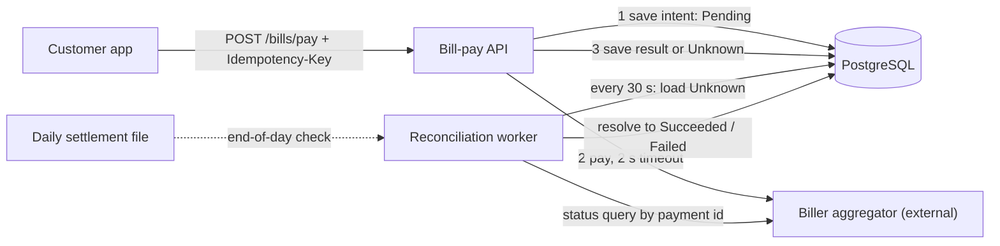
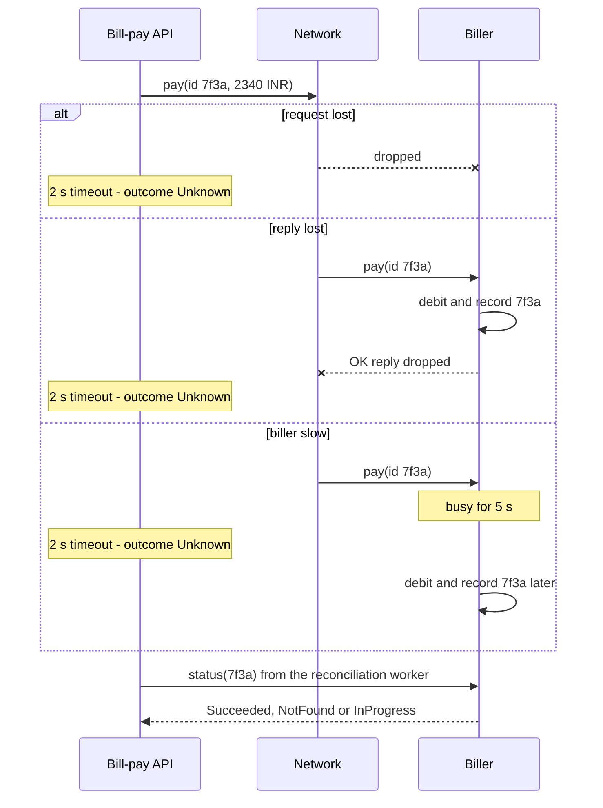

A program on one computer either runs or crashes. A system spread across many computers can be half-alive: the database committed your write, the reply got lost, and the caller thinks it failed. Almost every hard problem in this module — clocks, consistency, replication, consensus, locks — comes from three facts you will meet in this lesson.

## Learning objectives

By the end of this lesson you will be able to:

1. Explain what makes a system "distributed" and why that changes the rules compared with one process.
2. Name the eight fallacies of distributed computing and give a concrete failure caused by each.
3. Describe partial failure and why "slow" is often worse than "dead".
4. Explain the three possible meanings of a timeout and why a timeout never tells you whether the work happened.
5. Design a call to an external system so that an unknown outcome is safe: record intent first, use an idempotency key, mark the result as unknown, and reconcile.
6. Implement that design in ASP.NET Core with a timeout, an idempotency key and a reconciliation `BackgroundService`.
7. Decide when *not* to distribute at all.

## Prerequisites

- [Availability, reliability and the nines](#/lesson/m11-availability): you should know what "99.9 %" means in minutes of downtime.
- [Timeouts, retries and backoff with jitter](#/lesson/m10-timeouts-retries): we build on why every network call needs a timeout.
- [Idempotency keys](#/lesson/m10-idempotency): the main tool for making an unknown outcome safe to retry.

## Explain it like I'm a beginner

Imagine you run a bakery in Gurgaon and buy flour from a mill in Patna. There is no phone line. You can only send letters with a courier.

You send a letter: "Please deliver 200 kg of flour." A week passes. No reply.

What happened? There are only a few possibilities, and **you cannot tell them apart**:

1. The courier lost your letter. The mill never saw it. No flour is coming.
2. The mill got the letter, loaded the truck, and sent a reply. The courier lost the *reply*. Flour is on the way.
3. The mill got the letter but is very busy. The truck has not left yet. A reply will come next week.
4. The mill has shut down for good. Nobody will ever answer.

If you send the letter again, you might get 400 kg. If you don't, you might get none. Waiting longer helps a bit, but you never know *how* long is long enough.

That is a distributed system. Your computer is the bakery, the other computer is the mill, and the network is the courier. Messages can be lost, delayed or duplicated. The other side can be slow or dead, and from the outside those look the same. And there is no shared clock on the wall that both sides can read.

Three words to remember:

- **Partial failure**: some parts of the system work while others don't. The courier works, the mill is down. Or the mill works and the courier is down.
- **Unknown outcome**: after a timeout, you don't know whether the work happened.
- **No global clock**: the bakery and the mill each have their own watch, and the watches disagree.

## First-principles explanation

### What "distributed" means

A system is distributed when it runs on several machines that **cooperate only by sending messages over a network**. They share no memory and no clock. Your ASP.NET Core API, its PostgreSQL database, a Redis cache and a payment provider together already form a distributed system, even if you call it a monolith. The moment your code writes to the database *and* calls an outside API in the same user action, you have the problems in this lesson.

Inside one process, a method call has three properties we take for granted:

| Inside one process | Across a network |
|---|---|
| The call either returns or throws. You always find out. | The call can hang forever. A timeout is your only way out, and then you don't know what happened. |
| It takes nanoseconds. | It takes 0.5 ms in one data centre and 150–300 ms between continents (typical figures, not measurements). |
| If the callee crashes, you crash too. Failure is total. | The callee can crash while you keep running. Failure is partial. |
| There is one clock. "Before" and "after" are obvious. | Each machine has its own clock, and they drift apart. |

Those differences are not bugs you can fix with better code. They are physics and economics: light takes about 5 ms to travel 1,000 km in fibre, cables get cut, switches reboot, and garbage collectors pause.

### The eight fallacies

In 1994 Peter Deutsch at Sun Microsystems wrote down seven assumptions that newcomers to distributed systems make (building on earlier notes by Bill Joy and Tom Lyon), and James Gosling added the eighth around 1997. All are false. Each one causes a real class of outages.

**1. The network is reliable.** Packets drop, links flap, a cloud load balancer silently closes idle connections after a few minutes. *Failure case*: an order service calls the inventory service with no timeout. A switch drops packets for 90 seconds. Every request thread waits, the thread pool empties, and the order service, which is perfectly healthy, stops answering health checks and is killed by the orchestrator. *Design response*: timeouts on every call, retries only for idempotent operations, and queues for work that can wait.

**2. Latency is zero.** A page that makes 40 sequential calls of 5 ms each spends 200 ms waiting, before doing any work. Moving one of those services to another region at 60 ms round trip turns 200 ms into 2.6 s. *Design response*: batch calls, run independent calls in parallel, keep chatty components close together.

**3. Bandwidth is infinite.** A report endpoint returns 50 MB of JSON. 100 users opening it at 9 a.m. need 5 GB through one gateway. *Design response*: paginate, compress, send IDs instead of full objects, move bulk data through object storage.

**4. The network is secure.** Traffic inside a VPC can still be sniffed by a compromised pod. *Design response*: TLS everywhere, authenticate service-to-service calls, zero trust.

**5. Topology doesn't change.** Containers get new IP addresses every deployment. A service that cached a DNS answer forever keeps calling a pod that no longer exists. *Design response*: service discovery, short DNS TTLs, connection lifetimes (`SocketsHttpHandler.PooledConnectionLifetime`).

**6. There is one administrator.** The payment provider, the cloud vendor and your platform team all change things on their own schedule. A certificate expires at a partner. *Design response*: monitor dependencies you don't own, plan for their outages.

**7. Transport cost is zero.** Serialising, encrypting and sending data costs CPU and money. Cross-zone and internet egress is billed per GB in most clouds. *Design response*: count bytes in cost estimates; see [Cost estimation](#/lesson/m11-cost-estimation).

**8. The network is homogeneous.** Mobile clients on 2G in rural Bihar and fibre users in Bengaluru hit the same API. Different services speak different HTTP versions and serialisers. *Design response*: design for the slowest client, use standard protocols, version contracts.

Fallacies 1, 2 and 5 cause most outages in practice. Fallacy 1 leads directly to the hardest idea in this lesson.

### Partial failure

In a single process, failure is all or nothing. In a distributed system, **part of the work can succeed while another part fails**. A checkout might:

1. Insert the order row in PostgreSQL. Success.
2. Debit ₹2,340 through a payment provider. Success.
3. Publish an "order placed" event to a broker. Fails: the broker is restarting.

Now your database says "order placed", the customer's bank says "money gone", and the warehouse never hears about it. No `try/catch` can roll back step 2: the provider is another company's system. You need designs that make partial states visible and recoverable, such as the [transactional outbox](#/lesson/m12-outbox) and [sagas](#/lesson/m12-sagas).

### Slow is worse than dead

A dead server is easy: connections are refused within milliseconds, you fail fast and try another server. A *slow* server is the dangerous one. It accepts connections, holds them, and answers after 20 seconds. Every caller keeps waiting, and their resources (threads, sockets, database connections) are tied up. Engineers call this a **gray failure**: the health check passes because it is cheap, but real requests are slow or fail.

A back-of-the-envelope example (an estimate, to show the shape):

- An API serves 500 requests per second. Each normally holds a database connection for 10 ms. Average connections in use = 500 × 0.010 s = **5**.
- The database disk becomes slow and each query takes 2 s. Connections in use = 500 × 2 = **1,000**.
- The connection pool has 100 connections. After 0.2 s it is empty, and every new request queues behind it. The API "goes down" although nothing crashed.

This is Little's law (items in system = arrival rate × time in system) and it explains most cascading failures. Timeouts and [bulkheads](#/lesson/m10-bulkhead) exist to stop slowness spreading.

### The unknown outcome of a timeout

When a call times out, exactly one of these happened, and **you cannot tell which**:

| What happened | Did the work happen? | Is a blind retry safe? |
|---|---|---|
| The request was lost on the way | No | Yes |
| The server processed it, the reply was lost | **Yes** | **No: it would happen twice** |
| The server is still processing it | Not yet, but it will | **No** |
| The server crashed half-way | Maybe partially | Depends |

So a timeout is not a failure. It is **"I don't know"**. Treating it as a failure ("payment failed, please try again") is how customers get charged twice. Treating it as success is how orders ship without payment.

This is not a limitation of HTTP or of your library. It is a theorem-level fact. The **Two Generals problem** shows that two parties communicating over an unreliable channel can never be *certain* they agree, no matter how many acknowledgements they send: the last acknowledgement can always be lost. A related result, **FLP impossibility** (Fischer, Lynch and Paterson, 1985), proves that in a fully asynchronous network where one node may crash, no deterministic algorithm can guarantee that nodes always reach agreement: some run can go on forever without deciding. Real systems get around this with timeouts and probabilities, which is why they *usually* work rather than *always*.

There are only three honest ways to handle an unknown outcome:

1. **Make the operation idempotent and retry.** Send an idempotency key so that the second attempt is recognised as the same request. See [Idempotency keys](#/lesson/m10-idempotency).
2. **Ask.** Query the other side: "what happened to request `7f3a…`?" This only works if you sent it an ID you chose *before* the call.
3. **Reconcile later.** Compare your records with theirs, for example against a daily settlement file, and fix differences.

Most payment systems use all three.

:::callout type=warning title="The 'not found' trap"
You query the provider about a payment that timed out and it says "not found". Is it safe to mark the payment failed? **Not yet.** Your original request may still be stuck in a queue somewhere and arrive a minute later. Only declare it failed once the request can no longer be processed, for example because you sent an expiry time with it and that time has passed.
:::

### How big is the problem? Some arithmetic

Rare events become constant at scale. Suppose a bill-payment API handles 2 million payments a day and 0.05 % of calls to the biller time out (an assumed figure).

- Average rate: 2,000,000 ÷ 86,400 s ≈ **23 payments per second**. Peak, say 4× in the evening: about **93 per second**.
- Unknown outcomes per day: 2,000,000 × 0.0005 = **1,000 payments a day**.
- If half of those actually succeeded and we told the user "failed", about **500 users a day** retry and are charged twice. At an average bill of ₹1,500 that is ₹7.5 lakh a day in wrong debits and a flood of support calls.

A one-in-two-thousand event is one thousand angry customers a day. This is why "it works on my machine" means little in distributed systems.

### Timeouts: choosing a number

A timeout must be long enough that healthy-but-slow calls succeed, and short enough that a stuck call doesn't hold resources. Practical rules:

- Start from the dependency's measured latency: set the timeout a little above its p99 or p99.9, not its average.
- Respect the caller's budget. If the user-facing endpoint has a 3 s budget and you allow 3 retries of 2 s each, you have already broken it. Budget = attempts × timeout + backoff.
- Propagate deadlines: pass the request's `CancellationToken` down so that when the user gives up, downstream work stops too ([Cancellation tokens](#/lesson/m03-cancellation)).

### When it is unnecessary — the simpler alternative

The first rule of distribution, as Martin Fowler put it: **don't distribute** unless you must. A single well-sized PostgreSQL server with a hot standby, behind a modular monolith, avoids most of this module. It can handle tens of thousands of simple transactions per second on modern hardware (a rough, workload-dependent estimate). Distribute when you need:

- availability beyond one machine,
- scale beyond one machine,
- data close to users in several regions, or
- independent teams deploying independently.

You can never avoid it completely: any call to a payment provider, SMS gateway or email service is a distributed call. That boundary is where the patterns in this lesson always apply.

### Trade-offs it introduces

| You gain by distributing | You pay |
|---|---|
| Survive the loss of one machine or zone | Partial failures, unknown outcomes, recovery code |
| Scale past one machine | Coordination cost, network latency on every hop |
| Independent deployment | Contracts, versioning, distributed debugging |
| Data near users | Clock and consistency problems (next lessons) |

## Visual explanation

### Architecture: where the unknowns live



How to read it: the customer's app sends a payment with an idempotency key it generated, so a double-tap or app retry is recognised. The API first **saves the intent** (arrow 1) so that even if it crashes mid-call there is a record to reconcile. It calls the external biller with a strict timeout (arrow 2) and saves the outcome, which may be `Unknown` (arrow 3). A separate worker regularly picks up unknown payments, **asks** the biller what happened using the same payment id, and resolves them. The dotted arrow is the last line of defence: the end-of-day settlement file catches anything the status queries missed. Every arrow that crosses to the biller can fail independently, which is exactly why there are three of them.

### Sequence: the three faces of a timeout



All three branches look **identical** to the API: a timeout after 2 seconds. Only the biller knows the truth, and only because the API sent an id it chose up front. In the "request lost" branch the status query returns `NotFound`. In the "slow" branch it may also return `NotFound` at first and `Succeeded` a few seconds later — the trap from the callout above.

## Step-by-step example

An electricity bill-payment feature: the user pays ₹2,340 for consumer number `BR-0045123`, and our API calls a biller aggregator.

### Step 1 — the naive version

```csharp
app.MapPost("/bills/pay", async (PayBillRequest req, HttpClient http) =>
{
    try
    {
        var resp = await http.PostAsJsonAsync("https://biller.example/pay", req);   // default timeout: 100 s
        return resp.IsSuccessStatusCode ? Results.Ok("Paid") : Results.Problem("Payment failed");
    }
    catch (Exception)
    {
        return Results.Problem("Payment failed, please try again");   // the lie
    }
});
```

It passes every test on a laptop. In production it breaks in three ways:

1. **The default `HttpClient.Timeout` is 100 seconds.** A slow biller holds every request for up to 100 s. At 93 payments per second that is up to 9,300 waiting requests.
2. **"Payment failed, please try again" is a guess.** For a reply-lost timeout the money has moved. The user taps "Pay" again and is debited twice.
3. **There is no record.** If the API process restarts mid-call, nobody knows the payment was attempted.

### Step 2 — record intent, use our own id

Generate the payment id (or accept the client's idempotency key) and **save a `Pending` row before calling out**. Send that id to the biller as its idempotency key. Now a retry with the same id is recognised by the biller, and a crash leaves a `Pending` row to clean up.

### Step 3 — a real timeout and an honest status

Set the timeout to about 2 s (the biller's measured p99 plus margin, an assumption here). On timeout or a 5xx, store `Unknown` and tell the user "Payment is being confirmed. Don't pay again; we will update you within 15 minutes." Return `202 Accepted` with a status URL, not an error.

### Step 4 — resolve unknowns

A background worker queries the biller every 30 seconds for each `Unknown` or stale `Pending` payment. `Succeeded` or `Failed` resolves it. `NotFound` is treated as failed **only after the request's expiry time has passed**, because a slow request can still land. Anything still unresolved after the expiry goes to the end-of-day settlement comparison and, if needed, a human.

## Production-style C# implementation

Project structure:

```text
BillPay.Api/
  Program.cs
  Payments/
    PaymentModels.cs
    IBillerGateway.cs
    IPaymentStore.cs
    BillPaymentService.cs
    PaymentReconciler.cs
    ReconciliationWorker.cs
    FlakyBillerGateway.cs      (an in-memory fake that loses replies, for local runs and tests)
```

```csharp file=Payments/PaymentModels.cs
namespace BillPay.Payments;

/// <summary>Unknown is a first-class state: "we asked, and we don't know yet".</summary>
public enum PaymentStatus { Pending, Succeeded, Failed, Unknown }

public sealed record BillPayment(
    Guid Id,
    string ConsumerNumber,
    decimal Amount,
    PaymentStatus Status,
    DateTimeOffset CreatedAt,
    DateTimeOffset ExpiresAt,
    int StatusChecks = 0,
    string? FailureReason = null);

/// <summary>What we send to the biller. The id doubles as the idempotency key.</summary>
public sealed record BillerPaymentRequest(Guid PaymentId, string ConsumerNumber, decimal Amount, DateTimeOffset ExpiresAt);

public sealed record BillerPaymentResponse(bool Accepted, string? Reason);

/// <summary>What the biller says when asked about a payment id.</summary>
public enum RemoteStatus { NotFound, InProgress, Succeeded, Failed }

public sealed class BillPaymentOptions
{
    /// <summary>Slightly above the biller's measured p99. An assumption to tune from metrics.</summary>
    public TimeSpan GatewayTimeout { get; set; } = TimeSpan.FromSeconds(2);

    /// <summary>The biller must reject a request that arrives after this. Makes "NotFound" safe to act on.</summary>
    public TimeSpan RequestValidity { get; set; } = TimeSpan.FromMinutes(2);

    /// <summary>A Pending row older than this was probably interrupted by a crash or a cancelled request.</summary>
    public TimeSpan PendingGracePeriod { get; set; } = TimeSpan.FromSeconds(30);

    public TimeSpan ReconcileEvery { get; set; } = TimeSpan.FromSeconds(30);
}
```

```csharp file=Payments/IBillerGateway.cs
namespace BillPay.Payments;

public interface IBillerGateway
{
    /// <summary>Must be idempotent on <see cref="BillerPaymentRequest.PaymentId"/>.</summary>
    Task<BillerPaymentResponse> PayAsync(BillerPaymentRequest request, CancellationToken ct);

    Task<RemoteStatus> GetStatusAsync(Guid paymentId, CancellationToken ct);
}
```

```csharp file=Payments/IPaymentStore.cs
using System.Collections.Concurrent;

namespace BillPay.Payments;

public interface IPaymentStore
{
    /// <summary>Returns false if a payment with this id already exists (idempotent create).</summary>
    bool TryCreate(BillPayment payment);
    void Update(BillPayment payment);
    BillPayment? Get(Guid id);
    IReadOnlyList<BillPayment> GetByStatus(PaymentStatus status);
}

/// <summary>In-memory store for the sample. In production this is a PostgreSQL table with
/// a primary key on id, so TryCreate becomes INSERT ... ON CONFLICT DO NOTHING.</summary>
public sealed class InMemoryPaymentStore : IPaymentStore
{
    private readonly ConcurrentDictionary<Guid, BillPayment> _rows = new();
    public bool TryCreate(BillPayment payment) => _rows.TryAdd(payment.Id, payment);
    public void Update(BillPayment payment) => _rows[payment.Id] = payment;
    public BillPayment? Get(Guid id) => _rows.TryGetValue(id, out var p) ? p : null;
    public IReadOnlyList<BillPayment> GetByStatus(PaymentStatus status) =>
        _rows.Values.Where(p => p.Status == status).OrderBy(p => p.CreatedAt).ToList();
}
```

```csharp file=Payments/BillPaymentService.cs
using Microsoft.Extensions.Options;

namespace BillPay.Payments;

public sealed class BillPaymentService(
    IBillerGateway gateway,
    IPaymentStore store,
    TimeProvider clock,
    IOptions<BillPaymentOptions> options,
    ILogger<BillPaymentService> log)
{
    private readonly BillPaymentOptions _o = options.Value;

    /// <param name="paymentId">Idempotency key chosen by the client, so a double tap is one payment.</param>
    public async Task<BillPayment> PayAsync(Guid paymentId, string consumerNumber, decimal amount, CancellationToken ct)
    {
        if (amount <= 0) throw new ArgumentOutOfRangeException(nameof(amount));

        var now = clock.GetUtcNow();
        var payment = new BillPayment(paymentId, consumerNumber, amount, PaymentStatus.Pending, now, now + _o.RequestValidity);

        // 1. Record intent BEFORE calling out. A crash after this line leaves a row to reconcile.
        if (!store.TryCreate(payment))
        {
            var existing = store.Get(paymentId)!;
            if (existing.Amount != amount || existing.ConsumerNumber != consumerNumber)
                throw new InvalidOperationException($"Payment {paymentId} was already used for a different bill.");
            return existing;   // replay: same answer, no second call to the biller
        }

        // 2. Call out with our own deadline, linked to the caller's cancellation.
        using var cts = CancellationTokenSource.CreateLinkedTokenSource(ct);
        cts.CancelAfter(_o.GatewayTimeout);
        try
        {
            var reply = await gateway.PayAsync(
                new BillerPaymentRequest(payment.Id, consumerNumber, amount, payment.ExpiresAt), cts.Token);
            payment = reply.Accepted
                ? payment with { Status = PaymentStatus.Succeeded }
                : payment with { Status = PaymentStatus.Failed, FailureReason = reply.Reason };
        }
        catch (HttpRequestException ex) when (ex.HttpRequestError is HttpRequestError.ConnectionError
                                                  or HttpRequestError.NameResolutionError
                                                  or HttpRequestError.SecureConnectionError)
        {
            // We never got a connection, so the biller cannot have seen the request.
            payment = payment with { Status = PaymentStatus.Failed, FailureReason = "Biller unreachable" };
        }
        catch (Exception ex) when (ex is OperationCanceledException or HttpRequestException or IOException
                                   && !ct.IsCancellationRequested)
        {
            // Timeout, reset, 5xx surfaced as an exception: the work may or may not have happened.
            log.LogWarning(ex, "Payment {PaymentId} outcome unknown after {Timeout}", payment.Id, _o.GatewayTimeout);
            payment = payment with { Status = PaymentStatus.Unknown };
        }

        // 3. Save what we know. If the caller cancelled, the row stays Pending and the reconciler picks it up.
        store.Update(payment);
        return payment;
    }
}
```

```csharp file=Payments/PaymentReconciler.cs
using Microsoft.Extensions.Options;

namespace BillPay.Payments;

/// <summary>Turns Unknown (and stale Pending) payments into Succeeded or Failed by asking the biller.</summary>
public sealed class PaymentReconciler(
    IBillerGateway gateway,
    IPaymentStore store,
    TimeProvider clock,
    IOptions<BillPaymentOptions> options,
    ILogger<PaymentReconciler> log)
{
    private readonly BillPaymentOptions _o = options.Value;

    public async Task<int> ReconcileOnceAsync(CancellationToken ct)
    {
        var now = clock.GetUtcNow();
        var candidates = store.GetByStatus(PaymentStatus.Unknown)
            .Concat(store.GetByStatus(PaymentStatus.Pending).Where(p => now - p.CreatedAt > _o.PendingGracePeriod))
            .ToList();

        var resolved = 0;
        foreach (var p in candidates)
        {
            RemoteStatus remote;
            try { remote = await gateway.GetStatusAsync(p.Id, ct); }
            catch (Exception ex) when (!ct.IsCancellationRequested)
            {
                log.LogWarning(ex, "Status query for {PaymentId} failed; will retry next cycle", p.Id);
                continue;
            }

            var next = remote switch
            {
                RemoteStatus.Succeeded => p with { Status = PaymentStatus.Succeeded },
                RemoteStatus.Failed => p with { Status = PaymentStatus.Failed, FailureReason = "Rejected by biller" },
                // NotFound is only final once the biller can no longer accept the request.
                RemoteStatus.NotFound when now > p.ExpiresAt => p with { Status = PaymentStatus.Failed, FailureReason = "Never reached biller" },
                _ => p with { Status = PaymentStatus.Unknown, StatusChecks = p.StatusChecks + 1 },
            };
            store.Update(next);
            if (next.Status is PaymentStatus.Succeeded or PaymentStatus.Failed) resolved++;
        }
        return resolved;
    }
}
```

```csharp file=Payments/ReconciliationWorker.cs
using Microsoft.Extensions.Options;

namespace BillPay.Payments;

public sealed class ReconciliationWorker(
    PaymentReconciler reconciler,
    TimeProvider clock,
    IOptions<BillPaymentOptions> options,
    ILogger<ReconciliationWorker> log) : BackgroundService
{
    protected override async Task ExecuteAsync(CancellationToken stoppingToken)
    {
        using var timer = new PeriodicTimer(options.Value.ReconcileEvery, clock);
        while (await timer.WaitForNextTickAsync(stoppingToken))
        {
            try
            {
                var n = await reconciler.ReconcileOnceAsync(stoppingToken);
                if (n > 0) log.LogInformation("Reconciled {Count} payments", n);
            }
            catch (Exception ex) when (!stoppingToken.IsCancellationRequested)
            {
                log.LogError(ex, "Reconciliation cycle failed");   // never let the loop die
            }
        }
    }
}
```

```csharp file=Payments/FlakyBillerGateway.cs
using System.Collections.Concurrent;

namespace BillPay.Payments;

/// <summary>A fake biller that processes every payment but "loses" a share of replies,
/// so the caller times out although the money moved. Used for local runs and tests.</summary>
public sealed class FlakyBillerGateway(TimeProvider clock, double dropReplyRate, int seed = 42) : IBillerGateway
{
    private readonly ConcurrentDictionary<Guid, RemoteStatus> _ledger = new();
    private readonly Random _random = new(seed);
    private readonly object _gate = new();

    public async Task<BillerPaymentResponse> PayAsync(BillerPaymentRequest r, CancellationToken ct)
    {
        if (clock.GetUtcNow() > r.ExpiresAt) return new BillerPaymentResponse(false, "Request expired");

        var status = _ledger.GetOrAdd(r.PaymentId, RemoteStatus.Succeeded);   // idempotent on the id
        bool drop;
        lock (_gate) drop = _random.NextDouble() < dropReplyRate;
        if (drop) await Task.Delay(Timeout.InfiniteTimeSpan, ct);              // reply never arrives
        return new BillerPaymentResponse(status == RemoteStatus.Succeeded, null);
    }

    public Task<RemoteStatus> GetStatusAsync(Guid paymentId, CancellationToken ct) =>
        Task.FromResult(_ledger.TryGetValue(paymentId, out var s) ? s : RemoteStatus.NotFound);
}
```

```csharp file=Program.cs
using BillPay.Payments;

var builder = WebApplication.CreateBuilder(args);

builder.Services.Configure<BillPaymentOptions>(builder.Configuration.GetSection("BillPay"));
builder.Services.AddSingleton(TimeProvider.System);
builder.Services.AddSingleton<IPaymentStore, InMemoryPaymentStore>();
// Replace with a typed HttpClient-based gateway in production.
builder.Services.AddSingleton<IBillerGateway>(sp => new FlakyBillerGateway(sp.GetRequiredService<TimeProvider>(), dropReplyRate: 0.1));
builder.Services.AddSingleton<BillPaymentService>();
builder.Services.AddSingleton<PaymentReconciler>();
builder.Services.AddHostedService<ReconciliationWorker>();

var app = builder.Build();

app.MapPost("/bills/pay", async (PayBillRequest req, HttpRequest http, BillPaymentService svc, CancellationToken ct) =>
{
    if (!Guid.TryParse(http.Headers["Idempotency-Key"], out var key))
        return Results.Problem("Send an Idempotency-Key header (a GUID).", statusCode: StatusCodes.Status400BadRequest);

    var p = await svc.PayAsync(key, req.ConsumerNumber, req.Amount, ct);
    return p.Status switch
    {
        PaymentStatus.Succeeded => Results.Ok(p),
        PaymentStatus.Failed => Results.UnprocessableEntity(p),
        // Honest answer: we don't know yet. Tell the app where to look, and not to pay again.
        _ => Results.Accepted($"/bills/payments/{p.Id}", p),
    };
});

app.MapGet("/bills/payments/{id:guid}", (Guid id, IPaymentStore store) =>
    store.Get(id) is { } p ? Results.Ok(p) : Results.NotFound());

app.Run();

public sealed record PayBillRequest(string ConsumerNumber, decimal Amount);
```

Points worth noticing:

- **`Unknown` is a real status**, stored in the database and shown in the UI. Hiding it is what causes double payments.
- **The id is chosen before the call.** Without it, the status query and the biller's own deduplication are impossible.
- **Only a connection error is treated as a definite failure.** If no connection was ever made, the request cannot have been delivered. Any error after bytes may have been sent is `Unknown`.
- **The caller's cancellation is respected** but doesn't turn into a fake failure: the row stays `Pending` and the reconciler handles it.
- **`ExpiresAt` makes `NotFound` meaningful.** This needs the biller's cooperation; if it doesn't support expiry, keep checking until the end-of-day settlement file.

:::callout type=tradeoff title="Synchronous call or queue?"
You could put the payment on a queue and return `202` immediately for every request. That makes the API immune to a slow biller, but the user always waits for a push notification, even when the biller answers in 300 ms. The design above is a hybrid: answer synchronously when possible, fall back to asynchronous resolution when not.
:::

## Bad design vs good design

**Bad**: the Step 1 code, plus "fixes" that look sensible:

- *"Let's retry 3 times on any exception."* Without an idempotency key, each retry after a reply-lost timeout is a new debit. Retrying turned one unknown into up to three charges.
- *"Let's increase the timeout to 60 s so we always get an answer."* You don't always get one (the reply can still be lost), and now each stuck request holds a thread and a connection for a minute. At 93 requests per second, that is up to 5,580 requests in flight — the slowness spreads to your whole API.
- *"If the status query says NotFound, mark it failed."* The slow request lands 40 seconds later. The user was told "failed", paid again by another method, and the first payment also goes through.

**Good**: the implementation above:

| Concern | Bad | Good |
|---|---|---|
| Duplicate submits | New payment each tap | Client idempotency key; replay returns the same row |
| Timeout | 100 s default | About 2 s, linked to the request's cancellation |
| Timeout meaning | "Failed" | `Unknown`, shown honestly to the user |
| Crash mid-call | No record | `Pending` row saved first, reconciled later |
| NotFound | Treated as failed | Failed only after the request's expiry |
| Last resort | None | Daily settlement comparison |

**Is the extra machinery worth it?** For calls that move money, book inventory or send a legal notice: yes, always. For a call that fetches a weather widget, no. Just time out, show "unavailable" and move on. Match the effort to the cost of being wrong.

## Practical playground

The starter graph is the naive bill-payment design: the app calls the API, which calls the external biller synchronously and writes to PostgreSQL. Edit it in the HLD canvas until it handles unknown outcomes. Things to try:

1. Add a reconciliation `worker` that reads from the database and calls the biller.
2. Add a `queue` so that unknown payments are handed to the worker instead of polled.
3. Mark which edges carry an idempotency key (use the edge `label`).
4. Ask yourself for each edge: "If this message is lost, what is the state of the system and who notices?"

:::playground type=hld title="Make the bill-payment flow survive a lost reply"
```json
{
  "nodes": [
    { "id": "app", "type": "client", "label": "Customer app", "props": { "rps": 93 } },
    { "id": "lb", "type": "load-balancer", "label": "Load balancer" },
    { "id": "api", "type": "app-server", "label": "Bill-pay API", "props": { "instances": 3 } },
    { "id": "db", "type": "database", "label": "PostgreSQL", "props": { "replicas": 1 } },
    { "id": "biller", "type": "external", "label": "Biller aggregator", "props": { "latencyMs": 400 } }
  ],
  "edges": [
    { "from": "app", "to": "lb", "kind": "sync" },
    { "from": "lb", "to": "api", "kind": "sync" },
    { "from": "api", "to": "biller", "kind": "sync", "label": "pay (no timeout, no key)" },
    { "from": "api", "to": "db", "kind": "sync", "label": "save after reply" }
  ]
}
```
:::

## Exercises

:::exercise id=m13-why-hard-ex1 difficulty=beginner kind=code title="Classify the outcome of a remote call"
Write `OutcomeClassifier`, which turns the result of an HTTP call into one of three outcomes: the work definitely **succeeded**, it was definitely **not applied**, or the outcome is **unknown**. Your payment service will only retry blindly on `NotApplied` and will reconcile on `Unknown`.
::requirements
- `FromStatusCode(int)`: 200–299 → `Succeeded`; 400–499 → `NotApplied` (the server refused before acting); 500–599 → `Unknown`; anything else → `Unknown`.
- `FromException(Exception)`: an `HttpRequestException` whose `HttpRequestError` is `ConnectionError`, `NameResolutionError` or `SecureConnectionError` → `NotApplied` (no request was ever delivered). Everything else — `TimeoutException`, `OperationCanceledException` (including `TaskCanceledException`), `IOException`, other `HttpRequestException`s and unknown exceptions → `Unknown`.
::acceptance
- 200 and 201 are `Succeeded`; 404, 409 and 429 are `NotApplied`; 500, 502 and 504 are `Unknown`.
- A connection-refused `HttpRequestException` is `NotApplied`; a `ResponseEnded` one is `Unknown`.
- Timeouts and cancellations are `Unknown`.
::hint
The question is not "did it fail?" but "could the server have done the work?"
::hint
Once a connection exists, bytes may have reached the server. From then on, any error is `Unknown`.
::hint
`HttpRequestException` has an `HttpRequestError` property (since .NET 8) that tells you at which stage the request failed.
::hint
Use a `switch` expression with type patterns: `HttpRequestException { HttpRequestError: HttpRequestError.ConnectionError or ... } => CallOutcome.NotApplied`.
::hint
```csharp
public static CallOutcome FromStatusCode(int code) => code switch
{
    >= 200 and <= 299 => CallOutcome.Succeeded,
    >= 400 and <= 499 => CallOutcome.NotApplied,
    _ => CallOutcome.Unknown,
};
```
::starter
```csharp file=OutcomeClassifier.cs
using System;
using System.IO;
using System.Net.Http;

public enum CallOutcome { Succeeded, NotApplied, Unknown }

public static class OutcomeClassifier
{
    public static CallOutcome FromStatusCode(int statusCode) => throw new NotImplementedException();

    public static CallOutcome FromException(Exception ex) => throw new NotImplementedException();
}
```
::tests
```csharp file=OutcomeClassifierTests.cs
using System;
using System.IO;
using System.Net.Http;
using System.Threading.Tasks;
using Xunit;

public class OutcomeClassifierTests
{
    [Theory]
    [InlineData(200)]
    [InlineData(201)]
    [InlineData(204)]
    public void Two_hundreds_succeed(int code) => Assert.Equal(CallOutcome.Succeeded, OutcomeClassifier.FromStatusCode(code));

    [Theory]
    [InlineData(400)]
    [InlineData(404)]
    [InlineData(409)]
    [InlineData(429)]
    public void Four_hundreds_were_not_applied(int code) => Assert.Equal(CallOutcome.NotApplied, OutcomeClassifier.FromStatusCode(code));

    [Theory]
    [InlineData(500)]
    [InlineData(502)]
    [InlineData(504)]
    [InlineData(302)]
    public void Others_are_unknown(int code) => Assert.Equal(CallOutcome.Unknown, OutcomeClassifier.FromStatusCode(code));

    [Fact]
    public void Connection_refused_is_not_applied() =>
        Assert.Equal(CallOutcome.NotApplied, OutcomeClassifier.FromException(new HttpRequestException(HttpRequestError.ConnectionError, "refused")));

    [Fact]
    public void Dns_failure_is_not_applied() =>
        Assert.Equal(CallOutcome.NotApplied, OutcomeClassifier.FromException(new HttpRequestException(HttpRequestError.NameResolutionError, "dns")));

    [Fact]
    public void Response_ended_is_unknown() =>
        Assert.Equal(CallOutcome.Unknown, OutcomeClassifier.FromException(new HttpRequestException(HttpRequestError.ResponseEnded, "reset")));

    [Fact]
    public void Timeout_is_unknown() => Assert.Equal(CallOutcome.Unknown, OutcomeClassifier.FromException(new TimeoutException()));

    [Fact]
    public void Task_cancelled_is_unknown() => Assert.Equal(CallOutcome.Unknown, OutcomeClassifier.FromException(new TaskCanceledException()));

    [Fact]
    public void Io_error_is_unknown() => Assert.Equal(CallOutcome.Unknown, OutcomeClassifier.FromException(new IOException("broken pipe")));

    [Fact]
    public void Anything_else_is_unknown() => Assert.Equal(CallOutcome.Unknown, OutcomeClassifier.FromException(new InvalidOperationException()));
}
```
::solution
The rule is: you may only say "not applied" when you can prove the server never saw the request, or when it told you so with a 4xx. Every other uncertainty is `Unknown`.

```csharp file=OutcomeClassifier.cs
using System;
using System.IO;
using System.Net.Http;

public enum CallOutcome { Succeeded, NotApplied, Unknown }

public static class OutcomeClassifier
{
    public static CallOutcome FromStatusCode(int statusCode) => statusCode switch
    {
        >= 200 and <= 299 => CallOutcome.Succeeded,
        >= 400 and <= 499 => CallOutcome.NotApplied,
        _ => CallOutcome.Unknown,
    };

    public static CallOutcome FromException(Exception ex) => ex switch
    {
        HttpRequestException
        {
            HttpRequestError: HttpRequestError.ConnectionError
                           or HttpRequestError.NameResolutionError
                           or HttpRequestError.SecureConnectionError
        } => CallOutcome.NotApplied,
        _ => CallOutcome.Unknown,
    };
}
```

`TimeoutException`, `OperationCanceledException`, `IOException` and every other exception fall into the default arm. Listing them explicitly is fine for readability, but the safe default must be `Unknown`.
::alternatives
Some APIs document that a specific 5xx (for example `503` with `Retry-After` from a gateway that never forwarded the request) is safe to treat as not applied. Encode such rules per dependency, only when the provider guarantees them. A 4xx is also not always "nothing happened" for badly designed APIs; check the provider's contract.
::mistakes
- Treating `TaskCanceledException` as "failed, safe to retry". It is how `HttpClient` reports its own timeout.
- Treating every `HttpRequestException` as not applied. A connection reset after sending the body is very much unknown.
- Making `Unknown` the exception rather than the default. New exception types will then be misclassified as safe.
::extensions
Add `FromResponse(HttpResponseMessage)` that reads an `Idempotent-Replayed: true` header and reports `Succeeded` for a replayed request.
:::

:::exercise id=m13-why-hard-ex2 difficulty=beginner kind=written title="Find the fallacies in a design note"
A teammate writes this design note for a home-services app (AC repair, plumbing, appliance installation) used by technicians across India, who photograph every job before and after:

> "The mobile app uploads each day's 30–80 job photos (3 MB each) directly to our API, which forwards them synchronously to the document service, then to the AI tagging service, then saves a row in PostgreSQL. All three services are in our VPC so we don't need TLS between them. We call the tagging service by its IP address, which we put in `appsettings.json`. If any step fails we return 500 and the app shows 'Upload failed'. The default `HttpClient` timeout is fine."

List at least five problems. For each, name the fallacy (or other idea from this lesson) and suggest a fix.
::acceptance
- At least five distinct problems, each tied to a named fallacy or to partial failure or unknown outcome.
- Each problem has a concrete fix.
- At least one estimate with numbers (for example bandwidth).
::hint
Read the note once per fallacy: reliable network, zero latency, infinite bandwidth, secure network, fixed topology, one admin, zero transport cost, homogeneous network.
::hint
How much data does one technician upload per day? What does a patchy 4G connection in a basement or a small town do to that?
::hint
"Return 500 and show Upload failed" — after which step? What state is the system in if step 3 fails after steps 1 and 2 succeeded?
::hint
Consider presigned uploads to object storage, a queue between steps, an idempotency key per photo, service discovery and TLS.
::solution
A model answer (any five, well argued, is a pass):

1. **Bandwidth is infinite / the network is homogeneous.** 80 photos × 3 MB = 240 MB per technician per day, over mobile connections that may give 1 Mbps or less. 240 MB × 8 = 1,920 Mb ÷ 1 Mbps ≈ 32 minutes of perfect upload. *Fix*: compress on the device, upload in the background with resumable chunked uploads directly to object storage using presigned URLs, and send only metadata to the API.
2. **The network is reliable / unknown outcome.** A photo upload that times out may have been stored. The app retries and creates duplicates. *Fix*: an idempotency key per photo (for example a hash of the file plus a device id), so retries are recognised.
3. **Partial failure.** If tagging fails after the document service stored the file, the API returns 500 but the file exists. The user re-uploads and we have two copies, one untagged. *Fix*: store the file and the row first, then put "tag this photo" on a queue. Tagging is retried by a worker and doesn't block the upload.
4. **Latency is zero.** Three synchronous hops plus AI tagging (maybe seconds) inside one request. *Fix*: make tagging asynchronous; the user only waits for the upload.
5. **Topology doesn't change.** A hard-coded IP breaks the next time the tagging service is redeployed or scaled. *Fix*: service discovery or a DNS name with short TTL.
6. **The network is secure.** A compromised pod in the VPC can read job photos, which show the inside of customers' homes and are private data. *Fix*: TLS and service-to-service authentication (mTLS or tokens).
7. **Timeouts.** The default `HttpClient.Timeout` is 100 s. A slow tagging service ties up API threads. *Fix*: an explicit timeout per dependency, based on its p99.
8. **There is one administrator.** If the AI tagging is a third-party API, its rate limits and outages are outside your control. *Fix*: queue, rate-limit and degrade gracefully (untagged photos are still useful).
::mistakes
- Listing fallacies without saying how they bite *this* design.
- Suggesting "add retries" without idempotency, which turns timeouts into duplicates.
- Missing the partial-failure state: file stored, row missing, user told "failed".
:::

:::exercise id=m13-why-hard-ex3 difficulty=intermediate kind=code title="Make the receiver idempotent"
The caller now sends an idempotency key, but the **receiving** side must honour it. Implement `IdempotentChargeHandler`, which debits an account through an `ILedger` exactly once per key, even when the same request arrives many times, including at the same moment.
::requirements
- First request for a key: call `ILedger.Debit` once, remember the result, return it with `Replayed = false`.
- Same key and identical request again: return the stored charge id with `Replayed = true`. Do **not** debit again.
- Same key but different account or amount: throw `IdempotencyConflictException`. The key was reused by mistake.
- If `Debit` throws, remember nothing, so a later retry can succeed.
- 50 parallel calls with the same key must produce exactly one debit.
- An empty or whitespace key throws `ArgumentException`.
::acceptance
- All tests pass, including the parallel one.
- `ILedger.Debit` is never called twice for one key.
::hint
You need to remember, per key, the request you saw and the result you gave.
::hint
Store the *request* as well as the result, so you can detect a key reused with a different amount.
::hint
The parallel test is the hard part. Two threads that both check "have I seen this key?" before either has saved it will both debit. Check-and-save must be atomic.
::hint
Simplest correct approach: one `lock` around the check, the debit and the save. It serialises all charges in this process, which is fine for an exercise. Records compare by value, so `prior.Request == request` is a full payload check.
::hint
```csharp
lock (_gate)
{
    if (_done.TryGetValue(request.IdempotencyKey, out var prior)) { /* conflict or replay */ }
    var id = ledger.Debit(request.Account, request.Amount);
    _done[request.IdempotencyKey] = (request, id);
    return new ChargeResult(id, false);
}
```
::starter
```csharp file=IdempotentChargeHandler.cs
using System;
using System.Collections.Generic;

public sealed record ChargeRequest(string IdempotencyKey, string Account, decimal Amount);
public sealed record ChargeResult(string ChargeId, bool Replayed);

public interface ILedger
{
    /// <summary>Moves money and returns a charge id. Not idempotent by itself.</summary>
    string Debit(string account, decimal amount);
}

public sealed class IdempotencyConflictException(string key)
    : Exception($"Idempotency key '{key}' was already used for a different request.");

public sealed class IdempotentChargeHandler(ILedger ledger)
{
    public ChargeResult Handle(ChargeRequest request) => throw new NotImplementedException();
}
```
::tests
```csharp file=IdempotentChargeHandlerTests.cs
using System;
using System.Threading;
using System.Threading.Tasks;
using Xunit;

public class IdempotentChargeHandlerTests
{
    private sealed class CountingLedger : ILedger
    {
        private int _calls;
        public int FailNext { get; set; }
        public int Calls => _calls;
        public string Debit(string account, decimal amount)
        {
            if (FailNext > 0) { FailNext--; throw new InvalidOperationException("ledger down"); }
            var n = Interlocked.Increment(ref _calls);
            Thread.Sleep(1);   // widen the race window
            return $"ch_{n}";
        }
    }

    [Fact]
    public void First_call_debits()
    {
        var ledger = new CountingLedger();
        var r = new IdempotentChargeHandler(ledger).Handle(new ChargeRequest("k1", "acc-1", 2340m));
        Assert.Equal("ch_1", r.ChargeId);
        Assert.False(r.Replayed);
        Assert.Equal(1, ledger.Calls);
    }

    [Fact]
    public void Repeat_is_replayed_without_debit()
    {
        var ledger = new CountingLedger();
        var h = new IdempotentChargeHandler(ledger);
        h.Handle(new ChargeRequest("k1", "acc-1", 2340m));
        var again = h.Handle(new ChargeRequest("k1", "acc-1", 2340m));
        Assert.True(again.Replayed);
        Assert.Equal("ch_1", again.ChargeId);
        Assert.Equal(1, ledger.Calls);
    }

    [Fact]
    public void Different_payload_same_key_conflicts()
    {
        var h = new IdempotentChargeHandler(new CountingLedger());
        h.Handle(new ChargeRequest("k1", "acc-1", 2340m));
        Assert.Throws<IdempotencyConflictException>(() => h.Handle(new ChargeRequest("k1", "acc-1", 9999m)));
    }

    [Fact]
    public void Failed_debit_is_not_remembered()
    {
        var ledger = new CountingLedger { FailNext = 1 };
        var h = new IdempotentChargeHandler(ledger);
        Assert.Throws<InvalidOperationException>(() => h.Handle(new ChargeRequest("k1", "acc-1", 100m)));
        var r = h.Handle(new ChargeRequest("k1", "acc-1", 100m));
        Assert.False(r.Replayed);
        Assert.Equal(1, ledger.Calls);
    }

    [Fact]
    public void Parallel_duplicates_debit_once()
    {
        var ledger = new CountingLedger();
        var h = new IdempotentChargeHandler(ledger);
        Parallel.For(0, 50, _ => h.Handle(new ChargeRequest("same", "acc-1", 500m)));
        Assert.Equal(1, ledger.Calls);
    }

    [Fact]
    public void Blank_key_is_rejected() =>
        Assert.Throws<ArgumentException>(() => new IdempotentChargeHandler(new CountingLedger()).Handle(new ChargeRequest(" ", "a", 1m)));
}
```
::solution
Keep a dictionary from key to (request, charge id), and do the check, the debit and the save under one lock.

```csharp file=IdempotentChargeHandler.cs
using System;
using System.Collections.Generic;

public sealed record ChargeRequest(string IdempotencyKey, string Account, decimal Amount);
public sealed record ChargeResult(string ChargeId, bool Replayed);

public interface ILedger
{
    /// <summary>Moves money and returns a charge id. Not idempotent by itself.</summary>
    string Debit(string account, decimal amount);
}

public sealed class IdempotencyConflictException(string key)
    : Exception($"Idempotency key '{key}' was already used for a different request.");

public sealed class IdempotentChargeHandler(ILedger ledger)
{
    private readonly object _gate = new();
    private readonly Dictionary<string, (ChargeRequest Request, string ChargeId)> _done = new();

    public ChargeResult Handle(ChargeRequest request)
    {
        ArgumentNullException.ThrowIfNull(request);
        if (string.IsNullOrWhiteSpace(request.IdempotencyKey))
            throw new ArgumentException("An idempotency key is required.", nameof(request));

        lock (_gate)
        {
            if (_done.TryGetValue(request.IdempotencyKey, out var prior))
            {
                if (prior.Request != request) throw new IdempotencyConflictException(request.IdempotencyKey);
                return new ChargeResult(prior.ChargeId, Replayed: true);
            }

            var chargeId = ledger.Debit(request.Account, request.Amount);   // if this throws, nothing is stored
            _done[request.IdempotencyKey] = (request, chargeId);
            return new ChargeResult(chargeId, Replayed: false);
        }
    }
}
```

The lock makes "have I seen it?" and "remember it" one atomic step. A failed debit leaves no entry, so the client's retry is processed normally.
::alternatives
- **Database unique constraint** (production): `INSERT INTO idempotency_keys (key, request_hash) ... ON CONFLICT DO NOTHING` in the *same transaction* as the debit. The constraint, not a process lock, guarantees once-only across many API instances.
- **Per-key locks** (`ConcurrentDictionary<string, SemaphoreSlim>`) avoid serialising unrelated keys.
- **`ConcurrentDictionary<string, Lazy<T>>`** gives once-per-key execution without a global lock, but you must remove the entry if the factory throws.
- Expire keys after a retention period (for example 24 hours); otherwise the table grows forever.
::mistakes
- Checking outside the lock and saving inside it: two threads both pass the check.
- Storing only the key and not the request, so a reused key with a new amount silently returns the old charge.
- Caching the exception, so a transient ledger failure makes the key unusable forever.
- An in-memory dictionary in production: with 3 API instances behind a load balancer, duplicates land on different instances.
::extensions
Add an "in progress" state: if a duplicate arrives while the first debit is still running, return `409 Conflict` with `Retry-After` instead of blocking.
:::

:::exercise id=m13-why-hard-ex4 difficulty=intermediate kind=hld title="Redesign the bill-payment flow for unknown outcomes"
Start from the naive graph (same as the playground). Redesign it so that a lost reply from the biller never causes a double charge or a silently lost payment. Peak traffic is about 93 payments per second; the biller's p99 latency is about 1.5 s (assumed).
::acceptance
- An idempotency key flows from the app to the API and from the API to the biller.
- The API records intent before calling the biller.
- A worker resolves unknown outcomes, with a way to receive work (queue or polling).
- A final safety net (settlement file comparison) is shown.
- The timeout value is justified with numbers, and in-flight requests at peak are estimated.
::hint
Which edge can lose a message, and what does the system look like if it does?
::hint
The worker needs to find unknown payments. Polling the database or consuming a queue both work; which is simpler at 93 RPS?
::hint
In-flight requests ≈ arrival rate × time held. Compare a 2 s timeout with a 100 s one.
::hint
Add: `worker` (reconciler), `queue` (unknown payments), `object-storage` (settlement files), `scheduler` (end-of-day job). Label edges with "Idempotency-Key".
::starter
```json
{
  "nodes": [
    { "id": "app", "type": "client", "label": "Customer app", "props": { "rps": 93 } },
    { "id": "lb", "type": "load-balancer", "label": "Load balancer" },
    { "id": "api", "type": "app-server", "label": "Bill-pay API", "props": { "instances": 3 } },
    { "id": "db", "type": "database", "label": "PostgreSQL", "props": { "replicas": 1 } },
    { "id": "biller", "type": "external", "label": "Biller aggregator", "props": { "latencyMs": 400 } }
  ],
  "edges": [
    { "from": "app", "to": "lb", "kind": "sync" },
    { "from": "lb", "to": "api", "kind": "sync" },
    { "from": "api", "to": "biller", "kind": "sync", "label": "pay (no timeout, no key)" },
    { "from": "api", "to": "db", "kind": "sync", "label": "save after reply" }
  ]
}
```
::solution
```json
{
  "nodes": [
    { "id": "app", "type": "client", "label": "Customer app (generates Idempotency-Key)", "props": { "rps": 93 } },
    { "id": "lb", "type": "load-balancer", "label": "Load balancer", "props": { "multiAz": true } },
    { "id": "api", "type": "app-server", "label": "Bill-pay API", "props": { "instances": 3, "multiAz": true } },
    { "id": "db", "type": "database", "label": "PostgreSQL (payments + idempotency keys)", "props": { "replicas": 1, "multiAz": true } },
    { "id": "biller", "type": "external", "label": "Biller aggregator", "props": { "latencyMs": 400 } },
    { "id": "q", "type": "queue", "label": "payments-unknown" },
    { "id": "rec", "type": "worker", "label": "Reconciler", "props": { "instances": 2 } },
    { "id": "sched", "type": "scheduler", "label": "End-of-day settlement job" },
    { "id": "files", "type": "object-storage", "label": "Settlement files" },
    { "id": "mon", "type": "monitoring", "label": "Unknown-payment age alerts" }
  ],
  "edges": [
    { "from": "app", "to": "lb", "kind": "sync", "label": "Idempotency-Key" },
    { "from": "lb", "to": "api", "kind": "sync" },
    { "from": "api", "to": "db", "kind": "sync", "label": "1 insert Pending (unique key)" },
    { "from": "api", "to": "biller", "kind": "sync", "label": "2 pay, key + expiry, 2 s timeout" },
    { "from": "api", "to": "db", "kind": "sync", "label": "3 save result or Unknown" },
    { "from": "api", "to": "q", "kind": "async", "label": "Unknown payment ids" },
    { "from": "q", "to": "rec", "kind": "async" },
    { "from": "rec", "to": "biller", "kind": "sync", "label": "status by key" },
    { "from": "rec", "to": "db", "kind": "sync", "label": "resolve" },
    { "from": "sched", "to": "files", "kind": "sync", "label": "fetch daily file" },
    { "from": "sched", "to": "db", "kind": "sync", "label": "compare and flag mismatches" },
    { "from": "rec", "to": "mon", "kind": "async", "label": "metrics" }
  ]
}
```

**Reasoning.**

- *Timeout*: p99 ≈ 1.5 s, so 2 s lets 99 %+ of healthy calls finish. In-flight at peak ≈ 93 × 2 s ≈ **186** requests at worst, spread over 3 instances — manageable. With the 100 s default it could reach 93 × 100 = **9,300**, enough to exhaust thread pools and connection pools.
- *Idempotency*: the app's key makes double-taps and app retries one payment (unique constraint on the key in PostgreSQL). The same key is sent to the biller so that the reconciler's question and any retry refer to one payment.
- *Queue vs polling*: at 93 RPS and maybe 0.05 % unknown, that is about 0.05 unknowns per second — polling the database every 30 s would also be fine and simpler. The queue is shown because it scales and spreads work across workers; either is acceptable if justified. If the queue publish fails, the row is still `Unknown` in the database, so a slow poll catches it (the database is the source of truth, the queue is a hint).
- *Safety net*: the settlement file catches anything left. The monitor alerts when the oldest unknown payment is older than, say, 15 minutes.
::mistakes
- Retrying the pay call inside the API with no key.
- Writing to the database only after the reply (a crash loses the record).
- Treating the queue as the only record of unknown payments.
- No alerting on stuck unknowns.
:::

:::exercise id=m13-why-hard-ex5 difficulty=advanced kind=code title="An adaptive failure detector"
Nodes in a cluster send heartbeats. A fixed rule like "dead after 1 s of silence" causes false alarms when the network is jittery and slow detection when it is calm. Build `AdaptiveFailureDetector`: it learns the normal gap between heartbeats for each node and suspects a node only when the current silence is unusually long. It never declares a node *dead* — only *suspected* — because from the outside, slow and dead look the same.
::requirements
- Constructor: `(TimeProvider clock, int windowSize, double k, TimeSpan minTimeout)`.
- `Heartbeat(string node)` records "now" for that node.
- `CurrentTimeout(node)`: with fewer than two heartbeats → `minTimeout`. Otherwise mean + k × standard deviation (population) of the last `windowSize` gaps between heartbeats, but never less than `minTimeout`.
- `Check(node)`: `Unknown` if no heartbeat ever; `Suspected` if time since last heartbeat is greater than `CurrentTimeout`; otherwise `Alive`.
- A heartbeat after suspicion makes the node `Alive` again.
- Thread-safe.
::acceptance
- Regular 100 ms heartbeats with `minTimeout = 50 ms` give a 100 ms timeout: alive at +90 ms, suspected at +150 ms.
- Gaps alternating 100 ms and 300 ms with k = 4 give a 600 ms timeout.
- Only the last `windowSize` gaps count.
::hint
Store, per node, the last heartbeat time and a queue of recent gaps in milliseconds.
::hint
Use the injected `TimeProvider`'s `GetUtcNow()`, never `DateTime.UtcNow`, so tests can move time.
::hint
Mean = sum ÷ count. Population variance = average of (gap − mean)². Standard deviation = √variance.
::hint
When the queue has more than `windowSize` items, dequeue the oldest.
::hint
```csharp
var mean = gaps.Average();
var sd = Math.Sqrt(gaps.Average(g => (g - mean) * (g - mean)));
var ms = Math.Max(_min.TotalMilliseconds, mean + _k * sd);
return TimeSpan.FromMilliseconds(ms);
```
::starter
```csharp file=AdaptiveFailureDetector.cs
using System;
using System.Collections.Generic;
using System.Linq;

public enum NodeHealth { Unknown, Alive, Suspected }

public sealed class AdaptiveFailureDetector
{
    public AdaptiveFailureDetector(TimeProvider clock, int windowSize, double k, TimeSpan minTimeout)
    {
        throw new NotImplementedException();
    }

    public void Heartbeat(string node) => throw new NotImplementedException();

    public TimeSpan CurrentTimeout(string node) => throw new NotImplementedException();

    public NodeHealth Check(string node) => throw new NotImplementedException();
}
```
::tests
```csharp file=AdaptiveFailureDetectorTests.cs
using System;
using Xunit;

public class AdaptiveFailureDetectorTests
{
    private sealed class ManualClock : TimeProvider
    {
        private DateTimeOffset _now = new(2026, 10, 19, 9, 0, 0, TimeSpan.Zero);
        public override DateTimeOffset GetUtcNow() => _now;
        public void Advance(double ms) => _now = _now.AddMilliseconds(ms);
    }

    private static readonly TimeSpan Min = TimeSpan.FromMilliseconds(50);

    [Fact]
    public void Unknown_before_any_heartbeat() =>
        Assert.Equal(NodeHealth.Unknown, new AdaptiveFailureDetector(new ManualClock(), 10, 4, Min).Check("n1"));

    [Fact]
    public void Single_heartbeat_uses_min_timeout()
    {
        var c = new ManualClock();
        var d = new AdaptiveFailureDetector(c, 10, 4, Min);
        d.Heartbeat("n1");
        Assert.Equal(Min, d.CurrentTimeout("n1"));
        c.Advance(40);
        Assert.Equal(NodeHealth.Alive, d.Check("n1"));
        c.Advance(20);
        Assert.Equal(NodeHealth.Suspected, d.Check("n1"));
    }

    [Fact]
    public void Regular_heartbeats()
    {
        var c = new ManualClock();
        var d = new AdaptiveFailureDetector(c, 10, 4, Min);
        for (var i = 0; i < 5; i++) { d.Heartbeat("n1"); c.Advance(100); }
        c.Advance(-100);   // now exactly at the last heartbeat
        Assert.Equal(TimeSpan.FromMilliseconds(100), d.CurrentTimeout("n1"));
        c.Advance(90);
        Assert.Equal(NodeHealth.Alive, d.Check("n1"));
        c.Advance(60);
        Assert.Equal(NodeHealth.Suspected, d.Check("n1"));
    }

    [Fact]
    public void Jitter_widens_the_timeout()
    {
        var c = new ManualClock();
        var d = new AdaptiveFailureDetector(c, 10, 4, Min);
        d.Heartbeat("n1");
        foreach (var gap in new double[] { 100, 300, 100, 300 }) { c.Advance(gap); d.Heartbeat("n1"); }
        Assert.Equal(TimeSpan.FromMilliseconds(600), d.CurrentTimeout("n1"));
        c.Advance(500);
        Assert.Equal(NodeHealth.Alive, d.Check("n1"));
        c.Advance(200);
        Assert.Equal(NodeHealth.Suspected, d.Check("n1"));
    }

    [Fact]
    public void Only_recent_window_counts()
    {
        var c = new ManualClock();
        var d = new AdaptiveFailureDetector(c, 3, 4, Min);
        d.Heartbeat("n1");
        foreach (var gap in new double[] { 1000, 1000, 1000, 100, 100, 100 }) { c.Advance(gap); d.Heartbeat("n1"); }
        Assert.Equal(TimeSpan.FromMilliseconds(100), d.CurrentTimeout("n1"));
    }

    [Fact]
    public void Heartbeat_after_suspicion_revives()
    {
        var c = new ManualClock();
        var d = new AdaptiveFailureDetector(c, 10, 4, Min);
        d.Heartbeat("n1");
        c.Advance(1000);
        Assert.Equal(NodeHealth.Suspected, d.Check("n1"));
        d.Heartbeat("n1");
        Assert.Equal(NodeHealth.Alive, d.Check("n1"));
    }

    [Fact]
    public void Nodes_are_independent()
    {
        var c = new ManualClock();
        var d = new AdaptiveFailureDetector(c, 10, 4, Min);
        d.Heartbeat("a");
        c.Advance(100);
        d.Heartbeat("b");
        Assert.Equal(NodeHealth.Suspected, d.Check("a"));
        Assert.Equal(NodeHealth.Alive, d.Check("b"));
    }
}
```
::solution
Per node, keep the last heartbeat and a bounded queue of gaps. The timeout adapts to the observed distribution.

```csharp file=AdaptiveFailureDetector.cs
using System;
using System.Collections.Generic;
using System.Linq;

public enum NodeHealth { Unknown, Alive, Suspected }

public sealed class AdaptiveFailureDetector
{
    private sealed class NodeState
    {
        public DateTimeOffset Last;
        public readonly Queue<double> GapsMs = new();
    }

    private readonly TimeProvider _clock;
    private readonly int _window;
    private readonly double _k;
    private readonly TimeSpan _min;
    private readonly Dictionary<string, NodeState> _nodes = new();
    private readonly object _gate = new();

    public AdaptiveFailureDetector(TimeProvider clock, int windowSize, double k, TimeSpan minTimeout)
    {
        ArgumentNullException.ThrowIfNull(clock);
        ArgumentOutOfRangeException.ThrowIfLessThan(windowSize, 1);
        _clock = clock; _window = windowSize; _k = k; _min = minTimeout;
    }

    public void Heartbeat(string node)
    {
        var now = _clock.GetUtcNow();
        lock (_gate)
        {
            if (!_nodes.TryGetValue(node, out var s))
            {
                _nodes[node] = new NodeState { Last = now };
                return;
            }
            s.GapsMs.Enqueue((now - s.Last).TotalMilliseconds);
            while (s.GapsMs.Count > _window) s.GapsMs.Dequeue();
            s.Last = now;
        }
    }

    public TimeSpan CurrentTimeout(string node)
    {
        lock (_gate) return TimeoutFor(_nodes.TryGetValue(node, out var s) ? s : null);
    }

    public NodeHealth Check(string node)
    {
        var now = _clock.GetUtcNow();
        lock (_gate)
        {
            if (!_nodes.TryGetValue(node, out var s)) return NodeHealth.Unknown;
            return now - s.Last > TimeoutFor(s) ? NodeHealth.Suspected : NodeHealth.Alive;
        }
    }

    private TimeSpan TimeoutFor(NodeState? s)
    {
        if (s is null || s.GapsMs.Count == 0) return _min;
        var mean = s.GapsMs.Average();
        var sd = Math.Sqrt(s.GapsMs.Average(g => (g - mean) * (g - mean)));
        return TimeSpan.FromMilliseconds(Math.Max(_min.TotalMilliseconds, mean + _k * sd));
    }
}
```

This is a simplified version of the idea behind the **phi accrual failure detector** (used by Cassandra and Akka), which outputs a continuous suspicion level instead of a yes/no answer.
::alternatives
- **Phi accrual**: compute φ = −log₁₀(P(gap ≥ silence)) under a normal distribution and let each caller pick its own threshold (for example φ > 8 to fail over, φ > 3 to stop sending it new work).
- **Fixed timeout with multiple misses** ("suspect after 3 missed heartbeats"): simpler, fine when network jitter is low and predictable.
- **Indirect probes** (SWIM): before suspecting a node, ask two other nodes to ping it, which separates "it is down" from "my link to it is down".
::mistakes
- Declaring a node dead and acting irreversibly (deleting its data). A suspected node may be alive behind a partition: see [Split-brain](#/lesson/m13-split-brain).
- Using `DateTime.UtcNow`, which makes tests flaky and is affected by clock jumps. In production use a monotonic source such as `Stopwatch.GetTimestamp()` (which `TimeProvider.System.GetTimestamp()` wraps).
- Sample standard deviation vs population: either is fine if consistent, but the tests here expect population.
- Unbounded gap history, so a node that was slow last week is treated leniently forever.
::extensions
Add `Suspicion(node)` returning a φ value, and a test showing that the same silence produces a higher φ for a calm node than for a jittery one.
:::

## Automated testing

Distributed bugs hide in timing. Tests must make the bad timings happen on purpose and repeatably.

**1. Fault-injecting fakes.** Replace the real dependency with a fake that can lose requests, lose replies, delay or duplicate. The `FlakyBillerGateway` above processes the payment and then never replies, which is exactly the case that causes double charges. A unit test with `dropReplyRate: 1.0` proves the service stores `Unknown`, and a second call with the same key doesn't call the biller again.

```csharp
[Fact]
public async Task Lost_reply_becomes_unknown_then_reconciles_to_succeeded()
{
    var clock = TimeProvider.System;
    var opts = Options.Create(new BillPaymentOptions { GatewayTimeout = TimeSpan.FromMilliseconds(50) });
    var store = new InMemoryPaymentStore();
    var biller = new FlakyBillerGateway(clock, dropReplyRate: 1.0);
    var svc = new BillPaymentService(biller, store, clock, opts, NullLogger<BillPaymentService>.Instance);

    var p = await svc.PayAsync(Guid.NewGuid(), "BR-0045123", 2340m, CancellationToken.None);
    Assert.Equal(PaymentStatus.Unknown, p.Status);

    var reconciler = new PaymentReconciler(biller, store, clock, opts, NullLogger<PaymentReconciler>.Instance);
    await reconciler.ReconcileOnceAsync(CancellationToken.None);
    Assert.Equal(PaymentStatus.Succeeded, store.Get(p.Id)!.Status);
}
```

**2. Controlled time.** Pass a `TimeProvider` everywhere. A hand-written `ManualClock : TimeProvider` (or `FakeTimeProvider` from the `Microsoft.Extensions.TimeProvider.Testing` package) lets you test "NotFound before expiry stays Unknown; after expiry becomes Failed" without sleeping.

**3. Edge cases to cover.**

- The caller cancels mid-call: the row stays `Pending`, the reconciler picks it up after the grace period.
- The status query itself times out: the payment stays `Unknown`, no exception escapes the worker.
- The same idempotency key with a different amount: rejected, not replayed.
- The reply arrives *after* the timeout: the late result must not overwrite a later reconciled state incorrectly. (Use a version column or only allow `Unknown → final` transitions.)

**4. Integration and chaos tests.** Use a real PostgreSQL in a container, and a fault proxy such as Toxiproxy between the API and a stub biller to add latency, cut connections and drop packets. Then run a load test and assert the invariant: *the number of successful debits at the biller equals the number of `Succeeded` payments in our database, and no key is debited twice*. See [Chaos engineering](#/lesson/m14-chaos).

## Real-world application

- **UPI and card payments** show a "pending" or "processing" state to users and resolve it later through status checks and bank reconciliation. Payment providers' public APIs typically accept an idempotency key and offer a "get payment status by your reference" endpoint for exactly this reason.
- **Cloud SDKs** (for example the Azure and AWS SDKs) retry many operations automatically. They can only do so safely because those operations are idempotent or carry a client token.
- **TCP** itself solves a small version of the problem: sequence numbers and acknowledgements make delivery reliable *within one connection*. It cannot tell you whether the application on the other side processed your request before the connection broke. That is why application-level idempotency is still needed.
- **Field-service and delivery apps** (technicians, couriers, delivery riders) that sync job updates and proof-of-delivery photos from phones with patchy connectivity face the same unknown-outcome problem on every upload. A client-generated id per record, server-side deduplication, and a "pending sync" badge in the app are the usual design.
- **Database drivers**: if a `COMMIT` times out, you don't know whether the transaction committed. Application code that needs certainty writes a unique business key in the transaction and checks for it on reconnect.

## Interview questions

:::interview
::q beginner
What is a partial failure, and why don't single-process programs have it?
::a
A partial failure is when some components of a system fail while others keep running, for example the database commits but the call to the payment provider times out. In a single process, the parts share memory and fate: if the process dies, everything dies together, and a method call always returns or throws. Across a network, each machine fails independently and messages can be lost, so the system can end up in a half-done state that code must detect and repair.
::q beginner
Name three of the fallacies of distributed computing and how each causes a real problem.
::a
*The network is reliable*: calls without timeouts hang when packets drop, exhausting thread pools. *Latency is zero*: a page making 40 sequential service calls becomes slow, worse when one moves to another region. *Topology doesn't change*: a client that caches an IP address keeps calling a pod that has been replaced. Others: bandwidth is infinite, the network is secure, there is one administrator, transport cost is zero, the network is homogeneous.
::q intermediate
A call to a payment provider times out. What do you tell the user, and what does the system do next?
::a
I don't know whether the payment happened, so I tell the user the truth: "Payment is being confirmed, don't pay again." The system had already saved the payment as `Pending` with an id it generated before the call and sent that id to the provider as an idempotency key. It now marks the payment `Unknown`, and a reconciliation worker queries the provider by that id until it gets a definite answer. `NotFound` is only treated as failure after the request's expiry has passed, because a slow request can still land. A daily settlement comparison catches anything left. Retries, if any, reuse the same key.
::q intermediate
Why is a slow dependency often more dangerous than a dead one?
::a
A dead one fails fast: connection refused in milliseconds, so callers move on. A slow one holds connections and threads. By Little's law, resources in use = arrival rate × time held: at 500 RPS, going from 10 ms to 2 s per call raises in-use connections from 5 to 1,000, exhausting a 100-connection pool and making the caller unavailable too. Mitigations: strict timeouts based on p99, bulkheads per dependency, circuit breakers, and load shedding.
::q advanced
Explain why a timeout can never tell you whether a request was processed, and what theoretical results back this up.
::a
From the caller's side, "request lost", "reply lost" and "server still working" produce the same observation: silence until the deadline. The Two Generals problem shows that over a lossy channel no finite number of acknowledgements gives both sides certainty, because the last message can always be lost. FLP impossibility shows that in an asynchronous system with even one possible crash, no deterministic algorithm can guarantee consensus in bounded time, since you can't distinguish a crashed node from a slow one. Practical systems accept this and use timeouts as *suspicion*, idempotent operations so retries are safe, and reconciliation to repair the rest.
::q advanced
Your team proposes splitting a modular monolith into 12 microservices. What questions do you ask first?
::a
What problem are we solving: team autonomy, independent scaling, fault isolation, or something a monolith can't do? Every new network boundary adds partial failures, unknown outcomes, latency and versioning work. I'd ask: which operations will now span services and need sagas or outboxes instead of one transaction? What is our observability (tracing, correlation ids)? Can we deploy and test 12 services? Is a single PostgreSQL with a standby actually at its limit, with numbers? Often the right step is to strengthen module boundaries inside the monolith and extract only the one or two parts with a clear reason, such as very different scaling or a separate team.
:::

## Summary and revision

**Key takeaways**

- A distributed system is machines that cooperate only by messages: no shared memory, no shared clock.
- The eight fallacies are assumptions that are false; each one maps to a common outage.
- Partial failure means half-done states. Design for them with intent records, outboxes and sagas.
- Slow is worse than dead. Timeouts, bulkheads and Little's law are your tools.
- A timeout means "I don't know". Make the operation idempotent, ask the other side using an id you chose up front, and reconcile.
- `NotFound` after a timeout is not proof of failure until the request can no longer land.
- Don't distribute unless you must; but every external API call is already distributed.

**Terminology**: partial failure, gray failure, unknown outcome, idempotency key, reconciliation, Two Generals problem, FLP impossibility, failure detector, Little's law.

:::flashcards
Q: What are the three things a node in a distributed system can never know for certain?
A: Whether its message arrived, whether a silent node is dead or just slow, and what time it is on another machine.
Q: A call timed out. What are the possible states of the remote work?
A: Never received, done but reply lost, still in progress, or partially done after a crash. The caller cannot tell which.
Q: What must exist before a call so you can ask "what happened?" afterwards?
A: An id you generated and sent with the request (an idempotency key or client reference).
Q: Why is a "NotFound" status after a timeout not proof of failure?
A: The original request may still be in flight and arrive later, unless it carried an expiry that has passed.
Q: Little's law?
A: Items in the system = arrival rate × average time in the system. It explains why slowness exhausts pools.
Q: Which HTTP client errors prove the request was never delivered?
A: Errors before a connection exists, such as connection refused, DNS failure or TLS handshake failure.
Q: What is a gray failure?
A: A component that looks healthy to simple checks but is slow or failing for real traffic.
Q: The first law of distributed object design?
A: Don't distribute your objects unless you have to.
:::

## Knowledge check

:::quiz pass=70
::q single
Your API calls a courier-booking partner. The call times out after 3 seconds. A colleague wants to return "Booking failed, try again". What is the main risk?
- [ ] The user will wait too long.
- [x] The booking may have been created; a retry creates a second booking and a second charge.
- [ ] The partner will rate-limit you.
- [ ] There is no risk; a timeout means it failed.
> A timeout is an unknown outcome. Without an idempotency key, telling the user to retry can duplicate the work.
::q single
Which situation lets you safely conclude that a remote call had no effect?
- [ ] The call returned HTTP 503.
- [ ] The call timed out after 30 seconds.
- [x] The TCP connection could not be established (connection refused).
- [ ] The response body was empty.
> If no connection was ever made, the request could not have been delivered. A 5xx or a timeout happens after bytes may have been sent.
::q single
An API handles 400 requests per second, each holding a database connection for 5 ms. The database slows down and each query takes 1.5 s. Roughly how many connections are needed now?
- [ ] 2
- [ ] 60
- [x] 600
- [ ] 6,000
> Little's law: 400 × 1.5 s = 600 connections in use, against perhaps 2 before (400 × 0.005). A pool of 100 empties almost immediately.
::q multi
Which fallacies does this design break: "The report service returns all 2 million rows as JSON to the browser, calling five other services sequentially, each at a hard-coded IP address." (Select all that apply.)
- [x] Bandwidth is infinite.
- [x] Latency is zero.
- [x] Topology doesn't change.
- [ ] There is one administrator.
> Huge payloads assume infinite bandwidth, sequential calls assume zero latency, and hard-coded IPs assume a fixed topology.
::q single
A reconciliation worker queries the provider about a payment that timed out 10 seconds ago and gets "NotFound". The request carried an expiry of 2 minutes. What should it do?
- [ ] Mark it Failed and tell the user to pay again.
- [x] Keep it Unknown and check again later; only mark it Failed after the expiry has passed.
- [ ] Retry the payment with a new id.
- [ ] Mark it Succeeded.
> The original request may still be in transit. After the expiry, the provider will reject it, so NotFound becomes final.
::q single
Why does the bill-payment service save a Pending row before calling the biller?
- [ ] To make the call faster.
- [ ] Because PostgreSQL requires it.
- [x] So that a crash or cancellation during the call leaves a record that can be reconciled.
- [ ] To lock the user's account.
> Recording intent first means no external side effect can happen without a local trace of it.
::q single
A small internal tool for 30 users needs a database and a web front end. A developer proposes five microservices. What does this lesson suggest?
- [ ] Microservices are always more reliable.
- [x] Prefer a single deployable with one database; every network boundary adds partial failure and complexity.
- [ ] Use five services but put them in one data centre.
- [ ] Use a distributed database for safety.
> Don't distribute without a reason. The simple design avoids most of the problems in this module.
:::

## Completion criteria

You have finished this lesson when you can:

- [ ] Score at least 70 % on the knowledge check.
- [ ] Complete exercises 1 and 3 with all tests passing.
- [ ] Complete exercise 2 or 4 and compare with the model answer.
- [ ] Explain to a colleague, with the flour-order letter analogy, why a timeout is "I don't know".
- [ ] Sketch the record-intent → call with key → Unknown → reconcile flow from memory.
