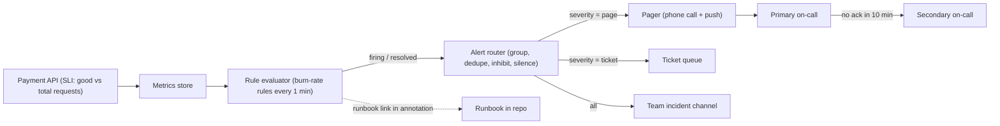
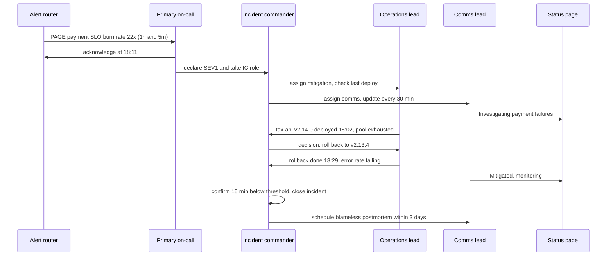

It is 31 July, the last day to pay municipal property tax with a 5 % rebate. At 6:07 p.m. the payment page starts timing out. At 6:09 the on-call engineer's phone buzzes with 47 alerts: CPU high on two database hosts, Redis evictions, SMS latency, disk usage on a log server, a certificate expiring in 25 days, and somewhere in the middle, the one that matters. She spends six minutes reading alerts before she starts fixing anything. This lesson is about designing alerts so the first buzz is the right one, and about running the next 30 minutes calmly.

## Learning objectives

By the end of this lesson you will be able to:

1. Distinguish symptom-based alerts from cause-based alerts, and explain why pages should be about symptoms.
2. Compute error budgets and burn rates, and design multiwindow, multi-burn-rate SLO alerts with real numbers.
3. Write a paging policy: what pages, what becomes a ticket, what is deleted.
4. Write a runbook that a tired engineer can follow at 3 a.m.
5. Run an incident with clear roles: incident commander, operations lead, communications lead and scribe.
6. Diagnose a failure from logs, traces and metrics, mitigate first, and write a blameless postmortem with useful action items.

## Prerequisites

- [SLI, SLO, SLA and error budgets](#/lesson/m14-sli-slo-sla): this lesson assumes you know what an SLO and an error budget are.
- [Logs, metrics, traces and OpenTelemetry](#/lesson/m14-observability): alerts are built on metrics, and diagnosis uses all three signals.

## Explain it like I'm a beginner

Think of a smoke alarm and a fire brigade.

A **good smoke alarm** goes off when there is smoke in the kitchen. It doesn't go off because the stove is "using 80 % of its gas", because sometimes that's just cooking. It goes off for the thing you care about (smoke, a symptom) and stays quiet otherwise. If it went off ten times a day for burnt toast, you'd pull the battery out. That is **alert fatigue**, and it is how real fires get missed.

When a fire does start, a good **fire brigade** doesn't argue about who's in charge. One person commands, others fight the fire, someone talks to the neighbours and the press, someone writes down what happened when. They put the fire out first and investigate the cause afterwards. Then they write a report that asks "how did the building let this fire spread?", not "whose fault is it?", because blaming the cook doesn't stop the next fire.

In software:

- The smoke alarm is an **alert**. The good kind fires on **symptoms users feel**: payments failing, pages slow.
- Waking a person up is a **page**. Less urgent issues become a **ticket** to handle in working hours.
- The fire brigade's playbook is a **runbook**. The person in charge is the **incident commander**.
- The report afterwards is a **blameless postmortem**.

## First-principles explanation

### What an alert is for

An alert is a request for human attention. Every alert should pass four tests:

1. **Urgent**: something bad is happening now, or will very soon.
2. **User-impacting**: users or the business feel it (or will).
3. **Actionable**: a human can do something useful right now.
4. **Novel**: it isn't a duplicate of an alert already firing.

If an alert fails *urgent*, it is a ticket. If it fails *actionable*, it is a dashboard panel. If it fails all four, delete it. Teams that apply these tests ruthlessly typically end up with a handful of paging alerts per service, not dozens.

### Symptoms versus causes

A **symptom** is what users experience: errors, slowness, wrong results, missing data. A **cause** is something inside the system that might lead to a symptom: high CPU, a full disk, a slow dependency, a pod restart.

Page on symptoms because:

- **Causes are many, symptoms are few.** There are hundreds of ways checkout can fail and one way to notice: checkout is failing. One symptom alert covers causes you haven't thought of yet.
- **Causes often don't matter.** CPU at 90 % during a sale is fine if latency is fine. Paging on it wakes someone for nothing.
- **Causes are noisy.** One database problem raises CPU, connection, replication-lag and disk-I/O alerts at once: four pages for one problem.

Cause-based signals are still valuable, but as **dashboards** you open during diagnosis, or as **tickets** for slow-burning problems ("disk will be full in 5 days", "TLS certificate expires in 14 days"). Those last two are worth noticing before they become symptoms, but they rarely need someone awake at 3 a.m.

### From SLO to alert: error budgets and burn rate

Suppose the payment API's SLO is **99.9 % of requests succeed within 1 second, over 30 days**.

- The **error budget** is the 0.1 % allowed to fail.
- Over 30 days that is 30 × 24 × 60 = 43,200 minutes × 0.001 = **43.2 minutes** of complete outage, or the equivalent number of bad requests spread out.

The **burn rate** says how fast you are spending the budget compared with the "exactly on budget" pace:

> burn rate = observed error ratio ÷ allowed error ratio

If 1.44 % of requests fail right now, the burn rate is 0.0144 ÷ 0.001 = **14.4**. At that pace the whole 30-day budget is gone in 30 ÷ 14.4 ≈ 2.1 days. A burn rate of 1 spends the budget exactly over 30 days.

How much budget does a burst use? **budget consumed = burn rate × window ÷ SLO period**. A burn rate of 14.4 sustained for 1 hour consumes 14.4 × 1 h ÷ 720 h = **2 %** of the monthly budget.

### Why naive alerts fail

- *"Page if error rate > 0.1 % over 5 minutes."* Too sensitive. A 3-minute blip pages someone, though it used under 0.01 % of the budget. Many false alarms.
- *"Page if error rate > 0.1 % over 30 days."* Too slow. A complete outage takes hours to move a 30-day average enough to fire.

You want fast detection for fast burns and no pages for small ones.

### Multiwindow, multi-burn-rate alerts

The approach from the Google SRE Workbook uses several rules. Each rule has a **long window** (is this significant?) and a **short window** (is it still happening?). A rule fires only when **both** windows exceed the burn-rate threshold:

| Severity | Long window | Short window | Burn rate | Budget used when it fires |
|---|---|---|---|---|
| Page | 1 hour | 5 minutes | 14.4 | 2 % |
| Page | 6 hours | 30 minutes | 6 | 5 % |
| Ticket | 3 days | 6 hours | 1 | 10 % |

How it behaves in practice:

- **A total outage** (100 % errors, burn rate 1,000) trips the first rule in about 1 hour × 14.4 ÷ 1,000 ≈ 52 seconds of long-window data, as soon as the short window confirms. Fast.
- **A partial failure** (2 % errors, burn rate 20) fires the first rule after about 43 minutes. Real problem, reasonable delay.
- **A slow leak** (0.15 % errors, burn rate 1.5) never pages, but the ticket rule catches it within a few days.
- **Recovery**: when the problem stops, the 5-minute short window drops below the threshold within minutes, so the alert resolves quickly instead of staying red for an hour.

The numbers are a starting point. Low-traffic services need care: at 10 requests per minute, two failures in 5 minutes is a 4 % error ratio. Use longer windows, a minimum request count, or synthetic traffic.

### Paging policy

A written **paging policy** turns opinions into rules:

- **What pages**: SLO burn-rate alerts on user-facing symptoms; data-loss risks (backups failing for 24 hours, replication broken); security events such as a leaked credential being used.
- **What becomes a ticket**: slow burns, capacity forecasts, certificate expiry beyond 7 days, single-instance failures that redundancy absorbed.
- **Who gets paged**: the service-owning team's primary on-call, escalating to the secondary after 10 minutes without acknowledgement, then to the engineering manager.
- **Acknowledge time**: for example within 5 minutes for a page; start mitigation within 15.
- **Hygiene**: every page is reviewed weekly. Any page that was not actionable gets the alert fixed or deleted. Track pages per on-call shift; a common target is no more than about two incidents per 12-hour shift, so the engineer has time to handle each one properly.
- **Routing and grouping**: the alert router (Prometheus Alertmanager, Azure Monitor action groups, PagerDuty, Opsgenie) groups related alerts into one notification, suppresses cause alerts while their symptom alert is firing (inhibition), and silences alerts during planned maintenance.

### Runbooks

A **runbook** is a short, specific page linked from the alert. A good one answers, in order:

1. **What does this alert mean** in user terms? ("Property-tax payments are failing or slower than 1 s for more than 1.44 % of requests.")
2. **How bad is it?** Links to the dashboard and the query that shows current impact.
3. **First mitigations**, safest first: roll back the last deploy; turn off the newest feature flag; fail over; shed non-critical traffic; scale out.
4. **How to diagnose** if mitigation doesn't help: which dashboards, which trace searches, known failure modes with their fingerprints.
5. **Who to escalate to**: database on-call, payment-gateway support number, the vendor's status page.

Keep runbooks next to the code (for example `docs/runbooks/payment-slo.md`) so they change in the same pull request as the system. A stale runbook is worse than none, because people trust it.

### Mitigate first, then fix

In an incident, the goal is to **stop the user impact**, not to find the root cause. Rolling back a deploy takes 3 minutes and works whether or not you understand the bug. Debugging the bug in production might take an hour while users can't pay. Find the cause after the bleeding stops. This is the single biggest habit change for engineers new to on-call.

### Incident roles

For anything bigger than a one-person fix, split the work. These roles come from the Incident Command System used by emergency services, adapted by many software teams:

- **Incident commander (IC)**: owns the incident. Decides priorities, assigns work, declares severity and the end of the incident. The IC does **not** debug. Their job is to keep the overview.
- **Operations lead**: the people changing the system. Only they touch production, so changes don't collide.
- **Communications lead**: updates stakeholders and users at a fixed rhythm, for example every 30 minutes, even if the update is "no change". Keeps executives out of the debugging channel.
- **Scribe**: keeps a timestamped log of observations, decisions and actions. This becomes the postmortem timeline.

In a small team one person may hold two roles, but the IC should not also be the person typing commands.

**Severity levels** set the response. A typical scheme:

| Level | Example | Response |
|---|---|---|
| SEV1 | Payments down for all users | Page, all roles, status page, leadership informed |
| SEV2 | Payments failing for one bank, or 10 % of users | Page, IC + ops, status page if prolonged |
| SEV3 | Degraded non-critical feature (receipts emailed late) | Business hours, ticket |
| SEV4 | Cosmetic or internal-only | Backlog |

Declare early and generously. Downgrading a SEV2 to SEV3 costs nothing; discovering after 40 minutes that nobody told customers costs trust.

### Measuring response

Useful time measures (compare medians over many incidents, never judge one person by one incident):

- **Time to detect (MTTD)**: from impact start to alert.
- **Time to acknowledge (MTTA)**: from alert to a human responding.
- **Time to mitigate**: from alert to user impact stopping. This matters most to users.
- **Time to resolve (MTTR)**: until the underlying issue is fixed. Teams define the "R" differently, so state your definition.

### Blameless postmortems

After a significant incident, write a **postmortem** within a few days. "Blameless" means you assume everyone acted reasonably given what they knew at the time, and you look for the **system conditions** that made the failure possible. If an engineer could deploy a query that took down payments, the question is "why did nothing stop that query?", not "why was Ravi careless?". Blame makes people hide information, and hidden information means the same failure repeats.

A useful postmortem template:

1. **Summary**: two or three sentences a manager can read.
2. **Impact**: who, how many, how long, in numbers ("about 6,200 payment attempts failed between 18:05 and 18:30 IST").
3. **Timeline**: from the scribe's log, with times and sources.
4. **Contributing factors**: usually several. Avoid a single "root cause"; complex failures need multiple conditions to line up.
5. **What went well**, and **where we got lucky**.
6. **Action items**: each with an owner, a priority and a ticket. Prefer actions that change the system (a guardrail, an automated check) over actions that ask people to "be more careful".

A caution on "5 whys": asking why repeatedly is a good habit, but it tends to produce one linear chain and stop at a person. Ask "what else contributed?" at each level.

### When a simpler setup is enough

A two-person team running an internal tool doesn't need severity matrices and four incident roles. They need: one or two symptom alerts (the site is down, the main job failed), a shared phone number, a short runbook, and a habit of writing a half-page note after anything that hurt. Add structure when the number of people involved in incidents grows past what one chat thread can coordinate.

## Visual explanation

### Architecture: from metric to the right person



How to read it: the API exports good and total request counts, which the metrics store keeps. Every minute the rule evaluator computes burn rates over each window pair and sends **firing** or **resolved** events to the router. The router groups related alerts into one notification, drops duplicates, suppresses cause alerts while a symptom alert from the same service is firing (inhibition), and honours maintenance silences. It then routes by severity: pages go to the pager service, which calls the primary on-call and escalates to the secondary after 10 minutes without acknowledgement. Tickets go to a queue. Everything is also posted to a chat channel. Each alert carries a link to its runbook, so the first thing the engineer opens is the instructions, not a blank dashboard.

### Sequence: a SEV1 from page to postmortem



The first responder acknowledges and, because this is clearly severe, declares a SEV1 and becomes incident commander. (In larger organisations a dedicated IC rotation may take over.) The IC hands mitigation to an operations lead and communication to a comms lead, so the IC can keep the overview. The comms lead posts a status update immediately, before the cause is known. The operations lead reports the recent deploy and the exhausted connection pool; the IC makes the call to roll back rather than debug. After the rollback, the IC waits until the error rate has stayed low for a set period before closing, and schedules the postmortem. Notice the IC never types a production command.

## Step-by-step example

We will redesign the alerts of the property-tax payment service.

### Step 1 — inventory the current alerts

The team has 31 alert rules. Classify each against the four tests. Results: 4 are symptom-based (payment errors, payment latency, bill page errors, homepage down), 19 are causes (CPU, memory, pod restarts, Redis evictions, slow queries), 8 are slow-burning risks (disk forecast, certificate expiry, backup age).

### Step 2 — define the SLIs

- Payment availability SLI: good = responses that are not 5xx **and** complete within 1 s; total = all payment requests. SLO 99.9 % over 30 days.
- Bill lookup SLI: same shape, 99.5 %, 500 ms threshold.

### Step 3 — write burn-rate rules

Two page rules and one ticket rule per SLI, as in the table above. With 1,200 payment requests per minute, the 5-minute window holds about 6,000 requests, enough for the ratio to be stable.

### Step 4 — demote causes

CPU, memory, restart and eviction alerts become dashboard panels on the service's "diagnosis" dashboard. Disk-full-in-5-days and certificate-expiry-in-14-days become tickets. Backup age over 26 hours stays a page, because silent backup failure is a data-loss risk that no user symptom will reveal.

### Step 5 — runbooks and routing

Each remaining page links to a runbook whose first line is "If a deploy happened in the last 2 hours, roll it back". The router inhibits all database cause alerts while the payment SLO alert is firing.

### Step 6 — review weekly

Every Monday the on-call hands over with a list of last week's pages: actionable or not, and what changed. After four weeks, pages are down from about 40 a week to 3. These numbers are illustrative, not a benchmark; your reduction depends on how noisy you started.

## Production-style C# implementation

Most teams evaluate alert rules in their metrics platform, not in application code. Building a small evaluator in C# is still useful: it makes the burn-rate maths concrete, it is a good fit for synthetic checks and for internal platforms without a full monitoring stack, and it is easy to test.

```text
Tax.Api/
  Program.cs
  Alerting/SliRecorder.cs
  Alerting/BurnRateRules.cs
  Alerting/AlertNotifier.cs
  Alerting/SloAlertWorker.cs
```

```csharp file=Alerting/SliRecorder.cs
using System.Collections.Concurrent;

namespace Tax.Alerting;

public readonly record struct WindowCounts(long Good, long Total)
{
    public double ErrorRatio => Total == 0 ? 0 : 1.0 - (double)Good / Total;
}

public interface ISliSource
{
    WindowCounts Read(TimeSpan window, DateTimeOffset now);
}

/// <summary>Keeps per-minute good/total counts for one SLI in memory, for up to 3 days.
/// A real system reads these from the metrics store instead.</summary>
public sealed class InMemorySli(TimeProvider time) : ISliSource
{
    private static readonly TimeSpan Retention = TimeSpan.FromDays(3);
    private readonly ConcurrentDictionary<long, Bucket> _buckets = new();

    private sealed class Bucket { public long Good; public long Total; }

    public void Record(bool good)
    {
        var minute = time.GetUtcNow().ToUnixTimeSeconds() / 60;
        var b = _buckets.GetOrAdd(minute, _ => new Bucket());
        Interlocked.Increment(ref b.Total);
        if (good) Interlocked.Increment(ref b.Good);

        if (minute % 60 == 0) Prune(minute);
    }

    public WindowCounts Read(TimeSpan window, DateTimeOffset now)
    {
        var to = now.ToUnixTimeSeconds() / 60;
        var from = to - (long)Math.Ceiling(window.TotalMinutes) + 1;
        long good = 0, total = 0;
        foreach (var (minute, b) in _buckets)
        {
            if (minute < from || minute > to) continue;
            good += Interlocked.Read(ref b.Good);
            total += Interlocked.Read(ref b.Total);
        }
        return new WindowCounts(good, total);
    }

    private void Prune(long currentMinute)
    {
        var oldest = currentMinute - (long)Retention.TotalMinutes;
        foreach (var key in _buckets.Keys)
            if (key < oldest) _buckets.TryRemove(key, out _);
    }
}
```

```csharp file=Alerting/BurnRateRules.cs
namespace Tax.Alerting;

public enum AlertSeverity { None = 0, Ticket = 1, Page = 2 }

public sealed record BurnRateRule(string Name, TimeSpan LongWindow, TimeSpan ShortWindow, double Threshold, AlertSeverity Severity);

public sealed record AlertEvaluation(AlertSeverity Severity, string? RuleName, double LongBurnRate, double ShortBurnRate);

public sealed class BurnRateEvaluator
{
    private readonly double _allowedErrorRatio;
    private readonly IReadOnlyList<BurnRateRule> _rules;
    private readonly long _minRequests;

    public BurnRateEvaluator(double slo, IReadOnlyList<BurnRateRule> rules, long minRequestsInShortWindow = 100)
    {
        if (slo is <= 0 or >= 1) throw new ArgumentOutOfRangeException(nameof(slo), "SLO must be between 0 and 1, e.g. 0.999.");
        _allowedErrorRatio = 1 - slo;
        _rules = rules.OrderByDescending(r => r.Severity).ThenByDescending(r => r.Threshold).ToList();
        _minRequests = minRequestsInShortWindow;
    }

    /// <summary>The SRE Workbook defaults for a 30-day SLO.</summary>
    public static IReadOnlyList<BurnRateRule> DefaultRules { get; } =
    [
        new("fast-burn", TimeSpan.FromHours(1), TimeSpan.FromMinutes(5), 14.4, AlertSeverity.Page),
        new("medium-burn", TimeSpan.FromHours(6), TimeSpan.FromMinutes(30), 6, AlertSeverity.Page),
        new("slow-burn", TimeSpan.FromDays(3), TimeSpan.FromHours(6), 1, AlertSeverity.Ticket),
    ];

    public double BurnRate(WindowCounts counts) => counts.ErrorRatio / _allowedErrorRatio;

    public AlertEvaluation Evaluate(ISliSource source, DateTimeOffset now)
    {
        foreach (var rule in _rules)
        {
            var shortCounts = source.Read(rule.ShortWindow, now);
            if (shortCounts.Total < _minRequests) continue;      // too little traffic to judge

            var longRate = BurnRate(source.Read(rule.LongWindow, now));
            var shortRate = BurnRate(shortCounts);
            if (longRate >= rule.Threshold && shortRate >= rule.Threshold)
                return new AlertEvaluation(rule.Severity, rule.Name, longRate, shortRate);
        }
        return new AlertEvaluation(AlertSeverity.None, null, 0, 0);
    }
}
```

```csharp file=Alerting/AlertNotifier.cs
namespace Tax.Alerting;

public sealed record AlertNotification(string AlertName, AlertSeverity Severity, bool Resolved, string Summary, string RunbookUrl);

public interface IAlertNotifier
{
    Task NotifyAsync(AlertNotification notification, CancellationToken ct);
}

/// <summary>Stand-in for PagerDuty, Opsgenie or an Azure Monitor action group webhook.</summary>
public sealed class LoggingAlertNotifier(ILogger<LoggingAlertNotifier> logger) : IAlertNotifier
{
    public Task NotifyAsync(AlertNotification n, CancellationToken ct)
    {
        if (n.Resolved)
            logger.LogInformation("RESOLVED {Alert}: {Summary}", n.AlertName, n.Summary);
        else
            logger.LogWarning("{Severity} {Alert}: {Summary} Runbook: {Runbook}", n.Severity, n.AlertName, n.Summary, n.RunbookUrl);
        return Task.CompletedTask;
    }
}
```

```csharp file=Alerting/SloAlertWorker.cs
namespace Tax.Alerting;

public sealed class SloAlertOptions
{
    public string SliName { get; set; } = "tax-payment-availability";
    public double Slo { get; set; } = 0.999;
    public TimeSpan EvaluationInterval { get; set; } = TimeSpan.FromMinutes(1);
    public string RunbookUrl { get; set; } = "https://git.example.com/tax/docs/runbooks/payment-slo.md";
}

/// <summary>Evaluates burn-rate rules every minute and notifies only on state changes,
/// so a 40-minute incident produces one page and one resolve, not 40 pages.</summary>
public sealed class SloAlertWorker(
    InMemorySli sli, IAlertNotifier notifier, TimeProvider time,
    Microsoft.Extensions.Options.IOptions<SloAlertOptions> options, ILogger<SloAlertWorker> logger) : BackgroundService
{
    private AlertSeverity _current = AlertSeverity.None;

    protected override async Task ExecuteAsync(CancellationToken stoppingToken)
    {
        var o = options.Value;
        var evaluator = new BurnRateEvaluator(o.Slo, BurnRateEvaluator.DefaultRules);
        using var timer = new PeriodicTimer(o.EvaluationInterval, time);

        while (await timer.WaitForNextTickAsync(stoppingToken))
        {
            try
            {
                var result = evaluator.Evaluate(sli, time.GetUtcNow());
                await TransitionAsync(o, result, stoppingToken);
            }
            catch (Exception ex) when (ex is not OperationCanceledException)
            {
                // An alert evaluator that crashes silently is worse than none. Log loudly and keep going.
                logger.LogError(ex, "SLO evaluation failed for {Sli}", o.SliName);
            }
        }
    }

    public async Task TransitionAsync(SloAlertOptions o, AlertEvaluation result, CancellationToken ct)
    {
        if (result.Severity == _current) return;

        var summary = result.Severity == AlertSeverity.None
            ? $"{o.SliName} burn rate back below thresholds"
            : $"{o.SliName} burning error budget at {result.LongBurnRate:F1}x (long) and {result.ShortBurnRate:F1}x (short), rule {result.RuleName}";

        await notifier.NotifyAsync(new AlertNotification(
            o.SliName, result.Severity == AlertSeverity.None ? _current : result.Severity,
            Resolved: result.Severity == AlertSeverity.None, summary, o.RunbookUrl), ct);
        _current = result.Severity;
    }
}
```

```csharp file=Program.cs
using Tax.Alerting;

var builder = WebApplication.CreateBuilder(args);

builder.Services.AddSingleton(TimeProvider.System);
builder.Services.AddSingleton<InMemorySli>();
builder.Services.AddSingleton<IAlertNotifier, LoggingAlertNotifier>();
builder.Services.Configure<SloAlertOptions>(builder.Configuration.GetSection("SloAlerts"));
builder.Services.AddHostedService<SloAlertWorker>();

var app = builder.Build();

// Record the SLI for the payment route: good = not 5xx and completed within 1 second.
app.Use(async (context, next) =>
{
    if (!context.Request.Path.StartsWithSegments("/tax/pay")) { await next(context); return; }

    var sli = context.RequestServices.GetRequiredService<InMemorySli>();
    var clock = context.RequestServices.GetRequiredService<TimeProvider>();
    var start = clock.GetTimestamp();
    try
    {
        await next(context);
        sli.Record(context.Response.StatusCode < 500 && clock.GetElapsedTime(start) <= TimeSpan.FromSeconds(1));
    }
    catch
    {
        sli.Record(good: false);
        throw;
    }
});

app.MapPost("/tax/pay", (TaxPayment payment) =>
    payment.AmountInPaise > 0 ? Results.Ok(new { receipt = $"RCPT-{payment.PropertyId}" }) : Results.BadRequest());

app.Run();

public sealed record TaxPayment(string PropertyId, long AmountInPaise);
```

Design notes:

- **Notify on transitions only.** The worker remembers the current severity and only notifies when it changes. That is the core of deduplication; a real router adds grouping and re-notification after a long silence.
- **Minimum traffic.** At 3 a.m. with 4 requests in 5 minutes, one failure is a 25 % error ratio. The `minRequestsInShortWindow` guard prevents those pages.
- **`4xx` is good.** A citizen typing the wrong property id is not a service failure. Count it as good, or exclude it; never as bad.
- **The evaluator must not fail silently.** If evaluation throws, log an error. In production you also want a **dead man's switch**: an always-firing heartbeat alert whose *absence* pages, proving the alerting pipeline itself is alive.

## Bad design vs good design

**Bad**: the original 31 rules, including:

```yaml
- alert: HighCpu            # cause, not symptom
  expr: cpu_usage > 0.8
  for: 2m
  severity: page
- alert: AnyPaymentError    # one error pages someone
  expr: increase(payment_errors_total[1m]) > 0
  severity: page
- alert: PodRestarted       # Kubernetes already handled it
  expr: increase(kube_pod_container_status_restarts_total[5m]) > 0
  severity: page
```

Problems: CPU pages during every sale even when users are happy; a single declined UPI timeout wakes someone; a restart that the platform already recovered from becomes a page. The engineer learns to ignore pages, and the real one at 18:07 is lost in the noise. None link to a runbook.

**Good**: two burn-rate page rules and one ticket rule per user-facing SLI, each with a runbook link; cause metrics on a diagnosis dashboard; slow-burning risks as tickets; inhibition so one database problem produces one notification; a weekly review that deletes non-actionable alerts.

**Is the full burn-rate machinery worth it?** For a service with a real SLO and an on-call rota, yes. For a small internal tool, a simple "error ratio over 5 % for 10 minutes" alert plus an uptime check is a fine start. Move to burn rates when you see false pages or slow detection.

:::callout type=mistake title="Alerting on the absence of data"
If the metrics pipeline breaks, `error_ratio > 0.0144` is never true, so no alert ever fires and the dashboard looks calm. Add an alert for "no data from the payment SLI for 10 minutes" and a heartbeat alert for the alerting pipeline itself.
:::

## Practical playground

This is the **failure simulation lab** for the property-tax incident. The database holds what the team's tools recorded between 17:30 and 18:40 IST on 31 July:

- `req_minute` — requests, 5xx errors and p99 latency per minute for two routes.
- `db_pool_minute` — connection-pool size, connections in use, waiters and database CPU.
- `deploy_event` — every deployment across services.
- `app_log` — the relevant log lines, with trace ids.

Investigate in this order, as you would in a real incident:

1. **Impact**: per-minute error percentage for `POST /tax/pay`. When did it start? When did it stop?
2. **What changed**: list deploys between 17:30 and 18:10. Which ones could plausibly touch payments?
3. **Saturation**: join `req_minute` with `db_pool_minute` by minute. Which moved first, waiters or errors?
4. **Evidence**: read the `Warning` and `Error` logs in time order. Which lines are red herrings?
5. **Recovery**: what happened at 18:29, and how quickly did the pool recover?

:::playground type=sql title="Failure simulation lab: last day of the tax rebate"
```sql
CREATE TABLE req_minute (
  minute timestamptz NOT NULL, route text NOT NULL, requests int NOT NULL,
  errors_5xx int NOT NULL, p99_ms int NOT NULL, PRIMARY KEY (minute, route)
);
CREATE TABLE db_pool_minute (
  minute timestamptz PRIMARY KEY, pool_size int NOT NULL, in_use int NOT NULL,
  waiters int NOT NULL, db_cpu_pct int NOT NULL
);
CREATE TABLE deploy_event (at timestamptz NOT NULL, service text NOT NULL, version text NOT NULL);
CREATE TABLE app_log (at timestamptz NOT NULL, level text NOT NULL, service text NOT NULL, message text NOT NULL, trace_id text);
INSERT INTO req_minute
SELECT timestamptz '2026-07-31 17:30+05:30' + m * interval '1 minute', 'POST /tax/pay', 900 + m * 10,
       CASE WHEN m < 35 THEN m % 3
            WHEN m < 37 THEN round((900 + m * 10) * (CASE m WHEN 35 THEN 0.010 ELSE 0.018 END))::int
            WHEN m < 60 THEN round((900 + m * 10) * least(0.06 + (m - 37) * 0.012, 0.30))::int
            ELSE m % 2 END,
       CASE WHEN m < 33 THEN 420 + (m % 5) * 10 WHEN m < 37 THEN 900 + (m - 33) * 600
            WHEN m < 60 THEN 4800 + (m % 4) * 900 ELSE 450 + (m % 5) * 10 END
FROM generate_series(0, 70) AS m
UNION ALL
SELECT timestamptz '2026-07-31 17:30+05:30' + m * interval '1 minute', 'GET /tax/bill/{id}', 400 + m * 3,
       CASE WHEN m BETWEEN 37 AND 59 THEN 3 ELSE m % 2 END,
       CASE WHEN m BETWEEN 34 AND 59 THEN 5100 + (m % 3) * 100 ELSE 180 + (m % 4) * 10 END
FROM generate_series(0, 70) AS m;
INSERT INTO db_pool_minute
SELECT timestamptz '2026-07-31 17:30+05:30' + m * interval '1 minute', 50,
       CASE WHEN m < 33 THEN 18 + m % 5 WHEN m < 60 THEN 50 ELSE 20 + m % 4 END,
       CASE WHEN m < 33 THEN 0 WHEN m < 60 THEN least((m - 32) * 15, 260) ELSE 0 END,
       CASE WHEN m < 32 THEN 34 + m % 6 WHEN m < 60 THEN 96 ELSE 38 + m % 4 END
FROM generate_series(0, 70) AS m;
INSERT INTO deploy_event VALUES
  ('2026-07-31 17:41+05:30', 'notification-svc', 'v1.8.2'),
  ('2026-07-31 18:02+05:30', 'tax-api', 'v2.14.0'),
  ('2026-07-31 18:05+05:30', 'cms-static', 'v3.1.0'),
  ('2026-07-31 18:29+05:30', 'tax-api', 'v2.13.4');
INSERT INTO app_log VALUES
  ('2026-07-31 17:52:10+05:30', 'Warning', 'notification-svc', 'SMS provider latency 2300 ms above 2000 ms threshold', 'a17c0e'),
  ('2026-07-31 18:02:40+05:30', 'Information', 'tax-api', 'Starting tax-api v2.14.0 (feature RebateEligibilityV2 enabled)', NULL),
  ('2026-07-31 18:04:05+05:30', 'Warning', 'tax-api', 'Slow query 3120 ms: SELECT ... FROM rebate_eligibility WHERE ward_id = $1 AND assessment_year = $2', '5d2e91'),
  ('2026-07-31 18:06:30+05:30', 'Warning', 'tax-api', 'Slow query 4870 ms: SELECT ... FROM rebate_eligibility WHERE ward_id = $1 AND assessment_year = $2', '77b0c4'),
  ('2026-07-31 18:07:12+05:30', 'Error', 'tax-api', 'Timeout after 5000 ms acquiring connection from pool (size 50, waiters 75)', '9f31aa'),
  ('2026-07-31 18:07:15+05:30', 'Warning', 'redis', 'Evicted 1200 keys (maxmemory-policy allkeys-lru)', NULL),
  ('2026-07-31 18:09:44+05:30', 'Error', 'gateway', 'Upstream tax-api timed out after 10000 ms, returned 504', '9f31aa'),
  ('2026-07-31 18:15:02+05:30', 'Error', 'tax-api', 'Timeout after 5000 ms acquiring connection from pool (size 50, waiters 255)', 'c4410b'),
  ('2026-07-31 18:29:30+05:30', 'Information', 'tax-api', 'Starting tax-api v2.13.4 (feature RebateEligibilityV2 disabled)', NULL),
  ('2026-07-31 18:33:00+05:30', 'Information', 'tax-api', 'Connection pool healthy: in use 21 of 50, waiters 0', NULL);
```
:::

## Exercises

:::exercise id=m14-alerting-incidents-ex1 difficulty=beginner kind=code title="Error budget and burn-rate arithmetic"
Write the helpers every SLO conversation needs.
::requirements
- `SloMath.ErrorBudgetMinutes(double slo, int periodDays)` — minutes of full outage allowed. `slo` must be strictly between 0 and 1, `periodDays` ≥ 1, else `ArgumentOutOfRangeException`.
- `SloMath.BurnRate(long good, long total, double slo)` — observed error ratio ÷ allowed error ratio. `total == 0` returns 0. `good > total` or negatives throw `ArgumentException`.
- `SloMath.BudgetConsumedFraction(double burnRate, TimeSpan window, int periodDays)` — burn rate × window ÷ period, as a fraction (0.02 means 2 %).
::acceptance
- 99.9 % over 30 days gives 43.2 minutes.
- 99.5 % over 28 days gives 201.6 minutes.
- 9,856 good out of 10,000 at 99.9 % gives a burn rate of 14.4.
- Burn rate 14.4 for 1 hour over 30 days consumes 0.02.
::hint
The allowed error ratio is `1 - slo`.
::hint
The period in minutes is `days × 24 × 60`.
::hint
Floating point: `1 - 0.999` is not exactly `0.001`. Tests compare with a precision, so don't round inside your code.
::hint
```csharp
public static double BurnRate(long good, long total, double slo) =>
    total == 0 ? 0 : (1.0 - (double)good / total) / (1 - slo);
```
::starter
```csharp file=SloMath.cs
using System;

public static class SloMath
{
    public static double ErrorBudgetMinutes(double slo, int periodDays) => throw new NotImplementedException();
    public static double BurnRate(long good, long total, double slo) => throw new NotImplementedException();
    public static double BudgetConsumedFraction(double burnRate, TimeSpan window, int periodDays) => throw new NotImplementedException();
}
```
::tests
```csharp file=SloMathTests.cs
using System;
using Xunit;

public class SloMathTests
{
    [Fact] public void Budget_999_30d() => Assert.Equal(43.2, SloMath.ErrorBudgetMinutes(0.999, 30), 6);
    [Fact] public void Budget_995_28d() => Assert.Equal(201.6, SloMath.ErrorBudgetMinutes(0.995, 28), 6);

    [Fact] public void Burn_rate_14_4() => Assert.Equal(14.4, SloMath.BurnRate(9_856, 10_000, 0.999), 6);
    [Fact] public void Burn_rate_on_budget() => Assert.Equal(1.0, SloMath.BurnRate(999_000, 1_000_000, 0.999), 6);
    [Fact] public void No_traffic_is_zero() => Assert.Equal(0.0, SloMath.BurnRate(0, 0, 0.999));

    [Fact] public void Consumed_fast_burn() => Assert.Equal(0.02, SloMath.BudgetConsumedFraction(14.4, TimeSpan.FromHours(1), 30), 9);
    [Fact] public void Consumed_medium_burn() => Assert.Equal(0.05, SloMath.BudgetConsumedFraction(6, TimeSpan.FromHours(6), 30), 9);

    [Fact] public void Bad_slo_throws() => Assert.Throws<ArgumentOutOfRangeException>(() => SloMath.ErrorBudgetMinutes(1.0, 30));
    [Fact] public void Bad_days_throws() => Assert.Throws<ArgumentOutOfRangeException>(() => SloMath.ErrorBudgetMinutes(0.99, 0));
    [Fact] public void Good_above_total_throws() => Assert.Throws<ArgumentException>(() => SloMath.BurnRate(11, 10, 0.99));
}
```
::solution
```csharp file=SloMath.cs
using System;

public static class SloMath
{
    public static double ErrorBudgetMinutes(double slo, int periodDays)
    {
        ValidateSlo(slo);
        ArgumentOutOfRangeException.ThrowIfLessThan(periodDays, 1);
        return periodDays * 24 * 60 * (1 - slo);
    }

    public static double BurnRate(long good, long total, double slo)
    {
        ValidateSlo(slo);
        if (good < 0 || total < 0 || good > total)
            throw new ArgumentException("Counts must be non-negative and good must not exceed total.");
        if (total == 0) return 0;
        return (1.0 - (double)good / total) / (1 - slo);
    }

    public static double BudgetConsumedFraction(double burnRate, TimeSpan window, int periodDays)
    {
        ArgumentOutOfRangeException.ThrowIfLessThan(periodDays, 1);
        return burnRate * window.TotalHours / (periodDays * 24.0);
    }

    private static void ValidateSlo(double slo)
    {
        if (double.IsNaN(slo) || slo <= 0 || slo >= 1)
            throw new ArgumentOutOfRangeException(nameof(slo), "Use a ratio such as 0.999.");
    }
}
```

Keep these numbers in your head: 99.9 % over 30 days is about 43 minutes; 99.99 % is about 4.3 minutes, which is less than the time it takes most humans to acknowledge a page and roll back. That is why four nines needs automation, not just alerts.
::mistakes
- Using `slo` as a percentage (99.9) in one place and a ratio (0.999) in another.
- Computing the burn rate from the success ratio instead of the error ratio.
- Rounding intermediate values, which turns 14.4 into 14 and changes when alerts fire.
::extensions
Add `TimeToExhaustion(double burnRate, int periodDays, double budgetRemainingFraction)` and use it in an alert summary: "at this rate the budget is gone in 2 days 1 hour".
:::

:::exercise id=m14-alerting-incidents-ex2 difficulty=beginner kind=written title="Page, ticket or delete?"
Classify each of these existing alerts for the property-tax service as **page**, **ticket**, **dashboard only** or **delete**. Give a one-line reason for each, and rewrite any that should change.

1. Database CPU above 85 % for 5 minutes.
2. Payment SLO burn rate above 14.4 over 1 hour and 5 minutes.
3. TLS certificate for `tax.example.gov.in` expires in 20 days.
4. One pod restarted (the deployment has 6 replicas).
5. Nightly PostgreSQL backup has not succeeded for 26 hours.
6. Any HTTP 500 in the last minute.
7. Disk on the log server will be full in 4 days at the current growth rate.
8. Payment gateway's average latency above 800 ms for 10 minutes.
::acceptance
- Pages only for urgent, user-impacting or data-loss conditions.
- Every "cause" alert is either demoted or justified.
- Rewrites turn at least one cause alert into a symptom or SLO alert.
- Mentions inhibition or grouping for at least one case.
::hint
Apply the four tests: urgent, user-impacting, actionable, novel.
::hint
Ask "would a user notice this right now?" If not, it is probably not a page.
::hint
Some risks have no user symptom until it is too late. Which one here is like that?
::solution
1. **Dashboard only.** High CPU is a cause; if it hurts users, the payment SLO alert fires. Keep it on the diagnosis dashboard; inhibit it while a symptom alert is firing.
2. **Page.** Urgent, user-impacting, actionable. Link the runbook.
3. **Ticket.** Not urgent at 20 days. Add a second rule that pages at 3 days, and better, automate renewal (ACME or managed certificates) so neither fires.
4. **Delete** (or dashboard). Redundancy handled it. Instead, ticket on "more than 5 restarts per hour" (a crash loop), which is a real problem even if users don't notice yet.
5. **Page.** No user notices a missing backup until the day you need it. Data-loss risk justifies waking someone, or at least a high-priority page in business hours if your RPO tolerates a few more hours. See [Backups and disaster recovery](#/lesson/m14-dr).
6. **Delete.** One error is normal at 1,200 requests per minute. Replace with the burn-rate rules.
7. **Ticket.** Four days is plenty of working time.
8. **Rewrite.** Average hides the tail, and it is a cause. Replace with "payment SLI (which includes the 1-second latency threshold) burn rate", plus a dashboard panel for gateway p99 split by bank.
::mistakes
- Paging on every resource metric "to be safe". That is how the 47-alert night happened.
- Demoting the backup alert because it has no user symptom.
:::

:::exercise id=m14-alerting-incidents-ex3 difficulty=intermediate kind=code title="Multiwindow burn-rate evaluator"
Implement the decision function behind the alert table in this lesson.
::requirements
- `MultiWindowAlert.Evaluate(Func<TimeSpan, (long Good, long Total)> read, double slo, long minRequests)` returns `Severity.Page`, `Severity.Ticket` or `Severity.None`.
- Rules (both windows must reach the threshold, `>=`):
  - Page: 1 h and 5 min at 14.4; or 6 h and 30 min at 6.
  - Ticket: 3 days and 6 h at 1.
- If a rule's **short** window has fewer than `minRequests` requests, skip that rule.
- Return the most severe matching result.
::acceptance
- A 5 % error ratio in all windows at SLO 99.9 % pages.
- 0.8 % errors in the 6 h and 30 min windows (burn rate 8) but only 0.8 % in the 1 h/5 min windows pages via the 6-hour rule.
- A burst that has already stopped (1 h at 2 %, 5 min at 0 %) does not page from the fast rule.
- 0.15 % in every window gives a ticket.
- A short window with 20 requests when `minRequests` is 100 is ignored.
::hint
Store the rules as data: `(TimeSpan Long, TimeSpan Short, double Threshold, Severity Sev)`.
::hint
Check page rules before the ticket rule and return on the first match.
::hint
Burn rate = `(1 - good/total) / (1 - slo)`. Guard against `total == 0`.
::hint
Your fake `read` in a test can be a `Dictionary<TimeSpan, (long, long)>` lookup.
::starter
```csharp file=MultiWindowAlert.cs
using System;

public enum Severity { None, Ticket, Page }

public static class MultiWindowAlert
{
    public static Severity Evaluate(Func<TimeSpan, (long Good, long Total)> read, double slo, long minRequests) =>
        throw new NotImplementedException();
}
```
::tests
```csharp file=MultiWindowAlertTests.cs
using System;
using System.Collections.Generic;
using Xunit;

public class MultiWindowAlertTests
{
    private static readonly TimeSpan M5 = TimeSpan.FromMinutes(5), M30 = TimeSpan.FromMinutes(30),
        H1 = TimeSpan.FromHours(1), H6 = TimeSpan.FromHours(6), D3 = TimeSpan.FromDays(3);

    // errorPct per window; 100,000 requests each unless overridden.
    private static Func<TimeSpan, (long, long)> Data(double m5, double m30, double h1, double h6, double d3, long shortTotal = 100_000)
    {
        var map = new Dictionary<TimeSpan, (long, long)>
        {
            [M5] = Row(m5, shortTotal), [M30] = Row(m30, shortTotal), [H1] = Row(h1, 100_000),
            [H6] = Row(h6, 100_000), [D3] = Row(d3, 100_000),
        };
        return w => map[w];
    }
    private static (long, long) Row(double errPct, long total) => ((long)Math.Round(total * (1 - errPct / 100)), total);

    [Fact] public void Total_outage_pages() =>
        Assert.Equal(Severity.Page, MultiWindowAlert.Evaluate(Data(5, 5, 5, 5, 5), 0.999, 100));

    [Fact] public void Medium_burn_pages_via_six_hour_rule() =>
        Assert.Equal(Severity.Page, MultiWindowAlert.Evaluate(Data(0.8, 0.8, 0.8, 0.8, 0.8), 0.999, 100));

    [Fact] public void Burst_that_stopped_does_not_page() =>
        Assert.Equal(Severity.Ticket, MultiWindowAlert.Evaluate(Data(0, 0.3, 2, 0.4, 0.2), 0.999, 100));

    [Fact] public void Slow_leak_is_ticket() =>
        Assert.Equal(Severity.Ticket, MultiWindowAlert.Evaluate(Data(0.15, 0.15, 0.15, 0.15, 0.15), 0.999, 100));

    [Fact] public void Healthy_is_none() =>
        Assert.Equal(Severity.None, MultiWindowAlert.Evaluate(Data(0.05, 0.05, 0.05, 0.05, 0.05), 0.999, 100));

    [Fact] public void Low_traffic_short_window_is_ignored() =>
        Assert.Equal(Severity.None, MultiWindowAlert.Evaluate(Data(50, 50, 50, 50, 0.05, shortTotal: 20), 0.999, 100));
}
```
::solution
```csharp file=MultiWindowAlert.cs
using System;

public enum Severity { None, Ticket, Page }

public static class MultiWindowAlert
{
    private static readonly (TimeSpan Long, TimeSpan Short, double Threshold, Severity Sev)[] Rules =
    [
        (TimeSpan.FromHours(1), TimeSpan.FromMinutes(5), 14.4, Severity.Page),
        (TimeSpan.FromHours(6), TimeSpan.FromMinutes(30), 6, Severity.Page),
        (TimeSpan.FromDays(3), TimeSpan.FromHours(6), 1, Severity.Ticket),
    ];

    public static Severity Evaluate(Func<TimeSpan, (long Good, long Total)> read, double slo, long minRequests)
    {
        ArgumentNullException.ThrowIfNull(read);
        var allowed = 1 - slo;

        foreach (var rule in Rules)
        {
            var s = read(rule.Short);
            if (s.Total < minRequests) continue;
            var l = read(rule.Long);
            if (Burn(l, allowed) >= rule.Threshold && Burn(s, allowed) >= rule.Threshold)
                return rule.Sev;
        }
        return Severity.None;
    }

    private static double Burn((long Good, long Total) c, double allowed) =>
        c.Total == 0 ? 0 : (1.0 - (double)c.Good / c.Total) / allowed;
}
```

Why the short window matters, using the "burst that stopped" test: the 1-hour window still shows a 2 % error ratio (burn rate 20) because the burst happened 20 minutes ago, but the 5-minute window shows zero. Without the short window, the alert would keep paging for up to an hour after recovery. With it, the page resolves within minutes. The 3-day window still shows elevated burn, so a ticket remains: someone should look at why it happened, in working hours.

In the low-traffic test the short windows of both page rules (5 and 30 minutes) hold only 20 requests, so both page rules are skipped even though the error ratio looks terrible. The ticket rule still runs: its 6-hour short window is bad, but its 3-day long window is at 0.05 % (burn rate 0.5), so the result is `None`.
::mistakes
- Using `||` instead of `&&` between the windows, which pages long after recovery.
- Checking the ticket rule first and returning `Ticket` for an outage.
- Skipping the minimum-traffic guard and paging at 3 a.m. for one failed request out of four.
::extensions
Return the matched rule and both burn rates, and format a summary like the one in `SloAlertWorker`.
:::

:::exercise id=m14-alerting-incidents-ex4 difficulty=intermediate kind=sql ordered=false title="Lab: when did it start, and what changed?"
Using the failure-simulation lab data, write one query that returns a single row:

- `first_bad_minute` — the first minute where the `POST /tax/pay` 5xx error percentage exceeded **2 %**,
- `error_pct` — that minute's error percentage, rounded to 2 decimals,
- `version` — the most recent **`tax-api`** deployment at or before that minute,
- `minutes_after_deploy` — whole minutes between that deployment and `first_bad_minute`.
::acceptance
- Exactly one row.
- Ignores deployments of other services, including the one closer in time.
- Uses the per-minute ratio `errors_5xx / requests`, not raw error counts.
::hint
Build it in steps with CTEs: per-minute error percentage, then the first bad minute, then the deploy.
::hint
`100.0 * errors_5xx / requests` avoids integer division.
::hint
For "most recent deploy at or before", filter `at <= first_bad_minute`, order by `at DESC`, `LIMIT 1`.
::hint
`extract(epoch FROM a - b) / 60` gives minutes between two timestamps.
::setup
```sql
CREATE TABLE req_minute (
  minute timestamptz NOT NULL, route text NOT NULL, requests int NOT NULL,
  errors_5xx int NOT NULL, p99_ms int NOT NULL, PRIMARY KEY (minute, route)
);
CREATE TABLE db_pool_minute (
  minute timestamptz PRIMARY KEY, pool_size int NOT NULL, in_use int NOT NULL,
  waiters int NOT NULL, db_cpu_pct int NOT NULL
);
CREATE TABLE deploy_event (at timestamptz NOT NULL, service text NOT NULL, version text NOT NULL);
CREATE TABLE app_log (at timestamptz NOT NULL, level text NOT NULL, service text NOT NULL, message text NOT NULL, trace_id text);
INSERT INTO req_minute
SELECT timestamptz '2026-07-31 17:30+05:30' + m * interval '1 minute', 'POST /tax/pay', 900 + m * 10,
       CASE WHEN m < 35 THEN m % 3
            WHEN m < 37 THEN round((900 + m * 10) * (CASE m WHEN 35 THEN 0.010 ELSE 0.018 END))::int
            WHEN m < 60 THEN round((900 + m * 10) * least(0.06 + (m - 37) * 0.012, 0.30))::int
            ELSE m % 2 END,
       CASE WHEN m < 33 THEN 420 + (m % 5) * 10 WHEN m < 37 THEN 900 + (m - 33) * 600
            WHEN m < 60 THEN 4800 + (m % 4) * 900 ELSE 450 + (m % 5) * 10 END
FROM generate_series(0, 70) AS m
UNION ALL
SELECT timestamptz '2026-07-31 17:30+05:30' + m * interval '1 minute', 'GET /tax/bill/{id}', 400 + m * 3,
       CASE WHEN m BETWEEN 37 AND 59 THEN 3 ELSE m % 2 END,
       CASE WHEN m BETWEEN 34 AND 59 THEN 5100 + (m % 3) * 100 ELSE 180 + (m % 4) * 10 END
FROM generate_series(0, 70) AS m;
INSERT INTO db_pool_minute
SELECT timestamptz '2026-07-31 17:30+05:30' + m * interval '1 minute', 50,
       CASE WHEN m < 33 THEN 18 + m % 5 WHEN m < 60 THEN 50 ELSE 20 + m % 4 END,
       CASE WHEN m < 33 THEN 0 WHEN m < 60 THEN least((m - 32) * 15, 260) ELSE 0 END,
       CASE WHEN m < 32 THEN 34 + m % 6 WHEN m < 60 THEN 96 ELSE 38 + m % 4 END
FROM generate_series(0, 70) AS m;
INSERT INTO deploy_event VALUES
  ('2026-07-31 17:41+05:30', 'notification-svc', 'v1.8.2'),
  ('2026-07-31 18:02+05:30', 'tax-api', 'v2.14.0'),
  ('2026-07-31 18:05+05:30', 'cms-static', 'v3.1.0'),
  ('2026-07-31 18:29+05:30', 'tax-api', 'v2.13.4');
INSERT INTO app_log VALUES
  ('2026-07-31 17:52:10+05:30', 'Warning', 'notification-svc', 'SMS provider latency 2300 ms above 2000 ms threshold', 'a17c0e'),
  ('2026-07-31 18:02:40+05:30', 'Information', 'tax-api', 'Starting tax-api v2.14.0 (feature RebateEligibilityV2 enabled)', NULL),
  ('2026-07-31 18:04:05+05:30', 'Warning', 'tax-api', 'Slow query 3120 ms: SELECT ... FROM rebate_eligibility WHERE ward_id = $1 AND assessment_year = $2', '5d2e91'),
  ('2026-07-31 18:06:30+05:30', 'Warning', 'tax-api', 'Slow query 4870 ms: SELECT ... FROM rebate_eligibility WHERE ward_id = $1 AND assessment_year = $2', '77b0c4'),
  ('2026-07-31 18:07:12+05:30', 'Error', 'tax-api', 'Timeout after 5000 ms acquiring connection from pool (size 50, waiters 75)', '9f31aa'),
  ('2026-07-31 18:07:15+05:30', 'Warning', 'redis', 'Evicted 1200 keys (maxmemory-policy allkeys-lru)', NULL),
  ('2026-07-31 18:09:44+05:30', 'Error', 'gateway', 'Upstream tax-api timed out after 10000 ms, returned 504', '9f31aa'),
  ('2026-07-31 18:15:02+05:30', 'Error', 'tax-api', 'Timeout after 5000 ms acquiring connection from pool (size 50, waiters 255)', 'c4410b'),
  ('2026-07-31 18:29:30+05:30', 'Information', 'tax-api', 'Starting tax-api v2.13.4 (feature RebateEligibilityV2 disabled)', NULL),
  ('2026-07-31 18:33:00+05:30', 'Information', 'tax-api', 'Connection pool healthy: in use 21 of 50, waiters 0', NULL);
```
::check
```sql
WITH pay AS (
  SELECT minute, 100.0 * errors_5xx / requests AS error_pct
  FROM req_minute WHERE route = 'POST /tax/pay'
), first_bad AS (
  SELECT min(minute) AS minute FROM pay WHERE error_pct > 2
), dep AS (
  SELECT d.version, d.at FROM deploy_event d, first_bad f
  WHERE d.service = 'tax-api' AND d.at <= f.minute
  ORDER BY d.at DESC LIMIT 1
)
SELECT f.minute AS first_bad_minute,
       round((SELECT p.error_pct FROM pay p WHERE p.minute = f.minute), 2) AS error_pct,
       dep.version,
       (extract(epoch FROM f.minute - dep.at) / 60)::int AS minutes_after_deploy
FROM first_bad f CROSS JOIN dep;
```
::solution
```sql
WITH pay AS (
  SELECT minute, 100.0 * errors_5xx / requests AS error_pct
  FROM req_minute WHERE route = 'POST /tax/pay'
), first_bad AS (
  SELECT min(minute) AS minute FROM pay WHERE error_pct > 2
), dep AS (
  SELECT d.version, d.at FROM deploy_event d, first_bad f
  WHERE d.service = 'tax-api' AND d.at <= f.minute
  ORDER BY d.at DESC LIMIT 1
)
SELECT f.minute AS first_bad_minute,
       round((SELECT p.error_pct FROM pay p WHERE p.minute = f.minute), 2) AS error_pct,
       dep.version,
       (extract(epoch FROM f.minute - dep.at) / 60)::int AS minutes_after_deploy
FROM first_bad f CROSS JOIN dep;
```

Result: 18:07 IST, 5.98 %, `v2.14.0`, 5 minutes after the deploy. The `cms-static` deploy at 18:05 is closer in time but serves the static content site and cannot touch payment queries. "What changed most recently?" is the right first question; "what changed *in the path of the failing requests*?" is the right second one.

Look also at the minutes before 18:07: errors were 1 % and 1.8 %, below the threshold, while p99 was already climbing and the pool had started queuing at 18:03. Latency is often the earliest symptom, which is why the payment SLI counts slow requests as bad.
::mistakes
- Picking the latest deploy of any service (`cms-static`).
- Using `errors_5xx > 20` instead of a ratio: traffic grows towards the deadline, so a fixed count means different things at different times.
:::

:::exercise id=m14-alerting-incidents-ex5 difficulty=advanced kind=written title="Failure simulation lab: diagnose, mitigate, write the postmortem"
You are the incident commander for the property-tax outage. Using the playground data and the evidence below, write: (a) your diagnosis with the evidence for each step, (b) the mitigation you would order and why, (c) a blameless postmortem with summary, impact in numbers, timeline, contributing factors and at least five action items with owners.

**Metrics** (from the lab tables, `POST /tax/pay`):

| Time (IST) | Requests/min | 5xx | p99 (ms) | Pool in use / 50 | Waiters | DB CPU |
|---|---|---|---|---|---|---|
| 18:00 | 1,200 | 0 | 420 | 18 | 0 | 34 % |
| 18:04 | 1,240 | 1 | 1,500 | 50 | 30 | 96 % |
| 18:07 | 1,270 | 76 | 5,700 | 50 | 75 | 96 % |
| 18:20 | 1,400 | 302 | 6,600 | 50 | 260 | 96 % |
| 18:31 | 1,510 | 1 | 460 | 23 | 0 | 41 % |

**Trace** `9f31aa` (a failing payment):

```text
POST /tax/pay                              10,004 ms  ERROR 504 (gateway timeout)
├─ auth.validate_token                          3 ms
├─ db.connection.acquire                    5,000 ms  ERROR timeout (pool size 50, waiters 75)
└─ (no further spans)
```

**Trace** `77b0c4` (a slow but successful bill lookup):

```text
GET /tax/bill/{id}                          5,120 ms  OK
├─ db.connection.acquire                      190 ms
├─ db.query SELECT property_bill                 6 ms
└─ db.query SELECT rebate_eligibility        4,870 ms
     db.statement: SELECT ... FROM rebate_eligibility WHERE ward_id = $1 AND assessment_year = $2
     db.rows: 1
```

**Other signals**: Redis evicted 1,200 keys at 18:07 (it evicts thousands daily under `allkeys-lru`). The SMS provider's latency was 2.3 s at 17:52. `cms-static` deployed at 18:05. `EXPLAIN` on staging for the rebate query shows `Seq Scan on rebate_eligibility (rows=4,100,000)`.
::acceptance
- Identifies the chain: new query without a suitable index → long-running queries hold connections → pool exhaustion → payment requests time out waiting for a connection.
- Explains why the failing payment trace shows no query of its own, and why the bill trace is the key evidence.
- Dismisses the red herrings with reasons.
- Orders mitigation before root-cause fixing (roll back or flag off), and states how to confirm it worked.
- Postmortem is blameless, quantifies impact, and has action items that change the system.
::hint
The failing request never got a connection. What was holding all 50?
::hint
Look for the span that is long in the *other* trace and appeared only after 18:02.
::hint
Read the log line at 18:02:40 again: what did v2.14.0 switch on?
::hint
Estimate impact by summing 5xx between 18:05 and 18:30 from `req_minute`, and remember slow-but-successful requests also count against the SLO.
::hint
Contributing factors are plural: the query, the missing index, no query-plan check, a shared pool, a deadline-day deploy, alert noise.
::solution
**(a) Diagnosis**

1. *Impact*: `POST /tax/pay` 5xx rose from about 0 % to 5.98 % at 18:07, reaching about 30 % by 18:28; p99 rose from 420 ms to 5–7.5 s. Bill lookups stayed mostly successful but p99 rose from under 200 ms to over 5 s, because every lookup now runs the slow rebate query. Impact began with latency at 18:03–18:04, before errors.
2. *What changed*: `tax-api` v2.14.0 at 18:02, whose start-up log says `RebateEligibilityV2 enabled`. `cms-static` (18:05) serves static pages and `notification-svc` (17:41) sends SMS after payment; neither is in the request path that failed.
3. *Mechanism*: The failing payment trace spends 5,000 ms in `db.connection.acquire` and times out with 75 waiters. It never ran a query, so its own trace can't show the cause. It is a **victim**. The bill-lookup trace shows the **culprit**: `SELECT ... FROM rebate_eligibility` taking 4,870 ms, a span that did not exist before v2.14.0. Staging `EXPLAIN` shows a sequential scan over 4.1 million rows: the new query filters on `(ward_id, assessment_year)`, which has no index.
4. *Chain*: every bill lookup now holds a connection for about 5 s instead of about 10 ms. At about 520 lookups per minute, that is roughly 520 × 5 s ÷ 60 s ≈ 43 connections busy on lookups alone, plus payments, so the 50-connection pool is saturated. Payments queue for a connection, wait 5 s, fail, and the gateway returns 504 after 10 s. Database CPU at 96 % comes from the parallel sequential scans.
5. *Red herrings*: Redis evictions happen daily under LRU and were not new; SMS latency was at 17:52, before impact, and SMS is sent asynchronously after payment.

**(b) Mitigation**

Roll back `tax-api` to v2.13.4, or (faster, if the flag is runtime-configurable) switch `RebateEligibilityV2` off. Either removes the slow query without needing to understand it fully. Do **not** try to create the index on the live primary during the incident: `CREATE INDEX` without `CONCURRENTLY` blocks writes to the table, and even `CONCURRENTLY` adds load to an already saturated database. Confirm: pool waiters drop to 0, p99 below 1 s and error rate below 0.1 % for 15 minutes. The data shows recovery at 18:30–18:31.

**(c) Postmortem (summary)**

*Summary.* On 31 July, the last day of the property-tax rebate, payments failed or took over 5 seconds for 26 minutes (18:04–18:30 IST) after a release introduced an unindexed query. The release was rolled back at 18:29.

*Impact.* Summing 5xx for `POST /tax/pay` from 18:05 to 18:29 gives 6,196 failed payment attempts out of about 34,000 (from the lab data). Most citizens likely retried, but some may have missed the rebate deadline; the business must decide whether to honour rebates for failed attempts logged with a property id.

*Timeline (IST).* 18:02 v2.14.0 deployed. 18:03 pool waiters appear. 18:04 first slow-query warning. 18:07 errors exceed 2 %. 18:09 page fired (after 47 other alerts). 18:15 IC declared SEV1. 18:22 rollback decided. 18:29 rollback complete. 18:31 metrics normal. 18:46 incident closed.

*Contributing factors.*
- A new query on a 4.1-million-row table without a matching composite index.
- No automated check for query plans or slow queries before release; staging data was too small to show the problem.
- One connection pool shared by cheap and expensive queries, so slow lookups starved payments (no bulkhead).
- Deploy on the busiest day of the year with no change freeze.
- 47 noisy alerts delayed the responder by about 6 minutes.
- The feature flag existed but was not runtime-switchable, so rollback was the only lever.

*What went well.* Rollback was automated and took 7 minutes. Traces made the culprit visible within minutes once someone looked at a non-failing request.

*Action items.*
1. Add index `(ward_id, assessment_year)` on `rebate_eligibility` with `CREATE INDEX CONCURRENTLY` in an expand migration. Owner: tax-api team. P1.
2. CI check: run new queries against a production-sized anonymised dataset and fail on sequential scans over 100,000 rows. Owner: platform team. P1.
3. Separate connection pools (or concurrency limits) for payment writes and lookups. Owner: tax-api team. P2.
4. Change freeze 48 hours before statutory deadlines, with an exception process. Owner: engineering manager. P2.
5. Make feature flags runtime-switchable from a config service. Owner: platform team. P2.
6. Replace CPU and Redis pages with the payment SLO burn-rate alerts; add inhibition. Owner: SRE. P1.
7. Add `statement_timeout` for lookup queries (for example 1 s) so one slow query cannot hold a connection for 5 s. Owner: tax-api team. P2.
::mistakes
- Blaming "the database" because CPU was 96 %: the database was doing exactly what it was asked.
- Concluding from the failing trace that "the connection pool is too small" and raising it to 200. That lets more slow scans run in parallel and pushes CPU further.
- Writing "developer should test queries properly" as an action item. That is blame, and it doesn't change the system.
- Spending the first 20 minutes finding the root cause before rolling back.
:::

## Automated testing

**Unit-test the maths.** Burn-rate and budget calculations are pure functions, as in exercises 1 and 3. Test boundary cases: zero traffic, exactly at threshold, recovery after a burst.

**Test the state machine.** Drive `SloAlertWorker.TransitionAsync` with a fake notifier and a sequence of evaluations (None → Page → Page → None) and assert exactly two notifications: one firing, one resolved.

```csharp
public sealed class RecordingNotifier : IAlertNotifier
{
    public List<AlertNotification> Sent { get; } = new();
    public Task NotifyAsync(AlertNotification n, CancellationToken ct) { Sent.Add(n); return Task.CompletedTask; }
}
```

**Test alert rules against recorded data.** Prometheus supports rule unit tests (`promtool test rules`) with synthetic series: "given this error series, the alert fires at minute 3 and resolves at minute 12". Keep those tests in the repository with the rules.

**Test the whole pipeline regularly.** Fire a synthetic test alert weekly and check that it reaches the pager. Run a heartbeat (dead man's switch) alert permanently. Game days and chaos experiments ([Chaos engineering](#/lesson/m14-chaos)) check that real failures produce the expected alerts and that runbooks work.

## Real-world application

- **Payment platforms** commonly alert on success rate per bank or provider, because one bank's outage looks like a small dip in the overall rate.
- **Government portals with deadlines** (tax filing, exam results, scholarship applications) have predictable peak days. Change freezes, pre-scaled capacity and a staffed incident bridge on those days are cheaper than any outage.
- **SaaS companies** publish status pages and post-incident reviews; reading public postmortems from cloud providers and well-known software companies is one of the best ways to learn failure modes.
- **Infrastructure project platforms** with field teams uploading progress data have a different symptom: data not arriving. Alert on "no uploads from any site for 2 hours during working hours" rather than on server metrics.
- Tooling: Prometheus with Alertmanager, Grafana Alerting, Azure Monitor alerts with action groups, PagerDuty or Opsgenie for paging and escalation, and chat integrations for incident channels.

## Interview questions

:::interview
::q beginner
What is the difference between symptom-based and cause-based alerts? Which should page?
::a
Symptom alerts fire on what users experience: errors, latency, failed transactions. Cause alerts fire on internal conditions that might lead to symptoms: CPU, memory, disk, restarts. Symptoms should page because they are few, always relevant to users, and catch causes you didn't anticipate. Causes are better as dashboards for diagnosis, or as tickets for slow-burning risks such as disk-full forecasts and certificate expiry. Exceptions exist for data-loss risks without user symptoms, such as failed backups.
::q beginner
What are the roles in an incident and why separate them?
::a
Incident commander (coordinates, decides, doesn't debug), operations lead (the only person changing production), communications lead (regular updates to stakeholders and users), scribe (timestamped log). Separating them stops the common failure where everyone debugs, nobody communicates, two people change production at once, and nobody remembers the timeline afterwards.
::q intermediate
Explain burn rate and why you would use two windows per alert.
::a
Burn rate is the observed error ratio divided by the allowed error ratio (1 − SLO). Burn rate 1 spends the budget exactly over the SLO period; 14.4 sustained for an hour spends 2 % of a 30-day budget. The long window makes sure the problem is significant (not a 30-second blip). The short window makes sure it is still happening, so the alert resolves within minutes after recovery instead of staying firing until the long window ages out. Use several rule pairs: fast burns page quickly, slow burns open tickets.
::q intermediate
What makes a postmortem blameless, and what makes a good action item?
::a
Blameless means assuming people made reasonable decisions with the information they had, and asking what in the system allowed the failure: missing guardrails, misleading dashboards, risky defaults. People then share what they actually did and saw, which is the only way to learn. Good action items change the system (an automated check, a timeout, a bulkhead, a safer default), have one owner, a priority and a tracked ticket. "Be more careful" or "remind the team" are not action items.
::q advanced
Your team gets 60 pages a week and on-call engineers are burning out. What do you do?
::a
Measure first: list every page for the last month with whether it was actionable and what was done. Typically most come from a few noisy rules. Delete or demote non-actionable ones; convert cause alerts to dashboards; replace threshold alerts with SLO burn-rate alerts; add grouping and inhibition so one failure gives one page; add minimum-traffic guards for low-volume services. Fix the top recurring causes with engineering work (protected time, or an error-budget policy that pauses features when the budget is spent). Set a target such as at most two incidents per shift and review weekly. Also check the rota: enough people, follow-the-sun if possible, compensation and time off after a bad night.
::q advanced
During an incident, the database is at 100 % CPU and a senior engineer wants to add an index on the live primary to fix the slow query. You are IC. What do you decide?
::a
Prefer the lowest-risk mitigation that removes the load: roll back the release or turn off the feature that introduced the query, or kill the offending queries and shed that endpoint. Creating an index during an incident adds heavy I/O to a saturated database; a plain `CREATE INDEX` also blocks writes to the table, and `CREATE INDEX CONCURRENTLY` takes longer, can fail and leave an invalid index. Once users are recovered, add the index concurrently in a planned change, verify the plan, then re-enable the feature. As IC, I'd make that call explicitly, note it in the timeline, and invite the engineer to own the follow-up fix.
:::

## Summary and revision

**Key takeaways**

- Every page must be urgent, user-impacting, actionable and novel. Everything else is a ticket, a dashboard, or deleted.
- Page on symptoms; use causes for diagnosis. Exception: silent data-loss risks such as failing backups.
- Error budget = (1 − SLO) × period. Burn rate = error ratio ÷ (1 − SLO).
- Multiwindow, multi-burn-rate alerts detect big problems fast, ignore blips, and resolve quickly after recovery.
- Runbooks start with the safest mitigation. Mitigate first, find the root cause later.
- Separate incident roles: commander, operations, communications, scribe.
- Blameless postmortems look for system conditions and produce action items that change the system.

**Terminology**: symptom, cause, page, ticket, alert fatigue, error budget, burn rate, multiwindow alert, inhibition, runbook, incident commander, severity, MTTD, MTTA, MTTR, blameless postmortem, contributing factor, dead man's switch.

:::flashcards
Q: The four tests every paging alert must pass?
A: Urgent, user-impacting, actionable, novel.
Q: Error budget minutes for 99.9 % over 30 days?
A: 43,200 minutes × 0.001 = 43.2 minutes.
Q: Formula for burn rate?
A: Observed error ratio ÷ (1 − SLO). Burn rate 1 spends the budget exactly over the SLO period.
Q: How much of a 30-day budget does burn rate 14.4 for 1 hour use?
A: 14.4 × 1 ÷ 720 = 2 %.
Q: Why does each burn-rate alert have a short window?
A: So it only fires while the problem is still happening, and resolves within minutes after recovery.
Q: What does the incident commander not do?
A: Debug or change production. The IC coordinates, decides and keeps the overview.
Q: First move in most incidents caused by a deploy?
A: Roll back (or turn off the feature flag). Find the root cause after users recover.
Q: What is a dead man's switch alert?
A: An always-firing heartbeat whose absence pages, proving the alerting pipeline itself is alive.
:::

## Knowledge check

:::quiz pass=70
::q single
Database CPU hits 92 % every evening during peak, but payment latency and error rates stay within SLO. What should happen to the "CPU > 85 %" page?
- [ ] Keep paging, high CPU is always dangerous.
- [x] Demote it to a dashboard (or a capacity ticket). Users are not affected, and the SLO alert will fire if they are.
- [ ] Raise the threshold to 95 % and keep paging.
- [ ] Page only on weekends.
> CPU is a cause. If it does not affect users, waking someone up is noise. Track it for capacity planning.
::q single
SLO is 99.9 %. In the last hour, 1.5 % of payment requests failed, and in the last 5 minutes 1.6 % failed. Using the 1 h / 5 min rule at 14.4, what happens?
- [ ] Nothing, 1.5 % is small.
- [x] Page. Burn rates are 15 and 16, both above 14.4.
- [ ] Ticket only.
- [ ] Page only if the 30-day window also exceeds 14.4.
> 0.015 ÷ 0.001 = 15 and 0.016 ÷ 0.001 = 16. Both windows exceed the threshold.
::q single
An outage ended 15 minutes ago. The 1-hour error ratio is still high, but the 5-minute window is clean. What should the fast-burn alert do?
- [ ] Stay firing until the 1-hour window recovers.
- [x] Resolve, because the short window shows the problem has stopped.
- [ ] Escalate to the secondary on-call.
- [ ] Open a new incident.
> This is exactly why the short window exists: to make alerts resolve promptly after recovery.
::q single
Payments are failing after a deploy 10 minutes ago. The cause is not yet understood. What is the best first action?
- [ ] Attach a debugger to production.
- [ ] Wait for the postmortem.
- [x] Roll back the deploy (or turn off its feature flag), then investigate.
- [ ] Add more instances.
> Mitigate first. Rollback works without understanding the bug, and stops user impact quickly.
::q multi
Which are good postmortem action items? (Select all that apply.)
- [x] Add a CI check that fails when a new query does a sequential scan on tables over 100,000 rows.
- [ ] Remind developers to be careful with SQL.
- [x] Set `statement_timeout` to 1 s for lookup queries.
- [x] Use separate connection limits for payment writes and lookups.
- [ ] Find out who approved the pull request.
> Good actions change the system. Reminders and blame don't prevent recurrence.
::q single
In the lab, the failing payment trace shows only `db.connection.acquire` timing out. Why is it not enough to find the cause?
- [ ] The trace was sampled incorrectly.
- [x] The failing request is a victim waiting for a connection. The culprit is in other requests holding connections, such as the slow `rebate_eligibility` query in bill lookups.
- [ ] Payment traces never include database spans.
- [ ] The connection pool was too small.
> In resource-exhaustion incidents, look at what is holding the resource, which is often in a different request type than the one failing.
::q single
Who should post status-page updates during a SEV1?
- [ ] The engineer typing the fix.
- [ ] Nobody until the incident is over.
- [x] The communications lead, at a fixed rhythm, even when there is no news.
- [ ] Every engineer on the call.
> Separating communication from mitigation keeps updates regular and keeps fixers focused.
:::

## Completion criteria

You have finished this lesson when you can:

- [ ] Score at least 70 % on the knowledge check.
- [ ] Complete exercises 1 and 3 with all tests passing.
- [ ] Classify the alerts in exercise 2 and justify each answer.
- [ ] Complete the failure simulation lab (exercises 4 and 5) and compare your postmortem with the model answer.
- [ ] Explain burn rate and multiwindow alerts to a colleague in under three minutes, with numbers.
