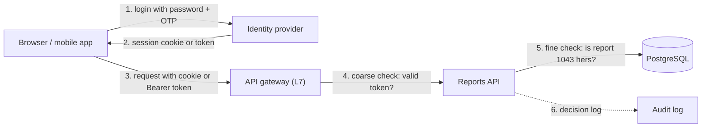
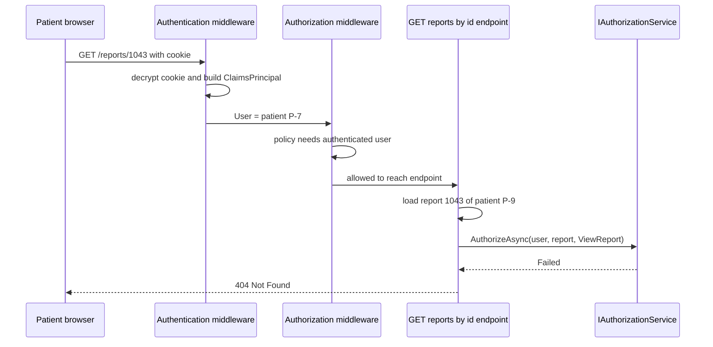

A patient logs in to a diagnostic lab's website to download her blood-test report. The login works. Then she changes `reports/1042` to `reports/1043` in the address bar and sees a stranger's report, with name, age, phone number and test results. The login was fine. What failed was the second question the server should have asked. This lesson separates those two questions, because confusing them is behind a large share of real security incidents. OWASP ranks broken access control as the number one web application risk.

## Learning objectives

By the end of this lesson you will be able to:

1. Explain authentication (proving who you are) and authorization (deciding what you may do) in plain words, and say which one a given bug belongs to.
2. Name the three kinds of credentials (something you know, have, are) and why multi-factor authentication combines them.
3. Describe how an identity flows through an ASP.NET Core request: credential, authentication handler, `ClaimsPrincipal`, authorization policy.
4. Compare server-side sessions with self-contained tokens, including revocation, scaling and size.
5. Return 401 and 403 correctly, and know when to return 404 instead.
6. Implement a custom authentication handler and a policy in ASP.NET Core.
7. Spot the common mistakes: authorization only in the UI, trusting client-sent ids, user enumeration, and missing checks on object ids.

## Prerequisites

- [HTTP fundamentals](#/lesson/m10-http-fundamentals): status codes, headers and cookies.
- [Authentication and authorization in ASP.NET Core](#/lesson/m03-authn-authz): the framework-level basics. This lesson goes deeper on the concepts and the system design.
- [Kestrel, middleware and routing](#/lesson/m03-kestrel-middleware-routing): authentication and authorization are middleware, so order matters.

## Explain it like I'm a beginner

Think about entering a large office building in Gurgaon.

At the reception, the guard looks at your face and your ID card, checks a list, and gives you a visitor badge. That step answers **"who are you?"**. It is **authentication** (often shortened to *authn*).

Later you tap the badge on the door to the 7th floor server room. The door stays shut. Nobody doubts who you are. Your badge simply does not include the server room. That step answers **"are you allowed in here?"**. It is **authorization** (*authz*).

Three things to notice:

- **They happen at different times.** Authentication happens once, at reception. Authorization happens at every door.
- **They use different information.** Authentication uses *proof* (your face, your ID card). Authorization uses *rules* (visitors can use floors 1 to 3, staff can use all floors, only IT can enter the server room).
- **A badge is a shortcut.** The guard does not re-check your ID at every door. The badge stands in for "reception already checked this person". In software that badge is a **session cookie** or a **token**.

Now the lab portal bug from the introduction makes sense. The patient was correctly authenticated: reception let her in. But the report page never checked whether report 1043 belongs to *this* patient. That is like the 7th-floor door opening for any badge at all.

## First-principles explanation

### What authentication is

Authentication is the process of **verifying a claim of identity** using evidence. The user says "I am ravi@example.com", and supplies proof. The proof is called a **credential**. There are three classic kinds:

| Factor | Plain English | Examples |
|---|---|---|
| Knowledge | Something you know | Password, PIN, security answer |
| Possession | Something you have | Phone with an authenticator app, hardware key (FIDO2 / passkey), SIM receiving an OTP |
| Inherence | Something you are | Fingerprint, face |

**Multi-factor authentication (MFA)** combines factors from *different* rows. A password plus a second password is still one factor. A password plus a code from your phone is two factors, because an attacker who stole your password from a breach still needs your phone.

Machines authenticate too. A billing service calling a payments API proves its identity with an **API key**, a **client certificate** (mutual TLS), or a **client secret** exchanged for a token (OAuth client credentials, covered in [OAuth 2.0 and OpenID Connect](#/lesson/m14-oauth-oidc)).

The output of authentication is an **identity**: a structured description of the caller. In .NET this is a `ClaimsPrincipal` holding one or more `ClaimsIdentity` objects, each a list of **claims** (name and value pairs such as `sub = 7f3a…`, `email = ravi@example.com`, `role = Patient`). A claim is a statement *about* the caller made by someone you trust (your login code, or an identity provider).

### What authorization is

Authorization is the process of **deciding whether an identified caller may perform an action on a resource**. Every authorization decision has the same four inputs:

1. **Subject**: who is asking (the `ClaimsPrincipal`).
2. **Action**: what they want to do (read, approve, delete).
3. **Resource**: what they want to do it to (report 1043, patient P-9).
4. **Context**: anything else that matters (time, IP range, whether the report has been signed yet).

The simplest rule only looks at the subject ("is this user an Admin?"). Realistic rules look at the resource too ("is this the patient the report *belongs* to?"). That second kind is where most bugs live, because it cannot be decided by an attribute on the controller. The code has to load the resource first. [Role-based and policy-based authorization](#/lesson/m14-rbac-pbac) covers this in depth.

### Why they must be separate

- **Different change rates.** How people log in changes rarely (add MFA, add Google sign-in). Who may do what changes weekly (a new approval step, a new role).
- **Different owners.** Authentication is often outsourced to an identity provider such as Microsoft Entra ID, Auth0, Keycloak or Google. Authorization almost never can be, because only your application knows that a patient may see her own reports but not anyone else's.
- **Different failure meaning.** A failed authentication means "I don't know who you are". A failed authorization means "I know exactly who you are, and the answer is no". HTTP has a status code for each.

### How credentials become a "badge": sessions versus tokens

Checking a password costs real work. A good password hash is deliberately slow, around 50–250 ms of CPU (see [Secure password storage](#/lesson/m14-passwords-secrets)). You cannot do that on every request. So after one successful login, the server issues something cheaper to check. There are two families.

**1. Server-side session (reference).** The server creates a random id (say 128 bits from a cryptographic random generator), stores `session_id → user_id, expires_at` in memory, Redis or a database table, and sends the id to the browser in a cookie. On each request it looks up the id.

**2. Self-contained token (value).** The server puts the identity itself into a signed blob, such as a JSON Web Token: `{"sub":"u-42","role":"Patient","exp":1760950000}` plus a signature. On each request it verifies the signature and the expiry. No lookup is needed. [JWT validation and limitations](#/lesson/m14-jwt) covers the details.

ASP.NET Core's cookie authentication is actually a third shape in between: by default it puts the *whole* `ClaimsPrincipal`, encrypted and signed with Data Protection keys, inside the cookie. It behaves like a self-contained token that happens to travel in a cookie, unless you plug in an `ITicketStore` to keep it on the server.

| | Server-side session | Self-contained token |
|---|---|---|
| Check cost | One lookup (Redis about 0.3–1 ms in the same region, estimate) | Signature check (microseconds for HMAC, tens of microseconds for RSA, estimate) |
| Logout / revoke | Delete the row. Effective immediately | Hard. The token stays valid until `exp` unless you add a deny list |
| Scaling | Every server needs the session store. It becomes a dependency | Any server with the key can verify. Nothing shared |
| Size on the wire | About 30 bytes of id | Often 800 bytes to 2 KB, sent on every request |
| Changing permissions | Next request sees the change | Old claims live until the token expires |
| Best fit | Browser apps on your own domain | APIs called by mobile apps, SPAs and other services, across domains |

Neither is "more secure" in general. The key question is: **how quickly must a revocation take effect?** If a fired employee must lose access within seconds, you need a lookup somewhere: a session store, a deny list, or very short-lived tokens plus refresh.

### Where the checks happen

In ASP.NET Core both steps are middleware, and order matters:

1. `UseAuthentication()` runs the configured **authentication handler**. It reads the cookie or `Authorization` header, validates it, and sets `HttpContext.User`. If there is no credential, the user is simply anonymous. It does **not** reject the request.
2. `UseAuthorization()` looks at the endpoint's metadata (`[Authorize]`, `.RequireAuthorization("policy")`) and evaluates the policy. If the user is anonymous and the policy needs an authenticated user, it calls **Challenge** (which becomes 401, or a redirect to the login page for cookies). If the user is authenticated but fails the policy, it calls **Forbid** (403).
3. Inside your endpoint, **resource-based checks** run after loading the data: `IAuthorizationService.AuthorizeAsync(User, report, "ViewReport")`.

### 401 versus 403 versus 404

The names are confusing. HTTP calls 401 "Unauthorized" when it really means "unauthenticated".

- **401 Unauthorized**: "I don't know who you are." The credential is missing, expired or invalid. The response must include a `WWW-Authenticate` header saying how to authenticate (for example `Bearer error="invalid_token"`). The client should log in or refresh its token and retry.
- **403 Forbidden**: "I know who you are, and you can't do this." Retrying with the same credential will not help. Logging in again will not help either.
- **404 Not Found** instead of 403: when merely confirming that the resource exists leaks information. If patient A requests patient B's report 1043, answering 403 tells A that report 1043 exists. Many systems, including GitHub for private repositories, answer 404 for resources the caller may not even know about.

A practical rule: **401 when authentication failed, 403 when the caller may know the resource exists but can't perform this action, 404 when the caller should not learn the resource exists.**

### What happens without a clear separation

- **"Logged in" treated as "allowed".** An endpoint has `[Authorize]` and nothing else, so every authenticated user, including every patient, can call it.
- **Authorization only in the UI.** The "Sign off" button is hidden for patients, but `POST /reports/1043/sign` works for anyone who sends it with curl.
- **Insecure direct object reference (IDOR).** The endpoint trusts the id in the URL without checking ownership. This is exactly the lab portal bug.
- **Identity taken from the request body.** `{"signedBy":"dr.mehta"}` is accepted as the signing doctor's identity instead of reading it from `HttpContext.User`.

### When a simpler alternative is enough

- An internal admin tool used by 5 people on a VPN: a single policy "must be in the Admins group" is fine. Don't build a permission matrix.
- A public read-only page: no authentication at all. Adding login to a page that needs none only adds friction.
- A single-team product with one web app: cookie sessions are simpler than a token-based setup with an external identity provider. Move to OpenID Connect when you have several apps that need single sign-on, or a corporate directory to integrate with.

## Visual explanation

### Where authentication and authorization sit in a system



Read it from left to right. **Arrow 1**: the user proves their identity once, to the identity provider (which may be your own login endpoint or an external service). **Arrow 2**: the provider hands back the "badge", a cookie or a token. **Arrow 3**: every later request carries that badge, never the password. **Arrow 4**: the gateway can reject requests with no valid badge early (cheap authentication, and a very coarse authorization such as "only staff may reach /admin"). **Arrow 5**: the API makes the real authorization decision, because only it can load report 1043 and compare its `patient_id` with the caller. **Arrow 6**: the decision, especially a denial, is written to an audit log. The key idea: authentication can be centralised, but fine-grained authorization lives next to the data.

### One request, step by step



Notice the two separate "no"s that could have happened. If the cookie were missing or invalid, the authorization middleware would have challenged and the browser would get 401 (or a login redirect). Here the cookie was fine, the coarse policy passed, and the endpoint itself made the resource-based check after loading the report. Because a patient should not learn that other patients' report numbers exist, the endpoint answers 404 rather than 403.

## Step-by-step example

We'll secure the lab's report portal in four steps. Users are patients, lab technicians and the pathologist who signs reports. Machines include a nightly job from the hospital's billing system that pulls signed reports.

### Step 1 — the naive version

```csharp
app.MapGet("/reports/{id:int}", (int id, ReportRepository repo) => repo.Get(id));
app.MapPost("/reports/{id:int}/sign", (int id, SignRequest req, ReportRepository repo) =>
    repo.Sign(id, signedBy: req.SignedBy));
```

Two problems: anyone on the internet can read any patient's report, and the signing doctor's name comes from the request body.

### Step 2 — authenticate everyone

Add cookie authentication for people and an API key scheme for the billing job. Mark the endpoints with `.RequireAuthorization()`. Now anonymous callers get 401. But every logged-in patient can still read every report, and any patient can sign one off.

### Step 3 — coarse authorization with a policy

Add a policy `SignReports` that requires the claim `permission = reports:sign`, which only the pathologist's account has. Signing now returns 403 for patients and technicians. The signer's identity comes from `User`, never from the body.

### Step 4 — fine-grained, resource-based authorization

Inside `GET /reports/{id}`, load the report and check: lab staff may see all reports, a patient only reports where `report.PatientId == user's patient_id claim`. Failed checks return 404. Every denial is logged with the user id, the report id and the reason.

The full code is next.

## Production-style C# implementation

```text
Portal.Api/
  Program.cs
  Security/
    PortalClaims.cs
    ApiKeyAuthenticationHandler.cs
    InMemoryApiKeyStore.cs
    ReportAuthorization.cs
  Reports/
    LabReport.cs
    InMemoryReportStore.cs
  Accounts/
    DemoUserDirectory.cs
```

```csharp file=Security/PortalClaims.cs
namespace Portal.Api.Security;

/// <summary>Claim type and value names used across the portal. One place, so typos can't create silent bypasses.</summary>
public static class PortalClaims
{
    public const string UserId = "sub";
    public const string PatientId = "patient_id";
    public const string Permission = "permission";
    public const string SignReports = "reports:sign";
    public const string ReadAllReports = "reports:read_all";
    public const string ApiKeyScheme = "ApiKey";
}
```

```csharp file=Security/InMemoryApiKeyStore.cs
using System.Security.Cryptography;
using System.Text;

namespace Portal.Api.Security;

public sealed record ApiClient(string ClientId, IReadOnlyList<string> Permissions);

public interface IApiKeyStore
{
    /// <summary>Returns the client owning this key, or null. Implementations store only a hash of each key.</summary>
    ValueTask<ApiClient?> FindAsync(string presentedKey, CancellationToken ct);
}

/// <summary>Keys are high-entropy random strings (32 bytes), so a fast SHA-256 hash is enough here.
/// Passwords are different: they are low-entropy and need a slow hash.</summary>
public sealed class InMemoryApiKeyStore : IApiKeyStore
{
    private readonly Dictionary<string, ApiClient> _byHash = new(StringComparer.Ordinal);

    public void Add(string plainKey, ApiClient client) => _byHash[Hash(plainKey)] = client;

    public ValueTask<ApiClient?> FindAsync(string presentedKey, CancellationToken ct) =>
        ValueTask.FromResult(_byHash.GetValueOrDefault(Hash(presentedKey)));

    private static string Hash(string key) => Convert.ToHexString(SHA256.HashData(Encoding.UTF8.GetBytes(key)));
}
```

```csharp file=Security/ApiKeyAuthenticationHandler.cs
using System.Security.Claims;
using System.Text.Encodings.Web;
using Microsoft.AspNetCore.Authentication;
using Microsoft.Extensions.Options;

namespace Portal.Api.Security;

/// <summary>Authentication only: turns an X-Api-Key header into a ClaimsPrincipal.
/// It never decides what the caller may do. That is the authorization layer's job.</summary>
public sealed class ApiKeyAuthenticationHandler(
    IOptionsMonitor<AuthenticationSchemeOptions> options,
    ILoggerFactory loggerFactory,
    UrlEncoder encoder,
    IApiKeyStore store)
    : AuthenticationHandler<AuthenticationSchemeOptions>(options, loggerFactory, encoder)
{
    public const string HeaderName = "X-Api-Key";

    protected override async Task<AuthenticateResult> HandleAuthenticateAsync()
    {
        if (!Request.Headers.TryGetValue(HeaderName, out var values) || string.IsNullOrWhiteSpace(values.ToString()))
            return AuthenticateResult.NoResult();   // no credential: anonymous, let authorization decide

        var client = await store.FindAsync(values.ToString(), Context.RequestAborted);
        if (client is null)
            return AuthenticateResult.Fail("Invalid API key.");   // never echo the key back

        var claims = new List<Claim> { new(PortalClaims.UserId, "client:" + client.ClientId) };
        claims.AddRange(client.Permissions.Select(p => new Claim(PortalClaims.Permission, p)));
        var identity = new ClaimsIdentity(claims, Scheme.Name, PortalClaims.UserId, ClaimTypes.Role);
        return AuthenticateResult.Success(new AuthenticationTicket(new ClaimsPrincipal(identity), Scheme.Name));
    }

    protected override Task HandleChallengeAsync(AuthenticationProperties properties)
    {
        Response.StatusCode = StatusCodes.Status401Unauthorized;
        Response.Headers.WWWAuthenticate = $"{PortalClaims.ApiKeyScheme} header=\"{HeaderName}\"";
        return Task.CompletedTask;
    }
}
```

```csharp file=Reports/LabReport.cs
namespace Portal.Api.Reports;

public enum ReportStatus { Draft, AwaitingSignOff, Signed }

public sealed class LabReport(int id, string patientId, string testName)
{
    public int Id { get; } = id;
    public string PatientId { get; } = patientId;
    public string TestName { get; } = testName;
    public ReportStatus Status { get; private set; } = ReportStatus.AwaitingSignOff;
    public string? SignedBy { get; private set; }

    /// <summary>Returns false if the report is not waiting for sign-off (already signed, or still a draft).</summary>
    public bool TrySign(string pathologistUserId)
    {
        if (Status != ReportStatus.AwaitingSignOff) return false;
        Status = ReportStatus.Signed;
        SignedBy = pathologistUserId;
        return true;
    }
}
```

```csharp file=Reports/InMemoryReportStore.cs
using System.Collections.Concurrent;

namespace Portal.Api.Reports;

public interface IReportStore
{
    LabReport? Find(int id);
    IReadOnlyList<LabReport> ForPatient(string patientId);
}

public sealed class InMemoryReportStore : IReportStore
{
    private readonly ConcurrentDictionary<int, LabReport> _reports = new();
    public InMemoryReportStore()
    {
        foreach (var r in new[] { new LabReport(1042, "P-7", "Complete blood count"), new LabReport(1043, "P-9", "Thyroid profile") })
            _reports[r.Id] = r;
    }
    public LabReport? Find(int id) => _reports.GetValueOrDefault(id);
    public IReadOnlyList<LabReport> ForPatient(string patientId) =>
        _reports.Values.Where(r => r.PatientId == patientId).OrderBy(r => r.Id).ToList();
}
```

```csharp file=Security/ReportAuthorization.cs
using System.Security.Claims;
using Microsoft.AspNetCore.Authorization;
using Microsoft.AspNetCore.Authorization.Infrastructure;
using Portal.Api.Reports;

namespace Portal.Api.Security;

public static class ReportOperations
{
    public static readonly OperationAuthorizationRequirement View = new() { Name = nameof(View) };
}

/// <summary>Resource-based rule: lab staff with reports:read_all see everything, a patient only their own reports.</summary>
public sealed class ReportAuthorizationHandler(ILogger<ReportAuthorizationHandler> log)
    : AuthorizationHandler<OperationAuthorizationRequirement, LabReport>
{
    protected override Task HandleRequirementAsync(AuthorizationHandlerContext context,
        OperationAuthorizationRequirement requirement, LabReport report)
    {
        if (requirement.Name != ReportOperations.View.Name) return Task.CompletedTask;
        var user = context.User;
        var callerPatientId = user.FindFirstValue(PortalClaims.PatientId);
        if (user.HasClaim(PortalClaims.Permission, PortalClaims.ReadAllReports) ||
            (callerPatientId is not null && callerPatientId == report.PatientId))
        {
            context.Succeed(requirement);
        }
        else
        {
            log.LogWarning("Denied {Operation} on report {ReportId} for user {UserId}",
                requirement.Name, report.Id, user.FindFirstValue(PortalClaims.UserId));
        }
        return Task.CompletedTask;
    }
}
```

```csharp file=Accounts/DemoUserDirectory.cs
using System.Security.Claims;
using System.Security.Cryptography;
using System.Text;
using Portal.Api.Security;

namespace Portal.Api.Accounts;

public interface IUserDirectory
{
    /// <summary>Returns claims for a valid login, or null. The same null for "no such user" and "wrong password".</summary>
    ClaimsIdentity? Validate(string email, string password, string authenticationType);
}

/// <summary>Demo only. Real password storage (PBKDF2, salts, lockout) is in the passwords lesson.</summary>
public sealed class DemoUserDirectory : IUserDirectory
{
    private sealed record Account(string UserId, string Email, byte[] PasswordSha, string? PatientId, string[] Permissions);
    private readonly List<Account> _accounts =
    [
        new("u-1", "dr.mehta@lab.example.com", Sha("demo-pathologist"), null, [PortalClaims.SignReports, PortalClaims.ReadAllReports]),
        new("u-7", "ravi@example.com", Sha("demo-ravi"), "P-7", []),
    ];

    public ClaimsIdentity? Validate(string email, string password, string authenticationType)
    {
        var account = _accounts.FirstOrDefault(a => string.Equals(a.Email, email, StringComparison.OrdinalIgnoreCase));
        var presented = Sha(password);
        // Compare even when the account is missing, so response time does not reveal which emails exist.
        var expected = account?.PasswordSha ?? new byte[presented.Length];
        if (!CryptographicOperations.FixedTimeEquals(presented, expected) || account is null) return null;

        var claims = new List<Claim> { new(PortalClaims.UserId, account.UserId), new(ClaimTypes.Email, account.Email) };
        if (account.PatientId is not null) claims.Add(new(PortalClaims.PatientId, account.PatientId));
        claims.AddRange(account.Permissions.Select(p => new Claim(PortalClaims.Permission, p)));
        return new ClaimsIdentity(claims, authenticationType, PortalClaims.UserId, ClaimTypes.Role);
    }

    private static byte[] Sha(string s) => SHA256.HashData(Encoding.UTF8.GetBytes(s));
}
```

```csharp file=Program.cs
using System.Security.Claims;
using Microsoft.AspNetCore.Authentication;
using Microsoft.AspNetCore.Authentication.Cookies;
using Microsoft.AspNetCore.Authorization;
using Portal.Api.Accounts;
using Portal.Api.Reports;
using Portal.Api.Security;

var builder = WebApplication.CreateBuilder(args);

var apiKeys = new InMemoryApiKeyStore();
// The real key comes from a secret store; the fallback exists only so the demo runs locally.
apiKeys.Add(builder.Configuration["Billing:ApiKey"] ?? "dev-only-billing-key", new ApiClient("billing-nightly", [PortalClaims.ReadAllReports]));
builder.Services.AddSingleton<IApiKeyStore>(apiKeys);
builder.Services.AddSingleton<IReportStore, InMemoryReportStore>();
builder.Services.AddSingleton<IUserDirectory, DemoUserDirectory>();
builder.Services.AddSingleton<IAuthorizationHandler, ReportAuthorizationHandler>();

builder.Services
    .AddAuthentication(CookieAuthenticationDefaults.AuthenticationScheme)
    .AddCookie(o =>
    {
        o.Cookie.HttpOnly = true;
        o.Cookie.SecurePolicy = CookieSecurePolicy.Always;
        o.Cookie.SameSite = SameSiteMode.Lax;
        o.ExpireTimeSpan = TimeSpan.FromMinutes(30);
        o.SlidingExpiration = true;
        // An API should answer 401/403, not redirect to an HTML login page.
        o.Events.OnRedirectToLogin = ctx => { ctx.Response.StatusCode = StatusCodes.Status401Unauthorized; return Task.CompletedTask; };
        o.Events.OnRedirectToAccessDenied = ctx => { ctx.Response.StatusCode = StatusCodes.Status403Forbidden; return Task.CompletedTask; };
    })
    .AddScheme<AuthenticationSchemeOptions, ApiKeyAuthenticationHandler>(PortalClaims.ApiKeyScheme, _ => { });

builder.Services.AddAuthorizationBuilder()
    // Accept either a person (cookie) or the billing job (API key) on report endpoints.
    .AddPolicy("Portal", p => p.AddAuthenticationSchemes(CookieAuthenticationDefaults.AuthenticationScheme, PortalClaims.ApiKeyScheme)
                               .RequireAuthenticatedUser())
    // No AddAuthenticationSchemes here: only the default (cookie) scheme is tried, so an API key can never sign.
    .AddPolicy("SignReports", p => p.RequireAuthenticatedUser()
                                    .RequireClaim(PortalClaims.Permission, PortalClaims.SignReports));

var app = builder.Build();

app.UseAuthentication();   // who are you?
app.UseAuthorization();    // may you reach this endpoint?

app.MapPost("/login", async (LoginRequest req, IUserDirectory users, HttpContext http) =>
{
    var identity = users.Validate(req.Email, req.Password, CookieAuthenticationDefaults.AuthenticationScheme);
    if (identity is null) return Results.Problem("Invalid email or password.", statusCode: 401);   // one message for both cases
    await http.SignInAsync(new ClaimsPrincipal(identity));
    return Results.NoContent();
});

app.MapPost("/logout", async (HttpContext http) => { await http.SignOutAsync(); return Results.NoContent(); })
   .RequireAuthorization();

app.MapGet("/reports/{id:int}", async (int id, ClaimsPrincipal user, IReportStore reports, IAuthorizationService authz) =>
{
    var report = reports.Find(id);
    if (report is null) return Results.NotFound();
    var result = await authz.AuthorizeAsync(user, report, ReportOperations.View);
    // 404, not 403: a patient should not learn that another patient's report number exists.
    return result.Succeeded
        ? Results.Ok(new { report.Id, report.TestName, Status = report.Status.ToString() })
        : Results.NotFound();
}).RequireAuthorization("Portal");

app.MapPost("/reports/{id:int}/sign", (int id, ClaimsPrincipal user, IReportStore reports) =>
{
    var report = reports.Find(id);
    if (report is null) return Results.NotFound();
    // Identity comes from the principal, never from the body. A report that is not awaiting sign-off is a 409, not a 500.
    return report.TrySign(user.FindFirstValue(PortalClaims.UserId)!) ? Results.NoContent() : Results.Conflict();
}).RequireAuthorization("SignReports");

app.Run();

public sealed record LoginRequest(string Email, string Password);
```

Key points in this code:

- **The handler only authenticates.** `ApiKeyAuthenticationHandler` returns `NoResult` when no key is present. That lets anonymous endpoints work and lets the authorization middleware decide whether a credential was required.
- **API keys are stored hashed.** A leaked database dump then doesn't hand out working keys. A fast hash is fine because the keys are 256-bit random values, not human passwords.
- **The policy names the permission, not the role.** `SignReports` checks `permission = reports:sign`. When the lab later lets a senior microbiologist sign culture reports too, you grant the permission, not edit code.
- **Resource-based check after loading.** `[Authorize]` can't know whose report 1043 is. The handler compares the report's patient with the caller's claim, and a missing `patient_id` claim never "matches".
- **Cookie hardening.** `HttpOnly` stops JavaScript (and XSS payloads) reading the cookie, `Secure` keeps it off plain HTTP, `SameSite=Lax` blocks most cross-site request forgery for unsafe methods. `SignInAsync` issues a brand-new cookie at login, so an attacker can't plant a session id before the victim logs in (session fixation). If browser forms post to these endpoints from other origins you control, add antiforgery tokens as well; SameSite is a second line, not the only one.

## Bad design vs good design

**Bad**: one `[Authorize]` attribute on the controller, an `IsAdmin` boolean column checked in Razor views to hide buttons, and endpoints that read `userId` from a query string.

```csharp
// Every logged-in user can sign any report, and can claim to be anyone.
[Authorize]
[HttpPost("reports/{id}/sign")]
public IActionResult Sign(int id, [FromQuery] string userId) { _repo.Sign(id, userId); return Ok(); }
```

Problems:

- Hiding a button is not access control. The API accepts the request anyway.
- `userId` is attacker-controlled. A forged sign-off gets recorded against the pathologist, on a medical document.
- There is no ownership check, so IDOR is possible on every read endpoint.
- Nothing is logged, so you can't even tell afterwards who did what.

**Good**: the implementation above. Authentication produces a principal. Coarse policies guard endpoints. Resource handlers guard objects. Identity always comes from `HttpContext.User`. Denials are logged.

:::callout type=mistake title="Deny by default"
Add a fallback policy so that a new endpoint someone forgets to annotate is protected, not public: `builder.Services.AddAuthorizationBuilder().SetFallbackPolicy(new AuthorizationPolicyBuilder().RequireAuthenticatedUser().Build());` Then mark truly public endpoints with `.AllowAnonymous()`. A missing attribute then fails closed.
:::

:::callout type=tradeoff title="Centralise authentication, distribute authorization"
Validating tokens at an API gateway saves every service from doing it, and lets you reject garbage traffic early. But the gateway can't load report 1043. Keep coarse checks (valid token, right audience, route-level scopes) at the edge and resource checks in the service that owns the data. A gateway-only design quietly turns into "logged in means allowed".
:::

## Practical playground

The graph below is a portal where the gateway does everything: it validates the session and is the *only* place access is checked. Open it in the HLD canvas. Add the components that make fine-grained authorization possible (a policy check inside the Reports API, an audit log, a session store for instant revocation) and see how the request path changes.

:::playground type=hld title="Lab report portal: where do the checks live?"
```json
{
  "nodes": [
    { "id": "users", "type": "client", "label": "Patients and lab staff", "props": { "rps": 150 } },
    { "id": "billing", "type": "external", "label": "Hospital billing nightly job" },
    { "id": "gw", "type": "api-gateway", "label": "Gateway (checks login only)" },
    { "id": "api", "type": "app-server", "label": "Reports API", "props": { "instances": 2 } },
    { "id": "db", "type": "database", "label": "PostgreSQL" }
  ],
  "edges": [
    { "from": "users", "to": "gw", "kind": "sync", "label": "cookie" },
    { "from": "billing", "to": "gw", "kind": "sync", "label": "API key" },
    { "from": "gw", "to": "api", "kind": "sync", "label": "X-User-Id header" },
    { "from": "api", "to": "db", "kind": "sync" }
  ]
}
```
:::

Questions to answer while you edit: can a caller reach the Reports API directly and set `X-User-Id` themselves? Where is the ownership check for report 1043? If a lab technician leaves the lab at 11:00, when do they lose access?

## Exercises

:::exercise id=m14-authn-vs-authz-ex1 difficulty=beginner kind=code title="Pick the right status code"
Write `AccessDecider.Decide`, which turns the outcome of authentication and authorization into an HTTP status code for an API.
::requirements
- No credential at all, or an invalid or expired credential → 401.
- Valid credential, resource does not exist → 404.
- Valid credential, resource exists, caller may not even know it exists (`CanSeeResource == false`) → 404.
- Valid credential, caller can see the resource but may not perform the action → 403.
- Everything allowed → 200.
- Authentication is checked first: an anonymous caller asking for a missing resource still gets 401.
::acceptance
- Anonymous + missing resource → 401 (don't reveal what exists to strangers).
- Patient reading another patient's report → 404.
- Patient trying to sign off their own visible report → 403.
- Pathologist signing a report → 200.
::hint
Order the checks the way the middleware pipeline does: authentication first, then existence, then visibility, then the action.
::hint
Each rule is one early `return`. You need no `else`.
::hint
`CredentialState` has three values. Only `Valid` gets past the first check.
::hint
```csharp
if (r.Credential != CredentialState.Valid) return 401;
if (!r.ResourceExists) return 404;
// two more lines
```
::starter
```csharp file=AccessDecider.cs
using System;

public enum CredentialState { Missing, Invalid, Valid }

public sealed record AccessRequest(CredentialState Credential, bool ResourceExists, bool CanSeeResource, bool CanPerformAction);

public static class AccessDecider
{
    public static int Decide(AccessRequest r) => throw new NotImplementedException();
}
```
::tests
```csharp file=AccessDeciderTests.cs
using Xunit;

public class AccessDeciderTests
{
    [Fact] public void Missing_credential_is_401() =>
        Assert.Equal(401, AccessDecider.Decide(new AccessRequest(CredentialState.Missing, true, true, true)));

    [Fact] public void Invalid_credential_is_401() =>
        Assert.Equal(401, AccessDecider.Decide(new AccessRequest(CredentialState.Invalid, true, true, true)));

    [Fact] public void Anonymous_and_missing_resource_is_still_401() =>
        Assert.Equal(401, AccessDecider.Decide(new AccessRequest(CredentialState.Missing, false, false, false)));

    [Fact] public void Missing_resource_is_404() =>
        Assert.Equal(404, AccessDecider.Decide(new AccessRequest(CredentialState.Valid, false, false, false)));

    [Fact] public void Hidden_resource_is_404() =>
        Assert.Equal(404, AccessDecider.Decide(new AccessRequest(CredentialState.Valid, true, false, false)));

    [Fact] public void Visible_but_not_allowed_is_403() =>
        Assert.Equal(403, AccessDecider.Decide(new AccessRequest(CredentialState.Valid, true, true, false)));

    [Fact] public void Allowed_is_200() =>
        Assert.Equal(200, AccessDecider.Decide(new AccessRequest(CredentialState.Valid, true, true, true)));
}
```
::solution
Four guard clauses in pipeline order.

```csharp file=AccessDecider.cs
using System;

public enum CredentialState { Missing, Invalid, Valid }

public sealed record AccessRequest(CredentialState Credential, bool ResourceExists, bool CanSeeResource, bool CanPerformAction);

public static class AccessDecider
{
    public static int Decide(AccessRequest r)
    {
        if (r.Credential != CredentialState.Valid) return 401;   // who are you?
        if (!r.ResourceExists) return 404;
        if (!r.CanSeeResource) return 404;                        // don't confirm it exists
        if (!r.CanPerformAction) return 403;                      // you can see it, but not do this
        return 200;
    }
}
```

The order matters. Checking existence before authentication would let an anonymous attacker probe which report numbers exist (404 versus 401 tells them). Merging the two 404 cases is deliberate: from the outside, "doesn't exist" and "exists but not yours" must look identical.
::mistakes
- Returning 403 for an expired token. The client then shows "access denied" instead of refreshing the token.
- Checking `ResourceExists` first, which leaks existence to anonymous callers.
- Returning different error bodies for the two 404 cases, which leaks the same information by another route.
::extensions
Add a `RateLimited` flag that yields 429, and decide where in the order it belongs (hint: before authentication, so brute-force attempts are also limited).
:::

:::exercise id=m14-authn-vs-authz-ex2 difficulty=beginner kind=written title="Authentication or authorization?"
For each incident, say whether it is primarily an authentication failure or an authorization failure, and name one fix.

1. An attacker uses a password from an old breach of another site to log in as a lab technician.
2. A logged-in technician at the Pune branch downloads `GET /scans/88.pdf`, an X-ray belonging to a Chennai branch patient she has never treated.
3. The mobile app hides the "Delete patient record" button for non-admins, but the API accepts the request from anyone logged in.
4. An API accepts any token whose signature is valid, including tokens issued for a different application.
5. A former employee's session still works two weeks after they left.
6. A support agent can view every patient's full Aadhaar number, though their job only needs the last 4 digits.
::acceptance
- Each item is classified and the reasoning is one or two sentences.
- At least one item is recognised as involving both.
- Fixes are concrete (a mechanism, not "be more careful").
::hint
Ask: did the system correctly know *who* the caller was? If yes, it is an authorization problem.
::hint
Item 4 is subtle: the token proves who issued it, but not *for whom* it was issued.
::hint
Item 5 is about the lifetime of the "badge", which is part of authentication, but the root cause is often a missing offboarding step.
::solution
1. **Authentication** (credential stuffing). Fixes: MFA, checking passwords against known-breached lists, rate limiting and lockout per account and per IP.
2. **Authorization** (IDOR / missing object-level check). Fix: resource-based check that the scan's patient is registered at the technician's branch (or assigned to her). Return 404.
3. **Authorization** enforced only in the UI. Fix: a policy on the API endpoint. The UI hiding is just convenience.
4. **Authentication**, specifically incomplete token validation: the audience (`aud`) was not checked, so a token minted for another app is accepted. Fix: validate issuer *and* audience. See [JWT validation](#/lesson/m14-jwt).
5. **Both.** The credential (session) outlived the identity. Fix: offboarding disables the account in the identity provider, sessions are server-side or tokens are short-lived with refresh checks, and a "revoke all sessions" action exists.
6. **Authorization** (excess privilege). Fix: least privilege, field-level masking, and audit logging of full-Aadhaar views. See [Least privilege and audit trails](#/lesson/m14-least-privilege-audit).
::mistakes
- Calling item 2 an authentication problem because "the user shouldn't have been logged in". She should have; she just shouldn't see that file.
- Treating item 4 as harmless because the signature was valid.
:::

:::exercise id=m14-authn-vs-authz-ex3 difficulty=intermediate kind=code title="A session store with idle and absolute timeouts"
Implement a server-side session store for the portal. Sessions expire after **20 minutes of inactivity** (sliding) and after **8 hours in total** no matter what (absolute). Users can "log out everywhere".
::requirements
- `Create(userId)` returns a new random session id (at least 128 bits, URL-safe).
- `Validate(id)` returns the user id if the session is alive, and refreshes its idle timer. Otherwise it returns null and forgets the session.
- `RevokeAll(userId)` ends every session of that user.
- Time comes from an injected `TimeProvider`.
::acceptance
- A session used every 10 minutes stays alive until the 8-hour mark, then dies.
- A session unused for 21 minutes is dead.
- Unknown ids return null.
- After `RevokeAll("u-7")`, all of u-7's sessions fail and u-1's still work.
::hint
Each session needs three facts: user id, created time, last-seen time.
::hint
Use `RandomNumberGenerator.GetBytes(32)` and `Convert.ToBase64String` with `+` and `/` replaced, or `Base64Url` in .NET 9+.
::hint
Alive means `now - lastSeen <= idle` AND `now - created <= absolute`.
::hint
For `RevokeAll`, either scan the dictionary (fine for thousands of sessions) or keep a second index `userId → set of session ids`.
::hint
```csharp
private sealed class Entry { public required string UserId; public DateTimeOffset Created; public DateTimeOffset LastSeen; }
```
::starter
```csharp file=SessionStore.cs
using System;
using System.Collections.Concurrent;
using System.Security.Cryptography;

public sealed class SessionStore
{
    public static readonly TimeSpan IdleTimeout = TimeSpan.FromMinutes(20);
    public static readonly TimeSpan AbsoluteTimeout = TimeSpan.FromHours(8);

    private readonly TimeProvider _clock;
    public SessionStore(TimeProvider clock) => _clock = clock;

    public string Create(string userId) => throw new NotImplementedException();
    public string? Validate(string sessionId) => throw new NotImplementedException();
    public void RevokeAll(string userId) => throw new NotImplementedException();
}
```
::tests
```csharp file=SessionStoreTests.cs
using System;
using Xunit;

public sealed class ManualClock : TimeProvider
{
    public DateTimeOffset Now { get; set; } = new(2026, 10, 20, 9, 0, 0, TimeSpan.Zero);
    public override DateTimeOffset GetUtcNow() => Now;
    public void Advance(TimeSpan by) => Now += by;
}

public class SessionStoreTests
{
    [Fact]
    public void Ids_are_long_and_unique()
    {
        var s = new SessionStore(new ManualClock());
        var a = s.Create("u-1"); var b = s.Create("u-1");
        Assert.NotEqual(a, b);
        Assert.True(a.Length >= 22);
    }

    [Fact]
    public void Valid_session_returns_user()
    {
        var s = new SessionStore(new ManualClock());
        Assert.Equal("u-7", s.Validate(s.Create("u-7")));
    }

    [Fact]
    public void Unknown_id_is_null() => Assert.Null(new SessionStore(new ManualClock()).Validate("nope"));

    [Fact]
    public void Idle_session_expires()
    {
        var clock = new ManualClock(); var s = new SessionStore(clock);
        var id = s.Create("u-7");
        clock.Advance(TimeSpan.FromMinutes(21));
        Assert.Null(s.Validate(id));
    }

    [Fact]
    public void Activity_slides_but_absolute_limit_wins()
    {
        var clock = new ManualClock(); var s = new SessionStore(clock);
        var id = s.Create("u-7");
        for (var i = 0; i < 47; i++) { clock.Advance(TimeSpan.FromMinutes(10)); Assert.Equal("u-7", s.Validate(id)); }
        clock.Advance(TimeSpan.FromMinutes(11));   // 481 minutes in total
        Assert.Null(s.Validate(id));
    }

    [Fact]
    public void Revoke_all_only_affects_that_user()
    {
        var s = new SessionStore(new ManualClock());
        var a1 = s.Create("u-7"); var a2 = s.Create("u-7"); var b = s.Create("u-1");
        s.RevokeAll("u-7");
        Assert.Null(s.Validate(a1));
        Assert.Null(s.Validate(a2));
        Assert.Equal("u-1", s.Validate(b));
    }
}
```
::solution
```csharp file=SessionStore.cs
using System;
using System.Collections.Concurrent;
using System.Linq;
using System.Security.Cryptography;

public sealed class SessionStore
{
    public static readonly TimeSpan IdleTimeout = TimeSpan.FromMinutes(20);
    public static readonly TimeSpan AbsoluteTimeout = TimeSpan.FromHours(8);

    private sealed class Entry
    {
        public required string UserId { get; init; }
        public DateTimeOffset Created { get; init; }
        public DateTimeOffset LastSeen { get; set; }
    }

    private readonly TimeProvider _clock;
    private readonly ConcurrentDictionary<string, Entry> _sessions = new(StringComparer.Ordinal);
    public SessionStore(TimeProvider clock) => _clock = clock;

    public string Create(string userId)
    {
        var id = Convert.ToBase64String(RandomNumberGenerator.GetBytes(32)).TrimEnd('=').Replace('+', '-').Replace('/', '_');
        var now = _clock.GetUtcNow();
        _sessions[id] = new Entry { UserId = userId, Created = now, LastSeen = now };
        return id;
    }

    public string? Validate(string sessionId)
    {
        if (!_sessions.TryGetValue(sessionId, out var e)) return null;
        var now = _clock.GetUtcNow();
        if (now - e.LastSeen > IdleTimeout || now - e.Created > AbsoluteTimeout)
        {
            _sessions.TryRemove(sessionId, out _);
            return null;
        }
        e.LastSeen = now;
        return e.UserId;
    }

    public void RevokeAll(string userId)
    {
        foreach (var kv in _sessions.Where(kv => kv.Value.UserId == userId).ToList())
            _sessions.TryRemove(kv.Key, out _);
    }
}
```

The idle timeout limits the damage of a computer left unlocked at the lab's reception desk. The absolute timeout limits the damage of a stolen cookie that an attacker keeps "warm" by making requests every few minutes. In production this store lives in Redis or PostgreSQL so every API instance sees the same sessions, and keys are stored as a hash of the id so a dump of the store can't be replayed.
::alternatives
ASP.NET Core cookie authentication with `SlidingExpiration` plus an `ITicketStore` implementation gives you the same behaviour inside the framework. Use this hand-rolled version only to understand the mechanics or for non-HTTP channels.
::mistakes
- Using `Guid.NewGuid()` as a session id. Version 4 GUIDs have 122 random bits, which is acceptable in practice, but they are not documented as cryptographically secure on every platform. Prefer `RandomNumberGenerator`.
- Implementing only the sliding timeout, so a stolen cookie lives forever if it is used.
- Using `DateTime.Now`, which makes the test impossible and breaks across time zones.
:::

:::exercise id=m14-authn-vs-authz-ex4 difficulty=intermediate kind=code title="Login that doesn't leak which accounts exist"
Write `LoginService.TryLogin`. It must give the same answer for "no such email" and "wrong password", and lock an account for 15 minutes after 5 failed attempts within 15 minutes.
::requirements
- Return a `LoginResult` with `Success`, `UserId` (when successful) and a `Message`.
- Failure message is always exactly `"Invalid email or password."`, including for locked accounts.
- Failed attempts are counted per normalised email (trimmed, lower-case), even for emails that don't exist, so an attacker can't tell the difference by watching lockout behaviour.
- A successful login resets the failure count.
- Password checking is delegated to `IPasswordChecker` (a fake in tests).
::acceptance
- Unknown email and wrong password produce identical results.
- After 5 failures, the correct password is rejected until 15 minutes pass.
- `"Ravi@Example.com "` and `"ravi@example.com"` count against the same lockout.
- Failures older than 15 minutes don't count.
::hint
Keep a list of failure timestamps per email. Prune old ones before counting.
::hint
Check the lockout *before* checking the password, so a locked account doesn't even get a password check (that would let attackers keep guessing).
::hint
`IPasswordChecker.Check` should return the user id or null. You don't need to know whether the email exists.
::hint
```csharp
var key = email.Trim().ToLowerInvariant();
var recent = _failures.GetValueOrDefault(key)?.Where(t => now - t < Window).ToList() ?? new();
if (recent.Count >= MaxFailures) return Fail();
```
::starter
```csharp file=LoginService.cs
using System;
using System.Collections.Generic;
using System.Linq;

public interface IPasswordChecker
{
    /// <summary>Returns the user id if email and password match, otherwise null.</summary>
    string? Check(string normalisedEmail, string password);
}

public sealed record LoginResult(bool Success, string? UserId, string Message);

public sealed class LoginService
{
    public const string GenericFailure = "Invalid email or password.";
    public const int MaxFailures = 5;
    public static readonly TimeSpan Window = TimeSpan.FromMinutes(15);

    private readonly IPasswordChecker _checker;
    private readonly TimeProvider _clock;

    public LoginService(IPasswordChecker checker, TimeProvider clock) { _checker = checker; _clock = clock; }

    public LoginResult TryLogin(string email, string password) => throw new NotImplementedException();
}
```
::tests
```csharp file=LoginServiceTests.cs
using System;
using System.Collections.Generic;
using Xunit;

public sealed class StepClock : TimeProvider
{
    public DateTimeOffset Now { get; set; } = new(2026, 10, 20, 9, 0, 0, TimeSpan.Zero);
    public override DateTimeOffset GetUtcNow() => Now;
}

public sealed class FakeChecker : IPasswordChecker
{
    public int Calls;
    public string? Check(string email, string password)
    {
        Calls++;
        return email == "ravi@example.com" && password == "correct-horse" ? "u-7" : null;
    }
}

public class LoginServiceTests
{
    [Fact]
    public void Correct_password_succeeds()
    {
        var r = new LoginService(new FakeChecker(), new StepClock()).TryLogin("ravi@example.com", "correct-horse");
        Assert.True(r.Success);
        Assert.Equal("u-7", r.UserId);
    }

    [Fact]
    public void Unknown_email_and_wrong_password_look_identical()
    {
        var svc = new LoginService(new FakeChecker(), new StepClock());
        var a = svc.TryLogin("nobody@x.in", "whatever");
        var b = svc.TryLogin("ravi@example.com", "wrong");
        Assert.Equal(a, b);
        Assert.Equal(LoginService.GenericFailure, a.Message);
    }

    [Fact]
    public void Locks_after_five_failures_even_with_correct_password()
    {
        var checker = new FakeChecker();
        var svc = new LoginService(checker, new StepClock());
        for (var i = 0; i < 5; i++) svc.TryLogin("ravi@example.com", "wrong");
        var callsBefore = checker.Calls;
        var r = svc.TryLogin("ravi@example.com", "correct-horse");
        Assert.False(r.Success);
        Assert.Equal(LoginService.GenericFailure, r.Message);
        Assert.Equal(callsBefore, checker.Calls);   // no password check while locked
    }

    [Fact]
    public void Email_is_normalised_for_lockout()
    {
        var svc = new LoginService(new FakeChecker(), new StepClock());
        for (var i = 0; i < 5; i++) svc.TryLogin("  Ravi@Example.COM ", "wrong");
        Assert.False(svc.TryLogin("ravi@example.com", "correct-horse").Success);
    }

    [Fact]
    public void Lock_expires_after_window()
    {
        var clock = new StepClock();
        var svc = new LoginService(new FakeChecker(), clock);
        for (var i = 0; i < 5; i++) svc.TryLogin("ravi@example.com", "wrong");
        clock.Now += TimeSpan.FromMinutes(16);
        Assert.True(svc.TryLogin("ravi@example.com", "correct-horse").Success);
    }

    [Fact]
    public void Success_resets_failures()
    {
        var svc = new LoginService(new FakeChecker(), new StepClock());
        for (var i = 0; i < 4; i++) svc.TryLogin("ravi@example.com", "wrong");
        Assert.True(svc.TryLogin("ravi@example.com", "correct-horse").Success);
        for (var i = 0; i < 4; i++) svc.TryLogin("ravi@example.com", "wrong");
        Assert.True(svc.TryLogin("ravi@example.com", "correct-horse").Success);
    }
}
```
::solution
```csharp file=LoginService.cs
using System;
using System.Collections.Generic;
using System.Linq;

public interface IPasswordChecker
{
    /// <summary>Returns the user id if email and password match, otherwise null.</summary>
    string? Check(string normalisedEmail, string password);
}

public sealed record LoginResult(bool Success, string? UserId, string Message);

public sealed class LoginService
{
    public const string GenericFailure = "Invalid email or password.";
    public const int MaxFailures = 5;
    public static readonly TimeSpan Window = TimeSpan.FromMinutes(15);

    private readonly IPasswordChecker _checker;
    private readonly TimeProvider _clock;
    private readonly Dictionary<string, List<DateTimeOffset>> _failures = new(StringComparer.Ordinal);
    private readonly object _gate = new();

    public LoginService(IPasswordChecker checker, TimeProvider clock) { _checker = checker; _clock = clock; }

    public LoginResult TryLogin(string email, string password)
    {
        var key = email.Trim().ToLowerInvariant();
        var now = _clock.GetUtcNow();
        lock (_gate)
        {
            var recent = _failures.TryGetValue(key, out var list) ? list.Where(t => now - t < Window).ToList() : new List<DateTimeOffset>();
            _failures[key] = recent;
            if (recent.Count >= MaxFailures) return Fail();
        }

        var userId = _checker.Check(key, password);
        lock (_gate)
        {
            if (userId is null) { _failures[key].Add(now); return Fail(); }
            _failures.Remove(key);
        }
        return new LoginResult(true, userId, "OK");
    }

    private static LoginResult Fail() => new(false, null, GenericFailure);
}
```

Records compare by value, so the test `Assert.Equal(a, b)` proves the two failures are indistinguishable. The real `IPasswordChecker` must also take the same time for unknown emails (hash a dummy password), or an attacker can still enumerate accounts by timing.
::alternatives
ASP.NET Core Identity has built-in lockout (`MaxFailedAccessAttempts`, `DefaultLockoutTimeSpan`). Use it if you use Identity. Add a per-IP rate limiter (`AddRateLimiter`) as well, because per-account lockout alone doesn't stop one attacker trying one password across 100,000 accounts (password spraying).
::mistakes
- Saying "account locked" in the message, which confirms the account exists.
- Locking permanently, which lets an attacker lock out the on-call pathologist in the middle of a night shift (denial of service). Use a time-based lock.
- Counting failures only for existing accounts.
:::

:::exercise id=m14-authn-vs-authz-ex5 difficulty=advanced kind=hld title="Single sign-on for six hospital apps"
A hospital chain runs six web apps (patient records, lab information system, pharmacy, radiology viewer, HR, staff rostering). Each has its own user table and login page. There are 6,000 employees and about 14,000 external users (visiting consultants, agency nurses, partner-lab staff). Most people sign in at the morning shift change, between 08:00 and 09:00 IST.

Design a target architecture where people sign in once, offboarding takes effect within 5 minutes across all apps, and each app still decides what users can do inside it. Estimate login and token-validation load.
::acceptance
- Authentication is centralised in one identity provider with MFA, and apps trust it via a standard protocol.
- Each app keeps its own authorization (roles, ownership) and the design says where that data lives.
- The 5-minute offboarding target is met and the mechanism is explicit.
- Estimates for peak logins per second and token validations per second are shown.
- What breaks first, and a simpler alternative, are named.
::hint
Which part is the same for all six apps, and which part is different for each?
::hint
OpenID Connect gives every app an ID token from one identity provider. See the [OAuth and OIDC lesson](#/lesson/m14-oauth-oidc).
::hint
For 5-minute offboarding, compare: 5-minute access tokens with refresh, or app sessions that re-check the user every 5 minutes, or back-channel logout.
::hint
Logins: 20,000 users, most in one hour, maybe 2 apps each before SSO kicks in. Validations: requests per user per minute × active users.
::starter
```json
{
  "nodes": [
    { "id": "staff", "type": "client", "label": "Employees and external staff", "props": { "rps": 400 } },
    { "id": "portal", "type": "app-server", "label": "Patient records (own login)" },
    { "id": "dms", "type": "app-server", "label": "Lab information system (own login)" },
    { "id": "hr", "type": "app-server", "label": "HR (own login)" },
    { "id": "db1", "type": "database", "label": "Records users table" },
    { "id": "db2", "type": "database", "label": "Lab users table" },
    { "id": "db3", "type": "database", "label": "HR users table" }
  ],
  "edges": [
    { "from": "staff", "to": "portal", "kind": "sync", "label": "password" },
    { "from": "staff", "to": "dms", "kind": "sync", "label": "another password" },
    { "from": "staff", "to": "hr", "kind": "sync", "label": "a third password" },
    { "from": "portal", "to": "db1", "kind": "sync" },
    { "from": "dms", "to": "db2", "kind": "sync" },
    { "from": "hr", "to": "db3", "kind": "sync" }
  ]
}
```
::solution
```json
{
  "nodes": [
    { "id": "staff", "type": "client", "label": "Employees and external staff", "props": { "rps": 400 } },
    { "id": "idp", "type": "external", "label": "Identity provider (OIDC, MFA, directory)" },
    { "id": "hrsrc", "type": "app-server", "label": "HR system (source of truth for joiners and leavers)" },
    { "id": "gw", "type": "api-gateway", "label": "Gateway (token validation, JWKS cached)" },
    { "id": "portal", "type": "app-server", "label": "Patient records", "props": { "instances": 2 } },
    { "id": "dms", "type": "app-server", "label": "Lab information system", "props": { "instances": 2 } },
    { "id": "hr", "type": "app-server", "label": "HR app", "props": { "instances": 2 } },
    { "id": "pdb", "type": "database", "label": "Records DB (ward and care-team memberships)" },
    { "id": "ddb", "type": "database", "label": "Lab DB (branch and department access)" },
    { "id": "sess", "type": "cache", "label": "Session store (Redis)", "props": { "ttlSeconds": 28800 } },
    { "id": "audit", "type": "database", "label": "Central audit log" },
    { "id": "mon", "type": "monitoring", "label": "Login and denial metrics" }
  ],
  "edges": [
    { "from": "staff", "to": "idp", "kind": "sync", "label": "sign in once with MFA" },
    { "from": "staff", "to": "gw", "kind": "sync", "label": "cookie or Bearer token" },
    { "from": "gw", "to": "portal", "kind": "sync" },
    { "from": "gw", "to": "dms", "kind": "sync" },
    { "from": "gw", "to": "hr", "kind": "sync" },
    { "from": "portal", "to": "idp", "kind": "sync", "label": "OIDC code flow, refresh every 5 min" },
    { "from": "portal", "to": "sess", "kind": "sync" },
    { "from": "portal", "to": "pdb", "kind": "sync", "label": "who may see which patient" },
    { "from": "dms", "to": "ddb", "kind": "sync", "label": "branch permissions" },
    { "from": "hrsrc", "to": "idp", "kind": "async", "label": "leaver disables account (SCIM)" },
    { "from": "idp", "to": "portal", "kind": "async", "label": "back-channel logout" },
    { "from": "portal", "to": "audit", "kind": "async" },
    { "from": "dms", "to": "audit", "kind": "async" },
    { "from": "gw", "to": "mon", "kind": "async" }
  ]
}
```

**Estimates (all are estimates).**

```text
Users: 20,000. Assume 80 % sign in during the 08:00–09:00 shift-change peak → 16,000 IdP logins in 1 hour
16,000 ÷ 3,600 s ≈ 4.5 logins/s average in that hour, ×4 for the 10-minute burst just before 08:00 ≈ 18 logins/s
Each login opens about 2 apps → 36 silent OIDC redirects/s (cheap: no password, existing IdP session)
Active users at peak: 12,000 × 4 requests/minute ÷ 60 ≈ 800 requests/s
Token validation: 800/s × one signature check each = trivial CPU with a cached JWKS
Refresh every 5 minutes: 12,000 sessions ÷ 300 s ≈ 40 refresh calls/s to the IdP
```

**Reasoning.**

- **Shared**: proving identity. One identity provider, one MFA enrolment, one password policy. Apps use OpenID Connect authorization code flow, so no app ever sees a password.
- **Per app**: authorization. Patient records keeps `care_team_membership(user_sub, patient_id, role)`. The lab system keeps branch and department access. Apps key their data by the IdP's stable `sub` (or object id), never by email, because emails change.
- **Offboarding in 5 minutes**: the HR system disables the leaver in the identity provider (SCIM provisioning or a scheduled sync). Apps keep server-side sessions and refresh against the IdP every 5 minutes. A disabled user's refresh fails, and the app kills the session. Back-channel logout (OIDC) makes it near-instant where the IdP supports it. The 5-minute refresh is the safety net.
- **What breaks first**: the identity provider becomes a single point of failure for all six apps. Mitigate with a managed IdP's SLA, and let existing sessions continue (fail open for *already authenticated* sessions for a bounded time) while new logins fail during an IdP outage. That is a business decision to document.
- **External staff**: put visiting consultants and agency nurses in a separate tenant, realm or group with stricter session lifetime and mandatory MFA, and expire their accounts automatically at the end of their engagement.
- **Simpler alternative**: if the company already has Microsoft 365, use Entra ID as the IdP and the ASP.NET Core OIDC handler in each app. That is configuration work, not a platform build. Only build your own identity service if regulation or a product need forces it.
::mistakes
- Centralising authorization too: a single "permissions service" that knows every app's rules becomes a bottleneck for every product change.
- Linking app data to email addresses, which breaks when someone's email changes after marriage or a domain migration.
- Long-lived access tokens (24 hours) with no refresh check, which miss the 5-minute offboarding target.
:::

## Automated testing

Security rules are business rules. Test them like business rules, at three levels.

**1. Unit-test authorization handlers.** An `AuthorizationHandler` is a plain class. Build a `ClaimsPrincipal` and an `AuthorizationHandlerContext` by hand:

```csharp
public class ReportAuthorizationHandlerTests
{
    private static ClaimsPrincipal Patient(string id) =>
        new(new ClaimsIdentity([new Claim("sub", "u-" + id), new Claim("patient_id", id)], "test"));

    [Fact]
    public async Task Patient_cannot_view_another_patients_report()
    {
        var report = new LabReport(1043, "P-9", "Thyroid profile");
        var ctx = new AuthorizationHandlerContext([ReportOperations.View], Patient("P-7"), report);
        await new ReportAuthorizationHandler(NullLogger<ReportAuthorizationHandler>.Instance).HandleAsync(ctx);
        Assert.False(ctx.HasSucceeded);
    }
}
```

**2. Integration-test the pipeline.** With `WebApplicationFactory<Program>` (package `Microsoft.AspNetCore.Mvc.Testing`), register a test authentication handler that turns a header like `X-Test-User: P-7` into a principal. Then assert real HTTP behaviour:

- No credential → 401 with a `WWW-Authenticate` header.
- Patient P-7 → `GET /reports/1043` is 404, `GET /reports/1042` is 200.
- Patient → `POST /reports/1042/sign` is 403.
- Pathologist signing an already signed report → 409.

**3. An endpoint inventory test.** Enumerate `EndpointDataSource.Endpoints` and assert that every endpoint has either `IAuthorizeData` or `IAllowAnonymous` metadata. This catches the "new endpoint, forgot the attribute" mistake in CI, before it reaches production.

Edge cases worth a test each: expired cookie, tampered cookie, API key with trailing whitespace, a user whose `patient_id` claim is missing (must be denied, not treated as "matches null"), and two schemes on one endpoint.

## Real-world application

- **Banking and UPI apps** authenticate the device once (device binding plus SIM verification) and then require a UPI PIN for each payment. The PIN is a step-up authentication for a high-risk action, separate from the app login.
- **Government portals** such as DigiLocker-style services delegate authentication to a national identity or OTP step, while each department's application authorizes what that citizen can see.
- **SaaS products** (GitHub, Jira-style tools) use one login for many organisations. Authorization is per organisation and per repository or project, which is why GitHub answers 404 for private repositories you can't access.
- **Hospital and lab platforms** typically mix humans (doctors, nurses, lab staff, patients) and machines (lab analysers uploading results, billing and insurance jobs). The machines get their own credentials and narrow permissions, never a shared human account.
- **ASP.NET Core itself** separates the two cleanly: `IAuthenticationHandler` per scheme (cookies, JWT bearer, OIDC, certificates, custom) and `IAuthorizationHandler` per requirement.

## Interview questions

:::interview
::q beginner
What is the difference between authentication and authorization?
::a
Authentication verifies *who* the caller is using a credential (password, OTP, certificate, token) and produces an identity, a set of claims. Authorization decides *what* that identity may do: given subject, action, resource and context, allow or deny. Authentication usually happens once per session. Authorization happens on every request and often on every object. A user can be perfectly authenticated and still not authorized.
::q beginner
When do you return 401 and when 403?
::a
401 when the request has no valid credential: missing, malformed, expired or wrong. It should carry a `WWW-Authenticate` header so the client knows how to authenticate, and the client may fix it by logging in or refreshing. 403 when the caller is known but not allowed; retrying with the same identity won't help. For resources the caller shouldn't know exist, return 404 instead of 403 to avoid leaking existence.
::q intermediate
Compare server-side sessions with self-contained tokens.
::a
A session is a random id that points to server-side state. Checks need a lookup, but revocation is instant and the cookie is tiny. A self-contained token (like a JWT) carries the claims and a signature. Any server with the key can verify it without shared state, which suits APIs and cross-domain clients, but revocation is hard until expiry, tokens are larger, and claims go stale. A common hybrid: short-lived access tokens (5–15 minutes) plus a refresh token that is checked against server state, so revocation takes effect within one token lifetime.
::q intermediate
What is an IDOR and how do you prevent it in ASP.NET Core?
::a
Insecure direct object reference: the endpoint takes an object id from the request and returns or changes that object without checking that the caller may access it. Prevent it with resource-based authorization: load the object, then call `IAuthorizationService.AuthorizeAsync(User, resource, requirement)` with a handler that checks ownership or membership. Better still, scope queries by the caller (`WHERE id = @id AND patient_id = @callerPatient`) so the object is never loaded for the wrong user. Add integration tests that try other users' ids. Non-guessable ids (UUIDs) reduce discovery but are not access control.
::q advanced
Your gateway validates JWTs. A colleague proposes removing all authorization from the microservices behind it "because the gateway already checks". What do you say?
::a
The gateway can check *authentication* and route-level scopes, but not object-level rules: it doesn't know whose report 1043 is. Removing service-side checks turns every authenticated user into a super-user for any object id. It also makes the services trust anything that reaches them, so one misconfigured network rule or a compromised internal service bypasses everything (no defence in depth). Keep the gateway for cheap early rejection, and keep fine-grained authorization in each service next to its data, with services still validating tokens (or a signed internal identity) themselves.
::q advanced
Design offboarding so a leaver loses access to 10 apps within 5 minutes.
::a
Make one system the source of truth (HR), and propagate to one identity provider via SCIM or a sync job. Apps authenticate via OIDC and never keep long-lived independent credentials. Choose a revocation mechanism: server-side sessions re-validated against the IdP every 5 minutes, or access tokens with a 5-minute lifetime whose refresh fails for disabled users, plus OIDC back-channel logout where supported. Revoke API keys and personal access tokens owned by the user in the same step. Audit: a report of active sessions per disabled user should always be empty. Test the process with a drill, not just a diagram.
:::

## Summary and revision

**Key takeaways**

- Authentication proves identity and produces claims. Authorization uses those claims, plus the resource and context, to allow or deny.
- After login, a cheap "badge" (session id or token) stands in for the credential. The choice between them is mostly about revocation speed, scaling and size.
- In ASP.NET Core, `UseAuthentication` builds `HttpContext.User`, `UseAuthorization` enforces endpoint policies, and resource-based checks run inside the endpoint after loading data.
- 401 means "unknown caller", 403 means "known but not allowed", 404 hides resources the caller shouldn't know about.
- Never trust identity from the request body or query, never rely on the UI for access control, and deny by default.

**Terminology**: authentication, authorization, credential, factor, MFA, claim, `ClaimsPrincipal`, authentication scheme, challenge, forbid, session, bearer token, IDOR, fallback policy, least privilege.

:::flashcards
Q: Authentication vs authorization in one line each?
A: Authentication: who are you (verify a credential). Authorization: may you do this (evaluate rules on subject, action, resource, context).
Q: What are the three authentication factor types?
A: Something you know (password), something you have (phone, hardware key), something you are (biometrics).
Q: Which HTTP status means "unauthenticated"?
A: 401 Unauthorized, with a WWW-Authenticate header. 403 means authenticated but not allowed.
Q: When should you return 404 instead of 403?
A: When confirming that the resource exists would leak information to a caller who shouldn't know about it.
Q: What does UseAuthentication do when no credential is present?
A: Nothing fails. The user is anonymous. Authorization decides later whether to challenge.
Q: Main advantage of server-side sessions over self-contained tokens?
A: Instant revocation: delete the session and the next request fails.
Q: What is an IDOR?
A: Insecure direct object reference: accessing another user's object by changing an id because the server doesn't check ownership.
Q: What does a fallback authorization policy give you?
A: Deny by default: endpoints without any authorization metadata still require an authenticated user.
:::

## Knowledge check

:::quiz pass=70
::q single
A mobile app sends an access token that expired 2 minutes ago. What should the API return?
- [ ] 403 Forbidden
- [x] 401 Unauthorized with a WWW-Authenticate header
- [ ] 400 Bad Request
- [ ] 200 with an error message in the body
> An expired credential is an authentication failure. 401 tells the client to refresh the token or log in again. 403 would wrongly tell it that retrying is pointless.
::q single
A logged-in patient on a pharmacy app changes `/prescriptions/5501` to `/prescriptions/5502` and sees another customer's prescription. Which control is missing?
- [ ] Multi-factor authentication
- [ ] HTTPS
- [x] A resource-based authorization check that the prescription belongs to the caller
- [ ] A longer session timeout
> The customer is correctly authenticated. The server failed to check whether this user may access *this object*, a classic IDOR.
::q multi
Which are authentication mechanisms? (Select all that apply.)
- [x] Password plus a TOTP code from an authenticator app
- [x] A client certificate in mutual TLS
- [ ] A policy requiring the `reports:sign` permission
- [x] An API key in a header
> A policy is an authorization rule. The others prove who the caller is.
::q single
You must guarantee that a fired employee loses access within 60 seconds. Which design meets this most simply?
- [ ] JWT access tokens valid for 24 hours
- [x] Server-side sessions checked on every request, deleted at offboarding
- [ ] Hiding the app's menu items for disabled users
- [ ] Rotating the signing key once a month
> A session lookup sees the deletion on the very next request. Self-contained 24-hour tokens stay valid until they expire unless you add a deny list.
::q single
The sign-off endpoint takes `{"reportId": 1042, "signedBy": "u-1"}` and records `signedBy`. What is wrong?
- [ ] Nothing, as long as the endpoint has `[Authorize]`
- [x] The signer identity is attacker-controlled. It must come from the authenticated principal.
- [ ] The id should be a GUID
- [ ] It should use PUT instead of POST
> Anything in the body can be forged. The authenticated `HttpContext.User` is the only trustworthy source of "who did this".
::q single
Your API gateway validates tokens. Where should the rule "patients may only see their own lab reports" be enforced?
- [ ] Only at the gateway
- [x] In the reports service, after loading the report (with the gateway doing coarse checks)
- [ ] In the mobile app
- [ ] In the identity provider
> Only the service that owns the data knows which patient each report belongs to. The gateway can't evaluate object-level rules.
::q single
A login page says "No account with that email" for unknown emails and "Wrong password" otherwise. Why is this a problem?
- [ ] It is slower
- [x] It lets attackers discover which emails have accounts (user enumeration), which helps targeted attacks
- [ ] It violates HTTP semantics
- [ ] It breaks cookies
> Use one generic message for both cases, keep response times similar, and apply the same lockout counting to unknown emails.
:::

## Completion criteria

You have finished this lesson when you can:

- [ ] Score at least 70 % on the knowledge check.
- [ ] Complete exercises 1 and 3 with all tests passing.
- [ ] Complete exercise 4 or 5 and compare with the solution.
- [ ] Explain to a colleague, using the office-badge analogy, why "logged in" doesn't mean "allowed", and when to answer 401, 403 and 404.
