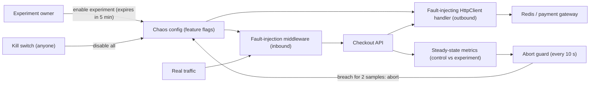
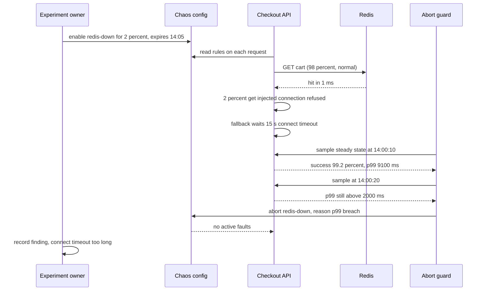

A food-delivery platform has a circuit breaker around its restaurant-menu service, retries with jitter on the payment client, and a Redis cache in front of everything. Everyone *believes* the app would survive Redis going down. One Tuesday afternoon the team decides to find out, on purpose, for 2 % of traffic, for five minutes, with a big red button within reach. Within 40 seconds the checkout p99 goes from 300 ms to 9 seconds. The cache client had a 15-second connect timeout nobody had noticed, and every request waited for it. The team presses the button, fixes the timeout that week, and the real Redis failure three months later is a non-event. That is chaos engineering: turning beliefs about resilience into evidence.

## Learning objectives

By the end of this lesson you will be able to:

1. Explain what chaos engineering is (and is not), and when a team is ready for it.
2. Write a chaos experiment: steady state, hypothesis, fault, blast radius, abort conditions and rollback.
3. Quantify blast radius in requests and in error-budget terms before running anything.
4. Implement safe fault injection in ASP.NET Core: server-side middleware and an outbound `HttpClient` handler, with opt-in, percentage limits and a kill switch.
5. Build an automatic abort guard that stops an experiment when the steady state breaks.
6. Plan and run a game day, and turn its findings into fixes.

## Prerequisites

- [Logs, metrics, traces and OpenTelemetry](#/lesson/m14-observability): you can't run an experiment you can't observe.
- [Alerting and incident response](#/lesson/m14-alerting-incidents): experiments test your alerts and runbooks too.
- [Circuit breaker](#/lesson/m10-circuit-breaker) and [Timeouts, retries and backoff](#/lesson/m10-timeouts-retries): the mechanisms most experiments verify.

## Explain it like I'm a beginner

A fire drill.

A school *believes* everyone can leave the building in four minutes. A fire drill tests it: the alarm rings on purpose, at a known time, with teachers ready. Maybe one staircase gets crowded and it takes nine minutes. Nobody is hurt, because it's a drill, and next week the school opens a second exit.

Some rules make a drill safe:

- **You know what "normal" looks like** (four minutes, everyone counted). That's the **steady state**.
- **You say what you expect** before you start: "everyone out in under four minutes". That's the **hypothesis**.
- **You start small**: one floor first, not the whole school during exams. That's limiting the **blast radius**.
- **You can stop instantly** if someone actually gets hurt. That's the **abort condition** and the **kill switch**.
- **You write down what went wrong** and fix it.

Chaos engineering is fire drills for software. You deliberately add a small fault (make a service slow, make a dependency fail, switch off a server) and watch whether the system behaves the way you believe it does. A **game day** is a scheduled, team-wide drill, where people practise the response too.

## First-principles explanation

### What chaos engineering is

The Principles of Chaos Engineering define it as *the discipline of experimenting on a system in order to build confidence in its capability to withstand turbulent conditions in production*. The key word is **experimenting**. It is the scientific method applied to resilience:

1. Define **steady state**: measurable outputs that show the system is healthy. Use business-level signals: orders per minute, payment success rate, p99 latency. Not CPU.
2. Form a **hypothesis**: "steady state will continue in both the control group and the experimental group while we inject fault X."
3. **Introduce real-world events**: server crashes, latency, dependency errors, network partitions, full disks, clock skew, a zone going away.
4. **Try to disprove the hypothesis** by comparing the experimental group with a control group. A difference is a finding.

It also adds two operating principles: **run in production** (eventually, carefully), because staging never has production's traffic mix, data and configuration; and **minimise blast radius** and **automate**, so experiments are safe and repeatable.

### What it is not

- **Not random breakage.** "Let's kill some pods and see" without a hypothesis, metrics or an abort plan is just causing an incident.
- **Not a replacement for testing.** Unit, integration and load tests come first. Chaos finds the problems that only appear when real components interact under real conditions.
- **Not a first step.** If you lack basic observability, timeouts, retries, health checks and alerts, you already know the system is fragile. Fix the known gaps first. Chaos is for finding *unknown* weaknesses.

### Readiness checklist

Before the first experiment in production:

- RED metrics and dashboards for the services involved, with SLOs.
- Alerts that page on symptoms ([previous lesson](#/lesson/m14-alerting-incidents)).
- Timeouts on every network call, and a plan for what each dependency's failure should do (fallback, degrade, fail fast).
- A way to stop the experiment in seconds, tested.
- Agreement from the service owners and on-call, and a time window outside critical periods (not the last day of a tax rebate, not a sale day).
- An error budget with room to spare. If the budget is spent, don't spend more on experiments.

### Anatomy of an experiment

A good experiment fits on one page:

| Field | Example |
|---|---|
| Name | Redis unavailable for checkout |
| Steady state | Checkout success ≥ 99.5 %, p99 < 800 ms, orders per minute within 10 % of the same time last week |
| Hypothesis | If Redis is unreachable, checkout falls back to the database within 200 ms; success stays ≥ 99.5 % and p99 < 1,200 ms |
| Fault | Redis client calls fail with connection refused |
| Scope (blast radius) | 2 % of checkout requests, opt-in header only, one region, 5 minutes |
| Abort conditions | Checkout success < 99 % for 2 consecutive 10-second samples, or p99 > 2,000 ms, or any page fires |
| Rollback | Kill switch disables all faults within 5 s; config change reverts automatically after 5 minutes |
| Observers | Experiment owner, service on-call, someone watching customer-support channels |
| Expected learning | Validate fallback path and timeout values |

### Kinds of fault

- **Latency**: add 500 ms or 3 s to a dependency. Usually more revealing than errors, because slow failures exhaust threads, connection pools and queues while timeouts tick.
- **Errors**: return 500, 503 or 429, or throw connection exceptions.
- **Resource exhaustion**: fill a disk, consume CPU or memory, exhaust a connection pool.
- **Instance or process failure**: kill a pod, a VM, a process. Tests orchestration, health checks and graceful shutdown.
- **Network faults**: packet loss, partitions between services, DNS failure.
- **State faults**: clock skew, expired certificates, rotated credentials.
- **Large-scale**: lose an availability zone or a region (usually a game day, and closely related to [disaster recovery](#/lesson/m14-dr)).

### Where to inject

- **Infrastructure level**: platforms such as Azure Chaos Studio, AWS Fault Injection Service, Chaos Mesh or LitmusChaos on Kubernetes, and proxies like Toxiproxy. They can kill VMs, add network latency, or stress CPU without code changes.
- **Application level**: middleware and `HttpClient` handlers inside your service. Precise (one route, one dependency, one tenant, an opt-in header), and works anywhere your code runs. In .NET, Polly v8 includes chaos strategies (latency, fault, outcome and behaviour injection) that plug into the same resilience pipelines as retries and circuit breakers.

Application-level injection gives the finest blast-radius control, which is why we build it in this lesson. Infrastructure-level faults test things code can't fake, such as a process actually dying.

### Blast radius, in numbers

Before running, compute the worst case. Checkout gets 2,000 requests per second.

- Experiment scope: 2 % of checkout traffic for 5 minutes → 2,000 × 0.02 × 300 s = **12,000 requests** exposed to the fault.
- If every exposed request failed (the worst case), how much error budget is that? SLO 99.9 % over 30 days: total requests ≈ 2,000 × 2,592,000 s ≈ 5.18 billion; budget = 0.1 % ≈ **5.18 million** bad requests. 12,000 ÷ 5.18 million ≈ **0.23 %** of the monthly budget.
- With an abort guard that triggers after 20 seconds of bad steady state, real exposure is closer to 2,000 × 0.02 × 20 = 800 requests.

That is a cost the business can agree to in advance. Compare: the unplanned Redis outage this experiment prevents could burn the whole budget in an hour.

### Steady state and control groups

Comparing against a **control group** separates the fault's effect from background noise. If 2 % of requests receive the fault, the other 98 % are the control. Tag injected requests (a span attribute and a low-cardinality metric tag like `chaos.experiment = redis-down`) so dashboards can show both groups side by side. A rise in p99 that appears in both groups is not caused by the experiment; one that appears only in the experimental group is.

### Abort conditions and kill switches

Two independent ways to stop:

1. **Automatic abort**: a guard watches steady-state metrics every few seconds and disables the experiment when they break for a sustained period (not a single noisy sample). It should also stop if *it* loses sight of the metrics: no data means abort, not continue.
2. **Manual kill switch**: one action (a config flag, an endpoint, a button) that any observer can use without asking permission. Test it before every experiment.

Experiments should also **expire**: the configuration carries an end time, so a forgotten experiment switches itself off.

### Progressing safely

1. Run in a test environment with synthetic load. Fix what breaks.
2. Run in production with the opt-in header only (internal test accounts or synthetic traffic).
3. Run on 1 % of real traffic in one region for a few minutes.
4. Increase scope or duration gradually. Automate the experiment to run regularly (for example weekly), so regressions are caught when someone changes a timeout.

### Game days

A **game day** is a scheduled exercise where a team runs one or more experiments together, with the people who would respond to the real event. Game days test what code can't: whether alerts fire, whether the runbook is right, whether the on-call engineer can find the dashboard, whether the failover script still works, whether the decision-maker is reachable.

A game day plan:

- **Before**: pick scenarios (for example "payment gateway returns 503 for UPI", "lose one zone"); write hypotheses; agree the window and stakeholders; brief support; test the kill switch; decide who plays on-call (ideally someone who didn't design the system).
- **During**: a facilitator injects faults and keeps time; responders handle it as a real incident (declaring, communicating, mitigating); observers note surprises; the facilitator can abort.
- **After**: a blameless review the same day or next: what matched the hypothesis, what didn't, what was confusing. Every surprise becomes a tracked action item.

Many game days end with findings that are not about code at all: a dashboard that needs VPN access nobody on-call has, a runbook referring to a renamed service, a failover requiring a credential stored in one person's password manager.

### When chaos engineering is not worth it (yet)

- A single-instance internal app: there is no redundancy to verify; you already know a crash means downtime. Invest in backups and quick restarts.
- No observability: you'd be injecting faults blind.
- A team already overloaded with incidents: fix the known, recurring causes first.
- During critical business periods or when the error budget is exhausted.

A light-weight alternative that suits many teams: **fault-injection tests in CI**. Use the same middleware or a Polly chaos strategy in integration tests to verify that a 3-second dependency delay produces a fast fallback. You get much of the learning without touching production.

## Visual explanation

### Architecture: the experiment control loop



How to read it: the owner enables an experiment through a configuration store, with an expiry time. Inbound middleware and an outbound `HttpClient` handler read the configuration on every request and inject faults into the selected slice of traffic. The API emits steady-state metrics tagged so that experimental and control traffic can be compared. The abort guard reads those metrics every 10 seconds and, if the steady state is broken for two samples in a row, disables the experiment through the same configuration path. The kill switch is a separate, simpler path that anyone can use. Both stop paths act on configuration, so stopping does not need a deploy.

### Sequence: an experiment that aborts



Ninety-eight percent of requests (the control group) behave normally. The 2 % that receive the injected fault expose the weakness: the fallback path waits for a long connect timeout instead of failing fast. Success rate barely moves, so an error-only abort condition would have let this run; the p99 condition catches it. After two consecutive breaching samples the guard disables the experiment, and the next requests see no fault. The finding (a 15-second timeout on a cache call that should take 1 ms) is exactly the kind of latent weakness chaos engineering is for.

## Step-by-step example

We'll verify the "Redis is optional" belief for the checkout API.

### Step 1 — define steady state

From the dashboards: checkout success 99.8 % (SLO 99.5 %), p99 320 ms, about 2,000 checkouts per second at 2 p.m. on a weekday. These are the baseline numbers for comparison.

### Step 2 — write the hypothesis and abort conditions

"If Redis calls fail with connection refused for 2 % of checkout requests, those requests fall back to PostgreSQL; success stays ≥ 99.5 % and p99 for the experimental group stays < 1,200 ms." Abort if success < 99 % or p99 > 2,000 ms for two consecutive 10-second samples, or any page fires.

### Step 3 — compute the blast radius

2,000 × 0.02 × 300 s = 12,000 requests at most; about 0.23 % of the monthly error budget in the worst case. Approved by the checkout team lead and the on-call engineer.

### Step 4 — dry run in staging

Run the same configuration in staging with load-test traffic. The p99 jumps to 15 s. Finding: `ConnectTimeout` on the Redis client is 15 s (a library default in this setup). Fix: set connect and operation timeouts to 100 ms and add a circuit breaker around the cache so a down cache is skipped entirely after a few failures.

### Step 5 — run in production, opt-in only

Enable the rule with `RequireOptInHeader = true`; QA sends traffic with `X-Chaos-Experiment: redis-down`. Checkout works, p99 for those requests 410 ms. Hypothesis holds.

### Step 6 — run on 2 % of real traffic

Five minutes, observers watching. Experimental-group p99 450 ms, success 99.8 %. No abort. Database load rises by an amount consistent with the extra 2 % of cache misses.

### Step 7 — automate

Schedule the experiment weekly at 2 % for 5 minutes, with the abort guard. If a future change reintroduces a long timeout, the guard aborts and opens a ticket.

## Production-style C# implementation

```text
Checkout.Api/
  Program.cs
  Chaos/ChaosOptions.cs
  Chaos/ChaosState.cs
  Chaos/FaultInjectionMiddleware.cs
  Chaos/FaultInjectingHandler.cs
  Chaos/SteadyStateMonitor.cs
```

```csharp file=Chaos/ChaosOptions.cs
namespace Checkout.Chaos;

public enum ChaosFaultKind { Latency, Error, Abort }

public sealed class ChaosRule
{
    public string ExperimentId { get; set; } = "";
    /// <summary>Inbound: path prefix such as "/checkout". Outbound: host such as "redis.internal".</summary>
    public string Target { get; set; } = "";
    public bool Outbound { get; set; }
    /// <summary>Share of matching requests to affect, 0.0 to 1.0.</summary>
    public double Percentage { get; set; }
    public ChaosFaultKind Kind { get; set; } = ChaosFaultKind.Latency;
    public int LatencyMs { get; set; } = 2000;
    public int StatusCode { get; set; } = 503;
    /// <summary>When true, only requests carrying X-Chaos-Experiment: {ExperimentId} are eligible.</summary>
    public bool RequireOptInHeader { get; set; } = true;
    /// <summary>Experiments switch themselves off at this time, so a forgotten one cannot run for days.</summary>
    public DateTimeOffset ExpiresAt { get; set; }
}

public sealed class ChaosOptions
{
    /// <summary>Master switch. Off by default in every environment.</summary>
    public bool Enabled { get; set; }
    public double MaxPercentage { get; set; } = 0.05;   // guard rail: never more than 5 % of traffic
    public List<ChaosRule> Rules { get; set; } = new();
}
```

```csharp file=Chaos/ChaosState.cs
using System.Collections.Concurrent;
using System.Diagnostics.Metrics;
using Microsoft.Extensions.Options;

namespace Checkout.Chaos;

public interface IChaosRandom { double NextDouble(); }

public sealed class SharedChaosRandom : IChaosRandom
{
    public double NextDouble() => Random.Shared.NextDouble();
}

/// <summary>Runtime state: which experiments have been aborted, and the decision logic shared by
/// the inbound middleware and the outbound handler.</summary>
public sealed class ChaosState
{
    public const string HeaderName = "X-Chaos-Experiment";

    private readonly IOptionsMonitor<ChaosOptions> _options;
    private readonly IChaosRandom _random;
    private readonly TimeProvider _time;
    private readonly ConcurrentDictionary<string, string> _aborted = new(StringComparer.OrdinalIgnoreCase);
    private readonly Counter<long> _injected;
    private volatile bool _killSwitch;

    public ChaosState(IOptionsMonitor<ChaosOptions> options, IChaosRandom random, TimeProvider time, IMeterFactory meters)
    {
        _options = options;
        _random = random;
        _time = time;
        _injected = meters.Create("Checkout.Chaos").CreateCounter<long>("chaos.faults.injected", "{fault}");
    }

    public bool KillSwitchEngaged => _killSwitch;
    public void EngageKillSwitch() => _killSwitch = true;
    public void ResetKillSwitch() => _killSwitch = false;

    public void Abort(string experimentId, string reason) => _aborted[experimentId] = reason;
    public IReadOnlyDictionary<string, string> Aborted => _aborted;

    public IEnumerable<ChaosRule> ActiveRules()
    {
        var o = _options.CurrentValue;
        if (!o.Enabled || _killSwitch) return [];
        var now = _time.GetUtcNow();
        return o.Rules.Where(r => r.ExpiresAt > now && !_aborted.ContainsKey(r.ExperimentId));
    }

    /// <summary>Returns the rule to apply, or null. Draws one random number per matching rule.</summary>
    public ChaosRule? Decide(bool outbound, string target, string? optInHeader)
    {
        var max = _options.CurrentValue.MaxPercentage;
        foreach (var rule in ActiveRules())
        {
            if (rule.Outbound != outbound) continue;
            var matches = outbound
                ? string.Equals(rule.Target, target, StringComparison.OrdinalIgnoreCase)
                : target.StartsWith(rule.Target, StringComparison.OrdinalIgnoreCase);
            if (!matches) continue;
            if (rule.RequireOptInHeader && !string.Equals(optInHeader, rule.ExperimentId, StringComparison.OrdinalIgnoreCase)) continue;

            if (_random.NextDouble() < Math.Min(rule.Percentage, max))
            {
                _injected.Add(1, new KeyValuePair<string, object?>("chaos.experiment", rule.ExperimentId));
                return rule;
            }
        }
        return null;
    }
}
```

```csharp file=Chaos/FaultInjectionMiddleware.cs
using System.Diagnostics;

namespace Checkout.Chaos;

/// <summary>Injects faults into inbound requests. Health endpoints are never touched, so an experiment
/// can't make the orchestrator restart healthy instances.</summary>
public sealed class FaultInjectionMiddleware(RequestDelegate next, ChaosState chaos, ILogger<FaultInjectionMiddleware> logger)
{
    public async Task InvokeAsync(HttpContext context)
    {
        var path = context.Request.Path.Value ?? "/";
        if (path.StartsWith("/health", StringComparison.OrdinalIgnoreCase))
        {
            await next(context);
            return;
        }

        var optIn = context.Request.Headers[ChaosState.HeaderName].ToString();
        var rule = chaos.Decide(outbound: false, path, optIn.Length == 0 ? null : optIn);
        if (rule is null)
        {
            await next(context);
            return;
        }

        // Tag the span so traces show which requests were part of the experiment group.
        Activity.Current?.SetTag("chaos.experiment", rule.ExperimentId);
        Activity.Current?.SetTag("chaos.fault", rule.Kind.ToString());
        context.Response.Headers["X-Chaos-Injected"] = rule.ExperimentId;
        logger.LogInformation("Chaos {Experiment} injecting {Fault} on {Path}", rule.ExperimentId, rule.Kind, path);

        switch (rule.Kind)
        {
            case ChaosFaultKind.Latency:
                await Task.Delay(rule.LatencyMs, context.RequestAborted);
                await next(context);
                break;
            case ChaosFaultKind.Error:
                context.Response.StatusCode = rule.StatusCode;
                await context.Response.WriteAsJsonAsync(new { title = "Injected fault", experiment = rule.ExperimentId });
                break;
            case ChaosFaultKind.Abort:
                context.Abort();   // simulates a dropped connection
                break;
        }
    }
}
```

```csharp file=Chaos/FaultInjectingHandler.cs
using System.Net;
using System.Net.Sockets;

namespace Checkout.Chaos;

/// <summary>Injects faults into outbound HTTP calls to a named host: the "dependency is slow or down"
/// experiments. Register it on the typed client you want to test.</summary>
public sealed class FaultInjectingHandler(ChaosState chaos, IHttpContextAccessor accessor) : DelegatingHandler
{
    protected override async Task<HttpResponseMessage> SendAsync(HttpRequestMessage request, CancellationToken ct)
    {
        var host = request.RequestUri?.Host ?? "";
        var optIn = accessor.HttpContext?.Request.Headers[ChaosState.HeaderName].ToString();
        var rule = chaos.Decide(outbound: true, host, string.IsNullOrEmpty(optIn) ? null : optIn);

        if (rule is null) return await base.SendAsync(request, ct);

        switch (rule.Kind)
        {
            case ChaosFaultKind.Latency:
                await Task.Delay(rule.LatencyMs, ct);    // the caller's timeout should fire before this ends
                return await base.SendAsync(request, ct);
            case ChaosFaultKind.Error:
                return new HttpResponseMessage((HttpStatusCode)rule.StatusCode)
                {
                    RequestMessage = request,
                    Content = new StringContent($"Injected by {rule.ExperimentId}"),
                };
            default:
                throw new HttpRequestException($"Injected connection failure ({rule.ExperimentId})",
                    new SocketException((int)SocketError.ConnectionRefused));
        }
    }
}
```

```csharp file=Chaos/SteadyStateMonitor.cs
using System.Collections.Concurrent;
using Microsoft.Extensions.Options;

namespace Checkout.Chaos;

public sealed record SteadyStateSample(long Requests, long Failures, double P99Ms);

/// <summary>Collects outcomes since the last sample. A real system queries the metrics backend instead.</summary>
public sealed class SteadyStateRecorder
{
    private readonly ConcurrentQueue<(bool Ok, double Ms)> _window = new();
    public void Record(bool ok, double ms) => _window.Enqueue((ok, ms));

    public SteadyStateSample TakeSample()
    {
        var items = new List<(bool Ok, double Ms)>();
        while (_window.TryDequeue(out var x)) items.Add(x);
        if (items.Count == 0) return new SteadyStateSample(0, 0, 0);
        var sorted = items.Select(i => i.Ms).Order().ToArray();
        var p99 = sorted[Math.Min(sorted.Length - 1, (int)Math.Ceiling(sorted.Length * 0.99) - 1)];
        return new SteadyStateSample(items.Count, items.Count(i => !i.Ok), p99);
    }
}

public sealed class AbortConditions
{
    public double MaxFailureRatio { get; set; } = 0.01;
    public double MaxP99Ms { get; set; } = 2000;
    public int ConsecutiveBreaches { get; set; } = 2;
    public long MinRequests { get; set; } = 200;
    public TimeSpan SampleInterval { get; set; } = TimeSpan.FromSeconds(10);
}

/// <summary>Aborts every active experiment when the steady state breaks for N consecutive samples.</summary>
public sealed class SteadyStateMonitor(
    SteadyStateRecorder recorder, ChaosState chaos, IOptions<AbortConditions> conditions,
    TimeProvider time, ILogger<SteadyStateMonitor> logger) : BackgroundService
{
    private int _breaches;

    protected override async Task ExecuteAsync(CancellationToken stoppingToken)
    {
        var c = conditions.Value;
        using var timer = new PeriodicTimer(c.SampleInterval, time);
        while (await timer.WaitForNextTickAsync(stoppingToken))
        {
            var active = chaos.ActiveRules().ToList();
            var sample = recorder.TakeSample();
            if (active.Count == 0) { _breaches = 0; continue; }
            if (sample.Requests < c.MinRequests) continue;   // not enough data: neither breach nor reset

            var failureRatio = (double)sample.Failures / sample.Requests;
            var breached = failureRatio > c.MaxFailureRatio || sample.P99Ms > c.MaxP99Ms;
            _breaches = breached ? _breaches + 1 : 0;

            if (_breaches >= c.ConsecutiveBreaches)
            {
                var reason = $"steady state broken: failures {failureRatio:P2}, p99 {sample.P99Ms:F0} ms";
                foreach (var rule in active) chaos.Abort(rule.ExperimentId, reason);
                logger.LogWarning("Chaos experiments aborted: {Reason}", reason);
                _breaches = 0;
            }
        }
    }
}
```

```csharp file=Program.cs
using Checkout.Chaos;

var builder = WebApplication.CreateBuilder(args);

builder.Services.Configure<ChaosOptions>(builder.Configuration.GetSection("Chaos"));
builder.Services.Configure<AbortConditions>(builder.Configuration.GetSection("Chaos:Abort"));
builder.Services.AddSingleton(TimeProvider.System);
builder.Services.AddSingleton<IChaosRandom, SharedChaosRandom>();
builder.Services.AddSingleton<ChaosState>();
builder.Services.AddSingleton<SteadyStateRecorder>();
builder.Services.AddHostedService<SteadyStateMonitor>();
builder.Services.AddHttpContextAccessor();
builder.Services.AddTransient<FaultInjectingHandler>();
builder.Services.AddHttpClient("payments", c =>
{
    c.BaseAddress = new Uri("https://payments.internal/");
    c.Timeout = TimeSpan.FromSeconds(3);
}).AddHttpMessageHandler<FaultInjectingHandler>();
builder.Services.AddHealthChecks();

var app = builder.Build();

// Record steady state for every non-health request (outermost, so injected latency is measured).
app.Use(async (context, next) =>
{
    var recorder = context.RequestServices.GetRequiredService<SteadyStateRecorder>();
    var clock = context.RequestServices.GetRequiredService<TimeProvider>();
    var start = clock.GetTimestamp();
    var ok = false;
    try
    {
        await next(context);
        ok = context.Response.StatusCode < 500;
    }
    finally
    {
        if (!context.Request.Path.StartsWithSegments("/health"))
            recorder.Record(ok, clock.GetElapsedTime(start).TotalMilliseconds);
    }
});

app.UseMiddleware<FaultInjectionMiddleware>();
app.MapHealthChecks("/health/ready");

app.MapPost("/checkout", async (IHttpClientFactory clients, CancellationToken ct) =>
{
    var http = clients.CreateClient("payments");
    try
    {
        using var response = await http.PostAsync("charge", content: null, ct);
        return response.IsSuccessStatusCode ? Results.Ok() : Results.Problem("Payment unavailable", statusCode: 503);
    }
    catch (HttpRequestException)
    {
        return Results.Problem("Payment unavailable", statusCode: 503);
    }
});

// Kill switch: anyone on the rota can call it. Protect it with authentication in production.
app.MapPost("/chaos/kill", (ChaosState chaos) => { chaos.EngageKillSwitch(); return Results.Ok(new { stopped = true }); });
app.MapGet("/chaos/status", (ChaosState chaos) => Results.Ok(new
{
    killSwitch = chaos.KillSwitchEngaged,
    active = chaos.ActiveRules().Select(r => r.ExperimentId),
    aborted = chaos.Aborted,
}));

app.Run();
```

Safety rails built into this design:

- **Off by default** (`Enabled = false`), with a hard **maximum percentage** that config can't exceed.
- **Expiry** on every rule.
- **Opt-in header** mode for the first production runs.
- **Health endpoints excluded**: injecting faults into readiness probes would make the orchestrator kill healthy instances, a much bigger blast radius than intended.
- **Two stop paths**: the automatic monitor and the manual kill switch, both effective without a deploy. `IOptionsMonitor` also picks up config changes at runtime.
- **Tagged telemetry**: spans and a counter carry the experiment id, so control and experimental groups can be compared. The experiment id is a small, bounded set, safe as a metric tag.

The same idea is available off the shelf: Polly v8's chaos strategies can be added to a resilience pipeline, for example with `AddChaosLatency` and `AddChaosFault`, controlled by an `EnabledGenerator` and `InjectionRate`. Use them when your pipelines already use Polly; the middleware above is useful for whole-request faults and for learning how injection works.

```csharp
// Requires the Polly.Core / Microsoft.Extensions.Http.Resilience packages.
builder.Services.AddHttpClient("payments")
    .AddResilienceHandler("payments-chaos", (pipeline, context) =>
    {
        var chaosOn = context.ServiceProvider.GetRequiredService<IOptionsMonitor<ChaosOptions>>();
        pipeline
            .AddTimeout(TimeSpan.FromSeconds(2))
            .AddChaosLatency(new ChaosLatencyStrategyOptions
            {
                EnabledGenerator = _ => ValueTask.FromResult(chaosOn.CurrentValue.Enabled),
                InjectionRate = 0.02,
                Latency = TimeSpan.FromSeconds(3),
            });
    });
```

## Bad design vs good design

**Bad**: "chaos Friday".

```text
- A script kills a random pod in production every hour, in every service, forever.
- No hypothesis, no steady-state definition, no observers.
- Faults also hit /health, so orchestrators restart more pods.
- No kill switch: stopping it needs a pull request and a deploy.
- Runs during the monthly billing run because nobody checked the calendar.
```

Problems: nobody knows what was being tested, so nothing is learned when it breaks, and every unrelated incident gets blamed on the chaos script. Blast radius is unbounded. The health-check injection amplifies the fault. Without a fast stop, a bad experiment becomes a long incident. The team's trust in the practice is destroyed, and the script gets deleted.

**Good**: one experiment at a time, written down; steady state and hypothesis; computed blast radius approved in advance; automated abort and manual kill switch; expiry; observers; health endpoints excluded; scheduled outside critical periods; findings tracked like postmortem action items. Automated recurring experiments come later, once each has been run manually.

**Is it worth it?** For a system with redundancy, fallbacks and an SLO, yes: each experiment is a cheap rehearsal of an expensive incident. For a small single-instance app, a fault-injection integration test in CI gives most of the value at almost no risk.

:::callout type=tradeoff title="Production versus staging"
Production experiments give real answers (real traffic, data, config, scale) but cost some risk and error budget. Staging experiments are free but often misleading: different timeouts, smaller data, no real load. Start in staging to remove obvious problems, then move to production with tight scope. Never skip straight to production for a fault you haven't run anywhere.
:::

## Practical playground

The circuit-breaker simulator models a service calling a dependency at 20 requests per second during an outage where 90 % of calls fail. Treat it as a chaos experiment.

1. Write your hypothesis first: "with the breaker **off**, what happens to latency and to the dependency during the outage?" Then run it with `breaker=false`.
2. Turn the breaker on. Did the hypothesis "the breaker protects callers within 10 seconds" hold? Measure how long the bad period lasted.
3. Change `timeoutMs` from 2,000 to 200. How does the user-visible latency change during the outage? This is the Redis connect-timeout lesson from the introduction.
4. Set `minRequests` to 200 (higher than the traffic in one window). What does the breaker do now? Relate this to the abort guard's `MinRequests`.
5. For each run, write one line in the form "Steady state: … Fault: … Observed: … Finding: …".

:::playground type=sim sim=circuit title="Chaos experiment: dependency outage with and without a breaker" breaker=false failureThreshold=0.5 windowSec=10 minRequests=20 openSec=10 halfOpenProbes=5 rps=20 outageFailure=0.9 timeoutMs=2000
:::

## Exercises

:::exercise id=m14-chaos-ex1 difficulty=beginner kind=code title="Compute an experiment's blast radius"
Before any experiment, compute what it can cost.
::requirements
- `BlastRadius.ExposedRequests(double rps, double trafficFraction, TimeSpan duration)` returns the number of requests that receive the fault, rounded down to a `long`. `rps` ≥ 0, `trafficFraction` in [0, 1], `duration` ≥ 0, else `ArgumentOutOfRangeException`.
- `BlastRadius.BudgetShare(long exposedRequests, double rps, double slo, int periodDays)` returns exposed requests as a fraction of the period's error budget (`rps × seconds in period × (1 − slo)`). `slo` strictly between 0 and 1.
- `BlastRadius.IsAcceptable(long exposedRequests, double rps, double slo, int periodDays, double maxBudgetShare)` returns true when the share is at most `maxBudgetShare`.
::acceptance
- 2,000 RPS, 2 %, 5 minutes gives 12,000 exposed requests.
- 12,000 at 2,000 RPS and 99.9 % over 30 days is about 0.00231 of the budget.
- With a 1 % budget limit that experiment is acceptable; 20 % of traffic for 30 minutes is not.
::hint
Exposed = rps × fraction × seconds.
::hint
Seconds in 30 days = 30 × 86,400 = 2,592,000.
::hint
Budget = total requests in the period × (1 − slo).
::hint
```csharp
var budget = rps * periodDays * 86_400.0 * (1 - slo);
return exposedRequests / budget;
```
::starter
```csharp file=BlastRadius.cs
using System;

public static class BlastRadius
{
    public static long ExposedRequests(double rps, double trafficFraction, TimeSpan duration) => throw new NotImplementedException();
    public static double BudgetShare(long exposedRequests, double rps, double slo, int periodDays) => throw new NotImplementedException();
    public static bool IsAcceptable(long exposedRequests, double rps, double slo, int periodDays, double maxBudgetShare) =>
        throw new NotImplementedException();
}
```
::tests
```csharp file=BlastRadiusTests.cs
using System;
using Xunit;

public class BlastRadiusTests
{
    [Fact] public void Exposed_for_lesson_example() =>
        Assert.Equal(12_000L, BlastRadius.ExposedRequests(2000, 0.02, TimeSpan.FromMinutes(5)));

    [Fact] public void Exposed_rounds_down() =>
        Assert.Equal(3L, BlastRadius.ExposedRequests(10, 0.035, TimeSpan.FromSeconds(10)));

    [Fact] public void Budget_share_for_lesson_example() =>
        Assert.Equal(0.002315, BlastRadius.BudgetShare(12_000, 2000, 0.999, 30), 6);

    [Fact] public void Small_experiment_acceptable() =>
        Assert.True(BlastRadius.IsAcceptable(12_000, 2000, 0.999, 30, 0.01));

    [Fact]
    public void Large_experiment_not_acceptable()
    {
        var exposed = BlastRadius.ExposedRequests(2000, 0.20, TimeSpan.FromMinutes(30));
        Assert.Equal(720_000L, exposed);
        Assert.False(BlastRadius.IsAcceptable(exposed, 2000, 0.999, 30, 0.01));
    }

    [Fact] public void Bad_fraction_throws() =>
        Assert.Throws<ArgumentOutOfRangeException>(() => BlastRadius.ExposedRequests(100, 1.5, TimeSpan.FromMinutes(1)));

    [Fact] public void Bad_slo_throws() =>
        Assert.Throws<ArgumentOutOfRangeException>(() => BlastRadius.BudgetShare(10, 100, 1.0, 30));
}
```
::solution
```csharp file=BlastRadius.cs
using System;

public static class BlastRadius
{
    public static long ExposedRequests(double rps, double trafficFraction, TimeSpan duration)
    {
        if (rps < 0) throw new ArgumentOutOfRangeException(nameof(rps));
        if (trafficFraction is < 0 or > 1 || double.IsNaN(trafficFraction)) throw new ArgumentOutOfRangeException(nameof(trafficFraction));
        if (duration < TimeSpan.Zero) throw new ArgumentOutOfRangeException(nameof(duration));
        return (long)Math.Floor(rps * trafficFraction * duration.TotalSeconds + 1e-9);
    }

    public static double BudgetShare(long exposedRequests, double rps, double slo, int periodDays)
    {
        if (double.IsNaN(slo) || slo <= 0 || slo >= 1) throw new ArgumentOutOfRangeException(nameof(slo));
        ArgumentOutOfRangeException.ThrowIfLessThan(periodDays, 1);
        if (rps <= 0) throw new ArgumentOutOfRangeException(nameof(rps));
        var budget = rps * periodDays * 86_400.0 * (1 - slo);
        return exposedRequests / budget;
    }

    public static bool IsAcceptable(long exposedRequests, double rps, double slo, int periodDays, double maxBudgetShare) =>
        BudgetShare(exposedRequests, rps, slo, periodDays) <= maxBudgetShare;
}
```

The small `1e-9` guards against floating-point results such as 11,999.999999 for what should be 12,000. The numbers make the conversation with the business concrete: "this experiment can cost at most a quarter of one percent of this month's error budget" is an easy yes; "20 % of traffic for 30 minutes uses 14 % of the budget in the worst case" deserves a smaller first step.
::mistakes
- Forgetting the traffic fraction and computing the whole service's traffic.
- Using the SLO itself instead of (1 − SLO) as the budget ratio.
- Using `Math.Round`, which can over-count by one; the brief asks to round down.
::extensions
Add an abort-time parameter: the realistic exposure is rps × fraction × time-to-abort, not the full duration.
:::

:::exercise id=m14-chaos-ex2 difficulty=beginner kind=written title="Write the experiment plan for a slow payment gateway"
The checkout service calls a payment gateway with a 3-second timeout and up to 1 retry. The team believes "if the gateway gets slow, checkout fails fast and shows 'try again' within 4 seconds, and other routes are unaffected". Write a one-page experiment plan using the fields from this lesson: name, steady state (with numbers), hypothesis, fault, scope and blast radius (with arithmetic, assuming 800 checkout RPS), abort conditions, rollback, observers, and what you expect to learn.
::acceptance
- Steady state uses business metrics and real numbers, not CPU.
- The hypothesis is falsifiable (it can be shown false by a measurement).
- Blast radius is computed in requests and as a share of the error budget.
- Abort conditions include latency and an "other routes affected" signal.
- Mentions the risk that retries double the latency and load.
::hint
What is the worst-case latency for one checkout with a 3 s timeout and 1 retry?
::hint
"Other routes are unaffected" means you must watch, for example, the menu and order-tracking routes too.
::hint
Start with 1 % and the opt-in header.
::solution
**Name**: Payment gateway +5 s latency.

**Steady state** (weekday 3 p.m. baseline): checkout success 99.7 %, checkout p99 1.1 s, menu p99 180 ms, order-tracking p99 150 ms, about 800 checkouts per second, thread-pool queue length near 0.

**Hypothesis**: When the gateway responds after 5 s for 1 % of checkout calls, those checkouts fail after the 3 s timeout, retry once, fail again, and return "try again" within about 6.2 s (3 s + jittered backoff + 3 s). The team's belief of "within 4 seconds" is therefore already **contradicted by arithmetic**: with 1 retry, the worst case is about 6 s. Revised hypothesis: affected checkouts fail within 6.5 s; unaffected checkouts keep p99 < 1.3 s; menu and tracking p99 stay < 250 ms; thread-pool queue stays < 50.

**Fault**: `FaultInjectingHandler` with `Kind = Latency`, `LatencyMs = 5000`, target host of the gateway.

**Scope**: Phase 1 opt-in header only (QA accounts). Phase 2: 1 % of checkout traffic, one region, 5 minutes, expiring automatically. Blast radius: 800 × 0.01 × 300 = 2,400 checkouts. At SLO 99.5 % over 30 days, budget = 800 × 2,592,000 × 0.005 ≈ 10.4 million; 2,400 is about 0.02 %.

**Abort conditions** (two consecutive 10 s samples): overall checkout success < 99 %; unaffected checkout p99 > 2 s; menu or tracking p99 > 400 ms; thread-pool queue > 200; any page.

**Rollback**: kill switch endpoint (tested before start) and rule expiry.

**Observers**: experiment owner, checkout on-call, someone watching customer-support chat, payment team contact.

**Expected learning**: whether the retry doubles user wait (likely, so consider no retry on timeout for payments, or a total deadline of 4 s across attempts); whether slow calls hold threads or connections and affect other routes (bulkhead needed?); whether the "try again" message is shown and whether users double-pay on retry (idempotency keys).
::mistakes
- Steady state "CPU below 70 %": users don't feel CPU.
- Hypothesis "the system should be resilient": not falsifiable.
- Forgetting that the retry multiplies both latency and the load on a struggling gateway.
:::

:::exercise id=m14-chaos-ex3 difficulty=intermediate kind=code title="The fault decider: who gets a fault?"
Implement the decision function used by fault-injection middleware, with all the safety rails.
::requirements
- `FaultDecider(IReadOnlyList<FaultRule> rules, Func<double> random)`: any rule with `Percentage` outside [0, 1] throws `ArgumentOutOfRangeException`.
- `bool KillSwitch { get; set; }` — when true, `Decide` always returns `FaultKind.None` and never calls `random`.
- `(FaultKind Kind, string? ExperimentId) Decide(RequestInfo request)`:
  - Paths starting with `/health` (case-insensitive) never get faults.
  - Rules are checked in order. A rule matches if the path starts with `PathPrefix` (case-insensitive) and, when `RequireOptInHeader` is true, the request's `ExperimentHeader` equals the rule's `ExperimentId` (case-insensitive).
  - For each matching rule, call `random()` **once**; if the value is less than `Percentage`, return that rule's kind and id.
  - Non-matching rules must not consume random numbers.
  - No fault: `(FaultKind.None, null)`.
::acceptance
- A matching rule with percentage 0.02 and random 0.01 injects; random 0.5 does not.
- `/health/ready` never gets a fault, even with a 100 % rule on `/`.
- Opt-in rules ignore requests without the right header.
- Kill switch stops everything and draws no random numbers.
- Random is only drawn for matching rules.
::hint
Do the cheap, deterministic checks (kill switch, health path, prefix, header) before drawing a random number.
::hint
In tests, `random` can be a lambda that dequeues from a `Queue<double>` and counts calls.
::hint
`string.Equals(a, b, StringComparison.OrdinalIgnoreCase)` handles a null header.
::hint
Validate percentages in the constructor with a loop over the rules.
::starter
```csharp file=FaultDecider.cs
using System;
using System.Collections.Generic;

public enum FaultKind { None, Latency, Error }

public sealed record FaultRule(string ExperimentId, string PathPrefix, double Percentage, FaultKind Kind, bool RequireOptInHeader);

public sealed record RequestInfo(string Path, string? ExperimentHeader);

public sealed class FaultDecider
{
    public FaultDecider(IReadOnlyList<FaultRule> rules, Func<double> random) => throw new NotImplementedException();
    public bool KillSwitch { get; set; }
    public (FaultKind Kind, string? ExperimentId) Decide(RequestInfo request) => throw new NotImplementedException();
}
```
::tests
```csharp file=FaultDeciderTests.cs
using System;
using System.Collections.Generic;
using Xunit;

public class FaultDeciderTests
{
    private sealed class Rng
    {
        private readonly Queue<double> _values;
        public int Calls { get; private set; }
        public Rng(params double[] values) => _values = new Queue<double>(values);
        public double Next() { Calls++; return _values.Count > 0 ? _values.Dequeue() : 0.99; }
    }

    private static FaultRule Checkout(double pct = 0.02, bool optIn = false) =>
        new("pay-slow", "/checkout", pct, FaultKind.Latency, optIn);

    [Fact]
    public void Injects_when_random_below_percentage()
    {
        var rng = new Rng(0.01);
        var d = new FaultDecider(new[] { Checkout() }, rng.Next);
        Assert.Equal((FaultKind.Latency, (string?)"pay-slow"), d.Decide(new RequestInfo("/checkout/123", null)));
    }

    [Fact]
    public void No_fault_when_random_above_percentage()
    {
        var d = new FaultDecider(new[] { Checkout() }, new Rng(0.5).Next);
        Assert.Equal((FaultKind.None, (string?)null), d.Decide(new RequestInfo("/checkout", null)));
    }

    [Fact]
    public void Health_is_never_faulted()
    {
        var rng = new Rng(0.0);
        var d = new FaultDecider(new[] { new FaultRule("all", "/", 1.0, FaultKind.Error, false) }, rng.Next);
        Assert.Equal(FaultKind.None, d.Decide(new RequestInfo("/HEALTH/ready", null)).Kind);
        Assert.Equal(0, rng.Calls);
    }

    [Fact]
    public void Opt_in_rule_requires_matching_header()
    {
        var rng = new Rng(0.0, 0.0);
        var d = new FaultDecider(new[] { Checkout(1.0, optIn: true) }, rng.Next);
        Assert.Equal(FaultKind.None, d.Decide(new RequestInfo("/checkout", null)).Kind);
        Assert.Equal(FaultKind.None, d.Decide(new RequestInfo("/checkout", "other-exp")).Kind);
        Assert.Equal(0, rng.Calls);
        Assert.Equal(FaultKind.Latency, d.Decide(new RequestInfo("/checkout", "PAY-SLOW")).Kind);
        Assert.Equal(1, rng.Calls);
    }

    [Fact]
    public void Kill_switch_stops_everything()
    {
        var rng = new Rng(0.0);
        var d = new FaultDecider(new[] { Checkout(1.0) }, rng.Next) { KillSwitch = true };
        Assert.Equal(FaultKind.None, d.Decide(new RequestInfo("/checkout", null)).Kind);
        Assert.Equal(0, rng.Calls);
    }

    [Fact]
    public void Only_matching_rules_draw_random_numbers()
    {
        var rng = new Rng(0.5, 0.01);
        var rules = new[]
        {
            new FaultRule("menu", "/menu", 1.0, FaultKind.Error, false),
            Checkout(0.02),
            new FaultRule("checkout-err", "/checkout", 0.05, FaultKind.Error, false),
        };
        var d = new FaultDecider(rules, rng.Next);
        Assert.Equal((FaultKind.Error, (string?)"checkout-err"), d.Decide(new RequestInfo("/checkout", null)));
        Assert.Equal(2, rng.Calls);
    }

    [Fact]
    public void Bad_percentage_throws() =>
        Assert.Throws<ArgumentOutOfRangeException>(() => new FaultDecider(new[] { Checkout(1.2) }, () => 0));
}
```
::solution
```csharp file=FaultDecider.cs
using System;
using System.Collections.Generic;

public enum FaultKind { None, Latency, Error }

public sealed record FaultRule(string ExperimentId, string PathPrefix, double Percentage, FaultKind Kind, bool RequireOptInHeader);

public sealed record RequestInfo(string Path, string? ExperimentHeader);

public sealed class FaultDecider
{
    private readonly IReadOnlyList<FaultRule> _rules;
    private readonly Func<double> _random;

    public FaultDecider(IReadOnlyList<FaultRule> rules, Func<double> random)
    {
        ArgumentNullException.ThrowIfNull(rules);
        ArgumentNullException.ThrowIfNull(random);
        foreach (var r in rules)
            if (double.IsNaN(r.Percentage) || r.Percentage < 0 || r.Percentage > 1)
                throw new ArgumentOutOfRangeException(nameof(rules), $"Rule {r.ExperimentId} has percentage {r.Percentage}.");
        _rules = rules;
        _random = random;
    }

    public bool KillSwitch { get; set; }

    public (FaultKind Kind, string? ExperimentId) Decide(RequestInfo request)
    {
        if (KillSwitch) return (FaultKind.None, null);
        if (request.Path.StartsWith("/health", StringComparison.OrdinalIgnoreCase)) return (FaultKind.None, null);

        foreach (var rule in _rules)
        {
            if (!request.Path.StartsWith(rule.PathPrefix, StringComparison.OrdinalIgnoreCase)) continue;
            if (rule.RequireOptInHeader &&
                !string.Equals(request.ExperimentHeader, rule.ExperimentId, StringComparison.OrdinalIgnoreCase)) continue;

            if (_random() < rule.Percentage) return (rule.Kind, rule.ExperimentId);
        }
        return (FaultKind.None, null);
    }
}
```

Why care about which rules draw random numbers? Two reasons. Tests become deterministic: you can predict exactly which value each rule sees. And with several rules on the same route, each rule's percentage is applied to the traffic that reached it, which is what the experiment plan assumes. Here `checkout-err` effectively gets 5 % of the 98 % that `pay-slow` didn't take; write that down in the plan, or allow only one active rule per route.
::alternatives
Instead of a random draw per request, hash a stable key (user id or session id) into [0, 1). The same users then consistently get the fault for the whole experiment, which makes user-journey effects visible and avoids one user seeing a mix of slow and fast responses.
::mistakes
- Drawing the random number before the prefix check, which skews the percentages of later rules and makes tests flaky.
- Comparing the header case-sensitively, so `PAY-SLOW` from a tool doesn't match.
- Letting `/health` through "because it's just one rule": the orchestrator then restarts healthy instances.
::extensions
Add `ExpiresAt` to `FaultRule` and pass a `TimeProvider`, so expired rules are skipped.
:::

:::exercise id=m14-chaos-ex4 difficulty=intermediate kind=code title="An abort guard that isn't fooled by noise"
Build the guard that stops an experiment when the steady state breaks.
::requirements
- `AbortGuard(double maxFailureRatio, double maxP99Ms, int consecutiveBreaches, long minRequests)`: ratios in [0, 1], `maxP99Ms > 0`, `consecutiveBreaches ≥ 1`, `minRequests ≥ 0`, else `ArgumentOutOfRangeException`.
- `bool Observe(SteadyStateSample sample)` returns `Aborted` after processing the sample.
- A sample with `Requests < minRequests` is **inconclusive**: it neither counts as a breach nor resets the streak.
- A sample breaches when `Failures / Requests > maxFailureRatio` **or** `P99Ms > maxP99Ms`. A healthy sample resets the streak to 0.
- When the streak reaches `consecutiveBreaches`, set `Aborted = true` and `Reason`. The reason must contain `"failure ratio"` if the failure condition breached in the final sample, otherwise `"p99"`.
- Once aborted, stay aborted.
- `ObserveMissing()` records that the metrics could not be read. Two missing samples in a row abort with a reason containing `"no data"`.
::acceptance
- One bad sample among good ones does not abort.
- Two consecutive bad samples abort (with `consecutiveBreaches = 2`).
- A low-traffic sample between two bad samples doesn't reset the streak.
- Two missing samples abort.
::hint
Track two counters: the breach streak and the missing-data streak. A real sample resets the missing streak.
::hint
Check `Aborted` first in both methods and return early.
::hint
Compute the failure ratio only when `Requests > 0`.
::starter
```csharp file=AbortGuard.cs
using System;

public sealed record SteadyStateSample(long Requests, long Failures, double P99Ms);

public sealed class AbortGuard
{
    public AbortGuard(double maxFailureRatio, double maxP99Ms, int consecutiveBreaches, long minRequests) =>
        throw new NotImplementedException();
    public bool Aborted { get; private set; }
    public string? Reason { get; private set; }
    public bool Observe(SteadyStateSample sample) => throw new NotImplementedException();
    public bool ObserveMissing() => throw new NotImplementedException();
}
```
::tests
```csharp file=AbortGuardTests.cs
using System;
using Xunit;

public class AbortGuardTests
{
    private static AbortGuard G() => new(0.01, 2000, 2, 100);
    private static readonly SteadyStateSample Good = new(1000, 2, 400);
    private static readonly SteadyStateSample BadErrors = new(1000, 50, 400);
    private static readonly SteadyStateSample BadLatency = new(1000, 2, 9000);
    private static readonly SteadyStateSample Tiny = new(10, 10, 9000);

    [Fact]
    public void Single_breach_does_not_abort()
    {
        var g = G();
        g.Observe(Good); g.Observe(BadErrors); g.Observe(Good); g.Observe(BadLatency);
        Assert.False(g.Aborted);
    }

    [Fact]
    public void Two_consecutive_breaches_abort_with_reason()
    {
        var g = G();
        g.Observe(BadLatency);
        Assert.True(g.Observe(BadErrors));
        Assert.Contains("failure ratio", g.Reason);
    }

    [Fact]
    public void Latency_reason()
    {
        var g = G();
        g.Observe(BadLatency);
        g.Observe(BadLatency);
        Assert.True(g.Aborted);
        Assert.Contains("p99", g.Reason);
    }

    [Fact]
    public void Low_traffic_sample_is_inconclusive()
    {
        var g = G();
        g.Observe(BadErrors);
        g.Observe(Tiny);
        Assert.False(g.Aborted);
        g.Observe(BadErrors);
        Assert.True(g.Aborted);
    }

    [Fact]
    public void Stays_aborted()
    {
        var g = G();
        g.Observe(BadErrors); g.Observe(BadErrors);
        Assert.True(g.Observe(Good));
    }

    [Fact]
    public void Missing_data_twice_aborts()
    {
        var g = G();
        Assert.False(g.ObserveMissing());
        Assert.True(g.ObserveMissing());
        Assert.Contains("no data", g.Reason);
    }

    [Fact]
    public void Real_sample_resets_missing_streak()
    {
        var g = G();
        g.ObserveMissing(); g.Observe(Good); g.ObserveMissing();
        Assert.False(g.Aborted);
    }

    [Fact]
    public void Bad_arguments_throw() =>
        Assert.Throws<ArgumentOutOfRangeException>(() => new AbortGuard(1.5, 2000, 2, 100));
}
```
::solution
```csharp file=AbortGuard.cs
using System;

public sealed record SteadyStateSample(long Requests, long Failures, double P99Ms);

public sealed class AbortGuard
{
    private readonly double _maxFailureRatio;
    private readonly double _maxP99Ms;
    private readonly int _needed;
    private readonly long _minRequests;
    private int _breachStreak;
    private int _missingStreak;

    public AbortGuard(double maxFailureRatio, double maxP99Ms, int consecutiveBreaches, long minRequests)
    {
        if (double.IsNaN(maxFailureRatio) || maxFailureRatio < 0 || maxFailureRatio > 1)
            throw new ArgumentOutOfRangeException(nameof(maxFailureRatio));
        if (!(maxP99Ms > 0)) throw new ArgumentOutOfRangeException(nameof(maxP99Ms));
        ArgumentOutOfRangeException.ThrowIfLessThan(consecutiveBreaches, 1);
        ArgumentOutOfRangeException.ThrowIfNegative(minRequests);
        (_maxFailureRatio, _maxP99Ms, _needed, _minRequests) = (maxFailureRatio, maxP99Ms, consecutiveBreaches, minRequests);
    }

    public bool Aborted { get; private set; }
    public string? Reason { get; private set; }

    public bool Observe(SteadyStateSample sample)
    {
        if (Aborted) return true;
        _missingStreak = 0;
        if (sample.Requests < _minRequests || sample.Requests == 0) return false;   // inconclusive

        var ratio = (double)sample.Failures / sample.Requests;
        var failureBreach = ratio > _maxFailureRatio;
        var latencyBreach = sample.P99Ms > _maxP99Ms;

        if (!failureBreach && !latencyBreach)
        {
            _breachStreak = 0;
            return false;
        }

        if (++_breachStreak >= _needed)
        {
            Aborted = true;
            Reason = failureBreach
                ? $"failure ratio {ratio:P2} above {_maxFailureRatio:P2} for {_breachStreak} samples"
                : $"p99 {sample.P99Ms:F0} ms above {_maxP99Ms:F0} ms for {_breachStreak} samples";
        }
        return Aborted;
    }

    public bool ObserveMissing()
    {
        if (Aborted) return true;
        if (++_missingStreak >= 2)
        {
            Aborted = true;
            Reason = "no data from steady-state metrics for 2 samples";
        }
        return Aborted;
    }
}
```

The three design choices that matter: requiring consecutive breaches filters single noisy samples (a GC pause, one slow client); treating low-traffic samples as inconclusive avoids aborting on "1 of 3 requests failed"; and treating missing data as a reason to stop follows the safety principle that an experiment must never run blind. The guard is deliberately "sticky": restarting an aborted experiment is a human decision, made after looking at what happened.
::mistakes
- Resetting the streak on a low-traffic sample, so alternating busy and quiet samples never abort.
- Continuing the experiment when metrics are missing.
- Aborting on the first breaching sample: experiments then stop on noise and nobody trusts the results.
::extensions
Compare the experimental group with the control group instead of fixed thresholds: abort when the experimental group's failure ratio exceeds the control group's by more than 0.5 percentage points.
:::

:::exercise id=m14-chaos-ex5 difficulty=advanced kind=hld title="Plan a zone-failure game day"
A ride-hailing platform runs in one region across three availability zones: an API tier (12 instances, 4 per zone), a matching service (6 instances), PostgreSQL with a synchronous standby in another zone, Redis with a replica, and a Kafka-style event stream. Peak is 6,000 requests per second; the game day will run on a Wednesday at 3 p.m., when traffic is about 2,500 requests per second. The team believes "losing any one zone causes no user-visible impact beyond a 30-second blip".

Design the game day: the architecture view of what you will break and observe, the sequence of experiments (from small to large), steady state and hypotheses with numbers, abort conditions, roles, and what you expect to find.
::acceptance
- Starts with smaller experiments (one instance, then one service's zone share) before the full zone.
- Checks capacity: can two zones carry the load? Shows the arithmetic.
- Covers stateful components (database failover, Redis, the stream) with specific hypotheses.
- Defines abort conditions and the stop mechanism for an infrastructure-level fault.
- Includes people and process checks (alerts, runbook, communication), not only code.
::hint
At 2,500 RPS with 12 instances, what is the load per instance, and what happens when 4 disappear? Is there headroom at the 6,000 RPS peak?
::hint
A zone failure is many failures at once: instances, the database primary (if it lives there), Redis, and network paths.
::hint
Infrastructure faults (shutting down VMs in a zone, blocking network) need their own stop path: how do you "undo" a zone outage?
::hint
Think about clients: will the mobile app retry and cause a retry storm when 4 instances vanish?
::starter
```json
{
  "nodes": [
    { "id": "riders", "type": "client", "label": "Rider and driver apps", "props": { "rps": 2500 } },
    { "id": "lb", "type": "load-balancer", "label": "Regional load balancer" },
    { "id": "api", "type": "app-server", "label": "API tier (4 per zone x 3)", "props": { "instances": 12, "multiAz": true } },
    { "id": "match", "type": "worker", "label": "Matching service", "props": { "instances": 6, "multiAz": true } },
    { "id": "pg", "type": "database", "label": "PostgreSQL primary (zone A) + sync standby (zone B)", "props": { "replicas": 1, "multiAz": true } },
    { "id": "redis", "type": "cache", "label": "Redis primary + replica" },
    { "id": "stream", "type": "stream", "label": "Trip event stream (3 brokers)" }
  ],
  "edges": [
    { "from": "riders", "to": "lb", "kind": "sync" },
    { "from": "lb", "to": "api", "kind": "sync" },
    { "from": "api", "to": "pg", "kind": "sync" },
    { "from": "api", "to": "redis", "kind": "sync" },
    { "from": "api", "to": "stream", "kind": "async" },
    { "from": "stream", "to": "match", "kind": "async" }
  ]
}
```
::solution
```json
{
  "nodes": [
    { "id": "riders", "type": "client", "label": "Rider and driver apps (retry with jitter, honour Retry-After)", "props": { "rps": 2500 } },
    { "id": "lb", "type": "load-balancer", "label": "Regional LB (zone-aware health checks)" },
    { "id": "api", "type": "app-server", "label": "API tier: 12 now, 15 during game day (5 per zone)", "props": { "instances": 15, "multiAz": true } },
    { "id": "match", "type": "worker", "label": "Matching service (2 per zone, partition rebalance)", "props": { "instances": 6, "multiAz": true } },
    { "id": "pg", "type": "database", "label": "PostgreSQL primary zone A, sync standby zone B (automatic failover)", "props": { "replicas": 1, "multiAz": true } },
    { "id": "redis", "type": "cache", "label": "Redis primary + replica in different zones (auto failover)" },
    { "id": "stream", "type": "stream", "label": "Event stream: replication factor 3, min in-sync 2" },
    { "id": "chaos", "type": "external", "label": "Chaos platform: zone A VM stop + network block, 20 min max, stop action tested" },
    { "id": "mon", "type": "monitoring", "label": "Steady state: trip requests/min, match time p95, API p99, error ratio, per-zone panels" },
    { "id": "guard", "type": "scheduler", "label": "Abort guard + facilitator kill switch" }
  ],
  "edges": [
    { "from": "riders", "to": "lb", "kind": "sync" },
    { "from": "lb", "to": "api", "kind": "sync" },
    { "from": "api", "to": "pg", "kind": "sync" },
    { "from": "api", "to": "redis", "kind": "sync" },
    { "from": "api", "to": "stream", "kind": "async" },
    { "from": "stream", "to": "match", "kind": "async" },
    { "from": "chaos", "to": "api", "kind": "async", "label": "inject" },
    { "from": "api", "to": "mon", "kind": "async" },
    { "from": "mon", "to": "guard", "kind": "sync" },
    { "from": "guard", "to": "chaos", "kind": "sync", "label": "stop action" }
  ]
}
```

**Capacity check first.** At 2,500 RPS over 12 instances, each handles about 208 RPS. Losing a zone leaves 8 instances at about 313 RPS each, +50 %. At the 6,000 RPS peak, 8 instances would need 750 RPS each. If load tests show one instance tops out around 400 RPS (an assumed figure; measure yours), the game day at 3 p.m. would survive, but a real zone loss at peak would not. That is the first finding, available before breaking anything: provision for N+1 zones (each pair of zones must carry the peak) or autoscale fast enough. For the game day, pre-scale to 15 instances (5 per zone).

**Sequence of experiments** (stop after any one that fails its hypothesis):
1. *Kill one API instance* (zone A). Hypothesis: LB removes it within 10 s; error ratio stays below 0.1 %; no alert pages.
2. *Stop all API instances in zone A* (5 of 15). Hypothesis: error ratio spike < 1 % for < 30 s; p99 < 800 ms after 60 s; autoscaler adds instances in zones B and C within 5 minutes.
3. *Redis primary failover* (forced). Hypothesis: cache errors for < 15 s; API falls back to the database with p99 < 1.5 s; database CPU stays < 70 %.
4. *PostgreSQL failover* (forced switchover to zone B). Hypothesis: writes fail for < 30 s; clients retry with idempotency keys, no duplicate trips; read-only endpoints keep serving from cache.
5. *Full zone A outage* (VM stop and network block for the zone, 15 minutes max). Hypothesis: within 60 s, trip requests per minute return to within 5 % of baseline and match time p95 within 20 %; stream keeps accepting writes (2 of 3 brokers in sync); matching service rebalances partitions within 2 minutes.

**Steady state.** Trip requests per minute (compared with the same minute last Wednesday), match time p95 (baseline 4 s), API p99 (baseline 350 ms), error ratio (baseline 0.05 %), driver location updates per second.

**Abort conditions.** Error ratio > 2 % for 60 s; match time p95 > 15 s for 2 minutes; trip requests per minute drop > 20 % for 2 minutes; any data-integrity alarm (duplicate trips, payments without trips); any real incident elsewhere. Stop mechanism: the chaos platform's stop action restarts the VMs and removes the network block; tested on one VM the day before. Because a zone fault can't be undone in a second, keep experiment 5 short and the facilitator authorised to stop without discussion.

**Roles.** Facilitator (injects, keeps time, can abort), incident commander (from the on-call rota, treats it as real), operations, comms (support team briefed: "possible brief slowness 3–4 p.m."), scribe, observers per component (database, stream, mobile).

**People and process checks.** Do the right alerts fire, and only those? Does the zone-failure runbook work as written? Can the on-call reach the database dashboard? Is the status page decision made in time?

**Likely findings** (from experience with designs like this, not guarantees): capacity without one zone is insufficient at peak; client retries without jitter create a spike when instances vanish; a few services pin connections to the old database primary until restarted (DNS caching or a long-lived pool); matching rebalances slower than expected; a dashboard or runbook references zone-specific hosts. Each becomes a tracked action item with an owner, and experiment 5 is repeated after fixes.
::mistakes
- Starting with the full zone outage.
- Testing only stateless instances and calling it a zone test.
- Ignoring capacity: surviving at 3 p.m. says nothing about surviving at peak.
- No tested way to stop an infrastructure-level fault.
:::

## Automated testing

**Fault injection in integration tests.** Use `WebApplicationFactory` (or a test host) with chaos enabled in test configuration, opt-in header required, and assert behaviour:

```csharp
[Fact]
public async Task Slow_payment_gateway_returns_503_within_deadline()
{
    // Arrange: payments client timeout 3 s, chaos rule adds 5 s latency to payments.internal for opt-in requests.
    using var client = factory.CreateClient();
    var request = new HttpRequestMessage(HttpMethod.Post, "/checkout");
    request.Headers.Add("X-Chaos-Experiment", "pay-slow");

    var started = Stopwatch.GetTimestamp();
    var response = await client.SendAsync(request);

    Assert.Equal(HttpStatusCode.ServiceUnavailable, response.StatusCode);
    Assert.True(Stopwatch.GetElapsedTime(started) < TimeSpan.FromSeconds(4));
}
```

Such tests run on every build and catch the "someone raised the timeout to 30 s" regression long before a game day.

**Unit tests for the safety rails.** The decider (exercise 3), the abort guard (exercise 4) and expiry logic are pure functions; test them exhaustively. A bug in a safety rail is the most dangerous bug in a chaos system.

**Test the kill switch every time.** Before each production experiment, enable a harmless rule (opt-in only), engage the kill switch, and confirm `/chaos/status` reports no active rules. Automate it as a pre-flight step.

**Scheduled experiments as tests.** Mature teams run experiments continuously (for example weekly) in production with tight blast radius, and treat a failed hypothesis like a failed test: a ticket with an owner.

## Real-world application

- **Netflix** popularised the practice with Chaos Monkey (randomly terminating instances) and later more targeted, automated experimentation; the public Principles of Chaos Engineering came from that community. How their current internal platform works in detail is beyond what is public.
- **Cloud providers** offer managed fault injection: Azure Chaos Studio and AWS Fault Injection Service can stop VMs, add network latency, or fail over databases, with stop conditions tied to alarms.
- **Kubernetes users** use Chaos Mesh or LitmusChaos to kill pods, inject network faults and stress resources in a namespace.
- **.NET teams** use Polly's chaos strategies or custom middleware for application-level faults, often in CI first.
- **Banks and payment firms** run DR and failover drills on a schedule, often driven by regulation; game days extend that habit to everyday dependencies.
- **Government and infrastructure platforms** with deadline-driven peaks benefit from rehearsing dependency failures (SMS gateway, payment gateway, identity provider) well before the peak, not during it.

## Interview questions

:::interview
::q beginner
What is chaos engineering, and how is it different from just breaking things?
::a
It is controlled experimentation on a system to build confidence that it withstands real-world turbulence. Each experiment has a measurable steady state, a falsifiable hypothesis, a deliberately limited blast radius, abort conditions and a fast stop. Breaking things without those is just causing an incident: you learn little and risk a lot. The goal is to find unknown weaknesses (a long timeout, a missing fallback, a wrong runbook) before a real failure does.
::q beginner
What is blast radius and how do you limit it?
::a
The portion of users, traffic or infrastructure an experiment can affect. Limit it by targeting a small percentage of traffic, one route, one region or one instance; using opt-in headers or test accounts first; keeping experiments short with automatic expiry; and having automatic abort conditions plus a manual kill switch. Quantify it beforehand: requests exposed = RPS × fraction × duration, and compare with the error budget.
::q intermediate
How would you implement fault injection in an ASP.NET Core service?
::a
For inbound faults, middleware early in the pipeline that reads rules from `IOptionsMonitor` (so they can change at runtime), skips health endpoints, matches route and opt-in header, draws a random number against the rule's percentage, and injects latency, an error status or a connection abort. For dependency faults, a `DelegatingHandler` on the typed `HttpClient`, or Polly v8 chaos strategies in the resilience pipeline. Add guard rails: off by default, maximum percentage, expiry, tags on spans and metrics (experiment id), an abort monitor, and a kill switch endpoint. Test the safety logic with unit tests and the behaviour with integration tests.
::q intermediate
Why should steady state be defined with business metrics rather than CPU or memory?
::a
Because the question is whether users are affected. Orders per minute, payment success, match time and p99 latency reflect user experience directly; CPU can rise with no user impact or stay flat while users suffer (for example, threads blocked on a slow dependency use little CPU). Business metrics also make the experiment's results meaningful to stakeholders. Resource metrics are still useful for explaining *why* steady state changed.
::q advanced
Your team wants to start chaos engineering. What do you put in place first, and what is the first experiment?
::a
Prerequisites: SLOs and RED dashboards for the target service; symptom-based alerts; timeouts on all dependencies; a written runbook; an error budget with headroom; agreement from owners and on-call. Build the injection mechanism with safety rails (off by default, max percentage, expiry, kill switch, abort guard) and test them. First experiment: something low-risk and high-learning, such as adding 1–2 s of latency to one non-critical dependency for opt-in requests in staging, then production. Latency experiments often reveal missing or overly long timeouts and thread or pool exhaustion. Then grow scope gradually, and run a game day once the team is comfortable.
::q advanced
During a production experiment, the abort guard fires and the kill switch is engaged, but errors continue. What could be happening and what do you do?
::a
The experiment may have triggered a lasting state change rather than a transient fault: a circuit breaker stuck open, connection pools filled with broken connections, a retry storm that keeps itself going (metastable failure), caches evicted and a thundering herd on the database, autoscaling that scaled the wrong tier, or a failover that did not fail back. Treat it as a real incident immediately: declare, assign an IC, communicate. Mitigate with standard tools: shed load, restart affected instances, reset breakers, roll back config. Afterwards, the postmortem focuses on why the system didn't return to steady state when the fault stopped, which is often the most valuable finding of the whole programme.
:::

## Summary and revision

**Key takeaways**

- Chaos engineering is experimentation: steady state, hypothesis, fault, compare with control, learn.
- Define steady state with business and user metrics, with numbers.
- Compute blast radius in requests and error-budget share before you start, and get agreement.
- Every experiment needs automatic abort conditions, a manual kill switch, and an expiry time.
- Start small (staging, opt-in, 1 %) and grow. Latency faults often teach the most.
- In ASP.NET Core, inject faults with middleware (inbound) and `DelegatingHandler` or Polly chaos strategies (outbound). Never fault health endpoints.
- Game days test people, alerts and runbooks, not only code.
- Don't start chaos engineering before basic observability, timeouts and alerting exist; fix known weaknesses first.

**Terminology**: steady state, hypothesis, control group, experimental group, fault injection, blast radius, abort condition, kill switch, game day, opt-in header, Chaos Monkey, chaos strategies (Polly), metastable failure.

:::flashcards
Q: The four steps of a chaos experiment?
A: Define steady state, form a hypothesis, inject a real-world fault, compare experimental and control groups to try to disprove the hypothesis.
Q: How do you compute an experiment's worst-case exposure?
A: RPS × traffic fraction × duration (in seconds).
Q: Why exclude health endpoints from fault injection?
A: Faulted probes make the orchestrator kill or remove healthy instances, enlarging the blast radius.
Q: Two independent ways an experiment should be able to stop?
A: An automatic abort guard on steady-state metrics, and a manual kill switch anyone can use.
Q: Why are latency faults often more revealing than error faults?
A: Slow calls hold threads, connections and queue slots while timeouts tick, exposing missing or long timeouts and resource exhaustion.
Q: What should an abort guard do when it can't read metrics?
A: Abort. Never continue an experiment blind.
Q: What does a game day test that automated experiments don't?
A: People and process: alerts, runbooks, dashboards, access, communication and decision-making.
Q: When is chaos engineering premature?
A: Without observability, timeouts and alerting, during critical business periods, or when the error budget is spent.
:::

## Knowledge check

:::quiz pass=70
::q single
Which is a well-formed chaos hypothesis?
- [ ] "The system should be resilient to Redis failures."
- [ ] "CPU will stay below 70 %."
- [x] "If Redis is unreachable for 2 % of checkout requests, those requests succeed via the database fallback with p99 under 1,200 ms, and overall checkout success stays at or above 99.5 %."
- [ ] "Let's see what happens when Redis goes down."
> A good hypothesis is specific, measurable and falsifiable, and uses user-facing metrics.
::q single
Checkout serves 1,500 RPS. You inject a fault into 4 % of checkout traffic for 10 minutes. What is the worst-case number of affected requests?
- [ ] 6,000
- [ ] 15,000
- [x] 36,000
- [ ] 900,000
> 1,500 × 0.04 × 600 s = 36,000.
::q single
During an experiment, the failure ratio stays normal but p99 for the experimental group jumps from 400 ms to 9 s. What does this most likely reveal?
- [ ] The experiment is broken.
- [x] A missing or too-long timeout: the fallback waits on the failed dependency instead of failing fast.
- [ ] The database is too small.
- [ ] Nothing, because errors did not increase.
> Slow fallbacks are a classic latent weakness. That's why abort conditions include latency, not just errors.
::q multi
Which belong in the safety design of a fault-injection mechanism? (Select all that apply.)
- [x] Disabled by default, with a maximum traffic percentage.
- [x] Automatic expiry of each experiment.
- [x] An abort guard plus a manual kill switch.
- [ ] Applying faults to readiness probes so failover is tested.
- [x] Tagging affected requests in traces and metrics.
> Faulting readiness probes makes orchestrators remove healthy instances, which is uncontrolled damage.
::q single
Your team has no SLOs, few timeouts, and alerts that fire on CPU only. A manager asks you to "start chaos engineering next week". What do you recommend?
- [ ] Run Chaos Monkey in production immediately.
- [x] First add SLOs, symptom alerts and timeouts, fix known weaknesses, then start with small, opt-in experiments.
- [ ] Chaos engineering is only for very large companies.
- [ ] Run a full region failover game day.
> Chaos finds unknown weaknesses. Known gaps should be fixed first, and you need observability to learn anything.
::q single
The abort guard fired and all faults stopped, but errors stay high. What is the most useful framing?
- [ ] The guard has a bug.
- [x] The fault triggered a lasting bad state (for example, a retry storm or stuck breaker). Treat it as a real incident now, and investigate why the system didn't return to steady state.
- [ ] Wait; it will recover by itself.
- [ ] Re-enable the experiment to reproduce it.
> Failure to recover after the trigger is removed is a serious finding (metastable behaviour). Mitigate first, learn afterwards.
::q single
What is the main purpose of a game day compared with automated weekly experiments?
- [ ] It is cheaper.
- [ ] It runs at a higher traffic percentage.
- [x] It exercises the human response: alerts, runbooks, roles, access and communication.
- [ ] It replaces load testing.
> Automated experiments test the system. Game days test the socio-technical system, including people.
:::

## Completion criteria

You have finished this lesson when you can:

- [ ] Score at least 70 % on the knowledge check.
- [ ] Complete exercises 1, 3 and 4 with all tests passing.
- [ ] Write an experiment plan (exercise 2) with steady state, hypothesis, blast radius arithmetic and abort conditions.
- [ ] Design a game day (exercise 5) that starts small and checks capacity before breaking a zone.
- [ ] Explain to a sceptical manager, in two minutes, why controlled chaos reduces risk instead of adding it.
