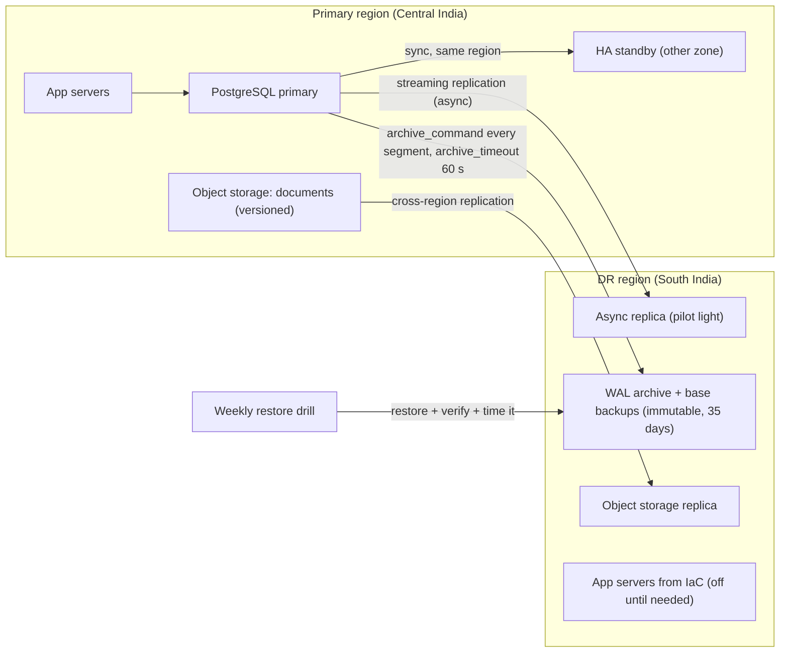
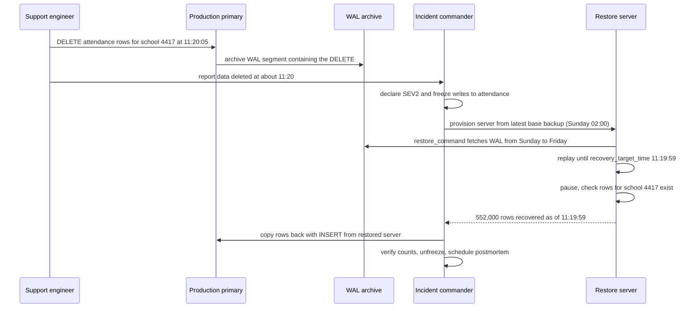

At 11:20 a.m. a support engineer at a company that sells school-management software runs a clean-up script against what he believes is the staging database. It is production. `DELETE FROM attendance WHERE school_id = 4417` was supposed to have `AND is_test = true`. Eleven months of daily attendance for a school with 2,300 students are gone, the records its teachers need for report cards, exam eligibility and scholarship claims. The database has two replicas in two availability zones, and both deleted the rows within milliseconds, exactly as designed. High availability did its job perfectly and saved nothing. This lesson is about the other half of reliability: getting data back.

## Learning objectives

By the end of this lesson you will be able to:

1. Define RPO and RTO, and derive them from business impact instead of guessing.
2. Explain why replication and high availability are not backups.
3. Compare full, incremental, differential, logical, physical and snapshot backups, and apply the 3-2-1 rule.
4. Configure PostgreSQL point-in-time recovery (PITR) with WAL archiving, and restore to a moment just before an accident.
5. Plan and run restore drills that measure your real RTO.
6. Choose a DR tier (backup and restore, pilot light, warm standby, active-active) and estimate its cost.

## Prerequisites

- [Availability, reliability and the nines](#/lesson/m11-availability): how availability is measured.
- [Read replicas and replication lag](#/lesson/m09-replicas): what a PostgreSQL replica does and doesn't do.
- [SLI, SLO, SLA and error budgets](#/lesson/m14-sli-slo-sla): useful for linking DR targets to commitments.

## Explain it like I'm a beginner

Imagine you are writing a long report on your laptop.

- You **save** every few minutes. If the laptop crashes, you lose at most the last few minutes of typing. That "how much work could I lose?" number is your **RPO**: Recovery Point Objective.
- If the laptop dies completely, you borrow another one, install the editor, download your file, and carry on. "How long until I'm working again?" is your **RTO**: Recovery Time Objective.

Now, two kinds of protection:

- A **second monitor that mirrors your screen** (replication) helps if one screen breaks. But if you accidentally delete a chapter, the mirror deletes it too, instantly.
- A **copy of the file from this morning in Google Drive, plus the history of every change since** (backup plus logs) lets you go back to 11:19 a.m., one minute before the mistake.

**Disaster recovery (DR)** is the plan for the bad day: which copies exist, where, how you restore them, who does it, and how long it takes. And the only way to know it works is to actually try it, before the bad day. That is a **restore drill**.

## First-principles explanation

### RPO and RTO

- **RPO (Recovery Point Objective)**: the maximum acceptable data loss, measured in time. RPO 5 minutes means that after a disaster you may lose up to the last 5 minutes of changes.
- **RTO (Recovery Time Objective)**: the maximum acceptable time from the disaster until the service works again.

They are business decisions expressed in minutes. Derive them from impact:

- A payments ledger loses money and trust with every lost transaction: RPO close to 0, RTO under an hour.
- A daily analytics dashboard can be rebuilt from source systems: RPO 24 hours, RTO 1–2 days is fine.
- A government grievance portal: losing a citizen's complaint is serious, but a 4-hour outage during a weekday is tolerable: RPO 5 minutes, RTO 4 hours.

Lower numbers cost more, roughly exponentially. Going from RPO 24 h to 5 min is cheap (WAL archiving). Going from 5 min to 0 needs synchronous replication to another site, which adds latency to every write.

Two related terms: **WRT** (work recovery time) is the time after systems are up to verify data and catch up on work; **MTD** (maximum tolerable downtime) is RTO + WRT, the point where the business is seriously harmed.

### Replication and HA are not backups

Replication copies every change, good or bad, to the replicas. It protects against **hardware and zone failures**. It does not protect against:

- **Logical errors**: a bad `DELETE`, a buggy migration, an application bug that overwrites prices.
- **Ransomware or a malicious insider** who encrypts or drops data with valid credentials.
- **Corruption** that is faithfully replicated.
- **Losing the whole account or region**, if the replicas live in the same place.

You need both. HA keeps you running through the common failures; backups let you go back in time.

### Kinds of backup

| Type | What it is | Strength | Weakness |
|---|---|---|---|
| Full | A complete copy | Simplest restore | Large and slow to take every time |
| Incremental | Only what changed since the last backup (full or incremental) | Small, fast to take | Restore needs the full plus every increment in order |
| Differential | What changed since the last *full* backup | Restore needs only full + latest differential | Grows each day until the next full |
| Logical (`pg_dump`) | SQL or a custom archive of the data | Portable across versions, restore one table | Slow for large databases, no PITR |
| Physical (`pg_basebackup`, pgBackRest, Barman) | A copy of the data files | Fast for big databases, basis for PITR | Same major version only, whole cluster |
| Storage snapshot | Disk-level snapshot by the cloud or SAN | Very fast, cheap to take | Must be crash-consistent; same provider; often same region |

PostgreSQL 17 added **native incremental physical backups**: with `summarize_wal = on`, `pg_basebackup --incremental=<previous backup_manifest>` copies only changed blocks, and `pg_combinebackup` merges a full and its incrementals into a restorable data directory. Tools like pgBackRest and Barman have long offered incremental and differential modes, plus parallelism, compression, encryption and retention management, and are what most self-managed teams use.

### The 3-2-1 rule (and its modern extension)

- **3** copies of your data (production plus two backups),
- on **2** different kinds of storage,
- with **1** copy off-site (another region or provider).

The modern version, **3-2-1-1-0**, adds **1** copy that is immutable or offline (write-once storage, a locked object-storage bucket with retention, an air-gapped copy) so ransomware with admin credentials cannot delete it, and **0** errors in your last restore test.

### PostgreSQL point-in-time recovery (PITR)

PostgreSQL writes every change first to the **write-ahead log (WAL)**: a stream of 16 MB segment files. The WAL exists so the database can recover after a crash, but if you **archive** every segment somewhere safe, you can replay history to any moment.

PITR has two ingredients:

1. A **base backup**: a physical copy of the data directory taken while the database runs (`pg_basebackup` or a backup tool).
2. A **continuous WAL archive**: every completed WAL segment copied to durable storage by `archive_command` (or `archive_library`).

To restore to 11:19:00:

1. Copy the latest base backup taken *before* 11:19 to a new server.
2. Configure `restore_command` (how to fetch archived WAL), `recovery_target_time = '2026-10-20 11:19:00+05:30'` and `recovery_target_action = 'promote'`.
3. Create an empty `recovery.signal` file and start PostgreSQL.
4. PostgreSQL replays WAL from the base backup's start up to 11:19:00, then stops and opens for writes.

A timestamp is the easiest target to explain, but not the most precise: several transactions can commit in the same second. If you can find the offending transaction with `pg_waldump`, use `recovery_target_lsn` (or `recovery_target_xid`) with `recovery_target_inclusive = false` to stop exactly before it.

You restore to a **new** server, not over production, then copy the deleted rows back (or switch traffic to the restored server if the damage is wide). Restoring alongside keeps the evidence and lets you compare.

**What sets your RPO with PITR?** The archive only receives *completed* segments. On a busy database a segment fills in seconds; on a quiet one it might take an hour. `archive_timeout = 60` forces a segment switch at least every minute, bounding data loss to about a minute plus archive delay. For near-zero RPO, stream WAL continuously (`pg_receivewal`, or the backup tool's streaming mode) or keep a synchronous standby.

**What sets your RTO?** Copying the base backup plus replaying WAL. Estimate, with clearly assumed numbers:

- Database 800 GB. Restore throughput from object storage about 200 MB/s (assumption; measure yours): 800,000 MB ÷ 200 MB/s = 4,000 s ≈ **67 minutes**.
- WAL since the base backup: 40 GB per day. With a weekly full and the accident on day 6, that's 240 GB to replay. At an assumed 60 MB/s replay rate: 240,000 ÷ 60 ≈ 4,000 s ≈ **67 minutes** more.
- Plus detection, decision, server provisioning, verification and switching traffic: say 45 minutes.
- Total ≈ **3 hours**. If the RTO is 1 hour, you need daily (or incremental) base backups to shorten replay, faster storage, or a standby that is already restored.

This arithmetic is why restore drills matter: real throughput is often very different from the estimate.

### Logical backups still matter

Physical backups restore a whole cluster. `pg_dump -Fc` gives you a portable, per-database archive from which you can restore one table (`pg_restore -t attendance`), move data to a newer major version, or hand a copy to an auditor. Many teams keep both: physical with PITR for disasters, a nightly logical dump of the critical database for surgical restores and long-term retention.

### Restore drills

A backup that has never been restored is a hope, not a backup. Common ways backups silently fail:

- The backup job "succeeds" but writes zero bytes because a mount was missing.
- WAL archiving stopped three weeks ago when a credential expired; nobody alerted.
- The encryption key is stored on the server that was lost.
- The restore needs a tool version nobody has installed.
- The backup is fine, but the restore takes 9 hours and the RTO is 2.

A **restore drill** restores a real backup to a scratch environment on a schedule (weekly automated, quarterly with humans), then:

1. verifies integrity (`pg_verifybackup` for base backups; application checks such as row counts and "latest order timestamp");
2. measures elapsed time for each step, which becomes your **measured RTO**;
3. measures the achievable recovery point, which becomes your **measured RPO**;
4. records the result and alerts if it fails or breaches the target.

### DR tiers

A **disaster** is losing a whole site: a region outage, a data-centre fire, an account compromise. The classic tiers, from cheapest to most expensive:

| Tier | What runs in the DR site | Typical RPO | Typical RTO | Relative cost |
|---|---|---|---|---|
| Backup and restore | Nothing; backups stored there | Minutes to hours | Hours to a day | Lowest: storage only |
| Pilot light | Core data replicated (database replica), app servers off | Seconds to minutes | Tens of minutes to hours | Low: one small replica |
| Warm standby | A scaled-down full copy, running | Seconds | Minutes | Medium: maybe 30–50 % of primary, an estimate |
| Multi-site active-active | Full capacity in each site, all serving | Near zero | Near zero for reads, depends on writes | Highest: about 2× plus complexity |

The ranges are typical, not guarantees; your actual numbers come from drills. Active-active for writes is the hard one: two regions accepting writes to the same data need conflict handling or a partitioned ownership model ([see multi-region](#/lesson/m16-multi-region)).

### Cost arithmetic

Suppose (all numbers illustrative) production costs ₹6 lakh per month: ₹3.5 lakh compute, ₹2 lakh database, ₹0.5 lakh storage.

- **Backup and restore**: geo-redundant backup storage, perhaps ₹30,000–50,000 per month. RTO is hours because everything must be built and restored.
- **Pilot light**: add a small cross-region read replica (₹40,000–60,000) and infrastructure-as-code to create app servers on demand. RTO drops to 30–60 minutes.
- **Warm standby**: replica sized to take traffic, plus app servers at 25 % scale: maybe ₹2–2.5 lakh. RTO 10–15 minutes.
- **Active-active**: roughly ₹12 lakh plus engineering time for conflict handling and global routing.

Compare against the cost of downtime. If an hour of outage costs ₹20 lakh in lost business and penalties, warm standby pays for itself after one avoided multi-hour outage a year. If an hour of outage costs ₹50,000, backup and restore is the right answer.

### Managed databases

Managed PostgreSQL (Azure Database for PostgreSQL flexible server, Amazon RDS, Google Cloud SQL) takes automatic backups and offers PITR within a retention window (on Azure flexible server, configurable from 7 to 35 days), optional geo-redundant backup storage, and cross-region read replicas you can promote. That removes most of the plumbing. It does **not** remove your responsibilities: choosing retention, testing restores, keeping a copy outside the account for ransomware and account-loss scenarios, protecting against accidental server deletion (resource locks), and knowing the restore runbook.

### Don't forget the rest

A database restore alone rarely brings a service back. A DR plan must also cover:

- **Object storage** (uploaded documents, homework files, invoices): versioning, cross-region replication, immutability policies.
- **Secrets and keys**: if the key vault is gone, encrypted backups are useless.
- **Infrastructure as code** to rebuild networks, app servers and DNS.
- **Message queues and caches**: usually rebuilt, but in-flight messages may be lost; design consumers to be idempotent and replayable.
- **DNS and certificates** for the DR endpoints.
- **People**: who declares a disaster, who executes, how you contact them if corporate chat is down.

### When a simpler approach is enough

An internal tool with a 50 MB database and a tolerance of a day's loss needs a nightly `pg_dump` to storage in another region, kept for 30 days, and a restore tested once a quarter. That is a complete DR plan for that system. Don't build a warm standby for something nobody would notice was down until Monday.

## Visual explanation

### Architecture: backups, WAL archive and a pilot-light DR region



How to read it: in the primary region, the HA standby in another zone handles hardware and zone failures with automatic failover. Every completed WAL segment and each base backup go to an archive in the DR region on immutable storage, so a compromised production account can't delete it; `archive_timeout` bounds RPO to about a minute on quiet periods. An asynchronous replica in the DR region is the pilot light: in a regional disaster you promote it (RPO = its replication lag, usually seconds) and create app servers from infrastructure as code. Documents replicate separately. The drill box is as important as any other: it restores from the archive every week and records how long it took. Note that the replica and the HA standby would both replay an accidental `DELETE`; only the archive lets you go back in time.

### Sequence: PITR after an accidental DELETE



The `DELETE` is itself recorded in WAL and archived, which is what makes the precise restore possible: replay stops just before the transaction that deleted the rows. Writes to the table are frozen so new attendance entries don't conflict with the repair. The restore goes to a **new** server so production keeps serving every other school. Recovery pauses at the target (`recovery_target_action = 'pause'` during investigation) so you can check you picked the right moment before promoting; if 11:19:59 was too late, you can restart with an earlier target. Finally, only the lost rows are copied back, so other schools' work since 11:20 is kept. The row count is a sanity check you can do in your head: 2,300 students × about 240 school days ≈ 552,000 attendance rows. A full rollback of the whole database to 11:19:59 would have lost everyone else's changes.

## Step-by-step example

We'll set up PITR for the school-management database, then rehearse the restore.

### Step 1 — agree RPO and RTO

With the business: attendance and marks are entered by teachers during every class and used for report cards, exam eligibility and fee reminders. Losing more than 15 minutes of entries means teachers re-entering a period's attendance from memory or paper; a day's outage during exam week delays results. Agreed: **RPO 5 minutes, RTO 4 hours** for the database, recorded in the service's reliability document.

### Step 2 — enable WAL archiving

```text
# postgresql.conf
wal_level = replica
archive_mode = on
archive_command = 'pgbackrest --stanza=vidya archive-push %p'
archive_timeout = 60          # force a segment switch at least every minute
summarize_wal = on            # PostgreSQL 17: enables native incremental base backups
```

`archive_command` must return success **only** after the file is durably stored; PostgreSQL keeps the segment and retries until it does. If archiving fails for long, WAL accumulates in `pg_wal` and can fill the disk, so alert on archive failures (`pg_stat_archiver.failed_count` and the age of `last_archived_time`).

### Step 3 — schedule base backups

Full backup weekly (Sunday 02:00), incremental daily. With 40 GB of WAL per day, the worst-case replay is one day of WAL instead of six. Keep 35 days of backups and WAL, plus monthly logical dumps for a year (required by the customer agreements with schools).

### Step 4 — make the archive survive a bad day

Store the repository in object storage in another region, with versioning and a retention lock so objects can't be deleted for 35 days, even by an administrator. Encrypt it, and store the encryption key in a separate key vault with its own access policy.

### Step 5 — rehearse the restore

```text
# On a fresh scratch server
pgbackrest --stanza=vidya --type=time "--target=2026-10-20 11:19:59+05:30" \
           --target-action=pause restore
# postgresql.auto.conf now contains restore_command and recovery_target_time
pg_ctl -D /var/lib/postgresql/17/main start
psql -c "SELECT count(*) FROM attendance WHERE school_id = 4417;"
psql -c "SELECT pg_wal_replay_resume();"   # promote once satisfied
```

With plain PostgreSQL tools instead of pgBackRest: copy the base backup into the data directory, set `restore_command = 'cp /mnt/archive/%f %p'`, `recovery_target_time`, `recovery_target_action`, create `recovery.signal`, and start the server.

### Step 6 — measure and record

The drill took 2 h 10 min: 70 minutes restoring the base backup, 25 minutes of WAL replay, 35 minutes of human steps. Within the 4-hour RTO, with margin. The recovery point achieved was 11:19:59, so RPO was met. Record both numbers and the date; alert if the next drill is late or slower than 3 hours.

## Production-style C# implementation

Backups themselves are run by database tools, not by your web app. What application code *can* do well is **watch** them: expose backup freshness as a health check that alerting uses, and record drill results so measured RTO and RPO are visible next to the targets.

```text
Ops.Dr/
  Program.cs
  Dr/BackupCatalog.cs
  Dr/BackupFreshnessHealthCheck.cs
  Dr/RestoreDrills.cs
```

```csharp file=Dr/BackupCatalog.cs
using System.Collections.Concurrent;

namespace Ops.Dr;

public enum BackupKind { Full, Incremental, Logical }

public sealed record BackupRecord(string Database, BackupKind Kind, DateTimeOffset FinishedAt, long SizeBytes, bool Verified);

public sealed record WalArchiveStatus(string Database, DateTimeOffset LastArchivedAt, long FailedCount);

public interface IBackupCatalog
{
    BackupRecord? LatestVerified(string database);
    WalArchiveStatus? ArchiveStatus(string database);
    void Add(BackupRecord record);
    void ReportArchive(WalArchiveStatus status);
}

/// <summary>In a real system this reads pgBackRest's "info --output=json", the managed service's API,
/// or pg_stat_archiver via a small agent. In memory here so it can be tested.</summary>
public sealed class InMemoryBackupCatalog : IBackupCatalog
{
    private readonly ConcurrentDictionary<string, List<BackupRecord>> _backups = new(StringComparer.OrdinalIgnoreCase);
    private readonly ConcurrentDictionary<string, WalArchiveStatus> _archive = new(StringComparer.OrdinalIgnoreCase);

    public void Add(BackupRecord record)
    {
        var list = _backups.GetOrAdd(record.Database, _ => new List<BackupRecord>());
        lock (list) list.Add(record);
    }

    public BackupRecord? LatestVerified(string database)
    {
        if (!_backups.TryGetValue(database, out var list)) return null;
        lock (list) return list.Where(b => b.Verified && b.Kind != BackupKind.Logical)
                               .MaxBy(b => b.FinishedAt);
    }

    public void ReportArchive(WalArchiveStatus status) => _archive[status.Database] = status;

    public WalArchiveStatus? ArchiveStatus(string database) =>
        _archive.TryGetValue(database, out var s) ? s : null;
}
```

```csharp file=Dr/BackupFreshnessHealthCheck.cs
using Microsoft.Extensions.Diagnostics.HealthChecks;
using Microsoft.Extensions.Options;

namespace Ops.Dr;

public sealed class DrTargets
{
    public string Database { get; set; } = "vidya";
    /// <summary>Recovery point objective. WAL archiving older than this breaches it.</summary>
    public TimeSpan Rpo { get; set; } = TimeSpan.FromMinutes(5);
    /// <summary>Recovery time objective, compared with drill results.</summary>
    public TimeSpan Rto { get; set; } = TimeSpan.FromHours(4);
    /// <summary>Longest allowed gap between verified physical base backups.</summary>
    public TimeSpan MaxBaseBackupAge { get; set; } = TimeSpan.FromHours(26);
}

/// <summary>Unhealthy when we could not currently meet the RPO, or base backups are stale.
/// Exposed on a separate endpoint so it pages the data on-call, not the load balancer.</summary>
public sealed class BackupFreshnessHealthCheck(IBackupCatalog catalog, IOptions<DrTargets> targets, TimeProvider time) : IHealthCheck
{
    public Task<HealthCheckResult> CheckHealthAsync(HealthCheckContext context, CancellationToken cancellationToken = default)
    {
        var t = targets.Value;
        var now = time.GetUtcNow();
        var data = new Dictionary<string, object>();

        var archive = catalog.ArchiveStatus(t.Database);
        if (archive is null)
            return Task.FromResult(HealthCheckResult.Unhealthy($"No WAL archive status for {t.Database}."));

        var archiveAge = now - archive.LastArchivedAt;
        data["walArchiveAgeSeconds"] = (int)archiveAge.TotalSeconds;
        data["walArchiveFailures"] = archive.FailedCount;

        var backup = catalog.LatestVerified(t.Database);
        if (backup is null)
            return Task.FromResult(HealthCheckResult.Unhealthy($"No verified base backup for {t.Database}.", data: data));

        var backupAge = now - backup.FinishedAt;
        data["baseBackupAgeHours"] = Math.Round(backupAge.TotalHours, 1);

        if (archiveAge > t.Rpo)
            return Task.FromResult(HealthCheckResult.Unhealthy(
                $"WAL last archived {archiveAge.TotalMinutes:F0} min ago; RPO is {t.Rpo.TotalMinutes:F0} min.", data: data));

        if (backupAge > t.MaxBaseBackupAge)
            return Task.FromResult(HealthCheckResult.Degraded(
                $"Latest verified base backup is {backupAge.TotalHours:F1} h old.", data: data));

        return Task.FromResult(HealthCheckResult.Healthy("Backups and WAL archive within targets.", data));
    }
}
```

```csharp file=Dr/RestoreDrills.cs
using System.Collections.Concurrent;
using Microsoft.Extensions.Options;

namespace Ops.Dr;

public sealed record DrillStep(string Name, TimeSpan Duration);

public sealed record DrillResult(
    string Database, DateTimeOffset RunAt, DateTimeOffset TargetTime, DateTimeOffset AchievedRecoveryPoint,
    IReadOnlyList<DrillStep> Steps, bool DataChecksPassed)
{
    public TimeSpan MeasuredRto => Steps.Aggregate(TimeSpan.Zero, (sum, s) => sum + s.Duration);
    public TimeSpan RecoveryPointShortfall => TargetTime - AchievedRecoveryPoint;
}

public sealed record DrillAssessment(bool MeetsRto, bool MeetsRpo, bool Passed, string Summary);

public sealed class RestoreDrillLog(IOptions<DrTargets> targets)
{
    private readonly ConcurrentQueue<(DrillResult Result, DrillAssessment Assessment)> _history = new();

    public DrillAssessment Record(DrillResult result)
    {
        var t = targets.Value;
        var meetsRto = result.MeasuredRto <= t.Rto;
        var meetsRpo = result.RecoveryPointShortfall <= t.Rpo;
        var passed = meetsRto && meetsRpo && result.DataChecksPassed;
        var slowest = result.Steps.MaxBy(s => s.Duration);

        var summary = $"Restore of {result.Database}: {result.MeasuredRto.TotalMinutes:F0} min (target {t.Rto.TotalMinutes:F0}), " +
                      $"recovery point {result.RecoveryPointShortfall.TotalSeconds:F0} s before target (allowed {t.Rpo.TotalSeconds:F0}), " +
                      $"slowest step '{slowest?.Name}', data checks {(result.DataChecksPassed ? "passed" : "FAILED")}.";

        var assessment = new DrillAssessment(meetsRto, meetsRpo, passed, summary);
        _history.Enqueue((result, assessment));
        return assessment;
    }

    public IReadOnlyList<(DrillResult Result, DrillAssessment Assessment)> History => _history.ToArray();
}
```

```csharp file=Program.cs
using Ops.Dr;

var builder = WebApplication.CreateBuilder(args);

builder.Services.Configure<DrTargets>(builder.Configuration.GetSection("Dr"));
builder.Services.AddSingleton(TimeProvider.System);
builder.Services.AddSingleton<IBackupCatalog, InMemoryBackupCatalog>();
builder.Services.AddSingleton<RestoreDrillLog>();
builder.Services.AddHealthChecks()
    .AddCheck<BackupFreshnessHealthCheck>("backups", tags: ["dr"]);

var app = builder.Build();

// Only DR checks here: a stale backup must not make the load balancer pull healthy app instances.
app.MapHealthChecks("/health/dr", new Microsoft.AspNetCore.Diagnostics.HealthChecks.HealthCheckOptions
{
    Predicate = r => r.Tags.Contains("dr"),
});

// Called by the backup tool's post-backup hook and by the archive monitor.
app.MapPost("/dr/backups", (BackupRecord record, IBackupCatalog catalog) => { catalog.Add(record); return Results.Accepted(); });
app.MapPost("/dr/archive", (WalArchiveStatus status, IBackupCatalog catalog) => { catalog.ReportArchive(status); return Results.Accepted(); });

// Called by the automated weekly restore drill when it finishes.
app.MapPost("/dr/drills", (DrillResult result, RestoreDrillLog log) => Results.Ok(log.Record(result)));
app.MapGet("/dr/drills", (RestoreDrillLog log) => Results.Ok(log.History.Select(h => h.Assessment)));

app.Run();
```

Design notes:

- **Separate health endpoint.** `/health/dr` is scraped by monitoring and pages the data on-call. Never put backup checks on the readiness probe: a stale backup is not a reason to stop serving users.
- **Measure what the business agreed.** The health check compares WAL archive age with the RPO, because that is the data you would lose right now. Drill results compare measured restore time with the RTO.
- **Verified only.** `LatestVerified` ignores unverified backups; a backup that failed `pg_verifybackup` doesn't count.
- **Secure the endpoints.** In production, the POST endpoints need authentication (a client certificate or a token for the backup hosts). Omitted here for brevity.

## Bad design vs good design

**Bad**: the "we have replicas" plan.

```text
- PostgreSQL primary + 2 replicas in the same region
- Nightly pg_dump to a folder on the primary's own disk, kept 3 days
- Backup job emails "OK" on success, nothing on failure
- No restore ever tested; dump format and password known to one engineer
```

Problems: the accidental `DELETE` replicates to both replicas instantly. The dumps live on the same disk as the database, so losing the server loses them. Up to 24 hours of data loss even when the dump works. Silence on failure means a broken job goes unnoticed for weeks. Nobody knows the restore takes 6 hours, or that it needs a password only one person has.

**Good**: HA standby for hardware failure, PITR with WAL archiving to a different region on immutable storage, `archive_timeout` to bound RPO, verified base backups, freshness alerts that page on failure (not on success), weekly automated restore drills with measured RTO and RPO, and a runbook any on-call engineer can follow.

**Is warm standby worth it?** Only if the cost of downtime justifies it. Many systems are well served by PITR plus a tested 2–4 hour restore. Spend first on what fails most often: human error and silent backup failures, not region outages.

:::callout type=warning title="Test the restore, not the backup"
"Backup succeeded" means files were written. Only a restore proves the files are complete, readable, decryptable and fast enough. Schedule the restore, measure it, and alert when it fails or is late.
:::

## Practical playground

The canvas shows the school-management platform in one region: app servers, a PostgreSQL primary with an HA standby, object storage for uploaded documents and homework, and a nightly dump to the same storage account. Improve it to meet **RPO 5 minutes, RTO 4 hours** for the database and **no document loss** even if the production account is compromised.

1. Add a WAL archive and base backups in another region. Where does `archive_timeout` show up in your RPO?
2. Make one copy immutable. What attack does this stop that cross-region replication does not?
3. Decide: backup-and-restore or pilot light? Add a replica in the DR region only if your RTO estimate needs it.
4. Add a restore-drill worker and a monitoring node. What does each alert on?
5. Write next to each node what happens to it in a regional outage.

:::playground type=hld title="Give the platform a real DR plan"
```json
{
  "nodes": [
    { "id": "users", "type": "client", "label": "Teachers, school admins and parents", "props": { "rps": 150 } },
    { "id": "lb", "type": "load-balancer", "label": "Load balancer", "props": { "region": "central-india" } },
    { "id": "app", "type": "app-server", "label": "School API", "props": { "instances": 3, "region": "central-india" } },
    { "id": "pg", "type": "database", "label": "PostgreSQL primary + HA standby", "props": { "replicas": 1, "multiAz": true, "region": "central-india" } },
    { "id": "blob", "type": "object-storage", "label": "Documents and homework uploads (also holds nightly pg_dump)", "props": { "region": "central-india" } }
  ],
  "edges": [
    { "from": "users", "to": "lb", "kind": "sync" },
    { "from": "lb", "to": "app", "kind": "sync" },
    { "from": "app", "to": "pg", "kind": "sync", "label": "SQL" },
    { "from": "app", "to": "blob", "kind": "sync", "label": "upload / presigned URLs" },
    { "from": "pg", "to": "blob", "kind": "async", "label": "nightly pg_dump" }
  ]
}
```
:::

## Exercises

:::exercise id=m14-dr-ex1 difficulty=beginner kind=code title="Estimate restore time and check the RPO"
Write two helpers the DR runbook can use.
::requirements
- `DrMath.EstimateRestore(double baseBackupGb, double restoreMBps, double walGb, double replayMBps, TimeSpan fixedOverhead)` returns a `TimeSpan`: base backup copy time + WAL replay time + fixed overhead. Use 1 GB = 1,000 MB. Throughputs must be positive, sizes non-negative, else `ArgumentOutOfRangeException`.
- `DrMath.CurrentDataAtRisk(DateTimeOffset lastArchivedAt, DateTimeOffset now)` returns how much data (as time) would be lost if the primary vanished now. A `lastArchivedAt` in the future (clock skew) returns `TimeSpan.Zero`.
- `DrMath.MeetsRpo(DateTimeOffset lastArchivedAt, DateTimeOffset now, TimeSpan rpo)` returns true when the data at risk is at most the RPO.
::acceptance
- 800 GB at 200 MB/s, 240 GB WAL at 60 MB/s, 45 min overhead gives about 2 h 58 min 20 s.
- Last archive 3 minutes ago meets a 5-minute RPO; 7 minutes ago does not.
- Zero WAL gives just copy time + overhead.
::hint
Time in seconds = size in MB ÷ MB per second.
::hint
`TimeSpan.FromSeconds(double)` builds the result.
::hint
`Math.Max` or a comparison handles clock skew: never return a negative span.
::hint
```csharp
var seconds = baseBackupGb * 1000 / restoreMBps + walGb * 1000 / replayMBps;
return TimeSpan.FromSeconds(seconds) + fixedOverhead;
```
::starter
```csharp file=DrMath.cs
using System;

public static class DrMath
{
    public static TimeSpan EstimateRestore(double baseBackupGb, double restoreMBps, double walGb, double replayMBps, TimeSpan fixedOverhead) =>
        throw new NotImplementedException();
    public static TimeSpan CurrentDataAtRisk(DateTimeOffset lastArchivedAt, DateTimeOffset now) => throw new NotImplementedException();
    public static bool MeetsRpo(DateTimeOffset lastArchivedAt, DateTimeOffset now, TimeSpan rpo) => throw new NotImplementedException();
}
```
::tests
```csharp file=DrMathTests.cs
using System;
using Xunit;

public class DrMathTests
{
    private static readonly DateTimeOffset Now = new(2026, 10, 20, 11, 20, 0, TimeSpan.FromHours(5.5));

    [Fact]
    public void Restore_estimate_matches_lesson()
    {
        var t = DrMath.EstimateRestore(800, 200, 240, 60, TimeSpan.FromMinutes(45));
        Assert.Equal(TimeSpan.FromSeconds(4000 + 4000 + 2700), t);
    }

    [Fact]
    public void No_wal_is_copy_plus_overhead() =>
        Assert.Equal(TimeSpan.FromSeconds(500 + 600), DrMath.EstimateRestore(100, 200, 0, 60, TimeSpan.FromMinutes(10)));

    [Fact]
    public void Bad_throughput_throws() =>
        Assert.Throws<ArgumentOutOfRangeException>(() => DrMath.EstimateRestore(100, 0, 10, 60, TimeSpan.Zero));

    [Fact]
    public void Negative_size_throws() =>
        Assert.Throws<ArgumentOutOfRangeException>(() => DrMath.EstimateRestore(-1, 100, 10, 60, TimeSpan.Zero));

    [Fact] public void Three_minutes_meets_five() => Assert.True(DrMath.MeetsRpo(Now.AddMinutes(-3), Now, TimeSpan.FromMinutes(5)));
    [Fact] public void Seven_minutes_breaches_five() => Assert.False(DrMath.MeetsRpo(Now.AddMinutes(-7), Now, TimeSpan.FromMinutes(5)));
    [Fact] public void Future_archive_time_is_zero_risk() => Assert.Equal(TimeSpan.Zero, DrMath.CurrentDataAtRisk(Now.AddSeconds(30), Now));
    [Fact] public void Risk_is_age() => Assert.Equal(TimeSpan.FromMinutes(4), DrMath.CurrentDataAtRisk(Now.AddMinutes(-4), Now));
}
```
::solution
```csharp file=DrMath.cs
using System;

public static class DrMath
{
    public static TimeSpan EstimateRestore(double baseBackupGb, double restoreMBps, double walGb, double replayMBps, TimeSpan fixedOverhead)
    {
        if (baseBackupGb < 0) throw new ArgumentOutOfRangeException(nameof(baseBackupGb));
        if (walGb < 0) throw new ArgumentOutOfRangeException(nameof(walGb));
        if (restoreMBps <= 0) throw new ArgumentOutOfRangeException(nameof(restoreMBps));
        if (replayMBps <= 0) throw new ArgumentOutOfRangeException(nameof(replayMBps));

        var seconds = baseBackupGb * 1000 / restoreMBps + walGb * 1000 / replayMBps;
        return TimeSpan.FromSeconds(seconds) + fixedOverhead;
    }

    public static TimeSpan CurrentDataAtRisk(DateTimeOffset lastArchivedAt, DateTimeOffset now) =>
        lastArchivedAt >= now ? TimeSpan.Zero : now - lastArchivedAt;

    public static bool MeetsRpo(DateTimeOffset lastArchivedAt, DateTimeOffset now, TimeSpan rpo) =>
        CurrentDataAtRisk(lastArchivedAt, now) <= rpo;
}
```

The estimate is only as good as its inputs. Replace the assumed throughputs with numbers measured in your last drill, and the estimate becomes a useful early warning when the database grows: at 1.6 TB the same formula says the restore alone takes over 2 hours.
::mistakes
- Mixing GB and MB, or using 1,024 in one place and 1,000 in another.
- Forgetting the human and provisioning overhead, which is often the largest part.
- Treating "last backup time" as the RPO when WAL archiving is the real recovery point.
::extensions
Add a parameter for incremental backups: the replay volume becomes WAL since the latest incremental rather than since the full.
:::

:::exercise id=m14-dr-ex2 difficulty=beginner kind=written title="Set RPO, RTO and a DR tier for four systems"
For each system, propose an RPO, an RTO and a DR tier (backup and restore, pilot light, warm standby, active-active), and justify each choice in two or three sentences.

1. A UPI-linked wallet's transaction ledger, 4,000 transactions per second at peak.
2. An internal BI dashboard rebuilt every night from the operational databases.
3. A hospital's medical-imaging archive (X-rays, CT and MRI scans): 60 TB, written once, read rarely, kept for 7 years under the hospital's records policy.
4. A state grievance portal: citizens file complaints, officers respond within 30 days.
::acceptance
- Each answer ties the numbers to business impact, not technology.
- At least one system gets a cheap tier, with a reason.
- The archive answer addresses immutability and retention, not just replication.
- The ledger answer recognises the latency cost of near-zero RPO.
::hint
Ask: what does one hour of lost data cost? What does one hour of downtime cost?
::hint
A system that can be rebuilt from others has a different RPO from one that is the source of truth.
::hint
For write-once data, the main risks are deletion and ransomware, not region outages.
::solution
1. **Ledger: RPO ≈ 0, RTO 15–30 min, warm standby (or active-passive with synchronous commit to a nearby site).** Lost transactions mean money and regulatory trouble. Zero RPO needs synchronous replication, which adds a network round trip to every commit; keep the synchronous standby close (another zone, or a nearby region) and keep PITR for logical errors. Active-active for a ledger needs careful partitioning of accounts by region; usually not worth the complexity.
2. **BI dashboard: RPO 24 h, RTO 1–2 days, backup and restore (or none).** It can be rebuilt from the sources, so the "backup" is the rebuild job and its code. Spending on DR here is waste.
3. **Imagery archive: RPO 0 for completed uploads, RTO 1–3 days, backup and restore on immutable storage.** Use object storage with versioning, cross-region replication and a 7-year retention lock (WORM), possibly on an archive tier to cut cost. Nobody needs instant access after a disaster; everybody needs the files to still exist. Verify integrity by sampling checksums periodically.
4. **Grievance portal: RPO 5 min, RTO 4 h, PITR plus pilot light.** A lost complaint harms a citizen and erodes trust, so archive WAL with `archive_timeout`. A few hours of downtime is tolerable on a 30-day response cycle, so a full warm standby is hard to justify; a small replica in a second region shortens the RTO for regional disasters at modest cost.
::mistakes
- Giving every system RPO 0 and RTO 0 "to be safe".
- Treating the imagery archive's replication as protection against deletion: replication copies deletes.
:::

:::exercise id=m14-dr-ex3 difficulty=intermediate kind=code title="Plan a point-in-time recovery from a backup catalog"
Given base backups, archived WAL segments and a target time, decide whether PITR to that time is possible, and if not, the latest point you *can* reach.
::requirements
- `RecoveryPlanner.Plan(IEnumerable<BaseBackup> backups, IEnumerable<WalSegment> wal, DateTimeOffset target)` returns a `RecoveryPlan`.
- Choose the **latest verified** base backup with `FinishedAt <= target`. None → `Possible = false`, reason `"no verified base backup before target"`, `AchievableTarget = null`.
- Needed WAL: segments with `LastRecordAt >= backup.StartedAt`, ordered by `Number`. The first must have `FirstRecordAt <= backup.StartedAt` (else reason `"WAL missing at backup start"`, not possible, achievable null).
- Walk the segments in order while `FirstRecordAt <= target`. Numbers must be consecutive. On a gap: not possible, reason `"WAL gap after segment N"`, achievable = `LastRecordAt` of segment N.
- If the last walked segment ends before the target: not possible, reason `"WAL archive ends before target"`, achievable = its `LastRecordAt`.
- Otherwise possible: return backup id, the segment numbers used, `AchievableTarget = target`.
::acceptance
- Picks Sunday's backup, not Monday's unverified one.
- Detects a missing segment and reports the last reachable time before it.
- Detects when the archive stops before the target.
- Ignores segments after the target.
::hint
Separate the two questions: which backup, then whether the WAL chain from it reaches the target.
::hint
Filter backups with `Verified && FinishedAt <= target`, then `MaxBy(b => b.FinishedAt)`.
::hint
Keep `previous` while iterating: if `seg.Number != previous.Number + 1`, that's a gap.
::hint
The achievable point on a gap is where replay would have to stop: the end of the last good segment.
::starter
```csharp file=RecoveryPlanner.cs
using System;
using System.Collections.Generic;
using System.Linq;

public sealed record BaseBackup(string Id, DateTimeOffset StartedAt, DateTimeOffset FinishedAt, bool Verified);
public sealed record WalSegment(long Number, DateTimeOffset FirstRecordAt, DateTimeOffset LastRecordAt);
public sealed record RecoveryPlan(bool Possible, string? BaseBackupId, IReadOnlyList<long> Segments, DateTimeOffset? AchievableTarget, string? Reason);

public static class RecoveryPlanner
{
    public static RecoveryPlan Plan(IEnumerable<BaseBackup> backups, IEnumerable<WalSegment> wal, DateTimeOffset target) =>
        throw new NotImplementedException();
}
```
::tests
```csharp file=RecoveryPlannerTests.cs
using System;
using System.Collections.Generic;
using System.Linq;
using Xunit;

public class RecoveryPlannerTests
{
    private static readonly DateTimeOffset T0 = new(2026, 10, 18, 2, 0, 0, TimeSpan.FromHours(5.5)); // Sunday 02:00

    private static List<WalSegment> Hourly(long first, int count, DateTimeOffset start) =>
        Enumerable.Range(0, count).Select(i => new WalSegment(first + i, start.AddHours(i), start.AddHours(i + 1).AddSeconds(-1))).ToList();

    private static readonly BaseBackup Sunday = new("full-sun", T0, T0.AddMinutes(40), true);
    private static readonly BaseBackup MondayUnverified = new("incr-mon", T0.AddDays(1), T0.AddDays(1).AddMinutes(10), false);

    [Fact]
    public void Happy_path_uses_latest_verified_backup()
    {
        var wal = Hourly(100, 60, T0.AddMinutes(-30));
        var target = T0.AddHours(30);
        var plan = RecoveryPlanner.Plan(new[] { Sunday, MondayUnverified }, wal, target);
        Assert.True(plan.Possible);
        Assert.Equal("full-sun", plan.BaseBackupId);
        Assert.Equal(target, plan.AchievableTarget);
        Assert.Equal(100L, plan.Segments.First());
        Assert.True(plan.Segments.All(n => n <= 131));
    }

    [Fact]
    public void No_backup_before_target()
    {
        var plan = RecoveryPlanner.Plan(new[] { Sunday }, Hourly(100, 5, T0), T0.AddMinutes(10));
        Assert.False(plan.Possible);
        Assert.Equal("no verified base backup before target", plan.Reason);
        Assert.Null(plan.AchievableTarget);
    }

    [Fact]
    public void Gap_reports_last_reachable_point()
    {
        var wal = Hourly(100, 60, T0.AddMinutes(-30));
        wal.RemoveAll(s => s.Number == 110);
        var plan = RecoveryPlanner.Plan(new[] { Sunday }, wal, T0.AddHours(30));
        Assert.False(plan.Possible);
        Assert.Equal("WAL gap after segment 109", plan.Reason);
        Assert.Equal(wal.Single(s => s.Number == 109).LastRecordAt, plan.AchievableTarget);
    }

    [Fact]
    public void Archive_ending_early()
    {
        var wal = Hourly(100, 10, T0.AddMinutes(-30));
        var plan = RecoveryPlanner.Plan(new[] { Sunday }, wal, T0.AddHours(30));
        Assert.False(plan.Possible);
        Assert.Equal("WAL archive ends before target", plan.Reason);
        Assert.Equal(wal.Last().LastRecordAt, plan.AchievableTarget);
    }

    [Fact]
    public void Missing_wal_at_backup_start()
    {
        var wal = Hourly(100, 60, T0.AddMinutes(30));
        var plan = RecoveryPlanner.Plan(new[] { Sunday }, wal, T0.AddHours(30));
        Assert.False(plan.Possible);
        Assert.Equal("WAL missing at backup start", plan.Reason);
    }
}
```
::solution
```csharp file=RecoveryPlanner.cs
using System;
using System.Collections.Generic;
using System.Linq;

public sealed record BaseBackup(string Id, DateTimeOffset StartedAt, DateTimeOffset FinishedAt, bool Verified);
public sealed record WalSegment(long Number, DateTimeOffset FirstRecordAt, DateTimeOffset LastRecordAt);
public sealed record RecoveryPlan(bool Possible, string? BaseBackupId, IReadOnlyList<long> Segments, DateTimeOffset? AchievableTarget, string? Reason);

public static class RecoveryPlanner
{
    public static RecoveryPlan Plan(IEnumerable<BaseBackup> backups, IEnumerable<WalSegment> wal, DateTimeOffset target)
    {
        var backup = backups.Where(b => b.Verified && b.FinishedAt <= target).MaxBy(b => b.FinishedAt);
        if (backup is null)
            return new RecoveryPlan(false, null, Array.Empty<long>(), null, "no verified base backup before target");

        var needed = wal.Where(s => s.LastRecordAt >= backup.StartedAt).OrderBy(s => s.Number).ToList();
        if (needed.Count == 0 || needed[0].FirstRecordAt > backup.StartedAt)
            return new RecoveryPlan(false, backup.Id, Array.Empty<long>(), null, "WAL missing at backup start");

        var used = new List<long>();
        WalSegment? previous = null;
        foreach (var seg in needed)
        {
            if (seg.FirstRecordAt > target) break;
            if (previous is not null && seg.Number != previous.Number + 1)
                return new RecoveryPlan(false, backup.Id, used, previous.LastRecordAt, $"WAL gap after segment {previous.Number}");
            used.Add(seg.Number);
            previous = seg;
        }

        if (previous!.LastRecordAt < target)
            return new RecoveryPlan(false, backup.Id, used, previous.LastRecordAt, "WAL archive ends before target");

        return new RecoveryPlan(true, backup.Id, used, target, null);
    }
}
```

This is the check that backup tools such as pgBackRest perform when they report a "WAL archive range" per backup, and it's worth running continuously, not just during an incident. A gap found on a Tuesday is an inconvenience; a gap found during a restore is a data-loss event.

A real planner works with LSNs (log sequence numbers) and timelines rather than timestamps, because timestamps only exist on commit records and timelines branch after each promotion. Timestamps keep the exercise readable.
::alternatives
If a gap makes the target unreachable from the latest backup, an *earlier* backup can't help (it needs the same WAL). A *later* backup taken after the gap can: try the latest verified backup whose start is after the gap and before the target.
::mistakes
- Choosing the newest backup even if unverified.
- Choosing a backup that finished after the target, which can't be restored to a point before its own end.
- Checking for gaps across *all* archived segments, including ones after the target, and reporting a false failure.
::extensions
Implement the alternative: if a gap blocks the target, retry with the latest verified backup that starts after the gap.
:::

:::exercise id=m14-dr-ex4 difficulty=intermediate kind=sql ordered=true title="Find gaps in the WAL archive"
The `wal_archive` table records each archived WAL segment for three databases. A healthy archive has consecutive `segment_no` values per database. Return every **gap**: `database`, `last_before_gap` (the segment number just before the missing range), `first_after_gap`, `missing_segments` (how many are missing), and `gap_starts_at` (the `archived_at` of `last_before_gap`). Order by `database`, then `last_before_gap`.
::acceptance
- One row per gap, not per missing segment.
- `missing_segments` is `first_after_gap - last_before_gap - 1`.
- Databases with no gaps produce no rows.
::hint
Compare each row with the next row of the same database.
::hint
`lead(segment_no) OVER (PARTITION BY database ORDER BY segment_no)` gives the next segment number.
::hint
Window functions can't go in `WHERE`. Compute them in a CTE, then filter `next_no > segment_no + 1`.
::setup
```sql
CREATE TABLE wal_archive (
  database text NOT NULL,
  segment_no bigint NOT NULL,
  archived_at timestamptz NOT NULL,
  size_bytes bigint NOT NULL DEFAULT 16777216,
  PRIMARY KEY (database, segment_no)
);
INSERT INTO wal_archive (database, segment_no, archived_at)
SELECT 'vidya', s, timestamptz '2026-10-18 00:00+05:30' + (s - 1000) * interval '2 minutes'
FROM generate_series(1000, 4000) AS s
WHERE s NOT BETWEEN 2310 AND 2345 AND s <> 3999;
INSERT INTO wal_archive (database, segment_no, archived_at)
SELECT 'grievance', s, timestamptz '2026-10-18 00:00+05:30' + (s - 500) * interval '5 minutes'
FROM generate_series(500, 1700) AS s;
INSERT INTO wal_archive (database, segment_no, archived_at)
SELECT 'library', s, timestamptz '2026-10-18 00:00+05:30' + (s - 80) * interval '9 minutes'
FROM generate_series(80, 700) AS s
WHERE s NOT IN (412, 413, 414, 415);
```
::check
```sql
WITH ordered AS (
  SELECT database, segment_no, archived_at,
         lead(segment_no) OVER (PARTITION BY database ORDER BY segment_no) AS next_no
  FROM wal_archive
)
SELECT database,
       segment_no AS last_before_gap,
       next_no AS first_after_gap,
       next_no - segment_no - 1 AS missing_segments,
       archived_at AS gap_starts_at
FROM ordered
WHERE next_no > segment_no + 1
ORDER BY database, last_before_gap;
```
::solution
```sql
WITH ordered AS (
  SELECT database, segment_no, archived_at,
         lead(segment_no) OVER (PARTITION BY database ORDER BY segment_no) AS next_no
  FROM wal_archive
)
SELECT database,
       segment_no AS last_before_gap,
       next_no AS first_after_gap,
       next_no - segment_no - 1 AS missing_segments,
       archived_at AS gap_starts_at
FROM ordered
WHERE next_no > segment_no + 1
ORDER BY database, last_before_gap;
```

Three gaps: `library` is missing 4 segments after 411; `vidya` is missing 36 after 2309 and one after 3998. For `vidya`, any PITR target after the `gap_starts_at` of segment 2309 is unreachable from backups taken before it, which is what the planner in exercise 3 reports. The single missing segment near the end may just be "not archived yet" or a real loss; check `pg_stat_archiver` on the primary.

Run this as a scheduled check and alert on any row. Real segment names are hexadecimal and include the timeline (for example `000000010000000A000000F3`); a tool converts them to a number or compares LSN ranges.
::mistakes
- Using `lag` and reporting the segment *after* the gap as the last good one.
- Forgetting `PARTITION BY database`, which compares segments of different databases.
- Generating every missing number with `generate_series` and returning one row per missing segment.
:::

:::exercise id=m14-dr-ex5 difficulty=advanced kind=hld title="DR for a state scholarship portal"
A state scholarship portal runs in one cloud region: 4 app instances, PostgreSQL 1.2 TB (25 GB of WAL per day), 40 TB of uploaded documents (mark sheets, income and caste certificates, bank passbooks) in object storage, Redis for sessions, and a queue for notification e-mails and SMS. Requirements from the department:

- Application deadlines are fixed by government order, and lakhs of students apply in the last days. During the last 2 hours before a deadline, RTO is **30 minutes** and RPO **zero** for submitted applications.
- At other times RTO **4 hours**, RPO **5 minutes**.
- Submitted applications and their documents must never be lost or altered, and must be kept 10 years for audit.
- The department will pay for DR, but asks you to justify every rupee.

Design the backup and DR architecture.
::acceptance
- Separates HA (zone failure), PITR (logical errors), and regional DR, and says which requirement each meets.
- Explains how RPO zero for submitted applications is achieved, and its latency cost.
- Shows restore-time arithmetic for the 1.2 TB database and how the 30-minute RTO is met.
- Protects documents against deletion and tampering, not only region loss.
- Includes drills, monitoring and the decision process for failing over.
- Estimates relative cost of the chosen tier versus alternatives.
::hint
A 1.2 TB restore from object storage cannot meet 30 minutes. What must already be running?
::hint
RPO zero needs a synchronous commit somewhere outside the failure domain. How far away can it be?
::hint
For documents, think "write once, read many": hashes, versioning and retention locks.
::hint
Who decides to fail over at 4:45 p.m. on a deadline day, and how long does that decision take?
::starter
```json
{
  "nodes": [
    { "id": "students", "type": "client", "label": "Students and scholarship officers", "props": { "rps": 300 } },
    { "id": "dns", "type": "dns", "label": "DNS" },
    { "id": "lb", "type": "load-balancer", "label": "Load balancer", "props": { "region": "primary" } },
    { "id": "app", "type": "app-server", "label": "Scholarship API", "props": { "instances": 4, "region": "primary" } },
    { "id": "pg", "type": "database", "label": "PostgreSQL 1.2 TB", "props": { "replicas": 0, "region": "primary" } },
    { "id": "redis", "type": "cache", "label": "Redis sessions", "props": { "region": "primary" } },
    { "id": "q", "type": "queue", "label": "Email queue", "props": { "region": "primary" } },
    { "id": "docs", "type": "object-storage", "label": "Application documents 40 TB", "props": { "region": "primary" } }
  ],
  "edges": [
    { "from": "students", "to": "dns", "kind": "sync" },
    { "from": "dns", "to": "lb", "kind": "sync" },
    { "from": "lb", "to": "app", "kind": "sync" },
    { "from": "app", "to": "pg", "kind": "sync" },
    { "from": "app", "to": "redis", "kind": "sync" },
    { "from": "app", "to": "q", "kind": "async" },
    { "from": "app", "to": "docs", "kind": "sync" }
  ]
}
```
::solution
```json
{
  "nodes": [
    { "id": "students", "type": "client", "label": "Students and scholarship officers", "props": { "rps": 300 } },
    { "id": "dns", "type": "dns", "label": "DNS with health-checked failover (TTL 60 s)" },
    { "id": "lb", "type": "load-balancer", "label": "Load balancer", "props": { "region": "primary" } },
    { "id": "app", "type": "app-server", "label": "Scholarship API", "props": { "instances": 4, "region": "primary", "multiAz": true } },
    { "id": "pg", "type": "database", "label": "PostgreSQL primary + sync standby in second zone", "props": { "replicas": 1, "multiAz": true, "region": "primary" } },
    { "id": "redis", "type": "cache", "label": "Redis sessions (rebuildable)", "props": { "region": "primary" } },
    { "id": "q", "type": "queue", "label": "Email queue (outbox in DB, replayable)", "props": { "region": "primary" } },
    { "id": "docs", "type": "object-storage", "label": "Application documents: versioned, SHA-256 in DB, 10-year retention lock", "props": { "region": "primary" } },
    { "id": "lb2", "type": "load-balancer", "label": "DR load balancer", "props": { "region": "dr" } },
    { "id": "app2", "type": "app-server", "label": "Scholarship API warm standby (scales 1 to 4)", "props": { "instances": 1, "region": "dr" } },
    { "id": "pg2", "type": "database", "label": "Cross-region replica (async, promotable)", "props": { "replicas": 0, "region": "dr" } },
    { "id": "arch", "type": "object-storage", "label": "Base backups + WAL archive, immutable 35 days, monthly dumps 10 years", "props": { "region": "dr" } },
    { "id": "docs2", "type": "object-storage", "label": "Application documents replica (retention lock)", "props": { "region": "dr" } },
    { "id": "drill", "type": "scheduler", "label": "Weekly restore drill + quarterly regional failover game day" },
    { "id": "mon", "type": "monitoring", "label": "Replica lag, WAL archive age, drill results, backup freshness" }
  ],
  "edges": [
    { "from": "students", "to": "dns", "kind": "sync" },
    { "from": "dns", "to": "lb", "kind": "sync" },
    { "from": "dns", "to": "lb2", "kind": "sync", "label": "on failover" },
    { "from": "lb", "to": "app", "kind": "sync" },
    { "from": "lb2", "to": "app2", "kind": "sync" },
    { "from": "app", "to": "pg", "kind": "sync" },
    { "from": "app", "to": "redis", "kind": "sync" },
    { "from": "app", "to": "q", "kind": "async" },
    { "from": "app", "to": "docs", "kind": "sync" },
    { "from": "app2", "to": "pg2", "kind": "sync" },
    { "from": "pg", "to": "pg2", "kind": "async", "label": "streaming replication" },
    { "from": "pg", "to": "arch", "kind": "async", "label": "WAL archive, archive_timeout 60 s" },
    { "from": "docs", "to": "docs2", "kind": "async", "label": "cross-region replication" },
    { "from": "drill", "to": "arch", "kind": "async" },
    { "from": "pg2", "to": "mon", "kind": "async" },
    { "from": "arch", "to": "mon", "kind": "async" }
  ]
}
```

**Three layers, three jobs.**
- *HA*: synchronous standby in a second zone with automatic failover. Handles the common failures (host, disk, zone) in under a minute with RPO zero, because every commit waits for the standby (`synchronous_commit = on`, `synchronous_standby_names`). Cost: one zone-to-zone round trip per commit, typically about a millisecond or two within a region (an estimate; measure it). This is what makes "RPO zero for submitted applications" true for anything short of a regional disaster.
- *PITR*: base backups and WAL archive in the DR region on immutable storage. Handles logical errors (bad migration, accidental delete, ransomware) with RPO about 1 minute.
- *Regional DR*: warm standby. An asynchronous replica in the DR region (lag usually seconds) plus one app instance and a DR load balancer, ready to scale out.

**RPO zero across regions?** Synchronous replication to another region would add the inter-region round trip (often tens of milliseconds) to every commit and makes the primary stall if the DR link is slow. Instead: keep cross-region async, and make application submission itself durable across regions. Store each document in object storage (replicated) and write a signed acknowledgement with an application number, then confirm to the student. During the deadline window, the API can additionally wait for the DR replica to confirm the submission's LSN (`pg_current_wal_lsn()` compared with the replica's replay LSN) before returning success, for that one transaction type only. This "wait for remote LSN" step costs latency only on final submissions during the critical window, and needs a timeout: if the DR replica is unreachable, the API must decide (in advance, with the department) whether to accept with zone-level durability or ask the student to retry.

**Restore arithmetic.** 1.2 TB from object storage at an assumed 250 MB/s = 1,200,000 ÷ 250 = 4,800 s = 80 minutes, before WAL replay. That fails the 30-minute RTO, which is why a running replica is required. Failover time with the warm standby: detection 5 min + decision 5 min + promote replica 1–2 min + scale app instances 5–10 min + DNS TTL 1 min ≈ 20–25 minutes. Pre-scale the DR app to 4 instances during deadline windows (a scheduled scale-up) to remove the 5–10 minutes.

**Documents.** Versioning on, delete protection, and a 10-year retention lock in compliance mode so no administrator can delete or overwrite. Store a SHA-256 hash of each document in the database at upload; verify a random sample weekly. Cross-region replication for region loss; the retention lock for tampering and ransomware.

**Everything else.** Redis sessions are rebuildable (users log in again). The email queue is fed from an outbox table in PostgreSQL, so it can be replayed after failover; consumers are idempotent. Secrets in a key vault replicated to the DR region. Infrastructure as code for both regions.

**Decision and drills.** Failover is declared by the incident commander using a written checklist ("primary region unreachable for 10 minutes, or provider confirms regional incident"); a scripted runbook does the steps. During deadline windows the department agrees in advance to extend deadlines if failover happens, which is the cheapest mitigation of all. Weekly automated restore drills from the archive; a quarterly game day that actually fails over to the DR region outside deadline windows ([Chaos engineering](#/lesson/m14-chaos)).

**Cost (relative, illustrative).** Backup and restore only: +5–10 % on top of production for storage; fails the 30-minute RTO. Pilot light (replica only): +15–20 %; RTO about 45–60 minutes because app capacity must be created. Warm standby as designed: +30–45 %. Active-active: +100 % or more plus conflict handling for applications; not justified because writes can tolerate a 20-minute failover with deadline extensions.
::mistakes
- Proposing synchronous cross-region replication for all writes without discussing the latency and availability cost.
- Relying on cross-region object replication alone for documents: a malicious delete replicates.
- Meeting a 30-minute RTO "with backups" without doing the restore arithmetic.
- Forgetting secrets, DNS TTL and the human decision time.
:::

## Automated testing

**Unit-test the logic around backups.** Freshness checks, recovery planning and drill assessment are pure functions of timestamps and sizes; test them with a fake `TimeProvider`:

```csharp
[Fact]
public async Task Stale_archive_is_unhealthy()
{
    var now = new DateTimeOffset(2026, 10, 20, 11, 0, 0, TimeSpan.Zero);
    var time = new FixedTime(now);
    var catalog = new InMemoryBackupCatalog();
    catalog.Add(new BackupRecord("vidya", BackupKind.Full, now.AddHours(-10), 800_000_000_000, Verified: true));
    catalog.ReportArchive(new WalArchiveStatus("vidya", now.AddMinutes(-12), FailedCount: 3));

    var check = new BackupFreshnessHealthCheck(catalog, Options.Create(new DrTargets()), time);
    var result = await check.CheckHealthAsync(new HealthCheckContext());

    Assert.Equal(HealthStatus.Unhealthy, result.Status);
}

sealed class FixedTime(DateTimeOffset now) : TimeProvider { public override DateTimeOffset GetUtcNow() => now; }
```

**Automate the restore itself.** A scheduled pipeline (for example nightly or weekly) that:

1. provisions a scratch database server from infrastructure as code;
2. restores the latest backup to a target time 10 minutes ago;
3. runs `pg_verifybackup` and then data checks: row counts for key tables within 1 % of production, `max(created_at)` within the RPO of the target time, a few known records present;
4. posts a `DrillResult` with step timings to the drill log;
5. tears the server down;
6. alerts if the drill fails, is slower than the RTO, or hasn't run for 8 days.

**Test migrations against restores.** Running pending migrations against last night's restored copy catches "works on empty staging, breaks on 1.2 TB production" before release.

**Game days.** At least once or twice a year, fail over for real (outside critical periods) and fail back. The first time almost always uncovers a missing secret, a hard-coded hostname or a DNS surprise.

## Real-world application

- **Managed PostgreSQL on Azure, AWS and Google Cloud** provides automatic backups with PITR and cross-region replicas; teams add retention choices, cross-account copies and restore drills on top.
- **Banks and payment companies** are typically required by regulators to maintain DR sites and test them periodically, which is why DR drills are routine in financial services.
- **Public postmortems** from well-known software companies describe incidents where backups failed silently and restores were attempted for the first time during a disaster. They are some of the most instructive reading on this topic.
- **School and university platforms** hold attendance, marks and fee records needed for transcripts, audits and disputes for years after a student leaves. Long-term immutable archives and logical exports matter more there than a fast failover.
- **Ransomware response**: organisations with immutable or offline copies restore; those whose backups were reachable with the same admin credentials often cannot.

## Interview questions

:::interview
::q beginner
What are RPO and RTO? Give an example of each.
::a
RPO (Recovery Point Objective) is the maximum acceptable data loss, measured in time: RPO 5 minutes means you can lose up to the last 5 minutes of changes. RTO (Recovery Time Objective) is the maximum acceptable downtime: RTO 4 hours means the service must be back within 4 hours of the disaster. Example: a grievance portal with RPO 5 minutes (WAL archived every minute) and RTO 4 hours (tested restore takes 2 hours). Both are business decisions; lower numbers cost more.
::q beginner
Why aren't replicas a backup?
::a
Replicas copy every change, including mistakes and malicious changes, within milliseconds. An accidental `DELETE`, a buggy migration or ransomware encryption replicate to all replicas. Replicas protect against hardware and zone failures. Backups (especially with point-in-time recovery and immutable copies) protect against logical errors and attacks by letting you go back to a moment before the damage.
::q intermediate
How does PostgreSQL point-in-time recovery work?
::a
PostgreSQL writes every change to the write-ahead log. With `archive_mode` on, each completed WAL segment is copied by `archive_command` to durable storage. A base backup (`pg_basebackup` or a tool like pgBackRest) captures the data files. To recover, restore the latest base backup taken before the target time onto a new server, set `restore_command` and `recovery_target_time`, create `recovery.signal`, and start; PostgreSQL replays archived WAL up to the target and then pauses or promotes. RPO depends on how often segments are archived (`archive_timeout` or WAL streaming); RTO depends on base-backup size and how much WAL must be replayed, so frequent or incremental base backups shorten it.
::q intermediate
How would you prove your backups work?
::a
Restore them regularly and automatically: provision a scratch server, restore to a recent target time, verify the backup (`pg_verifybackup`), run data checks (row counts, latest timestamps, known records), time each step, and record measured RTO and RPO against targets. Alert when the drill fails, is too slow, or doesn't run. Also monitor the inputs: WAL archive age and failures, backup freshness, and gaps in the archive. Do a human-run drill quarterly using the runbook, ideally by someone who didn't write it.
::q advanced
Compare DR tiers and how you would choose between them.
::a
Backup and restore: only backups in the DR region; cheapest; RTO hours. Pilot light: data replicated continuously (a replica), compute created on demand; RTO tens of minutes to an hour. Warm standby: a scaled-down full environment running; RTO minutes. Active-active: full capacity serving in multiple regions; near-zero RTO but about double cost and hard write-conflict problems. Choose by comparing the cost of downtime and data loss per hour with each tier's yearly cost, and by restore arithmetic: if restoring 1.2 TB takes 80 minutes, a 30-minute RTO forces a running replica. Most systems are well served by backup and restore or pilot light; reserve active-active for services where minutes of downtime are very expensive and the data model can be partitioned by region.
::q advanced
Ransomware gets admin credentials to your cloud account. What in your backup design determines whether you recover?
::a
Whether at least one copy is out of the attacker's reach: immutable storage with a compliance-mode retention lock (cannot be shortened or deleted even by admins), a copy in a separate account or provider with separate credentials, or an offline copy. Also: encryption keys stored separately and themselves protected; backups that are verified so you know which ones are clean; retention long enough to predate the intrusion (attackers may wait weeks); infrastructure as code to rebuild from scratch; and a practiced restore. Replication, snapshots in the same account, and backups deletable by the compromised role all fail in this scenario.
:::

## Summary and revision

**Key takeaways**

- RPO is how much data you can lose; RTO is how long you can be down. Both come from business impact.
- Replication and HA protect against hardware failure; only backups protect against mistakes, corruption and attacks.
- Follow 3-2-1 (and keep one immutable copy). Encrypt backups and keep keys elsewhere.
- PostgreSQL PITR = base backup + continuous WAL archive. `archive_timeout` bounds RPO; base-backup frequency and WAL volume drive RTO.
- Restore to a new server, check, then copy data back or switch over.
- Untested backups are hopes. Automate restore drills and record measured RTO and RPO.
- Choose a DR tier by comparing downtime cost with tier cost, and by doing the restore arithmetic.
- Simple systems deserve simple DR: a nightly dump off-site and a quarterly restore test.

**Terminology**: RPO, RTO, WRT, MTD, full, incremental, differential, logical and physical backups, snapshot, 3-2-1, immutable backup, WAL, base backup, WAL archive, PITR, `archive_timeout`, restore drill, backup and restore, pilot light, warm standby, active-active.

:::flashcards
Q: RPO versus RTO in one line each?
A: RPO: how much data (in time) you can lose. RTO: how long you can be down.
Q: Why doesn't a replica protect against an accidental DELETE?
A: It replicates the DELETE within milliseconds.
Q: The two ingredients of PostgreSQL PITR?
A: A base backup and a continuous archive of WAL segments.
Q: What does archive_timeout do?
A: Forces a WAL segment switch at least every N seconds, so quiet periods don't leave changes unarchived, bounding RPO.
Q: What is the 3-2-1 rule?
A: 3 copies, on 2 types of storage, 1 off-site. Modern version adds 1 immutable or offline copy and 0 restore errors.
Q: What sets the RTO of a PITR restore?
A: Time to copy the base backup plus time to replay WAL since it, plus provisioning, decision and verification time.
Q: Name the four DR tiers from cheapest to most expensive.
A: Backup and restore, pilot light, warm standby, multi-site active-active.
Q: Where should you restore after a logical error?
A: To a new server, then copy the lost data back, so production keeps everyone else's later changes.
:::

## Knowledge check

:::quiz pass=70
::q single
A bad migration drops a column on the primary. The database has two synchronous replicas in other zones. What protects you?
- [ ] The replicas: promote one.
- [x] Point-in-time recovery from a base backup and WAL archive to just before the migration.
- [ ] Restarting the primary.
- [ ] Increasing `max_wal_size`.
> Replicas applied the same DDL. Only a backup lets you go back in time.
::q single
Your WAL archive shows `last_archived_time` 47 minutes ago on a quiet Sunday, and the RPO is 5 minutes. What is the most likely fix?
- [ ] Take a full backup every 5 minutes.
- [x] Set `archive_timeout` (for example 60 s) so a segment is switched and archived even when traffic is low, and alert on archive age.
- [ ] Nothing, the RPO only applies on weekdays.
- [ ] Add a read replica.
> On low traffic a 16 MB segment can take a long time to fill. `archive_timeout` forces regular switches, bounding the recovery point.
::q single
The database is 1.6 TB and restores at about 200 MB/s. The RTO is 1 hour. What does the arithmetic tell you?
- [ ] Backups alone meet the RTO.
- [x] The copy alone takes about 8,000 s (2.2 h), so you need a running standby or a faster, smaller restore path.
- [ ] Compress the backup and it will be fine.
- [ ] Switch to logical backups.
> 1,600,000 MB ÷ 200 MB/s = 8,000 s. Before WAL replay and human steps, the RTO is already missed.
::q multi
Which make backups survive ransomware with stolen admin credentials? (Select all that apply.)
- [x] Object storage with a compliance-mode retention lock.
- [x] A copy in a separate account with separate credentials.
- [ ] Snapshots in the same account deletable by the admin role.
- [x] Encryption keys stored and protected separately from the backups.
- [ ] More read replicas.
> The attacker can delete anything their credentials can reach. Immutability and separation are what remain.
::q single
After deleting rows for one school at 11:20, why restore to a new server instead of rolling the production database back to 11:19?
- [ ] New servers are faster.
- [x] Rolling back production would also discard every other school's changes made after 11:19. Restoring alongside lets you copy back only the lost rows.
- [ ] PITR cannot restore to the original server.
- [ ] It avoids WAL replay.
> Surgical repair keeps unrelated work. A full rollback is a last resort for widespread damage.
::q single
Downtime costs your business about ₹40,000 per hour and regional outages are rare. Which DR tier is most likely right?
- [x] Backup and restore (perhaps pilot light), with tested restores.
- [ ] Active-active in three regions.
- [ ] Warm standby at full scale.
- [ ] No backups, rely on the provider.
> The cheaper tiers cost far less per year than the downtime they would save. Spend on tested backups first.
::q single
Backups have "succeeded" every night for a year, but nobody has restored one. What is the biggest risk?
- [ ] Backups use too much storage.
- [x] They may be incomplete, unreadable, missing WAL or keys, or too slow to restore within the RTO, and you will only find out during a disaster.
- [ ] The backup tool will expire.
- [ ] Replicas will fall behind.
> Only a restore proves a backup. Automate drills and measure them.
:::

## Completion criteria

You have finished this lesson when you can:

- [ ] Score at least 70 % on the knowledge check.
- [ ] Complete exercises 1 and 3 with all tests passing.
- [ ] Find the WAL gaps in exercise 4 and explain what each means for PITR.
- [ ] Design the scholarship-portal DR in exercise 5 and defend your tier choice with restore arithmetic.
- [ ] Explain, without notes, why replicas are not backups and how PITR works.
