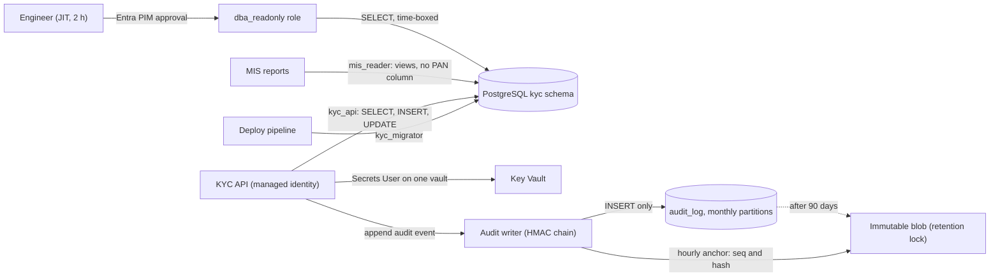
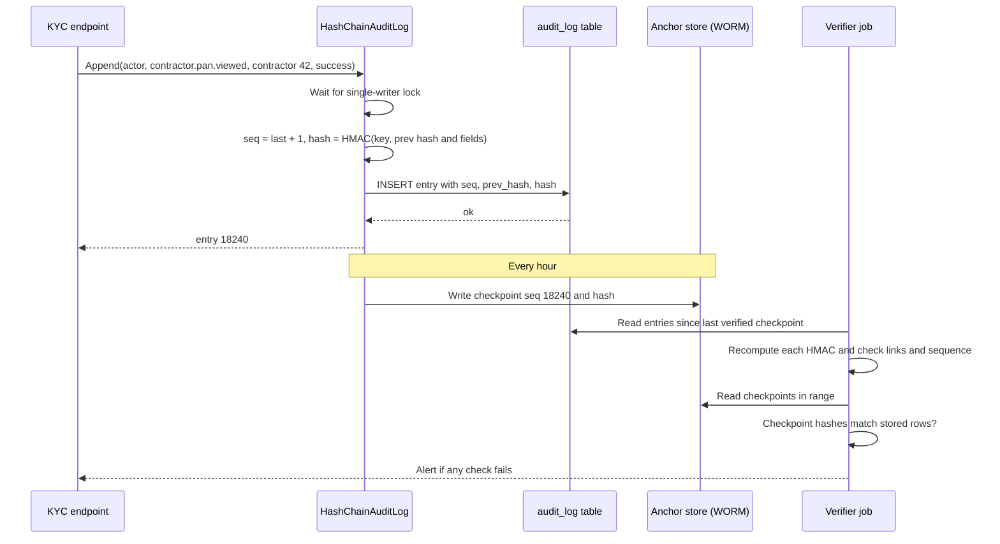

Two questions come up after every security incident. *How far could the attacker get?* and *What exactly did they do?* Least privilege answers the first: if every account can do only its own job, one stolen password or one injection bug opens one small door, not the whole building. Audit trails answer the second: a reliable record of who did what, when, to which record, and whether it worked. This lesson treats them together because they reinforce each other. Narrow permissions make the audit trail meaningful, and the audit trail shows when permissions are being abused.

## Learning objectives

By the end of this lesson you will be able to:

1. Explain least privilege and separation of duties with concrete examples for people, services and tokens.
2. Design PostgreSQL roles for an application (owner, migrator, app, read-only reporting) with schema, table and column grants, and verify them with `has_*_privilege` functions.
3. Replace shared secrets with service identities (managed identities, workload identity) and narrowly scoped, short-lived tokens.
4. Decide what an audit event must contain, and what it must never contain.
5. Build a tamper-evident, hash-chained audit log in C#, verify it, and anchor it externally.
6. Plan retention, archiving and access to audit data, including legal requirements and the conflict with data deletion.

## Prerequisites

- [Authentication versus authorization](#/lesson/m14-authn-vs-authz): identities and permissions.
- [Role-based and policy-based authorization](#/lesson/m14-rbac-pbac): roles, claims and policies in ASP.NET Core.
- [Secure password storage and secret management](#/lesson/m14-passwords-secrets): vaults and why secrets leak.
- [Relational fundamentals](#/lesson/m09-relational-fundamentals): tables, schemas and SQL.

## Explain it like I'm a beginner

Think of a large hotel. Guests get a key card that opens **their own room**, the gym and the lift, and only until checkout. Housekeeping cards open the rooms on one floor, during the day shift. The manager has a master card, kept in a safe, and taking it out is written in a register.

Nobody gets the master card "to save time". If a guest loses their card, the finder can open one room for a few days, not the whole hotel. That is **least privilege**: every card opens only what its holder needs, for only as long as they need it.

Now the register. Every time a card opens a door, the lock records *which card, which door, what time*. When something goes missing from room 512, security reads the record and sees that housekeeping card 7 opened it at 14:05, and nobody else did. That record is the **audit trail**.

A good register has two more properties. Nobody can quietly tear out a page: each page is numbered and stamped with a fingerprint of the page before it, so removing or changing one breaks the sequence (that's **tamper evidence**). And the register is kept for a fixed number of years, then destroyed on schedule (that's **retention**).

## First-principles explanation

### Least privilege: what and why

**Least privilege** means every *principal* (a person, a service, a job or a token) has the minimum permissions needed for its task, for the minimum time. Three reasons it matters:

1. **Blast radius.** Attacks rarely start at the most powerful account. They start with a phished user, a leaked connection string or an injectable endpoint. What the attacker can do next equals what that principal could do.
2. **Mistakes.** A developer running a "quick fix" `UPDATE` without a `WHERE` clause can only damage what their account can write.
3. **Evidence.** If five services share one database login, the audit log says "app_user deleted 3,000 rows", which tells you nothing. Separate identities make every log line attributable.

Two related ideas:

- **Separation of duties.** No single principal can complete a sensitive action alone. The person who creates a vendor can't approve that vendor's first payment. The pipeline that builds code can't approve its own deployment to production.
- **Just-in-time (JIT) access.** Admin rights are not standing rights. An engineer requests production database access for 2 hours with a ticket number. It is approved, logged and expires automatically (for example with Microsoft Entra Privileged Identity Management). A sealed **break-glass** account exists for emergencies, and its use triggers an alert.

### Least privilege in PostgreSQL

PostgreSQL's permission model has a few layers. A role needs the right at *every* layer to touch data:

| Layer | Privileges | Typical grant |
|---|---|---|
| Database | `CONNECT`, `CREATE`, `TEMP` | `GRANT CONNECT ON DATABASE kyc TO kyc_api` |
| Schema | `USAGE` (look inside), `CREATE` (make objects) | `GRANT USAGE ON SCHEMA kyc TO kyc_api` |
| Table / view | `SELECT`, `INSERT`, `UPDATE`, `DELETE`, `TRUNCATE`, `REFERENCES`, `TRIGGER` | `GRANT SELECT, INSERT, UPDATE ON kyc.contractors TO kyc_api` |
| Column | `SELECT`, `INSERT`, `UPDATE` on named columns | `GRANT SELECT (id, name, city) ON kyc.contractors TO mis_reader` |
| Sequence | `USAGE`, `SELECT`, `UPDATE` | Needed for `serial` columns. Identity columns don't need a separate grant |
| Function | `EXECUTE` | Revoke from `PUBLIC` for sensitive functions |
| Row | Row-level security policies | See [multi-tenant security](#/lesson/m14-multi-tenant-security) |

A sensible role design for one application database:

- **`kyc_owner`** (`NOLOGIN`): owns the schema and all tables. Nobody logs in as it.
- **`kyc_migrator`**: member of `kyc_owner`, used only by the deployment pipeline to run migrations. It can create and alter tables.
- **`kyc_api`**: the application's runtime login. It gets `SELECT, INSERT, UPDATE` on the tables it uses, `INSERT` only on the audit table, and no `DELETE` unless the domain needs it. It can't create tables, drop anything, or read tables of other modules.
- **`mis_reader`**: read-only reporting. `SELECT` on reporting views, or column-level `SELECT` that excludes PAN and bank details.
- **Humans** get personal logins, mapped to group roles such as `dba_readonly`, with elevated roles granted just in time.

Details that catch people out:

- **Ownership beats grants.** The owner of a table can do anything to it, and can't be restricted by `REVOKE`. If your app logs in as the table owner, least privilege at the database level doesn't exist. Superusers bypass everything, including row-level security.
- **`PUBLIC`** is every role. Since PostgreSQL 15, ordinary users can no longer create objects in the `public` schema by default, but older databases upgraded in place keep the old grant. Run `REVOKE CREATE ON SCHEMA public FROM PUBLIC`.
- **Default privileges.** Grants apply to existing tables only. For tables created later, use `ALTER DEFAULT PRIVILEGES FOR ROLE kyc_owner IN SCHEMA kyc GRANT SELECT, INSERT, UPDATE ON TABLES TO kyc_api`. Otherwise, the first migration that adds a table breaks the app in production.
- **`SECURITY DEFINER` functions** run with the owner's rights. They are a neat way to expose one narrow operation, such as "mark payment as released", without granting `UPDATE` on the table. Always set `search_path` on them (`SET search_path = kyc, pg_temp`) so a caller can't hijack a function name.
- **Per-role limits**: `ALTER ROLE kyc_api CONNECTION LIMIT 60` and `ALTER ROLE mis_reader SET statement_timeout = '30s'` stop one consumer from exhausting the database.

### Service identities instead of shared secrets

A connection string with a password in `appsettings.Production.json` is a standing credential. It gets copied into chat messages, CI logs and laptops. It never expires, and everyone who has seen it can use it from anywhere. The modern alternative is a **service identity**:

- In Azure, a **managed identity** is an identity the platform assigns to your App Service, Container App, VM or AKS workload. Your code asks the local platform endpoint for a short-lived token (the `Azure.Identity` library's `DefaultAzureCredential` does this). There is no secret to store or rotate.
- **Azure Database for PostgreSQL** accepts Microsoft Entra tokens as passwords, so `kyc_api` can map to the app's managed identity. Key Vault, Blob Storage and Service Bus authorise it with Azure role assignments (RBAC).
- In Kubernetes, **workload identity** federates a pod's service account with the cloud identity. Other clouds have equivalents.

Rules of thumb: **one identity per service** (not one per environment shared by all services), **role assignments at the narrowest scope** (one Key Vault, not the subscription; `Key Vault Secrets User`, not `Owner`), and review assignments quarterly.

### Scoped, short-lived tokens

Tokens carry permissions. Make them narrow in four dimensions:

| Dimension | Example |
|---|---|
| **What** (scope or permission) | `kyc.read` but not `kyc.write`. A blob URL allowing `read` only |
| **Which resource** (audience, path) | `aud=api://kyc`. A SAS token for one blob, not the container |
| **How long** (expiry) | Access tokens of 5–60 minutes. A download link valid for 10 minutes |
| **From where / for whom** (binding) | Sender-constrained tokens (mTLS or DPoP binding), an IP range for a SAS token, a `sub` that must match the session |

Examples you will build:

- A background job that only needs to read invoices requests a token with the `invoices.read` scope, not the admin scope the web app uses.
- The API gives the browser a **capability URL** for one PDF: `/files/drawings/NH27-pkg4/rev-C.pdf?exp=…&perm=read&sig=…`, valid for 10 minutes. The file server checks the signature and needs no database lookup. Leaking it exposes one file for a few minutes.

### Audit trails: what they are for

An **audit trail** is a chronological record of security-relevant and business-relevant actions, made so that someone can later answer: *who did what, to what, when, from where, and with what result?* It is different from application logs:

| | Application logs | Audit trail |
|---|---|---|
| Purpose | Debugging and operations | Accountability, investigation, compliance |
| Audience | Engineers | Security, auditors, legal, sometimes customers |
| Completeness | Sampled, levels can be turned down | Every in-scope event, no sampling |
| Retention | Days to weeks | Months to years, by policy |
| Mutability | Rotated and deleted freely | Append-only, tamper-evident |
| Content | Stack traces, timings | Structured who/what/when/outcome |

### What to record

Each audit event should answer the "five Ws and an outcome":

- **Who**: the actor's stable id (`user:5f2c…`, `service:payment-job`), plus on-behalf-of when a service acts for a user, and the authentication method (password + OTP, SSO, API key).
- **What**: a verb from a fixed vocabulary (`contractor.pan.viewed`, `payment.released`, `role.granted`), not free text.
- **On what**: the resource type and id (`contractor:42`), and the tenant.
- **When**: a UTC timestamp from a synchronised clock, plus a monotonically increasing sequence number.
- **Where from**: source IP, user agent or client id, and the correlation id that links to traces.
- **Outcome**: success, denied or failed, plus a reason code. **Denied attempts matter as much as successes**: 40 denied `pan.viewed` attempts in a minute is a signal.
- **Why** (for sensitive actions): a reason or ticket number entered by the user ("Payment run 2026-10-B").
- **Before/after** for changes to important fields, or a hash of them.

Which events: authentication (login, logout, failures, MFA changes, password resets), authorization changes (role grants, permission edits), access to sensitive data (viewing a full PAN, exporting a report), money and approvals (payment release, bid opening, contract change), administrative actions (configuration, feature flags, user impersonation), and security events (key rotation, audit-log access itself).

### What never to record

- Passwords, OTPs, session cookies, bearer tokens, API keys, private keys.
- Full sensitive values (PAN, Aadhaar number, card number, bank account). Record that it was *viewed*, and mask it (`ABCDE****F`) if you must show which one.
- Large payloads (whole documents). Record a hash and a pointer.

An audit log full of secrets becomes the most valuable target in the system, and it's usually kept longer and read by more people than the data it describes.

### Tamper evidence with a hash chain

An attacker who gains database write access (or an insider covering tracks) will try to edit or delete audit rows. You can't always *prevent* that, but you can make it **detectable**.

A **hash chain** links each entry to the previous one:

```text
hash[n] = HMAC(key, hash[n-1] | seq[n] | at[n] | actor[n] | action[n] | resource[n] | outcome[n])
```

- Change any field of entry 4, and its recomputed hash no longer matches the stored one.
- Recompute entry 4's hash to cover it up, and entry 5's stored `prev_hash` no longer matches.
- Delete entry 7, and entry 8's `prev_hash` points to a hash that isn't the one before it, and the sequence has a gap.

Two weaknesses, and their fixes:

1. **Recomputing the whole chain.** With a plain SHA-256 chain, an attacker who can rewrite every row can recompute every hash. Use an **HMAC** with a key the database doesn't hold (in Key Vault, used only by the audit writer), and **anchor** the chain: every hour, copy the latest `(seq, hash)` to a separate, write-once store (immutable blob storage with a time-based retention lock, or a different system run by a different team). Rewriting history then requires defeating two independent systems.
2. **Truncating the tail.** Deleting the newest entries leaves a perfectly valid shorter chain. Anchors detect that too: the anchored `seq 18,240` must still exist.

Cost: one HMAC per event is microseconds. The real constraint is that a chain needs a **single writer in order**, so throughput is bounded by sequential appends. One chain handles thousands of events a second, which is plenty for audit volume. Above that, keep **one chain per partition** (per tenant or per hour) and anchor each.

**Database-level protections** complement the chain. Grant the app role only `INSERT` and `SELECT` on the audit table. Add a trigger that rejects `UPDATE` and `DELETE`. Ship events to a separate store that the application's identity can append to but not delete from.

### Retention

How long to keep audit data is a policy decision driven by law, contracts and risk. Examples you are likely to meet (always confirm current rules with your compliance team):

- India's CERT-In directions of April 2022 require service providers and organisations to keep logs of their ICT systems for a rolling 180 days, within Indian jurisdiction.
- Financial, tax and procurement records often have multi-year retention rules (for example, 8 years for books of account under Indian company law). Audit events about those records usually follow them.
- Contracts with government clients often specify retention and access for auditors.

A practical tiering, with an estimate of volume: 200 users × 400 audit events a day ≈ 80,000 events a day. At about 1 KB each, that's ≈ 80 MB a day, ≈ 29 GB a year. Keep 90 days **hot** in PostgreSQL for investigations, then move older partitions to **cold**, immutable object storage for the full retention period, then **delete on schedule**. Partitioning the audit table by month makes the move a cheap `DETACH PARTITION`.

**Retention versus privacy.** Data-protection laws (India's DPDP Act 2023, the EU's GDPR) push you to delete personal data when it's no longer needed, while audit rules push you to keep records. Resolve it by keeping audit events minimal (ids, not personal details), pseudonymising actor ids where possible, and documenting the legal basis for retention. Hash chains and deletion interact too: when old entries are purged, verification starts from the oldest remaining anchored checkpoint.

**Access to audit data is itself audited.** Only a small security group can read it, nobody can edit it, and reads are logged.

## Visual explanation

### Identities, grants and the audit path



Each arrow carries exactly one identity with one set of rights. The deployment pipeline is the only principal that changes the schema. The API can read and write business tables but can't drop them, delete from them or read other schemas. Reporting goes through `mis_reader`, which sees no PAN column. Engineers have no standing access: they get `dba_readonly` for two hours through an approval workflow, and that approval is itself an audit event. The API's managed identity can read secrets from one vault and nothing else. Audit events go through a writer that chains them and can only insert. Every hour it writes the chain's head to immutable storage, and old partitions move there after 90 days. To rewrite history, an attacker would have to control the database *and* the immutable store.

### Writing and verifying an audit entry



The writer serialises appends so each entry knows the previous hash. That lock is the throughput limit, and why high-volume systems keep one chain per partition. The `INSERT` is the only privilege the writer needs. The hourly checkpoint goes to a store the database can't change. The verifier runs independently, perhaps under a different team's identity. It recomputes every hash (detects edits), checks each `prev_hash` and the sequence (detects deletions and reordering), and compares with the checkpoints (detects rewriting the whole chain or truncating the tail). Any failure is a security incident.

## Step-by-step example

**Scenario.** A contractor-onboarding platform for an infrastructure consultancy has 220 internal users, a KYC API, a nightly payment-file job and an MIS team that builds Power BI reports. An internal audit found:

1. The API, the job and Power BI all connect as `postgres` with the same password.
2. Developers have the production connection string "for support".
3. There is an `activity_log` table, but the app can `UPDATE` and `DELETE` it, and it stores full PAN numbers in a `details` column.
4. Nobody can say who downloaded the payment file on 3 October.

### Step 1 — roles and grants

Create `kyc_owner`, `kyc_migrator`, `kyc_api`, `payment_job` and `mis_reader`. Transfer ownership of every table to `kyc_owner`. Grant `kyc_api` DML on its tables, `payment_job` `SELECT` on payment views and `INSERT` on `payment_runs`, and `mis_reader` column-level `SELECT` on non-sensitive columns. Add default privileges. Change the `postgres` password and store it in a break-glass vault.

### Step 2 — identities

Map `kyc_api` and `payment_job` to the managed identities of the App Service and the Container Apps job (Entra authentication for PostgreSQL). There are no passwords in configuration any more. Power BI gets its own `mis_reader` login through the gateway. Developers lose standing access, and get `dba_readonly` through just-in-time approval for 2 hours.

### Step 3 — audit vocabulary

The team agrees a list of 38 event types, such as `auth.login.succeeded`, `auth.login.failed`, `contractor.pan.viewed`, `payment.file.generated`, `payment.file.downloaded` and `role.granted`. Every event has actor, action, resource, tenant, outcome, IP, correlation id and an optional reason.

### Step 4 — tamper-evident storage

A new `audit.audit_log` table, partitioned by month. `kyc_api` has `INSERT` and `SELECT` only, and a trigger rejects updates and deletes. The writer chains entries with HMAC-SHA256 using a key from Key Vault, and anchors hourly to immutable blob storage. The old `activity_log` is exported, its PAN values are masked, and it is archived read-only.

### Step 5 — answer the question

"Who downloaded the payment file on 3 October?" becomes one query: `action = 'payment.file.downloaded' AND at::date = '2026-10-03'`. It returns the actor, IP and reason. The chain verifies, so the answer can be trusted.

## Production-style C# implementation

```text
Kyc.Api/
  Program.cs
  Audit/AuditModels.cs
  Audit/AuditRedactor.cs
  Audit/IAuditStore.cs
  Audit/HashChainAuditLog.cs
  Audit/AuditAnchorService.cs
  Audit/AuditEndpointFilter.cs
```

```csharp file=Audit/AuditModels.cs
namespace Kyc.Api.Audit;

public enum AuditOutcome { Success, Denied, Failed }

/// <summary>What the caller supplies. Actions come from a fixed vocabulary such as "contractor.pan.viewed".</summary>
public sealed record AuditEvent(
    string Actor,
    string Action,
    string Resource,
    string TenantId,
    AuditOutcome Outcome,
    string? Reason = null,
    string? SourceIp = null,
    string? CorrelationId = null,
    IReadOnlyDictionary<string, string?>? Details = null);

/// <summary>What is stored: the event plus sequence, time and chain hashes.</summary>
public sealed record AuditRecord(
    long Seq,
    DateTimeOffset At,
    AuditEvent Event,
    string PrevHash,
    string Hash);

public sealed record AuditCheckpoint(long Seq, string Hash, DateTimeOffset At);
```

```csharp file=Audit/AuditRedactor.cs
using System.Text.RegularExpressions;

namespace Kyc.Api.Audit;

/// <summary>Removes secrets and masks identifiers before anything reaches the audit trail.</summary>
public static partial class AuditRedactor
{
    private static readonly string[] SecretKeyParts = ["password", "secret", "token", "otp", "apikey", "authorization"];

    [GeneratedRegex(@"\b[A-Z]{5}[0-9]{4}[A-Z]\b")]
    private static partial Regex Pan();

    public static IReadOnlyDictionary<string, string?> Redact(IReadOnlyDictionary<string, string?>? details)
    {
        var result = new SortedDictionary<string, string?>(StringComparer.Ordinal);
        if (details is null) return result;
        foreach (var (key, value) in details)
        {
            if (SecretKeyParts.Any(p => key.Contains(p, StringComparison.OrdinalIgnoreCase))) { result[key] = "[REDACTED]"; continue; }
            if (value is null) { result[key] = null; continue; }
            var masked = Pan().Replace(value, m => m.Value[..5] + "****" + m.Value[^1]);
            result[key] = masked.Length > 256 ? masked[..256] + "...[truncated]" : masked;
        }
        return result;
    }
}
```

```csharp file=Audit/IAuditStore.cs
using System.Collections.Concurrent;

namespace Kyc.Api.Audit;

/// <summary>Append-only store. Production: an INSERT-only PostgreSQL table, partitioned by month.</summary>
public interface IAuditStore
{
    Task<AuditRecord?> GetLastAsync(CancellationToken ct);
    Task AppendAsync(AuditRecord record, CancellationToken ct);
    Task<IReadOnlyList<AuditRecord>> ReadRangeAsync(long fromSeq, long toSeq, CancellationToken ct);
}

public interface IAnchorStore
{
    Task WriteAsync(AuditCheckpoint checkpoint, CancellationToken ct);
    Task<IReadOnlyList<AuditCheckpoint>> ReadAllAsync(CancellationToken ct);
}

public sealed class InMemoryAuditStore : IAuditStore
{
    private readonly List<AuditRecord> _records = [];
    private readonly Lock _gate = new();

    public Task<AuditRecord?> GetLastAsync(CancellationToken ct)
    {
        lock (_gate) return Task.FromResult(_records.Count == 0 ? null : _records[^1]);
    }

    public Task AppendAsync(AuditRecord record, CancellationToken ct)
    {
        lock (_gate)
        {
            var expected = _records.Count == 0 ? 1 : _records[^1].Seq + 1;
            if (record.Seq != expected) throw new InvalidOperationException($"Expected seq {expected}, got {record.Seq}.");
            _records.Add(record);
        }
        return Task.CompletedTask;
    }

    public Task<IReadOnlyList<AuditRecord>> ReadRangeAsync(long fromSeq, long toSeq, CancellationToken ct)
    {
        lock (_gate) return Task.FromResult<IReadOnlyList<AuditRecord>>(_records.Where(r => r.Seq >= fromSeq && r.Seq <= toSeq).ToList());
    }
}

public sealed class InMemoryAnchorStore : IAnchorStore
{
    private readonly ConcurrentQueue<AuditCheckpoint> _items = new();
    public Task WriteAsync(AuditCheckpoint c, CancellationToken ct) { _items.Enqueue(c); return Task.CompletedTask; }
    public Task<IReadOnlyList<AuditCheckpoint>> ReadAllAsync(CancellationToken ct) => Task.FromResult<IReadOnlyList<AuditCheckpoint>>(_items.ToList());
}
```

```csharp file=Audit/HashChainAuditLog.cs
using System.Globalization;
using System.Security.Cryptography;
using System.Text;
using Microsoft.Extensions.Options;

namespace Kyc.Api.Audit;

public sealed class AuditOptions
{
    /// <summary>Base64 HMAC key. Production: loaded from Key Vault, never stored in the database.</summary>
    public string HmacKeyBase64 { get; set; } = "";
    public TimeSpan AnchorInterval { get; set; } = TimeSpan.FromHours(1);
}

public interface IAuditLog
{
    Task<AuditRecord> AppendAsync(AuditEvent evt, CancellationToken ct = default);
}

public sealed record VerificationResult(bool Ok, long? FirstBadSeq, string? Problem);

public sealed class HashChainAuditLog(IAuditStore store, TimeProvider clock, IOptions<AuditOptions> options) : IAuditLog
{
    public static readonly string Genesis = new('0', 64);
    private readonly byte[] _key = Convert.FromBase64String(options.Value.HmacKeyBase64);
    private readonly SemaphoreSlim _writer = new(1, 1);

    public async Task<AuditRecord> AppendAsync(AuditEvent evt, CancellationToken ct = default)
    {
        var clean = evt with { Details = AuditRedactor.Redact(evt.Details) };
        await _writer.WaitAsync(ct);
        try
        {
            var last = await store.GetLastAsync(ct);
            var seq = (last?.Seq ?? 0) + 1;
            var prev = last?.Hash ?? Genesis;
            var at = clock.GetUtcNow();
            var record = new AuditRecord(seq, at, clean, prev, ComputeHash(_key, prev, seq, at, clean));
            await store.AppendAsync(record, ct);
            return record;
        }
        finally { _writer.Release(); }
    }

    /// <summary>Length-prefixed canonical form: no two different events can produce the same input string.</summary>
    public static string ComputeHash(byte[] key, string prevHash, long seq, DateTimeOffset at, AuditEvent e)
    {
        var sb = new StringBuilder();
        void Field(string? v) => sb.Append(v is null ? "-1:" : $"{v.Length}:{v}").Append('|');
        Field(prevHash);
        Field(seq.ToString(CultureInfo.InvariantCulture));
        Field(at.UtcDateTime.ToString("O", CultureInfo.InvariantCulture));
        Field(e.Actor); Field(e.Action); Field(e.Resource); Field(e.TenantId); Field(e.Outcome.ToString());
        Field(e.Reason); Field(e.SourceIp); Field(e.CorrelationId);
        foreach (var (k, v) in (e.Details ?? new Dictionary<string, string?>()).OrderBy(d => d.Key, StringComparer.Ordinal))
        {
            Field(k); Field(v);
        }
        return Convert.ToHexStringLower(HMACSHA256.HashData(key, Encoding.UTF8.GetBytes(sb.ToString())));
    }

    /// <summary>Checks hashes, links and sequence for a contiguous range, starting from a trusted previous hash.</summary>
    public VerificationResult Verify(IReadOnlyList<AuditRecord> records, string trustedPrevHash, long expectedFirstSeq)
    {
        var prev = trustedPrevHash;
        var expectedSeq = expectedFirstSeq;
        foreach (var r in records)
        {
            if (r.Seq != expectedSeq) return new(false, r.Seq, $"sequence gap: expected {expectedSeq}");
            if (r.PrevHash != prev) return new(false, r.Seq, "broken link");
            if (!CryptographicOperations.FixedTimeEquals(
                    Encoding.ASCII.GetBytes(ComputeHash(_key, r.PrevHash, r.Seq, r.At, r.Event)), Encoding.ASCII.GetBytes(r.Hash)))
                return new(false, r.Seq, "hash mismatch");
            prev = r.Hash;
            expectedSeq++;
        }
        return new(true, null, null);
    }
}
```

```csharp file=Audit/AuditAnchorService.cs
using Microsoft.Extensions.Hosting;
using Microsoft.Extensions.Logging;
using Microsoft.Extensions.Options;

namespace Kyc.Api.Audit;

/// <summary>Copies the chain head to a write-once store on a schedule, so rewriting or truncating the chain is detectable.</summary>
public sealed class AuditAnchorService(IAuditStore store, IAnchorStore anchors, TimeProvider clock,
    IOptions<AuditOptions> options, ILogger<AuditAnchorService> log) : BackgroundService
{
    protected override async Task ExecuteAsync(CancellationToken stoppingToken)
    {
        using var timer = new PeriodicTimer(options.Value.AnchorInterval, clock);
        long lastAnchored = 0;
        while (await timer.WaitForNextTickAsync(stoppingToken))
        {
            try
            {
                var head = await store.GetLastAsync(stoppingToken);
                if (head is null || head.Seq == lastAnchored) continue;
                await anchors.WriteAsync(new AuditCheckpoint(head.Seq, head.Hash, clock.GetUtcNow()), stoppingToken);
                lastAnchored = head.Seq;
                log.LogInformation("Anchored audit chain at seq {Seq}", head.Seq);
            }
            catch (Exception ex) when (ex is not OperationCanceledException)
            {
                // A missed anchor weakens tamper evidence: alert on this log event.
                log.LogError(ex, "Audit anchoring failed");
            }
        }
    }
}
```

```csharp file=Audit/AuditEndpointFilter.cs
using System.Security.Claims;

namespace Kyc.Api.Audit;

/// <summary>Writes one audit event per call to a sensitive endpoint, including denied and failed calls.</summary>
public sealed class AuditEndpointFilter(IAuditLog audit, string action, string resourceRouteKey) : IEndpointFilter
{
    public async ValueTask<object?> InvokeAsync(EndpointFilterInvocationContext ctx, EndpointFilterDelegate next)
    {
        var http = ctx.HttpContext;
        var user = http.User;
        var actor = user.FindFirstValue(ClaimTypes.NameIdentifier) ?? "anonymous";
        var tenant = user.FindFirstValue("tenant_id") ?? "unknown";
        var resource = $"{resourceRouteKey}:{http.GetRouteValue(resourceRouteKey)}";
        var reason = http.Request.Headers["X-Access-Reason"].ToString();

        object? result;
        try
        {
            result = await next(ctx);
        }
        catch
        {
            await audit.AppendAsync(new AuditEvent(actor, action, resource, tenant, AuditOutcome.Failed, reason,
                http.Connection.RemoteIpAddress?.ToString(), http.TraceIdentifier), http.RequestAborted);
            throw;
        }

        var status = result is IStatusCodeHttpResult s ? s.StatusCode ?? 200 : 200;
        var outcome = status is 401 or 403 ? AuditOutcome.Denied : status >= 400 ? AuditOutcome.Failed : AuditOutcome.Success;
        await audit.AppendAsync(new AuditEvent(actor, action, resource, tenant, outcome, reason,
            http.Connection.RemoteIpAddress?.ToString(), http.TraceIdentifier), http.RequestAborted);
        return result;
    }
}
```

```csharp file=Program.cs
using System.Security.Claims;
using Kyc.Api.Audit;
using Microsoft.AspNetCore.Authentication.Cookies;

var builder = WebApplication.CreateBuilder(args);

builder.Services.AddAuthentication(CookieAuthenticationDefaults.AuthenticationScheme).AddCookie();
builder.Services.AddAuthorization(o =>
{
    // Scope-based policies: a token or session must carry the exact permission.
    o.AddPolicy("kyc.pan.read", p => p.RequireAssertion(c =>
        c.User.FindAll("scope").SelectMany(s => s.Value.Split(' ')).Contains("kyc.pan.read")));
    o.AddPolicy("audit.read", p => p.RequireRole("security-auditor"));
});

builder.Services.AddSingleton(TimeProvider.System);
builder.Services.Configure<AuditOptions>(builder.Configuration.GetSection("Audit"));
builder.Services.PostConfigure<AuditOptions>(o =>
{
    // DEV ONLY fallback. Production loads the key from Key Vault via the app's managed identity.
    if (string.IsNullOrEmpty(o.HmacKeyBase64))
        o.HmacKeyBase64 = Convert.ToBase64String(System.Security.Cryptography.RandomNumberGenerator.GetBytes(32));
});
builder.Services.AddSingleton<IAuditStore, InMemoryAuditStore>();
builder.Services.AddSingleton<IAnchorStore, InMemoryAnchorStore>();
builder.Services.AddSingleton<HashChainAuditLog>();
builder.Services.AddSingleton<IAuditLog>(sp => sp.GetRequiredService<HashChainAuditLog>());
builder.Services.AddHostedService<AuditAnchorService>();

var app = builder.Build();
app.UseAuthentication();
app.UseAuthorization();

app.MapGet("/contractors/{contractorId:guid}/pan", (Guid contractorId) => Results.Ok(new { pan = "ABCDE1234F" }))
   .RequireAuthorization("kyc.pan.read")
   .AddEndpointFilter(new AuditEndpointFilterFactory("contractor.pan.viewed", "contractorId").Create);

app.MapGet("/audit/verify", async (HashChainAuditLog log, IAuditStore store, CancellationToken ct) =>
{
    var last = await store.GetLastAsync(ct);
    if (last is null) return Results.Ok(new VerificationResult(true, null, null));
    var records = await store.ReadRangeAsync(1, last.Seq, ct);
    return Results.Ok(log.Verify(records, HashChainAuditLog.Genesis, 1));
}).RequireAuthorization("audit.read");

app.Run();

/// <summary>Creates the filter with per-endpoint arguments while resolving IAuditLog from DI.</summary>
public sealed class AuditEndpointFilterFactory(string action, string routeKey)
{
    public ValueTask<object?> Create(EndpointFilterInvocationContext ctx, EndpointFilterDelegate next) =>
        new AuditEndpointFilter(ctx.HttpContext.RequestServices.GetRequiredService<IAuditLog>(), action, routeKey).InvokeAsync(ctx, next);
}
```

Design notes:

- **Redaction happens inside the audit log**, not at every call site, so one forgetful developer can't leak a token into it.
- **Denied and failed calls are audited.** Authorization middleware short-circuits before endpoint filters run, so in production you also record `403`s from an authorization-result handler (`IAuthorizationMiddlewareResultHandler`) or from middleware.
- **The canonical form is length-prefixed.** With a plain `actor|action` join, actor `a|b` with action `c` would hash the same as actor `a` with action `b|c`.
- **A single writer** keeps the chain ordered. In PostgreSQL you would take the last row `FOR UPDATE` or use an advisory lock in the same transaction as the insert, so two API instances can't both write `seq 18,241`.

The matching database setup:

```sql
CREATE SCHEMA audit AUTHORIZATION kyc_owner;
CREATE TABLE audit.audit_log (
  seq bigint NOT NULL, at timestamptz NOT NULL, actor text NOT NULL, action text NOT NULL,
  resource text NOT NULL, tenant_id text NOT NULL, outcome text NOT NULL, reason text,
  source_ip inet, correlation_id text, details jsonb, prev_hash char(64) NOT NULL, hash char(64) NOT NULL,
  PRIMARY KEY (at, seq)
) PARTITION BY RANGE (at);
GRANT USAGE ON SCHEMA audit TO kyc_api;
GRANT INSERT, SELECT ON audit.audit_log TO kyc_api;            -- no UPDATE, DELETE, TRUNCATE
CREATE FUNCTION audit.reject_change() RETURNS trigger LANGUAGE plpgsql AS
$$ BEGIN RAISE EXCEPTION 'audit_log is append-only'; END $$;
CREATE TRIGGER audit_log_append_only BEFORE UPDATE OR DELETE ON audit.audit_log
  FOR EACH ROW EXECUTE FUNCTION audit.reject_change();
```

## Bad design vs good design

| Bad | Consequence | Good |
|---|---|---|
| App connects as `postgres` or as the table owner | Injection or a leaked password means full control, including `DROP` | Dedicated runtime role with only the needed DML. Owner role is `NOLOGIN` |
| One login shared by API, jobs and reports | Logs can't say which one did it. You can't revoke one without breaking all | One role and identity per service |
| Connection string with password in config | Copied everywhere, never rotated | Managed identity with Entra authentication, or a vault with automatic rotation |
| Developers with standing production access | Every laptop is a path to production data | Just-in-time, time-boxed, approved and logged access. Break-glass for emergencies |
| Long-lived admin API key for a nightly job | Leaks give permanent admin access | A token with only the job's scope, valid for an hour, requested at start |
| `activity_log` the app can update and delete | Evidence can be edited silently | Insert-only grants, append-only trigger, hash chain, external anchors |
| Logging request bodies "for audit" | Passwords, OTPs and PANs in logs kept for years | Fixed event vocabulary, structured fields, redaction, masked identifiers |
| Audit only successful actions | Brute force and probing are invisible | Record denied and failed attempts too |

:::callout type=tradeoff title="How much audit is enough?"
Auditing every read of every row produces terabytes nobody reads, and the cost and noise hide the events that matter. Audit **writes** to important records, **reads of sensitive fields** (full PAN, bank details, health data), **exports**, **permission changes** and **authentication events**. For ordinary reads, normal access logs are enough. Write down the scope so auditors and engineers agree.
:::

:::callout type=mistake title="The audit log as an afterthought"
Teams often add auditing the week before a security review, as a generic "log the request" middleware. You end up with unstructured text, secrets in bodies, no denied attempts and no way to answer "who viewed this PAN". Design the event vocabulary with the domain, like any other feature.
:::

## Practical playground

The database has a `kyc` schema with `contractors`, `projects` and `audit_log`, and three roles with **no grants yet**: `kyc_api`, `mis_reader` and `payment_job`. Try granting rights, then switch identity with `SET ROLE mis_reader;` and see what fails. `RESET ROLE;` takes you back to the superuser. Useful checks:

- `SELECT has_column_privilege('mis_reader', 'kyc.contractors', 'pan', 'SELECT');`
- `SET ROLE kyc_api; UPDATE kyc.audit_log SET action = 'x';`, which should fail once you have granted only `INSERT`.
- `\dp` isn't available here, so query `information_schema.role_table_grants`.

:::playground type=sql title="Grant lab"
```sql
CREATE SCHEMA kyc;
CREATE TABLE kyc.contractors (
  id bigint GENERATED ALWAYS AS IDENTITY PRIMARY KEY,
  name text NOT NULL, city text NOT NULL, pan text NOT NULL, bank_account text NOT NULL
);
CREATE TABLE kyc.projects (id bigint PRIMARY KEY, name text NOT NULL, contractor_id bigint REFERENCES kyc.contractors(id));
CREATE TABLE kyc.audit_log (
  seq bigint PRIMARY KEY, at timestamptz NOT NULL DEFAULT now(), actor text NOT NULL,
  action text NOT NULL, resource text NOT NULL
);
INSERT INTO kyc.contractors (name, city, pan, bank_account) VALUES
  ('Shree Ganesh Infra', 'Pune', 'AAACS1234K', '50100234567890'),
  ('Brahmaputra Builders', 'Guwahati', 'AABCB5678L', '60200345678901'),
  ('Kaveri Constructions', 'Mysuru', 'AAFCK9012M', '70300456789012');
INSERT INTO kyc.projects VALUES (1, 'NH-27 package 4', 2), (2, 'Ring road bridge', 1);
CREATE ROLE kyc_api NOLOGIN;
CREATE ROLE mis_reader NOLOGIN;
CREATE ROLE payment_job NOLOGIN;
```
:::

## Exercises

:::exercise id=m14-least-privilege-audit-ex1 difficulty=beginner kind=code title="Redact audit details"
Implement `DetailRedactor.Redact`, which cleans the free-form `details` of an audit event before it is stored.
::requirements
- Any key containing (case-insensitive) `password`, `secret`, `token` or `otp` gets the value `[REDACTED]`.
- Any PAN-shaped value (`[A-Z]{5}[0-9]{4}[A-Z]`) anywhere in a value is masked to the first five characters, `****`, and the last character: `ABCDE1234F` → `ABCDE****F`.
- Any 12-digit number (an Aadhaar-like value) is masked to `XXXXXXXX` plus its last 4 digits.
- Values longer than 100 characters (after masking) are cut to 100 characters plus `...[truncated]`.
- `null` values stay `null`. The input dictionary is not modified.
::acceptance
- `{"Password": "hunter2"}` becomes `{"Password": "[REDACTED]"}`.
- `"Paid to PAN ABCDE1234F"` becomes `"Paid to PAN ABCDE****F"`.
- `"aadhaar 123456789012"` becomes `"aadhaar XXXXXXXX9012"`.
- A 300-character note becomes 100 characters plus the marker.
::hint
Do the key check first. A secret value doesn't need masking, it needs removing.
::hint
Use `Regex.Replace` with a `MatchEvaluator` lambda for each pattern.
::hint
`\b` word boundaries stop the 12-digit rule from matching inside a 16-digit card number. Card numbers deserve their own rule in a real system.
::hint
```csharp
masked = Regex.Replace(masked, @"\b[0-9]{12}\b", m => "XXXXXXXX" + m.Value[^4..]);
```
::starter
```csharp file=DetailRedactor.cs
using System;
using System.Collections.Generic;
using System.Linq;
using System.Text.RegularExpressions;

public static class DetailRedactor
{
    public const int MaxLength = 100;

    public static Dictionary<string, string?> Redact(IReadOnlyDictionary<string, string?> details) =>
        throw new NotImplementedException();
}
```
::tests
```csharp file=DetailRedactorTests.cs
using System.Collections.Generic;
using Xunit;

public class DetailRedactorTests
{
    private static Dictionary<string, string?> R(string k, string? v) =>
        DetailRedactor.Redact(new Dictionary<string, string?> { [k] = v });

    [Theory]
    [InlineData("Password")]
    [InlineData("client_secret")]
    [InlineData("refreshToken")]
    [InlineData("OTP")]
    public void Secret_keys_are_redacted(string key) => Assert.Equal("[REDACTED]", R(key, "hunter2")[key]);

    [Fact]
    public void Pan_is_masked() => Assert.Equal("Paid to PAN ABCDE****F", R("note", "Paid to PAN ABCDE1234F")["note"]);

    [Fact]
    public void Aadhaar_like_number_is_masked() => Assert.Equal("aadhaar XXXXXXXX9012", R("note", "aadhaar 123456789012")["note"]);

    [Fact]
    public void Long_values_are_truncated()
    {
        var v = R("note", new string('a', 300))["note"]!;
        Assert.Equal(new string('a', 100) + "...[truncated]", v);
    }

    [Fact]
    public void Null_stays_null() => Assert.Null(R("note", null)["note"]);

    [Fact]
    public void Input_is_not_modified()
    {
        var input = new Dictionary<string, string?> { ["password"] = "x" };
        DetailRedactor.Redact(input);
        Assert.Equal("x", input["password"]);
    }
}
```
::solution
```csharp file=DetailRedactor.cs
using System;
using System.Collections.Generic;
using System.Linq;
using System.Text.RegularExpressions;

public static class DetailRedactor
{
    public const int MaxLength = 100;
    private static readonly string[] SecretParts = { "password", "secret", "token", "otp" };
    private static readonly Regex Pan = new(@"\b[A-Z]{5}[0-9]{4}[A-Z]\b", RegexOptions.Compiled);
    private static readonly Regex Twelve = new(@"\b[0-9]{12}\b", RegexOptions.Compiled);

    public static Dictionary<string, string?> Redact(IReadOnlyDictionary<string, string?> details)
    {
        var result = new Dictionary<string, string?>();
        foreach (var (key, value) in details)
        {
            if (SecretParts.Any(p => key.Contains(p, StringComparison.OrdinalIgnoreCase))) { result[key] = "[REDACTED]"; continue; }
            if (value is null) { result[key] = null; continue; }
            var masked = Pan.Replace(value, m => m.Value[..5] + "****" + m.Value[^1]);
            masked = Twelve.Replace(masked, m => "XXXXXXXX" + m.Value[^4..]);
            result[key] = masked.Length > MaxLength ? masked[..MaxLength] + "...[truncated]" : masked;
        }
        return result;
    }
}
```

Redaction is a safety net, not the design. The real fix is a fixed event vocabulary with typed fields, so free text containing a secret is rare. Keep the redactor anyway, inside the audit writer, because someone will eventually put a token in `details`.
::mistakes
- Masking secret values instead of removing them. `hun****` still leaks length and the first characters.
- Truncating before masking, which can cut a PAN in half and leave the first part readable.
- Redacting in each controller instead of once, centrally.
:::

:::exercise id=m14-least-privilege-audit-ex2 difficulty=beginner kind=sql ordered=true title="Grant exactly what each role needs"
The setup creates a `kyc` schema, three tables and two roles with **no privileges**. Write the `GRANT` statements so that:

- **`kyc_api`** can use the schema, can `SELECT`, `INSERT` and `UPDATE` `kyc.contractors` (but not `DELETE`), can `SELECT` `kyc.projects`, and can only `INSERT` and `SELECT` on `kyc.audit_log` (no `UPDATE` or `DELETE`).
- **`mis_reader`** can use the schema, can `SELECT` `kyc.projects`, and can `SELECT` only the `id`, `name` and `city` columns of `kyc.contractors` (not `pan` or `bank_account`). It has no rights on `kyc.audit_log`.

End your script with this privilege matrix query (copy it as is):

```sql
SELECT r AS role,
  has_schema_privilege(r, 'kyc', 'USAGE')                          AS schema_usage,
  has_table_privilege(r, 'kyc.projects', 'SELECT')                 AS projects_select,
  has_column_privilege(r, 'kyc.contractors', 'name', 'SELECT')     AS contractor_name,
  has_column_privilege(r, 'kyc.contractors', 'pan', 'SELECT')      AS contractor_pan,
  has_table_privilege(r, 'kyc.contractors', 'INSERT')              AS contractor_insert,
  has_table_privilege(r, 'kyc.contractors', 'DELETE')              AS contractor_delete,
  has_table_privilege(r, 'kyc.audit_log', 'INSERT')                AS audit_insert,
  has_table_privilege(r, 'kyc.audit_log', 'UPDATE')                AS audit_update
FROM unnest(ARRAY['kyc_api', 'mis_reader']) AS r
ORDER BY r;
```
::acceptance
- `kyc_api`: everything true except `contractor_delete` and `audit_update`.
- `mis_reader`: `schema_usage`, `projects_select` and `contractor_name` true. Everything else false.
- No `GRANT ALL`, and no table-level `SELECT` on `kyc.contractors` for `mis_reader`.
::hint
Without `USAGE` on the schema, table grants are useless: the role can't even look inside `kyc`.
::hint
Column-level grants list the columns in brackets after the privilege: `GRANT SELECT (id, name, city) ON kyc.contractors TO mis_reader;`
::hint
`has_column_privilege` returns true if the role has the privilege on the whole table *or* on that column. So a table-level `SELECT` would make `contractor_pan` true.
::hint
`contractors.id` is an identity column, so `kyc_api` needs no sequence grant to insert. A `serial` column would need `GRANT USAGE ON SEQUENCE`.
::setup
```sql
CREATE SCHEMA kyc;
CREATE TABLE kyc.contractors (
  id bigint GENERATED ALWAYS AS IDENTITY PRIMARY KEY,
  name text NOT NULL, city text NOT NULL, pan text NOT NULL, bank_account text NOT NULL
);
CREATE TABLE kyc.projects (id bigint PRIMARY KEY, name text NOT NULL, contractor_id bigint REFERENCES kyc.contractors(id));
CREATE TABLE kyc.audit_log (seq bigint PRIMARY KEY, at timestamptz NOT NULL DEFAULT now(), actor text NOT NULL, action text NOT NULL, resource text NOT NULL);
INSERT INTO kyc.contractors (name, city, pan, bank_account) VALUES
  ('Shree Ganesh Infra', 'Pune', 'AAACS1234K', '50100234567890'),
  ('Brahmaputra Builders', 'Guwahati', 'AABCB5678L', '60200345678901');
INSERT INTO kyc.projects VALUES (1, 'NH-27 package 4', 2), (2, 'Ring road bridge', 1);
CREATE ROLE kyc_api NOLOGIN;
CREATE ROLE mis_reader NOLOGIN;
```
::check
```sql
GRANT USAGE ON SCHEMA kyc TO kyc_api, mis_reader;
GRANT SELECT, INSERT, UPDATE ON kyc.contractors TO kyc_api;
GRANT SELECT ON kyc.projects TO kyc_api, mis_reader;
GRANT INSERT, SELECT ON kyc.audit_log TO kyc_api;
GRANT SELECT (id, name, city) ON kyc.contractors TO mis_reader;
SELECT r AS role,
  has_schema_privilege(r, 'kyc', 'USAGE')                          AS schema_usage,
  has_table_privilege(r, 'kyc.projects', 'SELECT')                 AS projects_select,
  has_column_privilege(r, 'kyc.contractors', 'name', 'SELECT')     AS contractor_name,
  has_column_privilege(r, 'kyc.contractors', 'pan', 'SELECT')      AS contractor_pan,
  has_table_privilege(r, 'kyc.contractors', 'INSERT')              AS contractor_insert,
  has_table_privilege(r, 'kyc.contractors', 'DELETE')              AS contractor_delete,
  has_table_privilege(r, 'kyc.audit_log', 'INSERT')                AS audit_insert,
  has_table_privilege(r, 'kyc.audit_log', 'UPDATE')                AS audit_update
FROM unnest(ARRAY['kyc_api', 'mis_reader']) AS r
ORDER BY r;
```
::solution
```sql
GRANT USAGE ON SCHEMA kyc TO kyc_api, mis_reader;
GRANT SELECT, INSERT, UPDATE ON kyc.contractors TO kyc_api;
GRANT SELECT ON kyc.projects TO kyc_api, mis_reader;
GRANT INSERT, SELECT ON kyc.audit_log TO kyc_api;
GRANT SELECT (id, name, city) ON kyc.contractors TO mis_reader;
SELECT r AS role,
  has_schema_privilege(r, 'kyc', 'USAGE')                          AS schema_usage,
  has_table_privilege(r, 'kyc.projects', 'SELECT')                 AS projects_select,
  has_column_privilege(r, 'kyc.contractors', 'name', 'SELECT')     AS contractor_name,
  has_column_privilege(r, 'kyc.contractors', 'pan', 'SELECT')      AS contractor_pan,
  has_table_privilege(r, 'kyc.contractors', 'INSERT')              AS contractor_insert,
  has_table_privilege(r, 'kyc.contractors', 'DELETE')              AS contractor_delete,
  has_table_privilege(r, 'kyc.audit_log', 'INSERT')                AS audit_insert,
  has_table_privilege(r, 'kyc.audit_log', 'UPDATE')                AS audit_update
FROM unnest(ARRAY['kyc_api', 'mis_reader']) AS r
ORDER BY r;
```

Then prove it behaves, not just that the catalog says so. In the playground, run `SET ROLE mis_reader; SELECT pan FROM kyc.contractors;`, which gives "permission denied for table contractors". `SELECT id, name, city FROM kyc.contractors;` works. `SELECT * FROM kyc.contractors;` fails too, because `*` includes `pan`, a useful reminder that column grants break `SELECT *` in reports.

For a real database, add `ALTER DEFAULT PRIVILEGES` so tables created by future migrations get the same grants, and consider a reporting **view** (`kyc.contractors_public`) instead of column grants. Views are easier for BI tools and can also mask values.
::mistakes
- Forgetting `USAGE` on the schema, then wondering why `SELECT` on the table says "permission denied for schema".
- Granting table-level `SELECT` and then `REVOKE SELECT (pan)`. Column revokes don't override a table-level grant.
- `GRANT ALL ON ALL TABLES IN SCHEMA kyc TO kyc_api` "to get it working", which includes `DELETE`, `TRUNCATE` and `TRIGGER`.
:::

:::exercise id=m14-least-privilege-audit-ex3 difficulty=intermediate kind=code title="A hash-chained audit log with verification"
Implement `AuditChain`, an append-only, HMAC-chained list of audit entries, and its verifier.
::requirements
- `Append(actor, action, resource)` creates entry `seq = previous + 1` (starting at 1), with `At` from the injected `TimeProvider`, `PrevHash` = the previous entry's hash (or 64 zeros for the first), and `Hash` = lowercase hex HMAC-SHA256 over a **length-prefixed** canonical form of `prevHash, seq, at (UTC, "O" format), actor, action, resource`.
- `FindFirstInvalid(entries)` returns the `Seq` of the first entry that has a wrong sequence number, a `PrevHash` that doesn't match the previous entry's hash, or a hash that doesn't recompute. It returns `null` if all are valid.
- Use `CryptographicOperations.FixedTimeEquals` to compare hashes.
::acceptance
- A freshly built chain of 5 entries verifies.
- Changing the action of entry 3 (keeping its hash) is reported at seq 3.
- Removing entry 3 is reported at the entry that follows it.
- A chain built with a different key is invalid at seq 1.
- Actor `a|b` with action `c` hashes differently from actor `a` with action `b|c`.
::hint
Start by writing `Canonical(...)` that produces something like `64:0000…|1:1|28:2026-10-20T06:00:00.0000000Z|…`.
::hint
`HMACSHA256.HashData(key, Encoding.UTF8.GetBytes(canonical))` and `Convert.ToHexStringLower(...)`.
::hint
Verification walks the list with two running values: `expectedSeq` (starts at 1) and `prev` (starts at the genesis hash).
::hint
Records are immutable. Tests "tamper" with `entry with { Action = "x" }`, and your verifier must recompute rather than trust the stored hash.
::hint
```csharp
foreach (var e in entries)
{
    if (e.Seq != expectedSeq || e.PrevHash != prev) return e.Seq;
    var recomputed = Hash(e.PrevHash, e.Seq, e.At, e.Actor, e.Action, e.Resource);
    if (!CryptographicOperations.FixedTimeEquals(Encoding.ASCII.GetBytes(recomputed), Encoding.ASCII.GetBytes(e.Hash))) return e.Seq;
    prev = e.Hash; expectedSeq++;
}
```
::starter
```csharp file=AuditChain.cs
using System;
using System.Collections.Generic;
using System.Globalization;
using System.Security.Cryptography;
using System.Text;

public sealed record AuditEntry(long Seq, DateTimeOffset At, string Actor, string Action, string Resource, string PrevHash, string Hash);

public sealed class AuditChain
{
    public static readonly string Genesis = new('0', 64);
    private readonly byte[] _key;
    private readonly TimeProvider _clock;
    private readonly List<AuditEntry> _entries = new();

    public AuditChain(byte[] key, TimeProvider clock) { _key = key; _clock = clock; }

    public IReadOnlyList<AuditEntry> Entries => _entries;

    public AuditEntry Append(string actor, string action, string resource) => throw new NotImplementedException();

    public string Hash(string prevHash, long seq, DateTimeOffset at, string actor, string action, string resource) =>
        throw new NotImplementedException();

    public long? FindFirstInvalid(IReadOnlyList<AuditEntry> entries) => throw new NotImplementedException();
}
```
::tests
```csharp file=AuditChainTests.cs
using System;
using System.Collections.Generic;
using System.Linq;
using System.Security.Cryptography;
using Xunit;

public class AuditChainTests
{
    private sealed class StepClock : TimeProvider
    {
        private DateTimeOffset _now = new(2026, 10, 20, 6, 0, 0, TimeSpan.Zero);
        public override DateTimeOffset GetUtcNow() { _now = _now.AddSeconds(1); return _now; }
    }

    private static readonly byte[] Key = RandomNumberGenerator.GetBytes(32);

    private static AuditChain Build(byte[] key, int n)
    {
        var c = new AuditChain(key, new StepClock());
        for (var i = 1; i <= n; i++) c.Append("user:" + i, "contractor.pan.viewed", "contractor:" + (40 + i));
        return c;
    }

    [Fact]
    public void Fresh_chain_verifies()
    {
        var c = Build(Key, 5);
        Assert.Null(c.FindFirstInvalid(c.Entries));
        Assert.Equal(AuditChain.Genesis, c.Entries[0].PrevHash);
        Assert.Equal(c.Entries[1].Hash, c.Entries[2].PrevHash);
        Assert.Equal(64, c.Entries[0].Hash.Length);
    }

    [Fact]
    public void Edited_entry_is_detected()
    {
        var c = Build(Key, 5);
        var list = c.Entries.ToList();
        list[2] = list[2] with { Action = "contractor.viewed" };
        Assert.Equal(3L, c.FindFirstInvalid(list));
    }

    [Fact]
    public void Deleted_entry_is_detected_at_the_next_one()
    {
        var c = Build(Key, 5);
        var list = c.Entries.ToList();
        list.RemoveAt(2);
        Assert.Equal(4L, c.FindFirstInvalid(list));
    }

    [Fact]
    public void Swapped_entries_are_detected()
    {
        var c = Build(Key, 5);
        var list = c.Entries.ToList();
        (list[1], list[2]) = (list[2], list[1]);
        Assert.Equal(3L, c.FindFirstInvalid(list));
    }

    [Fact]
    public void Chain_from_another_key_is_invalid()
    {
        var forged = Build(RandomNumberGenerator.GetBytes(32), 3);
        var verifier = new AuditChain(Key, new StepClock());
        Assert.Equal(1L, verifier.FindFirstInvalid(forged.Entries));
    }

    [Fact]
    public void Field_boundaries_are_unambiguous()
    {
        var c = new AuditChain(Key, new StepClock());
        var at = new DateTimeOffset(2026, 10, 20, 6, 0, 0, TimeSpan.Zero);
        Assert.NotEqual(c.Hash(AuditChain.Genesis, 1, at, "a|b", "c", "r"), c.Hash(AuditChain.Genesis, 1, at, "a", "b|c", "r"));
    }
}
```
::solution
```csharp file=AuditChain.cs
using System;
using System.Collections.Generic;
using System.Globalization;
using System.Security.Cryptography;
using System.Text;

public sealed record AuditEntry(long Seq, DateTimeOffset At, string Actor, string Action, string Resource, string PrevHash, string Hash);

public sealed class AuditChain
{
    public static readonly string Genesis = new('0', 64);
    private readonly byte[] _key;
    private readonly TimeProvider _clock;
    private readonly List<AuditEntry> _entries = new();
    private readonly object _gate = new();

    public AuditChain(byte[] key, TimeProvider clock) { _key = key; _clock = clock; }

    public IReadOnlyList<AuditEntry> Entries => _entries;

    public AuditEntry Append(string actor, string action, string resource)
    {
        lock (_gate)
        {
            var seq = _entries.Count + 1L;
            var prev = _entries.Count == 0 ? Genesis : _entries[^1].Hash;
            var at = _clock.GetUtcNow();
            var entry = new AuditEntry(seq, at, actor, action, resource, prev, Hash(prev, seq, at, actor, action, resource));
            _entries.Add(entry);
            return entry;
        }
    }

    public string Hash(string prevHash, long seq, DateTimeOffset at, string actor, string action, string resource)
    {
        var sb = new StringBuilder();
        foreach (var f in new[] { prevHash, seq.ToString(CultureInfo.InvariantCulture),
                                  at.UtcDateTime.ToString("O", CultureInfo.InvariantCulture), actor, action, resource })
            sb.Append(f.Length.ToString(CultureInfo.InvariantCulture)).Append(':').Append(f).Append('|');
        return Convert.ToHexStringLower(HMACSHA256.HashData(_key, Encoding.UTF8.GetBytes(sb.ToString())));
    }

    public long? FindFirstInvalid(IReadOnlyList<AuditEntry> entries)
    {
        var prev = Genesis;
        long expectedSeq = 1;
        foreach (var e in entries)
        {
            if (e.Seq != expectedSeq || e.PrevHash != prev) return e.Seq;
            var recomputed = Hash(e.PrevHash, e.Seq, e.At, e.Actor, e.Action, e.Resource);
            if (!CryptographicOperations.FixedTimeEquals(Encoding.ASCII.GetBytes(recomputed), Encoding.ASCII.GetBytes(e.Hash)))
                return e.Seq;
            prev = e.Hash;
            expectedSeq++;
        }
        return null;
    }
}
```

The chain alone can't detect someone deleting the *last* entries, or rewriting everything with a stolen key. That's what external anchors are for: store `(seq, hash)` checkpoints somewhere the writer can't modify, and have the verifier check that each checkpoint still matches.
::mistakes
- Joining fields with a separator but no length prefix, so different events collide.
- Using local time or a culture-specific date format, so verification fails on a server in another time zone or culture.
- Checking only hashes but not links and sequence, so deleting a whole entry goes unnoticed.
- Storing the HMAC key in the same database as the log.
::extensions
Add `Checkpoint()` that returns `(seq, hash)`, and `VerifyAgainst(checkpoints)` that also fails when a checkpointed seq is missing or its hash differs (tail truncation).
:::

:::exercise id=m14-least-privilege-audit-ex4 difficulty=intermediate kind=sql ordered=true title="Find tampering in a hash-chained audit table"
The setup builds a SHA-256 hash chain over `audit_log` and then someone tampers with it. Each row's `hash` is:

```text
encode(sha256(convert_to(prev_hash || '|' || seq || '|' || actor || '|' || action || '|' || resource, 'UTF8')), 'hex')
```

and the first row's `prev_hash` is 64 zeros. Write a query that returns every row where either the recomputed hash differs from `hash` (`problem = 'hash_mismatch'`), or `prev_hash` differs from the previous row's `hash` (`problem = 'broken_link'`). Return `seq` and `problem`, ordered by `seq`. If both apply to a row, report `hash_mismatch`.
::acceptance
- Recomputes the hash from the stored columns with `sha256` and `convert_to`.
- Uses `lag(hash) OVER (ORDER BY seq)` for the link check, with the genesis value for the first row.
- Returns exactly the rows that were tampered with or follow a deleted row.
::hint
Do it in two steps: a CTE that computes `recomputed` and `prev_row_hash` per row, then a `WHERE` that filters problems.
::hint
`coalesce(lag(hash) OVER (ORDER BY seq), repeat('0', 64))` gives the expected `prev_hash` for every row, including the first.
::hint
`CASE WHEN recomputed <> hash THEN 'hash_mismatch' ELSE 'broken_link' END` gives the priority the task asks for.
::setup
```sql
CREATE TABLE audit_log (
  seq int PRIMARY KEY, at timestamptz NOT NULL, actor text NOT NULL, action text NOT NULL,
  resource text NOT NULL, prev_hash text NOT NULL, hash text NOT NULL
);
DO $$
DECLARE prev text := repeat('0', 64); h text; r record;
BEGIN
  FOR r IN SELECT * FROM (VALUES
      (1, timestamptz '2026-10-03 09:02+05:30', 'user:asha', 'auth.login.succeeded', 'portal'),
      (2, timestamptz '2026-10-03 09:05+05:30', 'user:asha', 'contractor.pan.viewed', 'contractor:42'),
      (3, timestamptz '2026-10-03 10:11+05:30', 'user:vikram', 'auth.login.succeeded', 'portal'),
      (4, timestamptz '2026-10-03 10:14+05:30', 'user:vikram', 'payment.file.downloaded', 'payment_run:2026-10-B'),
      (5, timestamptz '2026-10-03 10:20+05:30', 'user:asha', 'payment.released', 'payment_run:2026-10-B'),
      (6, timestamptz '2026-10-03 11:00+05:30', 'service:payment-job', 'payment.file.generated', 'payment_run:2026-10-C'),
      (7, timestamptz '2026-10-03 11:42+05:30', 'user:vikram', 'role.granted', 'user:vikram:finance-approver'),
      (8, timestamptz '2026-10-03 11:43+05:30', 'user:vikram', 'payment.released', 'payment_run:2026-10-C'),
      (9, timestamptz '2026-10-03 12:30+05:30', 'user:meera', 'auth.login.failed', 'portal'),
      (10, timestamptz '2026-10-03 12:31+05:30', 'user:meera', 'auth.login.succeeded', 'portal')
    ) AS v(seq, at, actor, action, resource) ORDER BY seq
  LOOP
    h := encode(sha256(convert_to(prev || '|' || r.seq || '|' || r.actor || '|' || r.action || '|' || r.resource, 'UTF8')), 'hex');
    INSERT INTO audit_log VALUES (r.seq, r.at, r.actor, r.action, r.resource, prev, h);
    prev := h;
  END LOOP;
END $$;
-- Someone covers their tracks:
UPDATE audit_log SET action = 'contractor.viewed' WHERE seq = 4;
DELETE FROM audit_log WHERE seq = 7;
```
::check
```sql
WITH chk AS (
  SELECT seq, hash, prev_hash,
         encode(sha256(convert_to(prev_hash || '|' || seq || '|' || actor || '|' || action || '|' || resource, 'UTF8')), 'hex') AS recomputed,
         coalesce(lag(hash) OVER (ORDER BY seq), repeat('0', 64)) AS expected_prev
  FROM audit_log
)
SELECT seq, CASE WHEN recomputed <> hash THEN 'hash_mismatch' ELSE 'broken_link' END AS problem
FROM chk
WHERE recomputed <> hash OR prev_hash <> expected_prev
ORDER BY seq;
```
::solution
```sql
WITH chk AS (
  SELECT seq, hash, prev_hash,
         encode(sha256(convert_to(prev_hash || '|' || seq || '|' || actor || '|' || action || '|' || resource, 'UTF8')), 'hex') AS recomputed,
         coalesce(lag(hash) OVER (ORDER BY seq), repeat('0', 64)) AS expected_prev
  FROM audit_log
)
SELECT seq, CASE WHEN recomputed <> hash THEN 'hash_mismatch' ELSE 'broken_link' END AS problem
FROM chk
WHERE recomputed <> hash OR prev_hash <> expected_prev
ORDER BY seq;
```

Result: seq 4 `hash_mismatch` (someone renamed "payment file downloaded" to a harmless "contractor viewed"), and seq 8 `broken_link` (its `prev_hash` is the hash of the deleted row 7, in which Vikram granted himself the finance-approver role a minute before releasing a payment).

Notice what this plain SHA-256 chain can't stop: someone with write access could recompute every hash after their edit, and the chain would verify. That is why production chains use an HMAC with a key outside the database and anchor checkpoints externally. A gap in `seq` (6 → 8) is a second, independent signal.
::mistakes
- Comparing each row with the *recomputed* previous hash instead of the *stored* one. The task is to find the row where the link breaks.
- Forgetting the first row, where `lag` returns `NULL` and `prev_hash <> NULL` is `NULL`, not true.
- Concatenating `at` into the hash input in your query when the writer didn't. Verification must use exactly the writer's canonical form.
:::

:::exercise id=m14-least-privilege-audit-ex5 difficulty=advanced kind=code title="Scoped, short-lived capability tokens for file downloads"
Drawings and payment files are served by a file service that has no database. The API issues a **capability token** that says "subject X may `read` resource `drawings/NH27-pkg4/rev-C.pdf` until 10:15". Implement `CapabilityTokenService`.
::requirements
- `Issue(Capability)` returns `base64url(payloadJson) + "." + base64url(HMAC-SHA256(key, payloadPart))`. The payload holds subject, resource, sorted permissions and expiry (Unix seconds).
- `Issue` throws `ArgumentException` if the expiry is in the past or more than 15 minutes ahead (by the `TimeProvider`), or if there are no permissions.
- `Validate(token, resource, permission)` returns the `Capability` only if the signature is valid (compared in constant time), the token has not expired, the resource matches **exactly**, and the permission is included. Otherwise it returns `null`. It must never throw on malformed input.
::acceptance
- A fresh token for `read` on one file validates for `read` on that file.
- It returns `null` for another file, for `write`, after expiry, after any change to the payload, and for a token signed with another key.
- Garbage input (`"abc"`, `"a.b.c"`, empty string) returns `null`.
- Asking for a 1-hour token throws.
::hint
Sign the encoded payload string, not the original object, so the verifier signs exactly the bytes it received.
::hint
`Convert.ToBase64String(...).TrimEnd('=').Replace('+', '-').Replace('/', '_')` produces base64url. Reverse it and re-pad to decode.
::hint
Wrap the whole of `Validate` in `try/catch (Exception) { return null; }` for malformed input, but check the signature *before* parsing the JSON.
::hint
`CryptographicOperations.FixedTimeEquals(expected, actual)` avoids leaking how many leading bytes matched.
::hint
```csharp
var parts = token.Split('.');
if (parts.Length != 2) return null;
var expected = HMACSHA256.HashData(_key, Encoding.ASCII.GetBytes(parts[0]));
if (!CryptographicOperations.FixedTimeEquals(expected, FromB64Url(parts[1]))) return null;
```
::starter
```csharp file=CapabilityTokenService.cs
using System;
using System.Collections.Generic;
using System.Linq;
using System.Security.Cryptography;
using System.Text;
using System.Text.Json;

public sealed record Capability(string Subject, string Resource, IReadOnlyList<string> Permissions, DateTimeOffset ExpiresAt);

public sealed class CapabilityTokenService
{
    public static readonly TimeSpan MaxLifetime = TimeSpan.FromMinutes(15);
    private readonly byte[] _key;
    private readonly TimeProvider _clock;

    public CapabilityTokenService(byte[] key, TimeProvider clock) { _key = key; _clock = clock; }

    public string Issue(Capability capability) => throw new NotImplementedException();

    public Capability? Validate(string token, string resource, string permission) => throw new NotImplementedException();
}
```
::tests
```csharp file=CapabilityTokenServiceTests.cs
using System;
using System.Security.Cryptography;
using Xunit;

public class CapabilityTokenServiceTests
{
    private sealed class ManualClock : TimeProvider
    {
        public DateTimeOffset Now { get; set; } = new(2026, 10, 20, 10, 0, 0, TimeSpan.Zero);
        public override DateTimeOffset GetUtcNow() => Now;
    }

    private const string File = "drawings/NH27-pkg4/rev-C.pdf";
    private static readonly byte[] Key = RandomNumberGenerator.GetBytes(32);

    private static (CapabilityTokenService svc, ManualClock clock, string token) Make()
    {
        var clock = new ManualClock();
        var svc = new CapabilityTokenService(Key, clock);
        var token = svc.Issue(new Capability("user:asha", File, new[] { "read" }, clock.Now.AddMinutes(10)));
        return (svc, clock, token);
    }

    [Fact]
    public void Valid_token_validates()
    {
        var (svc, _, token) = Make();
        var cap = svc.Validate(token, File, "read");
        Assert.NotNull(cap);
        Assert.Equal("user:asha", cap!.Subject);
    }

    [Fact] public void Other_resource_fails() { var (s, _, t) = Make(); Assert.Null(s.Validate(t, "drawings/NH27-pkg4/rev-D.pdf", "read")); }
    [Fact] public void Prefix_resource_fails() { var (s, _, t) = Make(); Assert.Null(s.Validate(t, "drawings/NH27-pkg4/", "read")); }
    [Fact] public void Missing_permission_fails() { var (s, _, t) = Make(); Assert.Null(s.Validate(t, File, "write")); }

    [Fact]
    public void Expired_token_fails()
    {
        var (svc, clock, token) = Make();
        clock.Now = clock.Now.AddMinutes(11);
        Assert.Null(svc.Validate(token, File, "read"));
    }

    [Fact]
    public void Tampered_payload_fails()
    {
        var (svc, _, token) = Make();
        var chars = token.ToCharArray();
        chars[5] = chars[5] == 'A' ? 'B' : 'A';
        Assert.Null(svc.Validate(new string(chars), File, "read"));
    }

    [Fact]
    public void Other_key_fails()
    {
        var (_, clock, token) = Make();
        Assert.Null(new CapabilityTokenService(RandomNumberGenerator.GetBytes(32), clock).Validate(token, File, "read"));
    }

    [Theory]
    [InlineData("")]
    [InlineData("abc")]
    [InlineData("a.b.c")]
    [InlineData("!!!.???")]
    public void Garbage_returns_null(string token) { var (s, _, _) = Make(); Assert.Null(s.Validate(token, File, "read")); }

    [Fact]
    public void Too_long_lifetime_throws()
    {
        var (svc, clock, _) = Make();
        Assert.Throws<ArgumentException>(() => svc.Issue(new Capability("user:asha", File, new[] { "read" }, clock.Now.AddHours(1))));
    }

    [Fact]
    public void Empty_permissions_throw()
    {
        var (svc, clock, _) = Make();
        Assert.Throws<ArgumentException>(() => svc.Issue(new Capability("user:asha", File, Array.Empty<string>(), clock.Now.AddMinutes(5))));
    }
}
```
::solution
```csharp file=CapabilityTokenService.cs
using System;
using System.Collections.Generic;
using System.Linq;
using System.Security.Cryptography;
using System.Text;
using System.Text.Json;

public sealed record Capability(string Subject, string Resource, IReadOnlyList<string> Permissions, DateTimeOffset ExpiresAt);

public sealed class CapabilityTokenService
{
    public static readonly TimeSpan MaxLifetime = TimeSpan.FromMinutes(15);
    private readonly byte[] _key;
    private readonly TimeProvider _clock;

    public CapabilityTokenService(byte[] key, TimeProvider clock) { _key = key; _clock = clock; }

    private sealed record Payload(string Sub, string Res, string[] Perm, long Exp);

    public string Issue(Capability c)
    {
        var now = _clock.GetUtcNow();
        if (c.ExpiresAt <= now) throw new ArgumentException("Expiry must be in the future.", nameof(c));
        if (c.ExpiresAt - now > MaxLifetime) throw new ArgumentException($"Lifetime may not exceed {MaxLifetime}.", nameof(c));
        if (c.Permissions.Count == 0) throw new ArgumentException("At least one permission is required.", nameof(c));
        var payload = new Payload(c.Subject, c.Resource, c.Permissions.OrderBy(p => p, StringComparer.Ordinal).ToArray(),
                                  c.ExpiresAt.ToUnixTimeSeconds());
        var body = B64Url(JsonSerializer.SerializeToUtf8Bytes(payload));
        return body + "." + B64Url(HMACSHA256.HashData(_key, Encoding.ASCII.GetBytes(body)));
    }

    public Capability? Validate(string token, string resource, string permission)
    {
        try
        {
            var parts = token.Split('.');
            if (parts.Length != 2) return null;
            var expected = HMACSHA256.HashData(_key, Encoding.ASCII.GetBytes(parts[0]));
            if (!CryptographicOperations.FixedTimeEquals(expected, FromB64Url(parts[1]))) return null;
            var p = JsonSerializer.Deserialize<Payload>(FromB64Url(parts[0]));
            if (p is null) return null;
            var expires = DateTimeOffset.FromUnixTimeSeconds(p.Exp);
            if (_clock.GetUtcNow() >= expires) return null;
            if (!string.Equals(p.Res, resource, StringComparison.Ordinal)) return null;
            if (!p.Perm.Contains(permission, StringComparer.Ordinal)) return null;
            return new Capability(p.Sub, p.Res, p.Perm, expires);
        }
        catch (Exception)
        {
            return null;
        }
    }

    private static string B64Url(byte[] b) => Convert.ToBase64String(b).TrimEnd('=').Replace('+', '-').Replace('/', '_');

    private static byte[] FromB64Url(string s)
    {
        var t = s.Replace('-', '+').Replace('_', '/');
        return Convert.FromBase64String(t.PadRight(t.Length + (4 - t.Length % 4) % 4, '='));
    }
}
```

This is the same idea as an Azure Storage SAS token or an S3 pre-signed URL: the permission travels with the request, scoped to one resource, one verb and a few minutes. Leaking it exposes one file briefly. Revocation is hard, because nothing is looked up, which is why the lifetime must be short. Log the issuing in the audit trail ("issued read on rev-C.pdf to user:asha"), since the file service can't know who the subject really is beyond what the token says.
::alternatives
A random opaque token stored in Redis with a TTL is revocable and hides the payload, but the file service then needs Redis. A JWT signed with an asymmetric key lets many services verify without sharing the signing key, which helps when the issuer and verifiers are run by different teams.
::mistakes
- Comparing signatures with `==` or `SequenceEqual`, which can leak timing information.
- Prefix matching on resources (`StartsWith`), so a token for a folder unlocks everything in it unintentionally.
- Parsing the JSON before checking the signature, which exposes the parser to attacker-controlled input.
- Long lifetimes "for convenience", which turn capability tokens into permanent links.
:::

## Automated testing

**1. Privilege tests against a real database.** In an integration test (Testcontainers with PostgreSQL in CI), run the migrations as the migrator, then connect as each runtime role and assert what must fail:

```csharp
[Fact]
public async Task Api_role_cannot_delete_or_alter()
{
    await using var conn = await OpenAsAsync("kyc_api");
    await AssertDeniedAsync(conn, "DELETE FROM kyc.contractors WHERE id = 1");
    await AssertDeniedAsync(conn, "UPDATE audit.audit_log SET action = 'x'");
    await AssertDeniedAsync(conn, "DROP TABLE kyc.projects");
}

[Fact]
public async Task Reporting_role_cannot_read_pan()
{
    await using var conn = await OpenAsAsync("mis_reader");
    await AssertDeniedAsync(conn, "SELECT pan FROM kyc.contractors");
}
```

Also snapshot-test the privilege matrix query from exercise 2. A migration that silently widens grants then fails the build.

**2. Audit completeness tests.** For each sensitive endpoint, call it as allowed, denied and failing users, and assert exactly one audit event with the right action, actor, resource and outcome. Keep a list of sensitive endpoints in one place, and add a test that every endpoint tagged `[Sensitive]` has the audit filter.

**3. Redaction tests.** Feed known secrets (`password`, a bearer token, a PAN) through every audit path and assert they never appear in stored records. Run the same assertion over application logs.

**4. Chain verification as a scheduled job.** Run the verifier hourly in production, and alert on failure. Test it in CI by tampering with a copy (as in exercise 3).

**5. Access reviews as code.** Export role assignments (database roles, Azure role assignments, app roles) monthly and diff them against an approved baseline. Unexpected new admins are a finding.

## Real-world application

- **Cloud platforms** model least privilege as built-in roles (Azure's `Key Vault Secrets User`, `Storage Blob Data Reader`) and scopes (subscription, resource group, resource). Security reviews commonly flag `Owner` or `Contributor` at subscription scope for service identities.
- **Just-in-time access** (Entra Privileged Identity Management, similar features in other clouds and in PAM tools) is now common for production databases and admin portals in regulated organisations.
- **Payment and banking systems** use maker-checker workflows (one person creates, another approves), which is separation of duties expressed in the domain model. The audit trail records both.
- **Certificate Transparency** logs and many ledger databases use Merkle trees, the more scalable cousin of the hash chain in this lesson, so anyone can verify that entries were neither altered nor removed.
- **Government e-procurement and grievance portals** typically must show auditors who viewed, changed or approved each record, which makes action-level audit trails a contractual requirement, not a nice-to-have.

## Interview questions

:::interview
::q beginner
What is the principle of least privilege? Give two examples.
::a
Every principal (user, service, job or token) should have only the permissions it needs, for only as long as it needs them. Examples: the application's database login can `SELECT/INSERT/UPDATE` its own tables but can't `DROP` them or read other schemas; an engineer gets production database access for two hours through an approval workflow instead of permanently; a download link grants `read` on one file for ten minutes. The benefits are a smaller blast radius when something is compromised, fewer accidental mistakes, and clearer audit trails.
::q beginner
What should an audit log entry contain, and what must it never contain?
::a
It should contain who (actor id, on-behalf-of, auth method), what (an action from a fixed vocabulary), on what (resource type and id, tenant), when (UTC time and a sequence number), where from (IP, client, correlation id), the outcome (success, denied, failed, with a reason code), and for sensitive actions the business reason. It must never contain passwords, OTPs, tokens, API keys or full sensitive identifiers such as PAN, Aadhaar or card numbers. Record that they were accessed, masked if necessary.
::q intermediate
Your app connects to PostgreSQL as the owner of all its tables. Why is that a problem, and how do you fix it?
::a
The owner can do anything to its tables (alter, drop, truncate, disable triggers and row-level security unless forced), and privileges can't be revoked from the owner. So an SQL injection or a leaked password gives total control, and append-only protections on the audit table are meaningless. Fix: make a `NOLOGIN` owner role, run migrations as a separate migrator role that is a member of it, and give the runtime role only the DML grants it needs, plus `ALTER DEFAULT PRIVILEGES` for future tables. Ideally, authenticate the runtime role with a managed identity instead of a password.
::q intermediate
How does a hash chain make an audit log tamper-evident, and what are its limits?
::a
Each entry stores the previous entry's hash and its own hash over (previous hash + its fields). Editing an entry breaks its hash. Recomputing it breaks the next entry's link. Deleting one breaks the link and leaves a sequence gap. Limits: anyone who can rewrite all rows and knows the hashing method can recompute the whole chain, and deleting the tail leaves a valid shorter chain. Mitigations: an HMAC whose key isn't in the database, periodic checkpoints of `(seq, hash)` written to an independent write-once store, an independent verifier, and insert-only database grants. Throughput is limited by the single ordered writer, so high volume uses one chain per partition.
::q advanced
Design access control and auditing for production support at a company with 40 engineers and a regulated customer base.
::a
No standing production access. Engineers have personal identities in the corporate directory, and elevated roles (`db_readonly`, `db_operator`, `app_admin`) are granted just in time through an approval workflow with a ticket reference, a time limit (for example 2–4 hours) and MFA. Database access goes through a bastion or a managed proxy that records sessions, using personal database roles mapped to group roles, never a shared `postgres` login. Read-only access is the default. Writes need a second approver, or a reviewed script run through the pipeline. Sensitive columns are masked through views even for support roles. Every elevation, query session and data export is audited to a tamper-evident store owned by the security team. Break-glass accounts are sealed in a vault, alert on use, and are rotated after use. Monthly access reviews compare assignments with a baseline, and quarterly drills test that break-glass works. Communicate the policy clearly, because engineers who can't get work done find unsafe workarounds.
::q advanced
The legal team wants audit logs kept for 8 years. The privacy team wants personal data deleted when a contractor leaves. How do you reconcile this?
::a
Separate what must be retained from what is personal. Audit events reference actors and subjects by stable pseudonymous ids, not names or contact details, and avoid personal data in `details`. The mapping from id to person lives in the identity or master-data system, under its own retention rules, and can be deleted or restricted when the person leaves. If an investigation needs re-identification within the retention period, an authorised and audited process can use the mapping as long as it exists, or an escrowed copy kept for exactly that legal purpose. Document the legal basis and periods in a retention schedule. Tier storage (hot for 90 days, immutable cold storage after that) and delete on schedule. Hash-chain verification restarts from the oldest retained checkpoint. Crypto-shredding (encrypting per-person fields with a per-person key and deleting the key) is an option when some personal data must sit inside events.
:::

## Summary and revision

**Key takeaways**

- Least privilege limits blast radius, mistakes and ambiguity: every principal gets the minimum access for the minimum time. Separation of duties and just-in-time access are its companions.
- In PostgreSQL, grant at every layer (database, schema, table, column). Never run the app as the owner or a superuser. Use default privileges for future tables, and limit connections and statement time per role.
- Prefer service identities (managed identity, workload identity) over passwords in configuration. Assign roles at the narrowest scope.
- Narrow tokens by permission, resource, lifetime and binding. Capability tokens are great for downloads, but they must be short-lived.
- Audit events answer who, what, on what, when, where from, outcome and why. Include denied attempts. Never log secrets or full sensitive identifiers.
- A hash chain makes edits and deletions detectable. An HMAC key outside the database and external anchors make it robust against rewriting and truncation.
- Retention is a policy: hot, then cold immutable storage, then scheduled deletion. Minimise personal data in events so audit retention and privacy can coexist.

**Terminology**: principal, least privilege, separation of duties, maker-checker, JIT access, break-glass, role, grant, `PUBLIC`, default privileges, `SECURITY DEFINER`, managed identity, workload identity, scope, audience, capability token, audit event, hash chain, HMAC, anchor/checkpoint, WORM storage, retention schedule, pseudonymisation.

:::flashcards
Q: Why must the application not connect to PostgreSQL as the table owner?
A: Owners can do anything to their tables and can't be restricted by REVOKE, so any compromise of the app becomes total control.
Q: Which grant is needed before any table grant in a schema is useful?
A: USAGE on the schema.
Q: Does a column-level REVOKE override a table-level SELECT grant?
A: No. Grant column-level SELECT on the allowed columns instead of table-level SELECT.
Q: What does ALTER DEFAULT PRIVILEGES solve?
A: Grants apply only to existing objects. Default privileges give the same grants to tables created later by migrations.
Q: Four ways to narrow a token?
A: Permission (scope), resource (audience/path), lifetime (expiry) and binding (sender-constrained, IP, subject).
Q: Why record denied attempts in the audit trail?
A: Probing, brute force and privilege abuse show up as denials. Successes alone hide attacks.
Q: What do the HMAC key and external anchors add to a hash chain?
A: The key stops an attacker from recomputing the chain. Anchors detect rewriting and tail truncation.
Q: What does CERT-In (2022) require for logs in India?
A: Keeping ICT system logs for a rolling 180 days within Indian jurisdiction.
:::

## Knowledge check

:::quiz pass=70
::q single
After an SQL injection in the reporting module, the attacker dropped the `payments` table. The app connected as the table owner. Which change would have prevented the DROP?
- [ ] Encrypting the database disk.
- [x] Running the app as a role with only SELECT/INSERT/UPDATE grants, with ownership held by a NOLOGIN role.
- [ ] Adding an index on `payments`.
- [ ] Enabling HSTS.
> Only the owner (or a superuser) can drop a table. A runtime role with DML grants can't. Fixing the injection is also required, but least privilege limited the blast radius.
::q single
`mis_reader` has `GRANT SELECT ON kyc.contractors`. You run `REVOKE SELECT (pan) ON kyc.contractors FROM mis_reader`. Can it still read `pan`?
- [x] Yes, because the table-level grant still covers every column.
- [ ] No, because the column-level revoke takes precedence.
- [ ] Only through `SELECT *`.
- [ ] Only if row-level security is enabled.
> Column privileges add to table privileges, they don't subtract. Revoke the table-level grant and grant SELECT on the allowed columns only.
::q single
Three services share one database login. A row is deleted unexpectedly. What is the main least-privilege problem besides blast radius?
- [ ] The database will be slower.
- [x] Logs and audit records can't tell which service did it, and you can't revoke one service's access without breaking the others.
- [ ] Shared logins can't use TLS.
- [ ] PostgreSQL doesn't allow it.
> Separate identities make actions attributable and access individually revocable.
::q multi
Which belong in an audit event for "finance user released payment run 2026-10-B"? (Select all that apply.)
- [x] Actor id and authentication method.
- [x] Action `payment.released` and resource `payment_run:2026-10-B`.
- [x] Outcome and the user's stated reason.
- [ ] The user's session cookie, to prove the session.
- [ ] The full bank account numbers in the run.
> Session cookies are credentials, and full bank account numbers are sensitive identifiers. Neither belongs in an audit trail.
::q single
An attacker with full database write access edits an audit row and recomputes the SHA-256 hashes of every later row. What detects this?
- [ ] Nothing can detect it.
- [ ] The primary key constraint.
- [x] An HMAC key held outside the database and checkpoints of the chain head stored in an independent write-once store.
- [ ] A larger hash function such as SHA-512.
> A plain hash can be recomputed by anyone. A secret key and external anchors force the attacker to compromise a second system.
::q single
A download link to a drawing PDF must be shareable by email with a site engineer. Which token design best follows least privilege?
- [ ] The user's full access token in the URL.
- [ ] A permanent link with a long random id.
- [x] A signed capability for `read` on that single file, valid for 10–15 minutes, whose issuing is audited.
- [ ] A link to the folder with a password in the email.
> Narrow by permission, resource and lifetime. Permanent links and full access tokens are far broader than needed.
::q single
Auditors want proof of who viewed contractors' full PAN numbers over the last year. What is the most important design choice?
- [ ] Log every HTTP request body.
- [x] A dedicated `contractor.pan.viewed` audit event on the only code path that returns the full PAN, with denied attempts also recorded.
- [ ] Turn application log level to Debug.
- [ ] Store PANs in plain text so the logs can include them.
> A specific event on a single, narrow access path makes the question answerable. Request-body logging leaks the data you are trying to protect.
:::

## Completion criteria

You have finished this lesson when you can:

- [ ] Score at least 70 % on the knowledge check.
- [ ] Complete exercise 2 in the SQL playground and confirm with `SET ROLE` that `mis_reader` cannot read `pan`.
- [ ] Complete exercises 1 and 3 with all tests passing.
- [ ] Explain in two minutes how a hash chain detects edits and deletions, and what the anchors add.
- [ ] List the identities and grants of one real system you work on, and name one permission you would remove.
