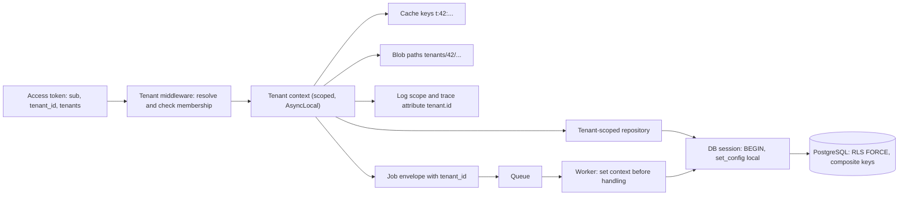
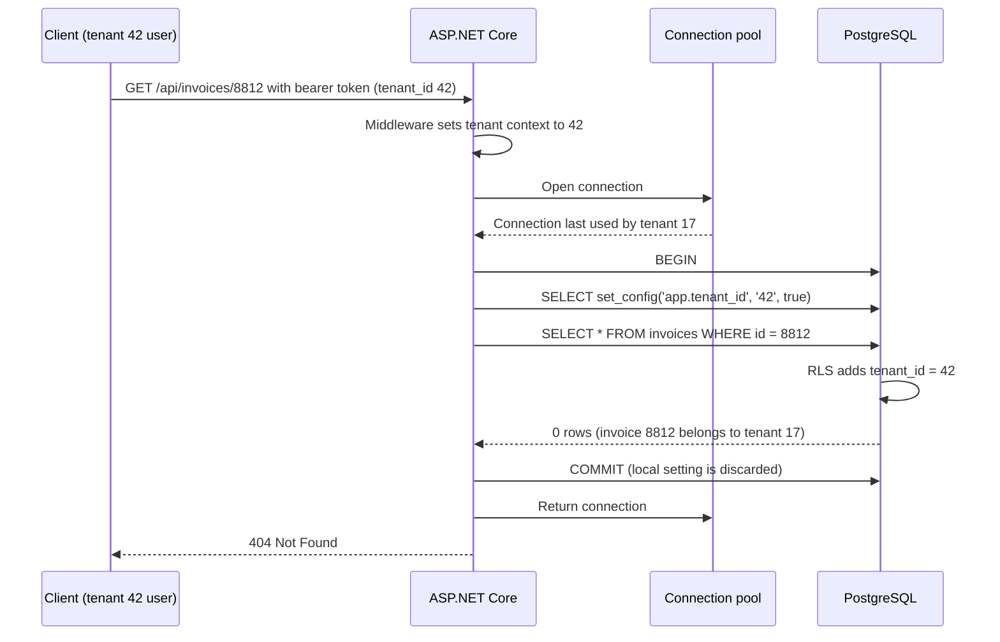

In a software-as-a-service product, hundreds of customer organisations (**tenants**) share the same servers, the same code and often the same database tables. The single worst bug such a product can have is not an outage. It is one tenant seeing another tenant's data: an agency seeing a rival agency's client rates, a hospital seeing another hospital's patients. That bug is usually one missing `WHERE tenant_id = @t`, one cache key without a tenant prefix, or one background job that forgot whose data it was processing. This lesson is about making that bug hard to write and easy to catch.

## Learning objectives

By the end of this lesson you will be able to:

1. Build a threat model for a multi-tenant system and list every path by which data can cross tenants.
2. Compare silo, bridge and pool isolation from a *security* point of view, and say what each one protects against.
3. Enforce tenant isolation in PostgreSQL with row-level security (RLS), including `FORCE`, `WITH CHECK`, restrictive policies, and the traps around owners, views, functions, unique constraints and connection pools.
4. Propagate the tenant context safely from the token to the database, caches, files, background jobs and logs in ASP.NET Core.
5. Write automated cross-tenant leak tests at the database, repository and API levels.
6. Design safe cross-tenant operations: support impersonation, platform admin and analytics.

## Prerequisites

- [Least privilege and audit trails](#/lesson/m14-least-privilege-audit): database roles, grants and audit events.
- [Role-based and policy-based authorization](#/lesson/m14-rbac-pbac): users, roles and claims.
- [SQL injection, XSS, CSRF and SSRF](#/lesson/m14-owasp): IDOR and broken access control.
- [Relational fundamentals](#/lesson/m09-relational-fundamentals): keys and constraints.

For the business side of multi-tenancy (tiers, noisy neighbours, onboarding and tenant moves), see [Multi-tenancy](#/lesson/m16-multi-tenancy), which builds on this lesson.

## Explain it like I'm a beginner

Picture a bank's safe-deposit vault. Hundreds of customers keep boxes in the same room. The room, the guards and the cameras are shared, because that's what makes it affordable.

What keeps it safe:

- **Every box has its own lock**, and your key opens only your box (row-level isolation).
- **The guard checks your ID** when you enter and writes down *which customer you are*. Every action after that is for that customer only (tenant context).
- **The guard never accepts "I'm here for box 512" on its own.** You must prove box 512 is yours (don't trust a tenant id the client sends).
- **When the bank's staff move boxes at night** (background jobs), each trolley carries a label with the owner's name. A trolley without a label is not moved.
- **Every so often, an inspector tries someone else's key on a box** to prove the locks work (leak tests).

A careless bank has one master key and trusts the staff to "only open the right box". That works until the one day someone doesn't. Multi-tenant security is about moving from "we trust every developer to remember the filter" to "the system refuses to show the wrong tenant's data even when someone forgets".

## First-principles explanation

### The threat model: how data crosses tenants

Think of every place where tenant data lives or flows, and ask "what if the tenant filter is missing or wrong here?"

| Leak path | Example | Typical cause |
|---|---|---|
| Database queries | `SELECT * FROM invoices WHERE id = @id` without a tenant filter | One forgotten predicate, a raw SQL report |
| Object references (IDOR) | `GET /api/invoices/8812` returns tenant B's invoice to a tenant A user | Authorization checks "logged in", not "belongs to my tenant" |
| Tenant id from the client | `X-Tenant-Id: 42` header trusted as is | Tenant taken from input, not from the authenticated identity |
| Caches | Key `project:17:summary` shared by every tenant's project 17 | Per-tenant ids that are only unique within a tenant |
| Files and object storage | `/uploads/invoice-2026-10.pdf` with guessable names | Paths not prefixed by tenant, public containers |
| Search indexes | Elasticsearch query without a tenant filter | Separate data store, separate (missing) filter |
| Background jobs | Nightly report job runs under "no tenant" and emails everyone's data | Context not carried in the message |
| Messages and events | A consumer processes an event for tenant B with tenant A's settings | Tenant id not in the envelope, or reused state |
| Logs, traces, errors | An exception message containing another tenant's data, visible in a tenant-facing support tool | Shared telemetry exposed to tenant admins |
| Exports and analytics | A "download all" CSV built by a query that skips the filter | Bulk paths written separately from normal paths |
| Admin and support tools | Support agent views a tenant with full rights and no audit | Over-broad internal roles |
| Unique constraints and errors | "Email already registered" reveals that the email exists in *another* tenant | Global uniqueness where tenant-scoped is meant |
| Timing and counts | Total counts or response times differ based on other tenants' data | Shared aggregates, unfiltered `COUNT(*)` |

Attackers in this model are usually **legitimate users of one tenant** (or someone who signed up for a free trial), probing for others' data. That matters: they are authenticated, they know your API, and they can create as many accounts as they like.

### Isolation models, through a security lens

| Model | What is separate | Main security property | Main residual risk |
|---|---|---|---|
| **Silo** (database or stack per tenant) | Database, often compute and keys | A query bug can't reach another tenant's data: the connection only sees one database | Routing bugs (connecting to the wrong tenant's database), shared admin credentials, many deployments to keep patched |
| **Bridge** (shared app, schema or database per tenant) | Schemas or databases. App shared | Strong data separation, with a shared code path | Connection or `search_path` routing mistakes, shared caches |
| **Pool** (shared tables with `tenant_id`) | Only rows | Cheapest and simplest to operate | Every query, cache, job and index must be tenant-aware. One bug can leak |

Silo is the strongest default, but it's not automatically safe: the app still has to pick the *right* database, using a tenant id it must not take from the client. Pool is safe only when isolation is **enforced centrally**, not remembered in every query. Most SaaS platforms pool their small tenants and silo a few large or regulated ones (the bridge approach in [Multi-tenancy](#/lesson/m16-multi-tenancy)), so they need both disciplines.

### Defence in depth for the pool model

Use several layers, each of which would stop most leaks on its own:

1. **Tenant context from identity.** The tenant comes from the authenticated token or session (a `tenant_id` claim issued by your identity provider). If a user belongs to several tenants, the request may *select* one, but the server checks membership.
2. **Application-level filtering.** A tenant-scoped repository or an ORM global query filter (EF Core `HasQueryFilter`) adds `tenant_id = @current` to every query, and refuses to run without a tenant.
3. **Database-level enforcement with RLS.** Even if the application layer is bypassed (a raw SQL report, a new developer's query), PostgreSQL itself returns only the current tenant's rows.
4. **Tenant-scoped everything else.** Cache keys, storage paths, search queries, message envelopes and log scopes all carry the tenant.
5. **Tests and monitoring.** Automated cross-tenant tests on every endpoint, catalog checks that every tenant table has RLS, and canary records that alert if they are ever read from the wrong tenant.

### Row-level security in PostgreSQL

**Row-level security (RLS)** lets a table decide, per row, whether the current session may see or change it. You enable it on a table and write **policies**:

```sql
ALTER TABLE invoices ENABLE ROW LEVEL SECURITY;
ALTER TABLE invoices FORCE ROW LEVEL SECURITY;

CREATE POLICY tenant_isolation ON invoices
  USING      (tenant_id = NULLIF(current_setting('app.tenant_id', true), '')::bigint)
  WITH CHECK (tenant_id = NULLIF(current_setting('app.tenant_id', true), '')::bigint);
```

- `USING` filters the rows a statement can **see** (`SELECT`, and the rows `UPDATE`/`DELETE` can target).
- `WITH CHECK` validates rows being **written** (`INSERT`, and the new version in `UPDATE`). Without it, a user could insert a row with another tenant's id, or "move" a row to another tenant with `UPDATE invoices SET tenant_id = 99`.
- `current_setting('app.tenant_id', true)` reads a custom setting the application sets per transaction. The second argument `true` means "return null instead of erroring if it isn't set". `NULLIF(..., '')` turns an empty string into null, and `tenant_id = NULL` matches nothing. So **no tenant means no rows**, which is the safe failure.
- Once RLS is enabled, if no policy applies to a role and command, the default is **deny**.

The application sets the tenant at the start of each transaction:

```sql
BEGIN;
SELECT set_config('app.tenant_id', '42', true);   -- true = local to this transaction
SELECT * FROM invoices WHERE status = 'pending';  -- RLS adds the tenant filter
COMMIT;                                           -- the setting disappears with the transaction
```

### The RLS traps

RLS is powerful, and it has sharp edges. Each of these has caused real leaks.

**1. Owners and superusers bypass RLS.** The table owner isn't subject to RLS unless the table has `FORCE ROW LEVEL SECURITY`. Superusers and roles with `BYPASSRLS` are never subject to it. If your app connects as the owner, `ENABLE` alone does nothing for you. Connect as a dedicated non-owner role (see [least privilege](#/lesson/m14-least-privilege-audit)), *and* set `FORCE` so the owner (migrations, maintenance scripts) is covered too.

**2. Session-level settings leak through connection pools.** `set_config(..., false)` or plain `SET app.tenant_id = 42` lasts for the whole *connection*. Connection pools hand that connection to the next request, which may belong to another tenant and may forget to set its own. Npgsql's built-in pool resets session state (`DISCARD ALL`) when a connection goes back to the pool unless `No Reset On Close=true` is set, but PgBouncer in transaction mode does not reset anything between clients, and a reset you never asked for is not a safety mechanism you control. Always use transaction-local settings (`set_config(..., true)` or `SET LOCAL`) inside an explicit transaction. With PgBouncer in transaction mode this is the *only* safe option, because consecutive statements may run on different server connections.

**3. Views run with the owner's rights.** A view normally accesses its tables with the permissions of the view's **owner**. If the owner is a superuser or the table owner, RLS is bypassed for everyone who queries the view. In PostgreSQL 15 and later, create views `WITH (security_invoker = true)` so the querying user's rights and policies apply.

**4. `SECURITY DEFINER` functions also run as their owner.** A helper function created by the owner, called by the app role, sees all tenants' rows. Prefer `SECURITY INVOKER` (the default), or filter by tenant explicitly inside definer functions, and always set `search_path` on them.

**5. Uniqueness and foreign keys cross tenants.** A global `UNIQUE (email)` makes registration fail with "email already exists" when the email exists in *another* tenant, which leaks information. Use `UNIQUE (tenant_id, email)`. A foreign key `invoices.project_id → projects.id` lets tenant A's invoice reference tenant B's project. Use composite keys: `PRIMARY KEY (tenant_id, id)` on projects and `FOREIGN KEY (tenant_id, project_id) REFERENCES projects (tenant_id, id)` on invoices, so the database itself refuses cross-tenant references. Foreign-key checks run without RLS, so this is the way to make them tenant-safe.

**6. Side channels through functions.** A query like `WHERE tenant_id = current_tenant() AND expensive_or_erroring(secret_column)` can, in some plans, evaluate the user's function on rows the policy would hide, leaking information through errors or timing. PostgreSQL evaluates policy quals first unless functions are marked `LEAKPROOF` (only superusers can do that, and only for functions that leak nothing). In practice: don't expose user-defined functions over hidden columns, and keep error messages generic.

**8. The setting is only as trustworthy as the SQL that runs.** `app.tenant_id` is an ordinary custom setting: *any* SQL running as the app role can change it with `SET app.tenant_id = '17'`. RLS keyed on a setting protects you from forgotten `WHERE` clauses, not from an attacker who can run arbitrary SQL (SQL injection) on the app's connection. Parameterised queries remain mandatory. For stronger guarantees, connect with a separate login per tenant (or per silo), so injected SQL can't switch tenants, at the cost of many roles and much less effective pooling.

**7. Performance.** A policy is an extra predicate on every query. With `tenant_id` as the leading column of your indexes (`(tenant_id, status, created_at)`), the cost is negligible. Without it, RLS can turn index scans into sequential scans. Subqueries in policies (for example, membership checks) run often, so keep them indexable and simple.

### Permissive and restrictive policies

Policies are **permissive** by default: a row is visible if *any* permissive policy allows it. **Restrictive** policies (`AS RESTRICTIVE`) must *all* pass in addition. That lets you layer rules cleanly:

```sql
-- Permissive: rows of tenants the user belongs to
CREATE POLICY member_rows ON documents
  USING (tenant_id IN (SELECT tenant_id FROM memberships
                       WHERE user_id = NULLIF(current_setting('app.user_id', true), '')::int));

-- Restrictive: restricted documents only for tenant admins
CREATE POLICY restricted_needs_admin ON documents AS RESTRICTIVE
  USING (classification <> 'restricted' OR EXISTS (
         SELECT 1 FROM memberships m WHERE m.user_id = NULLIF(current_setting('app.user_id', true), '')::int
           AND m.tenant_id = documents.tenant_id AND m.role = 'admin'));
```

Think of permissive policies as "ways in" and restrictive ones as "conditions that always apply". Exercise 4 builds exactly this.

### Tenant context propagation in ASP.NET Core

The tenant must travel with the work, everywhere, without anyone passing it by hand through 15 method signatures.

**1. Resolve it once, from identity.** Middleware after authentication reads the `tenant_id` claim. If users can belong to several tenants, the client may name the *active* tenant (a header or route segment), and the middleware checks that the user is a member, else `403`. Unauthenticated requests have no tenant.

**2. Store it in a request-scoped context.** An `ITenantContext` registered as scoped, or an `AsyncLocal<T>`-based accessor that also flows into `Task.Run` and other async continuations. Never a static field, which is shared by all concurrent requests.

**3. Use it at every boundary:**

- **Database**: a session factory that opens a transaction and calls `set_config('app.tenant_id', @t, true)` before handing out the connection. For silo tenants, the same factory picks the tenant's connection string from a catalogue.
- **Caches**: keys built by a helper that prefixes `t:{tenantId}:`, so no developer builds a raw key.
- **Object storage**: paths like `tenants/{tenantId}/invoices/{invoiceId}.pdf`, a container per tenant for silo tiers, and signed URLs scoped to one object.
- **Search**: a mandatory tenant filter, or an index (or alias with a filter) per tenant.
- **Messages and jobs**: the tenant id is a required field in the envelope. The consumer sets the context *before* handling, and rejects messages without it.
- **Logs and traces**: a logging scope and an OpenTelemetry attribute `tenant.id`, so every line is attributable. Make sure tenant admins never see other tenants' logs.

**4. Fail closed.** Code that needs a tenant and doesn't have one throws. It never falls back to "all tenants".

### Cross-tenant operations

Some features legitimately cross tenants. Make each one explicit, narrow and audited:

- **Support impersonation**: a support agent "views as" a tenant user only with the tenant's consent or a ticket, read-only by default, time-boxed, with a visible banner and an audit event for every action.
- **Platform admin**: a separate role and database login (perhaps with `BYPASSRLS`), used only by an internal admin application on a separate network path, never by the tenant-facing API.
- **Analytics**: aggregate in a separate warehouse with pseudonymised data, or have per-tenant jobs write aggregates. Don't give the reporting tool an RLS-bypassing login to production.

### When the pool is the wrong choice

If a contract says "our data must be in a dedicated database with our own key", or the data is extremely sensitive (health records, defence projects), a silo is simpler to reason about and to *prove* to an auditor. Also, if you have 5 large customers rather than 5,000 small ones, the cost advantage of pooling is small and the risk is not. Pool when you have many small tenants and the discipline to enforce it centrally.

## Visual explanation

### Where the tenant context goes



The tenant enters the system once, from the authenticated token, never from a free-form header alone. The middleware checks that the requested tenant is one the user belongs to, then fills a context that is per request (and flows correctly across `await`). Everything that touches tenant data reads from that one context. The repository adds tenant filters, the database session sets the transaction-local setting that RLS policies read, and caches, blob paths and logs all embed the tenant id. When work leaves the request (a queued job), the tenant id is copied into the message envelope, and the worker restores the context before doing anything. The database is the last line of defence: even code that skips the repository gets only the current tenant's rows.

### One request through a pooled connection



Two details make this safe. First, the connection previously served tenant 17, but because the setting was transaction-local, nothing of tenant 17 survives on it: the new transaction sets 42 before any query. Second, the API answers `404`, not `403`, for another tenant's id. A `403` would confirm to the attacker that invoice 8812 exists, which turns the endpoint into an oracle for probing other tenants.

## Step-by-step example

**Scenario.** *AgencyDesk* is a Jira-meets-invoicing SaaS tool where 1,400 design, marketing and IT-services agencies track client projects, log time and send invoices. It runs in the pool model on one PostgreSQL cluster: about 60 million invoice lines, 22,000 users, and peaks of around 300 requests a second at month-end, when every agency invoices its clients (an estimate: 22,000 users × 120 requests on the last two days ÷ (2 × 8 working hours × 3,600 s) ≈ 46 per second on average, × 6 for the 30-minute rush before the invoicing cut-off ≈ 280). A security review found one real leak (a CSV export of another tenant's invoices, caused by a raw SQL report) and asked for systematic fixes.

### Step 1 — composite keys

Every tenant table gets `tenant_id` as the first column of its primary key, and every foreign key becomes composite: `FOREIGN KEY (tenant_id, project_id) REFERENCES projects (tenant_id, id)`. Unique constraints become per tenant. Indexes start with `tenant_id`. This migration is the expensive part (estimate: two weekends of expand/contract work on 60 million rows), and it pays for itself by making cross-tenant references impossible.

### Step 2 — RLS on every tenant table

Enable and force RLS, with one `tenant_isolation` policy per table that has both `USING` and `WITH CHECK`. The app connects as `agencydesk_app`, which is not the owner. Migrations run as `agencydesk_migrator`. Views get `security_invoker = true`.

### Step 3 — tenant context and session factory

Middleware resolves the tenant from the token. A `TenantDbSession` opens a transaction and sets `app.tenant_id` locally before any query. The old code that ran `SET app.tenant_id` once per connection is removed.

### Step 4 — everything else

Cache keys go through `TenantCacheKeys`. Blob paths are built by `TenantPaths`. Message envelopes carry `TenantId`, and the worker base class sets the context. A logging scope adds `TenantId` to every log line.

### Step 5 — leak tests and monitoring

- A catalog test in CI fails if any table with a `tenant_id` column lacks enabled and forced RLS with a policy (exercise 2).
- An API test seeds two tenants and calls every `GET /{id}` endpoint as tenant A with tenant B's ids, expecting `404`.
- Two **canary rows** (a fake invoice per tenant with a known id) trigger an alert if they are ever returned to a different tenant.

The raw SQL report that caused the leak now returns only the current tenant's rows, without any code change, because RLS applies.

## Production-style C# implementation

```text
AgencyDesk.Api/
  Program.cs
  Tenancy/TenantContext.cs
  Tenancy/TenantResolutionMiddleware.cs
  Tenancy/TenantKeys.cs
  Data/TenantDbSession.cs
  Jobs/TenantJobs.cs
```

```csharp file=Tenancy/TenantContext.cs
namespace AgencyDesk.Api.Tenancy;

public interface ITenantContext
{
    string? TenantId { get; }
    /// <summary>Throws when no tenant is set, so code fails closed instead of reading all tenants.</summary>
    string RequiredTenantId { get; }
}

/// <summary>AsyncLocal flows across await and Task.Run, and is isolated between concurrent requests and jobs.</summary>
public sealed class TenantContextAccessor : ITenantContext
{
    private static readonly AsyncLocal<string?> Current = new();

    public string? TenantId => Current.Value;

    public string RequiredTenantId =>
        Current.Value ?? throw new InvalidOperationException("No tenant context. Refusing to access tenant data.");

    public IDisposable BeginScope(string tenantId)
    {
        ArgumentException.ThrowIfNullOrWhiteSpace(tenantId);
        var previous = Current.Value;
        Current.Value = tenantId;
        return new Restore(previous);
    }

    private sealed class Restore(string? previous) : IDisposable
    {
        private bool _done;
        public void Dispose()
        {
            if (_done) return;
            Current.Value = previous;
            _done = true;
        }
    }
}

public enum TenantStatus { Active, Suspended, Offboarded }

public interface ITenantDirectory
{
    Task<TenantStatus?> GetStatusAsync(string tenantId, CancellationToken ct);
}

public sealed class InMemoryTenantDirectory(IReadOnlyDictionary<string, TenantStatus> tenants) : ITenantDirectory
{
    public Task<TenantStatus?> GetStatusAsync(string tenantId, CancellationToken ct) =>
        Task.FromResult(tenants.TryGetValue(tenantId, out var s) ? s : (TenantStatus?)null);
}
```

```csharp file=Tenancy/TenantResolutionMiddleware.cs
using System.Security.Claims;
using Microsoft.Extensions.Logging;

namespace AgencyDesk.Api.Tenancy;

/// <summary>Resolves the active tenant from the authenticated identity. A client may only *select* among tenants it belongs to.</summary>
public sealed class TenantResolutionMiddleware(RequestDelegate next, ILogger<TenantResolutionMiddleware> log)
{
    public const string HeaderName = "X-Tenant-Id";

    public async Task InvokeAsync(HttpContext http, TenantContextAccessor accessor, ITenantDirectory directory)
    {
        if (http.User.Identity?.IsAuthenticated != true) { await next(http); return; }

        var memberships = http.User.FindAll("tenants").SelectMany(c => c.Value.Split(' ', StringSplitOptions.RemoveEmptyEntries)).ToHashSet(StringComparer.Ordinal);
        var home = http.User.FindFirstValue("tenant_id");
        if (home is not null) memberships.Add(home);

        var requested = http.Request.Headers[HeaderName].FirstOrDefault();
        var tenant = string.IsNullOrEmpty(requested) ? home : requested;

        if (tenant is null || !memberships.Contains(tenant))
        {
            log.LogWarning("User {User} requested tenant {Tenant} without membership", http.User.FindFirstValue(ClaimTypes.NameIdentifier), requested);
            http.Response.StatusCode = StatusCodes.Status403Forbidden;
            return;
        }
        if (await directory.GetStatusAsync(tenant, http.RequestAborted) is not TenantStatus.Active)
        {
            http.Response.StatusCode = StatusCodes.Status403Forbidden;
            return;
        }

        using var scope = accessor.BeginScope(tenant);
        using var logScope = log.BeginScope(new Dictionary<string, object> { ["TenantId"] = tenant });
        System.Diagnostics.Activity.Current?.SetTag("tenant.id", tenant);
        await next(http);
    }
}
```

```csharp file=Tenancy/TenantKeys.cs
namespace AgencyDesk.Api.Tenancy;

/// <summary>The only way to build cache keys and storage paths, so none can be built without a tenant.</summary>
public sealed class TenantKeys(ITenantContext tenant)
{
    public string Cache(string key) => $"t:{tenant.RequiredTenantId}:{key}";

    public string BlobPath(string category, string fileName)
    {
        if (fileName.Contains('/') || fileName.Contains('\\') || fileName.Contains(".."))
            throw new ArgumentException("File name must not contain path separators.", nameof(fileName));
        return $"tenants/{tenant.RequiredTenantId}/{category}/{fileName}";
    }
}
```

```csharp file=Data/TenantDbSession.cs
using System.Data;
using System.Data.Common;
using AgencyDesk.Api.Tenancy;

namespace AgencyDesk.Api.Data;

/// <summary>Opens a transaction and sets app.tenant_id LOCAL to it, so RLS applies and nothing leaks to the next user of the pooled connection.</summary>
public sealed class TenantDbSession(DbDataSource dataSource, ITenantContext tenant)
{
    public async Task<T> RunAsync<T>(Func<DbConnection, DbTransaction, Task<T>> work, CancellationToken ct)
    {
        var tenantId = tenant.RequiredTenantId;
        await using var conn = await dataSource.OpenConnectionAsync(ct);
        await using var tx = await conn.BeginTransactionAsync(IsolationLevel.ReadCommitted, ct);

        await using (var set = conn.CreateCommand())
        {
            set.Transaction = tx;
            set.CommandText = "SELECT set_config('app.tenant_id', @tenant, true)";
            var p = set.CreateParameter();
            p.ParameterName = "tenant";
            p.Value = tenantId;
            set.Parameters.Add(p);
            await set.ExecuteScalarAsync(ct);
        }

        var result = await work(conn, tx);
        await tx.CommitAsync(ct);
        return result;
    }
}

public sealed record InvoiceSummary(long Id, string Status, decimal AmountInr);

public sealed class InvoiceQueries(TenantDbSession session)
{
    /// <summary>No tenant predicate here on purpose: RLS adds it. The repository layer still adds one too (defence in depth).</summary>
    public Task<InvoiceSummary?> FindAsync(long id, CancellationToken ct) =>
        session.RunAsync(async (conn, tx) =>
        {
            await using var cmd = conn.CreateCommand();
            cmd.Transaction = tx;
            cmd.CommandText = "SELECT id, status, amount_inr FROM invoices WHERE id = @id";
            var p = cmd.CreateParameter();
            p.ParameterName = "id";
            p.Value = id;
            cmd.Parameters.Add(p);
            await using var r = await cmd.ExecuteReaderAsync(ct);
            return await r.ReadAsync(ct) ? new InvoiceSummary(r.GetInt64(0), r.GetString(1), r.GetDecimal(2)) : null;
        }, ct);
}
```

```csharp file=Jobs/TenantJobs.cs
using System.Threading.Channels;
using Microsoft.Extensions.Hosting;
using Microsoft.Extensions.Logging;
using AgencyDesk.Api.Tenancy;

namespace AgencyDesk.Api.Jobs;

/// <summary>Every job names its tenant. A job without one is rejected, never run "for all tenants".</summary>
public sealed record TenantJob(string TenantId, string Kind, string Payload);

public interface ITenantJobHandler
{
    string Kind { get; }
    Task HandleAsync(TenantJob job, CancellationToken ct);
}

public sealed class TenantJobQueue
{
    private readonly Channel<TenantJob> _channel = Channel.CreateBounded<TenantJob>(new BoundedChannelOptions(10_000)
    {
        FullMode = BoundedChannelFullMode.Wait,
    });
    public ChannelReader<TenantJob> Reader => _channel.Reader;

    /// <summary>Captures the tenant from the current context, so callers can't pass the wrong one by accident.</summary>
    public ValueTask EnqueueAsync(ITenantContext tenant, string kind, string payload, CancellationToken ct) =>
        _channel.Writer.WriteAsync(new TenantJob(tenant.RequiredTenantId, kind, payload), ct);
}

public sealed class TenantJobWorker(TenantJobQueue queue, IEnumerable<ITenantJobHandler> handlers, TenantContextAccessor accessor,
    ITenantDirectory directory, ILogger<TenantJobWorker> log) : BackgroundService
{
    private readonly Dictionary<string, ITenantJobHandler> _byKind = handlers.ToDictionary(h => h.Kind);

    protected override async Task ExecuteAsync(CancellationToken stoppingToken)
    {
        await foreach (var job in queue.Reader.ReadAllAsync(stoppingToken))
        {
            if (string.IsNullOrWhiteSpace(job.TenantId)) { log.LogError("Rejected {Kind} job without tenant", job.Kind); continue; }
            if (await directory.GetStatusAsync(job.TenantId, stoppingToken) is not TenantStatus.Active)
            {
                log.LogWarning("Skipped {Kind} job for inactive tenant {TenantId}", job.Kind, job.TenantId);
                continue;
            }
            if (!_byKind.TryGetValue(job.Kind, out var handler)) { log.LogError("No handler for {Kind}", job.Kind); continue; }

            using var scope = accessor.BeginScope(job.TenantId);
            using var logScope = log.BeginScope(new Dictionary<string, object> { ["TenantId"] = job.TenantId });
            try { await handler.HandleAsync(job, stoppingToken); }
            catch (Exception ex) when (ex is not OperationCanceledException)
            {
                log.LogError(ex, "Job {Kind} failed for tenant {TenantId}", job.Kind, job.TenantId);
            }
        }
    }
}
```

```csharp file=Program.cs
using Microsoft.AspNetCore.Authentication.Cookies;
using AgencyDesk.Api.Data;
using AgencyDesk.Api.Jobs;
using AgencyDesk.Api.Tenancy;

var builder = WebApplication.CreateBuilder(args);

builder.Services.AddAuthentication(CookieAuthenticationDefaults.AuthenticationScheme).AddCookie();
builder.Services.AddAuthorization();

builder.Services.AddSingleton<TenantContextAccessor>();
builder.Services.AddSingleton<ITenantContext>(sp => sp.GetRequiredService<TenantContextAccessor>());
builder.Services.AddSingleton<ITenantDirectory>(new InMemoryTenantDirectory(new Dictionary<string, TenantStatus>
{
    ["42"] = TenantStatus.Active, ["17"] = TenantStatus.Active, ["99"] = TenantStatus.Suspended,
}));
builder.Services.AddSingleton<TenantKeys>();
builder.Services.AddMemoryCache();

// Production: builder.Services.AddNpgsqlDataSource(connectionString) registers DbDataSource. The login is
// agencydesk_app: not the table owner, no BYPASSRLS.
builder.Services.AddScoped<TenantDbSession>();
builder.Services.AddScoped<InvoiceQueries>();

builder.Services.AddSingleton<TenantJobQueue>();
builder.Services.AddHostedService<TenantJobWorker>();

var app = builder.Build();

app.UseAuthentication();
app.UseMiddleware<TenantResolutionMiddleware>();
app.UseAuthorization();

app.MapGet("/api/invoices/{id:long}", async (long id, InvoiceQueries invoices, CancellationToken ct) =>
    await invoices.FindAsync(id, ct) is { } invoice ? Results.Ok(invoice) : Results.NotFound())   // 404, never 403, for other tenants' ids
   .RequireAuthorization();

app.MapPost("/api/reports/monthly", async (TenantJobQueue queue, ITenantContext tenant, CancellationToken ct) =>
{
    await queue.EnqueueAsync(tenant, "monthly-report", "{}", ct);
    return Results.Accepted();
}).RequireAuthorization();

app.Run();
```

Points to notice:

- **`TenantContextAccessor` is a singleton holding an `AsyncLocal`.** That is safe because the value is per async flow, not per object. A plain field on a singleton would be shared by every request, which is a classic leak.
- **`EnqueueAsync` reads the tenant from the context** instead of taking it as a parameter, which removes a whole class of "passed the wrong id" bugs.
- **The worker skips suspended and offboarded tenants.** Jobs queued before a tenant was offboarded must not resurrect its data.
- **`InvoiceQueries` has no tenant predicate**, to show that RLS enforces it. In real code, the repository adds `tenant_id = @t` as well. It helps the planner use the `(tenant_id, …)` index, and it is a second layer if a policy is ever dropped by mistake.

The matching schema:

```sql
CREATE TABLE projects (
  tenant_id bigint NOT NULL, id bigint NOT NULL, name text NOT NULL,
  PRIMARY KEY (tenant_id, id)
);
CREATE TABLE invoices (
  tenant_id bigint NOT NULL, id bigint NOT NULL, project_id bigint NOT NULL,
  status text NOT NULL, amount_inr numeric(14,2) NOT NULL, created_at timestamptz NOT NULL DEFAULT now(),
  PRIMARY KEY (tenant_id, id),
  FOREIGN KEY (tenant_id, project_id) REFERENCES projects (tenant_id, id)
);
CREATE INDEX ON invoices (tenant_id, status, created_at);
ALTER TABLE invoices ENABLE ROW LEVEL SECURITY;
ALTER TABLE invoices FORCE ROW LEVEL SECURITY;
CREATE POLICY tenant_isolation ON invoices
  USING      (tenant_id = NULLIF(current_setting('app.tenant_id', true), '')::bigint)
  WITH CHECK (tenant_id = NULLIF(current_setting('app.tenant_id', true), '')::bigint);
CREATE VIEW pending_invoices WITH (security_invoker = true) AS
  SELECT tenant_id, id, amount_inr FROM invoices WHERE status = 'pending';
```

## Bad design vs good design

| Bad | How it leaks | Good |
|---|---|---|
| Tenant id from an `X-Tenant-Id` header, trusted | Any user reads any tenant by changing a header | Tenant from the token. A header may only select among the user's memberships |
| Tenant stored in a static field or a singleton's field | Concurrent requests overwrite each other | Scoped service or `AsyncLocal` accessor |
| `SET app.tenant_id` once per connection | Pooled connection carries tenant 17 into tenant 42's request | `set_config(..., true)` inside a transaction, every time |
| App connects as table owner, RLS enabled but not forced | RLS silently doesn't apply | Non-owner app role, plus `FORCE ROW LEVEL SECURITY` |
| `CREATE VIEW` owned by a superuser for reports | View bypasses RLS for every user | `WITH (security_invoker = true)` |
| `UNIQUE (email)`, `FOREIGN KEY (project_id)` | Existence oracle, and cross-tenant references | `UNIQUE (tenant_id, email)`, composite foreign keys |
| Cache key `project:17` | Tenant B sees tenant A's cached project 17 | Keys built only by `TenantKeys.Cache(...)` |
| `403 Forbidden` for another tenant's id | Confirms the id exists, so attackers can enumerate | `404 Not Found`, same as a non-existent id |
| Nightly job "for all tenants" with one query | One bug emails everyone's data to everyone | One job per tenant, context set from the envelope |
| Support staff use a `BYPASSRLS` login in the tenant app | Untraceable cross-tenant access | Time-boxed, audited impersonation through the normal path |

:::callout type=warning title="RLS is a safety net, not a substitute for authorization"
RLS answers "which tenant's rows may this session see?" It doesn't answer "may this user, inside the tenant, approve this invoice?" That's still [RBAC or policy-based authorization](#/lesson/m14-rbac-pbac) in the application. And RLS only protects PostgreSQL. Caches, blob storage, search and queues need their own tenant enforcement.
:::

:::callout type=tradeoff title="Cost of the extra layers"
Composite keys make every primary and foreign key a bit larger, and every query must carry the tenant. Migrating an existing single-column-key schema is real work. For a pool with hundreds of tenants and sensitive data, it is worth it. For an internal tool with three business units that all trust each other, a `tenant_id` filter in the repository may be enough.
:::

## Practical playground

The setup creates a pooled `invoices` table for two tenants with RLS **enabled but not forced**, an app role, an owner role and a report view without `security_invoker`. Explore the traps:

1. `SET ROLE app_user; SELECT * FROM invoices;` returns no rows (no tenant set).
2. `SELECT set_config('app.tenant_id', '42', false); SELECT * FROM invoices;` returns tenant 42's rows. Now `SELECT * FROM invoices_report;`. The view leaks both tenants. Why?
3. `RESET ROLE; SET ROLE invoices_owner; SELECT count(*) FROM invoices;` shows that the owner sees everything. Then, as the superuser (`RESET ROLE`), run `ALTER TABLE invoices FORCE ROW LEVEL SECURITY;` and try again.
4. As `app_user` with tenant 42, try `INSERT INTO invoices VALUES (17, 900, 5, 'pending', 1);`. Which clause stops it?
5. Try `INSERT INTO invoices VALUES (42, 900, 5, 'pending', 1);`, a tenant-42 invoice pointing at project 5, which exists only in tenant 17. Which constraint stops it?

:::playground type=sql title="RLS traps lab"
```sql
CREATE ROLE invoices_owner NOLOGIN;
CREATE ROLE app_user NOLOGIN;
CREATE TABLE projects (tenant_id bigint NOT NULL, id bigint NOT NULL, name text NOT NULL, PRIMARY KEY (tenant_id, id));
CREATE TABLE invoices (
  tenant_id bigint NOT NULL, id bigint NOT NULL, project_id bigint NOT NULL,
  status text NOT NULL, amount_inr numeric(14,2) NOT NULL,
  PRIMARY KEY (tenant_id, id),
  FOREIGN KEY (tenant_id, project_id) REFERENCES projects (tenant_id, id)
);
INSERT INTO projects VALUES (42, 1, 'Website redesign for Jaipur Handlooms'), (42, 2, 'Diwali campaign for Ajmer Sweets'), (17, 5, 'Mobile app for Surat Diamonds');
INSERT INTO invoices VALUES
  (42, 101, 1, 'pending', 1850000.00), (42, 102, 2, 'approved', 640000.00),
  (17, 101, 5, 'pending', 2210000.00), (17, 102, 5, 'paid', 95000.00);
ALTER TABLE projects OWNER TO invoices_owner;
ALTER TABLE invoices OWNER TO invoices_owner;
GRANT SELECT ON projects, invoices TO invoices_owner;
ALTER TABLE invoices ENABLE ROW LEVEL SECURITY;
CREATE POLICY tenant_isolation ON invoices
  USING      (tenant_id = NULLIF(current_setting('app.tenant_id', true), '')::bigint)
  WITH CHECK (tenant_id = NULLIF(current_setting('app.tenant_id', true), '')::bigint);
GRANT SELECT, INSERT, UPDATE ON invoices TO app_user;
GRANT SELECT ON projects TO app_user;
CREATE VIEW invoices_report AS SELECT tenant_id, id, status, amount_inr FROM invoices;
GRANT SELECT ON invoices_report TO app_user;
```
:::

## Exercises

:::exercise id=m14-multi-tenant-security-ex1 difficulty=beginner kind=code title="Tenant-scoped cache keys that fail closed"
A summary cache uses keys like `project:17:summary`. Project ids are only unique within a tenant, so tenant B sometimes sees tenant A's summary. Implement `TenantCache`, a small wrapper around `IMemoryCache` that prefixes every key with the current tenant and refuses to work without one.
::requirements
- `Key(string key)` returns `t:{tenantId}:{key}`.
- `GetOrCreate<T>(key, factory)` uses the prefixed key.
- If the tenant is `null` or empty, every method throws `InvalidOperationException`.
- `key` must not be empty, and must not contain the `:` character at position 0 (so callers can't forge another prefix). Throw `ArgumentException`.
::acceptance
- Tenants `42` and `17` caching `project:17:summary` get different values.
- With no tenant, `GetOrCreate` throws and the factory is never called.
- A key like `:t:17:project` is rejected.
::hint
The tenant comes from an `ITenantContext` passed into the constructor, not from a method parameter.
::hint
Check the tenant *before* touching the cache, so a missing tenant never reads or writes anything.
::hint
`IMemoryCache.GetOrCreate(key, entry => factory())` is an extension method in `Microsoft.Extensions.Caching.Memory`.
::hint
```csharp
public string Key(string key) => $"t:{RequireTenant()}:{Validate(key)}";
```
::starter
```csharp file=TenantCache.cs
using System;
using Microsoft.Extensions.Caching.Memory;

public interface ITenantContext { string? TenantId { get; } }

public sealed class TenantCache
{
    private readonly IMemoryCache _cache;
    private readonly ITenantContext _tenant;

    public TenantCache(IMemoryCache cache, ITenantContext tenant) { _cache = cache; _tenant = tenant; }

    public string Key(string key) => throw new NotImplementedException();

    public T GetOrCreate<T>(string key, Func<T> factory) => throw new NotImplementedException();
}
```
::tests
```csharp file=TenantCacheTests.cs
using System;
using Microsoft.Extensions.Caching.Memory;
using Xunit;

public class TenantCacheTests
{
    private sealed class FixedTenant(string? id) : ITenantContext { public string? TenantId { get; } = id; }

    [Fact]
    public void Same_key_different_tenants_do_not_collide()
    {
        var shared = new MemoryCache(new MemoryCacheOptions());
        var a = new TenantCache(shared, new FixedTenant("42")).GetOrCreate("project:17:summary", () => "tenant 42 data");
        var b = new TenantCache(shared, new FixedTenant("17")).GetOrCreate("project:17:summary", () => "tenant 17 data");
        Assert.Equal("tenant 42 data", a);
        Assert.Equal("tenant 17 data", b);
    }

    [Fact]
    public void Key_is_prefixed() =>
        Assert.Equal("t:42:project:17", new TenantCache(new MemoryCache(new MemoryCacheOptions()), new FixedTenant("42")).Key("project:17"));

    [Theory]
    [InlineData(null)]
    [InlineData("")]
    public void No_tenant_throws_and_factory_not_called(string? tenant)
    {
        var called = false;
        var cache = new TenantCache(new MemoryCache(new MemoryCacheOptions()), new FixedTenant(tenant));
        Assert.Throws<InvalidOperationException>(() => cache.GetOrCreate("x", () => { called = true; return 1; }));
        Assert.False(called);
    }

    [Theory]
    [InlineData("")]
    [InlineData(":t:17:project")]
    public void Bad_keys_are_rejected(string key) =>
        Assert.Throws<ArgumentException>(() => new TenantCache(new MemoryCache(new MemoryCacheOptions()), new FixedTenant("42")).Key(key));
}
```
::solution
```csharp file=TenantCache.cs
using System;
using Microsoft.Extensions.Caching.Memory;

public interface ITenantContext { string? TenantId { get; } }

public sealed class TenantCache
{
    private readonly IMemoryCache _cache;
    private readonly ITenantContext _tenant;

    public TenantCache(IMemoryCache cache, ITenantContext tenant) { _cache = cache; _tenant = tenant; }

    public string Key(string key)
    {
        var tenant = _tenant.TenantId;
        if (string.IsNullOrEmpty(tenant)) throw new InvalidOperationException("No tenant context: refusing to use the cache.");
        if (string.IsNullOrEmpty(key) || key[0] == ':') throw new ArgumentException("Invalid cache key.", nameof(key));
        return $"t:{tenant}:{key}";
    }

    public T GetOrCreate<T>(string key, Func<T> factory) => _cache.GetOrCreate(Key(key), _ => factory())!;
}
```

The point is not the string format. It is that **no other code builds cache keys**. Make the raw `IMemoryCache` or `IDistributedCache` unavailable to feature code (only `TenantCache` is registered for it), and add an analyzer or code-review rule against raw keys.
::mistakes
- Passing the tenant id as a method argument. Callers will eventually pass the wrong one.
- Falling back to an unprefixed key when there is no tenant, which recreates the leak.
- Forgetting distributed caches, CDN caches and HTTP response caching, which all need the tenant in the key (or `Vary` on it).
:::

:::exercise id=m14-multi-tenant-security-ex2 difficulty=beginner kind=sql ordered=true title="Find tenant tables without proper RLS"
Write a catalog query for a CI check. In schema `app`, return every table that has a `tenant_id` column but is **not fully protected**: RLS is not enabled, or not forced, or the table has no policies. Return `table_name`, `rls_enabled`, `rls_forced` and `policy_count`, ordered by `table_name`.
::acceptance
- Reads `pg_class` (`relrowsecurity`, `relforcerowsecurity`), `pg_namespace`, `pg_attribute` and `pg_policy`.
- Includes tables with RLS enabled but no policy (they deny everything, which usually means a forgotten migration step).
- Excludes tables without `tenant_id` and tables that are fully protected.
- Considers ordinary tables only (`relkind = 'r'`), plus partitioned tables (`'p'`).
::hint
`pg_class.relrowsecurity` is "RLS enabled", `relforcerowsecurity` is "forced".
::hint
Join `pg_namespace` on `relnamespace` and filter `nspname = 'app'`. Use `EXISTS` on `pg_attribute` (`attrelid = c.oid AND attname = 'tenant_id' AND NOT attisdropped`).
::hint
Count policies with a correlated subquery: `(SELECT count(*) FROM pg_policy p WHERE p.polrelid = c.oid)`.
::hint
Filter with `WHERE NOT (relrowsecurity AND relforcerowsecurity AND policy_count > 0)`. A CTE lets you name `policy_count` first.
::setup
```sql
CREATE SCHEMA app;
CREATE TABLE app.tenants (id bigint PRIMARY KEY, name text NOT NULL);
CREATE TABLE app.projects (tenant_id bigint NOT NULL, id bigint NOT NULL, name text, PRIMARY KEY (tenant_id, id));
CREATE TABLE app.invoices (tenant_id bigint NOT NULL, id bigint NOT NULL, amount numeric, PRIMARY KEY (tenant_id, id));
CREATE TABLE app.time_entries (tenant_id bigint NOT NULL, id bigint NOT NULL, hours numeric, PRIMARY KEY (tenant_id, id));
CREATE TABLE app.attachments (tenant_id bigint NOT NULL, id bigint NOT NULL, path text, PRIMARY KEY (tenant_id, id));
CREATE TABLE app.expenses (tenant_id bigint NOT NULL, id bigint NOT NULL, description text, PRIMARY KEY (tenant_id, id));
CREATE TABLE app.currency_rates (code text PRIMARY KEY, rate numeric);
CREATE TABLE public.invoices_archive (tenant_id bigint NOT NULL, id bigint NOT NULL);

ALTER TABLE app.projects ENABLE ROW LEVEL SECURITY;
ALTER TABLE app.projects FORCE ROW LEVEL SECURITY;
CREATE POLICY tenant_isolation ON app.projects USING (tenant_id = NULLIF(current_setting('app.tenant_id', true), '')::bigint);

ALTER TABLE app.invoices ENABLE ROW LEVEL SECURITY;
CREATE POLICY tenant_isolation ON app.invoices USING (tenant_id = NULLIF(current_setting('app.tenant_id', true), '')::bigint);

ALTER TABLE app.time_entries ENABLE ROW LEVEL SECURITY;
ALTER TABLE app.time_entries FORCE ROW LEVEL SECURITY;

ALTER TABLE app.expenses ENABLE ROW LEVEL SECURITY;
ALTER TABLE app.expenses FORCE ROW LEVEL SECURITY;
CREATE POLICY tenant_isolation ON app.expenses USING (tenant_id = NULLIF(current_setting('app.tenant_id', true), '')::bigint);
```
::check
```sql
WITH t AS (
  SELECT c.oid, c.relname AS table_name, c.relrowsecurity AS rls_enabled, c.relforcerowsecurity AS rls_forced,
         (SELECT count(*) FROM pg_policy p WHERE p.polrelid = c.oid) AS policy_count
  FROM pg_class c
  JOIN pg_namespace n ON n.oid = c.relnamespace
  WHERE n.nspname = 'app' AND c.relkind IN ('r', 'p')
    AND EXISTS (SELECT 1 FROM pg_attribute a WHERE a.attrelid = c.oid AND a.attname = 'tenant_id' AND NOT a.attisdropped)
)
SELECT table_name, rls_enabled, rls_forced, policy_count
FROM t
WHERE NOT (rls_enabled AND rls_forced AND policy_count > 0)
ORDER BY table_name;
```
::solution
```sql
WITH t AS (
  SELECT c.oid, c.relname AS table_name, c.relrowsecurity AS rls_enabled, c.relforcerowsecurity AS rls_forced,
         (SELECT count(*) FROM pg_policy p WHERE p.polrelid = c.oid) AS policy_count
  FROM pg_class c
  JOIN pg_namespace n ON n.oid = c.relnamespace
  WHERE n.nspname = 'app' AND c.relkind IN ('r', 'p')
    AND EXISTS (SELECT 1 FROM pg_attribute a WHERE a.attrelid = c.oid AND a.attname = 'tenant_id' AND NOT a.attisdropped)
)
SELECT table_name, rls_enabled, rls_forced, policy_count
FROM t
WHERE NOT (rls_enabled AND rls_forced AND policy_count > 0)
ORDER BY table_name;
```

Result: `attachments` (nothing enabled), `invoices` (enabled but not forced, so the owner bypasses it), `time_entries` (forced but no policy, so the app sees nothing, which usually shows up as an outage right after a migration). `projects` and `expenses` are fine. `tenants` and `currency_rates` have no `tenant_id`, and `public.invoices_archive` is in another schema (worth a second check of its own!).

Run this query in CI against a database built from your migrations, and fail the build if it returns any rows. Extend it to check that each policy has a `WITH CHECK` expression (`pg_policy.polwithcheck IS NOT NULL`, or `polcmd = 'r'` for read-only policies), and that the app role doesn't own any of these tables.
::mistakes
- Using `information_schema.tables`, which doesn't expose RLS flags.
- Forgetting partitioned tables (`relkind = 'p'`). Policies on the parent apply to queries through the parent.
- Treating "enabled with no policy" as safe. It's safe from leaks, but usually a bug.
:::

:::exercise id=m14-multi-tenant-security-ex3 difficulty=intermediate kind=code title="Carry the tenant into background jobs"
Jobs are queued from requests and run later on a worker. Implement `TenantScope` (an `AsyncLocal`-based ambient tenant) and `TenantJobRunner.RunAsync`, which runs a job's handler inside the job's tenant scope.
::requirements
- `TenantScope.Current` returns the ambient tenant id or `null`. `TenantScope.Begin(tenantId)` sets it and returns an `IDisposable` that restores the previous value (scopes can nest).
- `RunAsync(job, handler)` throws `ArgumentException` if `job.TenantId` is null or blank.
- If the tenant is not active (by `ITenantStatus`), it returns `false` without calling the handler.
- Otherwise, it calls the handler with `TenantScope.Current == job.TenantId` for the whole handler (including after `await`), restores the previous scope afterwards (even if the handler throws), and returns `true`.
::acceptance
- 40 jobs for tenants A and B run concurrently with `await Task.Yield()` inside handlers, and each handler always sees its own tenant.
- Nested `Begin("A")` then `Begin("B")`: after disposing the inner scope, `Current` is `"A"` again.
- Inactive tenant: handler not called, `false` returned.
- A handler that throws still leaves `Current` as it was before.
::hint
A `static` field would be shared by all concurrent jobs. `AsyncLocal<string?>` gives each async flow its own value.
::hint
`Begin` saves the previous value, sets the new one, and returns an object whose `Dispose` puts the previous value back.
::hint
`using (TenantScope.Begin(job.TenantId)) { await handler(job); }` restores the scope even when the handler throws.
::hint
Check the tenant id and status *before* entering the scope, so an invalid job never runs with any tenant set.
::starter
```csharp file=TenantJobRunner.cs
using System;
using System.Threading;
using System.Threading.Tasks;

public sealed record TenantJob(string? TenantId, string Kind, string Payload);

public interface ITenantStatus { bool IsActive(string tenantId); }

public static class TenantScope
{
    public static string? Current => throw new NotImplementedException();

    public static IDisposable Begin(string tenantId) => throw new NotImplementedException();
}

public sealed class TenantJobRunner
{
    private readonly ITenantStatus _status;
    public TenantJobRunner(ITenantStatus status) => _status = status;

    public Task<bool> RunAsync(TenantJob job, Func<TenantJob, Task> handler) => throw new NotImplementedException();
}
```
::tests
```csharp file=TenantJobRunnerTests.cs
using System;
using System.Collections.Concurrent;
using System.Collections.Generic;
using System.Linq;
using System.Threading.Tasks;
using Xunit;

public class TenantJobRunnerTests
{
    private sealed class Status(params string[] active) : ITenantStatus
    {
        public bool IsActive(string tenantId) => active.Contains(tenantId);
    }

    [Fact]
    public async Task Concurrent_jobs_see_their_own_tenant()
    {
        var runner = new TenantJobRunner(new Status("A", "B"));
        var mismatches = new ConcurrentBag<string>();
        var jobs = Enumerable.Range(0, 40).Select(i => new TenantJob(i % 2 == 0 ? "A" : "B", "report", i.ToString()));
        await Task.WhenAll(jobs.Select(j => Task.Run(() => runner.RunAsync(j, async job =>
        {
            for (var k = 0; k < 5; k++)
            {
                await Task.Yield();
                if (TenantScope.Current != job.TenantId) mismatches.Add($"{job.Payload}:{TenantScope.Current}");
            }
        }))));
        Assert.Empty(mismatches);
    }

    [Fact]
    public void Scopes_nest_and_restore()
    {
        using (TenantScope.Begin("A"))
        {
            using (TenantScope.Begin("B")) Assert.Equal("B", TenantScope.Current);
            Assert.Equal("A", TenantScope.Current);
        }
        Assert.Null(TenantScope.Current);
    }

    [Fact]
    public async Task Inactive_tenant_is_skipped()
    {
        var called = false;
        var ran = await new TenantJobRunner(new Status("A")).RunAsync(new TenantJob("Z", "report", ""), _ => { called = true; return Task.CompletedTask; });
        Assert.False(ran);
        Assert.False(called);
    }

    [Theory]
    [InlineData(null)]
    [InlineData(" ")]
    public async Task Missing_tenant_is_rejected(string? tenant) =>
        await Assert.ThrowsAsync<ArgumentException>(() => new TenantJobRunner(new Status("A")).RunAsync(new TenantJob(tenant, "report", ""), _ => Task.CompletedTask));

    [Fact]
    public async Task Scope_is_restored_after_handler_throws()
    {
        var runner = new TenantJobRunner(new Status("A"));
        using (TenantScope.Begin("OUTER"))
        {
            await Assert.ThrowsAsync<InvalidOperationException>(() => runner.RunAsync(new TenantJob("A", "x", ""), _ => throw new InvalidOperationException()));
            Assert.Equal("OUTER", TenantScope.Current);
        }
    }

    [Fact]
    public async Task Handler_sees_job_tenant()
    {
        string? seen = null;
        Assert.True(await new TenantJobRunner(new Status("A")).RunAsync(new TenantJob("A", "x", ""), async _ => { await Task.Delay(1); seen = TenantScope.Current; }));
        Assert.Equal("A", seen);
    }
}
```
::solution
```csharp file=TenantJobRunner.cs
using System;
using System.Threading;
using System.Threading.Tasks;

public sealed record TenantJob(string? TenantId, string Kind, string Payload);

public interface ITenantStatus { bool IsActive(string tenantId); }

public static class TenantScope
{
    private static readonly AsyncLocal<string?> Value = new();

    public static string? Current => Value.Value;

    public static IDisposable Begin(string tenantId)
    {
        if (string.IsNullOrWhiteSpace(tenantId)) throw new ArgumentException("Tenant id is required.", nameof(tenantId));
        var previous = Value.Value;
        Value.Value = tenantId;
        return new Restore(previous);
    }

    private sealed class Restore(string? previous) : IDisposable
    {
        private int _disposed;
        public void Dispose()
        {
            if (Interlocked.Exchange(ref _disposed, 1) == 0) Value.Value = previous;
        }
    }
}

public sealed class TenantJobRunner
{
    private readonly ITenantStatus _status;
    public TenantJobRunner(ITenantStatus status) => _status = status;

    public async Task<bool> RunAsync(TenantJob job, Func<TenantJob, Task> handler)
    {
        if (string.IsNullOrWhiteSpace(job.TenantId)) throw new ArgumentException("Job has no tenant.", nameof(job));
        if (!_status.IsActive(job.TenantId)) return false;
        using (TenantScope.Begin(job.TenantId))
        {
            await handler(job);
        }
        return true;
    }
}
```

`AsyncLocal` values flow *down* into awaited calls and `Task.Run`, and changes made inside an async method don't flow back *up* to the caller. That is exactly the isolation you want. One caution: work started with `Task.Run` or a timer inside a scope captures the tenant at that moment and keeps it. Fire-and-forget work that outlives the job keeps running as that tenant, so avoid it, or pass the tenant explicitly.
::mistakes
- A `[ThreadStatic]` field, which breaks as soon as an `await` resumes on another thread.
- Setting the scope after checking only that the id is non-empty, without checking whether the tenant is still active.
- Running "all tenants" in one job with one scope switch per loop iteration, and forgetting to switch for one code path (a shared cache warm-up).
:::

:::exercise id=m14-multi-tenant-security-ex4 difficulty=intermediate kind=sql ordered=true title="Membership and classification policies with RLS"
Freelancers can belong to several agencies (tenants). The setup has `memberships (user_id, tenant_id, role)` and `documents (tenant_id, id, title, classification)` with RLS **enabled and forced** but no policies. Write a script that:

1. Creates a **permissive** policy `member_rows` on `documents` (for `SELECT`) that shows rows of every tenant the current user belongs to. The user comes from the setting `app.user_id`.
2. Creates a **restrictive** policy `restricted_needs_admin` (for `SELECT`) so that documents with `classification = 'restricted'` are visible only to users whose membership role in that document's tenant is `admin`.
3. Switches to `app_user`, sets `app.user_id` to `101` for the current transaction only, and returns `tenant_id`, `id` and `title` of the visible documents, ordered by `tenant_id, id`, with no `WHERE` clause.
::acceptance
- User 101 (viewer in tenant 1, admin in tenant 3, not a member of tenant 2) sees tenant 1's non-restricted documents and all of tenant 3's documents.
- Nothing from tenant 2 is visible.
- No user setting means no rows (use `NULLIF(current_setting('app.user_id', true), '')`).
- Uses `AS RESTRICTIVE` for the second policy.
::hint
Permissive policies are combined with OR, restrictive ones with AND. A row needs at least one permissive "yes" and every restrictive "yes".
::hint
`CREATE POLICY member_rows ON documents FOR SELECT USING (tenant_id IN (SELECT m.tenant_id FROM memberships m WHERE m.user_id = ...));`
::hint
Inside a policy, refer to the protected row's columns by table name: `documents.tenant_id`.
::hint
`CREATE POLICY restricted_needs_admin ON documents AS RESTRICTIVE FOR SELECT USING (classification <> 'restricted' OR EXISTS (SELECT 1 FROM memberships m WHERE ... AND m.role = 'admin'));`
::hint
`SET ROLE app_user; SELECT set_config('app.user_id', '101', true);` then the final query.
::setup
```sql
CREATE ROLE app_user NOLOGIN;
CREATE TABLE memberships (user_id int NOT NULL, tenant_id int NOT NULL, role text NOT NULL, PRIMARY KEY (user_id, tenant_id));
CREATE TABLE documents (
  tenant_id int NOT NULL, id int NOT NULL, title text NOT NULL,
  classification text NOT NULL CHECK (classification IN ('normal', 'restricted')),
  PRIMARY KEY (tenant_id, id)
);
INSERT INTO memberships VALUES (101, 1, 'viewer'), (101, 3, 'admin'), (102, 2, 'admin'), (103, 1, 'admin');
INSERT INTO documents VALUES
  (1, 1, 'Jaipur Handlooms website: wireframes v3', 'normal'),
  (1, 2, 'Jaipur Handlooms website: fee negotiation notes', 'restricted'),
  (1, 3, 'Jaipur Handlooms website: stand-up notes 19 Oct', 'normal'),
  (2, 1, 'Surat Diamonds app: pricing proposal', 'restricted'),
  (2, 2, 'Surat Diamonds app: design screenshots', 'normal'),
  (3, 1, 'Guwahati Tea campaign: creative brief', 'normal'),
  (3, 2, 'Guwahati Tea campaign: client disputes log', 'restricted');
GRANT SELECT ON memberships, documents TO app_user;
ALTER TABLE documents ENABLE ROW LEVEL SECURITY;
ALTER TABLE documents FORCE ROW LEVEL SECURITY;
```
::check
```sql
CREATE POLICY member_rows ON documents FOR SELECT
  USING (tenant_id IN (SELECT m.tenant_id FROM memberships m
                       WHERE m.user_id = NULLIF(current_setting('app.user_id', true), '')::int));
CREATE POLICY restricted_needs_admin ON documents AS RESTRICTIVE FOR SELECT
  USING (classification <> 'restricted' OR EXISTS (
         SELECT 1 FROM memberships m
         WHERE m.user_id = NULLIF(current_setting('app.user_id', true), '')::int
           AND m.tenant_id = documents.tenant_id AND m.role = 'admin'));
SET ROLE app_user;
SELECT set_config('app.user_id', '101', true);
SELECT tenant_id, id, title FROM documents ORDER BY tenant_id, id;
```
::solution
```sql
CREATE POLICY member_rows ON documents FOR SELECT
  USING (tenant_id IN (SELECT m.tenant_id FROM memberships m
                       WHERE m.user_id = NULLIF(current_setting('app.user_id', true), '')::int));
CREATE POLICY restricted_needs_admin ON documents AS RESTRICTIVE FOR SELECT
  USING (classification <> 'restricted' OR EXISTS (
         SELECT 1 FROM memberships m
         WHERE m.user_id = NULLIF(current_setting('app.user_id', true), '')::int
           AND m.tenant_id = documents.tenant_id AND m.role = 'admin'));
SET ROLE app_user;
SELECT set_config('app.user_id', '101', true);
SELECT tenant_id, id, title FROM documents ORDER BY tenant_id, id;
```

Result for user 101: tenant 1 documents 1 and 3 (the restricted fee negotiation notes are hidden, because 101 is only a viewer there), and tenant 3 documents 1 and 2 (admin, so the restricted disputes log is visible). Tenant 2 is invisible.

Things to try next: set `app.user_id` to `103` (admin of tenant 1 only), or to nothing. Then think about the design. This policy shows *all* tenants a user belongs to at once. Most products show one **active** tenant at a time, so add a second restrictive policy `tenant_id = current_setting('app.tenant_id')::int` and make the app set both settings. The membership subquery runs per row, so `memberships` needs its primary key `(user_id, tenant_id)` to stay fast, and the `memberships` table itself must not be writable by `app_user`, or a user could add themselves to any tenant.
::alternatives
Put the membership lookup in a `STABLE` SQL function `app.user_tenants()` that returns an array, and write `tenant_id = ANY(app.user_tenants())`. That keeps policies short and consistent across tables. If you make it `SECURITY DEFINER` (so `app_user` needs no `SELECT` on `memberships`), set `search_path` on it and keep it free of side effects.
::mistakes
- Making the classification rule permissive. It then *adds* visibility (OR) instead of restricting it.
- Using `set_config(..., false)`, which leaks the user id to the next request on a pooled connection.
- Testing as the superuser, which bypasses RLS completely and makes every policy look broken (or perfect).
:::

:::exercise id=m14-multi-tenant-security-ex5 difficulty=advanced kind=code title="A tenant-scoped repository with leak tests"
Implement `TenantRepository<T>`, an application-level guard over a shared in-memory store (standing in for a pooled database), and an `InvoiceService` that creates invoices safely. Then make the provided cross-tenant leak tests pass.
::requirements
- Every method throws `InvalidOperationException` when there is no current tenant.
- `Find(id)` returns the entity only if it belongs to the current tenant. Otherwise `null`, exactly as for a non-existent id (no existence oracle).
- `List()` returns only the current tenant's entities of type `T`.
- `Add(entity)` throws `TenantMismatchException` if `entity.TenantId` differs from the current tenant.
- `InvoiceService.Create(projectId, amount)` looks up the project through the tenant repository. If it isn't visible, it throws `KeyNotFoundException` (the same error as for a missing project). The invoice gets the current tenant's id automatically, never one from the caller.
::acceptance
- Tenant A can't find, list or reference any of tenant B's entities.
- An invoice for B's project, created as A, throws `KeyNotFoundException`, the same as a random id.
- Adding an entity with another tenant's id throws `TenantMismatchException`.
- The "enumerate every id" leak test finds no cross-tenant reads.
::hint
The repository reads the tenant from `ICurrentTenant` on every call, not once in the constructor (a long-lived repository would otherwise keep a stale tenant).
::hint
`Find` is `store.Get(id) is T e && e.TenantId == tenant ? e : null`.
::hint
`InvoiceService` should never accept a tenant id parameter. It builds `new Invoice(Guid.NewGuid(), currentTenant, projectId, amount)`.
::hint
Return the same exception type and message for "not found" and "belongs to another tenant", so callers can't tell them apart.
::starter
```csharp file=TenantRepository.cs
using System;
using System.Collections.Generic;
using System.Linq;

public interface ITenantOwned { Guid Id { get; } string TenantId { get; } }
public sealed record Project(Guid Id, string TenantId, string Name) : ITenantOwned;
public sealed record Invoice(Guid Id, string TenantId, Guid ProjectId, decimal AmountInr) : ITenantOwned;

public interface ICurrentTenant { string? TenantId { get; } }

public sealed class TenantMismatchException(string message) : Exception(message);

/// <summary>Unfiltered shared storage, like a pooled table. Only repositories may touch it.</summary>
public sealed class SharedStore
{
    private readonly Dictionary<Guid, ITenantOwned> _items = new();
    public ITenantOwned? Get(Guid id) => _items.TryGetValue(id, out var e) ? e : null;
    public IEnumerable<ITenantOwned> All() => _items.Values;
    public void Put(ITenantOwned e) => _items[e.Id] = e;
}

public sealed class TenantRepository<T> where T : class, ITenantOwned
{
    private readonly SharedStore _store;
    private readonly ICurrentTenant _tenant;
    public TenantRepository(SharedStore store, ICurrentTenant tenant) { _store = store; _tenant = tenant; }

    public T? Find(Guid id) => throw new NotImplementedException();
    public IReadOnlyList<T> List() => throw new NotImplementedException();
    public void Add(T entity) => throw new NotImplementedException();
}

public sealed class InvoiceService
{
    private readonly TenantRepository<Invoice> _invoices;
    private readonly TenantRepository<Project> _projects;
    private readonly ICurrentTenant _tenant;

    public InvoiceService(TenantRepository<Invoice> invoices, TenantRepository<Project> projects, ICurrentTenant tenant)
    { _invoices = invoices; _projects = projects; _tenant = tenant; }

    public Invoice Create(Guid projectId, decimal amountInr) => throw new NotImplementedException();
}
```
::tests
```csharp file=TenantRepositoryTests.cs
using System;
using System.Collections.Generic;
using System.Linq;
using Xunit;

public class TenantRepositoryTests
{
    private sealed class SwitchableTenant : ICurrentTenant { public string? TenantId { get; set; } }

    private readonly SharedStore _store = new();
    private readonly SwitchableTenant _tenant = new();
    private readonly Project _a1, _a2, _b1;
    private readonly Invoice _bInvoice;

    public TenantRepositoryTests()
    {
        _a1 = new Project(Guid.NewGuid(), "A", "Website redesign for Jaipur Handlooms");
        _a2 = new Project(Guid.NewGuid(), "A", "Diwali campaign for Ajmer Sweets");
        _b1 = new Project(Guid.NewGuid(), "B", "Mobile app for Surat Diamonds");
        _bInvoice = new Invoice(Guid.NewGuid(), "B", _b1.Id, 2_210_000m);
        foreach (var e in new ITenantOwned[] { _a1, _a2, _b1, _bInvoice }) _store.Put(e);
    }

    private TenantRepository<T> Repo<T>() where T : class, ITenantOwned => new(_store, _tenant);

    [Fact]
    public void Find_returns_own_and_hides_others()
    {
        _tenant.TenantId = "A";
        Assert.Same(_a1, Repo<Project>().Find(_a1.Id));
        Assert.Null(Repo<Project>().Find(_b1.Id));
        Assert.Null(Repo<Invoice>().Find(_bInvoice.Id));
    }

    [Fact]
    public void List_returns_only_own_of_type()
    {
        _tenant.TenantId = "A";
        Assert.Equal(2, Repo<Project>().List().Count);
        Assert.Empty(Repo<Invoice>().List());
    }

    [Fact]
    public void No_tenant_fails_closed()
    {
        _tenant.TenantId = null;
        Assert.Throws<InvalidOperationException>(() => Repo<Project>().Find(_a1.Id));
        Assert.Throws<InvalidOperationException>(() => Repo<Project>().List());
    }

    [Fact]
    public void Add_with_other_tenant_id_is_rejected()
    {
        _tenant.TenantId = "A";
        Assert.Throws<TenantMismatchException>(() => Repo<Project>().Add(new Project(Guid.NewGuid(), "B", "sneaky")));
    }

    [Fact]
    public void Invoice_for_other_tenants_project_looks_like_missing_project()
    {
        _tenant.TenantId = "A";
        var svc = new InvoiceService(Repo<Invoice>(), Repo<Project>(), _tenant);
        var crossTenant = Assert.Throws<KeyNotFoundException>(() => svc.Create(_b1.Id, 1000m));
        var missing = Assert.Throws<KeyNotFoundException>(() => svc.Create(Guid.NewGuid(), 1000m));
        Assert.Equal(missing.Message, crossTenant.Message);
    }

    [Fact]
    public void Created_invoice_gets_current_tenant()
    {
        _tenant.TenantId = "A";
        var invoice = new InvoiceService(Repo<Invoice>(), Repo<Project>(), _tenant).Create(_a1.Id, 640_000m);
        Assert.Equal("A", invoice.TenantId);
        Assert.Same(invoice, Repo<Invoice>().Find(invoice.Id));
    }

    [Fact]
    public void Leak_test_enumerate_every_id_from_every_tenant()
    {
        var leaks = new List<string>();
        foreach (var viewer in new[] { "A", "B" })
        {
            _tenant.TenantId = viewer;
            foreach (var e in _store.All().Where(x => x.TenantId != viewer))
            {
                if (Repo<Project>().Find(e.Id) is not null || Repo<Invoice>().Find(e.Id) is not null)
                    leaks.Add($"{viewer} read {e.TenantId}:{e.Id}");
            }
        }
        Assert.Empty(leaks);
    }
}
```
::solution
```csharp file=TenantRepository.cs
using System;
using System.Collections.Generic;
using System.Linq;

public interface ITenantOwned { Guid Id { get; } string TenantId { get; } }
public sealed record Project(Guid Id, string TenantId, string Name) : ITenantOwned;
public sealed record Invoice(Guid Id, string TenantId, Guid ProjectId, decimal AmountInr) : ITenantOwned;

public interface ICurrentTenant { string? TenantId { get; } }

public sealed class TenantMismatchException(string message) : Exception(message);

/// <summary>Unfiltered shared storage, like a pooled table. Only repositories may touch it.</summary>
public sealed class SharedStore
{
    private readonly Dictionary<Guid, ITenantOwned> _items = new();
    public ITenantOwned? Get(Guid id) => _items.TryGetValue(id, out var e) ? e : null;
    public IEnumerable<ITenantOwned> All() => _items.Values;
    public void Put(ITenantOwned e) => _items[e.Id] = e;
}

public sealed class TenantRepository<T> where T : class, ITenantOwned
{
    private readonly SharedStore _store;
    private readonly ICurrentTenant _tenant;
    public TenantRepository(SharedStore store, ICurrentTenant tenant) { _store = store; _tenant = tenant; }

    private string Tenant => string.IsNullOrEmpty(_tenant.TenantId)
        ? throw new InvalidOperationException("No tenant context.")
        : _tenant.TenantId;

    public T? Find(Guid id)
    {
        var tenant = Tenant;
        return _store.Get(id) is T e && e.TenantId == tenant ? e : null;
    }

    public IReadOnlyList<T> List()
    {
        var tenant = Tenant;
        return _store.All().OfType<T>().Where(e => e.TenantId == tenant).ToList();
    }

    public void Add(T entity)
    {
        var tenant = Tenant;
        if (entity.TenantId != tenant)
            throw new TenantMismatchException($"Entity belongs to another tenant than the current one.");
        _store.Put(entity);
    }
}

public sealed class InvoiceService
{
    private readonly TenantRepository<Invoice> _invoices;
    private readonly TenantRepository<Project> _projects;
    private readonly ICurrentTenant _tenant;

    public InvoiceService(TenantRepository<Invoice> invoices, TenantRepository<Project> projects, ICurrentTenant tenant)
    { _invoices = invoices; _projects = projects; _tenant = tenant; }

    public Invoice Create(Guid projectId, decimal amountInr)
    {
        var project = _projects.Find(projectId) ?? throw new KeyNotFoundException("Project not found.");
        var invoice = new Invoice(Guid.NewGuid(), project.TenantId, project.Id, amountInr);
        _invoices.Add(invoice);
        return invoice;
    }
}
```

This is what EF Core's global query filters (`HasQueryFilter(e => e.TenantId == _tenant.Id)`) do for you, plus the write-side check most teams forget. With RLS and composite foreign keys underneath, a cross-tenant reference now fails in three independent places. The leak test is the valuable part: in a real codebase, generate it for *every* entity type and every `GET /{id}` endpoint from the route table, so new endpoints are covered automatically.
::alternatives
In EF Core, a `SaveChanges` interceptor can set `TenantId` on added entities and reject modified entities whose `TenantId` differs, so feature code never sets it at all. For Dapper or raw SQL, rely on RLS and composite keys, and keep the repository thin.
::mistakes
- Capturing the tenant in the constructor of a singleton repository.
- Returning `403` or a distinct "belongs to another tenant" error, which lets an attacker confirm valid ids.
- Accepting `tenantId` as a parameter on service methods "for flexibility".
- `IgnoreQueryFilters()` in a report "just this once", without RLS underneath.
::extensions
Add a platform-admin path: `AdminScope.Begin(reason, ticket)` that allows cross-tenant reads for a limited time, writes an audit event for every read, and can never be used from a tenant-facing endpoint.
:::

## Automated testing

Cross-tenant leaks are invisible in normal testing, because a test with one tenant passes even when isolation is missing. **Every isolation test needs at least two tenants with overlapping ids.**

**1. Database tests** (Testcontainers PostgreSQL in CI): run migrations, connect as the app role, and assert:

```csharp
[Fact]
public async Task Rls_hides_other_tenants_and_blocks_cross_writes()
{
    await using var conn = await OpenAsAppRoleAsync();
    await using var tx = await conn.BeginTransactionAsync();
    await ExecAsync(conn, tx, "SELECT set_config('app.tenant_id', '42', true)");
    Assert.Equal(0L, await ScalarAsync<long>(conn, tx, "SELECT count(*) FROM invoices WHERE tenant_id = 17"));
    await AssertFailsAsync(conn, tx, "INSERT INTO invoices (tenant_id, id, project_id, status, amount_inr) VALUES (17, 999, 1, 'pending', 1)");
}

[Fact]
public async Task No_tenant_setting_means_no_rows()
{
    await using var conn = await OpenAsAppRoleAsync();
    Assert.Equal(0L, await ScalarAsync<long>(conn, null, "SELECT count(*) FROM invoices"));
}
```

Add the catalog check from exercise 2, and a test that the app role is not the owner of any tenant table and doesn't have `BYPASSRLS`.

**2. Pooling test.** Open a connection, run a transaction as tenant 17, return it to the pool, open again (it is likely the same physical connection), and assert that without setting a tenant you see zero rows.

**3. Repository and service tests** with two tenants, as in exercise 5.

**4. API-level leak tests**, generated from the endpoint list. Seed tenants A and B, call every `GET /{id}`, `PUT /{id}` and `DELETE /{id}` route as A with B's ids, and assert `404` and no change to B's data. Also send `X-Tenant-Id: B` as a user who belongs only to A, and expect `403`. Add each new route to the list automatically using `EndpointDataSource`.

**5. Production canaries.** Create a canary entity in each of two internal test tenants. Any read of a canary by a session whose tenant differs raises a high-severity alert. It costs almost nothing and catches leaks that tests missed.

## Real-world application

- **Managed SaaS platforms** commonly combine tenant ids in tokens, application-level filters and database enforcement, and publish their isolation model in security whitepapers because enterprise customers ask for it in every procurement.
- **PostgreSQL RLS** is widely used in pooled SaaS backends, and hosted platforms such as Supabase make it the primary way to protect data accessed directly from clients.
- **Cloud providers' guidance** (Azure Architecture Center on multitenant solutions, the AWS SaaS Lens) describes silo, bridge and pool models and stresses tenant context propagation and noisy-neighbour controls.
- **Government platforms** that serve several departments or agencies on one deployment often have a contractual requirement that one department can't see another's files. Composite keys plus RLS is a defensible answer, and the leak tests are the evidence auditors ask for.

## Interview questions

:::interview
::q beginner
What is a cross-tenant data leak, and name three ways it happens.
::a
It is when one tenant's user can read or change another tenant's data in a shared system. Common causes: a query missing the tenant filter (often in a report or export), an endpoint that loads a record by id without checking it belongs to the caller's tenant (IDOR), a cache key without the tenant, a tenant id taken from a request header instead of the authenticated identity, a background job that runs without tenant context, and file paths or search queries that aren't tenant-scoped.
::q beginner
Why should an API return 404 rather than 403 for another tenant's record?
::a
A `403` tells the caller "this exists, you just can't see it". An attacker can enumerate ids and learn which exist and how many records other tenants have. Returning `404`, exactly as for an id that doesn't exist, gives no information. Inside a tenant, `403` is still the right answer when a user lacks a role for a record they're allowed to know about.
::q intermediate
How does PostgreSQL row-level security work, and what are the common traps?
::a
You enable RLS on a table and define policies. `USING` filters visible rows, `WITH CHECK` validates written rows. Policies typically compare `tenant_id` with a per-transaction setting such as `current_setting('app.tenant_id', true)`. Traps: owners bypass RLS unless `FORCE` is set, and superusers and `BYPASSRLS` roles always bypass it. Session-level `SET` leaks through connection pools, so use `set_config(..., true)` inside a transaction. Views run as their owner unless created with `security_invoker = true`. `SECURITY DEFINER` functions run as their owner. Global unique constraints and single-column foreign keys cross tenants. Missing `WITH CHECK` allows writing rows into other tenants. And indexes must lead with `tenant_id`, or RLS adds cost.
::q intermediate
How do you propagate the tenant context to background jobs and message consumers?
::a
Put the tenant id in the message envelope as a required field, captured from the current context at enqueue time (not passed by hand). The consumer validates it (present, tenant active), opens a tenant scope (an `AsyncLocal`-based accessor or a DI scope with a scoped tenant context) before running the handler, and closes it afterwards. Database sessions in the handler set the transaction-local tenant setting as usual, and logs get a tenant scope. Jobs without a tenant are rejected, never run "for all tenants". Cross-tenant jobs are written as a loop that enqueues one job per tenant.
::q advanced
You inherit a pooled SaaS database with 300 tables, single-column keys and no RLS. How do you make it tenant-safe without downtime?
::a
Inventory first: which tables carry `tenant_id`, which can be derived from a parent, which are global. Add `tenant_id` where missing (expand, backfill in batches, then `NOT NULL`). Create composite unique indexes `(tenant_id, id)` concurrently, then add composite foreign keys as `NOT VALID` and validate later to avoid long locks. Introduce a non-owner app role and switch the app to it. Add the tenant-scoped session (transaction-local `set_config`) and ship it everywhere *before* enabling RLS. Then enable RLS table by table: create policies first, enable in a low-traffic window, `FORCE` once confirmed. Watch for "zero rows" errors as a sign of a missed context. Add catalog checks and leak tests to CI so new tables can't skip it, and canaries in production. Fix views (`security_invoker`) and definer functions. Communicate the plan, and track it per table on a dashboard.
::q advanced
Silo or pool for a customer whose contract demands "no possibility of commingling"? How do you decide, and what still needs care in a silo?
::a
A dedicated database (silo, or a silo tier in a bridge model) is the defensible answer: it's easy to explain and audit, supports a per-tenant encryption key and region, and removes query-level leak paths. Cost and operational load (migrations across many databases, monitoring, upgrades) are the price, so it suits a few large or regulated tenants. Silos still need care: the tenant-to-database routing must come from the authenticated identity and a trusted catalogue (a routing bug can connect tenant A to B's database), shared layers (caches, search, queues, object storage, logs) still need tenant scoping, admin credentials must not be shared across silos, backups and restores must go to the right place, and you still want leak tests for the routing layer.
:::

## Summary and revision

**Key takeaways**

- The worst multi-tenant bug is a cross-tenant leak. Map every path: queries, ids, headers, caches, files, search, jobs, messages, logs, exports, admin tools, constraints.
- Silo isolates by infrastructure, pool by rows. Pool is safe only with central enforcement and defence in depth.
- Take the tenant from identity. Let clients only *select* among their memberships.
- RLS enforces isolation in PostgreSQL. Use a non-owner app role, `FORCE`, `USING` plus `WITH CHECK`, transaction-local settings, `security_invoker` views, composite keys and tenant-leading indexes.
- Permissive policies are combined with OR, restrictive ones with AND.
- Carry the tenant through an `AsyncLocal` or scoped context into caches, paths, logs and job envelopes, and fail closed when it is missing.
- Test with two tenants and overlapping ids at every level, generate API leak tests from the route table, and put canaries in production.

**Terminology**: tenant, silo, pool, bridge, IDOR, tenant context, `AsyncLocal`, row-level security, `USING`, `WITH CHECK`, `FORCE ROW LEVEL SECURITY`, `BYPASSRLS`, permissive and restrictive policies, `security_invoker`, `SECURITY DEFINER`, composite foreign key, existence oracle, canary record.

:::flashcards
Q: Why must the tenant come from the token, not a header?
A: Headers are client input. A header may only select among tenants the authenticated user belongs to, checked on the server.
Q: Does enabling RLS restrict the table owner?
A: No. The owner bypasses RLS unless the table has FORCE ROW LEVEL SECURITY. Superusers and BYPASSRLS roles always bypass it.
Q: What does WITH CHECK add to a tenant policy?
A: It validates written rows, so a user can't insert or update rows into another tenant.
Q: Why use set_config(..., true) instead of SET?
A: It is local to the transaction, so it can't leak to the next user of a pooled connection.
Q: How do views interact with RLS?
A: They run with the view owner's rights unless created WITH (security_invoker = true) in PostgreSQL 15+.
Q: How do composite foreign keys help multi-tenancy?
A: (tenant_id, project_id) REFERENCES projects (tenant_id, id) makes cross-tenant references impossible at the database level.
Q: How are permissive and restrictive policies combined?
A: Permissive policies with OR (any one allows), restrictive policies with AND (all must allow).
Q: Why AsyncLocal for tenant context instead of a static field?
A: AsyncLocal is per async flow, so concurrent requests and jobs don't overwrite each other. A static is shared.
Q: What is a canary record?
A: A known fake record in a test tenant that raises an alert if it is ever read by another tenant's session.
:::

## Knowledge check

:::quiz pass=70
::q single
The app connects as the owner of `invoices`. RLS is enabled with a tenant policy, but tenant A can still see tenant B's invoices. Why?
- [ ] The policy needs `WITH CHECK`.
- [x] Table owners bypass RLS unless the table has `FORCE ROW LEVEL SECURITY`, and the app should not connect as the owner anyway.
- [ ] RLS only works on views.
- [ ] `current_setting` is cached per database.
> Owners are exempt by default. Use a non-owner role for the app and `FORCE` for safety.
::q single
After moving to PgBouncer in transaction mode, a user occasionally sees another tenant's data. The app runs `SET app.tenant_id = ...` once after opening a connection. What is the fix?
- [ ] Use a larger connection pool.
- [x] Set the tenant with `set_config('app.tenant_id', ..., true)` inside each transaction, before any query.
- [ ] Switch PgBouncer to session mode and keep the code as is.
- [ ] Add `DISCARD ALL` at the end of each request.
> In transaction mode, consecutive statements can run on different server connections, and session settings stay on whichever connection they landed on. Transaction-local settings travel with the transaction.
::q single
A reporting view `invoices_report` was created by the migration user (the table owner). Analysts using `app_user` with tenant 42 see all tenants through it. What is the most direct fix?
- [ ] Grant `BYPASSRLS` to the analysts.
- [x] Recreate the view `WITH (security_invoker = true)`.
- [ ] Add `ORDER BY tenant_id` to the view.
- [ ] Remove RLS from the base table.
> Views run with their owner's privileges by default. `security_invoker` applies the querying role's rights and policies.
::q multi
Which of these can leak data across tenants even when every SQL query is correctly filtered? (Select all that apply.)
- [x] A cache key `project:17:summary` without a tenant prefix.
- [x] A global `UNIQUE (email)` constraint whose error message reveals the email exists.
- [x] A background job that runs without a tenant context and emails a combined report.
- [ ] A composite primary key `(tenant_id, id)`.
- [x] Blob paths like `/uploads/invoice-2026-10.pdf` without a tenant folder.
> Composite keys prevent leaks. The others are leak paths outside the SQL filter.
::q single
User 101 is a viewer in tenant 1 and an admin in tenant 3. You want restricted documents visible only to tenant admins. How should the classification policy be declared?
- [ ] As a second permissive policy.
- [x] As a restrictive policy, so it must pass in addition to the membership policy.
- [ ] As a `WITH CHECK` clause only.
- [ ] As a column grant.
> Permissive policies are combined with OR and would add visibility. Restrictive policies are combined with AND and narrow it.
::q single
Which is the safest way for a user who belongs to several tenants to pick the active one?
- [ ] Trust the `X-Tenant-Id` header.
- [ ] Use the tenant of the record they request.
- [x] Accept the requested tenant only if it is in the user's memberships from the authenticated identity, else return 403.
- [ ] Store the active tenant in a static field after login.
> The client can *select*, but the server must *verify*, using data it trusts.
::q single
Your API tests pass, but a leak reaches production. All tests seed a single tenant. What is the most important change?
- [ ] Add more unit tests for single-tenant behaviour.
- [x] Seed at least two tenants with overlapping ids, and call every endpoint as one tenant with the other's ids.
- [ ] Increase code coverage to 100 %.
- [ ] Run tests as the database superuser.
> With one tenant, missing isolation is invisible. Superuser tests bypass RLS and hide problems too.
:::

## Completion criteria

You have finished this lesson when you can:

- [ ] Score at least 70 % on the knowledge check.
- [ ] Complete exercises 2 and 4 in the SQL playground, and explain why each trap in the RLS lab happens.
- [ ] Complete exercises 1 and 3 with all tests passing.
- [ ] Draw the path of the tenant context from token to database, cache, job and log for a system you know.
- [ ] Write a two-tenant leak test for one real endpoint.
