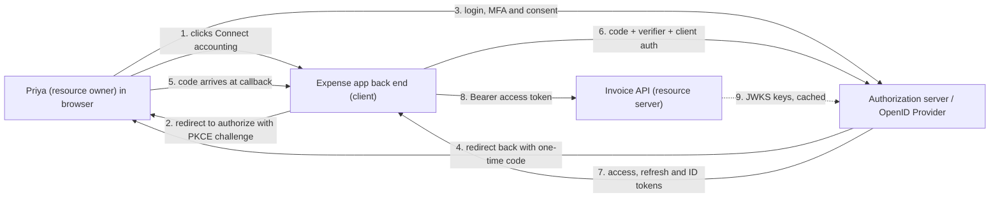
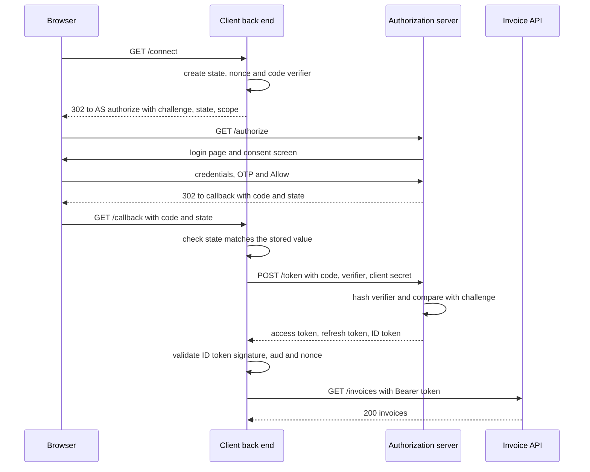

An expense-tracking app wants to read the GST invoices a small business keeps in its accounting software. Ten years ago the expense app would have asked: "type your accounting username and password here". It would then hold the business owner's full password forever, able to do anything, including deleting invoices. OAuth 2.0 exists to stop that. The owner instead clicks **Allow** on a screen from the accounting software itself, and the expense app receives a key that can only *read invoices*, only for 15 minutes at a time, and can be revoked with one click. This lesson explains how that key is issued, and how OpenID Connect builds "Sign in with Google" or "Sign in with Microsoft" on top of it.

## Learning objectives

By the end of this lesson you will be able to:

1. Name the four OAuth roles and map them onto a real integration.
2. Walk through the authorization code flow with PKCE message by message, and explain what `state`, `nonce` and the code verifier each defend against.
3. Choose the right grant: authorization code with PKCE for users, client credentials for machines, device code for TVs and CLIs, and never implicit or password.
4. Explain refresh tokens, rotation and reuse detection.
5. Tell scopes (what the app may do) from claims (facts about the user), and ID tokens (for the client) from access tokens (for the API).
6. Configure OpenID Connect sign-in and JWT bearer protection in ASP.NET Core, and implement PKCE and a cached client-credentials token provider in C#.
7. Spot common mistakes: tokens in URLs, using the ID token as an API key, wildcard redirect URIs and missing audience checks.

## Prerequisites

- [Authentication versus authorization](#/lesson/m14-authn-vs-authz): identity, credentials, sessions and tokens.
- [HTTP fundamentals](#/lesson/m10-http-fundamentals): redirects (302), query strings, form posts and headers.
- [Authentication and authorization in ASP.NET Core](#/lesson/m03-authn-authz): schemes and handlers.

## Explain it like I'm a beginner

Think of a hotel **valet key**. You give the valet a special key that starts the car and opens the driver's door, but does not open the boot or the glovebox. You never hand over your house keys. If the valet misbehaves, the hotel can cancel that key.

OAuth is the system for issuing valet keys on the internet:

- **You** are the **resource owner**: the person whose data it is.
- **The expense app** is the **client**: the app that wants to act for you.
- **The accounting software's login and consent service** is the **authorization server**: the hotel desk that issues valet keys after checking with you.
- **The accounting software's invoice API** is the **resource server**: the car. It accepts valet keys and checks what each one allows.

The valet key is an **access token**. What it allows ("read invoices", not "delete invoices") are its **scopes**.

Now a twist. Lots of apps started using OAuth just to *log people in*: "if Google gave me a token for this person, they must be this person". That was risky, because an access token says what an app *may do*, not *who the user is* or *for which app the login happened*. **OpenID Connect (OIDC)** fixes this by adding a second, separate document: the **ID token**. It is like a signed note from the hotel desk saying "this is Priya, she showed her ID at 10:42, and this note is meant for the expense app". The app reads the note to log Priya in. The car never sees it.

Short version: **OAuth 2.0 is about delegated access (authorization). OpenID Connect is about login (authentication), built on top of OAuth.**

## First-principles explanation

### The four roles

| Role | Plain English | In our example |
|---|---|---|
| Resource owner | The person whose data it is | Priya, owner of a Pune trading firm |
| Client | The app that wants access | Expense app (a web app with a back end) |
| Authorization server (AS) | Issues tokens after login and consent | Accounting software's identity service, or Entra ID, Auth0, Keycloak |
| Resource server (RS) | The API that holds the data | Accounting software's invoice API |

In OIDC vocabulary the authorization server is called the **OpenID Provider (OP)** and the client is the **Relying Party (RP)**.

Clients are also either **confidential** (they can keep a secret, such as a server-side web app or a back-end job) or **public** (they can't, such as a single-page app in the browser, a mobile app or a desktop app, because anyone can extract a secret from their code).

### Why redirects, and why a "code"?

The client must never see Priya's password. So the client *redirects* Priya's browser to the authorization server. She logs in there (password plus OTP, or a passkey), sees "Expense app wants to read your invoices", and clicks Allow. The authorization server then redirects her back to the client.

The obvious design would put the access token in that redirect URL. That was the old **implicit flow**, and it is now deprecated. URLs leak: into browser history, server logs, `Referer` headers and browser extensions. So instead the authorization server puts a short-lived, one-time **authorization code** in the redirect. The client's back end then exchanges the code for tokens in a direct, server-to-server **back-channel** POST that never touches the browser's address bar.

### PKCE: proving the same client finishes the flow

A stolen code would still be dangerous. On mobile, a malicious app can register the same custom URL scheme and receive the redirect. **PKCE** (Proof Key for Code Exchange, pronounced "pixie", RFC 7636) closes this:

1. Before redirecting, the client creates a random secret, the **code verifier** (43–128 characters).
2. It sends only a hash of it, the **code challenge** = `BASE64URL(SHA256(verifier))`, in the authorization request.
3. When exchanging the code, it sends the original verifier. The authorization server hashes it and compares it with the stored challenge.

An attacker who intercepts the code doesn't have the verifier, so the code is useless to them. Think of tearing a banknote in half: you send one half ahead, and only the person holding the other half can collect. The current OAuth security best practice (RFC 9700) says to use PKCE for **all** clients, confidential ones included.

### `state` and `nonce`

- **`state`** is a random value the client generates and stores (in a cookie or server-side) before redirecting. The authorization server echoes it back. If the returned `state` doesn't match, the client rejects the callback. This stops **login CSRF**, where an attacker tricks your browser into completing *their* login, so you unknowingly upload your expense receipts into the attacker's account.
- **`nonce`** (OIDC) is a random value the client sends that the provider puts *inside* the signed ID token. The client checks it, which stops an old ID token from being replayed.

### The grants you should know

| Grant (flow) | Use it for | Notes |
|---|---|---|
| Authorization code + PKCE | Any app acting for a user: web, SPA, mobile, desktop | The default. Confidential clients also authenticate at the token endpoint |
| Client credentials | Machine to machine, no user | A nightly job or one microservice calling another. The token represents the *app* |
| Device authorization (device code) | Smart TVs, CLIs, IoT devices with no browser or keyboard | Shows a short code. The user approves on their phone |
| Refresh token | Getting a new access token without asking the user again | Not a starting flow, used after one of the above |
| ~~Implicit~~ | Nothing | Deprecated. Tokens in URLs |
| ~~Resource owner password~~ | Nothing new | The client sees the password, which defeats the purpose. Deprecated in OAuth 2.1 drafts |

### Tokens: access, refresh and ID

- **Access token**: presented to the resource server in `Authorization: Bearer <token>`. Short-lived (5–60 minutes is typical). It may be a JWT the API validates locally, or an opaque string the API checks with the authorization server's **introspection** endpoint (RFC 7662). Its **audience** is the API.
- **Refresh token**: presented only to the authorization server's token endpoint, to obtain a new access token. Long-lived (days to months). It must be stored like a password. Public clients should get **rotating** refresh tokens: each use returns a new refresh token and invalidates the old one. If an old one is ever used again, someone has a copy, so the server revokes the whole chain (the token **family**). That is **reuse detection**.
- **ID token** (OIDC only): always a JWT, meant for the *client*. Its audience is the client's `client_id`. It carries `sub` (stable user id at this provider), `iss`, `aud`, `exp`, `iat`, `nonce`, and often `email` or `name`. The client validates it and creates its own session. **Never send an ID token to an API as a credential.** The API is not its audience.

### Scopes versus claims

- **Scopes** are *permissions the client asks for and the user grants*: `invoices.read`, `invoices.write`. They limit the **app**, not the user. If Priya can delete invoices but the token only has `invoices.read`, the expense app can't delete anything.
- **Claims** are *facts about the subject*: `sub`, `email`, `name`, `tenant_id`, `roles`.
- OIDC defines special scopes: `openid` (required: "I want an ID token"), `profile`, `email`, and `offline_access` (asks for a refresh token).

The API's final decision combines both: **the app must hold the scope AND the user must hold the permission.** A token with `invoices.write` for a user who is read-only in the accounting system must still be refused.

### Discovery and signing keys

An OIDC provider publishes `/.well-known/openid-configuration`, a JSON document with its issuer name, authorization endpoint, token endpoint and **JWKS URI** (its public signing keys). ASP.NET Core's handlers download this once and refresh it periodically, so key rotation at the provider just works. [JWT validation and limitations](#/lesson/m14-jwt) covers what the API does with those keys.

### Failure modes

- **Open redirect / wildcard redirect URIs.** If the authorization server accepts `https://*.expense.app/callback`, an attacker who controls any subdomain receives codes. Register exact redirect URIs and compare them exactly.
- **Missing audience check.** An API that accepts any token from the same provider will accept tokens minted for a different app. Always validate `aud`.
- **Tokens in browser storage.** An access token in `localStorage` is readable by any XSS payload. For SPAs, the **Backend for Frontend (BFF)** pattern keeps tokens on the server and gives the browser only an `HttpOnly` cookie.
- **Provider outage.** If the authorization server is down, no new logins and no token refreshes. Existing access tokens keep working until they expire, and JWKS caching keeps validation working. Plan the user experience for this.
- **Clock skew.** Token `exp` and `nbf` checks depend on clocks. Libraries allow a small skew (ASP.NET Core defaults to 5 minutes). Keep servers on NTP.

### When a simpler alternative is enough

- One web app, its own users, no third-party access, no SSO need: cookie authentication with ASP.NET Core Identity is simpler than running or integrating an identity provider.
- Two internal services in the same trust boundary: client credentials is fine, but so is mutual TLS or a managed identity (for example Azure Managed Identity) with no secrets at all.
- Don't build your own authorization server. Use a managed provider or a mature product (Entra ID, Auth0, Keycloak, Duende IdentityServer, OpenIddict). The protocol has dozens of sharp edges.

## Visual explanation

### Who talks to whom



Arrows 1–5 are the **front channel**: everything passes through Priya's browser as redirects, so nothing secret travels on them, only the code and `state`. Arrows 6–7 are the **back channel**: a direct HTTPS call from the client's server to the authorization server, where the code is exchanged together with the PKCE verifier and the client's own credentials. Arrow 8 is ordinary API use. The invoice API never talks to Priya and never sees her password. Arrow 9 is dotted because it happens rarely: the API downloads the provider's public keys once and caches them, then validates every token locally.

### Authorization code with PKCE, message by message



The browser carries the code from the authorization server to the client, but the browser never has the verifier or the client secret, so a code leaked from history or logs can't be redeemed. The client checks `state` *before* doing anything else. The authorization server checks the verifier. The client validates the ID token (signature, issuer, audience equal to its own client id, expiry, nonce) and only then creates its own session for Priya. The access token goes to the API, which runs its own validation with *its* audience.

## Step-by-step example

**Scenario.** "KharchaBook", an expense app, integrates with "LedgerLite", a GST accounting SaaS. LedgerLite runs an OIDC provider. Three needs:

1. **People sign in to KharchaBook with their LedgerLite account** (OIDC login).
2. **KharchaBook reads invoices for the signed-in user** (OAuth delegated access, scope `invoices.read`).
3. **A nightly KharchaBook job reconciles bank statements** with LedgerLite's reconciliation API. No user is present (client credentials, scope `recon.run`).

### Step 1 — register the client

At LedgerLite, register KharchaBook as a **confidential** client: `client_id = kharchabook-web`, exact redirect URI `https://app.kharchabook.in/signin-oidc`, allowed scopes `openid profile email offline_access invoices.read`. Register a second client, `kharchabook-recon`, for the nightly job with only the client credentials grant and scope `recon.run`. One client per purpose means a leaked job secret can't log anyone in.

### Step 2 — sign-in with the OIDC handler

Use ASP.NET Core's OpenID Connect handler. It generates `state`, `nonce` and PKCE, handles the callback, redeems the code and validates the ID token. (The `Microsoft.AspNetCore.Authentication.OpenIdConnect` package is required, so this snippet is not part of the compiled sample.)

```csharp
// dotnet add package Microsoft.AspNetCore.Authentication.OpenIdConnect
builder.Services.AddAuthentication(o =>
{
    o.DefaultScheme = CookieAuthenticationDefaults.AuthenticationScheme;
    o.DefaultChallengeScheme = OpenIdConnectDefaults.AuthenticationScheme;
})
.AddCookie(o =>
{
    o.Cookie.HttpOnly = true;
    o.Cookie.SecurePolicy = CookieSecurePolicy.Always;
    o.Cookie.SameSite = SameSiteMode.Lax;
    o.ExpireTimeSpan = TimeSpan.FromHours(8);
})
.AddOpenIdConnect(o =>
{
    o.Authority = "https://login.ledgerlite.in";          // discovery document lives under here
    o.ClientId = builder.Configuration["Oidc:ClientId"];
    o.ClientSecret = builder.Configuration["Oidc:ClientSecret"]; // from Key Vault, never appsettings.json
    o.ResponseType = OpenIdConnectResponseType.Code;      // authorization code flow
    o.UsePkce = true;                                     // default true, shown for clarity
    o.Scope.Clear();
    foreach (var s in new[] { "openid", "profile", "email", "offline_access", "invoices.read" }) o.Scope.Add(s);
    o.SaveTokens = true;                                  // keep access + refresh token in the auth cookie / ticket store
    o.MapInboundClaims = false;                           // keep "sub", "email" as-is
    o.TokenValidationParameters.NameClaimType = "name";
    o.PushedAuthorizationBehavior = PushedAuthorizationBehavior.UseIfAvailable; // .NET 9+: PAR
});
```

`SaveTokens = true` puts tokens in the authentication ticket. With the default cookie that makes the cookie large (often 3–5 KB, split into chunks). For production, add an `ITicketStore` backed by Redis or a database so the cookie only holds a key.

### Step 3 — protect the invoice API

LedgerLite's invoice API accepts bearer tokens and checks issuer, audience and scope:

```csharp
// dotnet add package Microsoft.AspNetCore.Authentication.JwtBearer
builder.Services.AddAuthentication().AddJwtBearer(o =>
{
    o.Authority = "https://login.ledgerlite.in";
    o.Audience = "api://ledgerlite-invoices";   // tokens for other APIs are rejected
    o.MapInboundClaims = false;
});
builder.Services.AddAuthorizationBuilder()
    .AddPolicy("invoices.read", p => p.RequireAuthenticatedUser()
        .RequireAssertion(c => (c.User.FindFirst("scope")?.Value ?? "").Split(' ').Contains("invoices.read")));
```

Scopes in a JWT usually arrive as one space-separated `scope` claim (Entra ID uses `scp`), hence the split.

### Step 4 — the nightly job with client credentials

The job POSTs `grant_type=client_credentials&scope=recon.run` with its client id and secret to the token endpoint, caches the token until shortly before it expires, and sends it to the reconciliation API. The next section implements that cache, plus PKCE and a hand-rolled authorize URL so you can see the mechanics the handler hides.

## Production-style C# implementation

```text
KharchaBook.Web/
  Program.cs
  OAuth/
    Pkce.cs
    OAuthClientOptions.cs
    AuthorizationRequestFactory.cs
    PendingLoginStore.cs
    TokenClient.cs
    ClientCredentialsTokenProvider.cs
    BearerTokenHandler.cs
```

```csharp file=OAuth/Pkce.cs
using System.Buffers.Text;
using System.Security.Cryptography;
using System.Text;

namespace KharchaBook.OAuth;

/// <summary>RFC 7636 helpers. The verifier stays on the client. Only the challenge goes in the browser redirect.</summary>
public static class Pkce
{
    /// <summary>32 random bytes encode to 43 base64url characters, the minimum length the RFC allows.</summary>
    public static string CreateVerifier() => Base64Url.EncodeToString(RandomNumberGenerator.GetBytes(32));

    public static string ChallengeS256(string verifier) =>
        Base64Url.EncodeToString(SHA256.HashData(Encoding.ASCII.GetBytes(verifier)));

    public static string RandomToken(int bytes = 32) => Base64Url.EncodeToString(RandomNumberGenerator.GetBytes(bytes));
}
```

```csharp file=OAuth/OAuthClientOptions.cs
namespace KharchaBook.OAuth;

public sealed class OAuthClientOptions
{
    public string AuthorizeEndpoint { get; set; } = "https://login.ledgerlite.in/connect/authorize";
    public string TokenEndpoint { get; set; } = "https://login.ledgerlite.in/connect/token";
    public string ClientId { get; set; } = "kharchabook-web";
    public string ClientSecret { get; set; } = "";          // bound from a secret store at startup
    public string RedirectUri { get; set; } = "https://app.kharchabook.in/callback";
    public string Scopes { get; set; } = "openid profile email offline_access invoices.read";

    // Separate client for the nightly job: different id, secret and scopes.
    public string JobClientId { get; set; } = "kharchabook-recon";
    public string JobClientSecret { get; set; } = "";
    public string JobScopes { get; set; } = "recon.run";
}
```

```csharp file=OAuth/PendingLoginStore.cs
using System.Collections.Concurrent;

namespace KharchaBook.OAuth;

/// <summary>What the client must remember between the redirect out and the callback.</summary>
public sealed record PendingLogin(string State, string Nonce, string CodeVerifier, string ReturnUrl, DateTimeOffset CreatedAt);

public interface IPendingLoginStore
{
    void Save(PendingLogin login);
    /// <summary>Removes and returns the pending login. One-time: a replayed callback finds nothing.</summary>
    PendingLogin? Take(string state);
}

public sealed class InMemoryPendingLoginStore(TimeProvider clock) : IPendingLoginStore
{
    private static readonly TimeSpan MaxAge = TimeSpan.FromMinutes(10);
    private readonly ConcurrentDictionary<string, PendingLogin> _byState = new(StringComparer.Ordinal);

    public void Save(PendingLogin login) => _byState[login.State] = login;

    public PendingLogin? Take(string state)
    {
        if (!_byState.TryRemove(state, out var p)) return null;
        return clock.GetUtcNow() - p.CreatedAt <= MaxAge ? p : null;
    }
}
```

```csharp file=OAuth/AuthorizationRequestFactory.cs
using Microsoft.AspNetCore.WebUtilities;
using Microsoft.Extensions.Options;

namespace KharchaBook.OAuth;

public sealed class AuthorizationRequestFactory(IOptions<OAuthClientOptions> options, IPendingLoginStore pending, TimeProvider clock)
{
    private readonly OAuthClientOptions _o = options.Value;

    public string CreateRedirectUrl(string returnUrl)
    {
        // Only allow local return URLs, or the callback becomes an open redirect.
        if (!returnUrl.StartsWith('/') || returnUrl.StartsWith("//")) returnUrl = "/";

        var login = new PendingLogin(Pkce.RandomToken(), Pkce.RandomToken(), Pkce.CreateVerifier(), returnUrl, clock.GetUtcNow());
        pending.Save(login);

        return QueryHelpers.AddQueryString(_o.AuthorizeEndpoint, new Dictionary<string, string?>
        {
            ["response_type"] = "code",
            ["client_id"] = _o.ClientId,
            ["redirect_uri"] = _o.RedirectUri,
            ["scope"] = _o.Scopes,
            ["state"] = login.State,
            ["nonce"] = login.Nonce,
            ["code_challenge"] = Pkce.ChallengeS256(login.CodeVerifier),
            ["code_challenge_method"] = "S256",
        });
    }
}
```

```csharp file=OAuth/TokenClient.cs
using System.Net.Http.Json;
using System.Text.Json.Serialization;
using Microsoft.Extensions.Options;

namespace KharchaBook.OAuth;

public sealed record TokenResponse(
    [property: JsonPropertyName("access_token")] string AccessToken,
    [property: JsonPropertyName("token_type")] string TokenType,
    [property: JsonPropertyName("expires_in")] int ExpiresIn,
    [property: JsonPropertyName("refresh_token")] string? RefreshToken,
    [property: JsonPropertyName("id_token")] string? IdToken,
    [property: JsonPropertyName("scope")] string? Scope);

public sealed class TokenRequestFailedException(string error) : Exception($"Token endpoint returned error '{error}'.")
{
    public string Error { get; } = error;
}

/// <summary>Back-channel calls to the token endpoint. Client authentication uses client_secret_post for brevity;
/// prefer private_key_jwt or mTLS (no shared secret) when the provider supports it.</summary>
public sealed class TokenClient(HttpClient http, IOptions<OAuthClientOptions> options)
{
    private readonly OAuthClientOptions _o = options.Value;

    public Task<TokenResponse> RedeemCodeAsync(string code, string codeVerifier, CancellationToken ct) =>
        PostAsync(new()
        {
            ["grant_type"] = "authorization_code",
            ["code"] = code,
            ["redirect_uri"] = _o.RedirectUri,
            ["code_verifier"] = codeVerifier,
            ["client_id"] = _o.ClientId,
            ["client_secret"] = _o.ClientSecret,
        }, ct);

    public Task<TokenResponse> RefreshAsync(string refreshToken, CancellationToken ct) =>
        PostAsync(new()
        {
            ["grant_type"] = "refresh_token",
            ["refresh_token"] = refreshToken,
            ["client_id"] = _o.ClientId,
            ["client_secret"] = _o.ClientSecret,
        }, ct);

    public Task<TokenResponse> ClientCredentialsAsync(CancellationToken ct) =>
        PostAsync(new()
        {
            ["grant_type"] = "client_credentials",
            ["scope"] = _o.JobScopes,
            ["client_id"] = _o.JobClientId,
            ["client_secret"] = _o.JobClientSecret,
        }, ct);

    private async Task<TokenResponse> PostAsync(Dictionary<string, string> form, CancellationToken ct)
    {
        using var response = await http.PostAsync(_o.TokenEndpoint, new FormUrlEncodedContent(form), ct);
        if (!response.IsSuccessStatusCode)
        {
            var err = await response.Content.ReadFromJsonAsync<Dictionary<string, object>>(ct);
            throw new TokenRequestFailedException(err?.GetValueOrDefault("error")?.ToString() ?? $"http_{(int)response.StatusCode}");
        }
        return (await response.Content.ReadFromJsonAsync<TokenResponse>(ct))!;
    }
}
```

```csharp file=OAuth/ClientCredentialsTokenProvider.cs
namespace KharchaBook.OAuth;

public interface IAccessTokenSource
{
    Task<TokenResponse> RequestAsync(CancellationToken ct);
}

public sealed class TokenClientSource(TokenClient client) : IAccessTokenSource
{
    public Task<TokenResponse> RequestAsync(CancellationToken ct) => client.ClientCredentialsAsync(ct);
}

/// <summary>Caches the app's own token and renews it 60 s before expiry. Only one renewal runs at a time,
/// so 50 parallel calls at expiry cause one token request, not 50.</summary>
public sealed class ClientCredentialsTokenProvider(IAccessTokenSource source, TimeProvider clock)
{
    private static readonly TimeSpan RenewEarly = TimeSpan.FromSeconds(60);
    private readonly SemaphoreSlim _gate = new(1, 1);
    private string? _token;
    private DateTimeOffset _expiresAt = DateTimeOffset.MinValue;

    public async Task<string> GetAsync(CancellationToken ct)
    {
        if (_token is not null && clock.GetUtcNow() < _expiresAt - RenewEarly) return _token;
        await _gate.WaitAsync(ct);
        try
        {
            if (_token is not null && clock.GetUtcNow() < _expiresAt - RenewEarly) return _token;   // another caller renewed it
            var response = await source.RequestAsync(ct);
            _token = response.AccessToken;
            _expiresAt = clock.GetUtcNow().AddSeconds(response.ExpiresIn);
            return _token;
        }
        finally { _gate.Release(); }
    }
}
```

```csharp file=OAuth/BearerTokenHandler.cs
using System.Net.Http.Headers;

namespace KharchaBook.OAuth;

/// <summary>Attaches the job's access token to every outgoing request of a named HttpClient.</summary>
public sealed class BearerTokenHandler(ClientCredentialsTokenProvider tokens) : DelegatingHandler
{
    protected override async Task<HttpResponseMessage> SendAsync(HttpRequestMessage request, CancellationToken ct)
    {
        request.Headers.Authorization = new AuthenticationHeaderValue("Bearer", await tokens.GetAsync(ct));
        return await base.SendAsync(request, ct);
    }
}
```

```csharp file=Program.cs
using KharchaBook.OAuth;

var builder = WebApplication.CreateBuilder(args);

builder.Services.Configure<OAuthClientOptions>(builder.Configuration.GetSection("OAuth"));
builder.Services.AddSingleton(TimeProvider.System);
builder.Services.AddSingleton<IPendingLoginStore, InMemoryPendingLoginStore>();   // use a distributed store with more than one instance
builder.Services.AddSingleton<AuthorizationRequestFactory>();
builder.Services.AddHttpClient<TokenClient>(c => c.Timeout = TimeSpan.FromSeconds(10));
builder.Services.AddSingleton<IAccessTokenSource, TokenClientSource>();
builder.Services.AddSingleton<ClientCredentialsTokenProvider>();
builder.Services.AddTransient<BearerTokenHandler>();
builder.Services.AddHttpClient("recon-api", c => c.BaseAddress = new Uri("https://api.ledgerlite.in/recon/"))
                .AddHttpMessageHandler<BearerTokenHandler>();

var app = builder.Build();

app.MapGet("/connect", (string? returnUrl, AuthorizationRequestFactory factory) =>
    Results.Redirect(factory.CreateRedirectUrl(returnUrl ?? "/")));

app.MapGet("/callback", async (string? code, string? state, string? error, IPendingLoginStore pending,
                               TokenClient tokens, CancellationToken ct) =>
{
    if (error is not null) return Results.Problem($"Sign-in was not completed: {error}", statusCode: 400);
    if (code is null || state is null) return Results.BadRequest();
    var login = pending.Take(state);
    if (login is null) return Results.Problem("Unknown or expired sign-in attempt.", statusCode: 400);   // login CSRF defence

    var result = await tokens.RedeemCodeAsync(code, login.CodeVerifier, ct);
    // Next: validate result.IdToken (signature via JWKS, iss, aud == client id, exp, nonce == login.Nonce),
    // then sign the user in with a cookie and store the refresh token server-side. The OIDC handler does all of this for you.
    return Results.Redirect(login.ReturnUrl);
});

app.MapPost("/jobs/reconcile", async (IHttpClientFactory factory, CancellationToken ct) =>
{
    var api = factory.CreateClient("recon-api");
    using var response = await api.PostAsync("runs", content: null, ct);
    return Results.StatusCode((int)response.StatusCode);
});

app.Run();
```

What to notice:

- **The verifier never leaves the server.** The browser only ever sees the challenge.
- **`Take` is one-time.** A callback replayed from browser history finds no pending login and fails.
- **`returnUrl` is restricted to local paths**, so the callback can't be abused to redirect users to a phishing site.
- **Two clients, two secrets.** The nightly job uses a different client id with only `recon.run`.
- **The token provider double-checks after acquiring the lock.** Without the second check, every waiting caller would fetch its own token after the first renewal finished.

## Bad design vs good design

**Bad** (seen in real integrations):

```javascript
// SPA asks the user for their LedgerLite password and calls the token endpoint itself
fetch("https://login.ledgerlite.in/connect/token", { method: "POST",
  body: `grant_type=password&username=${u}&password=${p}&client_id=spa&client_secret=s3cr3t` })
  .then(r => r.json()).then(t => localStorage.setItem("token", t.access_token));
```

Problems: the expense app sees the password, the "secret" is in JavaScript anyone can read, the token sits in `localStorage` where XSS can steal it, there is no consent screen and no MFA at the provider, and the token is probably long-lived because refreshing would need the password again.

**Good**: authorization code with PKCE. For an SPA, use a **BFF**: the SPA's own ASP.NET Core back end runs the OIDC flow as a confidential client, keeps tokens server-side, and gives the browser an `HttpOnly`, `Secure`, `SameSite` cookie. API calls go through the BFF, which attaches the access token.

:::callout type=mistake title="The ID token is not an API key"
Sending the ID token to your API "because it's a JWT with the user's email" is a common mistake. Its audience is the client, it carries no scopes, and APIs that accept it will also accept ID tokens issued to any other client of the same provider. Request an access token for the API's audience instead.
:::

:::callout type=tradeoff title="JWT access tokens versus opaque tokens with introspection"
JWT access tokens can be validated locally: fast, and they keep working during a provider outage, but revocation waits for expiry. Opaque tokens need an introspection call per request (cache it for 30–60 seconds), but revocation is near-instant and the token reveals nothing to the client. High-risk APIs (payments, admin) often prefer opaque tokens or very short JWT lifetimes.
:::

## Practical playground

The starter graph shows KharchaBook's current design: a single-page app that stores access tokens in the browser and calls LedgerLite APIs directly, and a nightly job that uses a shared admin user's password. Redesign it in the HLD canvas: add a BFF, separate clients, a token cache for the job, and decide where tokens live.

:::playground type=hld title="KharchaBook and LedgerLite: fix the token flows"
```json
{
  "nodes": [
    { "id": "spa", "type": "client", "label": "KharchaBook SPA (tokens in localStorage)", "props": { "rps": 120 } },
    { "id": "idp", "type": "external", "label": "LedgerLite OpenID Provider" },
    { "id": "inv", "type": "app-server", "label": "LedgerLite invoice API" },
    { "id": "job", "type": "worker", "label": "Nightly recon job (admin password in config)" },
    { "id": "recon", "type": "app-server", "label": "LedgerLite recon API" }
  ],
  "edges": [
    { "from": "spa", "to": "idp", "kind": "sync", "label": "password grant" },
    { "from": "spa", "to": "inv", "kind": "sync", "label": "Bearer from localStorage" },
    { "from": "job", "to": "idp", "kind": "sync", "label": "password grant as admin" },
    { "from": "job", "to": "recon", "kind": "sync" }
  ]
}
```
:::

While you edit, answer: where is the client secret stored after your change? What happens to an attacker who finds an XSS bug in the SPA? How many token requests per night does the job make with a cache, versus without one?

## Exercises

:::exercise id=m14-oauth-oidc-ex1 difficulty=beginner kind=code title="Implement PKCE"
Implement the two PKCE functions from RFC 7636: creating a code verifier, and computing the S256 code challenge.
::requirements
- `CreateVerifier()` returns 43–128 characters, all from the unreserved set `A–Z a–z 0–9 - . _ ~`, and is different every call.
- `ChallengeS256(verifier)` returns `BASE64URL(SHA256(ASCII(verifier)))` with no `=` padding.
- `IsValidVerifier(s)` checks the length and character rules.
::acceptance
- The RFC 7636 Appendix B test vector passes: verifier `dBjftJeZ4CVP-mB92K27uhbUJU1p1r_wW1gFWFOEjXk` gives challenge `E9Melhoa2OwvFrEMTJguCHaoeK1t8URWbuGJSstw-cM`.
- 100 generated verifiers are all valid and all distinct.
- A 42-character string or one containing `+` is not a valid verifier.
::hint
Base64url is base64 with `+` → `-`, `/` → `_`, and the trailing `=` removed.
::hint
32 random bytes become exactly 43 base64url characters.
::hint
Use `RandomNumberGenerator.GetBytes`, never `System.Random`. A predictable verifier defeats the purpose.
::hint
```csharp
static string B64Url(byte[] b) => Convert.ToBase64String(b).TrimEnd('=').Replace('+', '-').Replace('/', '_');
public static string ChallengeS256(string v) => B64Url(SHA256.HashData(Encoding.ASCII.GetBytes(v)));
```
::starter
```csharp file=PkceHelper.cs
using System;
using System.Linq;
using System.Security.Cryptography;
using System.Text;

public static class PkceHelper
{
    public static string CreateVerifier() => throw new NotImplementedException();
    public static string ChallengeS256(string verifier) => throw new NotImplementedException();
    public static bool IsValidVerifier(string candidate) => throw new NotImplementedException();
}
```
::tests
```csharp file=PkceHelperTests.cs
using System.Collections.Generic;
using System.Linq;
using Xunit;

public class PkceHelperTests
{
    [Fact]
    public void Rfc7636_test_vector() =>
        Assert.Equal("E9Melhoa2OwvFrEMTJguCHaoeK1t8URWbuGJSstw-cM",
                     PkceHelper.ChallengeS256("dBjftJeZ4CVP-mB92K27uhbUJU1p1r_wW1gFWFOEjXk"));

    [Fact]
    public void Generated_verifiers_are_valid_and_unique()
    {
        var set = new HashSet<string>();
        for (var i = 0; i < 100; i++)
        {
            var v = PkceHelper.CreateVerifier();
            Assert.True(PkceHelper.IsValidVerifier(v), v);
            set.Add(v);
        }
        Assert.Equal(100, set.Count);
    }

    [Fact]
    public void Challenge_has_no_padding() => Assert.DoesNotContain("=", PkceHelper.ChallengeS256(PkceHelper.CreateVerifier()));

    [Theory]
    [InlineData("short")]
    [InlineData("abcdefghijklmnopqrstuvwxyzabcdefghijklmnop")]          // 42 chars
    [InlineData("abcdefghijklmnopqrstuvwxyzabcdefghijklmnopq+")]        // 44 chars with '+'
    public void Rejects_bad_verifiers(string candidate) => Assert.False(PkceHelper.IsValidVerifier(candidate));

    [Fact]
    public void Accepts_tilde_and_dot() => Assert.True(PkceHelper.IsValidVerifier(new string('a', 41) + "~."));
}
```
::solution
```csharp file=PkceHelper.cs
using System;
using System.Linq;
using System.Security.Cryptography;
using System.Text;

public static class PkceHelper
{
    public static string CreateVerifier() => B64Url(RandomNumberGenerator.GetBytes(32));

    public static string ChallengeS256(string verifier) => B64Url(SHA256.HashData(Encoding.ASCII.GetBytes(verifier)));

    public static bool IsValidVerifier(string candidate) =>
        candidate.Length is >= 43 and <= 128 &&
        candidate.All(c => c is >= 'A' and <= 'Z' or >= 'a' and <= 'z' or >= '0' and <= '9' or '-' or '.' or '_' or '~');

    private static string B64Url(byte[] bytes) =>
        Convert.ToBase64String(bytes).TrimEnd('=').Replace('+', '-').Replace('/', '_');
}
```

In .NET 9 and later, `System.Buffers.Text.Base64Url.EncodeToString` does the same encoding without the string replacements. The test vector is the real proof: if you hash the wrong encoding (UTF-16 instead of ASCII) or forget to strip padding, it fails.
::mistakes
- Using `Random` or `Guid` for the verifier.
- Hashing `Encoding.Unicode` bytes. The RFC hashes the ASCII bytes.
- Using the `plain` method, which sends the verifier itself as the challenge and protects nothing if the authorize request leaks.
::extensions
Make `ChallengeS256` throw for invalid verifiers so callers can't accidentally send a weak one.
:::

:::exercise id=m14-oauth-oidc-ex2 difficulty=beginner kind=written title="Choose the grant"
For each scenario name the OAuth/OIDC flow, whether the client is public or confidential, and the tokens it should receive.

1. An ASP.NET Core MVC app lets employees sign in with the company's Entra ID.
2. A React SPA for citizens to track property tax payments.
3. A nightly Azure Function that pulls GST returns from a filing API. No user is involved.
4. A smart TV app for a streaming service.
5. An Android app for site engineers that must keep working offline for a shift and sync later.
6. A command-line tool developers use to deploy to an internal platform.
::acceptance
- Each answer names a flow and a client type.
- No answer uses implicit or password grants.
- The SPA answer mentions where tokens are stored.
- The Android answer addresses refresh tokens and secure storage.
::hint
First question for each: is there a user? If not, it is client credentials.
::hint
Second question: can this code keep a secret? Anything shipped to a user's device can't.
::hint
Devices without a comfortable browser or keyboard have their own grant.
::solution
1. **Authorization code + PKCE**, confidential client (server-side secret or certificate). Tokens: ID token for sign-in, access token only if the app calls APIs, refresh token if it needs long-lived API access.
2. **Authorization code + PKCE**. Ideally via a **BFF**: the SPA's back end is a confidential client and the browser gets only an `HttpOnly` cookie. If no back end is possible, a public client with PKCE, short-lived access tokens kept in memory (not `localStorage`) and rotating refresh tokens.
3. **Client credentials**, confidential client. Better still, a managed identity or a certificate (`private_key_jwt`) instead of a shared secret. Access token only.
4. **Device authorization grant**: the TV shows a code, the user approves on their phone. Public client. Access + refresh token.
5. **Authorization code + PKCE** using the system browser (Custom Tabs, never an embedded WebView), public client, refresh token with `offline_access`, rotated on use, stored in Android Keystore-backed encrypted storage. Access tokens short-lived. Offline work is queued and synced when a fresh access token is available.
6. **Authorization code + PKCE with a loopback redirect** (`http://127.0.0.1:<random port>`) if a browser is available, otherwise the **device code** flow. Public client. Store the refresh token in the OS keychain.
::mistakes
- Picking client credentials for the SPA because "it is our own app". Client credentials represents the app, not the citizen, so every citizen would see the same data.
- Embedding a client secret in the mobile app.
- Using an embedded WebView for login, which lets the app read the password field and breaks SSO.
:::

:::exercise id=m14-oauth-oidc-ex3 difficulty=intermediate kind=code title="The authorization server's code check"
Implement the authorization server side of code redemption: issue a one-time authorization code bound to a client, redirect URI and PKCE challenge, then redeem it safely.
::requirements
- `Issue(clientId, redirectUri, codeChallenge, subject)` returns a random code valid for 60 seconds.
- `Redeem(code, clientId, redirectUri, codeVerifier)` returns a `RedeemResult` with an `Outcome` and the `Subject` on success.
- Outcomes: `Ok`, `UnknownCode`, `Expired`, `AlreadyUsed`, `ClientMismatch`, `RedirectMismatch`, `PkceFailed`.
- A code can be redeemed at most once. A second attempt returns `AlreadyUsed`, even if the first attempt failed a later check.
- The redirect URI must match **exactly** (no prefix or case-insensitive matching).
- The PKCE comparison is constant-time.
::acceptance
- Happy path returns `Ok` and the subject.
- Redeeming the same code twice returns `AlreadyUsed` the second time.
- A wrong verifier returns `PkceFailed`.
- `https://app.kharchabook.in/callback/` (trailing slash) is a `RedirectMismatch`.
- After 61 seconds the code is `Expired`.
::hint
Store an entry per code: client id, redirect URI, challenge, subject, issued time, and a "used" flag.
::hint
Mark the code as used *first*, then run the other checks. Otherwise an attacker can try many verifiers against one code.
::hint
Compute the challenge from the presented verifier and compare the two strings' bytes with `CryptographicOperations.FixedTimeEquals`.
::hint
```csharp
if (e.Used) return new(Outcome.AlreadyUsed, null);
e.Used = true;
if (now - e.IssuedAt > Lifetime) return new(Outcome.Expired, null);
```
::starter
```csharp file=AuthorizationCodeStore.cs
using System;
using System.Collections.Concurrent;
using System.Security.Cryptography;
using System.Text;

public enum Outcome { Ok, UnknownCode, Expired, AlreadyUsed, ClientMismatch, RedirectMismatch, PkceFailed }

public sealed record RedeemResult(Outcome Outcome, string? Subject);

public sealed class AuthorizationCodeStore
{
    public static readonly TimeSpan Lifetime = TimeSpan.FromSeconds(60);
    private readonly TimeProvider _clock;
    public AuthorizationCodeStore(TimeProvider clock) => _clock = clock;

    public string Issue(string clientId, string redirectUri, string codeChallenge, string subject) =>
        throw new NotImplementedException();

    public RedeemResult Redeem(string code, string clientId, string redirectUri, string codeVerifier) =>
        throw new NotImplementedException();

    /// <summary>Helper: the S256 challenge for a verifier (base64url, no padding).</summary>
    public static string ChallengeFor(string verifier) =>
        Convert.ToBase64String(SHA256.HashData(Encoding.ASCII.GetBytes(verifier))).TrimEnd('=').Replace('+', '-').Replace('/', '_');
}
```
::tests
```csharp file=AuthorizationCodeStoreTests.cs
using System;
using Xunit;

public sealed class TestClock : TimeProvider
{
    public DateTimeOffset Now { get; set; } = new(2026, 10, 20, 10, 0, 0, TimeSpan.Zero);
    public override DateTimeOffset GetUtcNow() => Now;
}

public class AuthorizationCodeStoreTests
{
    private const string Client = "kharchabook-web";
    private const string Redirect = "https://app.kharchabook.in/callback";
    private const string Verifier = "dBjftJeZ4CVP-mB92K27uhbUJU1p1r_wW1gFWFOEjXk";

    private static (AuthorizationCodeStore Store, TestClock Clock, string Code) Setup()
    {
        var clock = new TestClock();
        var store = new AuthorizationCodeStore(clock);
        var code = store.Issue(Client, Redirect, AuthorizationCodeStore.ChallengeFor(Verifier), "user-priya");
        return (store, clock, code);
    }

    [Fact]
    public void Happy_path()
    {
        var (s, _, code) = Setup();
        Assert.Equal(new RedeemResult(Outcome.Ok, "user-priya"), s.Redeem(code, Client, Redirect, Verifier));
    }

    [Fact]
    public void Codes_are_random_and_long()
    {
        var (s, _, code) = Setup();
        var other = s.Issue(Client, Redirect, "x", "user-2");
        Assert.NotEqual(code, other);
        Assert.True(code.Length >= 32);
    }

    [Fact]
    public void Second_use_is_rejected()
    {
        var (s, _, code) = Setup();
        s.Redeem(code, Client, Redirect, Verifier);
        Assert.Equal(Outcome.AlreadyUsed, s.Redeem(code, Client, Redirect, Verifier).Outcome);
    }

    [Fact]
    public void Failed_attempt_still_burns_the_code()
    {
        var (s, _, code) = Setup();
        Assert.Equal(Outcome.PkceFailed, s.Redeem(code, Client, Redirect, "wrong-verifier-wrong-verifier-wrong-verif").Outcome);
        Assert.Equal(Outcome.AlreadyUsed, s.Redeem(code, Client, Redirect, Verifier).Outcome);
    }

    [Fact]
    public void Unknown_code() => Assert.Equal(Outcome.UnknownCode, Setup().Store.Redeem("nope", Client, Redirect, Verifier).Outcome);

    [Fact]
    public void Client_must_match()
    {
        var (s, _, code) = Setup();
        Assert.Equal(Outcome.ClientMismatch, s.Redeem(code, "evil-app", Redirect, Verifier).Outcome);
    }

    [Fact]
    public void Redirect_must_match_exactly()
    {
        var (s, _, code) = Setup();
        Assert.Equal(Outcome.RedirectMismatch, s.Redeem(code, Client, Redirect + "/", Verifier).Outcome);
    }

    [Fact]
    public void Expires_after_sixty_seconds()
    {
        var (s, clock, code) = Setup();
        clock.Now += TimeSpan.FromSeconds(61);
        Assert.Equal(Outcome.Expired, s.Redeem(code, Client, Redirect, Verifier).Outcome);
    }
}
```
::solution
```csharp file=AuthorizationCodeStore.cs
using System;
using System.Collections.Concurrent;
using System.Security.Cryptography;
using System.Text;

public enum Outcome { Ok, UnknownCode, Expired, AlreadyUsed, ClientMismatch, RedirectMismatch, PkceFailed }

public sealed record RedeemResult(Outcome Outcome, string? Subject);

public sealed class AuthorizationCodeStore
{
    public static readonly TimeSpan Lifetime = TimeSpan.FromSeconds(60);

    private sealed class Entry
    {
        public required string ClientId { get; init; }
        public required string RedirectUri { get; init; }
        public required string Challenge { get; init; }
        public required string Subject { get; init; }
        public DateTimeOffset IssuedAt { get; init; }
        public bool Used { get; set; }
    }

    private readonly TimeProvider _clock;
    private readonly ConcurrentDictionary<string, Entry> _codes = new(StringComparer.Ordinal);
    public AuthorizationCodeStore(TimeProvider clock) => _clock = clock;

    public string Issue(string clientId, string redirectUri, string codeChallenge, string subject)
    {
        var code = Convert.ToBase64String(RandomNumberGenerator.GetBytes(32)).TrimEnd('=').Replace('+', '-').Replace('/', '_');
        _codes[code] = new Entry { ClientId = clientId, RedirectUri = redirectUri, Challenge = codeChallenge,
                                   Subject = subject, IssuedAt = _clock.GetUtcNow() };
        return code;
    }

    public RedeemResult Redeem(string code, string clientId, string redirectUri, string codeVerifier)
    {
        if (!_codes.TryGetValue(code, out var e)) return new(Outcome.UnknownCode, null);
        lock (e)
        {
            if (e.Used) return new(Outcome.AlreadyUsed, null);   // a real server also revokes tokens issued from this code
            e.Used = true;                                        // burn first: one guess per code
        }
        if (_clock.GetUtcNow() - e.IssuedAt > Lifetime) return new(Outcome.Expired, null);
        if (!string.Equals(e.ClientId, clientId, StringComparison.Ordinal)) return new(Outcome.ClientMismatch, null);
        if (!string.Equals(e.RedirectUri, redirectUri, StringComparison.Ordinal)) return new(Outcome.RedirectMismatch, null);

        var presented = Encoding.ASCII.GetBytes(ChallengeFor(codeVerifier));
        var expected = Encoding.ASCII.GetBytes(e.Challenge);
        if (!CryptographicOperations.FixedTimeEquals(presented, expected)) return new(Outcome.PkceFailed, null);

        return new(Outcome.Ok, e.Subject);
    }

    public static string ChallengeFor(string verifier) =>
        Convert.ToBase64String(SHA256.HashData(Encoding.ASCII.GetBytes(verifier))).TrimEnd('=').Replace('+', '-').Replace('/', '_');
}
```

The order of checks is the lesson. Burning the code first means each code allows exactly one guess at the verifier. Exact string comparison of redirect URIs blocks the trailing-slash, path-suffix and case tricks that have caused real token leaks. RFC 6749 also says that if a code is used twice, the server should revoke tokens already issued from it, because one of the two callers is an attacker.
::alternatives
Real authorization servers store codes in a shared store (Redis with a 60 s TTL, or a database table) so any instance can redeem them. Some encrypt the code's content into the code itself and keep only a "used" set.
::mistakes
- Checking PKCE before marking the code used, which allows unlimited verifier guesses within 60 s.
- `StartsWith` for redirect URIs, which accepts `https://app.kharchabook.in/callback.evil.com` if the registered value lacks a path.
- Ordinary `==` on secrets. Use constant-time comparison for anything derived from a secret.
:::

:::exercise id=m14-oauth-oidc-ex4 difficulty=intermediate kind=code title="Refresh token rotation with reuse detection"
Implement rotating refresh tokens. Each refresh returns a new token and invalidates the old one. If an already-used token is presented again, revoke the whole family, because it has been copied.
::requirements
- `Issue(userId)` starts a new family and returns its first token.
- `Rotate(token)` returns a `RotateResult(Outcome, NewToken, UserId)`.
- Outcomes: `Ok`, `Unknown`, `Expired`, `ReuseDetected`, `Revoked`.
- Each token is valid for 14 days from its issue. The family is valid for at most 90 days from the first login.
- On reuse, every token in the family stops working, including the newest one.
- `RevokeUser(userId)` revokes all of a user's families (logout everywhere).
::acceptance
- Rotating A gives B. Rotating B gives C.
- Presenting A again returns `ReuseDetected`, and then C returns `Revoked`.
- A token not used for 15 days is `Expired`.
- Rotation on day 89 works, on day 91 it fails even with a fresh token.
::hint
Model two things: a family (user id, created time, revoked flag) and tokens (family id, issued time, used flag).
::hint
Store tokens by a hash in production. Here a dictionary keyed by the token string is fine.
::hint
`Rotate` order: unknown? family revoked? token used (reuse!)? expired? Then mark used and issue the next token in the same family.
::hint
```csharp
if (t.Used) { fam.Revoked = true; return new(RotateOutcome.ReuseDetected, null, null); }
```
::starter
```csharp file=RefreshTokenService.cs
using System;
using System.Collections.Generic;
using System.Linq;
using System.Security.Cryptography;

public enum RotateOutcome { Ok, Unknown, Expired, ReuseDetected, Revoked }

public sealed record RotateResult(RotateOutcome Outcome, string? NewToken, string? UserId);

public sealed class RefreshTokenService
{
    public static readonly TimeSpan TokenLifetime = TimeSpan.FromDays(14);
    public static readonly TimeSpan FamilyLifetime = TimeSpan.FromDays(90);

    private readonly TimeProvider _clock;
    public RefreshTokenService(TimeProvider clock) => _clock = clock;

    public string Issue(string userId) => throw new NotImplementedException();
    public RotateResult Rotate(string token) => throw new NotImplementedException();
    public void RevokeUser(string userId) => throw new NotImplementedException();
}
```
::tests
```csharp file=RefreshTokenServiceTests.cs
using System;
using Xunit;

public sealed class DayClock : TimeProvider
{
    public DateTimeOffset Now { get; set; } = new(2026, 1, 1, 0, 0, 0, TimeSpan.Zero);
    public override DateTimeOffset GetUtcNow() => Now;
}

public class RefreshTokenServiceTests
{
    [Fact]
    public void Rotation_chain_works()
    {
        var svc = new RefreshTokenService(new DayClock());
        var a = svc.Issue("priya");
        var b = svc.Rotate(a);
        Assert.Equal(RotateOutcome.Ok, b.Outcome);
        Assert.Equal("priya", b.UserId);
        Assert.NotEqual(a, b.NewToken);
        Assert.Equal(RotateOutcome.Ok, svc.Rotate(b.NewToken!).Outcome);
    }

    [Fact]
    public void Reuse_revokes_whole_family()
    {
        var svc = new RefreshTokenService(new DayClock());
        var a = svc.Issue("priya");
        var b = svc.Rotate(a).NewToken!;
        var c = svc.Rotate(b).NewToken!;
        Assert.Equal(RotateOutcome.ReuseDetected, svc.Rotate(a).Outcome);
        Assert.Equal(RotateOutcome.Revoked, svc.Rotate(c).Outcome);
    }

    [Fact]
    public void Other_families_are_unaffected_by_reuse()
    {
        var svc = new RefreshTokenService(new DayClock());
        var phone = svc.Issue("priya");
        var laptop = svc.Issue("priya");
        svc.Rotate(phone);
        svc.Rotate(phone);   // reuse on the phone family
        Assert.Equal(RotateOutcome.Ok, svc.Rotate(laptop).Outcome);
    }

    [Fact]
    public void Unused_token_expires_after_14_days()
    {
        var clock = new DayClock();
        var svc = new RefreshTokenService(clock);
        var a = svc.Issue("priya");
        clock.Now += TimeSpan.FromDays(15);
        Assert.Equal(RotateOutcome.Expired, svc.Rotate(a).Outcome);
    }

    [Fact]
    public void Family_has_absolute_lifetime()
    {
        var clock = new DayClock();
        var svc = new RefreshTokenService(clock);
        var t = svc.Issue("priya");
        var start = clock.Now;
        for (var i = 0; i < 12; i++) { clock.Now = clock.Now.AddDays(7); var r = svc.Rotate(t); Assert.Equal(RotateOutcome.Ok, r.Outcome); t = r.NewToken!; }
        clock.Now = start.AddDays(89);   // day 89: still inside the family lifetime
        var last = svc.Rotate(t);
        Assert.Equal(RotateOutcome.Ok, last.Outcome);
        clock.Now = start.AddDays(91);   // day 91: fresh token, but the family is too old
        Assert.Equal(RotateOutcome.Expired, svc.Rotate(last.NewToken!).Outcome);
    }

    [Fact]
    public void Unknown_and_logout_everywhere()
    {
        var svc = new RefreshTokenService(new DayClock());
        Assert.Equal(RotateOutcome.Unknown, svc.Rotate("garbage").Outcome);
        var a = svc.Issue("priya"); var b = svc.Issue("priya"); var other = svc.Issue("ravi");
        svc.RevokeUser("priya");
        Assert.Equal(RotateOutcome.Revoked, svc.Rotate(a).Outcome);
        Assert.Equal(RotateOutcome.Revoked, svc.Rotate(b).Outcome);
        Assert.Equal(RotateOutcome.Ok, svc.Rotate(other).Outcome);
    }
}
```
::solution
```csharp file=RefreshTokenService.cs
using System;
using System.Collections.Generic;
using System.Linq;
using System.Security.Cryptography;

public enum RotateOutcome { Ok, Unknown, Expired, ReuseDetected, Revoked }

public sealed record RotateResult(RotateOutcome Outcome, string? NewToken, string? UserId);

public sealed class RefreshTokenService
{
    public static readonly TimeSpan TokenLifetime = TimeSpan.FromDays(14);
    public static readonly TimeSpan FamilyLifetime = TimeSpan.FromDays(90);

    private sealed class Family { public required string UserId; public DateTimeOffset CreatedAt; public bool Revoked; }
    private sealed class Token { public required Guid FamilyId; public DateTimeOffset IssuedAt; public bool Used; }

    private readonly TimeProvider _clock;
    private readonly Dictionary<Guid, Family> _families = new();
    private readonly Dictionary<string, Token> _tokens = new(StringComparer.Ordinal);
    private readonly object _gate = new();

    public RefreshTokenService(TimeProvider clock) => _clock = clock;

    public string Issue(string userId)
    {
        lock (_gate)
        {
            var id = Guid.NewGuid();
            _families[id] = new Family { UserId = userId, CreatedAt = _clock.GetUtcNow() };
            return NewToken(id);
        }
    }

    public RotateResult Rotate(string token)
    {
        lock (_gate)
        {
            if (!_tokens.TryGetValue(token, out var t)) return new(RotateOutcome.Unknown, null, null);
            var fam = _families[t.FamilyId];
            if (fam.Revoked) return new(RotateOutcome.Revoked, null, null);
            if (t.Used)
            {
                fam.Revoked = true;   // someone holds a copy: kill the legitimate chain too
                return new(RotateOutcome.ReuseDetected, null, null);
            }
            var now = _clock.GetUtcNow();
            if (now - t.IssuedAt > TokenLifetime || now - fam.CreatedAt > FamilyLifetime)
                return new(RotateOutcome.Expired, null, null);

            t.Used = true;
            return new(RotateOutcome.Ok, NewToken(t.FamilyId), fam.UserId);
        }
    }

    public void RevokeUser(string userId)
    {
        lock (_gate)
            foreach (var f in _families.Values.Where(f => f.UserId == userId)) f.Revoked = true;
    }

    private string NewToken(Guid familyId)
    {
        var value = Convert.ToBase64String(RandomNumberGenerator.GetBytes(32));
        _tokens[value] = new Token { FamilyId = familyId, IssuedAt = _clock.GetUtcNow() };
        return value;
    }
}
```

Why revoke the newest token too? When reuse happens, the server can't tell which caller is the attacker. It might be the thief using the old token, or the thief may already have rotated and the real user is now presenting the old one. Killing the family forces a fresh login, which needs the real user's credentials and MFA.
::alternatives
Some providers allow a short grace period (for example 30 seconds) where the previous token still works, because mobile apps on flaky networks sometimes send the same refresh twice. That trades a little security for fewer surprise logouts. Sender-constrained tokens (DPoP or mTLS-bound) are a stronger alternative: a copied token is useless without the client's private key.
::mistakes
- Revoking only the reused token, which leaves the attacker's newer token alive.
- Storing refresh tokens in plain text. Store a hash, like a password, so a database leak doesn't hand out sessions.
- No absolute family lifetime, so one stolen token chain lives for ever if used every 13 days.
:::

:::exercise id=m14-oauth-oidc-ex5 difficulty=advanced kind=hld title="Open API platform for insurance partners"
A state transport department wants to give 40 insurance companies API access to vehicle registration data. Two kinds of access:

- **Partner-only**: verify that a registration number exists and get its make, model and year. About 30 million calls a month, peaking at 3× average on the last two days of March (financial year end).
- **Citizen-consented**: with the vehicle owner's consent (OTP to their registered mobile), the insurer may read the owner's name and address. About 2 million consents a month.

Design the identity and access layer. Show the flows, token types and lifetimes, how partners are onboarded and offboarded, and estimates.
::acceptance
- Partner-only calls use client credentials with strong client authentication (certificate or private-key JWT, not shared secrets) and narrow scopes.
- Citizen-consented calls use authorization code + PKCE with a consent screen run by the department, and the consent is recorded and revocable by the citizen.
- Access tokens carry an audience per API and the API checks scope and consent.
- Rate limiting and quotas per partner are included.
- Estimates for RPS and token issuance are shown.
::hint
Separate "which insurer is calling" from "which citizen agreed". Each needs a different grant.
::hint
How many token requests per second does client credentials cost if partners cache tokens for their lifetime? What if they don't?
::hint
Where does a citizen go to see and withdraw the consents they've given?
::hint
30 M calls a month ÷ (30 × 86,400 s) gives average RPS. Multiply by the peak factor, then think about burstiness inside a day.
::starter
```json
{
  "nodes": [
    { "id": "ins", "type": "client", "label": "Insurance partner systems (40)", "props": { "rps": 35 } },
    { "id": "api", "type": "app-server", "label": "Vehicle API (shared API key for all partners)" },
    { "id": "db", "type": "database", "label": "Vehicle registry" }
  ],
  "edges": [
    { "from": "ins", "to": "api", "kind": "sync", "label": "X-Api-Key: same for everyone" },
    { "from": "api", "to": "db", "kind": "sync" }
  ]
}
```
::solution
```json
{
  "nodes": [
    { "id": "ins", "type": "client", "label": "Insurance partner back ends (40)", "props": { "rps": 35 } },
    { "id": "cit", "type": "client", "label": "Citizen browser / phone" },
    { "id": "as", "type": "external", "label": "Department authorization server (OIDC, mTLS client auth)" },
    { "id": "otp", "type": "external", "label": "SMS OTP gateway" },
    { "id": "consent", "type": "database", "label": "Consent registry (who, which insurer, scopes, expiry)" },
    { "id": "gw", "type": "api-gateway", "label": "API gateway (JWT validation, per-partner quotas)" },
    { "id": "rl", "type": "rate-limiter", "label": "Per-partner rate limiter" },
    { "id": "veh", "type": "app-server", "label": "Vehicle API", "props": { "instances": 3 } },
    { "id": "owner", "type": "app-server", "label": "Owner details API (consent enforced)", "props": { "instances": 2 } },
    { "id": "db", "type": "database", "label": "Vehicle registry (read replica for API)", "props": { "replicas": 2 } },
    { "id": "portal", "type": "app-server", "label": "Citizen consent dashboard" },
    { "id": "audit", "type": "database", "label": "Access audit log" }
  ],
  "edges": [
    { "from": "ins", "to": "as", "kind": "sync", "label": "client credentials, mTLS, scope vehicle.verify" },
    { "from": "ins", "to": "gw", "kind": "sync", "label": "Bearer token (10 min)" },
    { "from": "gw", "to": "rl", "kind": "sync" },
    { "from": "gw", "to": "veh", "kind": "sync" },
    { "from": "veh", "to": "db", "kind": "sync" },
    { "from": "cit", "to": "as", "kind": "sync", "label": "code flow + PKCE started by insurer, OTP login" },
    { "from": "as", "to": "otp", "kind": "async" },
    { "from": "as", "to": "consent", "kind": "sync", "label": "record consent" },
    { "from": "gw", "to": "owner", "kind": "sync", "label": "token with owner.read and consent id" },
    { "from": "owner", "to": "consent", "kind": "sync", "label": "consent still active?" },
    { "from": "owner", "to": "db", "kind": "sync" },
    { "from": "portal", "to": "consent", "kind": "sync", "label": "view and withdraw" },
    { "from": "veh", "to": "audit", "kind": "async" },
    { "from": "owner", "to": "audit", "kind": "async" }
  ]
}
```

**Estimates (estimates, to be confirmed by load tests).**

```text
Partner calls: 30 M / month ÷ 2.6 M s ≈ 12 RPS average
Year-end peak ×3 ≈ 35 RPS, and office-hours concentration (8 busy hours) ×3 again ≈ 105 RPS
Client-credentials tokens: 40 partners × 1 token per 10 minutes ≈ 0.07 token requests/s if cached
Without caching (a token per call): 105 token requests/s — the AS becomes the bottleneck and the cost driver
Consents: 2 M / month ≈ 0.8 per second average, a few per second at peak, each with one SMS OTP
Audit log: 32 M rows/month × ~300 B ≈ 10 GB/month, partition monthly, retain per the department's policy
```

**Reasoning.**

- **Two grants for two questions.** Client credentials answers "which insurer". Each insurer is a separate confidential client authenticated with a certificate (mTLS, RFC 8705) or `private_key_jwt`, so there is no shared secret to leak and access tokens can be bound to the certificate. Scope `vehicle.verify` only.
- **Citizen consent** uses authorization code + PKCE. The insurer redirects the citizen to the department's authorization server, which logs them in with an OTP to the registered mobile and shows "Insurer X wants your name and address for policy renewal, valid 30 days". The consent is a row in the registry. The access token carries `owner.read`, the consent id and the registration number it covers.
- **Enforcement at the API.** The owner-details API checks the token's audience, scope, *and* that the consent row is still active (cached for 60 s). A citizen withdrawing consent on the dashboard takes effect within a minute, without waiting for token expiry.
- **Quotas.** The gateway rate-limits per `client_id` (for example 20 RPS sustained, burst 50), so one partner's batch job can't starve the others during the March peak.
- **Onboarding/offboarding.** A partner is a client registration plus a certificate. Offboarding = disable the client and revoke the certificate. Tokens die within 10 minutes. Certificates are rotated yearly with overlap.
- **What breaks first.** The SMS OTP gateway (delivery delays at peak) and the authorization server if partners don't cache tokens. Publish SDK guidance and monitor token requests per client.
- **Simpler alternative.** If citizen consent weren't required, per-partner client credentials plus a gateway with quotas would be the whole design. Don't add OIDC for machine-only access.
::mistakes
- One shared API key for all insurers: no attribution, no per-partner quotas, and offboarding one partner means rotating everyone.
- Letting the insurer collect the citizen's OTP on its own website, which teaches citizens to type OTPs into third-party pages.
- Consent checked only at token issuance, so withdrawal waits for token expiry.
:::

## Automated testing

**1. Unit tests for the mechanics.** PKCE (with the RFC test vector), state handling, code redemption order and refresh rotation are pure logic. The exercises above show how, with a hand-written `TimeProvider` subclass controlling time.

**2. Test the token provider without a network.** Inject a fake `IAccessTokenSource` that counts calls:

```csharp
public sealed class CountingSource : IAccessTokenSource
{
    public int Calls;
    public Task<TokenResponse> RequestAsync(CancellationToken ct)
    {
        Interlocked.Increment(ref Calls);
        return Task.FromResult(new TokenResponse("tok-" + Calls, "Bearer", 600, null, null, "recon.run"));
    }
}

[Fact]
public async Task Fifty_parallel_callers_cause_one_token_request()
{
    var source = new CountingSource();
    var provider = new ClientCredentialsTokenProvider(source, TimeProvider.System);
    await Task.WhenAll(Enumerable.Range(0, 50).Select(_ => provider.GetAsync(CancellationToken.None)));
    Assert.Equal(1, source.Calls);
}
```

**3. Test the HTTP contract with a fake handler.** Give `TokenClient` an `HttpClient` built on a custom `HttpMessageHandler` that captures the request and returns a canned JSON response. Assert that the form contains `grant_type=authorization_code`, the verifier, and the exact redirect URI, and that an `{"error":"invalid_grant"}` response throws `TokenRequestFailedException`.

**4. Integration tests for protected APIs.** In `WebApplicationFactory` tests, replace JWT bearer with a test scheme, or mint test JWTs with a test signing key and point `TokenValidationParameters` at it. Test: wrong audience → 401, missing scope → 403, right scope → 200.

**5. End-to-end against a real provider in CI.** Run Keycloak in a container, or use a test tenant of your provider, and script one full code flow with a headless browser. Do this rarely (nightly), because it is slow, but it catches configuration drift such as a changed redirect URI.

## Real-world application

- **"Sign in with Google / Microsoft / Apple"** is OpenID Connect. Microsoft Entra ID, Google and Apple all publish discovery documents and JWKS endpoints.
- **Open banking and account aggregation** frameworks (for example the UK and EU open banking standards and India's account aggregator ecosystem) are built on consented, scoped, revocable access, the same idea as OAuth: the user approves at their own bank, and the third party never sees bank credentials. The exact protocols differ per country.
- **GitHub and Slack apps** use authorization code for user-installed integrations, with scopes such as `repo` or `chat:write`.
- **Microservices in Azure** often use client credentials or managed identities to call each other and Microsoft Graph, with app roles in the token.
- **Azure API Management** and other gateways validate JWTs at the edge with a `validate-jwt` policy, while services still check object-level permissions. See [Azure API Management](#/lesson/m15-apim).

## Interview questions

:::interview
::q beginner
What is the difference between OAuth 2.0 and OpenID Connect?
::a
OAuth 2.0 is a delegation framework: it lets a client obtain an access token to call an API on behalf of a user (or itself), limited by scopes. It doesn't define how to identify the user to the client. OpenID Connect is an identity layer on top of OAuth: it adds the `openid` scope, a signed ID token with standard claims (`sub`, `iss`, `aud`, `nonce`), a UserInfo endpoint and discovery. Rule of thumb: OAuth for "may this app call this API", OIDC for "who just logged in".
::q beginner
Why does the authorization code flow return a code instead of a token?
::a
The redirect back to the client goes through the browser's address bar, which leaks into history, logs and Referer headers. A code is short-lived, single-use and useless on its own: it must be exchanged on a direct back-channel call that includes the PKCE verifier and, for confidential clients, client authentication. So a leaked code is worthless to an attacker, while a leaked token would be immediately usable.
::q intermediate
What does PKCE protect against, and why use it even for confidential clients?
::a
It protects against authorization code interception and injection. The client sends a hash (challenge) up front and must present the original verifier when redeeming the code, so only the client that started the flow can finish it. For confidential clients it still helps: it defeats code injection attacks where an attacker plants a stolen code into a victim's session, and it costs nothing. RFC 9700 recommends PKCE for all clients.
::q intermediate
Scopes versus claims, and ID token versus access token?
::a
Scopes are permissions granted to the client application (`invoices.read`). Claims are statements about the subject (`sub`, `email`, `roles`). The ID token is for the client, proving authentication, with `aud` set to the client id. The access token is for the resource server, with `aud` set to the API, carrying scopes. APIs must accept only access tokens with their own audience, and should combine scopes (what the app may do) with the user's own permissions (what the user may do).
::q advanced
How would you secure tokens in a single-page application?
::a
Preferred: the Backend for Frontend pattern. The SPA's own server performs authorization code + PKCE as a confidential client, stores tokens server-side, and issues an `HttpOnly`, `Secure`, `SameSite` session cookie. The browser never touches tokens, so XSS can't exfiltrate them (it can still make requests while the page is open, so XSS prevention still matters). Add anti-CSRF protection for state-changing calls. If no back end is possible, use code + PKCE as a public client, keep the access token in memory only, use short lifetimes and rotating refresh tokens with reuse detection, and consider DPoP to bind tokens to a key.
::q advanced
Your identity provider is down for 20 minutes. What still works and what doesn't, and how do you design for it?
::a
Existing access tokens that are JWTs keep validating locally if the JWKS is cached, until they expire. New logins fail, refresh fails, and introspection-based APIs fail unless introspection results are cached. Design: cache JWKS with a long grace period, keep access token lifetimes long enough to ride out short outages (balanced against revocation needs), let app sessions survive refresh failures for a bounded time, show a clear "sign-in temporarily unavailable" page, and monitor the provider's status. For critical systems, choose a provider with a strong SLA and multi-region deployment. Don't silently fall back to a weaker authentication method.
:::

## Summary and revision

**Key takeaways**

- OAuth 2.0 issues scoped, short-lived access tokens so apps never handle users' passwords. OpenID Connect adds the ID token so apps can log users in.
- Four roles: resource owner, client, authorization server, resource server.
- Use authorization code + PKCE for anything with a user, client credentials for machines, device code for input-constrained devices. Never implicit or password grants.
- `state` stops login CSRF, `nonce` stops ID token replay, PKCE stops code interception and injection.
- Refresh tokens are long-lived and powerful: rotate them, detect reuse, revoke families, store them hashed.
- APIs validate issuer, audience, expiry and scope, and still apply their own object-level authorization.

**Terminology**: resource owner, client (public, confidential), authorization server, resource server, authorization code, PKCE, code verifier, code challenge, state, nonce, scope, claim, ID token, access token, refresh token, rotation, introspection, discovery, JWKS, BFF.

:::flashcards
Q: OAuth 2.0 vs OpenID Connect?
A: OAuth: delegated access to APIs via access tokens and scopes. OIDC: login on top of OAuth, adding the ID token and standard identity claims.
Q: Name the four OAuth roles.
A: Resource owner, client, authorization server, resource server.
Q: What is the PKCE code challenge?
A: BASE64URL(SHA256(code_verifier)), sent in the authorize request. The verifier is sent later at the token endpoint.
Q: What does the state parameter prevent?
A: Login CSRF: the callback is accepted only if state matches a value the client stored before redirecting.
Q: Which grant for a nightly job with no user?
A: Client credentials (ideally with certificate or private-key JWT client authentication, or a managed identity).
Q: Who is the audience of an ID token?
A: The client (its client_id). It must never be used as an API credential.
Q: What is refresh token reuse detection?
A: Each refresh issues a new token and invalidates the old. If an old one is used again, the whole token family is revoked.
Q: Scopes limit whom: the user or the app?
A: The app. The user's own permissions still apply on top.
Q: Why is the implicit flow deprecated?
A: It returns tokens in the redirect URL, where they leak via history, logs and Referer, with no way to bind them to the client.
:::

## Knowledge check

:::quiz pass=70
::q single
A mobile app's authorization code is intercepted by a malicious app registered for the same URL scheme. What stops the attacker from redeeming it?
- [ ] The `state` parameter
- [x] PKCE: the attacker doesn't have the code verifier
- [ ] The ID token's nonce
- [ ] HTTPS on the redirect
> The token endpoint requires the verifier whose hash was sent at the start. Only the app that started the flow has it.
::q single
Your invoice API receives a valid, signed JWT from your company's identity provider, issued to the HR app. What should it do?
- [ ] Accept it, the signature is valid
- [x] Reject it with 401 because the audience is not the invoice API
- [ ] Accept it if the user has an HR role
- [ ] Return 403
> Signature validity proves who issued the token, not who it was for. Audience validation prevents tokens for one app being replayed against another.
::q single
A nightly job needs to call the reconciliation API. No user is involved. Which grant?
- [ ] Authorization code with PKCE
- [ ] Resource owner password with a service account
- [x] Client credentials
- [ ] Device code
> Client credentials represents the application itself. The password grant would share a human-style credential and is deprecated.
::q multi
Which belong in an OIDC ID token? (Select all that apply.)
- [x] `sub`
- [x] `aud` equal to the client id
- [x] `nonce`
- [ ] The refresh token
> The ID token describes the authentication event and the user, for the client. Refresh tokens are returned separately from the token endpoint.
::q single
The token has scope `invoices.write`, but the user is read-only inside the accounting system. The app tries to create an invoice. Correct result?
- [ ] Allowed, the scope grants it
- [x] Denied: scopes limit the app, the user's own permissions still apply
- [ ] Allowed if the token is less than 5 minutes old
- [ ] Denied with 401
> The effective permission is the intersection of what the app was granted and what the user may do. Denial here is 403: the caller is known.
::q single
A previously used refresh token is presented again. What should the authorization server do?
- [ ] Return a new access token, since the token is still within its lifetime
- [ ] Reject only that request
- [x] Treat it as theft: revoke the whole token family and require a new login
- [ ] Extend the token's lifetime
> Reuse means two parties hold the chain. The server can't tell which is legitimate, so it revokes all of it.
::q single
Where should an SPA keep tokens to be safest against XSS token theft?
- [ ] `localStorage`
- [ ] A non-HttpOnly cookie
- [x] On a Backend for Frontend server, with the browser holding only an HttpOnly session cookie
- [ ] In the URL fragment
> JavaScript can read `localStorage` and non-HttpOnly cookies. A BFF keeps tokens out of the browser entirely.
::q single
Why must redirect URIs be compared exactly?
- [ ] For performance
- [x] Prefix or wildcard matching lets attackers register lookalike URLs and receive authorization codes
- [ ] Because URLs are case-sensitive in HTTP
- [ ] To support multiple environments
> Real-world token leaks have come from loose redirect matching. Register each environment's exact URI.
:::

## Completion criteria

You have finished this lesson when you can:

- [ ] Score at least 70 % on the knowledge check.
- [ ] Complete exercises 1 and 3 with all tests passing.
- [ ] Complete exercise 4 or 5 and compare with the solution.
- [ ] Draw the authorization code + PKCE flow from memory and say what `state`, `nonce` and the verifier each protect.
- [ ] Explain to a colleague why an ID token must never be sent to an API.
