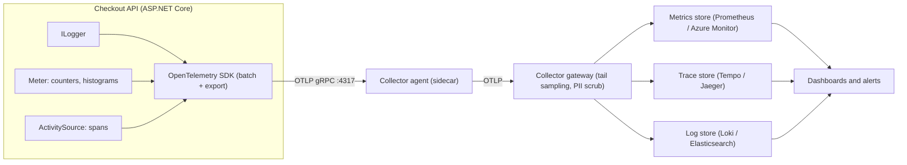
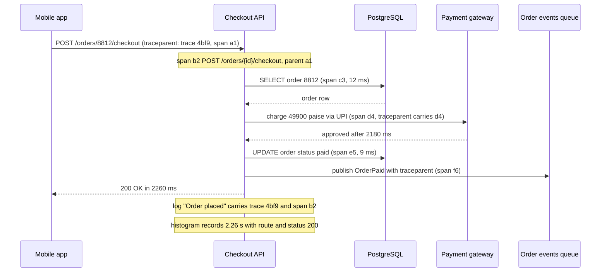

At 7:55 p.m. on a Friday, a food-ordering app in Bengaluru starts losing orders. The dashboard says CPU is 40 %, memory is fine, and every health check is green. Customers on social media say "payment spinning forever". The team has servers, logs and graphs, yet nobody can answer the only question that matters: *which part of the checkout is slow, for whom, since when?* That gap between "we collect data" and "we can answer new questions about production" is what observability is about.

## Learning objectives

By the end of this lesson you will be able to:

1. Explain what logs, metrics and traces are each good at, and why you need all three joined by a shared trace id.
2. Write structured logs in ASP.NET Core that a machine can filter, with trace and span ids attached automatically.
3. Choose metrics with the RED method (for request-driven services) and the USE method (for resources), and pick the right instrument type: counter, histogram, up-down counter or gauge.
4. Create spans with `ActivitySource` and metrics with `System.Diagnostics.Metrics`, and describe how the OpenTelemetry SDK exports them over OTLP.
5. Estimate telemetry volume and metric cardinality with real arithmetic, and keep both under control with sampling and tag discipline.
6. Decide when a simpler setup (a log file and a few counters) is enough.

## Prerequisites

- [Logging and observability in ASP.NET Core](#/lesson/m03-logging): `ILogger`, log levels and message templates.
- [Distributed request correlation](#/lesson/m10-correlation): `traceparent`, `Activity` and how context crosses service boundaries.
- [SLI, SLO, SLA and error budgets](#/lesson/m14-sli-slo-sla): helpful because metrics are what SLIs are computed from.

## Explain it like I'm a beginner

Think of a hospital patient.

- A **nurse's notes** describe individual events: "10:42 — gave paracetamol 500 mg, patient said pain is 6/10". Detailed, one line per event, easy to read for one patient, slow to search across a whole ward. Those are **logs**.
- The **monitor beside the bed** shows numbers over time: heart rate, blood pressure, oxygen. You can't tell *why* the heart rate jumped from it, but you see instantly *that* it jumped, and you can set an alarm at 120 beats per minute. Those are **metrics**.
- The **patient's journey file** follows one person through the hospital: reception 4 minutes, triage 11 minutes, X-ray queue 47 minutes, doctor 6 minutes. It shows *where the time went* for one visit. That is a **trace**, and each stop is a **span**.

A good hospital uses all three. The monitor says something is wrong. The journey file shows where. The nurse's notes explain why. The trick that makes them work together is the **patient id on every page**. In software that id is the **trace id**.

**OpenTelemetry** is like a standard form that every department agrees to fill in the same way, plus a courier service that collects the forms and delivers them to whichever records office you choose. Your code fills in the form once. You can change records offices (Grafana, Azure Monitor, Jaeger, Datadog) without rewriting the hospital.

## First-principles explanation

### Monitoring versus observability

**Monitoring** answers questions you knew to ask in advance: "Is CPU above 80 %?", "Is the error rate above 1 %?". **Observability** is the ability to answer questions you did *not* predict, using the data the system already emits: "Are only UPI payments from Android 14 users on the Jio network slow since the 7:40 p.m. deploy?". You get there by emitting rich, structured, correlated data, not by adding more dashboards.

### Pillar 1 — logs: discrete events with detail

A log record is one event: a timestamp, a level, a message and fields. The important word is **structured**. Compare:

```text
Payment failed for order 8812 after 2300ms
```

```json
{"ts":"2026-10-20T19:55:03.120Z","level":"Warning","msg":"Payment failed","order_id":"8812","payment_method":"upi","elapsed_ms":2300,"trace_id":"4bf92f3577b34da6a3ce929d0e0e4736","span_id":"00f067aa0ba902b7"}
```

The first is for a human with `grep`. The second is for a machine: you can ask "count failures by `payment_method` in the last 15 minutes" without regular expressions. In .NET, the message template `"Payment failed for order {OrderId}"` produces structured fields automatically. Never build the message with string interpolation (`$"... {orderId}"`), because the field name is lost and every message becomes unique.

Logs are the **most expensive signal per unit of insight** because each event is stored in full. Rules of thumb:

- Log *decisions and outcomes* (order placed, payment declined with reason), not every function entry.
- Default production level is `Information`. Keep `Debug` off, but be able to switch it on for one category at runtime.
- Never log secrets, full card numbers, Aadhaar numbers, OTPs or passwords. Mask personal data such as phone numbers.

### Pillar 2 — metrics: cheap numbers over time

A metric is a number aggregated over time, identified by a name and a few **tags** (also called attributes or labels): `http.server.request.duration{route="/orders/{id}", status="500"}`. Aggregation is what makes metrics cheap. A million requests per minute become a handful of numbers per minute: a count, a sum, and bucket counts for a histogram. That is why metrics drive dashboards and alerts.

The instrument types in `System.Diagnostics.Metrics` (which map directly to OpenTelemetry):

| Instrument | What it measures | Example |
|---|---|---|
| `Counter<T>` | Something that only goes up | orders placed, bytes sent |
| `UpDownCounter<T>` | Something that goes up and down, reported as changes | items in a queue, requests in flight |
| `Histogram<T>` | A distribution of values | request duration, payload size |
| `ObservableGauge<T>` | A current value read on demand | memory in use, cache entry count |

Use **histograms for latency**, never an average. An average of 120 ms can hide that 2 % of users wait 4 seconds. A histogram stores counts per bucket (0–5 ms, 5–10 ms … 5–10 s), so the backend can compute the 95th or 99th percentile (p95, p99) later.

### Which metrics? RED and USE

Two short checklists cover most needs.

**RED** (for anything that serves requests: APIs, queue consumers):

- **R**ate — requests per second.
- **E**rrors — failed requests per second, or the failed fraction.
- **D**uration — the latency distribution (a histogram).

**USE** (for resources: CPU, memory, disk, connection pools, thread pools):

- **U**tilisation — how busy it is (pool 18 of 20 connections in use = 90 %).
- **S**aturation — how much work is waiting (requests queued for a connection).
- **E**rrors — resource errors (connection timeouts, disk errors).

RED tells you users are suffering. USE tells you which resource is the cause. In the Friday story, RED on the checkout route would show p99 at 9 s. USE on the database connection pool would show 100 % utilisation and 140 requests waiting. Together they point straight at the problem: a slow query holding connections.

Google's SRE book describes a similar set, the **four golden signals**: latency, traffic, errors and saturation. RED is the same idea minus saturation.

### Pillar 3 — traces: where the time went

A **trace** is the full journey of one request across services. It is a tree of **spans**. Each span has a name, a start time, a duration, a status, tags, and a parent span id. The root span is the incoming HTTP request. Children are the database query, the call to the payment gateway, the message published to a queue.

Traces answer "where did the 2.3 seconds go?" in one picture: 40 ms in the API, 2,180 ms waiting for the payment gateway, 60 ms writing the order. No other signal does that across process boundaries.

Spans cross processes because the caller sends the trace context in the `traceparent` HTTP header (W3C Trace Context). You studied that in [Distributed request correlation](#/lesson/m10-correlation). In .NET, a span is a `System.Diagnostics.Activity`, created from an `ActivitySource`. `HttpClient` and ASP.NET Core create and propagate activities for you.

### The glue: correlation

The real power comes from joining the pillars:

- Every log line written inside a span carries `trace_id` and `span_id`. From a slow trace you jump to its logs.
- Histogram data points can carry **exemplars**: a sample trace id attached to a bucket. From a p99 spike on a graph you jump to one example slow trace. In the OpenTelemetry .NET SDK exemplars are opt-in (`SetExemplarFilter(ExemplarFilterType.TraceBased)`), and the backend must support them.
- All three carry the same **resource attributes**: `service.name`, `service.version`, `deployment.environment.name`, host or pod name. That is how you filter "only version 3.4.1 in production".

### OpenTelemetry: one standard, many backends

**OpenTelemetry** (OTel) is a vendor-neutral project under the CNCF. It defines:

1. **APIs and semantic conventions**: standard names such as `http.request.method`, `http.response.status_code`, `http.route`, `db.system.name`, `url.path`. Conventions are versioned and some were renamed when they became stable (for example `db.system` became `db.system.name`), so prefer the names the official instrumentation emits over hand-typed strings. In .NET, the API *is* the BCL: `ActivitySource`, `Meter` and `ILogger`. That is unusual and convenient: your libraries don't need an OpenTelemetry package to emit telemetry.
2. **SDKs**: the OpenTelemetry .NET SDK listens to those BCL APIs, batches the data and hands it to exporters.
3. **OTLP** (OpenTelemetry Protocol): the wire format for sending logs, metrics and traces, over gRPC (port 4317) or HTTP/protobuf (port 4318).
4. **The Collector**: a separate process that receives OTLP, processes it (batching, filtering, redacting, sampling) and exports it to one or more backends.

A typical pipeline: app → OTLP → a Collector running next to it (an agent or sidecar) → a central Collector gateway → backends (Prometheus or Azure Monitor for metrics, Tempo or Jaeger for traces, Loki or Elasticsearch for logs).

Why put a Collector in the middle? The app hands data off quickly and forgets it. Retries, buffering, secrets for the backend, PII scrubbing and tail sampling all live in one place you can change without redeploying 40 services.

### Cardinality: the silent bill

**Cardinality** is the number of unique time series a metric produces. Each unique combination of tag values is a separate series that the backend stores and indexes.

Worked estimate for the built-in `http.server.request.duration` histogram:

- 30 route and method combinations × about 6 status codes actually seen (200, 201, 400, 404, 500, 503; the built-in metric records the exact code) × 6 pods = 1,080 combinations.
- With the default bucket boundaries (14 of them, so 15 buckets including `+Inf`), a histogram exported Prometheus-style is 15 bucket series + sum + count = 17 series per combination.
- 1,080 × 17 ≈ **18,400 series**. Fine for any backend.

Now someone adds `user_id` as a tag "to debug one customer". With 500,000 active users that becomes 18,400 × 500,000 ≈ **9.2 billion** possible series. The backend slows down or refuses data, and many hosted vendors bill per series. The rule:

- **Metrics**: only low-cardinality tags with a small, *bounded* set of values (route template, status class, payment method, region, tenant *tier*).
- **Traces and logs**: high-cardinality fields are fine and expected (order id, user id, tenant id), because each record is stored once anyway.

Always use the **route template** (`/orders/{id}`), never the raw path (`/orders/88123`). ASP.NET Core's built-in metrics already do this.

### Volume and sampling

Estimate before you buy. Suppose a service averages 2,000 requests per second.

- Logs: 1 log line of about 800 bytes per request → 2,000 × 800 B = 1.6 MB/s → 1.6 MB × 86,400 s ≈ **138 GB per day**.
- Traces: 6 spans of about 500 bytes per request → 2,000 × 6 × 500 B = 6 MB/s ≈ **518 GB per day**.

These are estimates; real sizes depend on how many tags you add. Storing half a terabyte of traces per day is rarely worth it. That is what **sampling** is for:

- **Head sampling** decides at the start of a trace, for example "keep 10 %". Cheap and simple, and the decision travels in the `traceparent` flags so all services agree. Problem: it drops 90 % of your *errors* too.
- **Tail sampling** decides after the trace finishes, usually in the Collector: keep 100 % of traces with an error or longer than 1 second, plus 5 % of the rest. Much better signal, but the Collector must buffer complete traces in memory (typically for 10–30 seconds) and all spans of a trace must reach the same Collector instance.

At 10 % head sampling the trace volume above drops to about 52 GB per day. Metrics are not sampled; they are already aggregated, which is why alerts should be built on metrics, not on sampled traces.

### Built-in telemetry in ASP.NET Core

You get a lot for free in .NET 8 and later:

- ASP.NET Core emits `http.server.request.duration` (a histogram, in seconds) and `http.server.active_requests` from the `Microsoft.AspNetCore.Hosting` meter, tagged with method, route template and status code.
- `HttpClient` emits `http.client.request.duration` and creates client spans.
- Kestrel, the runtime (`System.Runtime`: GC, thread pool, exceptions) and many libraries publish metrics too.
- Every incoming request starts an `Activity`, so logs written during the request carry its trace id.

Your job is to add **business** telemetry (orders placed, payment outcomes, queue lag) and to enrich the built-in signals with a few well-chosen tags.

### When a simpler setup is enough

A single internal tool with 50 users on one VM does not need a Collector, tail sampling and three backends. JSON logs to a file, shipped by whatever your host provides, plus the built-in metrics on a `/metrics` page or Azure Monitor's default integration, covers it. Add distributed tracing the day you have a second service that a request passes through, or the day "where did the time go?" becomes a real question. Instrument through the BCL APIs from day one anyway: it costs nothing and means you can switch on full OpenTelemetry later without touching business code.

## Visual explanation

### Architecture: from code to backends



How to read it: the application code only talks to BCL APIs (`ILogger`, `Meter`, `ActivitySource`). The OpenTelemetry SDK inside the process listens to all three, batches the data, and sends it over OTLP to a Collector agent running next to the app. The agent forwards to a central gateway that applies the expensive policies: tail sampling for traces, removing personal data, dropping noisy series. The gateway writes each signal to a store built for it. The dashboard tool reads all three stores, which is what lets you click from a metric spike to a trace to its logs. If the gateway is down, the agent buffers for a while; if it stays down, telemetry is lost but the checkout keeps working. Telemetry must never take the business path down with it.

### Sequence: one checkout, one trace



This is one trace (`4bf9`) with spans `b2` to `f6`. The app sent its own span `a1` as the parent, so even the client-side time is in the picture. The payment call is the long bar: 2,180 of 2,260 ms. The `traceparent` header goes to the payment gateway and into the queue message, so if the gateway and the order-events consumer are instrumented, their spans join the same trace. The last two notes show the correlation: the log line and the histogram data point are recorded inside span `b2`, so they carry the same trace id, and the histogram bucket can keep it as an exemplar.

## Step-by-step example

We will instrument the checkout of the food-ordering app, one signal at a time.

### Step 1 — start with what is free

Add nothing and look at what ASP.NET Core already emits. Run `dotnet-counters monitor -n Shop.Api --counters Microsoft.AspNetCore.Hosting` and you see request rate, active requests and duration for every route. That is RED for the HTTP layer, with zero code.

### Step 2 — make logs structured and correlated

Switch the console logger to JSON, include scopes, and ask the logger factory to add trace and span ids. Replace interpolated strings with message templates. Now a log search for `trace_id = 4bf9…` returns exactly the lines for one checkout.

### Step 3 — add business metrics

HTTP metrics can't tell you how many *orders* succeeded or which *payment method* is failing. Create one `Meter` for the checkout feature with:

- `shop.orders.placed` (counter, tagged by payment method),
- `shop.payment.duration` (histogram, tagged by payment method and outcome),
- `shop.checkouts.in_flight` (up-down counter).

Payment method has five possible values. Outcome has three. That is 15 combinations: safe.

### Step 4 — add a span around the slow, important work

Create an `ActivitySource` and wrap "place order" in a span. Put the high-cardinality detail (`order.id`, `customer.id`) on the span, not on the metrics. When an exception escapes, mark the span as an error and record the exception.

### Step 5 — enrich the built-in HTTP metric safely

Product wants latency split by tenant *tier* (free, pro, enterprise). Add a tag to the built-in request-duration metric through `IHttpMetricsTagsFeature`, but only from an **allow-list**. Any unexpected value becomes `"unknown"`, so a client cannot create new series by sending garbage headers.

### Step 6 — export

Add the OpenTelemetry SDK packages, register the sources and meters, and point the OTLP exporter at the Collector. The business code from steps 2–5 does not change.

## Production-style C# implementation

Project structure:

```text
Shop.Api/
  Program.cs
  Observability/ShopTelemetry.cs
  Observability/TelemetryEnrichmentMiddleware.cs
  Checkout/PaymentGateway.cs
  Checkout/CheckoutService.cs
```

All instrumentation uses BCL types only. The OpenTelemetry SDK registration is shown afterwards as a separate snippet, because those NuGet packages are added in the real project.

```csharp file=Observability/ShopTelemetry.cs
using System.Diagnostics;
using System.Diagnostics.Metrics;

namespace Shop.Observability;

/// <summary>Holds the checkout feature's instruments. Registered as a singleton.
/// The Meter is created through IMeterFactory so DI owns its lifetime and tests can isolate it.</summary>
public sealed class ShopTelemetry
{
    public const string Name = "Shop.Checkout";

    /// <summary>Spans for the checkout feature. Static is the recommended pattern for ActivitySource.</summary>
    public static readonly ActivitySource ActivitySource = new(Name, "1.0.0");

    public Counter<long> OrdersPlaced { get; }
    public Histogram<double> PaymentDuration { get; }
    public UpDownCounter<long> CheckoutsInFlight { get; }

    public ShopTelemetry(IMeterFactory meterFactory)
    {
        var meter = meterFactory.Create(Name, "1.0.0");

        OrdersPlaced = meter.CreateCounter<long>(
            "shop.orders.placed", unit: "{order}",
            description: "Orders successfully placed, tagged by payment method.");

        // Seconds, following OpenTelemetry semantic conventions. Bucket advice suits a call
        // that is normally 100 ms to 3 s and times out at 10 s.
        PaymentDuration = meter.CreateHistogram<double>(
            "shop.payment.duration", unit: "s",
            description: "Time spent waiting for the payment gateway.",
            advice: new InstrumentAdvice<double>
            {
                HistogramBucketBoundaries = [0.05, 0.1, 0.25, 0.5, 1, 2, 3, 5, 10]
            });

        CheckoutsInFlight = meter.CreateUpDownCounter<long>(
            "shop.checkouts.in_flight", unit: "{checkout}",
            description: "Checkouts currently being processed.");
    }

    /// <summary>Payment methods are a closed set, so they are safe as a metric tag.</summary>
    public static string NormalisePaymentMethod(string? method) => method?.ToLowerInvariant() switch
    {
        "upi" => "upi",
        "card" => "card",
        "netbanking" => "netbanking",
        "wallet" => "wallet",
        "cod" => "cod",
        _ => "other",
    };
}
```

```csharp file=Observability/TelemetryEnrichmentMiddleware.cs
using System.Diagnostics;
using Microsoft.AspNetCore.Http.Features;

namespace Shop.Observability;

/// <summary>Adds a low-cardinality tag to the built-in http.server.request.duration metric and
/// a high-cardinality tag to the current request span. Must run early in the pipeline.</summary>
public sealed class TelemetryEnrichmentMiddleware(RequestDelegate next)
{
    private static readonly HashSet<string> AllowedTiers = new(StringComparer.OrdinalIgnoreCase)
        { "free", "pro", "enterprise" };

    public Task InvokeAsync(HttpContext context)
    {
        var rawTier = context.Request.Headers["X-Tenant-Tier"].ToString();
        var tier = AllowedTiers.Contains(rawTier) ? rawTier.ToLowerInvariant() : "unknown";

        // Metrics: bounded set of values only (3 tiers + "unknown").
        context.Features.Get<IHttpMetricsTagsFeature>()?.Tags.Add(new("shop.tenant_tier", tier));

        // Traces: the tenant id is unbounded, which is fine on a span.
        var tenantId = context.Request.Headers["X-Tenant-Id"].ToString();
        if (tenantId.Length is > 0 and <= 64)
            Activity.Current?.SetTag("shop.tenant_id", tenantId);

        return next(context);
    }
}
```

```csharp file=Checkout/PaymentGateway.cs
namespace Shop.Checkout;

public sealed record ChargeResult(bool Approved, string? DeclineReason);

public interface IPaymentGateway
{
    Task<ChargeResult> ChargeAsync(string orderId, long amountInPaise, string method, CancellationToken ct);
}

/// <summary>In-memory stand-in for a real gateway client. A real one would use a typed HttpClient,
/// which creates its own client span and sends traceparent automatically.</summary>
public sealed class FakePaymentGateway : IPaymentGateway
{
    public async Task<ChargeResult> ChargeAsync(string orderId, long amountInPaise, string method, CancellationToken ct)
    {
        await Task.Delay(TimeSpan.FromMilliseconds(120), ct);
        return amountInPaise > 5_000_000          // above ₹50,000 the fake declines
            ? new ChargeResult(false, "limit_exceeded")
            : new ChargeResult(true, null);
    }
}
```

```csharp file=Checkout/CheckoutService.cs
using System.Diagnostics;
using Shop.Observability;

namespace Shop.Checkout;

public sealed record CheckoutRequest(string OrderId, string CustomerId, long AmountInPaise, string PaymentMethod);
public sealed record CheckoutResult(bool Success, string? Reason);

public sealed partial class CheckoutService(
    IPaymentGateway gateway, ShopTelemetry telemetry, TimeProvider time, ILogger<CheckoutService> logger)
{
    public async Task<CheckoutResult> PlaceOrderAsync(CheckoutRequest request, CancellationToken ct)
    {
        ArgumentNullException.ThrowIfNull(request);
        var method = ShopTelemetry.NormalisePaymentMethod(request.PaymentMethod);

        // Child of the ASP.NET Core request span. Null when nobody is listening, hence the ?.
        using var activity = ShopTelemetry.ActivitySource.StartActivity("checkout.place_order");
        activity?.SetTag("order.id", request.OrderId);          // high cardinality: span only
        activity?.SetTag("customer.id", request.CustomerId);    // high cardinality: span only
        activity?.SetTag("payment.method", method);

        telemetry.CheckoutsInFlight.Add(1);
        var started = time.GetTimestamp();
        var outcome = "error";
        try
        {
            var charge = await gateway.ChargeAsync(request.OrderId, request.AmountInPaise, method, ct);
            outcome = charge.Approved ? "approved" : "declined";

            if (!charge.Approved)
            {
                LogPaymentDeclined(logger, request.OrderId, method, charge.DeclineReason ?? "unknown");
                activity?.SetTag("payment.decline_reason", charge.DeclineReason);
                return new CheckoutResult(false, charge.DeclineReason);
            }

            telemetry.OrdersPlaced.Add(1, new KeyValuePair<string, object?>("payment.method", method));
            LogOrderPlaced(logger, request.OrderId, request.AmountInPaise, method);
            return new CheckoutResult(true, null);
        }
        catch (Exception ex) when (ex is not OperationCanceledException)
        {
            activity?.SetStatus(ActivityStatusCode.Error, ex.GetType().Name);
            activity?.AddException(ex);
            LogCheckoutFailed(logger, ex, request.OrderId, method);
            throw;
        }
        finally
        {
            var tags = new TagList { { "payment.method", method }, { "payment.outcome", outcome } };
            telemetry.PaymentDuration.Record(time.GetElapsedTime(started).TotalSeconds, tags);
            telemetry.CheckoutsInFlight.Add(-1);
        }
    }

    // Source-generated logging: no boxing, no parsing of the template at runtime, structured fields.
    [LoggerMessage(EventId = 1001, Level = LogLevel.Information,
        Message = "Order {OrderId} placed for {AmountInPaise} paise via {PaymentMethod}")]
    private static partial void LogOrderPlaced(ILogger logger, string orderId, long amountInPaise, string paymentMethod);

    [LoggerMessage(EventId = 1002, Level = LogLevel.Warning,
        Message = "Payment declined for order {OrderId} via {PaymentMethod}: {DeclineReason}")]
    private static partial void LogPaymentDeclined(ILogger logger, string orderId, string paymentMethod, string declineReason);

    [LoggerMessage(EventId = 1003, Level = LogLevel.Error,
        Message = "Checkout failed for order {OrderId} via {PaymentMethod}")]
    private static partial void LogCheckoutFailed(ILogger logger, Exception exception, string orderId, string paymentMethod);
}
```

```csharp file=Program.cs
using Shop.Checkout;
using Shop.Observability;

var builder = WebApplication.CreateBuilder(args);

// Structured JSON logs with scopes, and trace/span ids attached to every record.
builder.Logging.ClearProviders();
builder.Logging.AddJsonConsole(o =>
{
    o.IncludeScopes = true;
    o.UseUtcTimestamp = true;
    o.TimestampFormat = "yyyy-MM-ddTHH:mm:ss.fffZ ";
});
builder.Logging.Configure(o => o.ActivityTrackingOptions =
    ActivityTrackingOptions.TraceId | ActivityTrackingOptions.SpanId | ActivityTrackingOptions.ParentId);

builder.Services.AddMetrics();                         // IMeterFactory (the host also adds it)
builder.Services.AddSingleton(TimeProvider.System);
builder.Services.AddSingleton<ShopTelemetry>();
builder.Services.AddSingleton<IPaymentGateway, FakePaymentGateway>();
builder.Services.AddSingleton<CheckoutService>();

var app = builder.Build();

app.UseMiddleware<TelemetryEnrichmentMiddleware>();

app.MapPost("/orders/{orderId}/checkout", async (string orderId, CheckoutBody body, CheckoutService checkout, CancellationToken ct) =>
{
    var result = await checkout.PlaceOrderAsync(
        new CheckoutRequest(orderId, body.CustomerId, body.AmountInPaise, body.PaymentMethod), ct);
    return result.Success
        ? Results.Ok(result)
        : Results.Problem(result.Reason, statusCode: StatusCodes.Status402PaymentRequired);
});

app.Run();

public sealed record CheckoutBody(string CustomerId, long AmountInPaise, string PaymentMethod);
```

### Exporting with the OpenTelemetry SDK

In the real project, add the packages `OpenTelemetry.Extensions.Hosting`, `OpenTelemetry.Instrumentation.AspNetCore`, `OpenTelemetry.Instrumentation.Http` and `OpenTelemetry.Exporter.OpenTelemetryProtocol`, then register:

```csharp
builder.Services.AddOpenTelemetry()
    .ConfigureResource(r => r.AddService(
        serviceName: "shop-checkout-api",
        serviceVersion: typeof(Program).Assembly.GetName().Version?.ToString()))
    .WithTracing(t => t
        .AddSource(ShopTelemetry.Name)          // our ActivitySource
        .AddAspNetCoreInstrumentation()
        .AddHttpClientInstrumentation()
        .SetSampler(new ParentBasedSampler(new TraceIdRatioBasedSampler(0.10))))   // 10 % head sampling
    .WithMetrics(m => m
        .AddMeter(ShopTelemetry.Name)           // our Meter
        .AddMeter("Microsoft.AspNetCore.Hosting", "Microsoft.AspNetCore.Server.Kestrel", "System.Net.Http")
        .AddMeter("System.Runtime")             // built-in runtime metrics (.NET 9+): GC, thread pool, exceptions
        .SetExemplarFilter(ExemplarFilterType.TraceBased))   // attach trace ids to histogram buckets
    .WithLogging()
    .UseOtlpExporter();   // endpoint from OTEL_EXPORTER_OTLP_ENDPOINT, e.g. http://localhost:4317
```

Notes on the choices:

- `AddSource` and `AddMeter` are allow-lists. If you forget to add your name, your spans and metrics are silently not exported. Write a startup test that checks it.
- `ParentBasedSampler` respects the caller's decision in `traceparent`. Without it, service B could keep a trace that service A dropped, leaving broken half-traces.
- `UseOtlpExporter()` sends all three signals to one endpoint. The endpoint, headers and protocol come from standard `OTEL_*` environment variables, so the same build works on a laptop (local Collector or the .NET Aspire dashboard) and in production.
- The exporter batches in the background. If the Collector is unreachable, the batch is dropped after retries; the request path is never blocked.
- Telemetry crosses the network, so treat it like any other data flow: use `https://` endpoints (TLS) outside the local host, put the backend's API key in `OTEL_EXPORTER_OTLP_HEADERS` from a secret store rather than in `appsettings.json`, and remember that span tags and logs can contain personal data that the Collector should scrub.

:::callout type=warning title="Metrics tags are forever"
Once a high-cardinality tag reaches the metrics backend, the series exist until retention expires, and you pay for them. Review every new metric tag the same way you review a database index: what are the possible values, and how many?
:::

## Bad design vs good design

**Bad**: the "debugging edition" of the checkout.

```csharp
logger.LogInformation($"Checkout start {orderId} {JsonSerializer.Serialize(request)}");   // full body, card data, interpolated
requestCounter.Add(1, new KeyValuePair<string, object?>("path", context.Request.Path.Value));   // /orders/88123 is a new series per order
requestCounter.Add(1, new KeyValuePair<string, object?>("user_id", userId));                  // 500,000 series
var avgLatency = totalMs / count;                                                           // an average hides the tail
```

Problems:

- The interpolated message makes every log line unique, so you can't count "checkout start" events, and the serialised request leaks personal data and possibly card details into a log store dozens of people can read.
- Raw path and user id as metric tags explode cardinality: one series per order and per user.
- An average latency of 180 ms says nothing about the 3 % of users waiting 6 s.
- There is no trace, so "where did the time go?" still needs guesswork.

**Good**: the implementation above. Message templates with named fields, no secrets. Route templates and bounded tags on metrics. High-cardinality ids on spans. Histograms for durations. Built-in metrics reused instead of re-invented.

**Is the full stack worth it?** For one service on one VM with modest traffic, the honest answer is often "not yet". JSON logs and the built-in metrics carry you a long way. The cost of OpenTelemetry is not the code (a dozen lines), it is running the Collector, the storage, and the habit of reviewing tags. Pay it when you have several services, an on-call rota, or an SLO to defend.

:::callout type=tradeoff title="Vendor agent or OpenTelemetry?"
A vendor's own agent often gives richer features on day one. OpenTelemetry gives portability: the same instrumentation can feed Azure Monitor today and a self-hosted Grafana stack next year. For new .NET code, emitting through the BCL APIs and exporting with OTLP keeps both doors open.
:::

## Practical playground

The playground loads one hour of request spans for the checkout API (24,000 rows, one every 150 ms). Treat it as the raw data a trace backend stores. Try these queries:

1. Requests per route: `SELECT route, count(*) FROM http_span GROUP BY route;`
2. p50, p95 and p99 duration for the checkout route with `percentile_cont(0.95) WITHIN GROUP (ORDER BY duration_ms)`.
3. Error rate per 5-minute window: `date_bin('5 minutes', started_at, timestamptz '2026-10-20 00:00+05:30')`. Is there a burst?
4. Why is the average for the checkout route misleading? Compare `avg(duration_ms)` with the p99.
5. Should `404` count as an error for an SLI? Argue both ways.

:::playground type=sql title="RED metrics from raw spans"
```sql
CREATE TABLE http_span (
  id bigint GENERATED ALWAYS AS IDENTITY PRIMARY KEY,
  trace_id text NOT NULL,
  service text NOT NULL,
  route text NOT NULL,
  status int NOT NULL,
  duration_ms numeric(10,1) NOT NULL,
  started_at timestamptz NOT NULL
);
INSERT INTO http_span (trace_id, service, route, status, duration_ms, started_at)
SELECT md5(g::text), 'shop-api',
       (ARRAY['GET /products','GET /products/{id}','POST /orders/{id}/checkout','GET /orders/{id}'])[1 + g % 4],
       CASE WHEN g % 4 = 2 AND g % 23 = 0 THEN 503
            WHEN g % 50 = 0 THEN 500
            WHEN g % 17 = 0 THEN 404
            ELSE 200 END,
       CASE g % 4 WHEN 0 THEN 20 + (g % 30)
                  WHEN 1 THEN 35 + (g % 40)
                  WHEN 2 THEN 180 + (g % 900) + CASE WHEN g % 97 = 0 THEN 6000 ELSE 0 END
                  ELSE 25 + (g % 25) END,
       timestamptz '2026-10-20 19:00+05:30' + g * interval '150 milliseconds'
FROM generate_series(1, 24000) AS g;
```
:::

## Exercises

:::exercise id=m14-observability-ex1 difficulty=beginner kind=code title="Safe tags for a request metric"
Write the helper that turns raw request data into **metric tags** that cannot explode cardinality.
::requirements
- `MetricTags.StatusClass(int statusCode)` returns `"1xx"`, `"2xx"`, `"3xx"`, `"4xx"` or `"5xx"`. Anything outside 100–599 returns `"other"`.
- `MetricTags.Route(string? routeTemplate)` returns the template unchanged, or `"unmatched"` when it is null or empty (a 404 for an unknown URL has no route).
- `MetricTags.ForRequest(string method, string? routeTemplate, int statusCode)` returns a `Dictionary<string, string>` with keys `http.request.method`, `http.route` and `status_class`. Methods outside GET, POST, PUT, PATCH, DELETE, HEAD and OPTIONS become `"_OTHER"`; known methods are upper-cased.
::acceptance
- `ForRequest("get", "/orders/{id}", 200)` gives `GET`, `/orders/{id}`, `2xx`.
- `ForRequest("BREW", null, 418)` gives `_OTHER`, `unmatched`, `4xx`.
- `StatusClass(42)` and `StatusClass(700)` give `other`.
::hint
Every function here maps an unbounded input to a small, fixed set of outputs. That is the whole idea of a safe tag.
::hint
Integer division gives the class: `503 / 100` is `5`.
::hint
Keep the allowed methods in a `HashSet<string>` with `StringComparer.OrdinalIgnoreCase`.
::hint
```csharp
public static string StatusClass(int code) => code is >= 100 and <= 599 ? $"{code / 100}xx" : "other";
```
::starter
```csharp file=MetricTags.cs
using System;
using System.Collections.Generic;

public static class MetricTags
{
    public static string StatusClass(int statusCode) => throw new NotImplementedException();
    public static string Route(string? routeTemplate) => throw new NotImplementedException();
    public static Dictionary<string, string> ForRequest(string method, string? routeTemplate, int statusCode) =>
        throw new NotImplementedException();
}
```
::tests
```csharp file=MetricTagsTests.cs
using Xunit;

public class MetricTagsTests
{
    [Theory]
    [InlineData(200, "2xx")]
    [InlineData(301, "3xx")]
    [InlineData(404, "4xx")]
    [InlineData(503, "5xx")]
    [InlineData(100, "1xx")]
    [InlineData(42, "other")]
    [InlineData(700, "other")]
    public void Status_classes(int code, string expected) => Assert.Equal(expected, MetricTags.StatusClass(code));

    [Fact]
    public void Unknown_route_is_unmatched()
    {
        Assert.Equal("unmatched", MetricTags.Route(null));
        Assert.Equal("unmatched", MetricTags.Route(""));
        Assert.Equal("/orders/{id}", MetricTags.Route("/orders/{id}"));
    }

    [Fact]
    public void Known_method_is_uppercased()
    {
        var t = MetricTags.ForRequest("get", "/orders/{id}", 200);
        Assert.Equal("GET", t["http.request.method"]);
        Assert.Equal("/orders/{id}", t["http.route"]);
        Assert.Equal("2xx", t["status_class"]);
        Assert.Equal(3, t.Count);
    }

    [Fact]
    public void Unknown_method_is_other()
    {
        var t = MetricTags.ForRequest("BREW", null, 418);
        Assert.Equal("_OTHER", t["http.request.method"]);
        Assert.Equal("unmatched", t["http.route"]);
        Assert.Equal("4xx", t["status_class"]);
    }
}
```
::solution
Each function maps an open-ended input onto a closed set. At most 8 methods × (routes + 1) × 6 classes series can ever exist.

```csharp file=MetricTags.cs
using System;
using System.Collections.Generic;

public static class MetricTags
{
    private static readonly HashSet<string> KnownMethods = new(StringComparer.OrdinalIgnoreCase)
        { "GET", "POST", "PUT", "PATCH", "DELETE", "HEAD", "OPTIONS" };

    public static string StatusClass(int statusCode) =>
        statusCode is >= 100 and <= 599 ? $"{statusCode / 100}xx" : "other";

    public static string Route(string? routeTemplate) =>
        string.IsNullOrEmpty(routeTemplate) ? "unmatched" : routeTemplate;

    public static Dictionary<string, string> ForRequest(string method, string? routeTemplate, int statusCode) =>
        new()
        {
            ["http.request.method"] = KnownMethods.Contains(method) ? method.ToUpperInvariant() : "_OTHER",
            ["http.route"] = Route(routeTemplate),
            ["status_class"] = StatusClass(statusCode),
        };
}
```

`_OTHER` matches the OpenTelemetry semantic convention for unknown HTTP methods. ASP.NET Core's built-in metric applies the same idea, which is why you rarely need your own request metric.
::mistakes
- Using `context.Request.Path` instead of the route template: one series per order id.
- Passing the method through unchanged: an attacker sending random methods creates unlimited series.
- Returning `"4xx"` for status 42 because of integer division without a range check.
::extensions
Add a `service.version` tag and estimate how many series a deploy that runs two versions side by side (canary) produces.
:::

:::exercise id=m14-observability-ex2 difficulty=beginner kind=code title="Wrap a step in a span that records failures"
Write a small helper that runs a piece of work inside a span, tags it, and marks it as an error if it throws.
::requirements
- `Traced.RunAsync<T>(ActivitySource source, string name, Func<Activity?, Task<T>> work)` starts an activity called `name`, passes it to `work`, and returns the result.
- On success, set the status to `ActivityStatusCode.Ok`.
- On an exception, set status `Error` with the exception type name as description, add tag `error.type` with the full type name, and **rethrow the original exception**.
- Must work when nobody is listening (`StartActivity` returns null).
::acceptance
- A successful call produces one stopped activity with status `Ok` and the tags `work` added.
- A throwing call produces status `Error`, tag `error.type = System.InvalidOperationException`, and the same exception reaches the caller.
- With no listener, the work still runs and receives `null`.
::hint
`using var activity = source.StartActivity(name);` disposes (and so stops) the span on every exit path.
::hint
Use the null-conditional operator: `activity?.SetStatus(...)`.
::hint
`catch (Exception ex) { ...; throw; }` keeps the original stack trace. `throw ex;` does not.
::hint
In tests, an `ActivityListener` with `Sample = AllDataAndRecorded` makes `StartActivity` return a real activity.
::starter
```csharp file=Traced.cs
using System;
using System.Diagnostics;
using System.Threading.Tasks;

public static class Traced
{
    public static Task<T> RunAsync<T>(ActivitySource source, string name, Func<Activity?, Task<T>> work) =>
        throw new NotImplementedException();
}
```
::tests
```csharp file=TracedTests.cs
using System;
using System.Collections.Generic;
using System.Diagnostics;
using System.Linq;
using System.Threading.Tasks;
using Xunit;

public class TracedTests
{
    private static (ActivitySource Source, List<Activity> Stopped, ActivityListener Listener) Listen(string name)
    {
        var stopped = new List<Activity>();
        var listener = new ActivityListener
        {
            ShouldListenTo = s => s.Name == name,
            Sample = (ref ActivityCreationOptions<ActivityContext> _) => ActivitySamplingResult.AllDataAndRecorded,
            ActivityStopped = a => stopped.Add(a),
        };
        ActivitySource.AddActivityListener(listener);
        return (new ActivitySource(name), stopped, listener);
    }

    [Fact]
    public async Task Success_sets_ok_and_keeps_tags()
    {
        var (src, stopped, l) = Listen("Test.Traced.Ok");
        using var keep = l;
        var result = await Traced.RunAsync(src, "load-order", a => { a?.SetTag("order.id", "8812"); return Task.FromResult(42); });
        Assert.Equal(42, result);
        var span = Assert.Single(stopped);
        Assert.Equal("load-order", span.DisplayName);
        Assert.Equal(ActivityStatusCode.Ok, span.Status);
        Assert.Equal("8812", span.GetTagItem("order.id"));
    }

    [Fact]
    public async Task Failure_sets_error_and_rethrows()
    {
        var (src, stopped, l) = Listen("Test.Traced.Err");
        using var keep = l;
        var ex = await Assert.ThrowsAsync<InvalidOperationException>(() =>
            Traced.RunAsync<int>(src, "charge", _ => throw new InvalidOperationException("gateway down")));
        Assert.Equal("gateway down", ex.Message);
        var span = Assert.Single(stopped);
        Assert.Equal(ActivityStatusCode.Error, span.Status);
        Assert.Equal("InvalidOperationException", span.StatusDescription);
        Assert.Equal("System.InvalidOperationException", span.GetTagItem("error.type"));
    }

    [Fact]
    public async Task Works_without_listener()
    {
        var src = new ActivitySource("Test.Traced.Nobody");
        Activity? seen = new Activity("placeholder");
        var r = await Traced.RunAsync(src, "x", a => { seen = a; return Task.FromResult("done"); });
        Assert.Equal("done", r);
        Assert.Null(seen);
    }
}
```
::solution
```csharp file=Traced.cs
using System;
using System.Diagnostics;
using System.Threading.Tasks;

public static class Traced
{
    public static async Task<T> RunAsync<T>(ActivitySource source, string name, Func<Activity?, Task<T>> work)
    {
        using var activity = source.StartActivity(name);
        try
        {
            var result = await work(activity);
            activity?.SetStatus(ActivityStatusCode.Ok);
            return result;
        }
        catch (Exception ex)
        {
            activity?.SetStatus(ActivityStatusCode.Error, ex.GetType().Name);
            activity?.SetTag("error.type", ex.GetType().FullName);
            throw;
        }
    }
}
```

The `using` declaration stops the activity on both paths, which is when listeners (and the OpenTelemetry exporter) receive it. The method must be `async` so that an exception thrown *inside* the awaited task is caught here, not later by the caller.
::mistakes
- Making the method non-async and returning `work(activity)` directly: the span stops before the work finishes and exceptions escape the `catch`.
- `throw ex;`, which resets the stack trace.
- Forgetting the `?.`: a `NullReferenceException` in production whenever sampling drops the span.
::extensions
Also call `activity?.AddException(ex)` (.NET 9+) so the exception message and stack trace become a span event, and decide whether stack traces in telemetry are acceptable for your data-protection policy.
:::

:::exercise id=m14-observability-ex3 difficulty=intermediate kind=sql ordered=true title="Compute RED per route from raw spans"
Using the `http_span` table, produce the RED summary a dashboard would show for the hour of data. Return one row per `route` with:

- `requests` — total count,
- `rps` — requests per second over the 3,600-second window, rounded to 2 decimals,
- `error_pct` — the share of requests with **status 500 or above**, as a percentage rounded to 2 decimals,
- `p95_ms` — the 95th percentile of `duration_ms` (continuous), rounded to 1 decimal.

Order by `route`.
::acceptance
- Exactly 4 rows, one per route, ordered alphabetically.
- `404` responses are not counted as errors.
- Uses `percentile_cont(0.95) WITHIN GROUP (ORDER BY duration_ms)`, not `avg`.
::hint
One `GROUP BY route` query is enough. Each column is an aggregate.
::hint
`count(*) FILTER (WHERE status >= 500)` counts only server errors.
::hint
Multiply by `100.0` before dividing so the result is not integer division, then `round(... , 2)`.
::hint
`percentile_cont` returns `double precision`. Cast to `numeric` before `round(x, 1)`.
::setup
```sql
CREATE TABLE http_span (
  id bigint GENERATED ALWAYS AS IDENTITY PRIMARY KEY,
  trace_id text NOT NULL, service text NOT NULL, route text NOT NULL,
  status int NOT NULL, duration_ms numeric(10,1) NOT NULL, started_at timestamptz NOT NULL
);
INSERT INTO http_span (trace_id, service, route, status, duration_ms, started_at)
SELECT md5(g::text), 'shop-api',
       (ARRAY['GET /products','GET /products/{id}','POST /orders/{id}/checkout','GET /orders/{id}'])[1 + g % 4],
       CASE WHEN g % 4 = 2 AND g % 23 = 0 THEN 503 WHEN g % 50 = 0 THEN 500 WHEN g % 17 = 0 THEN 404 ELSE 200 END,
       CASE g % 4 WHEN 0 THEN 20 + (g % 30) WHEN 1 THEN 35 + (g % 40)
                  WHEN 2 THEN 180 + (g % 900) + CASE WHEN g % 97 = 0 THEN 6000 ELSE 0 END
                  ELSE 25 + (g % 25) END,
       timestamptz '2026-10-20 19:00+05:30' + g * interval '150 milliseconds'
FROM generate_series(1, 24000) AS g;
```
::check
```sql
SELECT route,
       count(*) AS requests,
       round(count(*) / 3600.0, 2) AS rps,
       round(100.0 * count(*) FILTER (WHERE status >= 500) / count(*), 2) AS error_pct,
       round((percentile_cont(0.95) WITHIN GROUP (ORDER BY duration_ms))::numeric, 1) AS p95_ms
FROM http_span
GROUP BY route
ORDER BY route;
```
::solution
```sql
SELECT route,
       count(*) AS requests,
       round(count(*) / 3600.0, 2) AS rps,
       round(100.0 * count(*) FILTER (WHERE status >= 500) / count(*), 2) AS error_pct,
       round((percentile_cont(0.95) WITHIN GROUP (ORDER BY duration_ms))::numeric, 1) AS p95_ms
FROM http_span
GROUP BY route
ORDER BY route;
```

This is exactly what a metrics backend does with a histogram, except a histogram stores bucket counts instead of every value, so its percentiles are approximations within a bucket. Computing RED from raw spans works for an hour of data; for months of data and alerting you want pre-aggregated metrics, which are far cheaper to store and query.

Note that the checkout route has a higher error rate (it gets the extra `503`s) and a p95 an order of magnitude above the read routes. Its average would look much healthier than its p95 because the 6-second outliers are rare.
::mistakes
- `count(*) FILTER (WHERE status >= 400)`: counts 404s, which are usually client mistakes, not service failures.
- Integer division (`count(*) / 3600`) giving 1 instead of 1.67.
- Using `percentile_disc` without understanding the difference, or `avg` as "latency".
::extensions
Add a 5-minute time bucket with `date_bin` and find which window has the highest checkout error rate.
:::

:::exercise id=m14-observability-ex4 difficulty=intermediate kind=code title="A cardinality guard for tag values"
Some tags are *mostly* bounded but not guaranteed: a `client.app_version` tag from a header, or a `partner.id` tag that grows slowly. Build a guard that lets the first N distinct values through and maps every later new value to `"_other"`.
::requirements
- `CardinalityGuard(int maxDistinct)` — throws `ArgumentOutOfRangeException` if `maxDistinct < 1`.
- `string Normalise(string? value)` — null or empty becomes `"_empty"` (not counted towards the limit). A value already admitted is returned unchanged. A new value is admitted while fewer than `maxDistinct` are admitted; otherwise `"_other"` is returned.
- `int AdmittedCount` and `long OverflowCount` (how many calls returned `"_other"`).
- Thread-safe: 8 threads calling it at once must never admit more than `maxDistinct` values.
::acceptance
- With limit 3: `a, b, c, d, a` returns `a, b, c, _other, a`, and `OverflowCount` is 1.
- Empty and null become `_empty` and do not use a slot.
- A parallel test with 10,000 distinct values and limit 50 ends with exactly 50 admitted.
::hint
A `ConcurrentDictionary<string, byte>` holds admitted values. The hard part is the limit check.
::hint
"Check count, then add" is a race: two threads both see 49 and both add. Make the check-and-add atomic.
::hint
Simplest correct approach: a fast path (`ContainsKey`) without a lock, then `lock` for the slow path where you re-check and add.
::hint
Use `Interlocked.Increment` for the overflow counter.
::starter
```csharp file=CardinalityGuard.cs
using System;
using System.Collections.Concurrent;
using System.Threading;

public sealed class CardinalityGuard
{
    public CardinalityGuard(int maxDistinct) => throw new NotImplementedException();
    public int AdmittedCount => throw new NotImplementedException();
    public long OverflowCount => throw new NotImplementedException();
    public string Normalise(string? value) => throw new NotImplementedException();
}
```
::tests
```csharp file=CardinalityGuardTests.cs
using System;
using System.Linq;
using System.Threading.Tasks;
using Xunit;

public class CardinalityGuardTests
{
    [Fact]
    public void Admits_up_to_limit_then_overflows()
    {
        var g = new CardinalityGuard(3);
        var outp = new[] { "a", "b", "c", "d", "a" }.Select(g.Normalise).ToArray();
        Assert.Equal(new[] { "a", "b", "c", "_other", "a" }, outp);
        Assert.Equal(3, g.AdmittedCount);
        Assert.Equal(1L, g.OverflowCount);
    }

    [Fact]
    public void Empty_values_do_not_use_slots()
    {
        var g = new CardinalityGuard(1);
        Assert.Equal("_empty", g.Normalise(null));
        Assert.Equal("_empty", g.Normalise(""));
        Assert.Equal("x", g.Normalise("x"));
        Assert.Equal("_other", g.Normalise("y"));
    }

    [Fact]
    public void Rejects_bad_limit() => Assert.Throws<ArgumentOutOfRangeException>(() => new CardinalityGuard(0));

    [Fact]
    public void Parallel_calls_never_exceed_limit()
    {
        var g = new CardinalityGuard(50);
        Parallel.For(0, 10_000, new ParallelOptions { MaxDegreeOfParallelism = 8 }, i => g.Normalise("v" + i));
        Assert.Equal(50, g.AdmittedCount);
        Assert.Equal(9_950L, g.OverflowCount);
    }
}
```
::solution
```csharp file=CardinalityGuard.cs
using System;
using System.Collections.Concurrent;
using System.Threading;

public sealed class CardinalityGuard
{
    private readonly int _max;
    private readonly ConcurrentDictionary<string, byte> _admitted = new(StringComparer.Ordinal);
    private readonly Lock _gate = new();
    private long _overflow;

    public CardinalityGuard(int maxDistinct)
    {
        ArgumentOutOfRangeException.ThrowIfLessThan(maxDistinct, 1);
        _max = maxDistinct;
    }

    public int AdmittedCount => _admitted.Count;
    public long OverflowCount => Interlocked.Read(ref _overflow);

    public string Normalise(string? value)
    {
        if (string.IsNullOrEmpty(value)) return "_empty";
        if (_admitted.ContainsKey(value)) return value;          // fast path, no lock

        lock (_gate)
        {
            if (_admitted.ContainsKey(value)) return value;      // another thread admitted it
            if (_admitted.Count < _max)
            {
                _admitted[value] = 0;
                return value;
            }
        }
        Interlocked.Increment(ref _overflow);
        return "_other";
    }
}
```

After warm-up almost every call takes the lock-free fast path. The lock only guards admission, which happens at most `maxDistinct` times plus once per overflow call. If overflow calls are frequent and contention shows in a profile, add a `volatile bool _full` flag checked before the lock.

`System.Threading.Lock` is the dedicated lock type in .NET 9+. `lock (new object())` works on older versions.

Also *emit* `OverflowCount` as its own metric. A rising overflow count tells you the limit is too low or a client is misbehaving.
::alternatives
OpenTelemetry .NET SDK has its own per-metric cardinality limit (2,000 series by default in recent versions, configurable), with overflow going to a special `otel.metric.overflow` series. A guard like this one is still useful when you want to choose *which* values survive, for example only app versions seen in the last 30 days.
::mistakes
- `if (_admitted.Count < _max) _admitted.TryAdd(value, 0);` without a lock: the parallel test admits 51–58 values.
- Treating null as a value that takes a slot, so a missing header wastes one of your 50.
::extensions
Add a time-based reset so values not seen for 24 hours free their slot.
:::

:::exercise id=m14-observability-ex5 difficulty=advanced kind=code title="A tail-sampling decision"
Your Collector keeps every trace in memory for 20 seconds and then decides whether to export it. Implement the decision.
::requirements
- `TailSampler(double baselineRate, TimeSpan slowThreshold)` — `baselineRate` must be in [0, 1], else `ArgumentOutOfRangeException`.
- `SamplingDecision Decide(CompletedTrace trace)` returns, in priority order:
  1. `KeepError` if `HasError` is true,
  2. `KeepSlow` if `Duration >= slowThreshold`,
  3. `KeepBaseline` if the trace falls inside the baseline sample,
  4. otherwise `Drop`.
- The baseline must be **deterministic by trace id**, so every Collector instance makes the same choice. Take the last 16 hex characters of the 32-character trace id as an unsigned 64-bit number, divide by `ulong.MaxValue`, and keep if the result is below `baselineRate`. A rate of `1.0` keeps everything.
- A trace id that is not exactly 32 lowercase hex characters throws `ArgumentException`.
::acceptance
- An error trace is kept even with rate 0.
- A 1.2 s trace with a 1 s threshold is `KeepSlow`.
- Trace id ending in `0000000000000000` is kept at rate 0.01. Ending in `ffffffffffffffff` is dropped at 0.99 and kept at 1.0.
- Ending in `8000000000000000` (about 0.5) is dropped at 0.4 and kept at 0.6.
::hint
Write the rules as early returns in priority order.
::hint
`ulong.Parse(span, NumberStyles.AllowHexSpecifier)` parses hex. Validate the characters first.
::hint
`trace.TraceId.AsSpan(16)` gives the last 16 characters without allocating.
::hint
```csharp
var fraction = value / (double)ulong.MaxValue;
return _rate >= 1.0 || fraction < _rate ? SamplingDecision.KeepBaseline : SamplingDecision.Drop;
```
::starter
```csharp file=TailSampler.cs
using System;
using System.Collections.Generic;
using System.Globalization;

public enum SamplingDecision { Drop, KeepBaseline, KeepSlow, KeepError }

public sealed record CompletedTrace(string TraceId, TimeSpan Duration, bool HasError, IReadOnlyList<string> Services);

public sealed class TailSampler
{
    public TailSampler(double baselineRate, TimeSpan slowThreshold) => throw new NotImplementedException();
    public SamplingDecision Decide(CompletedTrace trace) => throw new NotImplementedException();
}
```
::tests
```csharp file=TailSamplerTests.cs
using System;
using Xunit;

public class TailSamplerTests
{
    private const string Prefix = "4bf92f3577b34da6";
    private static CompletedTrace T(string suffix, double ms = 100, bool err = false) =>
        new(Prefix + suffix, TimeSpan.FromMilliseconds(ms), err, new[] { "api" });

    [Fact]
    public void Errors_always_kept() =>
        Assert.Equal(SamplingDecision.KeepError, new TailSampler(0, TimeSpan.FromSeconds(1)).Decide(T("ffffffffffffffff", 5000, err: true)));

    [Fact]
    public void Slow_kept() =>
        Assert.Equal(SamplingDecision.KeepSlow, new TailSampler(0, TimeSpan.FromSeconds(1)).Decide(T("ffffffffffffffff", 1200)));

    [Fact]
    public void Threshold_is_inclusive() =>
        Assert.Equal(SamplingDecision.KeepSlow, new TailSampler(0, TimeSpan.FromSeconds(1)).Decide(T("ffffffffffffffff", 1000)));

    [Theory]
    [InlineData("0000000000000000", 0.01, SamplingDecision.KeepBaseline)]
    [InlineData("ffffffffffffffff", 0.99, SamplingDecision.Drop)]
    [InlineData("ffffffffffffffff", 1.0, SamplingDecision.KeepBaseline)]
    [InlineData("8000000000000000", 0.4, SamplingDecision.Drop)]
    [InlineData("8000000000000000", 0.6, SamplingDecision.KeepBaseline)]
    public void Baseline_is_deterministic(string suffix, double rate, SamplingDecision expected) =>
        Assert.Equal(expected, new TailSampler(rate, TimeSpan.FromSeconds(1)).Decide(T(suffix)));

    [Fact]
    public void Same_trace_same_decision_on_two_instances()
    {
        var a = new TailSampler(0.3, TimeSpan.FromSeconds(1));
        var b = new TailSampler(0.3, TimeSpan.FromSeconds(1));
        var t = T("3a1c9e00ab12cd34");
        Assert.Equal(a.Decide(t), b.Decide(t));
    }

    [Theory]
    [InlineData("4bf92f3577b34da6")]
    [InlineData("4BF92F3577B34DA6A3CE929D0E0E4736")]
    [InlineData("4bf92f3577b34da6a3ce929d0e0e47zz")]
    public void Bad_trace_id_throws(string id) =>
        Assert.Throws<ArgumentException>(() => new TailSampler(0.5, TimeSpan.FromSeconds(1)).Decide(new CompletedTrace(id, TimeSpan.Zero, false, Array.Empty<string>())));

    [Fact]
    public void Bad_rate_throws() =>
        Assert.Throws<ArgumentOutOfRangeException>(() => new TailSampler(1.5, TimeSpan.FromSeconds(1)));
}
```
::solution
```csharp file=TailSampler.cs
using System;
using System.Collections.Generic;
using System.Globalization;

public enum SamplingDecision { Drop, KeepBaseline, KeepSlow, KeepError }

public sealed record CompletedTrace(string TraceId, TimeSpan Duration, bool HasError, IReadOnlyList<string> Services);

public sealed class TailSampler
{
    private readonly double _rate;
    private readonly TimeSpan _slow;

    public TailSampler(double baselineRate, TimeSpan slowThreshold)
    {
        if (double.IsNaN(baselineRate) || baselineRate < 0 || baselineRate > 1)
            throw new ArgumentOutOfRangeException(nameof(baselineRate), "Must be between 0 and 1.");
        _rate = baselineRate;
        _slow = slowThreshold;
    }

    public SamplingDecision Decide(CompletedTrace trace)
    {
        ArgumentNullException.ThrowIfNull(trace);
        Validate(trace.TraceId);

        if (trace.HasError) return SamplingDecision.KeepError;
        if (trace.Duration >= _slow) return SamplingDecision.KeepSlow;

        var value = ulong.Parse(trace.TraceId.AsSpan(16), NumberStyles.AllowHexSpecifier, CultureInfo.InvariantCulture);
        var fraction = value / (double)ulong.MaxValue;
        return _rate >= 1.0 || fraction < _rate ? SamplingDecision.KeepBaseline : SamplingDecision.Drop;
    }

    private static void Validate(string id)
    {
        if (id is null || id.Length != 32) throw new ArgumentException("Trace id must be 32 hex characters.", nameof(id));
        foreach (var c in id)
            if (!(c is >= '0' and <= '9' or >= 'a' and <= 'f'))
                throw new ArgumentException("Trace id must be lowercase hex.", nameof(id));
    }
}
```

**Why deterministic?** In a fleet of 4 Collector gateways, spans of one trace may be routed by trace id to one instance (a load-balancing exporter does this), but the *baseline* choice should still be reproducible: rerunning the same data gives the same sample, and a head sampler using the same rule (OpenTelemetry's `TraceIdRatioBased` uses the trace id in a similar way) agrees with it. Random numbers would give a different answer on each instance.

**Cost estimate.** With 2,000 traces per second, 1 % errors, 2 % slow and a 5 % baseline, you keep about 2,000 × (0.01 + 0.02 + 0.97 × 0.05) ≈ 157 traces per second, roughly 8 % of the volume, but 100 % of the interesting ones. The price is memory: 20 seconds × 2,000 traces × 6 spans × 500 bytes ≈ 120 MB of buffered spans per gateway, an estimate that grows with span size.
::alternatives
Keep traces per *route* at different baselines (1 % for `GET /products`, 20 % for checkout), or keep every trace for a specific tenant during an investigation. Both are policy additions to the same decision function.
::mistakes
- Checking the baseline before the error rule, which drops errors from unlucky trace ids.
- Using `Random` or `GetHashCode()` (which is randomised per process in .NET) for the baseline.
- `fraction <= rate`, which keeps the all-zero id at rate 0.
::extensions
Add a rule "keep if more than 6 services were involved" and discuss why long fan-out traces are valuable for understanding dependencies.
:::

## Automated testing

Telemetry is code, and it breaks silently. Three kinds of tests catch the usual failures.

**1. Assert on metrics with `MeterListener`.** Create the instruments through a real `IMeterFactory` from a `ServiceCollection`, run the code, and assert what was recorded:

```csharp
[Fact]
public async Task Approved_payment_counts_one_order()
{
    var services = new ServiceCollection().AddMetrics().BuildServiceProvider();
    var telemetry = new ShopTelemetry(services.GetRequiredService<IMeterFactory>());
    var recorded = new List<(long Value, string? Method)>();

    using var listener = new MeterListener();
    listener.InstrumentPublished = (inst, l) => { if (inst.Name == "shop.orders.placed") l.EnableMeasurementEvents(inst); };
    listener.SetMeasurementEventCallback<long>((inst, value, tags, _) =>
        recorded.Add((value, tags.ToArray().FirstOrDefault(t => t.Key == "payment.method").Value as string)));
    listener.Start();

    var svc = new CheckoutService(new FakePaymentGateway(), telemetry, TimeProvider.System, NullLogger<CheckoutService>.Instance);
    await svc.PlaceOrderAsync(new CheckoutRequest("o-1", "c-1", 49_900, "UPI"), CancellationToken.None);

    Assert.Equal(new[] { (1L, (string?)"upi") }, recorded);
}
```

The package `Microsoft.Extensions.Diagnostics.Testing` offers `MetricCollector<T>`, which wraps this pattern in one line.

**2. Assert on spans with `ActivityListener`**, as in exercise 2: check names, status and that ids such as `order.id` are on the span and *not* on metrics.

**3. Assert on logs** with a fake `ILogger` or `FakeLogger` from `Microsoft.Extensions.Diagnostics.Testing`. Check the event id and structured fields, not the formatted string. Add one test that fails if a log contains a 16-digit number, a cheap guard against card numbers leaking.

**Configuration tests.** Start the app with `WebApplicationFactory` and check that the OpenTelemetry tracer provider includes your `ActivitySource` name. The "forgot `AddSource`" bug produces no error, only missing data, so a test is the only early warning.

## Real-world application

- **Payments and UPI apps**: success-rate metrics split by bank and payment method (bounded tags), traces across the app, switch and bank connectors, and alerts when one bank's success rate drops. Engineering blogs from large payment companies describe this kind of per-bank dashboard as essential; how they implement it internally is not public.
- **E-commerce sale days**: RED dashboards per route, with tail sampling raised to keep more checkout traces during the sale hour.
- **Government portals**: one trace from the citizen's request through department routing, queues and SMS, so a support desk can answer "where is my complaint?" from a trace id printed on the acknowledgement.
- **Photo and video sharing apps** (upload, resize, transcode): USE metrics on the media-processing workers (queue depth, GPU utilisation) and RED on the upload APIs.
- **.NET Aspire** uses exactly this stack locally: services emit OpenTelemetry over OTLP and the Aspire dashboard displays logs, metrics and traces together during development.

## Interview questions

:::interview
::q beginner
What are the three pillars of observability, and what is each one best at?
::a
**Logs** are individual events with detail, best for explaining *why* something happened (the decline reason, the exception). **Metrics** are numbers aggregated over time, cheap to store, best for dashboards, trends and alerts (rate, error rate, latency percentiles). **Traces** follow one request across services as a tree of spans, best for finding *where* time or failure happened. They are most useful when joined: logs and metric exemplars carry the trace id, and all three share resource attributes such as service name and version.
::q beginner
Why should you record latency in a histogram instead of an average?
::a
An average hides the tail. If 97 % of requests take 100 ms and 3 % take 5 s, the average is about 250 ms, which looks fine, but 3 in 100 users wait 5 seconds. A histogram counts requests per latency bucket, so you can compute p95 and p99 and alert on them. Histograms can also be aggregated across instances correctly, which averages and pre-computed percentiles cannot.
::q intermediate
Explain RED and USE, and when you would look at each.
::a
RED (rate, errors, duration) applies to things that serve requests: APIs, gRPC services, queue consumers. It tells you whether users are suffering. USE (utilisation, saturation, errors) applies to resources: CPU, memory, disk, connection pools, thread pools. It tells you which resource is the bottleneck. In an incident you start with RED to confirm user impact and find the affected service and route, then use USE on that service's resources to find the cause, for example a connection pool at 100 % with 140 waiters.
::q intermediate
What is metric cardinality and how do you control it in .NET?
::a
Cardinality is the number of unique time series, which is the product of the number of distinct values of every tag (times the series per instrument, about 17 for a default histogram exported Prometheus-style). It drives storage, query speed and often cost. Control it by: using route templates instead of raw paths; only putting bounded tags on metrics (status class, method, region, tier); normalising inputs through allow-lists so unknown values become `other`; putting high-cardinality ids (user, order, tenant) on spans and logs instead; relying on OpenTelemetry's per-metric cardinality limit as a safety net; and reviewing new tags in code review. Estimate the product before adding a tag.
::q advanced
Head sampling or tail sampling? Design the sampling for a payment service.
::a
Head sampling decides at the root (for example 10 %) and propagates the decision in `traceparent`. It is cheap and stateless but drops errors and slow requests in the same proportion as everything else. Tail sampling decides after the trace completes, so it can keep all errors and slow traces plus a small baseline, but it needs a Collector tier that buffers whole traces (seconds to tens of seconds of memory) and routes all spans of a trace to the same instance (load-balancing by trace id). For payments: parent-based head sampling at 100 % in the services (or a high rate) so nothing is lost before the Collector, then tail sampling at the gateway: keep every error, every trace over the SLO threshold, every trace for a flagged merchant under investigation, and 5–10 % baseline. Alerts come from unsampled metrics, so sampling never hides an outage. Watch Collector memory and drop counters.
::q advanced
Your OpenTelemetry Collector gateway is overloaded during a traffic spike. What happens, and how do you design for it?
::a
Without protection, the gateway's memory grows until it is killed, and every agent's buffers fill and start dropping. Design: the `memory_limiter` processor refuses data before the process runs out of memory; agents batch and retry with bounded queues; the SDK exports asynchronously and drops rather than blocking requests; scale gateways horizontally with trace-id-aware load balancing; reduce load at the source during spikes (lower baseline sampling, drop debug logs) via remote configuration; and keep metrics on a separate, lighter pipeline so alerting survives even when traces are being dropped. Alert on the Collector's own refused or dropped item counters so you know when you are partly blind.
:::

## Summary and revision

**Key takeaways**

- Observability means you can answer new questions about production from the data it already emits.
- Logs explain why, metrics show that and how much, traces show where. Join them with trace ids and shared resource attributes.
- Write structured logs with message templates. Never log secrets or personal data unmasked.
- Use RED for request-driven services and USE for resources. Record latency as a histogram and read percentiles.
- In .NET, emit with `ILogger`, `Meter` (via `IMeterFactory`) and `ActivitySource`. The OpenTelemetry SDK exports them over OTLP to a Collector.
- Cardinality is the product of tag values. Keep metric tags bounded; put ids on spans and logs.
- Estimate volume before buying. Use head sampling for simplicity, tail sampling to keep every error and slow trace.
- A small single-service app can start with JSON logs and built-in metrics.

**Terminology**: structured log, metric, histogram, percentile, span, trace, trace context, exemplar, resource attributes, RED, USE, golden signals, OpenTelemetry, OTLP, Collector, cardinality, head sampling, tail sampling.

:::flashcards
Q: What does RED stand for, and where does it apply?
A: Rate, Errors, Duration. For anything that serves requests: APIs, gRPC services, queue consumers.
Q: What does USE stand for, and where does it apply?
A: Utilisation, Saturation, Errors. For resources: CPU, memory, disks, connection pools, thread pools.
Q: Which .NET types create spans and metrics?
A: Spans: ActivitySource.StartActivity returns an Activity. Metrics: Meter (created via IMeterFactory) with Counter, UpDownCounter, Histogram and ObservableGauge instruments.
Q: Why must metric tags have bounded values?
A: Each unique tag combination is a separate time series. Unbounded tags (user id, raw path) multiply series into millions, slowing the backend and raising cost.
Q: Where do high-cardinality ids such as order id belong?
A: On spans and in logs, not on metrics.
Q: What is OTLP?
A: The OpenTelemetry Protocol for sending logs, metrics and traces, over gRPC (port 4317) or HTTP/protobuf (port 4318).
Q: Head sampling versus tail sampling in one line each?
A: Head decides at the start of the trace (cheap, drops errors too). Tail decides after the trace completes (keeps all errors and slow traces, needs buffering in the Collector).
Q: Why use a route template instead of the raw URL path in metrics?
A: /orders/{id} is one series; /orders/88123 is a new series for every order.
:::

## Knowledge check

:::quiz pass=70
::q single
During a sale, the checkout dashboard shows average latency of 210 ms, but support says many users wait more than 5 seconds. What is the most likely explanation?
- [ ] The dashboard is broken.
- [x] The average hides a slow tail. The p99 from the latency histogram would show the 5-second requests.
- [ ] Users' phones are slow.
- [ ] Latency should be measured with a counter.
> A few very slow requests barely move the mean when most requests are fast. Percentiles from a histogram show the tail.
::q single
A developer wants to add `customer_id` as a tag on `shop.orders.placed` to debug one complaint. You have 800,000 customers. What do you suggest?
- [ ] Fine, metrics are cheap.
- [ ] Add it but only in production.
- [x] Put `customer.id` on the checkout span and in the log line. Keep the metric tags bounded.
- [ ] Create a separate metric per customer.
> Each customer would become a series (multiplied by every other tag). Spans and logs store one record per event anyway, so ids belong there.
::q multi
Which of these are good metric tags for an HTTP request histogram? (Select all that apply.)
- [x] Route template such as `/orders/{id}`
- [x] Status class such as `5xx`
- [ ] Raw URL path such as `/orders/88123`
- [x] Region such as `ap-south-1`
- [ ] Exception message text
> Bounded values only. Raw paths and free-text messages are unbounded.
::q single
Users report slow checkout. Which order of investigation is usually fastest?
- [ ] Read all logs from all services for the last hour.
- [x] RED metrics to confirm impact and find the route, then a slow trace (via exemplar or search) to find the slow span, then that span's logs for the cause.
- [ ] Restart all services.
- [ ] Check CPU on every VM first.
> Metrics narrow the scope cheaply, traces show where the time went, logs explain why.
::q single
Your services use 10 % head sampling. A rare bug fails 0.1 % of payments. What is the problem?
- [ ] None, 10 % is plenty.
- [x] About 90 % of the failing traces are dropped, so there may be very few examples to study. Tail sampling that keeps all errors fixes this.
- [ ] Head sampling increases latency.
- [ ] Metrics will also be sampled at 10 %.
> Head sampling decides before the outcome is known. Metrics are not sampled, so the error *rate* is still correct, but the example traces are scarce.
::q single
You call `AddOpenTelemetry().WithTracing(t => t.AddAspNetCoreInstrumentation())`, but your `checkout.place_order` spans never appear. Most likely cause?
- [ ] ActivitySource only works in console apps.
- [x] The `ActivitySource` name was never registered with `AddSource("Shop.Checkout")`, so the SDK is not listening to it.
- [ ] Spans need a database.
- [ ] You must use `Activity.Current = new Activity(...)` instead.
> The SDK only listens to sources you add. When nobody listens, `StartActivity` returns null and nothing is recorded.
::q single
The OpenTelemetry Collector gateway goes down for 10 minutes. What should happen to user requests in a well-designed system?
- [ ] They should fail so no data is lost.
- [ ] They should wait until the Collector is back.
- [x] They continue normally. Agents buffer what they can and then drop telemetry, and a drop-count alert tells the team they are partly blind.
- [ ] The services should write telemetry to the main database instead.
> Telemetry must never take the business path down. Bounded buffers and asynchronous export make loss of telemetry the failure mode, not loss of service.
:::

## Completion criteria

You have finished this lesson when you can:

- [ ] Score at least 70 % on the knowledge check.
- [ ] Complete exercises 1 and 2 with all tests passing.
- [ ] Complete the RED query in exercise 3 and explain why 404s are excluded.
- [ ] Complete at least one of exercises 4 and 5 and compare with the solution.
- [ ] Estimate the metric cardinality and daily trace volume of a service you know, out loud, showing the arithmetic.
