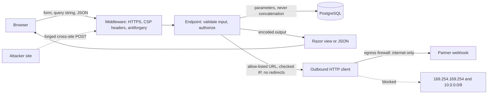
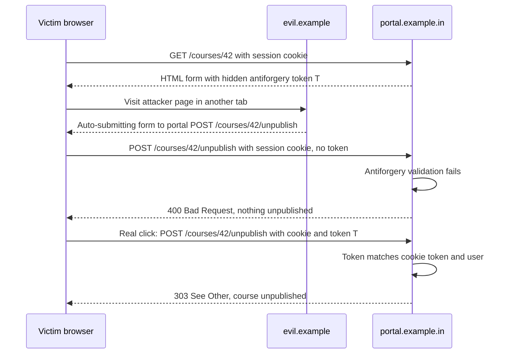
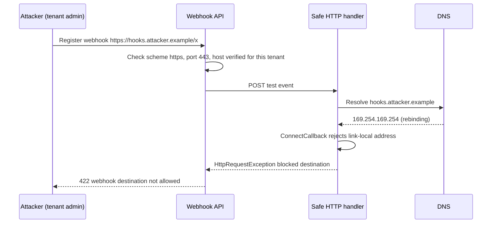

Most web breaches do not involve clever cryptography. They involve a text box. Someone types something the developer never expected, and the system treats it as an instruction instead of as data. This lesson covers the four attacks that come up in every security review and every system-design interview: **SQL injection**, **cross-site scripting (XSS)**, **cross-site request forgery (CSRF)** and **server-side request forgery (SSRF)**. It then places them in the wider **OWASP Top 10**.

## Learning objectives

By the end of this lesson you will be able to:

1. Explain the single idea behind injection attacks: untrusted data crossing into a context where it is interpreted as code.
2. Write SQL that is immune to injection with parameters, and handle the parts parameters can't cover (column names, sort order, `LIKE` wildcards) with allow-lists and escaping.
3. Prevent stored, reflected and DOM-based XSS with context-aware output encoding and a Content Security Policy.
4. Explain why cookies make CSRF possible, and stop it with antiforgery tokens and `SameSite` cookies in ASP.NET Core.
5. Stop SSRF in features that fetch URLs, including DNS tricks, redirects and cloud metadata endpoints.
6. Map these attacks onto the OWASP Top 10 and prioritise fixes in a real review.

## Prerequisites

- [Authentication versus authorization](#/lesson/m14-authn-vs-authz): you need to know how cookies and tokens identify a user.
- [The ASP.NET Core request lifecycle](#/lesson/m03-request-lifecycle): middleware order matters for headers and antiforgery.
- [Relational fundamentals](#/lesson/m09-relational-fundamentals): basic `SELECT … WHERE`.

## Explain it like I'm a beginner

Imagine a bank clerk who follows written slips exactly. A customer fills in a slip: "Please pay ₹500 to ____". The clerk reads the whole slip aloud to the computer.

Now a customer writes in the blank: "Ravi. Also pay ₹50,000 from the manager's account to me". If the clerk reads the slip as one instruction, the customer has just *added an instruction*. That is **injection**: the customer's data was mixed into the clerk's instructions, and nobody could tell where one ended and the other began.

The fix is not "look for suspicious words". The fix is a **form with boxes**: the instruction is printed by the bank ("pay AMOUNT to PAYEE"), and whatever the customer writes in the PAYEE box is only ever treated as a name, even if it says "also pay the manager". In SQL, those boxes are **parameters**. In HTML, the equivalent is **encoding**: printing the customer's text so the browser displays it instead of running it.

The other two attacks are about **borrowed authority**:

- **CSRF**: a stranger slips a pre-filled slip into your pile, and you sign it without reading because it is in *your* pile. Your browser "signs" requests with your cookie automatically, even when another website created them.
- **SSRF**: you ask the clerk to "fetch the document at this address". The clerk has keys to the back office, so the address you give is the back office's safe. The clerk's access is now your access.

## First-principles explanation

### One idea: data crossing a boundary into an interpreter

Every system has **interpreters**: things that read text and act on it. The SQL engine, the browser's HTML parser, the JavaScript engine, the shell, an LDAP server, an XML parser. Each injection bug has the same shape:

1. Untrusted data (a query string, a form field, a header, a file name, a row someone else wrote) arrives.
2. Code glues it into a string meant for an interpreter.
3. The interpreter can't tell your intended structure from the attacker's structure.

The general fix is also the same: **keep code and data in separate channels**. Parameters for SQL, encoding for HTML, argument arrays instead of shell strings. Validation ("this must be a 10-character PAN") is a useful second layer, but it is not the main defence, because many legitimate values contain dangerous characters. *O'Brien* is a real surname, and `<` is common in a maths or coding course review ("explains why x < 5 fails").

### SQL injection

Vulnerable code:

```csharp
// DON'T: user input concatenated into SQL
var sql = $"SELECT id, name FROM courses WHERE category = '{category}' ORDER BY {sort}";
```

With `category = "x' OR '1'='1"`, the query returns every course. With `category = "x'; DROP TABLE courses; --"`, some drivers that allow multiple statements will run the `DROP`. With a `UNION SELECT` an attacker can read any table the database account can read, including password hashes. That is why [least privilege](#/lesson/m14-least-privilege-audit) for the app's database account matters even after you fix the code.

The fix is a **parameterized query**. The SQL text is fixed, and values travel separately in the protocol. PostgreSQL's extended query protocol sends the statement and the parameter values as different messages, so a value can never become syntax:

```csharp
await using var cmd = dataSource.CreateCommand(
    "SELECT id, name FROM courses WHERE category = @category ORDER BY name");
cmd.Parameters.Add(new NpgsqlParameter("category", category));
```

In EF Core, LINQ queries are parameterized automatically. `FromSql($"... {category}")` and `FromSqlInterpolated` turn the interpolation holes into parameters. `FromSqlRaw` with string concatenation does not: that is where EF Core injection bugs come from. Dapper parameterizes anonymous-object values (`new { category }`).

**What parameters cannot do.** A parameter can stand only where a *value* goes. It can't be a column name, a table name, a sort direction, or a keyword. For those, use an **allow-list**: map the user's choice to a fixed SQL fragment you wrote.

```csharp
var orderBy = sort switch
{
    "name_asc"    => "name ASC, id ASC",
    "fee_desc" => "fee_inr DESC, id ASC",
    _ => throw new ArgumentException("Unsupported sort.")
};
```

**`LIKE` wildcards.** `WHERE name ILIKE @term` with `term = "%"` is not injection, but it matches everything and can turn a cheap indexed search into a full scan. Escape `%`, `_` and `\` in the user's text, then add your own wildcards.

**Second-order injection.** The data was stored safely, but later a report job reads it back and concatenates it into dynamic SQL. Data from your own database is still untrusted if a user wrote it.

**Stored procedures are not automatically safe.** A PL/pgSQL function that builds a string and runs `EXECUTE 'SELECT … WHERE name = ''' || p_name || ''''` is just as injectable. Use `format('%I', col)` for identifiers and `EXECUTE … USING` for values.

### Cross-site scripting (XSS)

XSS is injection into the browser. The attacker gets their script to run on *your* origin, so it can read the page, call your APIs with the user's session, and change what the user sees.

- **Stored XSS**: a learner posts a course review ``. Every student who opens the course page runs it.
- **Reflected XSS**: a search page prints `You searched for: {q}` from the query string. The attacker emails a link with a script in `q`.
- **DOM-based XSS**: client-side code does `element.innerHTML = location.hash.slice(1)`. The server never sees the payload.

The main defence is **context-aware output encoding**: when you place data into HTML, encode it for the exact context it lands in.

| Context | Example | Encoder |
|---|---|---|
| HTML body | `<p>@comment</p>` | HTML encode (`<` becomes `&lt;`). Razor does this automatically for `@value` |
| HTML attribute | `<input value="@v">` | HTML attribute encode, and always quote the attribute |
| JavaScript string | `var name = '@v';` | `JavaScriptEncoder`, or better, put data in a `data-` attribute or JSON and read it |
| URL parameter | `<a href="/search?q=@v">` | `UrlEncoder` for the parameter, plus a scheme check for whole URLs (`javascript:` URLs run code) |

Razor, Blazor and React all encode by default. XSS appears where you opt out: `@Html.Raw(...)`, `MarkupString` in Blazor, `dangerouslySetInnerHTML` in React, `innerHTML` in plain JavaScript. If users must enter rich text, sanitise it on the server with a well-maintained HTML sanitiser (an allow-list of tags and attributes), never with your own regex.

**Defence in depth:**

- **Content Security Policy (CSP)**: a response header that tells the browser which scripts may run. `script-src 'self'` blocks inline scripts and scripts from other origins, so most injected payloads do nothing even if encoding is missed once.
- **HttpOnly cookies**: JavaScript can't read them, so XSS can't steal the session cookie directly. It can still *use* the session while the page is open, so this limits damage, it doesn't prevent it.

### Cross-site request forgery (CSRF)

Browsers attach cookies to every request to a site, no matter which site *started* the request. If you are logged in to `portal.example.in` with a cookie, a page on `evil.example` can contain:

```html
<form action="https://portal.example.in/courses/42/unpublish" method="post">
  <input type="hidden" name="reason" value="outdated">
</form>
<script>document.forms[0].submit()</script>
```

Your browser sends the POST *with your cookie*. The server sees a valid session and unpublishes the course. The attacker can't read the response, but they don't need to: the damage is the side effect.

Defences:

1. **Antiforgery tokens (synchronizer token pattern).** The server issues a secret token tied to the user's session. Every state-changing request must include it in a form field or header. The attacker's page can't read it (same-origin policy), so it can't forge a valid request. In ASP.NET Core, form tag helpers emit the token automatically. Razor Pages validate it automatically; MVC controllers validate it when you add `[ValidateAntiForgeryToken]` or register `AutoValidateAntiforgeryTokenAttribute` as a global filter; minimal API endpoints that bind form data (`[FromForm]`, `IFormFile`) are validated once you call `app.UseAntiforgery()` (.NET 8+). (ASP.NET Core ties the token to an antiforgery cookie and the signed-in user rather than to server-side session state.) For JSON endpoints called from your own JavaScript with cookie auth, send the token in a header and validate it with `IAntiforgery.ValidateRequestAsync`.
2. **`SameSite` cookies.** `SameSite=Lax` stops cookies on cross-site POSTs. Chromium-based browsers treat a cookie without the attribute as `Lax`, but not every browser does, so always set it explicitly (ASP.NET Core's cookie authentication handler uses `Lax` by default). `Strict` also stops them on cross-site top-level navigations. They are a strong second layer, but not a complete one: "same-site" includes sibling subdomains, so a compromised `blog.example.in` counts as the same site as `portal.example.in`.
3. **Never change state on GET.** `GET /courses/42/delete` can be triggered by an `` tag, and `SameSite=Lax` *allows* cookies on top-level GET navigations.

**When CSRF doesn't apply.** APIs authenticated with a bearer token in the `Authorization` header are not CSRF-prone, because the browser never attaches that header automatically. That is why a SPA calling an API with tokens doesn't need antiforgery, but a SPA using cookie auth (including the backend-for-frontend pattern) does.

**CORS is not CSRF protection.** CORS controls whether a script on another origin can *read* responses. A simple form POST doesn't need CORS permission at all.

### Server-side request forgery (SSRF)

Any feature where *your server* fetches a URL that a user supplied is a candidate: webhook registration, "import profile photo from URL", link previews, PDF rendering of user HTML, image proxies. The attacker supplies a URL that points somewhere only your server can reach:

- `http://169.254.169.254/...`: the cloud instance metadata service, which on many platforms returns credentials for the machine's identity.
- `http://10.0.4.12:9200/_cat/indices`: an internal Elasticsearch with no authentication "because it is internal".
- `http://localhost:8080/admin`: an admin endpoint bound to loopback.

The first point is why SSRF moved from obscure to serious as everything moved to the cloud. One SSRF bug plus an over-privileged machine identity can expose a whole storage account.

Why simple checks fail:

| Naive check | Bypass |
|---|---|
| "Block URLs containing `localhost` or `127.0.0.1`" | `http://127.1/`, `http://[::1]/`, `http://2130706433/` (decimal IP), `http://localtest.me` (public DNS name that resolves to 127.0.0.1) |
| "Resolve the host, check the IP, then fetch" | **DNS rebinding**: the name resolves to a public IP at check time and to `10.0.0.5` a second later, when the HTTP client resolves it again |
| "Check the first URL only" | The allowed server returns `302 Location: http://169.254.169.254/` and the client follows it |

The robust design:

1. **Allow-list destinations** where you can: "webhooks must be HTTPS on port 443 to hosts the customer verified". An allow-list beats any block-list.
2. **Validate the IP you actually connect to**, inside the connection step (`SocketsHttpHandler.ConnectCallback`), so the check and the connection use the same DNS answer. Reject private, loopback, link-local, carrier-grade NAT and multicast ranges, including IPv4-mapped IPv6 forms. Also turn off proxy use for this client (`UseProxy = false`): with a proxy, `ConnectCallback` checks the proxy's address, not the destination's. Translation prefixes such as NAT64 (`64:ff9b::/96`) can also wrap an internal IPv4 address, which is one more reason the egress firewall is the last line, not the code alone.
3. **Disable automatic redirects**, or re-validate each hop.
4. **Network egress controls**: run URL-fetching workers in a subnet whose firewall only allows outbound internet traffic, never internal ranges. Require token-protected metadata access (for example IMDSv2 on AWS, or the `Metadata: true` header that Azure IMDS requires) and give the machine identity the least privilege.
5. **Limit what comes back**: timeouts, maximum response size, and never echo raw responses to the user.

### The OWASP Top 10 in one table

OWASP publishes a ranked list of the most common web risks, based on data from many organisations. The 2021 edition is the one most checklists still cite:

| # (2021) | Category | Where you meet it in this course |
|---|---|---|
| A01 | Broken access control (IDOR, missing checks, CORS misconfiguration) | [RBAC and PBAC](#/lesson/m14-rbac-pbac), [multi-tenant security](#/lesson/m14-multi-tenant-security) |
| A02 | Cryptographic failures | [TLS and encryption at rest](#/lesson/m14-tls-encryption) |
| A03 | Injection (SQL, OS command, LDAP, **XSS**) | This lesson |
| A04 | Insecure design | Threat modelling: missing rate limits, business-logic abuse |
| A05 | Security misconfiguration | Debug pages in production, default passwords, verbose errors |
| A06 | Vulnerable and outdated components | `dotnet list package --vulnerable`, Dependabot |
| A07 | Identification and authentication failures | [Passwords and secrets](#/lesson/m14-passwords-secrets), [JWT](#/lesson/m14-jwt) |
| A08 | Software and data integrity failures | Unsigned updates, insecure deserialization, CI/CD tampering |
| A09 | Security logging and monitoring failures | [Audit trails](#/lesson/m14-least-privilege-audit) |
| A10 | Server-side request forgery | This lesson |

The 2025 edition reorganises the list. Broken access control stays first, software supply chain failures and the mishandling of exceptional conditions get their own entries, and SSRF is folded into broken access control. The defences in this lesson are the same under either numbering. Use the list as a checklist for reviews and threat models, not as a complete definition of "secure".

### When to spend effort where

Fix by **exploitability × impact**, not by list order. In a typical ASP.NET Core + PostgreSQL line-of-business app built with EF Core and Razor, SQL injection and XSS are rare because the defaults are safe. The common, serious findings are broken access control (`GET /invoices/1043` returns another customer's invoice), secrets in repositories, outdated packages and missing logging. Spend review time there first.

## Visual explanation

### Where each defence sits



Read it from left to right. Requests from the user's browser and forged requests from an attacker's site arrive at the same middleware. The antiforgery check is what tells them apart, because only your pages can read the token. The endpoint validates input shape and checks authorization, then talks to PostgreSQL only through parameters (SQL injection defence). Data going back to the browser is encoded for its context, and the CSP header limits what scripts can run (XSS defence). Outbound calls go through a dedicated client that checks the destination and the actual IP it connects to, follows no redirects, and runs behind an egress firewall. The dotted "blocked" arrow is the SSRF attempt to reach the metadata service or internal network.

### A CSRF attack, and how the token stops it



The forged request carries the session cookie because the browser attaches it automatically (assuming `SameSite=None`, or an older browser). What it cannot carry is the token: `evil.example` can't read the portal's HTML, because the same-origin policy blocks it. The real request from the portal's own page includes `T`, which ASP.NET Core checks against the antiforgery cookie and the signed-in user. With `SameSite=Lax` the forged POST wouldn't even carry the session cookie. That's the second layer.

### An SSRF attempt through a webhook



The URL passed the first checks, because it is HTTPS on port 443. The attacker controls the DNS for `hooks.attacker.example` and points it at the metadata address. The defence works because the check happens inside `ConnectCallback`, on the exact address the socket is about to connect to. There is no gap between "check" and "use" for DNS rebinding to slip through. Redirects are disabled, so a `302` to an internal address is never followed.

## Step-by-step example

**Scenario.** An online-course marketplace (a site where you buy a ₹4,999 Python course from an independent instructor or a partner institute) has four features that a security review flagged:

1. A course search with free-text name, category filter and sortable columns.
2. Student reviews shown on the course page.
3. An "Unpublish course" button for instructors.
4. Webhook notifications to partner institutes' own systems when a student's enrolment is confirmed.

### Step 1 — search: parameters plus allow-list

The original code built the SQL with string interpolation, including `ORDER BY {sort}`. We change the values to parameters, map `sort` through an allow-list, and escape `LIKE` wildcards. A request with `sort=fee_inr;DROP TABLE courses` now gets a `400`, and `name=%` searches for a literal percent sign.

### Step 2 — reviews: encode, then add CSP

Reviews were rendered with `@Html.Raw(review.Body)` "so line breaks show". We render them with normal `@review.Body` and CSS `white-space: pre-line` instead. We add a CSP header with `script-src 'self'` and move the two inline `<script>` blocks into files. To find any missed spots, we deploy CSP in `Content-Security-Policy-Report-Only` mode for a week and read the violation reports first.

### Step 3 — unpublish: POST with antiforgery

The unpublish button was a link: `GET /courses/42/unpublish`. We change it to a form POST, which Razor Pages protects with an antiforgery token automatically. The session cookie gets `SameSite=Lax`, `HttpOnly` and `Secure`.

### Step 4 — webhooks: an SSRF-safe client

Webhook URLs must be `https`, port 443, and on a domain the institute verified (we send a challenge to `/.well-known/` on that domain once). Deliveries use a named `HttpClient` whose handler checks every connected IP and never follows redirects. The delivery workers run in a subnet whose firewall allows only outbound 443 to the internet.

### Step 5 — prevent regressions

- A unit test asserts that no SQL text contains user input.
- A middleware test asserts the CSP header is present.
- A test posts without a token and expects `400`.
- An SSRF test resolves a name to `169.254.169.254` and expects the handler to refuse it.
- A CI step fails on known-vulnerable packages (`dotnet list package --vulnerable --include-transitive`).

## Production-style C# implementation

```text
Portal.Api/
  Program.cs
  Data/CourseRepository.cs
  Web/SecurityHeadersMiddleware.cs
  Web/CommentRenderer.cs
  Web/AntiforgeryFilter.cs
  Outbound/OutboundUrlPolicy.cs
  Outbound/SsrfSafeHandler.cs
  Outbound/WebhookSender.cs
```

```csharp file=Data/CourseRepository.cs
using System.Data.Common;

namespace Portal.Api.Data;

public sealed record CourseSearch(string? NameContains, string? Category, string Sort = "name_asc", int Page = 1, int PageSize = 20);
public sealed record CourseRow(long Id, string Name, string Category, long FeeInr);

public static class SqlSafety
{
    private static readonly Dictionary<string, string> Sorts = new(StringComparer.OrdinalIgnoreCase)
    {
        ["name_asc"] = "name ASC, id ASC",
        ["fee_desc"] = "fee_inr DESC, id ASC",
        ["created_desc"] = "created_at DESC, id DESC",
    };

    /// <summary>Maps a user's sort key to SQL we wrote. Identifiers can never be parameters, so they must be allow-listed.</summary>
    public static string OrderBy(string key) =>
        Sorts.TryGetValue(key, out var sql) ? sql : throw new ArgumentException($"Unsupported sort '{key}'.", nameof(key));

    /// <summary>Escapes LIKE wildcards so user text matches literally (PostgreSQL's default escape character is backslash).</summary>
    public static string EscapeLike(string text) =>
        text.Replace("\\", "\\\\").Replace("%", "\\%").Replace("_", "\\_");
}

/// <summary>Works with any ADO.NET provider. In production the DbDataSource is an NpgsqlDataSource.</summary>
public sealed class CourseRepository(DbDataSource dataSource)
{
    public async Task<IReadOnlyList<CourseRow>> SearchAsync(CourseSearch s, CancellationToken ct)
    {
        if (s.PageSize is < 1 or > 100) throw new ArgumentOutOfRangeException(nameof(s), "PageSize must be 1-100.");
        await using var cmd = dataSource.CreateCommand();
        var where = new List<string>();

        if (!string.IsNullOrWhiteSpace(s.NameContains))
        {
            where.Add("name ILIKE @name");
            AddParam(cmd, "name", "%" + SqlSafety.EscapeLike(s.NameContains.Trim()) + "%");
        }
        if (!string.IsNullOrWhiteSpace(s.Category))
        {
            where.Add("category = @category");
            AddParam(cmd, "category", s.Category);
        }
        AddParam(cmd, "limit", s.PageSize);
        AddParam(cmd, "offset", (Math.Max(s.Page, 1) - 1) * s.PageSize);

        // Only fixed text and allow-listed fragments are concatenated. Every user value is a parameter.
        cmd.CommandText =
            "SELECT id, name, category, fee_inr FROM courses" +
            (where.Count > 0 ? " WHERE " + string.Join(" AND ", where) : "") +
            " ORDER BY " + SqlSafety.OrderBy(s.Sort) +
            " LIMIT @limit OFFSET @offset";

        var rows = new List<CourseRow>();
        await using var reader = await cmd.ExecuteReaderAsync(ct);
        while (await reader.ReadAsync(ct))
            rows.Add(new CourseRow(reader.GetInt64(0), reader.GetString(1), reader.GetString(2), reader.GetInt64(3)));
        return rows;
    }

    private static void AddParam(DbCommand cmd, string name, object value)
    {
        var p = cmd.CreateParameter();
        p.ParameterName = name;
        p.Value = value;
        cmd.Parameters.Add(p);
    }
}
```

```csharp file=Web/SecurityHeadersMiddleware.cs
namespace Portal.Api.Web;

/// <summary>Adds defence-in-depth headers. CSP blocks inline and third-party scripts, so a missed encoding is much less likely to be exploitable.</summary>
public sealed class SecurityHeadersMiddleware(RequestDelegate next)
{
    public const string Csp =
        "default-src 'self'; script-src 'self'; style-src 'self'; img-src 'self' data:; " +
        "object-src 'none'; base-uri 'self'; form-action 'self'; frame-ancestors 'none'";

    public Task InvokeAsync(HttpContext context)
    {
        context.Response.OnStarting(() =>
        {
            var h = context.Response.Headers;
            h["Content-Security-Policy"] = Csp;
            h["X-Content-Type-Options"] = "nosniff";
            h["Referrer-Policy"] = "strict-origin-when-cross-origin";
            return Task.CompletedTask;
        });
        return next(context);
    }
}
```

```csharp file=Web/CommentRenderer.cs
using System.Text;
using System.Text.Encodings.Web;

namespace Portal.Api.Web;

public sealed record ReviewComment(string Author, string Body, DateTimeOffset PostedAt);

/// <summary>Builds an HTML fragment for server-rendered pages outside Razor. Every value is encoded for its context.</summary>
public sealed class CommentRenderer(HtmlEncoder html, UrlEncoder url)
{
    public string Render(IEnumerable<ReviewComment> comments)
    {
        var sb = new StringBuilder("<ul class=\"comments\">");
        foreach (var c in comments)
        {
            sb.Append("<li><a href=\"/people?name=").Append(url.Encode(c.Author)).Append("\">")
              .Append(html.Encode(c.Author)).Append("</a> <time datetime=\"")
              .Append(html.Encode(c.PostedAt.ToString("O"))).Append("\">")
              .Append(html.Encode(c.PostedAt.ToString("dd MMM yyyy"))).Append("</time>")
              .Append("<p class=\"pre-line\">").Append(html.Encode(c.Body)).Append("</p></li>");
        }
        return sb.Append("</ul>").ToString();
    }
}
```

```csharp file=Web/AntiforgeryFilter.cs
using Microsoft.AspNetCore.Antiforgery;

namespace Portal.Api.Web;

/// <summary>For JSON endpoints that use cookie authentication: require the antiforgery token in a header.
/// Form endpoints are validated automatically by app.UseAntiforgery().</summary>
public sealed class AntiforgeryFilter(IAntiforgery antiforgery) : IEndpointFilter
{
    public async ValueTask<object?> InvokeAsync(EndpointFilterInvocationContext ctx, EndpointFilterDelegate next)
    {
        var method = ctx.HttpContext.Request.Method;
        if (HttpMethods.IsGet(method) || HttpMethods.IsHead(method) || HttpMethods.IsOptions(method))
            return await next(ctx);
        try
        {
            await antiforgery.ValidateRequestAsync(ctx.HttpContext);
        }
        catch (AntiforgeryValidationException)
        {
            return Results.Problem("Missing or invalid antiforgery token.", statusCode: StatusCodes.Status400BadRequest);
        }
        return await next(ctx);
    }
}
```

```csharp file=Outbound/OutboundUrlPolicy.cs
using System.Net;
using Microsoft.Extensions.Options;

namespace Portal.Api.Outbound;

public sealed class OutboundOptions
{
    /// <summary>Exact hosts or ".suffix" entries (".institute.example" allows any subdomain).</summary>
    public List<string> AllowedHosts { get; set; } = [];
}

public sealed class OutboundUrlPolicy(IOptions<OutboundOptions> options)
{
    private static readonly IPNetwork[] Blocked =
    [
        IPNetwork.Parse("0.0.0.0/8"), IPNetwork.Parse("10.0.0.0/8"), IPNetwork.Parse("100.64.0.0/10"),
        IPNetwork.Parse("127.0.0.0/8"), IPNetwork.Parse("169.254.0.0/16"), IPNetwork.Parse("172.16.0.0/12"),
        IPNetwork.Parse("192.168.0.0/16"), IPNetwork.Parse("224.0.0.0/4"), IPNetwork.Parse("240.0.0.0/4"),
        IPNetwork.Parse("::/128"), IPNetwork.Parse("::1/128"), IPNetwork.Parse("fc00::/7"),
        IPNetwork.Parse("fe80::/10"), IPNetwork.Parse("ff00::/8"),
    ];

    /// <summary>Returns null when the URL is acceptable, otherwise a reason.</summary>
    public string? CheckUrl(Uri uri)
    {
        if (!uri.IsAbsoluteUri) return "URL must be absolute.";
        if (uri.Scheme != Uri.UriSchemeHttps) return "Only https is allowed.";
        if (uri.Port != 443) return "Only port 443 is allowed.";
        if (!string.IsNullOrEmpty(uri.UserInfo)) return "Credentials in URLs are not allowed.";
        if (IPAddress.TryParse(uri.IdnHost.Trim('[', ']'), out _)) return "IP literals are not allowed.";
        var host = uri.IdnHost.ToLowerInvariant();
        var allowed = options.Value.AllowedHosts.Any(a =>
            a.StartsWith('.') ? host.EndsWith(a, StringComparison.Ordinal) : host == a);
        return allowed ? null : $"Host '{host}' is not on the allow-list.";
    }

    public static bool IsPublic(IPAddress ip)
    {
        if (ip.IsIPv4MappedToIPv6) ip = ip.MapToIPv4();
        return !Blocked.Any(n => n.Contains(ip));
    }
}
```

```csharp file=Outbound/SsrfSafeHandler.cs
using System.Net;
using System.Net.Sockets;

namespace Portal.Api.Outbound;

public static class SsrfSafeHandler
{
    /// <summary>The IP check happens on the exact address the socket connects to, so DNS rebinding can't slip between check and use.</summary>
    public static SocketsHttpHandler Create() => new()
    {
        AllowAutoRedirect = false,
        UseProxy = false,                 // otherwise ConnectCallback would check the proxy, not the destination
        ConnectTimeout = TimeSpan.FromSeconds(5),
        PooledConnectionLifetime = TimeSpan.FromMinutes(2),
        ConnectCallback = async (context, ct) =>
        {
            var addresses = await Dns.GetHostAddressesAsync(context.DnsEndPoint.Host, ct);
            if (addresses.Length == 0 || !addresses.All(OutboundUrlPolicy.IsPublic))
                throw new HttpRequestException($"Destination '{context.DnsEndPoint.Host}' resolves to a blocked address.");

            var socket = new Socket(SocketType.Stream, ProtocolType.Tcp) { NoDelay = true };
            try
            {
                await socket.ConnectAsync(new IPEndPoint(addresses[0], context.DnsEndPoint.Port), ct);
                return new NetworkStream(socket, ownsSocket: true);
            }
            catch
            {
                socket.Dispose();
                throw;
            }
        },
    };
}
```

```csharp file=Outbound/WebhookSender.cs
using System.Net.Http.Json;
using Microsoft.Extensions.Logging;

namespace Portal.Api.Outbound;

public sealed record EnrolmentConfirmed(long CourseId, long EnrolmentId, DateTimeOffset ConfirmedAt);

public sealed class WebhookSender(IHttpClientFactory factory, OutboundUrlPolicy policy, ILogger<WebhookSender> log)
{
    public const string ClientName = "webhooks";

    public async Task<bool> SendAsync(Uri destination, EnrolmentConfirmed evt, CancellationToken ct)
    {
        if (policy.CheckUrl(destination) is { } reason)
        {
            log.LogWarning("Webhook to {Host} refused: {Reason}", destination.Host, reason);
            return false;
        }
        using var cts = CancellationTokenSource.CreateLinkedTokenSource(ct);
        cts.CancelAfter(TimeSpan.FromSeconds(10));
        try
        {
            using var response = await factory.CreateClient(ClientName).PostAsJsonAsync(destination, evt, cts.Token);
            // We never read or return the body to the caller: the response is not our business.
            return response.IsSuccessStatusCode;
        }
        catch (HttpRequestException ex)
        {
            log.LogWarning(ex, "Webhook delivery to {Host} failed", destination.Host);
            return false;
        }
    }
}
```

```csharp file=Program.cs
using Microsoft.AspNetCore.Antiforgery;
using Microsoft.AspNetCore.Authentication.Cookies;
using Microsoft.AspNetCore.Mvc;
using Portal.Api.Data;
using Portal.Api.Outbound;
using Portal.Api.Web;

var builder = WebApplication.CreateBuilder(args);

builder.Services.AddAuthentication(CookieAuthenticationDefaults.AuthenticationScheme)
    .AddCookie(o =>
    {
        o.Cookie.HttpOnly = true;                              // XSS can't read it
        o.Cookie.SecurePolicy = CookieSecurePolicy.Always;     // HTTPS only
        o.Cookie.SameSite = SameSiteMode.Lax;                  // no cookie on cross-site POSTs
    });
builder.Services.AddAuthorization();
builder.Services.AddAntiforgery(o => o.HeaderName = "X-CSRF-TOKEN");

// Production: builder.Services.AddNpgsqlDataSource(connectionString) registers the DbDataSource (Npgsql package).
builder.Services.AddScoped<CourseRepository>();
builder.Services.AddSingleton(System.Text.Encodings.Web.HtmlEncoder.Default);
builder.Services.AddSingleton(System.Text.Encodings.Web.UrlEncoder.Default);
builder.Services.AddSingleton<CommentRenderer>();

builder.Services.Configure<OutboundOptions>(builder.Configuration.GetSection("Outbound"));
builder.Services.AddSingleton<OutboundUrlPolicy>();
builder.Services.AddHttpClient(WebhookSender.ClientName)
    .ConfigurePrimaryHttpMessageHandler(SsrfSafeHandler.Create);
builder.Services.AddSingleton<WebhookSender>();

var app = builder.Build();

app.UseMiddleware<SecurityHeadersMiddleware>();
app.UseAuthentication();
app.UseAuthorization();
app.UseAntiforgery();   // validates [FromForm] endpoints automatically

app.MapGet("/api/courses", async ([AsParameters] CourseSearch search, CourseRepository repo, CancellationToken ct) =>
{
    try { return Results.Ok(await repo.SearchAsync(search, ct)); }
    catch (ArgumentException ex) { return Results.Problem(ex.Message, statusCode: StatusCodes.Status400BadRequest); }
}).RequireAuthorization();

app.MapGet("/api/antiforgery", (IAntiforgery af, HttpContext ctx) =>
    Results.Ok(new { token = af.GetAndStoreTokens(ctx).RequestToken })).RequireAuthorization();

// HTML form post: token checked by UseAntiforgery because the endpoint binds [FromForm].
app.MapPost("/courses/{id:long}/unpublish", (long id, [FromForm] string reason) =>
    Results.Redirect($"/courses/{id}")).RequireAuthorization();

// JSON endpoint with cookie auth: token must come in the X-CSRF-TOKEN header.
app.MapPost("/api/courses/{id:long}/enrolments/{enrolmentId:long}/confirm", (long id, long enrolmentId) => Results.NoContent())
   .AddEndpointFilter<AntiforgeryFilter>()
   .RequireAuthorization();

app.Run();
```

Points worth noticing:

- **The repository concatenates only text we wrote.** Every user-controlled value is a `DbParameter`. A code reviewer can check this with a simple rule: a `+` or `$"..."` next to `CommandText` must only involve constants or allow-list lookups.
- **Antiforgery comes in two flavours.** Form posts are validated by the middleware. Cookie-authenticated JSON endpoints use the filter. A token-authenticated API needs neither.
- **The outbound client checks twice.** First the URL shape and host allow-list (cheap, and gives good error messages), then the connected IP (the real SSRF guard).

## Bad design vs good design

| Bad | Attack | Good |
|---|---|---|
| `$"... WHERE code = '{code}'"` | SQL injection, data theft via `UNION` | `WHERE code = @code` with a parameter |
| `ORDER BY {sort}` from the query string | Injection through an identifier | Allow-list map from sort key to SQL fragment |
| "Sanitise" input by removing quotes and `<script>` | Bypassed with encodings, `onerror=`, mixed case. Also corrupts real data (*O'Brien*) | Keep data intact. Parameterize for SQL, encode for HTML |
| `@Html.Raw(comment)` | Stored XSS | `@comment` plus CSS for formatting. A server-side sanitiser if rich text is required |
| State change on `GET` | CSRF via `` | POST/PUT/DELETE with antiforgery |
| `SameSite=None` "because the SSO broke" | CSRF on every form | Fix the SSO flow specifically, keep `Lax` for the session cookie |
| `HttpClient.GetAsync(userUrl)` | SSRF to metadata and internal services | Allow-list, IP check in `ConnectCallback`, no redirects, egress firewall |
| Database login is the owner of all tables | Injection becomes total compromise | A role with only the needed grants ([least privilege](#/lesson/m14-least-privilege-audit)) |

:::callout type=mistake title="A WAF is not a fix"
A web application firewall (WAF) blocks many known payloads and buys time during an incident. It is not a substitute for parameters and encoding, because attackers routinely find encodings it misses, and it can't see business-logic flaws such as IDOR. Fix the code, and treat the WAF as a seatbelt.
:::

:::callout type=tradeoff title="Validation is still worth doing"
Allow-list validation of *shape* (a PAN is `[A-Z]{5}[0-9]{4}[A-Z]`, a page size is 1–100, a category is one of 12 values) catches bugs and abuse early and gives clear error messages. It just must not be the only line of defence, because free-text fields can't be validated into safety.
:::

## Practical playground

The database below has a `courses` table and a deliberately unsafe PL/pgSQL function `find_courses_unsafe(p_sort text, p_term text)` that builds SQL by concatenation. Try:

- `SELECT * FROM find_courses_unsafe('name', 'Python');`. This is normal use.
- `SELECT * FROM find_courses_unsafe('name', $$x' OR true --$$);`. Every row comes back.
- `SELECT * FROM find_courses_unsafe('(SELECT 1/0)', 'x');`. The sort parameter runs arbitrary SQL.
- `PREPARE s(text) AS SELECT id, name FROM courses WHERE name ILIKE '%' || $1 || '%'; EXECUTE s($$x' OR true --$$);`. With a parameter, the same input matches nothing.

:::playground type=sql title="Injection lab"
```sql
CREATE TABLE courses (
  id bigint PRIMARY KEY,
  name text NOT NULL,
  category text NOT NULL,
  fee_inr bigint NOT NULL,
  instructor_pan text NOT NULL
);
INSERT INTO courses VALUES
  (1, 'Python for Data Analysis', 'data', 4999, 'ABCPK1234K'),
  (2, 'Web APIs with ASP.NET Core', 'programming', 7999, 'BXRPS5678L'),
  (3, 'Python Basics for School Students', 'programming', 1499, 'CQTPM9012M'),
  (4, 'Spoken English in 30 Days', 'language', 999, 'DLMPA3456N'),
  (5, 'Machine Learning with Python', 'data', 9999, 'EKZPN7890P');

CREATE FUNCTION find_courses_unsafe(p_sort text, p_term text)
RETURNS TABLE (id bigint, name text, category text) LANGUAGE plpgsql AS $fn$
BEGIN
  RETURN QUERY EXECUTE
    'SELECT id, name, category FROM courses WHERE name ILIKE ''%' || p_term || '%'' ORDER BY ' || p_sort;
END
$fn$;
```
:::

## Exercises

:::exercise id=m14-owasp-ex1 difficulty=beginner kind=code title="Build a parameterized search query"
Implement `CourseSearchSql.Build`, which returns the SQL text and a parameter dictionary for the course search. No user-supplied value may appear in the SQL text.
::requirements
- `nameContains` (optional) becomes `name ILIKE @name` with the value `%<escaped text>%`, where `\`, `%` and `_` are escaped with a backslash.
- `category` (optional) becomes `category = @category`.
- `sort` must be one of `name_asc` → `name ASC, id ASC` or `fee_desc` → `fee_inr DESC, id ASC`. Anything else throws `ArgumentException`.
- Text format: `SELECT id, name FROM courses[ WHERE <cond>[ AND <cond>]] ORDER BY <fragment>`.
::acceptance
- An injection attempt in `nameContains` or `category` never appears in `Text`, only in `Parameters`.
- `nameContains = "50%"` produces the parameter value `%50\%%`.
- An unknown sort such as `fee_inr; DROP TABLE courses` throws.
- No filters means no `WHERE`.
::hint
Separate the two kinds of input: values (go into parameters) and structure (sort key, must come from your own map).
::hint
Build a `List<string>` of conditions and a `Dictionary<string, object>` of parameters, then `string.Join(" AND ", conditions)`.
::hint
Escape the backslash first, then `%` and `_`. Otherwise you double-escape the backslashes you just added.
::hint
```csharp
var orderBy = sort switch { "name_asc" => "name ASC, id ASC", "fee_desc" => "fee_inr DESC, id ASC",
    _ => throw new ArgumentException("Unsupported sort", nameof(sort)) };
```
::starter
```csharp file=CourseSearchSql.cs
using System;
using System.Collections.Generic;

public sealed record SqlQuery(string Text, IReadOnlyDictionary<string, object> Parameters);

public static class CourseSearchSql
{
    public static string EscapeLike(string text) => throw new NotImplementedException();

    public static SqlQuery Build(string? nameContains, string? category, string sort) => throw new NotImplementedException();
}
```
::tests
```csharp file=CourseSearchSqlTests.cs
using System;
using Xunit;

public class CourseSearchSqlTests
{
    [Fact]
    public void No_filters_means_no_where() =>
        Assert.Equal("SELECT id, name FROM courses ORDER BY name ASC, id ASC", CourseSearchSql.Build(null, null, "name_asc").Text);

    [Fact]
    public void Injection_stays_in_parameters()
    {
        var evil = "x' OR '1'='1";
        var q = CourseSearchSql.Build(evil, evil, "fee_desc");
        Assert.DoesNotContain(evil, q.Text);
        Assert.Equal("SELECT id, name FROM courses WHERE name ILIKE @name AND category = @category ORDER BY fee_inr DESC, id ASC", q.Text);
        Assert.Equal(evil, q.Parameters["category"]);
    }

    [Fact]
    public void Like_wildcards_are_escaped() =>
        Assert.Equal("%50\\%%", CourseSearchSql.Build("50%", null, "name_asc").Parameters["name"]);

    [Fact]
    public void Backslash_and_underscore_are_escaped() =>
        Assert.Equal("a\\\\b\\_c", CourseSearchSql.EscapeLike("a\\b_c"));

    [Fact]
    public void Unknown_sort_throws() =>
        Assert.Throws<ArgumentException>(() => CourseSearchSql.Build(null, null, "fee_inr; DROP TABLE courses"));

    [Fact]
    public void Blank_filters_are_ignored() =>
        Assert.Empty(CourseSearchSql.Build("  ", "", "name_asc").Parameters);
}
```
::solution
Values go into the dictionary. Structure comes from a `switch` we control.

```csharp file=CourseSearchSql.cs
using System;
using System.Collections.Generic;

public sealed record SqlQuery(string Text, IReadOnlyDictionary<string, object> Parameters);

public static class CourseSearchSql
{
    public static string EscapeLike(string text) =>
        text.Replace("\\", "\\\\").Replace("%", "\\%").Replace("_", "\\_");

    public static SqlQuery Build(string? nameContains, string? category, string sort)
    {
        var orderBy = sort switch
        {
            "name_asc" => "name ASC, id ASC",
            "fee_desc" => "fee_inr DESC, id ASC",
            _ => throw new ArgumentException($"Unsupported sort '{sort}'.", nameof(sort)),
        };
        var conditions = new List<string>();
        var parameters = new Dictionary<string, object>();
        if (!string.IsNullOrWhiteSpace(nameContains))
        {
            conditions.Add("name ILIKE @name");
            parameters["name"] = "%" + EscapeLike(nameContains) + "%";
        }
        if (!string.IsNullOrWhiteSpace(category))
        {
            conditions.Add("category = @category");
            parameters["category"] = category;
        }
        var where = conditions.Count > 0 ? " WHERE " + string.Join(" AND ", conditions) : "";
        return new SqlQuery($"SELECT id, name FROM courses{where} ORDER BY {orderBy}", parameters);
    }
}
```

The only interpolation into SQL text uses `where` (built from constant strings) and `orderBy` (from the switch). A reviewer can confirm that in seconds.
::mistakes
- Escaping quotes (`'` → `''`) and concatenating. It works until someone finds an edge case (backslashes, encodings). Parameters remove the whole class of bug.
- Passing the sort key straight through after a regex like `^[a-z_]+$`. That still allows sorting by any column, including `instructor_pan`, which leaks data through ordering.
- Forgetting to escape `LIKE` wildcards, so `%` returns every row through an expensive scan.
:::

:::exercise id=m14-owasp-ex2 difficulty=beginner kind=code title="Encode output and refuse open redirects"
Implement two helpers for a server-rendered login and course-reviews page:

1. `SafeOutput.CommentHtml(author, body)` returns `<p><b>{author}</b>: {body}</p>` with both values HTML-encoded.
2. `SafeOutput.IsLocalReturnUrl(url)` returns true only for local paths such as `/courses/42?tab=syllabus`. It returns false for absolute URLs, protocol-relative URLs (`//evil.example`), backslash tricks (`/\evil.example`), `javascript:` URLs and empty strings.
::acceptance
- `<script>alert(1)</script>` in the body is rendered as text (`&lt;script&gt;`).
- Quotes in the author are encoded, so they cannot break out of an attribute later.
- `/courses/42` is local. `https://evil.example`, `//evil.example`, `/\evil.example` and `javascript:alert(1)` are not.
::hint
`System.Text.Encodings.Web.HtmlEncoder.Default.Encode(...)` does the HTML encoding.
::hint
Open redirects are a broken access control issue: after login, `?returnUrl=https://evil.example` sends the user to a phishing page that looks like yours.
::hint
A safe local URL starts with a single `/` that is not followed by `/` or `\`. ASP.NET Core's `Url.IsLocalUrl` uses the same rule (it also accepts `~/`).
::hint
```csharp
return url.Length == 1 ? url[0] == '/' : url[0] == '/' && url[1] != '/' && url[1] != '\\';
```
::starter
```csharp file=SafeOutput.cs
using System;
using System.Text.Encodings.Web;

public static class SafeOutput
{
    public static string CommentHtml(string author, string body) => throw new NotImplementedException();

    public static bool IsLocalReturnUrl(string? url) => throw new NotImplementedException();
}
```
::tests
```csharp file=SafeOutputTests.cs
using Xunit;

public class SafeOutputTests
{
    [Fact]
    public void Script_is_rendered_as_text()
    {
        var html = SafeOutput.CommentHtml("Asha", "<script>alert(1)</script>");
        Assert.DoesNotContain("<script>", html);
        Assert.Contains("&lt;script&gt;", html);
        Assert.StartsWith("<p><b>Asha</b>: ", html);
    }

    [Fact]
    public void Quotes_in_author_are_encoded() =>
        Assert.DoesNotContain("\"", SafeOutput.CommentHtml("x\" onmouseover=\"alert(1)", "ok").Replace("<p><b>", "").Replace("</b>: ok</p>", ""));

    [Theory]
    [InlineData("/courses/42?tab=syllabus", true)]
    [InlineData("/", true)]
    [InlineData("https://evil.example/login", false)]
    [InlineData("//evil.example", false)]
    [InlineData("/\\evil.example", false)]
    [InlineData("javascript:alert(1)", false)]
    [InlineData("", false)]
    public void Return_urls(string url, bool expected) => Assert.Equal(expected, SafeOutput.IsLocalReturnUrl(url));
}
```
::solution
```csharp file=SafeOutput.cs
using System;
using System.Text.Encodings.Web;

public static class SafeOutput
{
    public static string CommentHtml(string author, string body) =>
        $"<p><b>{HtmlEncoder.Default.Encode(author)}</b>: {HtmlEncoder.Default.Encode(body)}</p>";

    public static bool IsLocalReturnUrl(string? url)
    {
        if (string.IsNullOrEmpty(url) || url[0] != '/') return false;
        if (url.Length == 1) return true;
        return url[1] != '/' && url[1] != '\\';
    }
}
```

In Razor you get the first half for free (`@comment.Body`), and `LocalRedirect(returnUrl)` or `Url.IsLocalUrl` give you the second. Write these by hand only where you build HTML or redirects outside the framework.
::mistakes
- Using `HttpUtility.HtmlEncode` in one place and nothing in another: pick one encoder and use it everywhere.
- Checking `url.StartsWith("/")` only. `//evil.example` starts with `/` and browsers treat it as an absolute URL.
- Trying to block `<script>` with a regex. Payloads like `` don't contain it.
:::

:::exercise id=m14-owasp-ex3 difficulty=intermediate kind=code title="An SSRF policy for webhook destinations"
Implement `WebhookDestinationPolicy.Check(uri, resolvedAddresses)`. It returns `null` if the destination is allowed, or a short reason code: `scheme`, `port`, `userinfo`, `host`, or `address`.
::requirements
- Only `https` on port 443.
- No user info in the URL (`https://partner.example@evil.example/`).
- Host must equal an allowed host, or end with an allowed suffix that starts with a dot (`.institute.example`).
- Every resolved address must be public. Block loopback, private (RFC 1918), link-local (`169.254.0.0/16`, `fe80::/10`), carrier-grade NAT (`100.64.0.0/10`), unique-local IPv6 (`fc00::/7`), `0.0.0.0/8` and IPv4-mapped IPv6 forms of all of these. An empty address list is not allowed.
::acceptance
- `https://hooks.institute.example/x` resolving to `20.40.1.7` is allowed.
- The same URL resolving to `169.254.169.254`, `10.1.2.3` or `::ffff:127.0.0.1` is rejected with `address`.
- `http://` is rejected with `scheme`, port 8443 with `port`.
- `https://evilinstitute.example` is rejected with `host` (a suffix match must respect the dot).
::hint
Check cheap string rules first (scheme, port, user info, host), then addresses.
::hint
`System.Net.IPNetwork.Parse("10.0.0.0/8").Contains(ip)` does the range test (.NET 8+).
::hint
Normalise `::ffff:a.b.c.d` with `ip.IsIPv4MappedToIPv6 ? ip.MapToIPv4() : ip` before testing IPv4 ranges.
::hint
For the suffix rule, `".institute.example"` must match `hooks.institute.example` but not `evilinstitute.example`. Keep the leading dot in the comparison.
::starter
```csharp file=WebhookDestinationPolicy.cs
using System;
using System.Collections.Generic;
using System.Linq;
using System.Net;

public sealed class WebhookDestinationPolicy
{
    private readonly IReadOnlyList<string> _allowedHosts;
    public WebhookDestinationPolicy(IReadOnlyList<string> allowedHosts) => _allowedHosts = allowedHosts;

    public string? Check(Uri uri, IReadOnlyList<IPAddress> resolvedAddresses) => throw new NotImplementedException();
}
```
::tests
```csharp file=WebhookDestinationPolicyTests.cs
using System;
using System.Linq;
using System.Net;
using Xunit;

public class WebhookDestinationPolicyTests
{
    private static readonly WebhookDestinationPolicy Policy = new(new[] { ".institute.example", "api.partner.example" });
    private static IPAddress[] Ips(params string[] s) => s.Select(IPAddress.Parse).ToArray();

    [Fact]
    public void Public_allowed_host_passes() =>
        Assert.Null(Policy.Check(new Uri("https://hooks.institute.example/x"), Ips("20.40.1.7")));

    [Theory]
    [InlineData("169.254.169.254")]
    [InlineData("10.1.2.3")]
    [InlineData("127.0.0.1")]
    [InlineData("::ffff:127.0.0.1")]
    [InlineData("100.64.3.3")]
    [InlineData("fd00::5")]
    [InlineData("::1")]
    public void Internal_addresses_are_blocked(string ip) =>
        Assert.Equal("address", Policy.Check(new Uri("https://hooks.institute.example/x"), Ips(ip)));

    [Fact]
    public void One_bad_address_among_many_is_blocked() =>
        Assert.Equal("address", Policy.Check(new Uri("https://api.partner.example/"), Ips("20.40.1.7", "192.168.1.10")));

    [Fact]
    public void Empty_resolution_is_blocked() =>
        Assert.Equal("address", Policy.Check(new Uri("https://api.partner.example/"), Array.Empty<IPAddress>()));

    [Fact] public void Http_is_rejected() => Assert.Equal("scheme", Policy.Check(new Uri("http://api.partner.example/"), Ips("20.40.1.7")));
    [Fact] public void Other_port_is_rejected() => Assert.Equal("port", Policy.Check(new Uri("https://api.partner.example:8443/"), Ips("20.40.1.7")));
    [Fact] public void Userinfo_is_rejected() => Assert.Equal("userinfo", Policy.Check(new Uri("https://api.partner.example@evil.example/"), Ips("20.40.1.7")));
    [Fact] public void Suffix_respects_dot() => Assert.Equal("host", Policy.Check(new Uri("https://evilinstitute.example/"), Ips("20.40.1.7")));
}
```
::solution
```csharp file=WebhookDestinationPolicy.cs
using System;
using System.Collections.Generic;
using System.Linq;
using System.Net;

public sealed class WebhookDestinationPolicy
{
    private static readonly IPNetwork[] Blocked =
    {
        IPNetwork.Parse("0.0.0.0/8"), IPNetwork.Parse("10.0.0.0/8"), IPNetwork.Parse("100.64.0.0/10"),
        IPNetwork.Parse("127.0.0.0/8"), IPNetwork.Parse("169.254.0.0/16"), IPNetwork.Parse("172.16.0.0/12"),
        IPNetwork.Parse("192.168.0.0/16"), IPNetwork.Parse("224.0.0.0/4"), IPNetwork.Parse("::/128"),
        IPNetwork.Parse("::1/128"), IPNetwork.Parse("fc00::/7"), IPNetwork.Parse("fe80::/10"), IPNetwork.Parse("ff00::/8"),
    };

    private readonly IReadOnlyList<string> _allowedHosts;
    public WebhookDestinationPolicy(IReadOnlyList<string> allowedHosts) => _allowedHosts = allowedHosts;

    public string? Check(Uri uri, IReadOnlyList<IPAddress> resolvedAddresses)
    {
        if (uri.Scheme != Uri.UriSchemeHttps) return "scheme";
        if (uri.Port != 443) return "port";
        if (!string.IsNullOrEmpty(uri.UserInfo)) return "userinfo";
        var host = uri.IdnHost.ToLowerInvariant();
        var hostOk = _allowedHosts.Any(a => a.StartsWith('.') ? host.EndsWith(a, StringComparison.Ordinal) : host == a);
        if (!hostOk) return "host";
        if (resolvedAddresses.Count == 0 || !resolvedAddresses.All(IsPublic)) return "address";
        return null;
    }

    private static bool IsPublic(IPAddress ip)
    {
        if (ip.IsIPv4MappedToIPv6) ip = ip.MapToIPv4();
        return !Blocked.Any(n => n.Contains(ip));
    }
}
```

In production, call the address part from `SocketsHttpHandler.ConnectCallback` with the addresses you are about to connect to, as in the lesson's `SsrfSafeHandler`. If you check in one place and let `HttpClient` resolve again later, DNS rebinding defeats you.
::mistakes
- Allowing the request when *any* address is public. An attacker's DNS can return one public and one private address.
- Using `host.EndsWith("institute.example")` without the dot.
- Forgetting IPv6, or the IPv4-mapped form `::ffff:127.0.0.1`.
- Following redirects after the check.
::extensions
Add per-tenant verified domains: a tenant can only register hosts it proved it controls via a DNS TXT record.
:::

:::exercise id=m14-owasp-ex4 difficulty=intermediate kind=sql title="Fix an injectable PL/pgSQL search function"
The setup creates `courses` and an unsafe function. Write a safe replacement, `find_courses(p_sort text, p_term text)`, that returns `id`, `name` and `category` for courses whose name contains `p_term` (case-insensitive), ordered by the column named in `p_sort` and then by `id`. Then return, in one query, the rows from two calls: a normal one and an injection attempt.

```sql
SELECT 'normal' AS call, id, name FROM find_courses('fee_inr', 'python')
UNION ALL
SELECT 'attack', id, name FROM find_courses('name', $$x' OR true --$$);
```
::requirements
- Use `format()` with `%I` for the sort column and `EXECUTE ... USING` for the search term.
- Only allow sorting by `name`, `category` or `fee_inr`. Any other value must raise an exception.
- The attack call must return no rows.
::acceptance
- The normal call returns the three Python courses, cheapest first.
- The attack call returns zero rows (the input is treated as a literal search string).
- `find_courses('(SELECT 1/0)', 'x')` raises an error that you control, not a division by zero.
::hint
`EXECUTE format('SELECT ... ORDER BY %I, id', p_sort) USING p_term` keeps the identifier quoted and the value out of the SQL text.
::hint
Inside the dynamic SQL, refer to the value as `$1`: `WHERE name ILIKE '%' || $1 || '%'`.
::hint
Check the allow-list first: `IF p_sort NOT IN ('name', 'category', 'fee_inr') THEN RAISE EXCEPTION ...`.
::hint
`RETURNS TABLE (id bigint, name text, category text)` plus `RETURN QUERY EXECUTE ...`. The dynamic query must return exactly those columns, in that order.
::setup
```sql
CREATE TABLE courses (
  id bigint PRIMARY KEY, name text NOT NULL, category text NOT NULL, fee_inr bigint NOT NULL
);
INSERT INTO courses VALUES
  (1, 'Python for Data Analysis', 'data', 4999),
  (2, 'Web APIs with ASP.NET Core', 'programming', 7999),
  (3, 'Python Basics for School Students', 'programming', 1499),
  (4, 'Spoken English in 30 Days', 'language', 999),
  (5, 'Machine Learning with Python', 'data', 9999);
CREATE FUNCTION find_courses_unsafe(p_sort text, p_term text)
RETURNS TABLE (id bigint, name text, category text) LANGUAGE plpgsql AS $fn$
BEGIN
  RETURN QUERY EXECUTE
    'SELECT id, name, category FROM courses WHERE name ILIKE ''%' || p_term || '%'' ORDER BY ' || p_sort;
END
$fn$;
```
::check
```sql
CREATE FUNCTION find_courses(p_sort text, p_term text)
RETURNS TABLE (id bigint, name text, category text) LANGUAGE plpgsql AS $fn$
BEGIN
  IF p_sort NOT IN ('name', 'category', 'fee_inr') THEN
    RAISE EXCEPTION 'unsupported sort column %', p_sort;
  END IF;
  RETURN QUERY EXECUTE format(
    'SELECT p.id, p.name, p.category FROM courses p WHERE p.name ILIKE ''%%'' || $1 || ''%%'' ORDER BY p.%I, p.id', p_sort)
  USING p_term;
END
$fn$;
SELECT 'normal' AS call, id, name FROM find_courses('fee_inr', 'python')
UNION ALL
SELECT 'attack', id, name FROM find_courses('name', $$x' OR true --$$);
```
::solution
```sql
CREATE FUNCTION find_courses(p_sort text, p_term text)
RETURNS TABLE (id bigint, name text, category text) LANGUAGE plpgsql AS $fn$
BEGIN
  IF p_sort NOT IN ('name', 'category', 'fee_inr') THEN
    RAISE EXCEPTION 'unsupported sort column %', p_sort;
  END IF;
  RETURN QUERY EXECUTE format(
    'SELECT p.id, p.name, p.category FROM courses p WHERE p.name ILIKE ''%%'' || $1 || ''%%'' ORDER BY p.%I, p.id', p_sort)
  USING p_term;
END
$fn$;
SELECT 'normal' AS call, id, name FROM find_courses('fee_inr', 'python')
UNION ALL
SELECT 'attack', id, name FROM find_courses('name', $$x' OR true --$$);
```

Three things make it safe. `USING p_term` passes the term as a parameter (`$1`), so quotes in it are just characters. `%I` quotes the identifier, so even if the allow-list were missing, `(SELECT 1/0)` would become a quoted (and non-existent) column name rather than an expression. And the allow-list stops sorting by columns you didn't intend to expose. Inside `format`, a literal `%` must be written `%%`. The table alias `p` avoids a clash between the output column names and the table columns.
::mistakes
- Using `quote_literal` and concatenation. It works, but `USING` is simpler and harder to get wrong.
- Using `%s` instead of `%I` for the column name, which inserts it unquoted.
- Forgetting that `RETURNS TABLE (id ...)` declares variables named `id`, `name` and `category`, which makes unqualified column references ambiguous in static SQL.
:::

:::exercise id=m14-owasp-ex5 difficulty=intermediate kind=written title="CSRF review of a cookie-authenticated SPA"
A React single-page app on `app.example.in` calls an ASP.NET Core API on `api.example.in`. The review notes:

1. Authentication uses a cookie with `SameSite=None; Secure; HttpOnly` "because app and api are different subdomains".
2. CORS: `WithOrigins("https://app.example.in").AllowCredentials()`.
3. `POST /api/payments/{id}/release` accepts `application/x-www-form-urlencoded` as well as JSON.
4. `GET /api/users/{id}/deactivate` exists "for the admin email link".
5. No antiforgery is configured "because CORS blocks other sites".

Explain which findings allow CSRF and why, and give a prioritised fix list.
::acceptance
- Explains that CORS limits reading responses, not sending simple requests.
- Identifies 3 (form-encoded POST is a simple request, sent cross-site with the cookie) and 4 (category change on GET) as directly exploitable.
- Notes that `app` and `api` on `example.in` are the *same site*, so `SameSite=Lax` would work and `None` is unnecessary.
- Proposes antiforgery tokens in a header for unsafe methods, JSON-only content type, and removal of the GET.
::hint
Which requests can a plain HTML page on `evil.example` send without any JavaScript permission?
::hint
"Same site" means the same registrable domain (`example.in`), not the same origin.
::hint
A JSON content type forces a CORS preflight. Accepting form-encoded bodies removes that protection.
::solution
**Exploitable now.**

- **Finding 4, `GET .../deactivate`**: any page can trigger it with ``. The browser sends the cookie (`SameSite=None` allows it, and even `Lax` allows cookies on top-level GET navigations). This is the most severe finding. Replace it with a POST behind a confirmation page. For the email link, use a one-time, signed, short-lived token in the URL that leads to a confirmation page, not to the action itself.
- **Finding 3, form-encoded POST**: an HTML form on `evil.example` can POST `application/x-www-form-urlencoded` to the API without a preflight. With `SameSite=None` the cookie is attached and the payment is released. CORS doesn't help: it only stops `evil.example` from *reading* the response. Accept `application/json` only, which forces a preflight that the CORS policy rejects.
- **Finding 5, "CORS blocks other sites"**: this is a misunderstanding. CORS is not a CSRF defence.

**Unnecessary risk.** Finding 1: `app.example.in` and `api.example.in` share the registrable domain `example.in`, so they are the *same site*. `SameSite=Lax` (or `Strict`) still sends the cookie on requests from the SPA. Change it to `Lax`.

**Fix list, in order:**

1. Remove the state-changing GET (today).
2. Require JSON on unsafe methods. Reject form content types with `415`.
3. Add antiforgery: the SPA fetches a token from `/api/antiforgery`, sends it as `X-CSRF-TOKEN` on unsafe methods, and an endpoint filter validates it.
4. Set the cookie to `SameSite=Lax`.
5. Add tests that post cross-site without a token and expect `400`.

Option: move to a backend-for-frontend on the same origin as the SPA, which simplifies cookies and CORS.
::mistakes
- Concluding that `HttpOnly` prevents CSRF. It prevents *reading* the cookie, not *sending* it.
- Assuming subdomains are cross-site.
:::

:::exercise id=m14-owasp-ex6 difficulty=advanced kind=code title="Compile a user-built report filter into safe SQL"
The marketing team wants a report screen where users build filters like `category = 'data' AND (fee > 4,999 OR name contains "python")`. The UI sends a tree. Implement `FilterCompiler.Compile(node)` that turns the tree into a SQL `WHERE` fragment plus parameters.
::requirements
- Fields are allow-listed: `category` → `category`, `fee` → `fee_inr`, `name` → `name`, `city` → `city`. Unknown fields throw `ArgumentException`.
- Operators: `eq` (`=`), `neq` (`<>`), `gt` (`>`), `lt` (`<`), `contains` (`ILIKE`, value `%escaped%`), `in` (`= ANY(@pN)`, value is the array as given). Unknown operators throw `ArgumentException`.
- Parameters are named `p0`, `p1`, … in the order conditions appear (depth-first, left to right).
- Groups render as `(` + children joined with ` AND ` or ` OR ` + `)`. A condition renders as `col op @pN`.
- To prevent abuse, reject trees deeper than 4 levels (the root is depth 1) or with more than 20 conditions, with `ArgumentException`. Empty groups are also rejected.
::acceptance
- The example tree compiles to `(category = @p0 AND (fee_inr > @p1 OR name ILIKE @p2))` with values `data`, `4999`, `%python%`.
- A field named `fee_inr; DROP TABLE x` throws, as does an operator `like`.
- `in` produces `city = ANY(@p0)`.
- A 5-level-deep tree throws.
::hint
This is a tree walk. Write one recursive method that returns SQL text and appends to a shared parameter list.
::hint
Two allow-lists (fields and operators) are your only source of SQL text. Values never touch the string.
::hint
Pass `depth` into the recursion and count conditions as you go. Throw as soon as a limit is exceeded, before doing more work.
::hint
```csharp
string Walk(FilterNode n, int depth) => n switch
{
    Condition c => $"{Column(c.Field)} {Op(c.Op)} @p{Add(c)}",
    Group g => "(" + string.Join(g.And ? " AND " : " OR ", g.Children.Select(ch => Walk(ch, depth + 1))) + ")",
};
```
::starter
```csharp file=FilterCompiler.cs
using System;
using System.Collections.Generic;
using System.Linq;

public abstract record FilterNode;
public sealed record Condition(string Field, string Op, object Value) : FilterNode;
public sealed record Group(bool And, IReadOnlyList<FilterNode> Children) : FilterNode;

public sealed record CompiledFilter(string Sql, IReadOnlyList<KeyValuePair<string, object>> Parameters);

public static class FilterCompiler
{
    public const int MaxDepth = 4;
    public const int MaxConditions = 20;

    public static CompiledFilter Compile(FilterNode root) => throw new NotImplementedException();
}
```
::tests
```csharp file=FilterCompilerTests.cs
using System;
using System.Collections.Generic;
using System.Linq;
using Xunit;

public class FilterCompilerTests
{
    private static Group And(params FilterNode[] c) => new(true, c);
    private static Group Or(params FilterNode[] c) => new(false, c);

    [Fact]
    public void Example_tree_compiles()
    {
        var tree = And(new Condition("category", "eq", "data"),
                       Or(new Condition("fee", "gt", 4_999L), new Condition("name", "contains", "python")));
        var f = FilterCompiler.Compile(tree);
        Assert.Equal("(category = @p0 AND (fee_inr > @p1 OR name ILIKE @p2))", f.Sql);
        Assert.Equal(new[] { "p0", "p1", "p2" }, f.Parameters.Select(p => p.Key).ToArray());
        Assert.Equal("data", f.Parameters[0].Value);
        Assert.Equal(4_999L, f.Parameters[1].Value);
        Assert.Equal("%python%", f.Parameters[2].Value);
    }

    [Fact]
    public void Contains_escapes_wildcards() =>
        Assert.Equal("%100\\%%", FilterCompiler.Compile(new Condition("name", "contains", "100%")).Parameters[0].Value);

    [Fact]
    public void In_uses_any()
    {
        var f = FilterCompiler.Compile(new Condition("city", "in", new[] { "Pune", "Indore" }));
        Assert.Equal("city = ANY(@p0)", f.Sql);
    }

    [Fact]
    public void Unknown_field_throws() =>
        Assert.Throws<ArgumentException>(() => FilterCompiler.Compile(new Condition("fee_inr; DROP TABLE x", "eq", 1)));

    [Fact]
    public void Unknown_operator_throws() =>
        Assert.Throws<ArgumentException>(() => FilterCompiler.Compile(new Condition("name", "like", "x")));

    [Fact]
    public void Too_deep_throws()
    {
        FilterNode n = new Condition("category", "eq", "data");
        for (var i = 0; i < 4; i++) n = And(n);
        Assert.Throws<ArgumentException>(() => FilterCompiler.Compile(n));
    }

    [Fact]
    public void Depth_four_is_allowed()
    {
        FilterNode n = new Condition("category", "eq", "data");
        for (var i = 0; i < 3; i++) n = And(n);
        Assert.Equal("(((category = @p0)))", FilterCompiler.Compile(n).Sql);
    }

    [Fact]
    public void Too_many_conditions_throws() =>
        Assert.Throws<ArgumentException>(() => FilterCompiler.Compile(
            Or(Enumerable.Range(0, 21).Select(i => (FilterNode)new Condition("category", "eq", "S" + i)).ToArray())));

    [Fact]
    public void Empty_group_throws() =>
        Assert.Throws<ArgumentException>(() => FilterCompiler.Compile(And()));
}
```
::solution
```csharp file=FilterCompiler.cs
using System;
using System.Collections.Generic;
using System.Linq;

public abstract record FilterNode;
public sealed record Condition(string Field, string Op, object Value) : FilterNode;
public sealed record Group(bool And, IReadOnlyList<FilterNode> Children) : FilterNode;

public sealed record CompiledFilter(string Sql, IReadOnlyList<KeyValuePair<string, object>> Parameters);

public static class FilterCompiler
{
    public const int MaxDepth = 4;
    public const int MaxConditions = 20;

    private static readonly Dictionary<string, string> Columns = new(StringComparer.Ordinal)
    {
        ["category"] = "category", ["fee"] = "fee_inr", ["name"] = "name", ["city"] = "city",
    };

    private static readonly Dictionary<string, string> Operators = new(StringComparer.Ordinal)
    {
        ["eq"] = "=", ["neq"] = "<>", ["gt"] = ">", ["lt"] = "<", ["contains"] = "ILIKE", ["in"] = "= ANY",
    };

    public static CompiledFilter Compile(FilterNode root)
    {
        var parameters = new List<KeyValuePair<string, object>>();
        var sql = Walk(root, 1, parameters);
        return new CompiledFilter(sql, parameters);
    }

    private static string Walk(FilterNode node, int depth, List<KeyValuePair<string, object>> ps)
    {
        if (depth > MaxDepth) throw new ArgumentException($"Filter is deeper than {MaxDepth} levels.");
        switch (node)
        {
            case Condition c:
                if (ps.Count >= MaxConditions) throw new ArgumentException($"Filter has more than {MaxConditions} conditions.");
                if (!Columns.TryGetValue(c.Field, out var column)) throw new ArgumentException($"Unknown field '{c.Field}'.");
                if (!Operators.TryGetValue(c.Op, out var op)) throw new ArgumentException($"Unknown operator '{c.Op}'.");
                var name = "p" + ps.Count;
                var value = c.Op == "contains" ? "%" + EscapeLike(Convert.ToString(c.Value) ?? "") + "%" : c.Value;
                ps.Add(new KeyValuePair<string, object>(name, value));
                return c.Op == "in" ? $"{column} = ANY(@{name})" : $"{column} {op} @{name}";
            case Group g:
                if (g.Children.Count == 0) throw new ArgumentException("Empty group.");
                var parts = g.Children.Select(ch => Walk(ch, depth + 1, ps)).ToList();
                return "(" + string.Join(g.And ? " AND " : " OR ", parts) + ")";
            default:
                throw new ArgumentException("Unknown node type.");
        }
    }

    private static string EscapeLike(string s) => s.Replace("\\", "\\\\").Replace("%", "\\%").Replace("_", "\\_");
}
```

Every piece of SQL text comes from one of two dictionaries or from fixed punctuation. Limits on depth and condition count protect the database from a user (or script) that sends a 10,000-condition filter: an expensive query is a denial-of-service vector too. In production you would also validate value *types* per field (fee must be a number), so a type error becomes a `400` instead of a database exception.
::alternatives
EF Core with LINQ expressions (`query.Where(BuildExpression(tree))`) gives the same safety, because EF parameterizes constants. The tree-to-expression compiler is more code but keeps you in typed C#. A third option is a fixed set of named report filters, which is simpler and often enough.
::mistakes
- Using the field name from the request as the column name after a regex check.
- Putting values into the SQL "because they are numbers". A `long` today becomes a `string` after a refactor.
- No limits, so one request can generate a query the planner takes seconds to plan.
:::

## Automated testing

**1. Unit tests on SQL builders and encoders** (exercises 1, 2 and 6): assert that malicious input never appears in SQL text, that unknown identifiers throw, and that HTML output contains encoded entities.

**2. Integration tests with `WebApplicationFactory`** for cross-cutting defences:

```csharp
public class SecurityHeaderTests(WebApplicationFactory<Program> factory) : IClassFixture<WebApplicationFactory<Program>>
{
    [Fact]
    public async Task Every_response_has_csp()
    {
        var res = await factory.CreateClient().GetAsync("/health");
        Assert.Contains("script-src 'self'", res.Headers.GetValues("Content-Security-Policy").Single());
    }

    [Fact]
    public async Task Form_post_without_token_is_rejected()
    {
        var client = factory.CreateClient(); // signed in through a test auth handler
        var res = await client.PostAsync("/courses/42/unpublish",
            new FormUrlEncodedContent(new Dictionary<string, string> { ["reason"] = "dup" }));
        Assert.Equal(HttpStatusCode.BadRequest, res.StatusCode);
    }
}
```

**3. SSRF tests without the network.** Pass a fake resolver into the policy (as in exercise 3), or put the resolver behind an interface that `ConnectCallback` uses, so a test can make `hooks.attacker.example` resolve to `169.254.169.254`.

**4. Static analysis and dependency scanning in CI.** Roslyn analyzers flag `FromSqlRaw` with interpolation and string-built `CommandText` (CA2100). `dotnet list package --vulnerable --include-transitive` and Dependabot cover A06. A secret scanner covers credentials committed by mistake.

**5. Dynamic scanning.** Run an automated DAST scanner (for example OWASP ZAP in baseline mode) against staging on a schedule. It finds missing headers, reflected XSS and obvious injection, and it complements unit tests rather than replacing them.

## Real-world application

- **Instance-metadata SSRF** is a recurring cause of cloud data breaches. Attackers use a URL-fetching feature to reach the metadata endpoint, obtain the machine's credentials, and read storage. Token-protected metadata access and least-privilege machine identities exist largely because of this pattern.
- **Government and utility portals** in many countries, India included, often have legacy pages with string-built SQL and `Html.Raw` rendering. Security audits by empanelled auditors routinely list SQL injection and XSS before go-live, and the fix list in this lesson is what they expect.
- **Frameworks moved the defaults.** ASP.NET Core's Razor encodes by default, Razor Pages validate antiforgery tokens on forms, the cookie authentication handler sets `SameSite=Lax`, and EF Core parameterizes LINQ. Most modern findings come from the places where developers opt out.
- **Webhook platforms** (payment gateways, Git hosting, chat tools) deliver webhooks from dedicated egress workers with IP checks and no redirects, for the same SSRF reasons described here.

## Interview questions

:::interview
::q beginner
What is SQL injection and how do you prevent it in .NET?
::a
SQL injection happens when user input is concatenated into SQL text, so the input can change the query's structure (`' OR '1'='1`, `UNION SELECT ...`). Prevention: parameterized queries (ADO.NET/Npgsql parameters, Dapper anonymous objects, EF Core LINQ or `FromSql` with interpolation, which becomes parameters). For identifiers that can't be parameters (sort columns, table names), use an allow-list that maps user choices to fixed SQL. Add least-privilege database accounts so a successful injection can do less.
::q beginner
What is the difference between stored and reflected XSS?
::a
Stored XSS: the payload is saved (a comment, a profile name) and served to every user who views it. Reflected XSS: the payload is in the request (usually the URL) and the server echoes it into the response, so the victim must click a crafted link. DOM-based XSS is a third kind, where client-side JavaScript writes untrusted data into the page. Prevention for all of them: context-aware output encoding (Razor does it by default), avoiding `Html.Raw` and `innerHTML`, sanitising rich text with an allow-list sanitiser, and a strict CSP as defence in depth.
::q intermediate
Why do APIs that use bearer tokens not need CSRF protection, while cookie-based apps do?
::a
CSRF relies on the browser automatically attaching credentials to a cross-site request. Browsers attach cookies automatically, so a form on `evil.example` can make an authenticated POST to your site. A bearer token lives in JavaScript memory or storage and must be added to the `Authorization` header explicitly by your code. A cross-site page can't read it, so it can't send it. As soon as you authenticate an API with cookies (including a backend-for-frontend), you need antiforgery tokens or equivalent, plus `SameSite` cookies.
::q intermediate
Your app has a "link preview" feature. How do you protect it against SSRF?
::a
Run fetching in an isolated worker with an egress firewall that allows only public internet destinations. In code: only `http(s)` on standard ports, no credentials in the URL, resolve the host and reject private, loopback, link-local, CGNAT and multicast ranges (including IPv4-mapped IPv6). Do that check in `ConnectCallback` on the address actually being connected, to defeat DNS rebinding. Disable redirects or re-validate each hop. Set short timeouts and a maximum response size, fetch only the HTML head, and never return raw responses. Give the worker's identity no access to anything sensitive, and require token-protected metadata access.
::q advanced
A pen-test report lists 40 findings across the OWASP Top 10 for a portal going live in three weeks. How do you prioritise?
::a
Rank by exploitability × impact in *this* system, not by OWASP order. Fix first anything that gives unauthenticated or cross-tenant data access or code execution: injection, broken access control/IDOR, SSRF to metadata, auth bypasses, exposed secrets (rotate them too). Then authenticated high-impact issues (stored XSS on admin pages, CSRF on payment actions), then hardening (headers, verbose errors, outdated packages without known exploit paths). Look for root causes: ten IDOR findings usually mean one missing authorization pattern, which gets fixed centrally with a policy or a query filter. Add regression tests for each class, retest, and record accepted risks with owners and dates. Communicate clearly what is fixed before go-live and what is mitigated (WAF rule, feature flag off) until later.
::q advanced
Can a stored procedure or ORM ever be vulnerable to SQL injection? Give examples.
::a
Yes. A PL/pgSQL function that concatenates parameters into `EXECUTE` is injectable. The fix is `format('%I', ...)` for identifiers and `EXECUTE ... USING` for values. In EF Core, `FromSqlRaw` or `ExecuteSqlRaw` with string concatenation is injectable, while `FromSql`/`FromSqlInterpolated` with an interpolated string is safe because the holes become parameters. Building a string first and passing it to the "safe" method loses that. Dynamic `OrderBy` with column names from the request (via `EF.Property` or string-based dynamic LINQ libraries) can expose unintended columns or, with some libraries, inject expressions. Second-order injection, where stored data is later concatenated, can hit any layer.
:::

## Summary and revision

**Key takeaways**

- Injection is untrusted data crossing into an interpreter. Keep code and data in separate channels: parameters for SQL, encoding for HTML, argument lists for processes.
- Parameters cover values only. Identifiers and keywords need allow-lists. Escape `LIKE` wildcards.
- XSS: encode for the output context. Most bugs come from opting out of framework encoding. CSP and HttpOnly cookies limit the damage.
- CSRF exists because browsers attach cookies automatically. Use antiforgery tokens for unsafe methods, `SameSite=Lax` cookies, and no state changes on GET. Bearer-token APIs are not affected. CORS is not CSRF protection.
- SSRF: allow-list destinations, check the IP you actually connect to, don't follow redirects, add egress firewalls, and protect metadata endpoints.
- The OWASP Top 10 is a checklist for reviews. Prioritise by exploitability and impact in your system. Broken access control is the most common serious finding.

**Terminology**: injection, parameterized query, allow-list, second-order injection, stored/reflected/DOM XSS, output encoding, CSP, HttpOnly, CSRF, synchronizer token, SameSite, same-site vs same-origin, SSRF, DNS rebinding, instance metadata service, egress control, WAF, DAST.

:::flashcards
Q: Why can't a sort column be passed as a SQL parameter?
A: Parameters stand only where a value goes. Identifiers and keywords must come from an allow-list you control.
Q: What is second-order SQL injection?
A: Data stored safely is later read back and concatenated into dynamic SQL, so the injection fires on the second use.
Q: Which Razor construct turns off HTML encoding?
A: Html.Raw (and MarkupString in Blazor). Most XSS in ASP.NET Core apps comes from it.
Q: What does a Content Security Policy with script-src 'self' block?
A: Inline scripts and scripts from other origins, so most injected payloads can't run.
Q: Does CORS prevent CSRF?
A: No. CORS controls reading responses cross-origin. A plain form POST is sent with cookies without any CORS check.
Q: What does SameSite=Lax do?
A: The browser omits the cookie on cross-site subresource and POST requests, but sends it on top-level GET navigations.
Q: Why must the SSRF IP check happen in ConnectCallback?
A: So the check and the connection use the same DNS answer. Otherwise DNS rebinding swaps the address in between.
Q: Name three SSRF targets in a cloud deployment.
A: The instance metadata endpoint (169.254.169.254), internal services on private IPs, and admin ports on localhost.
Q: In PL/pgSQL dynamic SQL, how do you pass identifiers and values safely?
A: format('%I', identifier) for identifiers and EXECUTE ... USING for values.
:::

## Knowledge check

:::quiz pass=70
::q single
A developer "fixes" SQL injection by replacing every `'` with `''` before concatenating the search term. What is the best response?
- [ ] Accept it: doubling quotes is the standard SQL escape.
- [x] Replace it with a parameterized query. Hand-escaping is fragile and easy to forget in one of many places.
- [ ] Add a regex that rejects input containing SQL keywords.
- [ ] Put a WAF in front instead.
> Parameters remove the whole class of bug by keeping values out of the SQL text. Keyword blocklists break real data and are bypassable.
::q single
An endpoint takes `?sort=fee_inr` and builds `ORDER BY {sort}`. The team already uses parameters for all values. What should they do?
- [ ] Pass `sort` as a parameter too.
- [x] Map allowed sort keys to fixed SQL fragments and reject everything else.
- [ ] Quote it with double quotes and concatenate.
- [ ] Nothing: ORDER BY cannot be exploited.
> Parameters can't be identifiers. ORDER BY accepts expressions, including subqueries, so an allow-list is required.
::q single
Course reviews are rendered with `@Html.Raw(review.Body)` so that line breaks show. A tester posts ``. What is the best fix?
- [ ] Strip `<script>` tags from reviews when saving.
- [x] Render with `@review.Body` (encoded) and use CSS `white-space: pre-line` for line breaks, plus a CSP.
- [ ] Mark the session cookie HttpOnly.
- [ ] Validate that reviews contain only letters and digits.
> The payload doesn't contain `<script>`. HttpOnly limits cookie theft but not XSS itself. Encoding plus CSS solves the real requirement.
::q multi
Which of these are effective CSRF defences for a cookie-authenticated web app? (Select all that apply.)
- [x] Antiforgery tokens validated on every state-changing request.
- [x] Session cookies with `SameSite=Lax` or `Strict`.
- [ ] A CORS policy that allows only your own origin.
- [x] Never changing state on GET requests.
- [ ] Marking the cookie HttpOnly.
> CORS restricts reading responses, and HttpOnly restricts JavaScript reading the cookie. Neither stops the browser from sending a forged request with the cookie.
::q single
A React SPA calls an API with an access token in the `Authorization: Bearer` header, stored in memory. Does it need antiforgery tokens?
- [ ] Yes, every API needs antiforgery tokens.
- [x] No, because a cross-site page cannot make the browser attach that header automatically.
- [ ] Only for GET requests.
- [ ] Only if the API uses HTTPS.
> CSRF depends on ambient credentials (cookies, client certificates, HTTP auth). An explicit header is not ambient.
::q single
Your webhook client resolves the host, checks the IP is public, then calls `HttpClient.PostAsync(url)`. An attacker still reaches `169.254.169.254`. What is the most likely technique?
- [ ] Brute-forcing the TLS certificate.
- [x] DNS rebinding: the name resolved to a public IP during the check and to the metadata IP when HttpClient resolved it again.
- [ ] CSRF against the webhook API.
- [ ] SQL injection in the URL.
> Check and use must be the same resolution. Do the IP check in `ConnectCallback`, and disable redirects as well.
::q single
In a review of an EF Core + Razor Pages app, which finding is usually the most common serious one?
- [ ] SQL injection through LINQ queries.
- [ ] XSS through normal `@value` output.
- [x] Broken access control, such as reading another customer's record by changing an id.
- [ ] Weak TLS cipher suites.
> The framework defaults make injection and XSS rare. Authorization checks are application logic, so they are often missed.
:::

## Completion criteria

You have finished this lesson when you can:

- [ ] Score at least 70 % on the knowledge check.
- [ ] Complete exercises 1, 2 and 3 with all tests passing.
- [ ] Complete exercise 4 in the SQL playground, and show that the attack call returns no rows.
- [ ] Explain in two minutes why CORS does not prevent CSRF, and why bearer-token APIs are not affected.
- [ ] Review one endpoint in a project you work on against the four attacks and write down one concrete fix.
