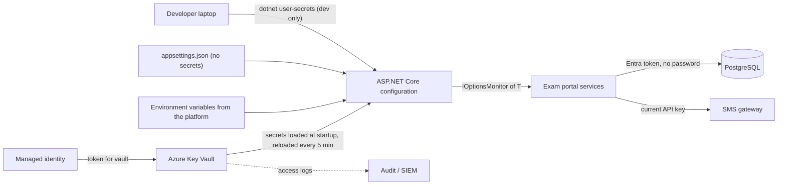
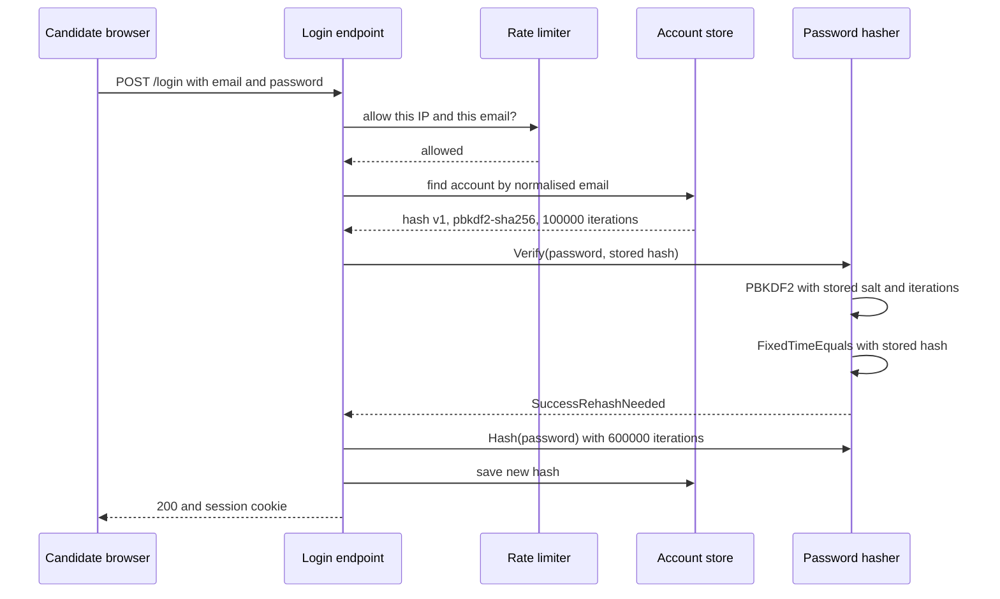

A state recruitment board runs an online exam portal with 12 lakh candidate accounts. One night, a backup file of its database ends up on a public file-sharing site. What happens next depends entirely on decisions made years earlier. If passwords were stored as plain MD5, attackers recover most of them within hours, and because people reuse passwords, they then try them on email, banking and UPI apps. If passwords were stored with a salted, deliberately slow hash, the same attackers might crack a few thousand weak ones over weeks, and everyone else is safe. The same backup also contained `appsettings.json` with the SMS gateway key and the database password. This lesson covers both problems: storing *users'* secrets (passwords) and storing the *application's* secrets.

## Learning objectives

By the end of this lesson you will be able to:

1. Explain why passwords are hashed, not encrypted, and what salts, slow hashes and peppers each defend against.
2. Choose between Argon2id, bcrypt, scrypt and PBKDF2, with parameters, and size the CPU cost of logins.
3. Implement PBKDF2 hashing in C# with `Rfc2898DeriveBytes.Pbkdf2`, a self-describing hash format, and constant-time verification.
4. Upgrade old hashes transparently when users log in.
5. Apply modern password policy: length over complexity, breached-password screening, no forced rotation.
6. Keep application secrets out of source control using user secrets, environment variables, Azure Key Vault and managed identities.
7. Rotate secrets without downtime using overlapping keys and dual credentials.

## Prerequisites

- [Authentication versus authorization](#/lesson/m14-authn-vs-authz): credentials, login flows, user enumeration.
- [Configuration, environment variables and secrets](#/lesson/m03-configuration): the ASP.NET Core configuration system and the options pattern.

## Explain it like I'm a beginner

**Passwords.** Imagine a bank locker room. The bank doesn't keep a copy of your locker key. It keeps a **wax impression** of it. When you come in, they press your key into fresh wax and compare the shapes. If a thief steals the box of wax impressions, they still can't open lockers, because you can't turn an impression back into a key.

A **hash** is that impression: a one-way fingerprint of your password. The server stores only the fingerprint, and at login it fingerprints what you typed and compares.

But thieves are clever. If everyone's impression is made the same way, they can prepare impressions of the 10 million most common keys in advance and look for matches. So the bank adds a random squiggle, different for each customer, to every impression. That squiggle is a **salt**. Now the thief must start from scratch for each customer.

Finally, the bank makes impression-making **deliberately slow**: the wax takes a quarter of a second to set. For one customer at the counter, that's nothing. For a thief trying 10 million keys against 12 lakh customers, it's centuries. That is a **slow hash** (also called a key-derivation or password-hashing function).

**Application secrets.** Your app also has keys: the database password, the SMS gateway key, the token-signing key. Writing them in the code is like taping the strongroom key under the manager's desk. Everyone who ever sees the code, including every former contractor and every backup, has the key. Instead, keep them in a **vault** that hands keys only to the right machine, logs every use, and lets you change the locks (**rotation**) without closing the bank.

## First-principles explanation

### Why hash, not encrypt?

Encryption is reversible by design: whoever has the key can recover every password. The key has to live somewhere the application can reach, so an attacker who steals the database often steals the key too. Hashing is one-way: there is no key to steal. The server never needs the original password back. It only needs to check that a typed password produces the same hash.

### Why fast hashes (MD5, SHA-1, SHA-256) are wrong for passwords

General-purpose hashes are designed to be fast. A single modern GPU can compute billions of SHA-256 hashes per second (order of magnitude, depending on hardware). Human passwords have little randomness: millions of people use the same few thousand passwords, and leaked lists of hundreds of millions of real passwords are freely available. A fast hash lets an attacker try the entire leaked list against every account in minutes.

Three defences work together:

1. **Salt**: a unique random value (16 bytes is standard) per password, stored next to the hash. It doesn't need to be secret. It makes two users with the password `Rahul@123` have different hashes, and it defeats precomputed tables (rainbow tables): the attacker must attack each account separately.
2. **Work factor (slowness)**: a password-hashing function repeats or memory-loads its computation so one guess costs, say, 100 ms of CPU and, for memory-hard functions, tens of megabytes of RAM. The attacker's GPU advantage shrinks dramatically, especially for memory-hard functions, because GPUs have little memory per core.
3. **Pepper** (optional): a secret key, the same for all users, stored *outside* the database (in a vault or HSM), mixed in with HMAC before hashing. If only the database leaks, the attacker can't even start guessing. The cost: if you lose the pepper, every password is unrecoverable, and rotating it requires tracking which pepper version each hash used.

### Which algorithm?

| Algorithm | Plain English | Recommended parameters (OWASP, at the time of writing) | Notes |
|---|---|---|---|
| **Argon2id** | Slow *and* memory-hungry | m = 19 MiB, t = 2, p = 1 (minimum) | Winner of the Password Hashing Competition. First choice for new systems. Needs a NuGet package in .NET |
| **scrypt** | Memory-hard, older | N = 2^17, r = 8, p = 1 | Good. Less common in .NET |
| **bcrypt** | Slow, fixed small memory | cost ≥ 10 | Widely supported. Only the first 72 bytes of the password are used |
| **PBKDF2-HMAC-SHA256** | Repeats HMAC many times | 600,000 iterations | Built into .NET (`Rfc2898DeriveBytes.Pbkdf2`), FIPS-approved. Not memory-hard, so GPUs help attackers more |

ASP.NET Core Identity's default `PasswordHasher<TUser>` uses PBKDF2 with HMAC-SHA512 and, since .NET 7, 100,000 iterations, with a 128-bit salt. That is reasonable, and if you use Identity you should keep it, increasing `IterationCount` in `PasswordHasherOptions` if your hardware allows.

**Tune by measurement, not by copying numbers.** Pick parameters so that one hash takes roughly 50–250 ms on your production servers, then check the cost at peak (below).

### Sizing the cost: results day

The recruitment board publishes results at 10:00. Estimate:

```text
Logins in the first 10 minutes: 3 lakh candidates (estimate)
300,000 ÷ 600 s = 500 logins/s
CPU per login at 600,000 PBKDF2 iterations: assume ~0.2 s of one core (measure it!)
500 × 0.2 = 100 cores busy just hashing
```

That is expensive. Options: reduce iterations a little (with care), use a faster but memory-hard Argon2id setting, scale out temporarily, or reduce the number of password logins (keep users signed in, or serve results by roll number plus date of birth with rate limiting and no account at all). Note what this means for attackers too: **the login endpoint is a CPU-exhaustion target.** Rate-limit it per IP and per account *before* hashing.

### Verifying safely

- **Constant-time comparison**: compare the computed hash and the stored hash with `CryptographicOperations.FixedTimeEquals`. Ordinary comparison returns early at the first differing byte, which can leak information through timing.
- **Equal work for unknown users**: if the email doesn't exist, still run a hash against a dummy value. Otherwise "no such user" answers in 1 ms and "wrong password" in 200 ms, which tells attackers which emails have accounts.
- **Self-describing hash strings**: store the algorithm, parameters, salt and hash together, for example `v1$pbkdf2-sha256$600000$p1$<salt>$<hash>`. Then you can change parameters later and still verify old hashes.
- **Rehash on login**: after a successful verification with old parameters, you have the plaintext password in memory for a moment. Hash it with the current parameters and save. Over months, active users migrate automatically. For accounts that never log in again, you can wrap old hashes (for example `pbkdf2(md5_hash)`) as a one-off migration, then unwrap at their next login.

### Password policy that actually helps

Modern guidance (NIST SP 800-63B) has moved away from the rules many systems still enforce:

- **Length beats complexity.** Require at least 8 characters, and allow at least 64. (The latest revision asks for 15 when the password is the only factor.) Allow spaces and all Unicode characters, normalised consistently.
- **No composition rules** ("one capital, one digit, one symbol"). They produce `Password@1` and help nobody.
- **Screen against breached and common passwords.** Reject anything on a known-breached list. The Have I Been Pwned "Pwned Passwords" API supports this without sending the password: you send the first 5 hex characters of its SHA-1 hash and compare suffixes locally (k-anonymity).
- **No forced periodic rotation.** Change passwords on evidence of compromise, not every 90 days.
- **Allow paste and password managers.** Blocking paste pushes people to shorter passwords.
- **Offer MFA**, and require it for staff and administrators. A good hash protects stored passwords. MFA protects against passwords stolen elsewhere.

### Application secrets

An application secret is anything that grants access: database connection strings with passwords, API keys, OAuth client secrets, token-signing keys, the password pepper, storage account keys, certificates' private keys.

**Where secrets should not be:** source code, `appsettings.json` committed to git, container images, CI logs, wiki pages, chat messages, and error messages. Git history keeps a secret forever even after you delete it from the latest commit. A leaked secret must be **rotated**, not just removed.

**Where they can be, by environment:**

| Environment | Mechanism | Notes |
|---|---|---|
| Developer laptop | `dotnet user-secrets` | Stored as plain JSON in the user profile, outside the project folder. Only for development, never for production |
| CI pipeline | Pipeline secret variables / secure files | Masked in logs. Scope them to the pipelines that need them |
| Production (any host) | Environment variables injected by the platform | `ConnectionStrings__Default` maps to `ConnectionStrings:Default`. Visible to anyone who can inspect the process, so limit host access |
| Production (cloud) | **Azure Key Vault** (or AWS Secrets Manager, HashiCorp Vault) | Access by **managed identity**, so the app has no secret to fetch the secrets with. Every access is logged. Supports versions and rotation |
| Keys that must never leave hardware | HSM-backed keys (Key Vault Premium, Managed HSM) | The app asks the vault to *sign*, it never sees the private key |

**Managed identities** remove the "secret zero" problem (what secret do you use to fetch your secrets?). The cloud platform gives the app an identity, and the app gets tokens for Key Vault, Azure SQL or PostgreSQL from the platform. Many Azure services, including Azure Database for PostgreSQL, accept Entra ID tokens instead of passwords, so the database password disappears entirely.

### Rotation without downtime

Rotation means replacing a secret on a schedule (for example every 90 days for API keys) and immediately after any suspected leak. The trick is **overlap**: two valid secrets at once.

- **Signing keys** (JWT, webhook HMAC): publish or accept the new key, start signing with it, and keep accepting the old one until everything signed with it has expired. See [JWT validation and limitations](#/lesson/m14-jwt).
- **API keys from providers**: most providers allow two active keys. Switch the app to key 2, confirm, then revoke key 1.
- **Database passwords**: use two database users (`app_blue`, `app_green`). Rotate the inactive user's password, switch the app's connection string to it, then rotate the other. Or move to token-based database authentication.
- **The app must pick up new values without a restart**, or with a rolling restart. In ASP.NET Core, read secrets through `IOptionsMonitor<T>` and configure the Key Vault provider with a reload interval.

### Failure modes

- **Pepper or key lost**: no one can log in. Back up vault contents, enable soft-delete and purge protection on Key Vault.
- **Vault outage or throttling**: if the app fetches a secret per request, a vault hiccup becomes an outage. Load secrets at startup and refresh periodically, keep the last good value, and never call the vault in the hot path. Key Vault throttles per vault, so 200 pods each fetching 30 secrets on every restart can hit limits.
- **Secrets in logs**: a logged connection string or `Authorization` header is a leaked secret. Redact in logging configuration and in exception handling.
- **Rotation that breaks things**: rotating the database password while 40 instances still hold the old one in their connection pools. Use dual credentials, rolling restarts, and alerts on authentication failures.

### When a simpler alternative is enough

- If you can avoid storing passwords at all, do: use an identity provider (Entra ID, Google, an OIDC provider) and let it handle hashing, MFA, breach detection and lockout. See [OAuth 2.0 and OpenID Connect](#/lesson/m14-oauth-oidc).
- If you use ASP.NET Core Identity, use its `PasswordHasher`. Don't write your own unless you have a specific reason (a migration, a different algorithm requirement).
- A small app on a single VM can use environment variables set by the deployment, with file permissions locked down. Key Vault becomes worthwhile when you have several services, several environments, or audit requirements.

## Visual explanation

### Where secrets come from at runtime



Configuration sources are layered, and later sources override earlier ones: `appsettings.json` holds non-secret defaults, environment variables override per environment, and Key Vault supplies the secrets in production. User secrets are only added in the Development environment. The app's **managed identity** gets a token from the platform to read Key Vault, so no secret is needed to fetch secrets. Services read values through `IOptionsMonitor<T>`, so a rotated SMS key or pepper version reaches running code on the next reload without a restart. For the database, the best case is no password at all: the app presents an Entra ID token. Every vault access is logged for audits.

### Login with rehash-on-login



The rate limiter runs **before** any hashing, because hashing is the expensive part and an attacker shouldn't be able to make you burn CPU for free. The stored hash string tells the hasher which algorithm, iteration count and salt to use. Comparison is constant-time. Because the stored hash used an older iteration count, the hasher reports success *with* "rehash needed", and the endpoint immediately re-hashes the password it already has in memory with current parameters. The user notices nothing, and the database gradually upgrades itself. For an unknown email, the endpoint would verify against a dummy hash so that the response time is the same.

## Step-by-step example

### Step 1 — what the old portal did

```csharp
var hash = Convert.ToHexString(MD5.HashData(Encoding.UTF8.GetBytes(password)));   // no salt, fast
if (user.PasswordHash == hash) { /* logged in */ }
```

Unsalted, fast, and compared with `==`. Every candidate with `Exam@2024` has the same hash.

### Step 2 — salted, slow hash with a self-describing format

Generate a 16-byte salt, run PBKDF2-HMAC-SHA256 with 600,000 iterations producing 32 bytes, store `v1$pbkdf2-sha256$600000$<pepperId>$<salt>$<hash>`.

### Step 3 — pepper from Key Vault

HMAC-SHA256 the normalised password with a pepper key (32 random bytes stored in Key Vault, identified by `p1`) before PBKDF2. Store the pepper id in the hash string so a future `p2` can coexist.

### Step 4 — migrate the 12 lakh MD5 hashes

You can't re-hash passwords you don't know. Run a one-time job that replaces each `md5hex` with `legacy-md5$<pbkdf2(md5hex)>`. Every stored value is now slow to attack. At each user's next login, verify by computing `pbkdf2(md5(password))`, then store a proper `v1` hash.

### Step 5 — move the app's own secrets

Delete the SMS key and database password from `appsettings.json`, **rotate both** (they were in a leaked backup, and in git history), put the new values in Key Vault, grant the app's managed identity "Key Vault Secrets User" on that vault only, and switch the database to Entra ID authentication.

## Production-style C# implementation

```text
Exams.Portal/
  Program.cs
  Security/
    Passwords/PasswordHashing.cs
    Passwords/PasswordPolicy.cs
    Passwords/BreachedPasswordClient.cs
    Secrets/SmsGatewayClient.cs
  Accounts/
    AccountService.cs
```

```csharp file=Security/Passwords/PasswordHashing.cs
using System.Globalization;
using System.Security.Cryptography;
using System.Text;
using Microsoft.Extensions.Options;

namespace Exams.Security.Passwords;

public enum PasswordCheck { Failed, Success, SuccessRehashNeeded }

public sealed class PasswordHashingOptions
{
    public int Iterations { get; set; } = 600_000;   // tune so one hash costs ~50–250 ms on your servers
    public int SaltBytes { get; set; } = 16;
    public int HashBytes { get; set; } = 32;
}

/// <summary>Pepper keys live in Key Vault, never in the database. Old ids stay until no hash uses them.</summary>
public sealed class PepperOptions
{
    public string CurrentKeyId { get; set; } = "";
    public Dictionary<string, string> Keys { get; set; } = new();   // key id → base64 of 32 random bytes
}

public interface IPasswordHashing
{
    string Hash(string password);
    PasswordCheck Verify(string password, string stored);
}

/// <summary>Format: v1$pbkdf2-sha256$&lt;iterations&gt;$&lt;pepperId&gt;$&lt;salt b64&gt;$&lt;hash b64&gt;</summary>
public sealed class Pbkdf2PasswordHashing(IOptionsMonitor<PasswordHashingOptions> options, IOptionsMonitor<PepperOptions> pepper)
    : IPasswordHashing
{
    private const string Version = "v1";
    private const string Algorithm = "pbkdf2-sha256";

    public string Hash(string password)
    {
        var o = options.CurrentValue;
        var p = pepper.CurrentValue;
        var key = PepperKey(p, p.CurrentKeyId) ?? throw new InvalidOperationException("Current pepper key is not configured.");
        var salt = RandomNumberGenerator.GetBytes(o.SaltBytes);
        var hash = Derive(password, salt, o.Iterations, o.HashBytes, key);
        return string.Join('$', Version, Algorithm, o.Iterations.ToString(CultureInfo.InvariantCulture), p.CurrentKeyId,
                           Convert.ToBase64String(salt), Convert.ToBase64String(hash));
    }

    public PasswordCheck Verify(string password, string stored)
    {
        var parts = stored.Split('$');
        if (parts.Length != 6 || parts[0] != Version || parts[1] != Algorithm) return PasswordCheck.Failed;
        if (!int.TryParse(parts[2], NumberStyles.None, CultureInfo.InvariantCulture, out var iterations) ||
            iterations is < 10_000 or > 10_000_000) return PasswordCheck.Failed;   // refuse absurd values from a tampered row

        var currentPepper = pepper.CurrentValue;
        var key = PepperKey(currentPepper, parts[3]);
        if (key is null) return PasswordCheck.Failed;

        byte[] salt, expected;
        try { salt = Convert.FromBase64String(parts[4]); expected = Convert.FromBase64String(parts[5]); }
        catch (FormatException) { return PasswordCheck.Failed; }

        var actual = Derive(password, salt, iterations, expected.Length, key);
        if (!CryptographicOperations.FixedTimeEquals(actual, expected)) return PasswordCheck.Failed;

        var stale = iterations < options.CurrentValue.Iterations || parts[3] != currentPepper.CurrentKeyId;
        return stale ? PasswordCheck.SuccessRehashNeeded : PasswordCheck.Success;
    }

    private static byte[] Derive(string password, byte[] salt, int iterations, int length, byte[] pepperKey)
    {
        // Normalise so "é" typed on two keyboards gives the same bytes, then pepper, then stretch.
        var normalised = Encoding.UTF8.GetBytes(password.Normalize(NormalizationForm.FormKC));
        var peppered = HMACSHA256.HashData(pepperKey, normalised);
        return Rfc2898DeriveBytes.Pbkdf2(peppered, salt, iterations, HashAlgorithmName.SHA256, length);
    }

    private static byte[]? PepperKey(PepperOptions p, string id) =>
        p.Keys.TryGetValue(id, out var b64) ? Convert.FromBase64String(b64) : null;
}
```

```csharp file=Security/Passwords/PasswordPolicy.cs
namespace Exams.Security.Passwords;

public interface IBreachedPasswordChecker
{
    Task<bool> IsBreachedAsync(string password, CancellationToken ct);
}

/// <summary>Length and breach screening, no composition rules (NIST SP 800-63B style).</summary>
public sealed class PasswordPolicy(IBreachedPasswordChecker breached)
{
    public const int MinLength = 12;    // our choice for a portal that also offers OTP; 15 if the password is the only factor
    public const int MaxLength = 128;   // generous, but bounded so nobody posts a 10 MB "password" to burn CPU

    public async Task<IReadOnlyList<string>> ValidateAsync(string password, string email, CancellationToken ct)
    {
        var errors = new List<string>();
        var length = password.EnumerateRunes().Count();   // count characters, not UTF-16 code units
        if (length < MinLength) errors.Add($"Use at least {MinLength} characters. A short phrase works well.");
        if (length > MaxLength) errors.Add($"Use at most {MaxLength} characters.");
        var localPart = email.Split('@')[0];
        if (localPart.Length >= 4 && password.Contains(localPart, StringComparison.OrdinalIgnoreCase))
            errors.Add("Don't include your email name in your password.");
        if (errors.Count == 0 && await breached.IsBreachedAsync(password, ct))
            errors.Add("This password has appeared in a data breach. Please choose another.");
        return errors;
    }
}
```

```csharp file=Security/Passwords/BreachedPasswordClient.cs
using System.Security.Cryptography;
using System.Text;

namespace Exams.Security.Passwords;

/// <summary>k-anonymity range query: only the first 5 hex characters of the SHA-1 leave the server.</summary>
public sealed class PwnedPasswordsClient(HttpClient http, ILogger<PwnedPasswordsClient> log) : IBreachedPasswordChecker
{
    public async Task<bool> IsBreachedAsync(string password, CancellationToken ct)
    {
        var sha1 = Convert.ToHexString(SHA1.HashData(Encoding.UTF8.GetBytes(password)));   // SHA-1 here is a lookup key, not storage
        var prefix = sha1[..5];
        var suffix = sha1[5..];
        try
        {
            using var request = new HttpRequestMessage(HttpMethod.Get, $"https://api.pwnedpasswords.com/range/{prefix}");
            request.Headers.Add("Add-Padding", "true");
            using var response = await http.SendAsync(request, ct);
            response.EnsureSuccessStatusCode();
            var body = await response.Content.ReadAsStringAsync(ct);
            foreach (var line in body.Split('\n'))
            {
                var colon = line.IndexOf(':');
                if (colon == 35 && line.AsSpan(0, 35).Equals(suffix, StringComparison.OrdinalIgnoreCase) &&
                    int.TryParse(line.AsSpan(colon + 1).Trim(), out var count) && count > 0)
                    return true;
            }
            return false;
        }
        catch (Exception e) when (e is HttpRequestException or TaskCanceledException)
        {
            // Availability trade-off: don't block registration when the service is down; log and rely on length rules.
            log.LogWarning(e, "Breached-password check unavailable");
            return false;
        }
    }
}
```

```csharp file=Security/Secrets/SmsGatewayClient.cs
using System.Net.Http.Headers;
using Microsoft.Extensions.Options;

namespace Exams.Security.Secrets;

public sealed class SmsGatewayOptions
{
    public Uri BaseUrl { get; set; } = new("https://sms.example-gateway.in/");
    public string ApiKey { get; set; } = "";   // from Key Vault secret "SmsGateway--ApiKey"
}

/// <summary>Reads the key through IOptionsMonitor on every call, so a rotated key in Key Vault
/// reaches the running app on the provider's next reload, with no restart.</summary>
public sealed class SmsGatewayClient(HttpClient http, IOptionsMonitor<SmsGatewayOptions> options)
{
    public async Task SendOtpAsync(string mobile, string otp, CancellationToken ct)
    {
        var o = options.CurrentValue;
        using var request = new HttpRequestMessage(HttpMethod.Post, new Uri(o.BaseUrl, "v1/otp"))
        {
            Content = JsonContent.Create(new { to = mobile, code = otp }),
        };
        request.Headers.Authorization = new AuthenticationHeaderValue("Bearer", o.ApiKey);
        using var response = await http.SendAsync(request, ct);
        response.EnsureSuccessStatusCode();   // never log the request headers
    }
}
```

```csharp file=Accounts/AccountService.cs
using System.Collections.Concurrent;
using Exams.Security.Passwords;

namespace Exams.Accounts;

public sealed record Account(Guid Id, string Email, string PasswordHash);

public interface IAccountStore
{
    Account? FindByEmail(string normalisedEmail);
    void Save(Account account);
}

public sealed class InMemoryAccountStore : IAccountStore
{
    private readonly ConcurrentDictionary<string, Account> _byEmail = new(StringComparer.Ordinal);
    public Account? FindByEmail(string normalisedEmail) => _byEmail.GetValueOrDefault(normalisedEmail);
    public void Save(Account account) => _byEmail[account.Email] = account;
}

public sealed record RegisterResult(bool Succeeded, IReadOnlyList<string> Errors);

public sealed class AccountService(IAccountStore store, IPasswordHashing hasher, PasswordPolicy policy, ILogger<AccountService> log)
{
    // Computed once: unknown emails are verified against this so they cost the same time as real ones.
    private readonly Lazy<string> _dummyHash = new(() => hasher.Hash(Guid.NewGuid().ToString()));

    public static string Normalise(string email) => email.Trim().ToLowerInvariant();

    public async Task<RegisterResult> RegisterAsync(string email, string password, CancellationToken ct)
    {
        var key = Normalise(email);
        var errors = await policy.ValidateAsync(password, key, ct);
        if (errors.Count > 0) return new(false, errors);
        if (store.FindByEmail(key) is not null) return new(true, []);   // don't reveal existing accounts; email the owner instead
        store.Save(new Account(Guid.NewGuid(), key, hasher.Hash(password)));
        return new(true, []);
    }

    public Guid? Login(string email, string password)
    {
        var account = store.FindByEmail(Normalise(email));
        var result = hasher.Verify(password, account?.PasswordHash ?? _dummyHash.Value);
        if (account is null || result == PasswordCheck.Failed) return null;

        if (result == PasswordCheck.SuccessRehashNeeded)
        {
            store.Save(account with { PasswordHash = hasher.Hash(password) });
            log.LogInformation("Upgraded password hash for account {AccountId}", account.Id);
        }
        return account.Id;
    }
}
```

```csharp file=Program.cs
using System.Threading.RateLimiting;
using Exams.Accounts;
using Exams.Security.Passwords;
using Exams.Security.Secrets;

var builder = WebApplication.CreateBuilder(args);

// Configuration order (later wins): appsettings.json → appsettings.{Env}.json → user secrets (Development only)
// → environment variables → command line. In production, Key Vault is added here (see the snippet below).

builder.Services.AddOptions<PasswordHashingOptions>().BindConfiguration("Security:PasswordHashing")
    .Validate(o => o.Iterations >= 100_000 && o.SaltBytes >= 16, "Password hashing parameters are too weak.")
    .ValidateOnStart();
builder.Services.AddOptions<PepperOptions>().BindConfiguration("Security:Pepper")
    .Validate(o => o.Keys.ContainsKey(o.CurrentKeyId), "Current pepper key id has no key.")
    .ValidateOnStart();   // fail at startup, not at the first login
builder.Services.AddOptions<SmsGatewayOptions>().BindConfiguration("SmsGateway")
    .Validate(o => !string.IsNullOrWhiteSpace(o.ApiKey), "SMS gateway API key is missing.")
    .ValidateOnStart();

builder.Services.AddSingleton<IPasswordHashing, Pbkdf2PasswordHashing>();
builder.Services.AddHttpClient<IBreachedPasswordChecker, PwnedPasswordsClient>(c => c.Timeout = TimeSpan.FromSeconds(2));
builder.Services.AddSingleton<PasswordPolicy>();
builder.Services.AddSingleton<IAccountStore, InMemoryAccountStore>();
builder.Services.AddSingleton<AccountService>();
builder.Services.AddHttpClient<SmsGatewayClient>();

// Rate-limit before hashing: each login costs ~0.2 s of CPU, so an unlimited endpoint is a DoS target.
builder.Services.AddRateLimiter(o =>
{
    o.RejectionStatusCode = StatusCodes.Status429TooManyRequests;
    o.AddPolicy("login", ctx => RateLimitPartition.GetFixedWindowLimiter(
        ctx.Connection.RemoteIpAddress?.ToString() ?? "unknown",
        _ => new FixedWindowRateLimiterOptions { PermitLimit = 10, Window = TimeSpan.FromMinutes(1) }));
});

var app = builder.Build();
app.UseRateLimiter();

app.MapPost("/register", async (Credentials c, AccountService accounts, CancellationToken ct) =>
{
    var result = await accounts.RegisterAsync(c.Email, c.Password, ct);
    return result.Succeeded ? Results.Accepted() : Results.ValidationProblem(new Dictionary<string, string[]> { ["password"] = [.. result.Errors] });
});

app.MapPost("/login", (Credentials c, AccountService accounts) =>
    accounts.Login(c.Email, c.Password) is { } id
        ? Results.Ok(new { accountId = id })   // real app: sign in with a cookie here
        : Results.Problem("Invalid email or password.", statusCode: 401))
   .RequireRateLimiting("login");

app.Run();

public sealed record Credentials(string Email, string Password);
```

### Adding Key Vault in production

These packages aren't part of the compiled sample (`Azure.Extensions.AspNetCore.Configuration.Secrets`, `Azure.Identity`):

```csharp
if (builder.Environment.IsProduction())
{
    builder.Configuration.AddAzureKeyVault(
        new Uri($"https://{builder.Configuration["KeyVaultName"]}.vault.azure.net/"),
        new DefaultAzureCredential(),   // managed identity in Azure, your login on a dev machine
        new AzureKeyVaultConfigurationOptions { ReloadInterval = TimeSpan.FromMinutes(5) });
}
// Secret "Security--Pepper--Keys--p1" becomes configuration key "Security:Pepper:Keys:p1".
```

For local development:

```bash
dotnet user-secrets init
dotnet user-secrets set "Security:Pepper:CurrentKeyId" "dev"
dotnet user-secrets set "Security:Pepper:Keys:dev" "$(openssl rand -base64 32)"
dotnet user-secrets set "SmsGateway:ApiKey" "test-key-from-sandbox"
```

And for Argon2id, a package such as `Konscious.Security.Cryptography.Argon2` can replace `Derive` with the same hash-string approach (`v2$argon2id$m=19456,t=2,p=1$...`), and the rehash-on-login logic migrates users from `v1` automatically.

## Bad design vs good design

**Bad:**

```csharp
// appsettings.json (committed):  "Db": "Host=pg;Username=exam;Password=Exam@2019", "SmsKey": "sk_live_8f2..."
public bool Login(string email, string password)
{
    var user = _db.Users.Single(u => u.Email == email);                       // throws for unknown email → 500 vs 401
    var hash = Convert.ToBase64String(SHA256.HashData(Encoding.UTF8.GetBytes(password)));   // fast, unsalted
    _log.LogInformation("Login {Email} with {Password}", email, password);    // plaintext in logs
    return user.PasswordHash == hash;                                          // not constant-time
}
```

Problems: secrets in a committed file (and therefore in every clone and backup); a fast unsalted hash; plaintext passwords in logs (which often have weaker protection than the database); different behaviour for unknown emails; ordinary comparison; and no path to upgrade the hashing later because the format isn't recorded.

**Good:** the implementation above. A slow salted hash with a self-describing format and pepper, constant-time verification, a dummy hash for unknown users, rehash-on-login, rate limiting before hashing, breach screening, and secrets from Key Vault through `IOptionsMonitor` with validation at startup.

:::callout type=mistake title="Removing a secret from git is not enough"
Deleting a key in a new commit leaves it in history, in forks, in CI caches and in every developer's clone. Treat any secret that reached a repository as compromised: rotate it first, then clean history if you must. Turn on secret scanning with push protection (GitHub, Azure DevOps and tools such as gitleaks support this) so the next one is blocked before it lands.
:::

:::callout type=tradeoff title="Pepper: real protection, real operational risk"
A pepper means a database-only leak gives attackers nothing to crack. But it adds a dependency on the vault for every login, and losing it locks out every user. Use it if you have a mature vault setup with backups and soft-delete. Otherwise a well-tuned Argon2id or PBKDF2 with unique salts is already a large improvement.
:::

## Practical playground

The SQL playground holds a snapshot of the exam portal's `candidate_account` table during a migration: some hashes are legacy MD5 wrapped in PBKDF2, some are `v1` with old iteration counts, some are current. Write queries to answer an auditor: how many accounts per hash scheme? How many legacy accounts have logged in during the last 90 days (and will migrate soon) versus not (and need a forced reset)? Which staff accounts lack MFA?

:::playground type=sql title="Exam portal: password hash migration status"
```sql
CREATE TABLE candidate_account (
  account_id    int PRIMARY KEY,
  email         text NOT NULL UNIQUE,
  password_hash text NOT NULL,
  is_staff      boolean NOT NULL DEFAULT false,
  mfa_enabled   boolean NOT NULL DEFAULT false,
  last_login_at timestamptz
);
INSERT INTO candidate_account VALUES
 (1,'asha@example.in','legacy-md5$pbkdf2-sha256$600000$c2FsdA==$aGFzaA==',false,false,'2026-03-02 10:00+00'),
 (2,'ravi@example.in','v1$pbkdf2-sha256$100000$p1$c2FsdA==$aGFzaA==',false,false,'2026-10-18 09:00+00'),
 (3,'meera@example.in','v1$pbkdf2-sha256$600000$p1$c2FsdA==$aGFzaA==',false,true,'2026-10-19 11:30+00'),
 (4,'board.admin@example.in','v1$pbkdf2-sha256$600000$p1$c2FsdA==$aGFzaA==',true,false,'2026-10-20 08:10+00'),
 (5,'sunil@example.in','legacy-md5$pbkdf2-sha256$600000$c2FsdA==$aGFzaA==',false,false,'2026-09-28 17:45+00'),
 (6,'farah@example.in','v1$pbkdf2-sha256$600000$p0$c2FsdA==$aGFzaA==',false,false,'2025-12-01 12:00+00'),
 (7,'exam.cell@example.in','v1$pbkdf2-sha256$600000$p1$c2FsdA==$aGFzaA==',true,true,'2026-10-20 07:55+00'),
 (8,'arjun@example.in','legacy-md5$pbkdf2-sha256$600000$c2FsdA==$aGFzaA==',false,false,NULL);
-- Try: SELECT split_part(password_hash, '$', 1) AS scheme, count(*) FROM candidate_account GROUP BY 1;
```
:::

## Exercises

:::exercise id=m14-passwords-secrets-ex1 difficulty=beginner kind=code title="PBKDF2 hashing with Rfc2898DeriveBytes.Pbkdf2"
Implement `PasswordHasher` with PBKDF2-HMAC-SHA256: a key-derivation helper, hashing into a self-describing string, and constant-time verification.
::requirements
- `DeriveKey(password, salt, iterations, length)` wraps `Rfc2898DeriveBytes.Pbkdf2` with SHA-256 and UTF-8 password bytes.
- `Hash(password, iterations)` uses a new 16-byte random salt and 32-byte output, and returns `pbkdf2-sha256$<iterations>$<salt base64>$<hash base64>`.
- `Verify(password, stored)` parses the string, re-derives with the stored salt and iterations, and compares with `CryptographicOperations.FixedTimeEquals`. It returns false (never throws) for malformed input.
::acceptance
- `DeriveKey("passwd", "salt", 1, 64)` matches the RFC 7914 PBKDF2-HMAC-SHA256 test vector.
- Hashing the same password twice gives different strings (different salts), and both verify.
- A wrong password fails. A malformed or unknown-algorithm string fails without throwing.
- The iteration count in the string is honoured (a hash made with 1,000 iterations verifies).
::hint
`Rfc2898DeriveBytes.Pbkdf2(byte[] password, byte[] salt, int iterations, HashAlgorithmName.SHA256, int outputLength)` is a static method. No need to create an instance.
::hint
Use `string.Join('$', ...)` to build and `stored.Split('$')` to parse. Check you get exactly 4 parts.
::hint
Wrap `Convert.FromBase64String` and `int.Parse` in a `try/catch (FormatException)`, or use `int.TryParse`.
::hint
```csharp
var actual = DeriveKey(password, salt, iterations, expected.Length);
return CryptographicOperations.FixedTimeEquals(actual, expected);
```
::starter
```csharp file=PasswordHasher.cs
using System;
using System.Security.Cryptography;
using System.Text;

public static class PasswordHasher
{
    public static byte[] DeriveKey(string password, byte[] salt, int iterations, int length) => throw new NotImplementedException();
    public static string Hash(string password, int iterations = 600_000) => throw new NotImplementedException();
    public static bool Verify(string password, string stored) => throw new NotImplementedException();
}
```
::tests
```csharp file=PasswordHasherTests.cs
using System;
using System.Text;
using Xunit;

public class PasswordHasherTests
{
    [Fact]
    public void Rfc7914_test_vector()
    {
        var key = PasswordHasher.DeriveKey("passwd", Encoding.UTF8.GetBytes("salt"), 1, 64);
        Assert.Equal("55ac046e56e3089fec1691c22544b605f94185216dde0465e68b9d57c20dacbc49ca9cccf179b645991664b39d77ef317c71b845b1e30bd509112041d3a19783",
                     Convert.ToHexString(key).ToLowerInvariant());
    }

    [Fact]
    public void Format_is_self_describing()
    {
        var parts = PasswordHasher.Hash("correct horse battery staple", 1_000).Split('$');
        Assert.Equal(4, parts.Length);
        Assert.Equal("pbkdf2-sha256", parts[0]);
        Assert.Equal("1000", parts[1]);
        Assert.Equal(16, Convert.FromBase64String(parts[2]).Length);
        Assert.Equal(32, Convert.FromBase64String(parts[3]).Length);
    }

    [Fact]
    public void Same_password_different_salts()
    {
        var a = PasswordHasher.Hash("Exam@2026 is here", 1_000);
        var b = PasswordHasher.Hash("Exam@2026 is here", 1_000);
        Assert.NotEqual(a, b);
        Assert.True(PasswordHasher.Verify("Exam@2026 is here", a));
        Assert.True(PasswordHasher.Verify("Exam@2026 is here", b));
    }

    [Fact]
    public void Wrong_password_fails() => Assert.False(PasswordHasher.Verify("exam@2026 is here", PasswordHasher.Hash("Exam@2026 is here", 1_000)));

    [Theory]
    [InlineData("")]
    [InlineData("md5$abc")]
    [InlineData("pbkdf2-sha256$notanumber$AAAA$AAAA")]
    [InlineData("pbkdf2-sha256$1000$!!!$AAAA")]
    [InlineData("sha1$1000$AAAAAAAAAAAAAAAAAAAAAA==$AAAA")]
    public void Malformed_fails_without_throwing(string stored) => Assert.False(PasswordHasher.Verify("x", stored));

    [Fact]
    public void Default_iterations_are_strong() => Assert.Equal("600000", PasswordHasher.Hash("a long passphrase").Split('$')[1]);
}
```
::solution
```csharp file=PasswordHasher.cs
using System;
using System.Globalization;
using System.Security.Cryptography;
using System.Text;

public static class PasswordHasher
{
    private const string Algorithm = "pbkdf2-sha256";

    public static byte[] DeriveKey(string password, byte[] salt, int iterations, int length) =>
        Rfc2898DeriveBytes.Pbkdf2(Encoding.UTF8.GetBytes(password), salt, iterations, HashAlgorithmName.SHA256, length);

    public static string Hash(string password, int iterations = 600_000)
    {
        var salt = RandomNumberGenerator.GetBytes(16);
        var hash = DeriveKey(password, salt, iterations, 32);
        return string.Join('$', Algorithm, iterations.ToString(CultureInfo.InvariantCulture),
                           Convert.ToBase64String(salt), Convert.ToBase64String(hash));
    }

    public static bool Verify(string password, string stored)
    {
        var parts = stored.Split('$');
        if (parts.Length != 4 || parts[0] != Algorithm) return false;
        if (!int.TryParse(parts[1], NumberStyles.None, CultureInfo.InvariantCulture, out var iterations) || iterations < 1) return false;
        try
        {
            var salt = Convert.FromBase64String(parts[2]);
            var expected = Convert.FromBase64String(parts[3]);
            if (expected.Length == 0) return false;
            return CryptographicOperations.FixedTimeEquals(DeriveKey(password, salt, iterations, expected.Length), expected);
        }
        catch (FormatException) { return false; }
    }
}
```

The RFC test vector proves you call PBKDF2 correctly (algorithm, byte encoding, output length). The format string is what makes the system maintainable: when you raise iterations to 800,000 in two years, old hashes still verify because they carry their own count, and rehash-on-login upgrades them (exercise 3). In production, also cap the iteration count you accept from the database, so a tampered row with `2000000000` can't freeze a CPU.
::mistakes
- A fixed salt for every user ("application salt"). That is a weak pepper, not a salt, and identical passwords get identical hashes again.
- Using `new Rfc2898DeriveBytes(password, salt)` with its old default of 1,000 iterations and SHA-1. Use the static `Pbkdf2` method with explicit parameters.
- Comparing base64 strings with `==`.
::extensions
Add a pepper: HMAC-SHA256 the password with a 32-byte key before PBKDF2, and add a key id to the format.
:::

:::exercise id=m14-passwords-secrets-ex2 difficulty=beginner kind=written title="Audit five password storage schemes"
You review five systems. For each, say how an attacker with a copy of the database would attack it, rank them from weakest to strongest, and recommend a fix.

A. `password` column with AES-256 encrypted passwords; the key is in `appsettings.json`.
B. `SHA256(password)` in hex, no salt.
C. `SHA256(salt + password)` with a unique 16-byte salt per user.
D. bcrypt with cost 4.
E. Argon2id, m = 19 MiB, t = 2, p = 1, unique salt, plus a pepper in Key Vault.
::acceptance
- The ranking places A and B at the bottom and E at the top, with reasons.
- The answer explains why C, despite salts, is still weak.
- It notes that A is reversible and that the key is likely stolen with the data.
- Each fix is concrete (algorithm and parameters, or migration approach).
::hint
For each scheme, ask: does the attacker need a key? Can one guess be tested against all users at once? How much does one guess cost?
::hint
A unique salt stops precomputation and batch attacks. It doesn't make each guess slower.
::hint
bcrypt's cost is exponential: each +1 doubles the work. Cost 4 is 2^4 rounds.
::solution
**Ranking, weakest first: A ≈ B < C < D < E.**

- **A (encrypted)**: if the key is stolen with the database (it's in the same deployment and often the same backup), every password is recovered instantly, including strong ones. Even if the key isn't stolen, any insider with key access can read all passwords. Fix: migrate to a password hash. You can decrypt each password once in a migration job and hash it properly, then destroy the key.
- **B (unsalted SHA-256)**: identical passwords share hashes, precomputed tables work, and one guess is tested against all 12 lakh users at once at billions of guesses per second. Most weak and medium passwords fall quickly. Fix: wrap as `argon2id(sha256hex)` immediately, then upgrade on login.
- **C (salted SHA-256)**: no precomputation and no batch testing, but each guess is still extremely cheap, so a targeted attack on any one account (say, the board administrator) tries hundreds of millions of guesses per second. Fix: same wrap-and-upgrade approach.
- **D (bcrypt cost 4)**: the right family but almost no work: 16 rounds instead of the 1,024 at cost 10. Fix: raise cost to at least 10 (measure) and rehash on login. Note bcrypt's 72-byte limit.
- **E (Argon2id with pepper)**: memory-hard, slow, salted, and a database-only leak gives nothing to crack without the pepper. Remaining risks: the pepper's availability and backup, weak user passwords (screen against breached lists), and MFA for staff.
::mistakes
- Calling encryption "more secure because it uses AES-256". Reversibility is the problem, not the cipher.
- Thinking a salt makes guessing slow. It makes guessing *per account* instead of *for everyone*.
:::

:::exercise id=m14-passwords-secrets-ex3 difficulty=intermediate kind=code title="Upgrade legacy hashes on login"
The old portal stored `sha1$<salt hex>$<hash hex>` where hash = SHA-1(salt bytes followed by the UTF-8 password bytes). Newer accounts have `pbkdf2-sha256$<iterations>$<salt b64>$<hash b64>`. Write `LoginUpgrader.Login`, which verifies either format and upgrades the stored hash to PBKDF2 with the current target iteration count after a successful login.
::requirements
- Constructor takes an `IHashStore` and the target iteration count (tests use small numbers for speed).
- `Login(userId, password)` returns true for a correct password and false otherwise (including unknown users and malformed hashes).
- On success, if the stored hash is `sha1$…`, or PBKDF2 with fewer than the target iterations, save a new PBKDF2 hash with the target iterations.
- If the stored hash is already current, don't rewrite it.
- On failure, never change the stored hash.
- Comparisons are constant-time for both formats.
::acceptance
- A legacy user logs in once, and their stored hash now starts with `pbkdf2-sha256$<target>$`.
- They can log in again with the new hash.
- A PBKDF2 hash with 1,000 iterations is upgraded when the target is 2,000.
- A current hash is left byte-for-byte identical.
- A wrong password against a legacy hash leaves it unchanged.
::hint
Split on `$` and switch on the first part.
::hint
Legacy: `SHA1.HashData(salt.Concat(Encoding.UTF8.GetBytes(password)).ToArray())`, then compare with the hex-decoded stored hash.
::hint
`Convert.FromHexString` decodes hex. Wrap parsing in `try/catch (FormatException)`.
::hint
Return a tuple from verification: `(bool ok, bool needsUpgrade)`, then decide whether to save.
::hint
```csharp
var (ok, upgrade) = parts[0] switch
{
    "sha1" => (VerifySha1(parts, password), true),
    "pbkdf2-sha256" => VerifyPbkdf2(parts, password),
    _ => (false, false),
};
```
::starter
```csharp file=LoginUpgrader.cs
using System;
using System.Collections.Generic;
using System.Globalization;
using System.Linq;
using System.Security.Cryptography;
using System.Text;

public interface IHashStore
{
    string? Get(string userId);
    void Set(string userId, string hash);
}

public sealed class LoginUpgrader
{
    private readonly IHashStore _store;
    private readonly int _targetIterations;

    public LoginUpgrader(IHashStore store, int targetIterations) { _store = store; _targetIterations = targetIterations; }

    public bool Login(string userId, string password) => throw new NotImplementedException();

    /// <summary>Creates a current-format hash. Provided so tests and the solution agree on the format.</summary>
    public static string HashPbkdf2(string password, int iterations)
    {
        var salt = RandomNumberGenerator.GetBytes(16);
        var hash = Rfc2898DeriveBytes.Pbkdf2(Encoding.UTF8.GetBytes(password), salt, iterations, HashAlgorithmName.SHA256, 32);
        return $"pbkdf2-sha256${iterations.ToString(CultureInfo.InvariantCulture)}${Convert.ToBase64String(salt)}${Convert.ToBase64String(hash)}";
    }
}
```
::tests
```csharp file=LoginUpgraderTests.cs
using System;
using System.Collections.Generic;
using System.Linq;
using System.Security.Cryptography;
using System.Text;
using Xunit;

public sealed class DictStore : IHashStore
{
    public readonly Dictionary<string, string> Data = new();
    public int Writes;
    public string? Get(string userId) => Data.TryGetValue(userId, out var h) ? h : null;
    public void Set(string userId, string hash) { Data[userId] = hash; Writes++; }
}

public class LoginUpgraderTests
{
    private static string Legacy(string password)
    {
        var salt = RandomNumberGenerator.GetBytes(8);
        var hash = SHA1.HashData(salt.Concat(Encoding.UTF8.GetBytes(password)).ToArray());
        return $"sha1${Convert.ToHexString(salt)}${Convert.ToHexString(hash)}";
    }

    [Fact]
    public void Legacy_login_upgrades_and_still_works()
    {
        var store = new DictStore();
        store.Data["asha"] = Legacy("roll-no-and-dob");
        var svc = new LoginUpgrader(store, 2_000);
        Assert.True(svc.Login("asha", "roll-no-and-dob"));
        Assert.StartsWith("pbkdf2-sha256$2000$", store.Data["asha"]);
        Assert.True(svc.Login("asha", "roll-no-and-dob"));
    }

    [Fact]
    public void Wrong_password_never_changes_hash()
    {
        var store = new DictStore();
        var legacy = Legacy("roll-no-and-dob");
        store.Data["asha"] = legacy;
        Assert.False(new LoginUpgrader(store, 2_000).Login("asha", "guess"));
        Assert.Equal(legacy, store.Data["asha"]);
        Assert.Equal(0, store.Writes);
    }

    [Fact]
    public void Low_iteration_pbkdf2_is_upgraded()
    {
        var store = new DictStore();
        store.Data["ravi"] = LoginUpgrader.HashPbkdf2("monsoon in pune", 1_000);
        Assert.True(new LoginUpgrader(store, 2_000).Login("ravi", "monsoon in pune"));
        Assert.StartsWith("pbkdf2-sha256$2000$", store.Data["ravi"]);
    }

    [Fact]
    public void Current_hash_is_not_rewritten()
    {
        var store = new DictStore();
        var current = LoginUpgrader.HashPbkdf2("monsoon in pune", 2_000);
        store.Data["ravi"] = current;
        Assert.True(new LoginUpgrader(store, 2_000).Login("ravi", "monsoon in pune"));
        Assert.Equal(current, store.Data["ravi"]);
        Assert.Equal(0, store.Writes);
    }

    [Theory]
    [InlineData("nobody", null)]
    [InlineData("bad1", "sha1$zz$yy")]
    [InlineData("bad2", "md5$abc")]
    [InlineData("bad3", "pbkdf2-sha256$x$AAAA$AAAA")]
    public void Unknown_or_malformed_is_false(string user, string? hash)
    {
        var store = new DictStore();
        if (hash is not null) store.Data[user] = hash;
        Assert.False(new LoginUpgrader(store, 2_000).Login(user, "anything"));
    }
}
```
::solution
```csharp file=LoginUpgrader.cs
using System;
using System.Collections.Generic;
using System.Globalization;
using System.Linq;
using System.Security.Cryptography;
using System.Text;

public interface IHashStore
{
    string? Get(string userId);
    void Set(string userId, string hash);
}

public sealed class LoginUpgrader
{
    private readonly IHashStore _store;
    private readonly int _targetIterations;

    public LoginUpgrader(IHashStore store, int targetIterations) { _store = store; _targetIterations = targetIterations; }

    public bool Login(string userId, string password)
    {
        var stored = _store.Get(userId);
        if (stored is null) { HashPbkdf2(password, _targetIterations); return false; }   // equal work for unknown users

        var parts = stored.Split('$');
        bool ok, upgrade;
        try
        {
            (ok, upgrade) = parts[0] switch
            {
                "sha1" when parts.Length == 3 => (VerifySha1(parts, password), true),
                "pbkdf2-sha256" when parts.Length == 4 => VerifyPbkdf2(parts, password),
                _ => (false, false),
            };
        }
        catch (FormatException) { return false; }

        if (ok && upgrade) _store.Set(userId, HashPbkdf2(password, _targetIterations));
        return ok;
    }

    private static bool VerifySha1(string[] parts, string password)
    {
        var salt = Convert.FromHexString(parts[1]);
        var expected = Convert.FromHexString(parts[2]);
        var actual = SHA1.HashData(salt.Concat(Encoding.UTF8.GetBytes(password)).ToArray());
        return CryptographicOperations.FixedTimeEquals(actual, expected);
    }

    private (bool Ok, bool Upgrade) VerifyPbkdf2(string[] parts, string password)
    {
        if (!int.TryParse(parts[1], NumberStyles.None, CultureInfo.InvariantCulture, out var iterations) || iterations < 1)
            return (false, false);
        var salt = Convert.FromBase64String(parts[2]);
        var expected = Convert.FromBase64String(parts[3]);
        var actual = Rfc2898DeriveBytes.Pbkdf2(Encoding.UTF8.GetBytes(password), salt, iterations, HashAlgorithmName.SHA256, expected.Length);
        var ok = CryptographicOperations.FixedTimeEquals(actual, expected);
        return (ok, ok && iterations < _targetIterations);
    }

    public static string HashPbkdf2(string password, int iterations)
    {
        var salt = RandomNumberGenerator.GetBytes(16);
        var hash = Rfc2898DeriveBytes.Pbkdf2(Encoding.UTF8.GetBytes(password), salt, iterations, HashAlgorithmName.SHA256, 32);
        return $"pbkdf2-sha256${iterations.ToString(CultureInfo.InvariantCulture)}${Convert.ToBase64String(salt)}${Convert.ToBase64String(hash)}";
    }
}
```

Only *active* users migrate this way. For the rest, run a one-time job that wraps every remaining `sha1$…` hash as `sha1-wrapped$pbkdf2(sha1hash)`, so the whole table is slow to attack today rather than "eventually". After a deadline (say 12 months), force a password reset (via verified email or SMS) for accounts still on legacy formats, and record the migration in an ADR.
::alternatives
ASP.NET Core Identity supports this pattern natively: `PasswordHasher<TUser>.VerifyHashedPassword` returns `PasswordVerificationResult.SuccessRehashNeeded`, and `UserManager` re-hashes automatically. A custom `IPasswordHasher<TUser>` that understands your legacy format plugs into the same flow.
::mistakes
- Upgrading before verifying, which overwrites the real user's hash with an attacker's guess.
- Forgetting that a thrown `FormatException` from one corrupt row must not become a 500 error that differs from "wrong password".
- Leaving legacy hashes for inactive users untouched indefinitely.
:::

:::exercise id=m14-passwords-secrets-ex4 difficulty=intermediate kind=code title="A key ring for zero-downtime secret rotation"
The portal signs SMS delivery callback URLs with HMAC so the gateway can't be spoofed. Build a `KeyRing` that supports rotation: sign with the current key, verify with any key that is active and not retired.
::requirements
- `Add(keyId, secret, activatesAt)` adds a key. Secrets must be at least 32 bytes.
- `Current` is the key with the latest `activatesAt` that is not in the future and not retired. If none, throw `InvalidOperationException` when signing.
- `Sign(message)` returns `(KeyId, Signature)` using HMAC-SHA256 with the current key, signature as base64.
- `Verify(message, keyId, signature)` returns true only if that key exists, has activated, is not retired at the current time, and the HMAC matches (constant-time).
- `Retire(keyId, at)` makes the key invalid from `at` onwards.
- Time comes from `TimeProvider`.
::acceptance
- Adding a key that activates tomorrow doesn't change today's signing key.
- After activation, new signatures use the new key, and old signatures still verify.
- After the old key's retirement time, its signatures fail.
- An unknown key id or a tampered message fails.
::hint
Store keys in a dictionary by id, each with secret, activation time and an optional retirement time.
::hint
`Current`: filter by `activatesAt <= now` and not retired, then take the max by `activatesAt`.
::hint
`HMACSHA256.HashData(secret, Encoding.UTF8.GetBytes(message))`.
::hint
Decode the presented signature with `Convert.FromBase64String` inside `try/catch` and compare with `CryptographicOperations.FixedTimeEquals`.
::starter
```csharp file=KeyRing.cs
using System;
using System.Collections.Generic;
using System.Linq;
using System.Security.Cryptography;
using System.Text;

public sealed class KeyRing
{
    private readonly TimeProvider _clock;
    public KeyRing(TimeProvider clock) => _clock = clock;

    public void Add(string keyId, byte[] secret, DateTimeOffset activatesAt) => throw new NotImplementedException();
    public void Retire(string keyId, DateTimeOffset at) => throw new NotImplementedException();
    public string CurrentKeyId => throw new NotImplementedException();
    public (string KeyId, string Signature) Sign(string message) => throw new NotImplementedException();
    public bool Verify(string message, string keyId, string signature) => throw new NotImplementedException();
}
```
::tests
```csharp file=KeyRingTests.cs
using System;
using System.Security.Cryptography;
using Xunit;

public sealed class MovableClock : TimeProvider
{
    public DateTimeOffset Now { get; set; } = new(2026, 10, 20, 0, 0, 0, TimeSpan.Zero);
    public override DateTimeOffset GetUtcNow() => Now;
}

public class KeyRingTests
{
    private static (KeyRing Ring, MovableClock Clock) Setup()
    {
        var clock = new MovableClock();
        var ring = new KeyRing(clock);
        ring.Add("k1", RandomNumberGenerator.GetBytes(32), clock.Now.AddDays(-30));
        return (ring, clock);
    }

    [Fact]
    public void Signs_and_verifies()
    {
        var (ring, _) = Setup();
        var (kid, sig) = ring.Sign("callback?msg=88&status=delivered");
        Assert.Equal("k1", kid);
        Assert.True(ring.Verify("callback?msg=88&status=delivered", kid, sig));
    }

    [Fact]
    public void Tampered_message_fails()
    {
        var (ring, _) = Setup();
        var (kid, sig) = ring.Sign("callback?msg=88&status=delivered");
        Assert.False(ring.Verify("callback?msg=88&status=failed", kid, sig));
    }

    [Fact]
    public void Future_key_is_not_current_yet()
    {
        var (ring, clock) = Setup();
        ring.Add("k2", RandomNumberGenerator.GetBytes(32), clock.Now.AddDays(1));
        Assert.Equal("k1", ring.CurrentKeyId);
        Assert.False(ring.Verify("m", "k2", Convert.ToBase64String(new byte[32])));
    }

    [Fact]
    public void Rotation_overlap_then_retirement()
    {
        var (ring, clock) = Setup();
        var old = ring.Sign("m");
        ring.Add("k2", RandomNumberGenerator.GetBytes(32), clock.Now.AddDays(1));
        clock.Now = clock.Now.AddDays(1);
        Assert.Equal("k2", ring.Sign("m").KeyId);
        Assert.True(ring.Verify("m", old.KeyId, old.Signature));      // overlap window
        ring.Retire("k1", clock.Now.AddHours(24));
        clock.Now = clock.Now.AddHours(25);
        Assert.False(ring.Verify("m", old.KeyId, old.Signature));     // retired
        Assert.Equal("k2", ring.CurrentKeyId);
    }

    [Fact]
    public void Unknown_key_and_bad_base64_fail()
    {
        var (ring, _) = Setup();
        Assert.False(ring.Verify("m", "k9", "AAAA"));
        Assert.False(ring.Verify("m", "k1", "%%%"));
    }

    [Fact]
    public void Short_secret_rejected() =>
        Assert.Throws<ArgumentException>(() => new KeyRing(new MovableClock()).Add("weak", new byte[16], DateTimeOffset.UnixEpoch));

    [Fact]
    public void No_active_key_throws_on_sign() =>
        Assert.Throws<InvalidOperationException>(() => new KeyRing(new MovableClock()).Sign("m"));
}
```
::solution
```csharp file=KeyRing.cs
using System;
using System.Collections.Generic;
using System.Linq;
using System.Security.Cryptography;
using System.Text;

public sealed class KeyRing
{
    private sealed class Entry
    {
        public required byte[] Secret { get; init; }
        public DateTimeOffset ActivatesAt { get; init; }
        public DateTimeOffset? RetiresAt { get; set; }
    }

    private readonly TimeProvider _clock;
    private readonly Dictionary<string, Entry> _keys = new(StringComparer.Ordinal);
    private readonly object _gate = new();

    public KeyRing(TimeProvider clock) => _clock = clock;

    public void Add(string keyId, byte[] secret, DateTimeOffset activatesAt)
    {
        if (secret.Length < 32) throw new ArgumentException("Secrets must be at least 256 bits.", nameof(secret));
        lock (_gate) _keys[keyId] = new Entry { Secret = (byte[])secret.Clone(), ActivatesAt = activatesAt };
    }

    public void Retire(string keyId, DateTimeOffset at)
    {
        lock (_gate) if (_keys.TryGetValue(keyId, out var e)) e.RetiresAt = at;
    }

    public string CurrentKeyId
    {
        get
        {
            var now = _clock.GetUtcNow();
            lock (_gate)
            {
                var current = _keys.Where(kv => IsUsable(kv.Value, now)).OrderByDescending(kv => kv.Value.ActivatesAt).FirstOrDefault();
                return current.Key ?? throw new InvalidOperationException("No active signing key.");
            }
        }
    }

    public (string KeyId, string Signature) Sign(string message)
    {
        var kid = CurrentKeyId;
        byte[] secret;
        lock (_gate) secret = _keys[kid].Secret;
        return (kid, Convert.ToBase64String(HMACSHA256.HashData(secret, Encoding.UTF8.GetBytes(message))));
    }

    public bool Verify(string message, string keyId, string signature)
    {
        Entry? e;
        lock (_gate) _keys.TryGetValue(keyId, out e);
        if (e is null || !IsUsable(e, _clock.GetUtcNow())) return false;
        byte[] presented;
        try { presented = Convert.FromBase64String(signature); } catch (FormatException) { return false; }
        var expected = HMACSHA256.HashData(e.Secret, Encoding.UTF8.GetBytes(message));
        return CryptographicOperations.FixedTimeEquals(expected, presented);
    }

    private static bool IsUsable(Entry e, DateTimeOffset now) => e.ActivatesAt <= now && (e.RetiresAt is null || now < e.RetiresAt);
}
```

The rotation runbook this supports: (1) generate k2 in Key Vault and add it with an activation time 24 hours ahead, so every instance has loaded it before anyone signs with it; (2) at activation, all instances sign with k2 while still verifying k1; (3) once every k1-signed URL could have expired (say 24 hours), retire k1. No moment exists where a valid callback is rejected. The same three phases apply to JWT signing keys and webhook secrets.
::alternatives
Microsoft's ASP.NET Core Data Protection system is a production key ring of exactly this kind (activation dates, expiration, a key id in every payload, automatic rotation every 90 days by default). Use it for cookies and protected payloads instead of writing your own, and persist its keys to shared storage protected by Key Vault when you run more than one instance.
::mistakes
- Activating a new key immediately on one instance while others haven't loaded it, so their verifications fail during the rollout.
- Retiring the old key at the moment of switching, which breaks everything signed a minute earlier.
- Keeping secrets as strings in logs or exception messages.
:::

:::exercise id=m14-passwords-secrets-ex5 difficulty=advanced kind=hld title="Secrets management for 25 services across cloud and on-prem"
An infrastructure consultancy runs 25 services: 18 on AKS in Azure (Central India), and 7 legacy ASP.NET Core apps on on-prem IIS servers in Gurgaon. Today, connection strings, SMTP passwords, map API keys and JWT signing keys live in `appsettings.Production.json` files copied by hand, and some are committed to git. There are three environments (dev, UAT, production). An auditor requires: no secrets in source control, quarterly rotation of all secrets, rotation within 4 hours of a suspected leak, and an access log of who read which production secret.

Design the target architecture and the rotation process, including how the on-prem servers authenticate, how database credentials rotate without downtime, how CI/CD deploys without seeing production secrets, and what happens if Key Vault is unavailable.
::acceptance
- One vault per environment (or equivalent isolation), with access granted per service identity and least privilege.
- AKS workloads use workload identity / managed identity, on-prem servers use a certificate-based identity or Azure Arc, and no "secret zero" sits in a config file.
- Database credential rotation uses dual credentials or token-based authentication, with steps.
- CI/CD and secret scanning are covered.
- Vault outage behaviour and throttling are addressed with numbers.
::hint
Who is allowed to read the production SMTP password? Not developers, not the pipeline. Only the one service that sends mail.
::hint
On-prem servers can't use Azure managed identity directly. What else can prove a machine's identity to Entra ID?
::hint
Count secret reads: 18 services × 6 pods × 15 secrets each, at every restart and every reload interval.
::hint
For the database, compare "two users, alternate rotation" with "Entra ID authentication, no password at all".
::starter
```json
{
  "nodes": [
    { "id": "dev", "type": "client", "label": "Developers (copy appsettings.Production.json by hand)" },
    { "id": "git", "type": "external", "label": "Git repo (some secrets committed)" },
    { "id": "aks", "type": "app-server", "label": "18 services on AKS", "props": { "instances": 108 } },
    { "id": "iis", "type": "app-server", "label": "7 apps on on-prem IIS", "props": { "instances": 7 } },
    { "id": "pg", "type": "database", "label": "Azure Database for PostgreSQL (shared admin password)" }
  ],
  "edges": [
    { "from": "dev", "to": "git", "kind": "sync", "label": "commits" },
    { "from": "dev", "to": "aks", "kind": "sync", "label": "kubectl create secret by hand" },
    { "from": "dev", "to": "iis", "kind": "sync", "label": "RDP + copy config" },
    { "from": "aks", "to": "pg", "kind": "sync", "label": "admin user" },
    { "from": "iis", "to": "pg", "kind": "sync", "label": "admin user" }
  ]
}
```
::solution
```json
{
  "nodes": [
    { "id": "git", "type": "external", "label": "Git repo (no secrets, push protection on)" },
    { "id": "ci", "type": "worker", "label": "CI/CD (deploys config references, not values)" },
    { "id": "entra", "type": "external", "label": "Microsoft Entra ID (workload identities)" },
    { "id": "kvp", "type": "external", "label": "Key Vault: production (RBAC, soft-delete, purge protection)" },
    { "id": "kvu", "type": "external", "label": "Key Vault: UAT" },
    { "id": "aks", "type": "app-server", "label": "18 services on AKS (workload identity per service)", "props": { "instances": 108 } },
    { "id": "iis", "type": "app-server", "label": "7 IIS apps (Azure Arc-enabled servers, or certificate-based service principals)", "props": { "instances": 7 } },
    { "id": "pg", "type": "database", "label": "PostgreSQL (Entra auth, one role per service)", "props": { "multiAz": true } },
    { "id": "rot", "type": "scheduler", "label": "Rotation runbooks (Event Grid near-expiry events)" },
    { "id": "smtp", "type": "external", "label": "SMTP and map API providers (two active keys)" },
    { "id": "siem", "type": "monitoring", "label": "Vault diagnostic logs to SIEM, alerts" }
  ],
  "edges": [
    { "from": "git", "to": "ci", "kind": "sync" },
    { "from": "ci", "to": "aks", "kind": "sync", "label": "deploy with vault name only" },
    { "from": "ci", "to": "iis", "kind": "sync", "label": "deploy via agent, no secrets" },
    { "from": "aks", "to": "entra", "kind": "sync", "label": "federated token" },
    { "from": "iis", "to": "entra", "kind": "sync", "label": "Arc identity or certificate" },
    { "from": "aks", "to": "kvp", "kind": "sync", "label": "read own secrets at start + every 30 min" },
    { "from": "iis", "to": "kvp", "kind": "sync", "label": "read own secrets" },
    { "from": "aks", "to": "pg", "kind": "sync", "label": "Entra access token, no password" },
    { "from": "iis", "to": "pg", "kind": "sync", "label": "Entra token or rotated dual users" },
    { "from": "rot", "to": "kvp", "kind": "async", "label": "new secret version" },
    { "from": "rot", "to": "smtp", "kind": "async", "label": "create key 2, revoke key 1 later" },
    { "from": "kvp", "to": "siem", "kind": "async", "label": "every secret read" }
  ]
}
```

**Identity and access.**

- One Key Vault per environment (and per sensitivity tier if needed). Developers can read the dev vault, nobody reads production secrets by default, and break-glass access is time-bound (Privileged Identity Management) and alerted.
- Each AKS service has its own **workload identity** (federated with its Kubernetes service account) with "Key Vault Secrets User" scoped to only its secrets. A compromised pod reads only its own secrets.
- On-prem IIS servers become **Azure Arc-enabled servers**, which gives each machine a managed identity, or use an Entra service principal authenticated with a **certificate** stored in the Windows certificate store (non-exportable private key). Either way, no client secret sits in a config file.

**Database credentials.** Prefer Entra ID authentication to Azure Database for PostgreSQL: each service's identity maps to its own PostgreSQL role with least privilege, tokens are short-lived, and there is no password to rotate. For any app that can't use tokens yet, create two roles (`svc_blue`, `svc_green`) and rotate alternately: (1) set a new password on the inactive role, (2) write it to Key Vault, (3) the app picks it up on reload or rolling restart and new connections use it, (4) once the old role has no connections (`pg_stat_activity`), rotate it next quarter. The shared admin password is removed from all applications and kept for break-glass only.

**Third-party keys.** Providers with two active keys get the overlap pattern: create key 2, store as a new secret version, wait one reload interval, confirm traffic uses key 2, revoke key 1. Key Vault near-expiry events trigger the runbook quarterly. The 4-hour leak response is the same runbook started manually, then the leaked value is revoked at the provider.

**CI/CD.** Pipelines deploy *references* (vault name, secret names), never values. Pipeline service connections use workload identity federation instead of stored secrets. Secret scanning with push protection blocks commits containing keys. Already-committed secrets are treated as leaked: rotated first, then history cleaned.

**Estimates and failure behaviour (estimates).**

```text
AKS: 18 services × 6 pods × 15 secrets = 1,620 reads per full rollout
Reload every 30 min: 1,620 ÷ 1,800 s ≈ 1 read/s steady state — negligible
Worst case: all pods restart at once → 1,620 reads in ~60 s ≈ 27/s
Key Vault throttles per vault per region at a few thousand transactions per 10 s (check current service limits) → well within
Danger: a bug that reads a secret per HTTP request at 2,000 RPS → throttled within seconds
```

Apps load secrets at startup and keep the last good values in memory. If Key Vault is unreachable during a reload, they keep running on cached values and alert. If it is unreachable at startup, new pods fail readiness (they don't start without secrets), while existing pods continue to serve. Never fetch from the vault inside request handling.

**Audit.** Key Vault diagnostic logs go to the SIEM: every read of a production secret is attributable to an identity. Quarterly reports show rotation dates per secret and any human reads.

**Simpler alternative.** If the 7 on-prem apps are retired within a year, don't build Arc onboarding: use certificate-based service principals for them and spend the effort migrating them to AKS.
::mistakes
- One shared vault for all environments, so a UAT identity can read production secrets.
- A single "app" service principal for all 25 services, so one leaked credential opens everything.
- Storing the client secret used to access Key Vault in `appsettings.json` (secret zero).
- Rotating a database password in place while 108 pods hold pooled connections with the old one.
:::

## Automated testing

**1. Known-answer tests.** Use published test vectors (RFC 7914 for PBKDF2-HMAC-SHA256, RFC 4231 for HMAC-SHA256) so you know you call the primitives correctly. Exercise 1 does this.

**2. Behavioural tests for the hasher.** Different salts for the same password; wrong password fails; malformed strings fail without throwing; `SuccessRehashNeeded` when iterations or pepper id are old; iteration counts outside the allowed range are refused. Use small iteration counts in unit tests (inject `PasswordHashingOptions`) so the suite stays fast, and keep one test at production settings that also asserts a time budget (for example "between 20 ms and 1 s on CI"), so nobody accidentally ships 1,000 iterations.

**3. Login behaviour.** Unknown email and wrong password return identical responses. A legacy hash is upgraded exactly once. Rate limiting returns 429 before any hashing (count calls on a fake hasher).

**4. Configuration tests.** Build the host with an in-memory configuration missing the pepper and assert startup fails (`ValidateOnStart`). Build it with a complete configuration and assert all options bind.

**5. Secret hygiene in CI.** Run a secret scanner on every pull request. Add a test that serialises your options classes through the logging pipeline and asserts no secret values appear (or mark sensitive properties and redact them).

**6. Rotation drills.** In UAT, rotate every secret type on a schedule and check that nothing breaks. A rotation process that has never been run will fail during an incident.

## Real-world application

- **Large breaches** of sites that stored unsalted or fast-hashed passwords led to millions of cracked passwords being published, fuelling credential-stuffing attacks against unrelated services for years. That is why breached-password screening exists.
- **ASP.NET Core Identity** uses PBKDF2 with per-user salts and a versioned hash format, and returns `SuccessRehashNeeded` to drive upgrades, the same design as this lesson.
- **Password managers and modern identity providers** use memory-hard hashing (Argon2id or scrypt) for stored credentials, and passkeys (FIDO2) remove shared secrets from many logins entirely.
- **Cloud platforms** provide managed secret stores (Azure Key Vault, AWS Secrets Manager, Google Secret Manager) with identity-based access, versioning, rotation hooks and audit logs. Kubernetes integrates via the Secrets Store CSI driver or workload identity.
- **Government and banking portals** in India commonly combine passwords with OTPs on registered mobiles. The OTP channel's own secrets (SMS gateway keys) need the same rotation discipline as any other.

## Interview questions

:::interview
::q beginner
Why should passwords be hashed rather than encrypted?
::a
Encryption is reversible: whoever has the key recovers every password, and the key usually lives close to the data, so a breach often exposes both. A password hash is one-way. The server never needs the original password, only to check a typed password produces the same hash. With a unique salt and a slow algorithm, an attacker with the database must guess each password individually at a high cost per guess.
::q beginner
What is a salt, and does it need to be secret?
::a
A random value, typically 16 bytes, generated per password and stored with the hash. It makes identical passwords hash differently and defeats precomputed tables, forcing attackers to attack each account separately. It doesn't need to be secret. It doesn't slow down individual guesses, which is why you also need a slow hash.
::q intermediate
Compare Argon2id, bcrypt and PBKDF2.
::a
Argon2id is memory-hard and tunable in memory, time and parallelism. It is the first choice for new systems because memory hardness limits GPU and ASIC advantage. bcrypt is widely supported, has a cost factor (exponential), fixed small memory, and a 72-byte input limit. PBKDF2 repeats HMAC many times, isn't memory-hard, but is built into .NET and FIPS-approved, so it suits regulated environments; it needs high iteration counts (OWASP suggests 600,000 for HMAC-SHA256). Whatever you choose, store a self-describing format and tune parameters by measuring on production hardware.
::q intermediate
How do you move users from an old hash scheme to a new one without forcing resets?
::a
Store the algorithm and parameters with each hash. At login, verify with the stored scheme, and on success re-hash the plaintext (which you have at that moment) with the current scheme and save it. For inactive users, wrap the old hash inside the new algorithm in a one-off job (for example `argon2id(md5hex)`) so the whole table is protected immediately, and unwrap at their next login. Set a deadline after which remaining legacy accounts must reset via a verified channel.
::q advanced
Design secret management for a set of services in Azure, including rotation.
::a
One Key Vault per environment with RBAC, soft-delete and purge protection. Each service gets its own managed or workload identity with access to only its secrets, removing secret zero. Services load secrets at startup through the configuration provider, reload periodically, read via `IOptionsMonitor`, and keep last-good values if the vault is unavailable. Prefer token-based access to databases and Azure services so there is no password at all. For remaining secrets, rotate with overlap: two active keys or dual database users, publish new, switch, then revoke old. Automate with near-expiry events and runbooks, scan repositories for secrets, and send vault access logs to a SIEM.
::q advanced
Login is your most expensive endpoint because of password hashing. How do you protect it and size it?
::a
Estimate peak logins per second times CPU seconds per hash (measured) to get cores needed; for example 500 logins/s × 0.2 s = 100 cores at a results-day peak. Reduce demand by keeping users signed in, using refresh tokens, or offering passkeys or OTP flows. Rate-limit per IP and per account before hashing, so attackers can't force hashing work. Use a dummy hash for unknown users so timing doesn't leak existence, but note it also costs CPU. Autoscale the login service separately from the rest of the API. Never lower parameters to unsafe levels to save money; choose Argon2id settings that balance memory and time instead.
:::

## Summary and revision

**Key takeaways**

- Hash passwords with a slow, salted, preferably memory-hard function (Argon2id; bcrypt, scrypt or PBKDF2 with strong parameters). Never encrypt, never use fast hashes.
- Store a self-describing hash format, compare in constant time, do equal work for unknown users, and rehash on login.
- Policy: length over complexity, breached-password screening, no forced rotation, MFA for important accounts.
- Application secrets don't belong in code or git. Use user secrets for development, and Key Vault with managed identities in production.
- Rotate with overlap (two valid keys or credentials), read secrets through `IOptionsMonitor`, validate configuration at startup, and treat any leaked secret as compromised.

**Terminology**: hash, salt, pepper, work factor, key-derivation function, PBKDF2, bcrypt, scrypt, Argon2id, constant-time comparison, rehash on login, k-anonymity, user secrets, Key Vault, managed identity, workload identity, secret zero, rotation, key ring.

:::flashcards
Q: Why not encrypt passwords?
A: Encryption is reversible. Whoever gets the key gets every password. Hashing is one-way.
Q: What does a salt protect against?
A: Precomputed tables and batch attacks: identical passwords get different hashes, so each account must be attacked separately.
Q: What does a pepper add?
A: A secret key outside the database, so a database-only leak can't be cracked offline.
Q: OWASP's PBKDF2-HMAC-SHA256 iteration recommendation?
A: 600,000 iterations (tune by measuring on your hardware).
Q: Which .NET method derives a PBKDF2 key?
A: Rfc2898DeriveBytes.Pbkdf2(password, salt, iterations, HashAlgorithmName.SHA256, length).
Q: How do you compare hashes safely?
A: CryptographicOperations.FixedTimeEquals, which takes the same time regardless of where bytes differ.
Q: What is secret zero?
A: The credential needed to fetch other secrets. Managed identities remove it.
Q: How do you rotate a signing key without downtime?
A: Publish the new key, wait for all instances to load it, start signing with it, keep verifying the old one until its signatures expire, then retire it.
Q: Are dotnet user-secrets encrypted?
A: No. They are plain JSON outside the project folder, for development only.
:::

## Knowledge check

:::quiz pass=70
::q single
A database backup with 12 lakh password hashes leaks. Which storage scheme leaves users safest?
- [ ] SHA-256 with a single application-wide salt
- [ ] AES-256 encryption with the key in appsettings.json
- [x] Argon2id with a unique salt per user and a pepper in Key Vault
- [ ] MD5 applied 1,000 times
> Unique salts force per-account attacks, Argon2id makes each guess expensive in time and memory, and the pepper means a database-only leak can't be cracked at all.
::q single
Login takes 2 ms when the email doesn't exist and 180 ms when it does. What is the risk and the fix?
- [ ] No risk, faster is better
- [x] Attackers can enumerate accounts by timing. Verify against a dummy hash for unknown users
- [ ] Lower the iteration count to make both fast
- [ ] Return 404 for unknown emails
> Equal work for both paths, plus one generic error message, prevents user enumeration.
::q single
You raise PBKDF2 iterations from 100,000 to 600,000. What happens to existing users?
- [ ] They all must reset their passwords
- [ ] Their old hashes stop verifying
- [x] Old hashes still verify because the iteration count is stored with them, and they are re-hashed at the next successful login
- [ ] Nothing until the database is migrated offline
> A self-describing format plus rehash-on-login upgrades active users without any disruption.
::q multi
Which follow current password policy guidance? (Select all that apply.)
- [x] Screen new passwords against breached-password lists
- [ ] Require an uppercase letter, a digit and a symbol
- [x] Allow long passphrases and pasting from password managers
- [ ] Force a password change every 90 days
> Composition rules and forced periodic changes lead to predictable passwords. Length and breach screening work better.
::q single
A developer accidentally pushed the production SMS gateway key to a public repository and deleted it in the next commit 5 minutes later. What must happen?
- [ ] Nothing, it was deleted quickly
- [ ] Rewrite git history and continue using the key
- [x] Rotate the key immediately (revoke it at the provider), then clean history and enable push protection
- [ ] Make the repository private
> Automated scanners harvest public repositories within minutes. Any exposed secret is compromised and must be rotated.
::q single
Your services fetch the database password from Key Vault on every HTTP request. What is the main problem?
- [ ] Key Vault doesn't support passwords
- [x] Every request depends on the vault, which adds latency and causes throttling or outages under load
- [ ] It is too secure
- [ ] Managed identities can't call Key Vault
> Load secrets at startup, refresh periodically, keep last-good values, and never call the vault in the hot path.
::q single
How should an AKS service authenticate to Key Vault?
- [ ] A client secret stored in a Kubernetes ConfigMap
- [ ] The developer's personal account
- [x] A workload (managed) identity scoped to only that service's secrets
- [ ] A shared service principal used by all services
> Workload identity removes secret zero and limits each service to its own secrets.
:::

## Completion criteria

You have finished this lesson when you can:

- [ ] Score at least 70 % on the knowledge check.
- [ ] Complete exercises 1 and 3 with all tests passing.
- [ ] Complete exercise 4 or 5 and compare with the solution.
- [ ] Explain salt, slow hash and pepper using the wax-impression analogy.
- [ ] Describe, step by step, how you would rotate a database password used by 100 running instances without downtime.
