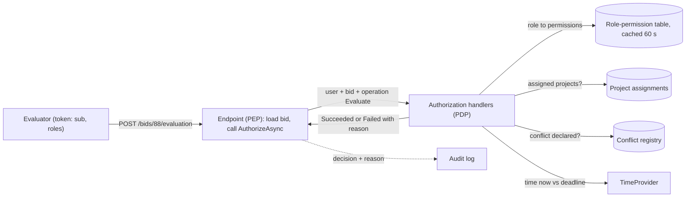
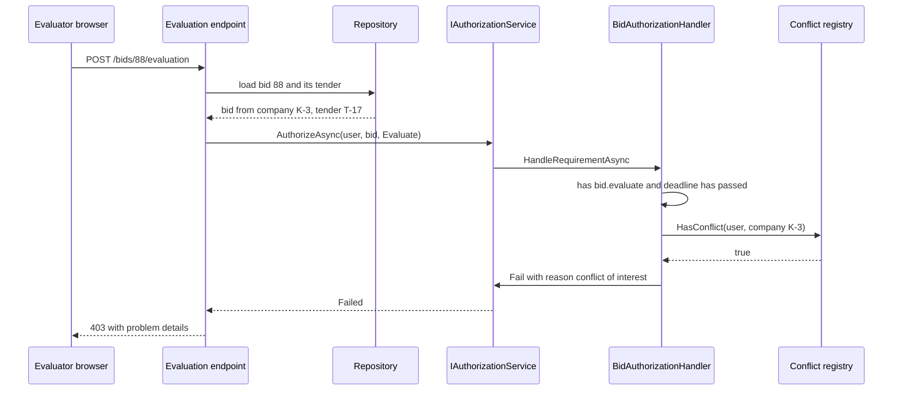

A municipal e-procurement portal runs tenders for road and drainage works. On day one the rules were simple: bidders submit bids, officers publish tenders, evaluators score bids. Three roles, three `[Authorize(Roles = "...")]` attributes. A year later the rules read like this: an evaluator may score a bid only after the bid deadline, only for tenders in projects they are assigned to, and never if they declared a conflict of interest with that bidder. An Executive Engineer may approve awards up to ₹50 lakh, a Superintending Engineer up to ₹5 crore. The person who created a payment can't approve it. Roles alone can't express any of that. This lesson shows how to grow from roles to policies without turning your code into a maze of `if` statements.

## Learning objectives

By the end of this lesson you will be able to:

1. Explain role-based (RBAC), attribute-based (ABAC), policy-based (PBAC) and relationship-based (ReBAC) access control, with an example where each one is the right fit.
2. Use roles as bundles of permissions, and check *permissions* in code instead of role names.
3. Build ASP.NET Core policies from requirements and handlers, including a dynamic policy provider.
4. Implement resource-based authorization with `IAuthorizationService` for ownership, assignment and time-window rules.
5. Express segregation of duties (maker-checker) and approval limits as policies.
6. Model roles and scoped assignments in PostgreSQL and query "who can do X on Y?".
7. Design authorization for a multi-tenant system at scale: where decisions are made, how permission data is cached, and how list endpoints are filtered.

## Prerequisites

- [Authentication versus authorization](#/lesson/m14-authn-vs-authz): claims, 401 versus 403 versus 404, and the IDOR problem.
- [Authentication and authorization in ASP.NET Core](#/lesson/m03-authn-authz): `[Authorize]`, middleware order.
- [Dependency injection](#/lesson/m03-dependency-injection): handlers are registered as services.

## Explain it like I'm a beginner

Think about a hospital.

**Roles** are job titles: doctor, nurse, receptionist, pharmacist. Each title comes with a list of things you're allowed to do. A nurse may record vital signs. A receptionist may book appointments. When a new nurse joins, you don't list all 40 things nurses may do. You just say "she's a nurse". That is **role-based access control (RBAC)**: users get roles, roles carry permissions.

But real hospital rules are more specific than job titles:

- A doctor may read a patient's file **only if that patient is under their care**. (A relationship between the doctor and the patient.)
- A pharmacist may dispense controlled drugs **only during their shift, and only with a second pharmacist's sign-off**. (Time, and a second person.)
- Anyone may open a patient's file **in an emergency**, but it is logged and reviewed. (Context, plus "break-glass".)

These rules look at **attributes**: of the person (department, shift), of the thing (which patient, which ward), of the action (read, dispense) and of the situation (time, emergency flag). A rule that combines attributes is a **policy**. Systems built on such rules are called **attribute-based** or **policy-based access control (ABAC / PBAC)**. When the most important attribute is a *relationship* ("under their care", "member of this project", "owner of this file"), people call it **relationship-based access control (ReBAC)**.

The practical approach most teams end up with: **roles for the coarse picture, policies for the specific rules.**

## First-principles explanation

### RBAC: roles as bundles of permissions

RBAC has three ideas:

1. **Permissions** are named actions: `bid.submit`, `bid.evaluate`, `award.approve`.
2. **Roles** are named sets of permissions: `Evaluator = {bid.read, bid.evaluate}`.
3. **Assignments** link users to roles, optionally **scoped**: "Asha is Evaluator *on project NH-48*".

The most important habit: **check permissions in code, not role names.** `User.IsInRole("Evaluator")` scattered across 60 endpoints means a new role "Senior Evaluator" requires editing 60 places. A check for the permission `bid.evaluate` doesn't change when roles are reorganised. Only the role → permission table does.

RBAC is excellent when:

- Rules depend mostly on *what kind of user* someone is.
- An administrator must be able to answer "what can Ravi do?" by reading a list.
- Auditors ask for access reviews ("show every user with `award.approve`").

RBAC struggles with:

- **Ownership and relationships** ("their own bid", "patients under their care"). You'd need a role per object.
- **Context** (time windows, amounts, location, device posture).
- **Role explosion.** Encoding attributes into roles produces names like `Evaluator_NH48_RoadWorks_Under50L`. Organisations with hundreds of such roles stop being able to review them.

### ABAC and PBAC: rules over attributes

An ABAC decision evaluates a rule over four groups of attributes:

| Group | Examples in the tender portal |
|---|---|
| Subject | user id, roles, department, approval limit, assigned projects |
| Resource | tender id, project, estimated value, deadline, bid owner, status |
| Action | read, submit, evaluate, approve |
| Environment | current time, IP range, MFA used for this session, emergency flag |

A rule reads like a sentence: *"Allow `evaluate` on a bid if the subject has `bid.evaluate`, the subject is assigned to the bid's project, now is after the tender's deadline, and the subject has no conflict declaration for this bidder."*

"PBAC" is mostly a name for the same idea with the emphasis on **policies as named, testable, centrally managed units**. In ASP.NET Core, a policy is a named list of requirements, and each requirement is checked by handlers.

Trade-offs of ABAC/PBAC:

| You gain | You pay |
|---|---|
| Precise rules without role explosion | "Who can do X?" is no longer a simple lookup. You must evaluate the policy for each candidate |
| Context-aware decisions (time, amount, MFA) | Attributes must be fresh and correct. A stale "assigned projects" list is a security bug |
| Rules live in one place, testable as units | Harder for non-developers to review than a role list |

### ReBAC: relationships as the main attribute

Many rules are really about a graph: user → member of → team → editor of → folder → contains → document. Google's Zanzibar paper describes a system that stores such relationship tuples (`doc:42#editor@team:roads#member`) and answers "can user U edit doc 42?" by walking the graph, at very large scale. Open-source systems inspired by it (SpiceDB, OpenFGA and others) exist. You need this style when sharing is user-driven (Google Drive-like folders, nested groups). For most line-of-business apps, a few membership tables and policies are enough.

### Where decisions are made: PEP, PDP, PIP

Security literature names the pieces, and the names help in design discussions:

- **Policy Enforcement Point (PEP)**: the code that stops the request. In ASP.NET Core: the authorization middleware, or your endpoint calling `IAuthorizationService`.
- **Policy Decision Point (PDP)**: the code that evaluates the rules. In ASP.NET Core: the authorization handlers. In larger systems it might be a separate service (for example Open Policy Agent).
- **Policy Information Point (PIP)**: where attributes come from: claims in the token, the database (project assignments), a cache.

Keeping these separate is what lets you unit-test the decision logic without HTTP and swap where attributes come from.

### ASP.NET Core's model

- A **requirement** (`IAuthorizationRequirement`) is a piece of data describing what must be true: "has permission `bid.evaluate`", "amount within approval limit".
- A **handler** (`AuthorizationHandler<TRequirement>` or `AuthorizationHandler<TRequirement, TResource>`) decides whether a requirement is met. It calls `context.Succeed(requirement)` to approve, does nothing to abstain, or calls `context.Fail()` to veto.
- A **policy** is a named set of requirements. **All** requirements must succeed. For a single requirement, **any** handler can satisfy it, unless some handler calls `Fail()`, which overrides everything.
- **Resource-based authorization**: the endpoint loads the resource and calls `IAuthorizationService.AuthorizeAsync(User, resource, requirementOrPolicy)`. Attributes like `[Authorize]` run before your code, before the resource is loaded, so they can't check ownership.
- **`IAuthorizationPolicyProvider`** builds policies on demand, so `"perm:bid.evaluate"` can become a policy without registering one per permission.

### Common rules and how to express them

| Rule | Model | ASP.NET Core |
|---|---|---|
| Only officers publish tenders | RBAC permission | Policy with `PermissionRequirement("tender.publish")` |
| Bidders edit only their own draft bids before the deadline | Ownership + state + time | Resource handler on `Bid` |
| Award approval up to the user's limit | ABAC (subject attribute vs resource attribute) | Requirement + handler comparing a claim with the tender value |
| Maker can't approve their own payment | Segregation of duties | Resource handler: `payment.CreatedBy != user` → else `Fail()` |
| Evaluator can't score bids with declared conflicts | ABAC with an external attribute (PIP) | Resource handler that queries the conflict registry, `Fail()` with a reason |
| Auditors read everything but change nothing | RBAC | Permissions `*.read` only |
| Break-glass access in emergencies | Context + audit | Separate policy requiring a justification claim, alerting and logging |

### Failure modes

- **Fail-open handlers.** A handler that catches an exception from the conflict registry and calls `Succeed` "so evaluators aren't blocked". Under a database outage, every conflict check passes. Authorization must fail **closed**.
- **Stale permissions in tokens.** Permissions copied into a JWT at login stay valid until it expires. Keep tokens to roles or identity, and resolve fine-grained permissions server-side with a short cache (see [JWT validation and limitations](#/lesson/m14-jwt)).
- **List endpoints that filter after loading.** Loading 10,000 bids and filtering in memory leaks data through counts and pagination, and is slow. Push authorization into the query (`WHERE project_id = ANY(@assignedProjects)`) or into PostgreSQL row-level security (see [Multi-tenant security](#/lesson/m14-multi-tenant-security)).
- **Role names as magic strings** sprinkled through code, where a typo (`"Evalutor"`) silently denies, or worse, an inverted check silently allows.
- **No audit of denials.** Repeated 403s from one account are an early signal of probing or misconfiguration.

### When a simpler alternative is enough

- Three roles, no ownership rules, 10 endpoints: `RequireRole` policies are fine. Don't build a permission system.
- A single-tenant internal app where every user may see everything they can reach: authentication plus one admin policy.
- Don't adopt an external policy engine (OPA, a Zanzibar clone) until you have several services that must share the same rules, or user-driven sharing. Each external engine adds a network hop, a deployment, and a second language for rules.

## Visual explanation

### Policy enforcement, decision and information points



The endpoint is the **enforcement point**: it can't decide anything itself, it only loads the resource and asks. The handlers are the **decision point**: they combine the user's claims with **information points**, the role-permission table, project assignments, the conflict registry and the clock. Each information source is behind an interface, which is what makes the handlers unit-testable. The decision comes back to the endpoint, which returns 200, 403 or 404, and every denial is written to the audit log with its reason.

### A resource-based check, step by step



The coarse check (does this user have any evaluation permission?) could happen at the endpoint's policy. The fine checks need the bid, so they happen after loading it. The handler calls `Fail` with a reason rather than just not succeeding, so even if another handler for the same requirement would succeed (say, a "super evaluator" rule added later), the conflict of interest still vetoes the decision. The endpoint returns 403, not 404, because evaluators are allowed to know the bid exists. They're blocked from scoring it.

## Step-by-step example

### Step 1 — roles on attributes

```csharp
[Authorize(Roles = "Evaluator,ProcurementOfficer")]
public IActionResult Evaluate(string bidId, EvaluationDto dto) { /* ... */ }
```

Works for week one. Problems appear quickly: officers shouldn't evaluate, new roles need code edits, and nothing checks the deadline or conflicts.

### Step 2 — roles become permission bundles

Create the permission list and a role → permission map. Endpoints require permissions: `.RequirePermission("bid.evaluate")`. A dynamic policy provider turns `"perm:bid.evaluate"` into a policy with a `PermissionRequirement`. Reorganising roles now touches only the map.

### Step 3 — resource rules in a handler

`BidAuthorizationHandler` handles `Edit` and `Evaluate` for a `(Bid, Tender)` pair: bidders edit their own drafts before the deadline; evaluators score after the deadline, with no conflict declared. Endpoints call `AuthorizeAsync(User, new BidContext(bid, tender), BidOperations.Evaluate)`.

### Step 4 — attribute rules

`ApprovalLimitHandler` compares the user's `approval_limit_inr` claim (from HR data, resolved at login or from a cache) with the tender's estimated value. A ₹3.2 crore award needs a Superintending Engineer; an Executive Engineer gets 403 with a clear reason.

### Step 5 — queries that respect authorization

The "my bids to evaluate" list doesn't load all bids. It queries `WHERE tender.project_id = ANY(@assignedProjects) AND tender.deadline < now() AND NOT EXISTS (conflict…)`. The handler and the query implement the same rule, so a test checks they agree.

## Production-style C# implementation

```text
Tenders.Api/
  Program.cs
  Tenders/
    Domain.cs
    InMemoryStores.cs
  Authorization/
    Permissions.cs
    PermissionAuthorization.cs
    BidAuthorization.cs
    ApprovalLimit.cs
```

```csharp file=Tenders/Domain.cs
namespace Tenders.Domain;

public enum BidStatus { Draft, Submitted, Withdrawn }

public sealed record Tender(string Id, string ProjectId, decimal EstimatedValueInr, DateTimeOffset BidDeadline);

public sealed class Bid(string id, string tenderId, string bidderCompanyId)
{
    public string Id { get; } = id;
    public string TenderId { get; } = tenderId;
    public string BidderCompanyId { get; } = bidderCompanyId;
    public BidStatus Status { get; set; } = BidStatus.Draft;
    public decimal QuotedAmountInr { get; set; }
    public int? Score { get; set; }
    public string? EvaluatedBy { get; set; }
}

public interface ITenderStore
{
    Tender? FindTender(string id);
    Bid? FindBid(string id);
}

public interface IConflictRegistry
{
    /// <summary>True if the user declared a conflict of interest with this bidder company.</summary>
    bool HasConflict(string userId, string bidderCompanyId);
}

public interface IAssignmentStore
{
    IReadOnlySet<string> ProjectsFor(string userId);
}
```

```csharp file=Tenders/InMemoryStores.cs
using Tenders.Domain;

namespace Tenders.Infrastructure;

public sealed class InMemoryTenderStore : ITenderStore
{
    private readonly Dictionary<string, Tender> _tenders = new()
    {
        ["T-17"] = new Tender("T-17", "P-NH48", 3_20_00_000m, new DateTimeOffset(2026, 10, 15, 11, 30, 0, TimeSpan.FromHours(5.5))),
    };
    private readonly Dictionary<string, Bid> _bids = new()
    {
        ["B-88"] = new Bid("B-88", "T-17", "K-3") { Status = BidStatus.Submitted, QuotedAmountInr = 3_05_00_000m },
    };
    public Tender? FindTender(string id) => _tenders.GetValueOrDefault(id);
    public Bid? FindBid(string id) => _bids.GetValueOrDefault(id);
}

public sealed class InMemoryConflictRegistry : IConflictRegistry
{
    private readonly HashSet<(string User, string Company)> _declared = [("u-meera", "K-3")];
    public bool HasConflict(string userId, string bidderCompanyId) => _declared.Contains((userId, bidderCompanyId));
}

public sealed class InMemoryAssignmentStore : IAssignmentStore
{
    private readonly Dictionary<string, HashSet<string>> _byUser = new()
    {
        ["u-asha"] = ["P-NH48"],
        ["u-meera"] = ["P-NH48", "P-RING"],
    };
    public IReadOnlySet<string> ProjectsFor(string userId) =>
        _byUser.TryGetValue(userId, out var set) ? set : new HashSet<string>();
}
```

```csharp file=Authorization/Permissions.cs
using System.Collections.Frozen;

namespace Tenders.Authorization;

public static class Permissions
{
    public const string TenderPublish = "tender.publish";
    public const string BidSubmit = "bid.submit";
    public const string BidRead = "bid.read";
    public const string BidEvaluate = "bid.evaluate";
    public const string AwardApprove = "award.approve";
    public const string AuditRead = "audit.read";
}

public interface IRolePermissionStore
{
    IReadOnlySet<string> PermissionsFor(IEnumerable<string> roles);
}

/// <summary>Role → permissions. In production this comes from a table and is cached for about a minute,
/// so an administrator's change applies everywhere quickly without a deploy.</summary>
public sealed class StaticRolePermissionStore : IRolePermissionStore
{
    private static readonly FrozenDictionary<string, string[]> Map = new Dictionary<string, string[]>
    {
        ["Bidder"] = [Permissions.BidSubmit],
        ["Evaluator"] = [Permissions.BidRead, Permissions.BidEvaluate],
        ["ProcurementOfficer"] = [Permissions.TenderPublish, Permissions.BidRead],
        ["ExecutiveEngineer"] = [Permissions.BidRead, Permissions.AwardApprove],
        ["SuperintendingEngineer"] = [Permissions.BidRead, Permissions.AwardApprove],
        ["Auditor"] = [Permissions.BidRead, Permissions.AuditRead],
    }.ToFrozenDictionary(StringComparer.Ordinal);

    public IReadOnlySet<string> PermissionsFor(IEnumerable<string> roles) =>
        roles.SelectMany(r => Map.GetValueOrDefault(r) ?? []).ToHashSet(StringComparer.Ordinal);
}
```

```csharp file=Authorization/PermissionAuthorization.cs
using System.Collections.Concurrent;
using System.Security.Claims;
using Microsoft.AspNetCore.Authorization;
using Microsoft.Extensions.Options;

namespace Tenders.Authorization;

public sealed class PermissionRequirement(string permission) : IAuthorizationRequirement
{
    public string Permission { get; } = permission;
}

public sealed class PermissionHandler(IRolePermissionStore store) : AuthorizationHandler<PermissionRequirement>
{
    protected override Task HandleRequirementAsync(AuthorizationHandlerContext context, PermissionRequirement requirement)
    {
        var roles = context.User.FindAll(ClaimTypes.Role).Select(c => c.Value);
        if (store.PermissionsFor(roles).Contains(requirement.Permission)) context.Succeed(requirement);
        return Task.CompletedTask;   // abstain otherwise: no permission means no success
    }
}

/// <summary>Turns "perm:bid.evaluate" into a policy on demand, so permissions need no individual registration.</summary>
public sealed class PermissionPolicyProvider(IOptions<AuthorizationOptions> options) : IAuthorizationPolicyProvider
{
    public const string Prefix = "perm:";
    private readonly DefaultAuthorizationPolicyProvider _fallback = new(options);
    private readonly ConcurrentDictionary<string, AuthorizationPolicy> _cache = new(StringComparer.Ordinal);

    public Task<AuthorizationPolicy?> GetPolicyAsync(string policyName)
    {
        if (!policyName.StartsWith(Prefix, StringComparison.Ordinal)) return _fallback.GetPolicyAsync(policyName);
        var policy = _cache.GetOrAdd(policyName, name => new AuthorizationPolicyBuilder()
            .RequireAuthenticatedUser()
            .AddRequirements(new PermissionRequirement(name[Prefix.Length..]))
            .Build());
        return Task.FromResult<AuthorizationPolicy?>(policy);
    }

    public Task<AuthorizationPolicy> GetDefaultPolicyAsync() => _fallback.GetDefaultPolicyAsync();
    public Task<AuthorizationPolicy?> GetFallbackPolicyAsync() => _fallback.GetFallbackPolicyAsync();
}

public static class PermissionEndpointExtensions
{
    public static TBuilder RequirePermission<TBuilder>(this TBuilder builder, string permission)
        where TBuilder : IEndpointConventionBuilder =>
        builder.RequireAuthorization(PermissionPolicyProvider.Prefix + permission);
}
```

```csharp file=Authorization/BidAuthorization.cs
using System.Security.Claims;
using Microsoft.AspNetCore.Authorization;
using Microsoft.AspNetCore.Authorization.Infrastructure;
using Tenders.Domain;

namespace Tenders.Authorization;

public static class BidOperations
{
    public static readonly OperationAuthorizationRequirement Edit = new() { Name = nameof(Edit) };
    public static readonly OperationAuthorizationRequirement Evaluate = new() { Name = nameof(Evaluate) };
}

public sealed record BidContext(Bid Bid, Tender Tender);

public sealed class BidAuthorizationHandler(IRolePermissionStore permissions, IAssignmentStore assignments,
                                            IConflictRegistry conflicts, TimeProvider clock)
    : AuthorizationHandler<OperationAuthorizationRequirement, BidContext>
{
    protected override Task HandleRequirementAsync(AuthorizationHandlerContext context,
        OperationAuthorizationRequirement requirement, BidContext resource)
    {
        var user = context.User;
        var userId = user.FindFirstValue("sub");
        if (userId is null) return Task.CompletedTask;
        var now = clock.GetUtcNow();
        var (bid, tender) = resource;

        switch (requirement.Name)
        {
            case nameof(BidOperations.Edit):
                // Ownership + state + time: only the bidder's own company, only drafts, only before the deadline.
                if (user.FindFirstValue("company_id") == bid.BidderCompanyId &&
                    bid.Status == BidStatus.Draft && now < tender.BidDeadline)
                    context.Succeed(requirement);
                break;

            case nameof(BidOperations.Evaluate):
                var perms = permissions.PermissionsFor(user.FindAll(ClaimTypes.Role).Select(c => c.Value));
                if (!perms.Contains(Permissions.BidEvaluate)) break;
                if (!assignments.ProjectsFor(userId).Contains(tender.ProjectId)) break;
                if (now < tender.BidDeadline) { context.Fail(new AuthorizationFailureReason(this, "Bids can't be evaluated before the deadline.")); break; }
                if (conflicts.HasConflict(userId, bid.BidderCompanyId))
                {
                    // Veto: no other handler can override a declared conflict of interest.
                    context.Fail(new AuthorizationFailureReason(this, "You declared a conflict of interest with this bidder."));
                    break;
                }
                context.Succeed(requirement);
                break;
        }
        return Task.CompletedTask;
    }
}
```

```csharp file=Authorization/ApprovalLimit.cs
using System.Globalization;
using Microsoft.AspNetCore.Authorization;
using Tenders.Domain;

namespace Tenders.Authorization;

public sealed class ApprovalLimitRequirement : IAuthorizationRequirement
{
    public static readonly ApprovalLimitRequirement Instance = new();
}

/// <summary>ABAC: compares a subject attribute (approval limit) with a resource attribute (estimated value).</summary>
public sealed class ApprovalLimitHandler : AuthorizationHandler<ApprovalLimitRequirement, Tender>
{
    protected override Task HandleRequirementAsync(AuthorizationHandlerContext context, ApprovalLimitRequirement requirement, Tender tender)
    {
        var raw = context.User.FindFirst("approval_limit_inr")?.Value;
        if (decimal.TryParse(raw, NumberStyles.Number, CultureInfo.InvariantCulture, out var limit) && tender.EstimatedValueInr <= limit)
            context.Succeed(requirement);
        else
            context.Fail(new AuthorizationFailureReason(this,
                $"Award of ₹{tender.EstimatedValueInr:N0} exceeds your approval limit."));
        return Task.CompletedTask;
    }
}
```

```csharp file=Program.cs
using System.Security.Claims;
using Microsoft.AspNetCore.Authentication.Cookies;
using Microsoft.AspNetCore.Authorization;
using Tenders.Authorization;
using Tenders.Domain;
using Tenders.Infrastructure;

var builder = WebApplication.CreateBuilder(args);

builder.Services.AddSingleton(TimeProvider.System);
builder.Services.AddSingleton<ITenderStore, InMemoryTenderStore>();
builder.Services.AddSingleton<IConflictRegistry, InMemoryConflictRegistry>();
builder.Services.AddSingleton<IAssignmentStore, InMemoryAssignmentStore>();
builder.Services.AddSingleton<IRolePermissionStore, StaticRolePermissionStore>();

builder.Services.AddSingleton<IAuthorizationPolicyProvider, PermissionPolicyProvider>();
builder.Services.AddSingleton<IAuthorizationHandler, PermissionHandler>();
builder.Services.AddSingleton<IAuthorizationHandler, BidAuthorizationHandler>();
builder.Services.AddSingleton<IAuthorizationHandler, ApprovalLimitHandler>();

builder.Services.AddAuthentication(CookieAuthenticationDefaults.AuthenticationScheme).AddCookie();
builder.Services.AddAuthorizationBuilder()
    .SetFallbackPolicy(new AuthorizationPolicyBuilder().RequireAuthenticatedUser().Build());   // deny by default

var app = builder.Build();
app.UseAuthentication();
app.UseAuthorization();

app.MapPost("/tenders/{id}/publish", (string id) => Results.Accepted())
   .RequirePermission(Permissions.TenderPublish);

app.MapPut("/bids/{id}", async (string id, decimal amount, ClaimsPrincipal user, ITenderStore store, IAuthorizationService authz) =>
{
    var bid = store.FindBid(id);
    var tender = bid is null ? null : store.FindTender(bid.TenderId);
    if (bid is null || tender is null) return Results.NotFound();
    var result = await authz.AuthorizeAsync(user, new BidContext(bid, tender), BidOperations.Edit);
    if (!result.Succeeded) return Results.NotFound();   // other companies' bids are invisible
    bid.QuotedAmountInr = amount;
    return Results.NoContent();
}).RequirePermission(Permissions.BidSubmit);

app.MapPost("/bids/{id}/evaluation", async (string id, int score, ClaimsPrincipal user, ITenderStore store, IAuthorizationService authz) =>
{
    var bid = store.FindBid(id);
    var tender = bid is null ? null : store.FindTender(bid.TenderId);
    if (bid is null || tender is null) return Results.NotFound();
    var result = await authz.AuthorizeAsync(user, new BidContext(bid, tender), BidOperations.Evaluate);
    if (!result.Succeeded)
    {
        var reason = result.Failure?.FailureReasons.FirstOrDefault()?.Message ?? "You can't evaluate this bid.";
        return Results.Problem(reason, statusCode: StatusCodes.Status403Forbidden);
    }
    bid.Score = score;
    bid.EvaluatedBy = user.FindFirstValue("sub");
    return Results.NoContent();
}).RequirePermission(Permissions.BidEvaluate);

app.MapPost("/tenders/{id}/award", async (string id, ClaimsPrincipal user, ITenderStore store, IAuthorizationService authz) =>
{
    var tender = store.FindTender(id);
    if (tender is null) return Results.NotFound();
    var result = await authz.AuthorizeAsync(user, tender, ApprovalLimitRequirement.Instance);
    return result.Succeeded
        ? Results.Accepted()
        : Results.Problem(result.Failure?.FailureReasons.FirstOrDefault()?.Message, statusCode: StatusCodes.Status403Forbidden);
}).RequirePermission(Permissions.AwardApprove);

app.Run();
```

What to notice:

- **Two layers.** `RequirePermission` is the cheap, coarse check that runs before the endpoint. The resource handlers run after loading data.
- **Permissions, not role names, at endpoints.** Only `StaticRolePermissionStore` knows role names.
- **`Fail` with reasons for vetoes.** The conflict-of-interest rule can't be overridden by a future handler that also handles `Evaluate`, and the user sees *why* they were refused.
- **404 for bids of other companies, 403 for evaluators.** What a caller may know shapes the status code.
- **Fallback policy.** Any endpoint without metadata requires an authenticated user.

## Bad design vs good design

**Bad:**

```csharp
public IActionResult Approve(string paymentId)
{
    var p = _db.Payments.Find(paymentId);
    if (User.IsInRole("Admin") || User.IsInRole("FinanceHead") || User.IsInRole("FinanceHead2") ||
        (User.IsInRole("Accountant") && p.Amount < 50000) || User.Identity!.Name == "ramesh.k")
    {
        p.Approve(User.Identity!.Name!);
        _db.SaveChanges();
        return Ok();
    }
    return Forbid();
}
```

Problems: role names hard-coded in an endpoint (and duplicated in dozens of others), a named individual baked into code, no segregation of duties (the accountant who created the payment can approve it), the ₹50,000 threshold buried in code where an auditor can't find it, and no reason given or logged.

**Good:** a `PaymentApprovalRequirement` with one handler that checks `payment.CreatedBy != user`, the permission `payment.approve`, and the user's approval-limit attribute, failing with a reason in each case. Thresholds live in data (the user's limit) and the rule lives in one tested class.

:::callout type=tradeoff title="Permissions in the token or looked up per request?"
Putting permissions in the token avoids lookups but freezes them until the token expires, and large permission sets bloat tokens. Looking them up per request (with a 30–60 s in-memory cache keyed by user) keeps tokens small and changes fast, at the cost of a cache and a dependency. A common middle ground: roles in the token, role → permission expansion from a cached table, and resource attributes from the database.
:::

:::callout type=mistake title="Authorization in the UI only"
Hiding the "Approve" button when the user lacks the permission is good UX. It is not security. Every rule enforced in the UI must also be enforced by the API. A useful pattern is an endpoint like `GET /bids/88/permissions` that returns what the current user may do, computed by the same handlers, so the UI and the API never disagree.
:::

## Practical playground

The SQL playground below holds the tender portal's access data: users, roles, permissions, scoped role assignments and conflict declarations. Try writing queries such as "list every permission Meera has on project P-NH48", "who can approve awards anywhere?", and "which assignments expire in the next 30 days?". These are exactly the questions an access review asks.

:::playground type=sql title="Tender portal: roles, scopes and conflicts"
```sql
CREATE TABLE app_user (user_id int PRIMARY KEY, name text NOT NULL, active boolean NOT NULL);
CREATE TABLE role (role_id int PRIMARY KEY, name text UNIQUE NOT NULL);
CREATE TABLE role_permission (role_id int REFERENCES role, permission text NOT NULL, PRIMARY KEY (role_id, permission));
CREATE TABLE user_role (
  user_id     int REFERENCES app_user,
  role_id     int REFERENCES role,
  project_id  text,              -- NULL means every project
  valid_until date               -- NULL means no end date
);
CREATE TABLE conflict_declaration (user_id int REFERENCES app_user, tender_id text NOT NULL);
CREATE TABLE tender (tender_id text PRIMARY KEY, project_id text NOT NULL, estimated_value_inr numeric NOT NULL);

INSERT INTO app_user VALUES (1,'Asha',true),(2,'Ravi',true),(3,'Meera',true),(4,'Sunil',false),(5,'Farah',true),(6,'Arjun',true);
INSERT INTO role VALUES (1,'Evaluator'),(2,'ProcurementOfficer'),(3,'Auditor'),(4,'ExecutiveEngineer');
INSERT INTO role_permission VALUES
 (1,'bid.read'),(1,'bid.evaluate'),
 (2,'tender.publish'),(2,'bid.read'),(2,'bid.evaluate'),
 (3,'bid.read'),(3,'audit.read'),
 (4,'bid.read'),(4,'award.approve');
INSERT INTO user_role VALUES
 (1,1,'P-NH48',NULL),(2,1,'P-RING',NULL),(3,2,NULL,NULL),(4,1,'P-NH48',NULL),
 (5,1,'P-NH48','2026-09-30'),(5,3,'P-NH48',NULL),(6,2,NULL,'2026-12-31'),(6,1,'P-NH48',NULL),(6,4,'P-RING',NULL);
INSERT INTO conflict_declaration VALUES (3,'T-17');
INSERT INTO tender VALUES ('T-17','P-NH48',32000000),('T-18','P-RING',4500000);
```
:::

## Exercises

:::exercise id=m14-rbac-pbac-ex1 difficulty=beginner kind=code title="Roles as permission bundles"
Write `PermissionResolver`, which expands a user's roles into permissions and answers "can this user do X?".
::requirements
- Built from a dictionary `role → permissions`.
- `PermissionsFor(roles)` returns the union of permissions of all known roles. Unknown roles contribute nothing (and don't throw).
- `Can(roles, permission)` returns true if any role grants the permission.
- Role and permission names are case-sensitive (ordinal).
- The resolver must not be affected if the caller later mutates the dictionary it was built from.
::acceptance
- `["Evaluator"]` → `{bid.read, bid.evaluate}`.
- `["Evaluator", "Auditor"]` → union, with `bid.read` once.
- `["evaluator"]` (lower case) grants nothing.
- Changing the original dictionary after construction doesn't change answers.
::hint
A `HashSet<string>` handles duplicates for you.
::hint
Copy the input dictionary in the constructor, including copying each permission list.
::hint
`roles.SelectMany(r => _map.TryGetValue(r, out var p) ? p : Array.Empty<string>())`
::starter
```csharp file=PermissionResolver.cs
using System;
using System.Collections.Generic;
using System.Linq;

public sealed class PermissionResolver
{
    public PermissionResolver(IReadOnlyDictionary<string, string[]> rolePermissions) => throw new NotImplementedException();

    public IReadOnlySet<string> PermissionsFor(IEnumerable<string> roles) => throw new NotImplementedException();

    public bool Can(IEnumerable<string> roles, string permission) => throw new NotImplementedException();
}
```
::tests
```csharp file=PermissionResolverTests.cs
using System.Collections.Generic;
using Xunit;

public class PermissionResolverTests
{
    private static Dictionary<string, string[]> Map() => new()
    {
        ["Evaluator"] = new[] { "bid.read", "bid.evaluate" },
        ["Auditor"] = new[] { "bid.read", "audit.read" },
        ["Bidder"] = new[] { "bid.submit" },
    };

    [Fact]
    public void Single_role()
    {
        var p = new PermissionResolver(Map()).PermissionsFor(new[] { "Evaluator" });
        Assert.Equal(2, p.Count);
        Assert.Contains("bid.evaluate", p);
    }

    [Fact]
    public void Union_without_duplicates()
    {
        var p = new PermissionResolver(Map()).PermissionsFor(new[] { "Evaluator", "Auditor" });
        Assert.Equal(3, p.Count);
    }

    [Fact]
    public void Unknown_role_grants_nothing() => Assert.Empty(new PermissionResolver(Map()).PermissionsFor(new[] { "Wizard" }));

    [Fact]
    public void Case_sensitive() => Assert.False(new PermissionResolver(Map()).Can(new[] { "evaluator" }, "bid.evaluate"));

    [Fact]
    public void Can_checks_any_role() => Assert.True(new PermissionResolver(Map()).Can(new[] { "Bidder", "Auditor" }, "audit.read"));

    [Fact]
    public void Defensive_copy()
    {
        var map = Map();
        var resolver = new PermissionResolver(map);
        map["Bidder"] = new[] { "award.approve" };
        map["Evaluator"][0] = "award.approve";
        Assert.False(resolver.Can(new[] { "Bidder", "Evaluator" }, "award.approve"));
    }
}
```
::solution
```csharp file=PermissionResolver.cs
using System;
using System.Collections.Generic;
using System.Linq;

public sealed class PermissionResolver
{
    private readonly Dictionary<string, HashSet<string>> _map;

    public PermissionResolver(IReadOnlyDictionary<string, string[]> rolePermissions) =>
        _map = rolePermissions.ToDictionary(kv => kv.Key, kv => new HashSet<string>(kv.Value, StringComparer.Ordinal), StringComparer.Ordinal);

    public IReadOnlySet<string> PermissionsFor(IEnumerable<string> roles)
    {
        var result = new HashSet<string>(StringComparer.Ordinal);
        foreach (var role in roles)
            if (_map.TryGetValue(role, out var perms)) result.UnionWith(perms);
        return result;
    }

    public bool Can(IEnumerable<string> roles, string permission) =>
        roles.Any(r => _map.TryGetValue(r, out var perms) && perms.Contains(permission));
}
```

The defensive copy matters more than it looks. If the resolver kept a reference to the caller's arrays, any code holding the original dictionary could quietly grant `award.approve` at runtime. Authorization data should be immutable once loaded and replaced as a whole when it changes (for example, swap in a new resolver every 60 seconds from the database).
::mistakes
- Case-insensitive comparisons for permission names, which merge `Bid.Evaluate` and `bid.evaluate` and hide typos in configuration.
- Throwing on unknown roles. A role removed from the map while users still have it in old tokens should simply grant nothing.
::extensions
Add role inheritance (`SeniorEvaluator` includes `Evaluator`) and detect cycles at construction time.
:::

:::exercise id=m14-rbac-pbac-ex2 difficulty=beginner kind=code title="An ownership handler for site diary entries"
Site engineers write daily diary entries (weather, labour count, work done). Write an ASP.NET Core `AuthorizationHandler` that decides who may edit an entry.
::requirements
- The author may edit their own entry within 24 hours of creating it.
- A user with role `SiteManager` may edit any entry for a site they manage (claim `managed_site`, one claim per site), at any time.
- Everyone else, including the author after 24 hours, is not authorized (the handler simply doesn't succeed).
- Time comes from an injected `TimeProvider`.
::acceptance
- Author at 23 hours: allowed. Author at 25 hours: not allowed.
- Another engineer: not allowed.
- Site manager of the entry's site: allowed even after a week. Site manager of a different site: not allowed.
- A user with no `sub` claim: not allowed.
::hint
Inherit from `AuthorizationHandler<EditDiaryRequirement, DiaryEntry>` and override `HandleRequirementAsync`.
::hint
`context.User.FindFirst("sub")?.Value` gives the user id. `context.User.IsInRole("SiteManager")` checks the role, provided the identity's role claim type is `ClaimTypes.Role`.
::hint
`context.User.HasClaim("managed_site", entry.SiteId)` checks the site.
::hint
In tests, build `new AuthorizationHandlerContext(new[] { requirement }, user, entry)` and call `await handler.HandleAsync(ctx)`. Then check `ctx.HasSucceeded`.
::starter
```csharp file=DiaryAuthorization.cs
using System;
using System.Security.Claims;
using System.Threading.Tasks;
using Microsoft.AspNetCore.Authorization;

public sealed record DiaryEntry(string Id, string SiteId, string AuthorId, DateTimeOffset CreatedAt);

public sealed class EditDiaryRequirement : IAuthorizationRequirement { }

public sealed class EditDiaryHandler : AuthorizationHandler<EditDiaryRequirement, DiaryEntry>
{
    public static readonly TimeSpan AuthorEditWindow = TimeSpan.FromHours(24);
    private readonly TimeProvider _clock;
    public EditDiaryHandler(TimeProvider clock) => _clock = clock;

    protected override Task HandleRequirementAsync(AuthorizationHandlerContext context, EditDiaryRequirement requirement, DiaryEntry entry) =>
        throw new NotImplementedException();
}
```
::tests
```csharp file=DiaryAuthorizationTests.cs
using System;
using System.Security.Claims;
using System.Threading.Tasks;
using Microsoft.AspNetCore.Authorization;
using Xunit;

public sealed class SetClock(DateTimeOffset now) : TimeProvider
{
    public override DateTimeOffset GetUtcNow() => now;
}

public class DiaryAuthorizationTests
{
    private static readonly DateTimeOffset Created = new(2026, 10, 19, 18, 0, 0, TimeSpan.Zero);
    private static readonly DiaryEntry Entry = new("D-1", "SITE-PUNE-4", "u-ravi", Created);

    private static ClaimsPrincipal User(string? sub, params Claim[] extra)
    {
        var claims = new System.Collections.Generic.List<Claim>(extra);
        if (sub is not null) claims.Add(new Claim("sub", sub));
        return new ClaimsPrincipal(new ClaimsIdentity(claims, "test", "sub", ClaimTypes.Role));
    }

    private static async Task<bool> Check(ClaimsPrincipal user, TimeSpan after)
    {
        var req = new EditDiaryRequirement();
        var ctx = new AuthorizationHandlerContext(new IAuthorizationRequirement[] { req }, user, Entry);
        await new EditDiaryHandler(new SetClock(Created + after)).HandleAsync(ctx);
        return ctx.HasSucceeded;
    }

    [Fact] public async Task Author_within_window() => Assert.True(await Check(User("u-ravi"), TimeSpan.FromHours(23)));
    [Fact] public async Task Author_after_window() => Assert.False(await Check(User("u-ravi"), TimeSpan.FromHours(25)));
    [Fact] public async Task Other_engineer() => Assert.False(await Check(User("u-asha"), TimeSpan.FromHours(1)));

    [Fact] public async Task Manager_of_site_any_time() => Assert.True(await Check(
        User("u-meera", new Claim(ClaimTypes.Role, "SiteManager"), new Claim("managed_site", "SITE-PUNE-4")), TimeSpan.FromDays(7)));

    [Fact] public async Task Manager_of_other_site() => Assert.False(await Check(
        User("u-meera", new Claim(ClaimTypes.Role, "SiteManager"), new Claim("managed_site", "SITE-NAGPUR-1")), TimeSpan.FromHours(1)));

    [Fact] public async Task Managed_site_claim_without_role() => Assert.False(await Check(
        User("u-sunil", new Claim("managed_site", "SITE-PUNE-4")), TimeSpan.FromHours(30)));

    [Fact] public async Task No_sub_claim() => Assert.False(await Check(User(null), TimeSpan.FromHours(1)));
}
```
::solution
```csharp file=DiaryAuthorization.cs
using System;
using System.Security.Claims;
using System.Threading.Tasks;
using Microsoft.AspNetCore.Authorization;

public sealed record DiaryEntry(string Id, string SiteId, string AuthorId, DateTimeOffset CreatedAt);

public sealed class EditDiaryRequirement : IAuthorizationRequirement { }

public sealed class EditDiaryHandler : AuthorizationHandler<EditDiaryRequirement, DiaryEntry>
{
    public static readonly TimeSpan AuthorEditWindow = TimeSpan.FromHours(24);
    private readonly TimeProvider _clock;
    public EditDiaryHandler(TimeProvider clock) => _clock = clock;

    protected override Task HandleRequirementAsync(AuthorizationHandlerContext context, EditDiaryRequirement requirement, DiaryEntry entry)
    {
        var userId = context.User.FindFirst("sub")?.Value;
        if (userId is null) return Task.CompletedTask;

        var isAuthorInWindow = userId == entry.AuthorId && _clock.GetUtcNow() - entry.CreatedAt <= AuthorEditWindow;
        var isSiteManager = context.User.IsInRole("SiteManager") && context.User.HasClaim("managed_site", entry.SiteId);

        if (isAuthorInWindow || isSiteManager) context.Succeed(requirement);
        return Task.CompletedTask;
    }
}
```

Register it with `builder.Services.AddSingleton<IAuthorizationHandler, EditDiaryHandler>()` and call `authz.AuthorizeAsync(User, entry, new EditDiaryRequirement())` in the endpoint after loading the entry. The handler never calls `Fail()`, because "not the author" isn't a veto: a different handler (say, an auditor correction workflow) could legitimately satisfy the same requirement later.
::alternatives
Split the two rules into two handlers for the same requirement (`AuthorWindowHandler`, `SiteManagerHandler`). ASP.NET Core succeeds if either one succeeds. This keeps each rule tiny and lets you add rules without editing existing ones.
::mistakes
- Checking `managed_site` without the role, so any stale claim grants manager powers.
- Comparing `entry.AuthorId` with `User.Identity.Name`, which is often the email address, not the stable id.
- Using `DateTime.Now`.
:::

:::exercise id=m14-rbac-pbac-ex3 difficulty=intermediate kind=code title="Payment approval: maker-checker and limits"
Write `PaymentApprovalPolicy.Evaluate`, an attribute-based policy that returns a decision and a reason.
::requirements
- Deny with reason `"maker-checker"` if the approver created the payment.
- Deny with `"missing-permission"` if the approver lacks `payment.approve`.
- Deny with `"department"` if the payment's department differs from the approver's, unless the approver has `payment.approve.all-departments`.
- Deny with `"limit"` if the amount exceeds the approver's limit.
- Deny with `"mfa-required"` if the amount is ₹10 lakh or more and the session didn't use MFA.
- Otherwise allow with reason `"ok"`.
- Checks run in the order above, and the first failure is the reason.
::acceptance
- A finance officer approving their own ₹5,000 payment is denied with `maker-checker`.
- An approver with a ₹5 lakh limit approving ₹4.99 lakh in their department is allowed.
- ₹12 lakh with a ₹50 lakh limit, no MFA → `mfa-required`. With MFA → `ok`.
- A cross-department approval is allowed only with the all-departments permission.
::hint
Model the inputs as two records: `Approver` (id, department, permissions, limit, mfa) and `Payment` (id, createdBy, department, amount).
::hint
Each rule is one guard clause returning a `Decision`.
::hint
Use `decimal` for money and `>=` for the MFA threshold (`10_00_000m`).
::hint
```csharp
if (p.CreatedBy == a.UserId) return Decision.Deny("maker-checker");
if (!a.Permissions.Contains("payment.approve")) return Decision.Deny("missing-permission");
```
::starter
```csharp file=PaymentApprovalPolicy.cs
using System;
using System.Collections.Generic;

public sealed record Approver(string UserId, string Department, IReadOnlySet<string> Permissions, decimal LimitInr, bool UsedMfa);
public sealed record Payment(string Id, string CreatedBy, string Department, decimal AmountInr);

public sealed record Decision(bool Allowed, string Reason)
{
    public static Decision Allow() => new(true, "ok");
    public static Decision Deny(string reason) => new(false, reason);
}

public static class PaymentApprovalPolicy
{
    public const decimal MfaThresholdInr = 10_00_000m;
    public static Decision Evaluate(Approver approver, Payment payment) => throw new NotImplementedException();
}
```
::tests
```csharp file=PaymentApprovalPolicyTests.cs
using System.Collections.Generic;
using Xunit;

public class PaymentApprovalPolicyTests
{
    private static Approver A(decimal limit = 5_00_000m, bool mfa = false, string dept = "Roads", params string[] perms) =>
        new("u-asha", dept, new HashSet<string>(perms.Length == 0 ? new[] { "payment.approve" } : perms), limit, mfa);

    private static Payment P(decimal amount, string createdBy = "u-ravi", string dept = "Roads") => new("PAY-1", createdBy, dept, amount);

    [Fact] public void Maker_cannot_check() =>
        Assert.Equal(Decision.Deny("maker-checker"), PaymentApprovalPolicy.Evaluate(A(), P(5_000m, createdBy: "u-asha")));

    [Fact] public void Needs_permission() =>
        Assert.Equal("missing-permission", PaymentApprovalPolicy.Evaluate(A(perms: "payment.view"), P(5_000m)).Reason);

    [Fact] public void Within_limit_is_allowed() =>
        Assert.Equal(Decision.Allow(), PaymentApprovalPolicy.Evaluate(A(), P(4_99_000m)));

    [Fact] public void Over_limit() => Assert.Equal("limit", PaymentApprovalPolicy.Evaluate(A(), P(5_00_001m)).Reason);

    [Fact] public void Other_department_denied() =>
        Assert.Equal("department", PaymentApprovalPolicy.Evaluate(A(), P(1_000m, dept: "Water")).Reason);

    [Fact] public void Other_department_with_all_departments() =>
        Assert.True(PaymentApprovalPolicy.Evaluate(A(perms: new[] { "payment.approve", "payment.approve.all-departments" }), P(1_000m, dept: "Water")).Allowed);

    [Theory]
    [InlineData(false, "mfa-required")]
    [InlineData(true, "ok")]
    public void Large_payments_need_mfa(bool mfa, string expected) =>
        Assert.Equal(expected, PaymentApprovalPolicy.Evaluate(A(limit: 50_00_000m, mfa: mfa), P(12_00_000m)).Reason);

    [Fact] public void Exactly_threshold_needs_mfa() =>
        Assert.Equal("mfa-required", PaymentApprovalPolicy.Evaluate(A(limit: 50_00_000m), P(10_00_000m)).Reason);
}
```
::solution
```csharp file=PaymentApprovalPolicy.cs
using System;
using System.Collections.Generic;

public sealed record Approver(string UserId, string Department, IReadOnlySet<string> Permissions, decimal LimitInr, bool UsedMfa);
public sealed record Payment(string Id, string CreatedBy, string Department, decimal AmountInr);

public sealed record Decision(bool Allowed, string Reason)
{
    public static Decision Allow() => new(true, "ok");
    public static Decision Deny(string reason) => new(false, reason);
}

public static class PaymentApprovalPolicy
{
    public const decimal MfaThresholdInr = 10_00_000m;

    public static Decision Evaluate(Approver a, Payment p)
    {
        if (string.Equals(p.CreatedBy, a.UserId, StringComparison.Ordinal)) return Decision.Deny("maker-checker");
        if (!a.Permissions.Contains("payment.approve")) return Decision.Deny("missing-permission");
        if (!string.Equals(p.Department, a.Department, StringComparison.Ordinal) &&
            !a.Permissions.Contains("payment.approve.all-departments")) return Decision.Deny("department");
        if (p.AmountInr > a.LimitInr) return Decision.Deny("limit");
        if (p.AmountInr >= MfaThresholdInr && !a.UsedMfa) return Decision.Deny("mfa-required");
        return Decision.Allow();
    }
}
```

This is a pure function of its inputs, which is the ideal shape for a policy: trivially testable, easy to review with the finance team, and easy to call from an ASP.NET Core handler (`var d = PaymentApprovalPolicy.Evaluate(ToApprover(context.User), payment); if (d.Allowed) context.Succeed(req); else context.Fail(new AuthorizationFailureReason(this, d.Reason));`). The MFA rule is a **step-up** requirement: the UI can react to `mfa-required` by asking the user to re-authenticate with MFA (OIDC `acr_values` or `max_age`) and retry.
::alternatives
External policy engines (Open Policy Agent with Rego, Cedar, Casbin) express the same rules as data in a dedicated language, so policies can be changed and audited separately from code. That is worth it when many services share the same rules or non-developers own them, and overkill for one service.
::mistakes
- Checking the limit before maker-checker, so a self-approval of a small amount reports `ok` from a later refactor that reorders rules. The order is a business decision; test it.
- Using `double` for money.
- Taking `UsedMfa` from the request body. It must come from the authentication result (the `amr` claim).
:::

:::exercise id=m14-rbac-pbac-ex4 difficulty=intermediate kind=sql ordered=true title="Who can evaluate bids for tender T-17?"
Using the tender portal's access tables, list every user who may perform `bid.evaluate` on tender `T-17` as of `2026-10-20`. A user qualifies if they are active, hold a role granting `bid.evaluate`, the role assignment is for the tender's project or for all projects (`project_id IS NULL`), the assignment hasn't expired (`valid_until IS NULL` or on/after the date), and they have no conflict declaration for `T-17`. Return `user_id` and `name`, once per user, ordered by `user_id`.
::setup
```sql
CREATE TABLE app_user (user_id int PRIMARY KEY, name text NOT NULL, active boolean NOT NULL);
CREATE TABLE role (role_id int PRIMARY KEY, name text UNIQUE NOT NULL);
CREATE TABLE role_permission (role_id int REFERENCES role, permission text NOT NULL, PRIMARY KEY (role_id, permission));
CREATE TABLE user_role (user_id int REFERENCES app_user, role_id int REFERENCES role, project_id text, valid_until date);
CREATE TABLE conflict_declaration (user_id int REFERENCES app_user, tender_id text NOT NULL);
CREATE TABLE tender (tender_id text PRIMARY KEY, project_id text NOT NULL, estimated_value_inr numeric NOT NULL);

INSERT INTO app_user VALUES (1,'Asha',true),(2,'Ravi',true),(3,'Meera',true),(4,'Sunil',false),(5,'Farah',true),(6,'Arjun',true);
INSERT INTO role VALUES (1,'Evaluator'),(2,'ProcurementOfficer'),(3,'Auditor'),(4,'ExecutiveEngineer');
INSERT INTO role_permission VALUES
 (1,'bid.read'),(1,'bid.evaluate'),
 (2,'tender.publish'),(2,'bid.read'),(2,'bid.evaluate'),
 (3,'bid.read'),(3,'audit.read'),
 (4,'bid.read'),(4,'award.approve');
INSERT INTO user_role VALUES
 (1,1,'P-NH48',NULL),(2,1,'P-RING',NULL),(3,2,NULL,NULL),(4,1,'P-NH48',NULL),
 (5,1,'P-NH48','2026-09-30'),(5,3,'P-NH48',NULL),(6,2,NULL,'2026-12-31'),(6,1,'P-NH48',NULL),(6,4,'P-RING',NULL);
INSERT INTO conflict_declaration VALUES (3,'T-17');
INSERT INTO tender VALUES ('T-17','P-NH48',32000000),('T-18','P-RING',4500000);
```
::check
```sql
SELECT DISTINCT u.user_id, u.name
FROM tender t
JOIN user_role ur ON (ur.project_id = t.project_id OR ur.project_id IS NULL)
JOIN role_permission rp ON rp.role_id = ur.role_id AND rp.permission = 'bid.evaluate'
JOIN app_user u ON u.user_id = ur.user_id AND u.active
WHERE t.tender_id = 'T-17'
  AND (ur.valid_until IS NULL OR ur.valid_until >= date '2026-10-20')
  AND NOT EXISTS (SELECT 1 FROM conflict_declaration c WHERE c.user_id = u.user_id AND c.tender_id = t.tender_id)
ORDER BY u.user_id;
```
::acceptance
- Asha (1) and Arjun (6) are listed, Arjun only once although two of his assignments qualify.
- Ravi is excluded (wrong project), Meera (conflict), Sunil (inactive), Farah (expired evaluator assignment, auditor role lacks the permission).
::hint
Start from the tender, because its project decides which assignments count.
::hint
The project condition has two alternatives: the same project, or a global assignment (`IS NULL`).
::hint
Use `NOT EXISTS` for the conflict rule. A `LEFT JOIN ... IS NULL` also works.
::hint
A user can qualify through several assignments. `DISTINCT` (or `EXISTS` in a query over `app_user`) gives one row each.
::solution
```sql
SELECT DISTINCT u.user_id, u.name
FROM tender t
JOIN user_role ur ON (ur.project_id = t.project_id OR ur.project_id IS NULL)
JOIN role_permission rp ON rp.role_id = ur.role_id AND rp.permission = 'bid.evaluate'
JOIN app_user u ON u.user_id = ur.user_id AND u.active
WHERE t.tender_id = 'T-17'
  AND (ur.valid_until IS NULL OR ur.valid_until >= date '2026-10-20')
  AND NOT EXISTS (SELECT 1 FROM conflict_declaration c WHERE c.user_id = u.user_id AND c.tender_id = t.tender_id)
ORDER BY u.user_id;
```

This is the **"who can?"** question that ABAC makes hard and RBAC makes easy. Because the rule here is mostly relational (roles, scopes, dates, a conflict table), it can be answered in SQL. The C# handler and this query encode the same rule, so keep a test that runs both against the same fixture and compares results. If they drift, either the evaluation list shows bids a user can't open, or worse, the API allows what the list hides. For list endpoints, the same predicate becomes the `WHERE` clause, so you never load and then filter.
::mistakes
- `ur.project_id = t.project_id` alone, which drops global assignments (Arjun's officer role).
- Forgetting `u.active`, so offboarded staff appear in access reviews as able to evaluate.
- Applying the date filter in `WHERE` on a `LEFT JOIN`ed table, accidentally turning it into an inner join (not a problem here, but common in variants of this query).
:::

:::exercise id=m14-rbac-pbac-ex5 difficulty=advanced kind=hld title="Authorization for a multi-tenant project platform"
A SaaS project-management platform serves 2,000 organisations and 300,000 users. Inside each organisation: projects, folders and documents; teams and nested groups; per-folder sharing ("share this folder with the PMC team as viewers"); and organisation-wide roles (Owner, Admin, Member, Guest). Peak traffic is 20,000 page loads per second, and an average page performs 15 authorization checks (the document list shows only what the user may see, and buttons depend on permissions).

Design the authorization architecture. Address where decisions are made, how relationship data is stored and cached, how lists are filtered, how quickly a removed share takes effect, and what happens when the authorization component is slow or down.
::acceptance
- Estimates the number of checks per second and shows how caching or batching reduces them.
- Chooses between an embedded library and a central authorization service, with reasons.
- Explains list filtering (not check-per-row after loading) for large folders.
- States a consistency target for revocations and the mechanism (for example, cache TTL, versioned snapshots, or Zanzibar-style consistency tokens).
- Defines fail-closed behaviour and its user impact.
::hint
20,000 × 15 is a lot of network calls. What if checks were local?
::hint
Org roles change rarely. Folder shares change often but per folder. What is the cache key for each?
::hint
For "list the 50 documents I can see in this folder", is it cheaper to check 5,000 documents or to ask "which folders/groups grant me access?" first?
::hint
The "new enemy" problem: Priya is removed from a folder, then a sensitive document is added. A stale cache must not show it to her. How do you order those two events?
::starter
```json
{
  "nodes": [
    { "id": "web", "type": "client", "label": "Web and mobile clients", "props": { "rps": 20000 } },
    { "id": "lb", "type": "load-balancer", "label": "Load balancer" },
    { "id": "api", "type": "app-server", "label": "Project API (role checks in controllers)", "props": { "instances": 20 } },
    { "id": "db", "type": "database", "label": "PostgreSQL (everything)" }
  ],
  "edges": [
    { "from": "web", "to": "lb", "kind": "sync" },
    { "from": "lb", "to": "api", "kind": "sync" },
    { "from": "api", "to": "db", "kind": "sync", "label": "load docs, then filter in memory" }
  ]
}
```
::solution
```json
{
  "nodes": [
    { "id": "web", "type": "client", "label": "Web and mobile clients", "props": { "rps": 20000 } },
    { "id": "lb", "type": "load-balancer", "label": "Load balancer" },
    { "id": "api", "type": "app-server", "label": "Project API with embedded policy engine", "props": { "instances": 20 } },
    { "id": "lcache", "type": "cache", "label": "In-process permission cache (per user, per org)", "props": { "ttlSeconds": 30 } },
    { "id": "authz", "type": "app-server", "label": "Authorization service (relationship graph, check and lookup APIs)", "props": { "instances": 6 } },
    { "id": "rcache", "type": "cache", "label": "Redis: expanded group memberships", "props": { "ttlSeconds": 300 } },
    { "id": "reldb", "type": "database", "label": "Relationship tuples (PostgreSQL, partitioned by org)", "props": { "replicas": 2 } },
    { "id": "db", "type": "database", "label": "Project data (PostgreSQL, org_id on every row, RLS)", "props": { "replicas": 2 } },
    { "id": "bus", "type": "stream", "label": "Permission change events" },
    { "id": "audit", "type": "database", "label": "Authorization audit log" },
    { "id": "mon", "type": "monitoring", "label": "Check latency, deny rate, cache hit ratio" }
  ],
  "edges": [
    { "from": "web", "to": "lb", "kind": "sync" },
    { "from": "lb", "to": "api", "kind": "sync" },
    { "from": "api", "to": "lcache", "kind": "sync", "label": "org role + folder grants for this user" },
    { "from": "api", "to": "authz", "kind": "sync", "label": "batch check / lookup on cache miss" },
    { "from": "authz", "to": "rcache", "kind": "sync" },
    { "from": "authz", "to": "reldb", "kind": "sync" },
    { "from": "api", "to": "db", "kind": "sync", "label": "WHERE folder_id = ANY(granted folders)" },
    { "from": "authz", "to": "bus", "kind": "async", "label": "share removed, version bumped" },
    { "from": "bus", "to": "api", "kind": "async", "label": "evict user and folder cache entries" },
    { "from": "api", "to": "audit", "kind": "async", "label": "denials and sensitive grants" },
    { "from": "api", "to": "mon", "kind": "async" }
  ]
}
```

**Estimates (estimates).**

```text
Checks: 20,000 pages/s × 15 checks = 300,000 checks/s
Most checks on one page share the same user, org and folder → resolve once per request:
  "user's org role + folders granted to user (direct + via groups)" → 1 lookup per page
With a 30 s in-process cache and ~70 % hit ratio (estimate): 20,000 × 0.3 ≈ 6,000 lookups/s to the authz service
Batch API: the remaining per-document checks for a page go in one call, not 15
Relationship data: 300 k users × ~40 tuples ≈ 12 M tuples + folder shares ≈ 30 M rows; fits one PostgreSQL cluster
```

**Reasoning.**

- **Hybrid placement.** A central authorization service owns the relationship graph (users, groups, nested groups, folder shares) and answers `check` and `lookup` ("which folders can U view in org O?"), because nested groups and inheritance are expensive to compute in every service. The project API embeds the *policy* (org role rules, document state rules, guest restrictions) and caches the graph answers per user. That avoids 300,000 network calls per second.
- **List filtering.** The API asks once for "folders granted to this user in this org" (typically tens to hundreds of ids), then queries `WHERE org_id = @org AND folder_id = ANY(@folders)`. PostgreSQL row-level security on `org_id` is a second wall against cross-tenant leaks. Checking 5,000 documents one by one after loading them would be slow and leak counts.
- **Consistency.** Target: a removed share takes effect within 5 seconds in normal operation. The authz service publishes a change event with a new version for the affected folder and user, and API instances evict matching cache entries. The 30 s TTL is the safety net if an event is missed. For the "new enemy" problem, the API includes the folder's permission version with each write. A document added to a folder after a removal is stamped with the new version, and a cached grant older than that version is not trusted for it (the Zanzibar paper's "zookie" idea, simplified).
- **Failure behaviour.** If the authz service is slow (p99 above 50 ms), the API serves from cache for already-cached users. On a cache miss with the authz service down, it **fails closed**: lists show only documents the user created, and other access returns a clear "permissions temporarily unavailable" error. Owners and admins (org roles, cached separately with a longer TTL) can still work. That is a product decision to agree in advance.
- **What breaks first.** Large nested groups ("All Contractors", 20,000 members) make expansion expensive. Pre-compute group membership expansions into Redis and update them incrementally on change events.
- **Simpler alternative.** For a platform with only org roles and project membership (no per-folder sharing, no nested groups), a `project_member(user_id, project_id, role)` table, a 30 s per-user cache, and query-side filtering inside the API are enough. Introduce a relationship service only when user-driven sharing appears.
::mistakes
- Per-row authorization calls inside a list endpoint (N+1 checks across the network).
- Long cache TTLs (10 minutes) with no change events, so removed collaborators keep access to new documents.
- Failing open when the authorization service times out.
- No tenant id in the relationship tuples, so a bug in group naming can grant access across organisations.
:::

## Automated testing

Authorization rules deserve more tests than most code, because a bug is silent: nothing crashes, the wrong person just sees something.

**1. Handler unit tests.** Build `ClaimsPrincipal` and `AuthorizationHandlerContext` objects directly, as in exercise 2. Test every rule's yes and no, and the boundaries (exactly at the deadline, exactly at the approval limit).

**2. Decision tables.** For rules with several attributes, write a table-driven test with one row per combination that matters:

```csharp
[Theory]
[InlineData("Evaluator", true,  false, true,  true)]    // assigned, after deadline, no conflict → allow
[InlineData("Evaluator", true,  true,  true,  false)]   // conflict → deny
[InlineData("Evaluator", false, false, true,  false)]   // not assigned → deny
[InlineData("Evaluator", true,  false, false, false)]   // before deadline → deny
[InlineData("Auditor",   true,  false, true,  false)]   // no permission → deny
public async Task Evaluate_rules(string role, bool assigned, bool conflict, bool afterDeadline, bool expected) { /* build fakes, assert */ }
```

Business owners can review the table directly.

**3. Policy-wiring tests.** Resolve `IAuthorizationService` from a real `ServiceCollection` with your registrations (`AddAuthorization`, your policy provider and handlers, fakes for stores) and assert that `"perm:bid.evaluate"` resolves and behaves. This catches "forgot to register the handler", which makes every check silently deny.

**4. Endpoint inventory.** Enumerate endpoints and assert each one has authorization metadata or `AllowAnonymous`, and that every `perm:` name it uses exists in the permissions list.

**5. Query/handler agreement.** For list endpoints, run the SQL filter and the handler against the same fixture and assert they agree, as described in exercise 4.

## Real-world application

- **Cloud platforms** use RBAC at scale: Azure RBAC role definitions (sets of actions) assigned to principals at a **scope** (management group, subscription, resource group, resource), plus conditions for attribute-based refinements. AWS IAM policies are a policy language with conditions on attributes such as tags and source IP.
- **Document sharing** systems (Google Drive-like products) are relationship-based. Google's Zanzibar paper describes one such system publicly, and products such as SpiceDB and OpenFGA implement its model.
- **Banking and government finance** systems enforce maker-checker and delegated financial powers (approval limits by designation), exactly the rules in exercise 3.
- **Hospitals** combine role permissions with care relationships and break-glass procedures with mandatory review.
- **ASP.NET Core** itself offers roles, claims, policies, requirements, handlers, resource-based authorization and custom policy providers. Most applications never need anything beyond these.

## Interview questions

:::interview
::q beginner
What is RBAC, and why check permissions rather than role names in code?
::a
Role-based access control assigns users to roles and roles to permissions. Checking permissions (`bid.evaluate`) rather than roles (`IsInRole("Evaluator")`) decouples code from the organisation chart: adding a "Senior Evaluator" role or merging two roles only changes the role-permission mapping, not every endpoint. It also makes access reviews easier, because "who can approve awards?" becomes a query over permissions.
::q beginner
What is resource-based authorization, and why can't `[Authorize]` do it?
::a
It is an authorization decision that depends on the specific object being accessed, such as its owner, project, status or amount. `[Authorize]` runs before your endpoint code, so the object hasn't been loaded yet. In ASP.NET Core you load the resource and then call `IAuthorizationService.AuthorizeAsync(User, resource, requirement)`, with an `AuthorizationHandler<TRequirement, TResource>` implementing the rule.
::q intermediate
How do requirements, handlers and policies combine in ASP.NET Core?
::a
A policy is a list of requirements, and all must be satisfied. Each requirement can have several handlers. A requirement is satisfied if at least one handler calls `Succeed` and no handler calls `Fail`. `Fail` is a veto that overrides any success, so use it for hard rules like conflicts of interest and segregation of duties; for "this rule doesn't apply", just return without calling either. Handlers are registered in DI as `IAuthorizationHandler`.
::q intermediate
When does RBAC stop being enough, and what do you do?
::a
When rules depend on attributes of the resource or context (ownership, project membership, amounts, time windows, MFA) or on user-driven sharing. Encoding those into roles causes role explosion. Keep roles for coarse capabilities, and add attribute-based policies for the specific rules: resource handlers, attributes from claims or cached lookups, and data-driven thresholds like approval limits. For heavy sharing graphs, consider a relationship-based service.
::q advanced
How do you implement authorization for list endpoints efficiently and safely?
::a
Push the rule into the query instead of loading and filtering. Compute what grants the user has (projects, folders, tenant) once per request, then filter in SQL (`WHERE org_id = @org AND project_id = ANY(@projects)`), with PostgreSQL row-level security as a backstop for tenant isolation. This avoids N+1 checks, leaks via counts and pagination, and memory blow-ups. Keep the per-object handler for single-object endpoints, and test that the query predicate and the handler agree on a shared fixture.
::q advanced
Design the caching for permission checks so revocations are fast but the system stays quick.
::a
Cache per user and scope (for example `user:org` → role and granted folders) in process for 15–60 s, with event-driven invalidation: when a role or share changes, publish an event and evict the affected keys on all instances. The TTL bounds staleness when an event is lost. For strong guarantees on sensitive content, attach a permission version to resources and refuse to trust cached grants older than the resource's version (the Zanzibar "zookie" idea). Fail closed on cache miss plus authorization-service failure. Monitor hit ratio and the age of entries used for decisions.
:::

## Summary and revision

**Key takeaways**

- RBAC: users get roles, roles bundle permissions. Check permissions in code. Great for coarse capabilities and access reviews.
- ABAC/PBAC: rules over subject, resource, action and environment attributes. Needed for ownership, limits, time windows, MFA and segregation of duties.
- ReBAC: relationships (member of, shared with, owner of) as the key attribute. Needed for user-driven sharing at scale.
- In ASP.NET Core: requirements, handlers and policies, `Fail` for vetoes, resource-based checks after loading data, and a policy provider for permission-named policies.
- Filter lists in the query, fail closed, cache with invalidation, audit denials.

**Terminology**: RBAC, ABAC, PBAC, ReBAC, permission, role, scoped assignment, requirement, handler, policy, resource-based authorization, PEP, PDP, PIP, segregation of duties, maker-checker, step-up authentication, break-glass, role explosion.

:::flashcards
Q: RBAC in one line?
A: Users are assigned roles, roles are bundles of permissions, code checks permissions.
Q: What four attribute groups does an ABAC rule use?
A: Subject, resource, action and environment (context).
Q: In ASP.NET Core, when is a requirement satisfied?
A: When at least one handler calls Succeed and no handler calls Fail.
Q: When should a handler call context.Fail()?
A: For hard vetoes that must override any other handler, such as conflicts of interest or maker-checker violations.
Q: Why can't [Authorize] check that a user owns a bid?
A: It runs before the endpoint loads the bid. Use IAuthorizationService.AuthorizeAsync with the loaded resource.
Q: What is role explosion?
A: Encoding attributes into role names (Evaluator_NH48_Under50L) until there are too many roles to manage or review.
Q: What is maker-checker?
A: Segregation of duties: the person who creates a transaction can't approve it.
Q: How should list endpoints apply authorization?
A: In the query (WHERE on granted scopes, plus row-level security), not by loading everything and filtering.
:::

## Knowledge check

:::quiz pass=70
::q single
A new "Deputy Evaluator" role must be able to evaluate bids. With permission-based checks, what changes?
- [ ] Every evaluation endpoint's `[Authorize(Roles = ...)]` list
- [x] Only the role-to-permission mapping (grant `bid.evaluate` to the new role)
- [ ] The token signing key
- [ ] Nothing can be done without a redeploy of all services
> Endpoints check `bid.evaluate`, so adding a role is a data change in one place.
::q single
An evaluator declared a conflict of interest with bidder K-3. A second handler, added later, lets "Chief Evaluators" evaluate any bid. The evaluator is also a Chief Evaluator. What should happen, and how do you guarantee it?
- [ ] Allowed, because one handler succeeded
- [x] Denied: the conflict handler calls `context.Fail()`, which overrides any success
- [ ] Denied only if the conflict handler is registered first
- [ ] It depends on the HTTP method
> `Fail` is a veto regardless of handler order. Abstaining (not calling Succeed) would let the other handler win.
::q single
Bidders may edit only their own bids. Where is this enforced?
- [ ] In `[Authorize(Roles = "Bidder")]`
- [ ] In the Razor view, by hiding the Edit button
- [x] In a resource-based handler after loading the bid, comparing its company with the user's `company_id` claim
- [ ] In the JWT
> Ownership depends on the specific bid, so the check must run after it is loaded.
::q multi
Which are attribute-based rules that roles alone can't express cleanly? (Select all that apply.)
- [x] Approve awards up to the user's personal limit
- [x] Evaluate only after the bid deadline
- [ ] Auditors may read bids
- [x] The creator of a payment can't approve it
> "Auditors may read bids" is a plain role permission. The others compare attributes of the user, the resource and time.
::q single
A "My documents" page loads 8,000 documents and removes those the user can't see, showing "Showing 50 of 8,000". What is wrong?
- [ ] Nothing, filtering is correct
- [x] It leaks information through the total count and is slow. The authorization rule should be part of the query
- [ ] It should use a larger page size
- [ ] It should cache the 8,000 documents
> Push grants into the `WHERE` clause and count only what the user may see.
::q single
The conflict registry database times out during a check. What should the handler do?
- [ ] Call Succeed so evaluators aren't blocked
- [x] Not succeed (fail closed), log the error, and let the endpoint return an error
- [ ] Retry forever
- [ ] Skip the conflict rule and evaluate the others
> Authorization must fail closed. A fail-open handler turns every outage into a policy bypass.
::q single
Your company has 600 roles like `Engineer_Pune_Roads_Level2`. Which change helps most?
- [ ] Add more roles for the new projects
- [x] Collapse to a few roles and express location, department and level as attributes evaluated by policies
- [ ] Put all 600 roles into the JWT
- [ ] Remove authorization from internal APIs
> This is role explosion. Attributes plus policies keep roles meaningful and reviewable.
:::

## Completion criteria

You have finished this lesson when you can:

- [ ] Score at least 70 % on the knowledge check.
- [ ] Complete exercises 2 and 3 with all tests passing.
- [ ] Complete exercise 4 or 5 and compare with the solution.
- [ ] Explain, with one example each, when you'd use RBAC, ABAC and ReBAC.
- [ ] Describe how ASP.NET Core combines requirements, handlers and `Fail`, and why list endpoints must filter in the query.
