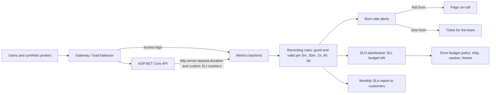
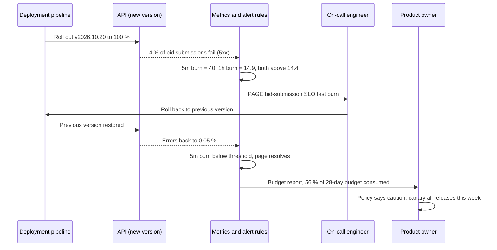

"Is the system reliable?" is not a useful question until you say *reliable at what, for whom, measured how, and how reliable is enough*. Without those answers, every team argues from gut feeling. Developers want to ship, operations wants stability, and management wants "five nines" without knowing what it costs. SLIs, SLOs, SLAs and error budgets turn that argument into arithmetic. They are the vocabulary of site reliability engineering (SRE), and they appear in almost every senior system-design interview.

## Learning objectives

By the end of this lesson you will be able to:

1. Define an SLI as a ratio of good events to valid events, and choose SLIs for availability, latency, freshness and correctness.
2. Set an SLO with a target and a window, and explain why 100 % is the wrong target.
3. Explain how an SLA differs from an SLO, and why the SLA target is always looser.
4. Do availability math: allowed downtime per nine, serial dependencies, redundancy, and request-based versus time-based availability.
5. Compute error budgets and burn rates, and write an error-budget policy.
6. Design multi-window, multi-burn-rate alerts, and implement the SLI recording and evaluation in ASP.NET Core.

## Prerequisites

- [Availability](#/lesson/m11-availability): what availability means and how redundancy helps.
- [Non-functional requirements](#/lesson/m11-nfrs): how reliability targets appear in requirements.
- [Logging in ASP.NET Core](#/lesson/m03-logging): structured telemetry basics.

## Explain it like I'm a beginner

Imagine a pizza shop that advertises: **"Delivered in 30 minutes, or it's free."** That's a promise to customers, with a penalty if broken. That's the **SLA** (service level agreement).

Inside the shop, the manager doesn't aim for 30 minutes. That would mean giving away pizzas every busy evening. The kitchen's own goal is: **"99 out of 100 orders delivered within 25 minutes, measured over each month."** That's the **SLO** (service level objective): an internal target, stricter than the promise, so there's a safety margin.

To know whether they hit it, they need a measurement: for each order, *was it delivered within 25 minutes, yes or no?* The share of "yes" answers is the **SLI** (service level indicator).

Now the clever part. If the goal is 99 out of 100, then 1 order in 100 is *allowed* to be late. In a month of 3,000 orders, that's 30 late orders. That allowance is the **error budget**. If by the 10th of the month they've already had 25 late orders, the manager stops trying new recipes and focuses on speed. If it's the 25th and only 5 were late, there's room to experiment with a new oven. The budget turns "should we take risks?" from an argument into a number.

## First-principles explanation

### SLI: a ratio of good events to valid events

A **service level indicator** is a measurement of one aspect of the service *as users experience it*. The most robust form is a ratio:

```text
SLI = good events / valid events        (a number between 0 and 1, often shown as %)
```

| SLI type | Good event | Valid event | Example |
|---|---|---|---|
| Availability | Request answered successfully | Every request that should succeed | `status < 500` (and not `429` from our own overload) out of all requests except client errors |
| Latency | Request answered faster than a threshold | Every valid request | Fraction of `GET /tenders` served in ≤ 300 ms |
| Freshness | Data newer than a threshold when read | Every read | Dashboard tiles showing data less than 5 minutes old |
| Correctness | Output correct | Every output checked | Bills whose computed GST matches an independent recomputation |
| Durability | Object still readable | Every object stored | Daily sample of stored drawings that can be read and whose checksum matches |
| Pipeline throughput | Batch finished on time | Every scheduled batch | Nightly payment files generated by 06:00 |

Choices that matter:

- **What counts as valid.** A `404` for a mistyped URL or a `400` for invalid input is not a failure of your service, so exclude most `4xx` from both the numerator and the denominator. A `429 Too Many Requests` that *you* send because you are overloaded is a failure from the user's point of view, so count it as bad. Health checks and synthetic traffic are usually excluded, or tracked separately.
- **Where you measure.** At the load balancer (sees requests that never reached your app), at the server (easy, but blind to network and load-balancer failures), or at the client (closest to the user, but noisy and hard to collect). Many teams use load-balancer or gateway logs for the main SLI, plus synthetic probes from several regions.
- **Latency as a ratio, not an average.** "Average latency 180 ms" hides the 3 % of users who wait 4 seconds. "99 % of requests within 300 ms" counts them. Percentiles (p99) are useful on dashboards, but percentiles can't be averaged across servers or time. Ratios of counts can always be added up, which is why SLIs should be ratios.

### SLO: target plus window

A **service level objective** is a target value for an SLI over a time window:

> "99.5 % of bid submissions succeed, measured over a rolling 28 days."
> "99 % of tender searches complete within 300 ms, measured over a rolling 28 days."

**The window.** Rolling windows (the last 28 or 30 days) give a continuous view and avoid the "it's the 1st, budget reset, let's take risks" effect. Calendar windows (each month) match how SLAs and business reports work. Many teams use rolling for engineering decisions and calendar for reporting. 28 days contains exactly four of each weekday, which avoids weekday bias.

**The target.** Start from what users need and what the system achieves today:

- Look at the last 3 months of SLI history. If you've achieved 99.7 %, a 99.9 % SLO means an immediate reliability project. A 99.5 % SLO means "keep doing what you do".
- Ask what users notice. For an internal reporting tool used from 10:00 to 18:00, an outage at 03:00 matters little. For UPI-style payments it matters every second.
- Each additional nine costs roughly 10 times more in redundancy, automation and on-call effort (a rule of thumb, not a law).

**Why not 100 %?** Because it is impossible (networks, clients and dependencies fail), and because aiming for it freezes all change, since every deployment is a risk. Users also can't tell 99.99 % from 100 % when their own mobile network fails more often than that. The right SLO is *just reliable enough* that users are happy, which leaves room to ship.

### SLA: a contract with consequences

A **service level agreement** is a promise to a customer, usually with financial consequences such as service credits. Differences from an SLO:

| | SLO | SLA |
|---|---|---|
| Audience | Engineering and product teams | Customers, legal, sales |
| Consequence of missing | Error-budget policy: shift effort to reliability | Credits, penalties, contract termination |
| Target | Tighter (for example 99.9 %) | Looser (for example 99.5 %) |
| Definition | Precise, engineering-owned | Precise, legally reviewed: what counts as downtime, exclusions (planned maintenance, customer-caused, force majeure), how to claim |

The SLA target must be **looser** than the SLO, so you see trouble (budget burning) long before you owe money. Public cloud SLAs typically promise between 99.9 % and 99.99 % monthly availability depending on the service and configuration, with credits of 10–25 % or more of the monthly fee when missed. Read your providers' SLAs. Your own SLA can't sensibly exceed what your dependencies promise you, unless you add redundancy across them.

Government and infrastructure contracts in India often state uptime as "99.5 % per quarter, excluding scheduled maintenance windows notified 48 hours in advance", with penalties as a percentage of the quarterly payment. That is an SLA. Your internal SLO should be stricter than it.

### Availability math

**Allowed downtime per nine**, for a 30-day window (43,200 minutes):

| SLO | Allowed bad fraction | Downtime per 30 days | Per year (365 days) |
|---|---|---|---|
| 99 % | 1 % | 7 h 12 min | 3.65 days |
| 99.5 % | 0.5 % | 3 h 36 min | 1.83 days |
| 99.9 % | 0.1 % | 43.2 min | 8.76 h |
| 99.95 % | 0.05 % | 21.6 min | 4.38 h |
| 99.99 % | 0.01 % | 4.32 min | 52.6 min |
| 99.999 % | 0.001 % | 25.9 s | 5.26 min |

Arithmetic: 43,200 min × 0.001 = 43.2 min. At 99.99 %, a single 5-minute incident breaks the monthly target. Human response alone (paging, waking up, logging in) takes longer than that, so four nines requires automatic failover.

**Request-based versus time-based.** "The site was down for 20 minutes" (time-based) and "0.08 % of requests failed" (request-based) can tell different stories. A 20-minute outage at 03:00 affects few requests. A 2-minute outage at month-end peak affects many. Request-based SLIs weight failures by how many users felt them, which is usually what you want. Time-based measures (from synthetic probes) still matter for low-traffic services, where a ratio of a few requests is too noisy.

**Serial dependencies multiply.** If a request needs the API (99.95 %), the database (99.99 %) and an identity provider (99.9 %) to all work, then, assuming independent failures:

```text
A = 0.9995 × 0.9999 × 0.999 ≈ 0.9984   → about 69 minutes of downtime per 30 days
```

That is worse than the weakest component. Every hard dependency on the request path lowers your ceiling. Remove dependencies from the hot path (cache identity metadata, queue non-urgent work), or give them fallbacks.

**Redundancy helps, if failures are independent.** Two independent replicas of a 99 % component, either of which can serve:

```text
A = 1 − (1 − 0.99)² = 1 − 0.0001 = 0.9999
```

The catch is the word *independent*. Two instances in the same zone, behind the same load balancer, running the same buggy release, with the same expired certificate, fail together. Correlated failures are why real-world redundancy delivers much less than the formula suggests. Redundancy across zones, regions and release versions (canary deployments) gets you closer.

**Composite SLOs.** A user journey ("search tender, open it, submit bid") succeeds only if every step does. Define an SLO per critical journey, measured end to end (synthetic transactions), in addition to per-service SLOs.

### Error budgets

The **error budget** is the complement of the SLO: the amount of unreliability you are *allowed* in the window.

```text
error budget (fraction) = 1 − SLO
allowed bad events      = (1 − SLO) × valid events in the window
```

Example: SLO 99.9 % over 30 days, 45 million valid requests → allowed bad = 0.001 × 45,000,000 = **45,000 failed requests**. A deployment that fails 100 % of requests for 10 minutes at 1,000 requests per second burns 600,000 bad requests: 13 times the monthly budget in 10 minutes.

**Error-budget policy.** The budget is only useful if it changes behaviour. A written policy, agreed by product and engineering leadership, says what happens:

| Budget consumed (rolling 28 days) | Action |
|---|---|
| < 50 % | Normal: ship features, run experiments |
| 50–100 % | Caution: risky changes need extra review, canary everything, prioritise top reliability bugs |
| > 100 % | Freeze: only reliability fixes and security patches ship until the SLI is back above target. A postmortem for every large consumer of budget |

Leaving budget unspent is also a signal: the SLO may be stricter than needed, or the team is too cautious, and could ship faster.

The policy aligns incentives. Product teams *want* reliability, because burning the budget stops their launches. Operations accepts change, because change is budgeted.

### Burn rate

The **burn rate** is how fast you are spending the budget compared with the "even" rate that would use exactly 100 % of it by the end of the window:

```text
burn rate = (bad / valid in a recent period) / (1 − SLO)
```

- Burn rate **1**: at this pace the budget runs out exactly at the end of the window.
- Burn rate **14.4** over 1 hour of a 30-day (720-hour) window: 14.4 × 1 / 720 = **2 % of the monthly budget gone in one hour**. Sustained, it empties the budget in 720 / 14.4 = 50 hours.
- Burn rate **0.5**: comfortably within budget.

Example: SLO 99.9 %. In the last hour, 1.2 % of requests failed. Burn rate = 0.012 / 0.001 = 12, which is just below the 14.4 page threshold below.

### Alerting on SLOs: multiple windows, multiple burn rates

Classic alerts ("error rate > 1 % for 5 minutes", "CPU > 80 %") are either too noisy (paging for blips that cost 0.01 % of budget) or too slow (missing a steady leak that costs 30 % of the budget in a week). SLO-based alerts ask instead: *is the budget at risk?*

The approach recommended in the Google SRE Workbook uses **several burn-rate thresholds, each over a long and a short window**:

| Severity | Long window | Short window | Burn rate | Budget spent when it fires (30-day SLO) |
|---|---|---|---|---|
| Page | 1 hour | 5 minutes | 14.4 | 2 % |
| Page | 6 hours | 30 minutes | 6 | 5 % |
| Ticket | 3 days | 6 hours | 1 | 10 % |

- The **long window** makes sure enough budget has really been spent to justify attention (no pages for a 30-second blip).
- The **short window** (about 1/12 of the long one) makes the alert *stop* quickly once the problem is fixed. Without it, a 1-hour window keeps paging for up to an hour after recovery.
- An alert fires only when **both** windows exceed the threshold.
- Fast burns page a human now. Slow burns create a ticket for working hours.

This gives few false pages, quick detection of big outages (a full outage trips the first rule within minutes), and detection of slow leaks that classic threshold alerts miss. Alerting design is covered further in [alerting and incident response](#/lesson/m14-alerting-incidents).

### Implementing SLIs in ASP.NET Core

You need counts of good and valid events, aggregated per minute or so, stored for at least the longest alert window (3 days) and ideally the SLO window (28–30 days):

- **Built-in metrics.** ASP.NET Core (.NET 8+) emits the `http.server.request.duration` histogram with `http.response.status_code` and `http.route` attributes through `System.Diagnostics.Metrics`. Exported with OpenTelemetry to Prometheus, Azure Monitor or another backend, that is enough for availability and latency SLIs: count all requests, count `5xx` and `429`, and count requests in the buckets at or below your latency threshold. Make sure a histogram bucket boundary sits exactly at the threshold (for example 0.3 s), or the latency SLI will be an estimate.
- **Recording rules** in the metrics backend pre-compute ratios over 5 m, 30 m, 1 h, 6 h and 3 d, so alert queries are cheap.
- **Custom SLI counters** when the built-in metrics don't express "good". For example, a bid submission is good only if it was stored *and* the receipt was emailed, which the HTTP status alone can't tell you.
- **In-process evaluation** (as in this lesson's code) is useful for small systems without a metrics stack, for tests, and for exposing a `/slo/status` endpoint. In larger systems the metrics backend does the evaluation.

### When this is overkill

For a small internal tool with 30 users, a basic uptime check and an alert on repeated `5xx` errors is enough. Formal SLOs, error-budget policies and burn-rate alerts pay off when several teams share a platform, when there are customers with SLAs, when there's real tension between shipping speed and stability, or when on-call fatigue from noisy alerts is a problem. Start with one or two SLOs for the most important user journey, not thirty.

## Visual explanation

### From requests to decisions



Measurements come from two places: the gateway (which sees failures that never reached the app) and the app itself (which knows business-level success, such as "bid stored and receipt sent"). The metrics backend keeps raw counts. Recording rules turn them into good/valid ratios over the windows that alerting needs. Fast burns page a person, and slow burns open a ticket. The same numbers feed the dashboard that product and engineering use to apply the error-budget policy, and the monthly SLA report. That report uses the contract's definitions and exclusions, which may differ from the engineering SLI, so keep both definitions written down.

### A bad deployment, detected and contained by burn-rate alerts



The release fails 4 % of submissions. With a 99.9 % SLO the burn rate is 0.04 / 0.001 = 40, so the 5-minute window crosses 14.4 almost at once, and the 1-hour window crosses it once enough bad requests accumulate (about 22 minutes into the incident in this example). Only when both are above the threshold does the page fire, which filters out blips. After the rollback, the 5-minute window drops below the threshold within minutes, so the page resolves, even though the 1-hour window still remembers the incident. This incident alone added about 3 % (4 % errors for roughly 30 minutes is about 1.2 minutes of full outage, against a 28-day budget of about 40 minutes), but together with earlier incidents the budget is now 56 % consumed. That moves the team into the "caution" band of its policy: a business decision driven by the same numbers the alert used.

## Step-by-step example

**Scenario.** A state e-procurement portal handles tender search, document download and bid submission for about 40,000 registered bidders. Traffic estimate: 1.2 million requests a day on normal days ≈ 14 requests per second on average. In the last 2 hours before a big tender closes, bid submissions spike to about 40 per second, plus searches. The contract with the state says "99.5 % availability per calendar month, excluding notified maintenance". Last quarter the team had two long outages and many small ones, and on-call engineers were paged 60 times a month, mostly for nothing.

### Step 1 — pick the journeys and SLIs

1. **Bid submission availability**: good = `POST /bids` returns `2xx` *and* the receipt is stored. Valid = all `POST /bids` except `4xx` validation errors.
2. **Bid submission latency**: good = completed within 2 s (uploads are handled separately, through direct-to-storage URLs).
3. **Tender search latency**: good = `GET /tenders` within 300 ms.

### Step 2 — set SLOs from history

History (last 90 days): submission availability 99.82 %, search latency 98.9 % within 300 ms. SLOs, rolling 28 days:

- Submission availability **99.9 %**: a stretch, justified because a failed bid near the deadline can disqualify a bidder.
- Submission latency **99 %** within 2 s.
- Search latency **99 %** within 300 ms: a small stretch, requiring a database index fix.

The SLA stays at 99.5 % per month, so the SLO has a margin of 0.4 percentage points.

### Step 3 — budgets in numbers

Bid submissions: about 900,000 valid submissions in 28 days (an estimate). Budget at 99.9 % = 0.001 × 900,000 = **900 failed submissions**. A 10-minute outage during a closing-hour peak at 40 per second = 24,000 failures, which is 27 times the budget. So the most important engineering work is protecting the closing hours: no deployments in the last 24 hours before a big closing, autoscaling tested before each one, and a pre-warmed capacity buffer.

### Step 4 — replace threshold alerts with burn-rate alerts

Delete the CPU, memory and "error rate > 1 % for 1 minute" pages. Add the three burn-rate rules per SLO. Keep CPU and disk alerts as *tickets*, for capacity planning. Expected result: pages drop from about 60 to a handful a month, and each one means real budget is at risk.

### Step 5 — the policy

Agreed with the head of the procurement cell and the vendor's delivery head: below 50 % consumed, normal releases. From 50 % to 100 %, releases only with a canary and outside closing windows. Above 100 %, a reliability-only freeze and a postmortem. The monthly report to the state uses the SLA's definitions. The internal dashboard uses the SLOs.

## Production-style C# implementation

```text
Portal.Api/
  Program.cs
  Slo/SloMath.cs
  Slo/SliRecorder.cs
  Slo/BurnRateEvaluator.cs
  Slo/SliMiddleware.cs
```

```csharp file=Slo/SloMath.cs
namespace Portal.Api.Slo;

public sealed record SloDefinition(string Name, double Target, TimeSpan Window)
{
    public double BudgetFraction => 1.0 - Target;
}

public static class SloMath
{
    /// <summary>Allowed "bad" time in a window: 99.9 % of 30 days gives 43.2 minutes.</summary>
    public static TimeSpan AllowedDowntime(double target, TimeSpan window) =>
        TimeSpan.FromTicks((long)Math.Round(window.Ticks * (1.0 - target)));

    /// <summary>All components must work (independent failures assumed).</summary>
    public static double Serial(params double[] availabilities) =>
        availabilities.Aggregate(1.0, (acc, a) => acc * a);

    /// <summary>Any one of n independent replicas is enough. Correlated failures make the real number lower.</summary>
    public static double Parallel(double availability, int replicas) =>
        1.0 - Math.Pow(1.0 - availability, replicas);

    /// <summary>(bad / valid) / (1 - SLO). 1.0 means the budget lasts exactly the window.</summary>
    public static double BurnRate(double target, long good, long valid) =>
        valid == 0 ? 0 : ((double)(valid - good) / valid) / (1.0 - target);

    /// <summary>Fraction of the whole-window budget consumed by "bad" events so far.</summary>
    public static double BudgetConsumed(double target, long bad, long validInWindow) =>
        validInWindow == 0 ? 0 : bad / ((1.0 - target) * validInWindow);
}
```

```csharp file=Slo/SliRecorder.cs
namespace Portal.Api.Slo;

/// <summary>Per-minute good/valid counters in a ring buffer. Thread-safe and allocation-free on the hot path.
/// Size it for the longest window you query (3 days = 4,320 minutes).</summary>
public sealed class SliRecorder
{
    private readonly TimeProvider _clock;
    private readonly long[] _minute;
    private readonly long[] _good;
    private readonly long[] _valid;
    private readonly Lock _gate = new();

    public SliRecorder(TimeProvider clock, TimeSpan capacity)
    {
        _clock = clock;
        var size = (int)Math.Ceiling(capacity.TotalMinutes) + 1;
        _minute = new long[size];
        Array.Fill(_minute, -1);
        _good = new long[size];
        _valid = new long[size];
    }

    public TimeSpan Capacity => TimeSpan.FromMinutes(_minute.Length - 1);

    private long NowMinute => _clock.GetUtcNow().ToUnixTimeSeconds() / 60;

    public void Record(bool good) => Record(good ? 1 : 0, 1);

    public void Record(long good, long valid)
    {
        if (good < 0 || valid < good) throw new ArgumentOutOfRangeException(nameof(good));
        var m = NowMinute;
        var i = (int)(m % _minute.Length);
        lock (_gate)
        {
            if (_minute[i] != m) { _minute[i] = m; _good[i] = 0; _valid[i] = 0; }
            _good[i] += good;
            _valid[i] += valid;
        }
    }

    /// <summary>Totals for the last <paramref name="window"/>, including the current (partial) minute.</summary>
    public (long Good, long Valid) Sum(TimeSpan window)
    {
        var minutes = (int)Math.Ceiling(window.TotalMinutes);
        if (minutes > _minute.Length - 1) throw new ArgumentOutOfRangeException(nameof(window), "Window exceeds recorder capacity.");
        var now = NowMinute;
        long good = 0, valid = 0;
        lock (_gate)
        {
            for (var m = now - minutes + 1; m <= now; m++)
            {
                var i = (int)(m % _minute.Length);
                if (_minute[i] != m) continue;
                good += _good[i];
                valid += _valid[i];
            }
        }
        return (good, valid);
    }
}
```

```csharp file=Slo/BurnRateEvaluator.cs
namespace Portal.Api.Slo;

public enum AlertSeverity { None = 0, Ticket = 1, Page = 2 }

public sealed record BurnRule(TimeSpan LongWindow, TimeSpan ShortWindow, double Threshold, AlertSeverity Severity);

public sealed record SloStatus(string Slo, double Target, double BurnRate1h, double BurnRate6h, double BurnRate3d,
    AlertSeverity Alert, string? FiringRule);

public sealed class BurnRateEvaluator(SloDefinition slo, SliRecorder sli, IReadOnlyList<BurnRule> rules)
{
    /// <summary>The Google SRE Workbook defaults for a 30-day SLO.</summary>
    public static IReadOnlyList<BurnRule> DefaultRules { get; } =
    [
        new(TimeSpan.FromHours(1), TimeSpan.FromMinutes(5), 14.4, AlertSeverity.Page),
        new(TimeSpan.FromHours(6), TimeSpan.FromMinutes(30), 6, AlertSeverity.Page),
        new(TimeSpan.FromDays(3), TimeSpan.FromHours(6), 1, AlertSeverity.Ticket),
    ];

    public double BurnRate(TimeSpan window)
    {
        var (good, valid) = sli.Sum(window);
        return SloMath.BurnRate(slo.Target, good, valid);
    }

    public SloStatus Evaluate()
    {
        AlertSeverity worst = AlertSeverity.None;
        string? firing = null;
        foreach (var r in rules)
        {
            if (r.Severity <= worst) continue;
            if (BurnRate(r.LongWindow) >= r.Threshold && BurnRate(r.ShortWindow) >= r.Threshold)
            {
                worst = r.Severity;
                firing = $"{r.LongWindow}/{r.ShortWindow} >= {r.Threshold}";
            }
        }
        return new SloStatus(slo.Name, slo.Target, BurnRate(TimeSpan.FromHours(1)), BurnRate(TimeSpan.FromHours(6)),
            BurnRate(TimeSpan.FromDays(3)), worst, firing);
    }
}
```

```csharp file=Slo/SliMiddleware.cs
using System.Diagnostics;
using System.Diagnostics.Metrics;

namespace Portal.Api.Slo;

public sealed class SliOptions
{
    public string RoutePrefix { get; set; } = "/bids";
    public TimeSpan LatencyThreshold { get; set; } = TimeSpan.FromSeconds(2);
}

public sealed record SliRecorders(SliRecorder Availability, SliRecorder Latency);

/// <summary>Classifies each request into valid/invalid and good/bad, for availability and latency SLIs.
/// Also emits OpenTelemetry-friendly counters so a metrics backend can do the same maths.</summary>
public sealed class SliMiddleware
{
    private readonly RequestDelegate _next;
    private readonly SliRecorders _recorders;
    private readonly SliOptions _options;
    private readonly Counter<long> _valid;
    private readonly Counter<long> _good;

    public SliMiddleware(RequestDelegate next, SliRecorders recorders, Microsoft.Extensions.Options.IOptions<SliOptions> options, IMeterFactory meters)
    {
        _next = next;
        _recorders = recorders;
        _options = options.Value;
        var meter = meters.Create("Portal.Slo");
        _valid = meter.CreateCounter<long>("slo.bid_submission.valid");
        _good = meter.CreateCounter<long>("slo.bid_submission.good");
    }

    public static bool IsValid(int status) => status < 400 || status >= 500 || status == 429;
    public static bool IsAvailable(int status) => status < 500 && status != 429;

    public async Task InvokeAsync(HttpContext ctx)
    {
        if (!ctx.Request.Path.StartsWithSegments(_options.RoutePrefix) || !HttpMethods.IsPost(ctx.Request.Method))
        {
            await _next(ctx);
            return;
        }
        var start = Stopwatch.GetTimestamp();
        var status = 500;
        try
        {
            await _next(ctx);
            status = ctx.Response.StatusCode;
        }
        finally
        {
            if (IsValid(status))
            {
                var available = IsAvailable(status);
                var fast = Stopwatch.GetElapsedTime(start) <= _options.LatencyThreshold;
                _recorders.Availability.Record(available);
                _recorders.Latency.Record(available && fast);
                _valid.Add(1);
                if (available) _good.Add(1);
            }
        }
    }
}
```

```csharp file=Program.cs
using Portal.Api.Slo;

var builder = WebApplication.CreateBuilder(args);

builder.Services.AddSingleton(TimeProvider.System);
builder.Services.Configure<SliOptions>(builder.Configuration.GetSection("Sli"));
builder.Services.AddSingleton(sp =>
{
    var clock = sp.GetRequiredService<TimeProvider>();
    return new SliRecorders(new SliRecorder(clock, TimeSpan.FromDays(3)), new SliRecorder(clock, TimeSpan.FromDays(3)));
});
builder.Services.AddKeyedSingleton("availability", (sp, _) => new BurnRateEvaluator(
    new SloDefinition("bid-submission-availability", 0.999, TimeSpan.FromDays(28)),
    sp.GetRequiredService<SliRecorders>().Availability, BurnRateEvaluator.DefaultRules));
builder.Services.AddKeyedSingleton("latency", (sp, _) => new BurnRateEvaluator(
    new SloDefinition("bid-submission-latency", 0.99, TimeSpan.FromDays(28)),
    sp.GetRequiredService<SliRecorders>().Latency, BurnRateEvaluator.DefaultRules));

var app = builder.Build();

app.UseMiddleware<SliMiddleware>();

app.MapPost("/bids", () => Results.Created("/bids/1", new { id = 1 }));

app.MapGet("/slo/status", (
    [Microsoft.Extensions.DependencyInjection.FromKeyedServices("availability")] BurnRateEvaluator availability,
    [Microsoft.Extensions.DependencyInjection.FromKeyedServices("latency")] BurnRateEvaluator latency) =>
    Results.Ok(new[] { availability.Evaluate(), latency.Evaluate() }));

app.Run();
```

Notes:

- **The in-process recorder is per instance.** With 4 API instances, each sees a quarter of the traffic. For real alerting, export the counters (`slo.bid_submission.valid`, `.good`) and let the metrics backend sum across instances. The in-process evaluator is still useful for tests, single-instance services and a quick `/slo/status` view.
- **Unhandled exceptions count as bad.** `status` starts at `500`, so a crash before the response is written is recorded as a failure, not ignored.
- **Latency good requires success.** A fast `500` is not a good latency event. That keeps the latency SLI from improving when the service fails quickly.

In Prometheus, the same SLI as recording rules and an alert (a sketch, assuming the counters are exported with these names):

```text
# Ratio of bad events over 1h and 5m
record: slo:bid_submission:error_ratio_1h
expr: 1 - (sum(rate(slo_bid_submission_good_total[1h])) / sum(rate(slo_bid_submission_valid_total[1h])))
record: slo:bid_submission:error_ratio_5m
expr: 1 - (sum(rate(slo_bid_submission_good_total[5m])) / sum(rate(slo_bid_submission_valid_total[5m])))

alert: BidSubmissionFastBurn
expr: slo:bid_submission:error_ratio_1h > (14.4 * 0.001) and slo:bid_submission:error_ratio_5m > (14.4 * 0.001)
labels: { severity: page }
```

## Bad design vs good design

| Bad | Problem | Good |
|---|---|---|
| "Availability = server uptime from the hosting dashboard" | The server can be up while every request fails | Request-based SLI from gateway or app: good / valid |
| SLO of 100 % | Every deployment is a breach. No room to ship. Impossible anyway | A target users would notice falling below, based on history |
| SLA equal to the SLO | You owe credits the moment the engineering target slips | SLA looser than the SLO, with written exclusions |
| Average latency as the SLI | Hides the slow tail that users complain about | Fraction of requests under a threshold |
| Counting `400`/`404` as failures | Bad clients or bots "break" your SLO | Exclude client errors from valid events, but count your own `429`s and `5xx` |
| Paging on CPU > 80 % or a 1-minute error spike | Noisy pages for things users never felt | Multi-window burn-rate alerts. Resource alerts as tickets |
| 30 SLOs per service | Nobody looks at them | 1–3 SLOs per critical user journey |
| Error budget without a policy | A number on a dashboard that changes nothing | Written policy agreed by product and engineering leadership |
| Per-instance numbers used as service SLI | Each instance sees only part of the traffic | Aggregate counts across instances in the metrics backend |

:::callout type=tradeoff title="Tighter SLOs are not free"
Moving from 99.9 % to 99.99 % cuts the monthly budget from 43 minutes to about 4. That usually means multi-zone or multi-region deployment, automated failover, canary releases with automatic rollback, and on-call staff who respond within minutes, all of which cost money and slow delivery. Ask what users would pay for the extra nine before committing to it.
:::

:::callout type=mistake title="Dependencies that quietly cap your SLO"
A service with a 99.99 % SLO that calls a payment gateway with a 99.9 % SLA on every request can't meet its target, whatever its own engineering. Either exclude the dependency's failures from your SLI (and say so), or design around it with queues, retries within budget, fallbacks and alternative providers. Write the dependency chain down when you set the SLO.
:::

## Practical playground

The program simulates 28 days of traffic for a 99.9 % SLO, with a background error rate, one bad deployment and one slow leak. It prints, per day, the SLI, the budget consumed and what the multi-window alert rules would have done. Change the incident sizes, the SLO target or the thresholds, and watch how quickly the budget goes and when pages fire. Then remove the `m >= r.Long - 1` guard and see a spurious ticket on day 1: right after a restart, a 3-day window holding only a few minutes of data is too noisy to alert on. Real systems handle this with a minimum-traffic condition on the rule.

:::playground type=csharp title="Error budget simulator"
```csharp file=Program.cs
using System;
using System.Collections.Generic;
using System.Linq;

public static class Program
{
    public static void Main()
    {
        const double slo = 0.999;
        const int reqPerMinute = 600;           // about 10 requests per second
        const int days = 28;
        var minutes = days * 24 * 60;
        var bad = new long[minutes];
        var rng = new Random(42);

        for (var m = 0; m < minutes; m++)
        {
            double errorRate = 0.0004;                                   // background noise
            if (m >= 6 * 1440 + 600 && m < 6 * 1440 + 625) errorRate = 0.08;   // day 7: bad deploy, 25 min
            if (m >= 15 * 1440 && m < 18 * 1440) errorRate = 0.0025;     // days 16-18: slow leak
            bad[m] = Enumerable.Range(0, reqPerMinute).Count(_ => rng.NextDouble() < errorRate);
        }

        double Burn(int end, int window)
        {
            var start = Math.Max(0, end - window + 1);
            long b = 0; for (var i = start; i <= end; i++) b += bad[i];
            var valid = (long)(end - start + 1) * reqPerMinute;
            return (double)b / valid / (1 - slo);
        }

        var rules = new (int Long, int Short, double Threshold, string Severity)[]
        {
            (60, 5, 14.4, "PAGE"), (360, 30, 6, "PAGE"), (4320, 360, 1, "TICKET"),
        };

        var allowed = (1 - slo) * minutes * reqPerMinute;
        long cumulative = 0;
        for (var d = 0; d < days; d++)
        {
            var alerts = new SortedSet<string>();
            long dayBad = 0;
            for (var m = d * 1440; m < (d + 1) * 1440; m++)
            {
                dayBad += bad[m];
                foreach (var r in rules)   // skip a rule until its long window is full: a few minutes of data is too noisy
                    if (m >= r.Long - 1 && Burn(m, r.Long) >= r.Threshold && Burn(m, r.Short) >= r.Threshold) alerts.Add(r.Severity);
            }
            cumulative += dayBad;
            var sli = 1 - (double)dayBad / (1440 * reqPerMinute);
            Console.WriteLine($"day {d + 1,2}: SLI {sli:P3}  budget used {cumulative / allowed,7:P1}  {string.Join(",", alerts)}");
        }
    }
}
```
:::

## Exercises

:::exercise id=m14-sli-slo-sla-ex1 difficulty=beginner kind=code title="Availability math helpers"
Implement `Availability`, a small static class for the calculations you do in every SLO discussion.
::requirements
- `AllowedDowntime(target, window)`: the window multiplied by `1 - target`, rounded to the nearest tick.
- `Serial(params double[] parts)`: the product (all must work).
- `Parallel(double part, int replicas)`: `1 - (1 - part)^replicas`. Throw `ArgumentOutOfRangeException` if `replicas < 1`.
- `Nines(double availability)`: `-log10(1 - availability)`, so 0.999 gives 3. Return `double.PositiveInfinity` for 1.0.
- Every method throws `ArgumentOutOfRangeException` for availabilities or targets outside `[0, 1]`.
::acceptance
- 99.9 % over 30 days allows 43.2 minutes. 99.99 % over 365 days allows about 52.6 minutes.
- `Serial(0.9995, 0.9999, 0.999)` ≈ 0.99840.
- `Parallel(0.99, 2)` = 0.9999.
- `Nines(0.9995)` ≈ 3.30.
::hint
`TimeSpan.FromTicks((long)Math.Round(window.Ticks * (1 - target)))` avoids floating-point drift in the minutes.
::hint
`Aggregate(1.0, (acc, a) => acc * a)` multiplies a list.
::hint
Write one private `Check(double value, string name)` helper and call it at the start of every method.
::hint
```csharp
public static double Nines(double a) { Check(a, nameof(a)); return a == 1.0 ? double.PositiveInfinity : -Math.Log10(1 - a); }
```
::starter
```csharp file=Availability.cs
using System;
using System.Linq;

public static class Availability
{
    public static TimeSpan AllowedDowntime(double target, TimeSpan window) => throw new NotImplementedException();
    public static double Serial(params double[] parts) => throw new NotImplementedException();
    public static double Parallel(double part, int replicas) => throw new NotImplementedException();
    public static double Nines(double availability) => throw new NotImplementedException();
}
```
::tests
```csharp file=AvailabilityTests.cs
using System;
using Xunit;

public class AvailabilityTests
{
    [Fact]
    public void Three_nines_over_30_days_is_43_2_minutes() =>
        Assert.Equal(43.2, Availability.AllowedDowntime(0.999, TimeSpan.FromDays(30)).TotalMinutes, 6);

    [Fact]
    public void Four_nines_over_a_year_is_about_52_6_minutes() =>
        Assert.Equal(52.56, Availability.AllowedDowntime(0.9999, TimeSpan.FromDays(365)).TotalMinutes, 2);

    [Fact]
    public void Serial_multiplies() =>
        Assert.Equal(0.99840, Availability.Serial(0.9995, 0.9999, 0.999), 5);

    [Fact]
    public void Parallel_two_replicas() =>
        Assert.Equal(0.9999, Availability.Parallel(0.99, 2), 10);

    [Fact]
    public void Nines_of_three_and_a_half() =>
        Assert.Equal(3.30, Availability.Nines(0.9995), 2);

    [Fact]
    public void Perfect_is_infinite_nines() =>
        Assert.True(double.IsPositiveInfinity(Availability.Nines(1.0)));

    [Theory]
    [InlineData(-0.1)]
    [InlineData(1.5)]
    public void Out_of_range_throws(double a) =>
        Assert.Throws<ArgumentOutOfRangeException>(() => Availability.Serial(0.99, a));

    [Fact]
    public void Zero_replicas_throws() =>
        Assert.Throws<ArgumentOutOfRangeException>(() => Availability.Parallel(0.99, 0));
}
```
::solution
```csharp file=Availability.cs
using System;
using System.Linq;

public static class Availability
{
    private static void Check(double value, string name)
    {
        if (double.IsNaN(value) || value < 0 || value > 1) throw new ArgumentOutOfRangeException(name, "Must be between 0 and 1.");
    }

    public static TimeSpan AllowedDowntime(double target, TimeSpan window)
    {
        Check(target, nameof(target));
        return TimeSpan.FromTicks((long)Math.Round(window.Ticks * (1 - target)));
    }

    public static double Serial(params double[] parts)
    {
        foreach (var p in parts) Check(p, nameof(parts));
        return parts.Aggregate(1.0, (acc, a) => acc * a);
    }

    public static double Parallel(double part, int replicas)
    {
        Check(part, nameof(part));
        if (replicas < 1) throw new ArgumentOutOfRangeException(nameof(replicas));
        return 1 - Math.Pow(1 - part, replicas);
    }

    public static double Nines(double availability)
    {
        Check(availability, nameof(availability));
        return availability == 1.0 ? double.PositiveInfinity : -Math.Log10(1 - availability);
    }
}
```

The formulas assume independent failures. Use `Parallel` as an upper bound: two replicas in one zone behind one load balancer share many failure causes, so the real number is much closer to a single replica's.
::mistakes
- Computing downtime in minutes with `double` and printing 43.199999. Round, or work in ticks.
- Adding availabilities of serial components instead of multiplying them.
- Treating `Parallel` as a promise rather than a best case.
:::

:::exercise id=m14-sli-slo-sla-ex2 difficulty=beginner kind=written title="Write SLIs, SLOs and an SLA for a grievance portal"
A state public-grievance portal lets citizens file complaints (text plus up to 3 photos), track them by number, and lets officers respond. About 8,000 complaints are filed a day, with 120,000 status checks. A third of the traffic comes from mobile phones on 4G in rural districts. An SMS is sent when a complaint is registered. Write: two or three SLIs (with good and valid event definitions), an SLO for each (target and window), and the SLA you would put in the vendor contract. Explain your choices and one exclusion.
::acceptance
- At least one availability SLI on complaint filing, with `4xx` validation errors excluded.
- A latency SLI with a threshold suited to rural mobile networks, measured as a ratio.
- A freshness or pipeline SLI for the registration SMS.
- SLOs justified (why not higher, why not lower), with a window.
- An SLA looser than the SLO, with clear exclusions and how downtime is measured.
::hint
Which user action hurts most when it fails? Filing a complaint matters more than viewing statistics.
::hint
Photo uploads over 4G take seconds. Should the latency SLI include the upload, or only the form submission?
::hint
An SMS that arrives 2 hours late is almost as bad as none. That's a freshness SLI: "SMS delivered within N minutes of registration".
::solution
A good answer, with reasoning:

**SLI 1: complaint filing availability.** Good: `POST /complaints` returns `201` and the complaint is stored with a number. Valid: all `POST /complaints` except `400`/`422` validation errors and `401`. Count `429` and `5xx` as bad. Measured at the API gateway, so failures before the app are counted.
**SLO: 99.5 % over a rolling 28 days.** A citizen who fails can usually retry minutes later, and the portal is run by a small team, so 99.9 % (43 minutes a month) would demand on-call effort out of proportion. 99.5 % allows about 3.4 hours a month. If history shows 99.8 %, consider 99.7 %.

**SLI 2: filing latency, excluding photo upload.** Photos go directly to object storage through upload URLs, so their time depends mostly on the citizen's network. Good: the form submission completes within 3 s at the server. Valid: all valid filings.
**SLO: 95 % within 3 s, rolling 28 days.** Rural 4G adds round-trip time the server can't control, so the threshold is generous. A separate synthetic probe from a rural network measures end-to-end time, as a signal rather than an SLO.

**SLI 3: SMS freshness.** Good: the registration SMS is accepted by the SMS gateway within 5 minutes of registration. Valid: all registrations with a valid mobile number.
**SLO: 99 % within 5 minutes, rolling 28 days.** "Accepted by the gateway" is what we control. Handset delivery depends on telecom operators.

**SLA (contract): 99.0 % monthly availability of complaint filing**, measured by the gateway SLI above, excluding: maintenance notified 48 hours in advance (at most 4 hours a month, between 00:00 and 05:00 IST), failures of state data-centre infrastructure outside the vendor's scope, and DDoS attacks above an agreed volume. Penalty bands per 0.5 % below target. The SLA is deliberately looser than the 99.5 % SLO, so the vendor sees problems through budget burn well before penalties apply.

**One exclusion to call out:** the SMS SLI doesn't cover telecom delivery, so the SLA must not promise "citizen receives SMS within 5 minutes".
::mistakes
- An SLO of 99.99 % for a portal run by a three-person team.
- Measuring "server uptime" instead of request success.
- Including photo upload time in a server latency SLI, which then measures rural networks rather than the service.
- Making the SLA equal to the SLO.
:::

:::exercise id=m14-sli-slo-sla-ex3 difficulty=intermediate kind=code title="An error-budget calculator with a policy"
Implement `ErrorBudget.Evaluate`, which reports the budget for a window and the action the error-budget policy requires.
::requirements
- Inputs: `target` (for example 0.999), `validEvents`, `badEvents` for the window so far, and `expectedValidEvents` for the whole window (budget is defined against the whole window's traffic).
- `AllowedBad` = `floor((1 - target) × expectedValidEvents)`. Guard against floating-point error: in `double`, `1 - 0.999` is slightly more than 0.001, so 1,000 bad events would look like 99.99... % consumed.
- `Consumed` = `badEvents / ((1 - target) × expectedValidEvents)`. `Remaining` = `1 - Consumed` (may be negative).
- `CurrentBurnRate` = `(badEvents / validEvents) / (1 - target)`, or 0 if there are no valid events.
- `Policy`: `Normal` when consumed < 0.5, `Caution` when 0.5 ≤ consumed < 1.0, `Freeze` when consumed ≥ 1.0.
- `ArgumentOutOfRangeException` for a target outside (0, 1), negative counts, or `badEvents > validEvents`.
::acceptance
- 99.9 % with 1,000,000 expected events allows exactly 1,000 bad events.
- 450 bad events: consumed 0.45, policy Normal. 700: Caution. 1,000: Freeze. 1,300: remaining -0.3.
- 300 bad out of 200,000 valid so far at 99.9 % gives a burn rate of 1.5.
::hint
Separate "how much budget exists" (from the expected whole-window traffic) from "how fast we're burning" (from the traffic so far).
::hint
Do the budget arithmetic in `decimal`. `(decimal)0.999` is exactly 0.999, so `1m - (decimal)target` is exactly 0.001.
::hint
Return a `record` with all values, so callers (dashboards, release gates) don't recompute them.
::starter
```csharp file=ErrorBudget.cs
using System;

public enum BudgetPolicy { Normal, Caution, Freeze }

public sealed record BudgetStatus(long AllowedBad, double Consumed, double Remaining, double CurrentBurnRate, BudgetPolicy Policy);

public static class ErrorBudget
{
    public static BudgetStatus Evaluate(double target, long validEvents, long badEvents, long expectedValidEvents) =>
        throw new NotImplementedException();
}
```
::tests
```csharp file=ErrorBudgetTests.cs
using System;
using Xunit;

public class ErrorBudgetTests
{
    [Fact]
    public void Allowed_bad_is_exact() =>
        Assert.Equal(1000L, ErrorBudget.Evaluate(0.999, 400_000, 0, 1_000_000).AllowedBad);

    [Theory]
    [InlineData(450, 0.45, BudgetPolicy.Normal)]
    [InlineData(700, 0.70, BudgetPolicy.Caution)]
    [InlineData(1000, 1.00, BudgetPolicy.Freeze)]
    public void Consumed_and_policy(long bad, double consumed, BudgetPolicy policy)
    {
        var s = ErrorBudget.Evaluate(0.999, 600_000, bad, 1_000_000);
        Assert.Equal(consumed, s.Consumed, 6);
        Assert.Equal(policy, s.Policy);
    }

    [Fact]
    public void Remaining_can_go_negative() =>
        Assert.Equal(-0.3, ErrorBudget.Evaluate(0.999, 800_000, 1300, 1_000_000).Remaining, 6);

    [Fact]
    public void Burn_rate_uses_traffic_so_far() =>
        Assert.Equal(1.5, ErrorBudget.Evaluate(0.999, 200_000, 300, 1_000_000).CurrentBurnRate, 6);

    [Fact]
    public void No_traffic_means_zero_burn() =>
        Assert.Equal(0.0, ErrorBudget.Evaluate(0.999, 0, 0, 1_000_000).CurrentBurnRate);

    [Theory]
    [InlineData(1.0, 10, 0)]
    [InlineData(0.0, 10, 0)]
    [InlineData(0.999, 10, 11)]
    [InlineData(0.999, -1, 0)]
    public void Invalid_input_throws(double target, long valid, long bad) =>
        Assert.Throws<ArgumentOutOfRangeException>(() => ErrorBudget.Evaluate(target, valid, bad, 1_000_000));
}
```
::solution
```csharp file=ErrorBudget.cs
using System;

public enum BudgetPolicy { Normal, Caution, Freeze }

public sealed record BudgetStatus(long AllowedBad, double Consumed, double Remaining, double CurrentBurnRate, BudgetPolicy Policy);

public static class ErrorBudget
{
    public static BudgetStatus Evaluate(double target, long validEvents, long badEvents, long expectedValidEvents)
    {
        if (double.IsNaN(target) || target <= 0 || target >= 1) throw new ArgumentOutOfRangeException(nameof(target));
        if (validEvents < 0 || badEvents < 0 || expectedValidEvents < 0) throw new ArgumentOutOfRangeException(nameof(validEvents));
        if (badEvents > validEvents) throw new ArgumentOutOfRangeException(nameof(badEvents), "More bad events than valid events.");

        // decimal: (decimal)0.999 is exactly 0.999, so 1 - target is exactly 0.001 and boundaries (consumed == 1.0) hold.
        var budgetFraction = 1m - (decimal)target;
        var budgetEvents = budgetFraction * expectedValidEvents;
        var allowed = (long)Math.Floor(budgetEvents);
        var consumed = budgetEvents == 0 ? (badEvents > 0 ? double.PositiveInfinity : 0) : (double)(badEvents / budgetEvents);
        var burn = validEvents == 0 ? 0 : (double)((decimal)badEvents / validEvents / budgetFraction);
        var policy = consumed >= 1.0 ? BudgetPolicy.Freeze : consumed >= 0.5 ? BudgetPolicy.Caution : BudgetPolicy.Normal;
        return new BudgetStatus(allowed, consumed, 1 - consumed, burn, policy);
    }
}
```

A release pipeline can call this before deploying: `Freeze` blocks the release unless it is labelled as a reliability fix, and `Caution` forces a canary. That turns the policy into an automated gate, so nobody has to argue about it at 18:00 on a Friday.
::mistakes
- Defining the budget against traffic *so far*, which makes the allowance tiny on day 1 and huge on day 28.
- Integer division (`badEvents / validEvents` with `long`), which gives 0.
- Treating "budget remaining" as a percentage of time left in the window. They are different things.
:::

:::exercise id=m14-sli-slo-sla-ex4 difficulty=intermediate kind=sql ordered=true title="Compute daily SLIs and budget consumption from request logs"
The `requests` table holds one week of gateway logs for a tender portal (one row per request, `at` in local time). For each day, return:

- `day` (the date of `at`),
- `valid`: requests with status below 400, or 500 and above, or exactly 429,
- `bad`: valid requests with status 500 and above, or 429,
- `availability`: `1 - bad / valid`, rounded to 4 decimals,
- `latency_sli`: the fraction of valid requests that took at most 300 ms, rounded to 4 decimals,
- `budget_consumed_pct`: the **cumulative** bad requests up to and including that day, as a percentage of the budget for the whole week at a **99 %** availability SLO (`0.01 × total valid requests in the week`), rounded to 1 decimal.

Order by `day`.
::acceptance
- Client errors such as `404` are excluded from `valid` and `bad`.
- `availability` and `latency_sli` use numeric division, not integer division.
- `budget_consumed_pct` uses a running sum over days and a total over the whole week.
- The outage day stands out in `availability`, and the slow day in `latency_sli`.
::hint
Aggregate per day first, in a CTE, with `count(*) FILTER (WHERE ...)` for each counter.
::hint
`sum(bad) OVER (ORDER BY day)` is the running total. `sum(valid) OVER ()` is the whole week's total.
::hint
Cast before dividing: `bad::numeric / valid`.
::hint
```sql
round(100 * sum(bad) OVER (ORDER BY day) / (0.01 * sum(valid) OVER ()), 1) AS budget_consumed_pct
```
::setup
```sql
CREATE TABLE requests (
  id int PRIMARY KEY, at timestamp NOT NULL, route text NOT NULL, status int NOT NULL, duration_ms int NOT NULL
);
INSERT INTO requests
SELECT g,
  timestamp '2026-10-12 00:00' + (g - 1) * interval '1 minute',
  CASE WHEN g % 3 = 0 THEN 'POST /bids' ELSE 'GET /tenders' END,
  CASE WHEN g BETWEEN 3481 AND 3525 THEN 503      -- 14 Oct, 10:00-10:44: outage
       WHEN g % 997 = 0 THEN 500
       WHEN g % 41 = 0 THEN 404
       WHEN g % 1009 = 0 THEN 429
       ELSE 200 END,
  CASE WHEN g BETWEEN 7201 AND 7380 THEN 650      -- 17 Oct, 00:00-02:59: slow database failover
       WHEN g % 53 = 0 THEN 420
       ELSE 80 + (g % 9) * 20 END
FROM generate_series(1, 10080) AS g;
```
::check
```sql
WITH daily AS (
  SELECT at::date AS day,
         count(*) FILTER (WHERE status < 400 OR status >= 500 OR status = 429) AS valid,
         count(*) FILTER (WHERE status >= 500 OR status = 429) AS bad,
         count(*) FILTER (WHERE (status < 400 OR status >= 500 OR status = 429) AND duration_ms <= 300) AS fast
  FROM requests
  GROUP BY 1
)
SELECT day, valid, bad,
       round(1 - bad::numeric / valid, 4) AS availability,
       round(fast::numeric / valid, 4) AS latency_sli,
       round(100 * sum(bad) OVER (ORDER BY day) / (0.01 * sum(valid) OVER ()), 1) AS budget_consumed_pct
FROM daily
ORDER BY day;
```
::solution
```sql
WITH daily AS (
  SELECT at::date AS day,
         count(*) FILTER (WHERE status < 400 OR status >= 500 OR status = 429) AS valid,
         count(*) FILTER (WHERE status >= 500 OR status = 429) AS bad,
         count(*) FILTER (WHERE (status < 400 OR status >= 500 OR status = 429) AND duration_ms <= 300) AS fast
  FROM requests
  GROUP BY 1
)
SELECT day, valid, bad,
       round(1 - bad::numeric / valid, 4) AS availability,
       round(fast::numeric / valid, 4) AS latency_sli,
       round(100 * sum(bad) OVER (ORDER BY day) / (0.01 * sum(valid) OVER ()), 1) AS budget_consumed_pct
FROM daily
ORDER BY day;
```

What the result shows: 14 October's 45-minute outage drops that day's availability to about 96.5 % and alone consumes about half of the week's budget (budget used jumps from 4.1 % to 53.9 %). 17 October's slow failover leaves availability almost untouched (99.86 %) but drops the latency SLI to about 85.8 %. An availability-only SLO would have missed that incident completely. By the end of the week, about 65 % of the budget is gone, so the policy says *caution*.

In production you wouldn't scan raw logs for this. You would compute per-minute counts once (a materialised table or metrics recording rules) and sum those. The window-function pattern is the same.
::mistakes
- `bad / valid` with integers, which returns 0.
- Counting `404`s as bad, which makes broken links on other sites hurt your SLO.
- Computing the budget against each day's traffic instead of the whole window.
- A latency SLI that includes fast failures as "good".
:::

:::exercise id=m14-sli-slo-sla-ex5 difficulty=advanced kind=code title="Multi-window, multi-burn-rate alert evaluation"
Implement `MinuteBuckets` (per-minute good/bad counts in a ring buffer) and `BurnAlerter.Evaluate`, which applies the three standard rules and returns the most severe alert whose long *and* short windows both meet the threshold.
::requirements
- `MinuteBuckets(TimeProvider clock, int capacityMinutes)`: `Add(good, bad)` adds to the current minute's bucket (reusing a bucket whose minute stamp is old resets it). `Sum(int minutes)` returns `(good, bad)` over the last `minutes` minutes including the current one. It throws `ArgumentOutOfRangeException` when `minutes` exceeds the capacity.
- `BurnAlerter(MinuteBuckets buckets, double target)`: `BurnRate(int minutes)` = `(bad / (good + bad)) / (1 - target)`, or 0 with no traffic.
- Rules: 60/5 min ≥ 14.4 → `Page`. 360/30 min ≥ 6 → `Page`. 4,320/360 min ≥ 1 → `Ticket`.
- `Evaluate()` returns `None`, `Ticket` or `Page`.
::acceptance
- Three days of 0.05 % errors at a 99.9 % SLO: `None`.
- Then 10 minutes of total failure: `Page`.
- Then 40 more minutes of healthy traffic: no page (short windows are clean), but `Ticket` (the 3-day burn is still above 1).
- Three days of 0.3 % errors: `Ticket`, not `Page`.
::hint
Minute number = `clock.GetUtcNow().ToUnixTimeSeconds() / 60`. The bucket index is `minute % capacity`.
::hint
Store the minute stamp next to each bucket's counts. A bucket whose stamp isn't the minute you're summing belongs to an older lap of the ring, so skip it.
::hint
Allocate `capacity + 1` buckets, so a window of exactly `capacity` minutes plus the current minute never overlaps itself.
::hint
`Evaluate` checks each rule: `BurnRate(long) >= threshold && BurnRate(short) >= threshold`. Keep the highest severity.
::hint
```csharp
for (var m = now - minutes + 1; m <= now; m++)
{
    var i = (int)(m % _stamp.Length);
    if (_stamp[i] == m) { good += _good[i]; bad += _bad[i]; }
}
```
::starter
```csharp file=BurnAlerter.cs
using System;

public enum Alert { None = 0, Ticket = 1, Page = 2 }

public sealed class MinuteBuckets
{
    public MinuteBuckets(TimeProvider clock, int capacityMinutes) => throw new NotImplementedException();
    public void Add(long good, long bad) => throw new NotImplementedException();
    public (long Good, long Bad) Sum(int minutes) => throw new NotImplementedException();
}

public sealed class BurnAlerter
{
    public BurnAlerter(MinuteBuckets buckets, double target) => throw new NotImplementedException();
    public double BurnRate(int minutes) => throw new NotImplementedException();
    public Alert Evaluate() => throw new NotImplementedException();
}
```
::tests
```csharp file=BurnAlerterTests.cs
using System;
using Xunit;

public class BurnAlerterTests
{
    private sealed class ManualClock : TimeProvider
    {
        public DateTimeOffset Now { get; set; } = new(2026, 10, 1, 0, 0, 30, TimeSpan.Zero);
        public override DateTimeOffset GetUtcNow() => Now;
    }

    private const int PerMinute = 1000;

    private static (ManualClock clock, MinuteBuckets buckets, BurnAlerter alerter) Make()
    {
        var clock = new ManualClock();
        var buckets = new MinuteBuckets(clock, 4320);
        return (clock, buckets, new BurnAlerter(buckets, 0.999));
    }

    private static void Run(ManualClock clock, MinuteBuckets b, int minutes, long badPerMinute)
    {
        for (var i = 0; i < minutes; i++)
        {
            b.Add(PerMinute - badPerMinute, badPerMinute);
            clock.Now = clock.Now.AddMinutes(1);
        }
    }

    [Fact]
    public void Healthy_traffic_does_not_alert()
    {
        var (clock, b, a) = Make();
        Run(clock, b, 4320, 0);
        for (var i = 0; i < 2000; i++) { b.Add(PerMinute, 0); clock.Now = clock.Now.AddMinutes(1); }
        Run(clock, b, 4320, 0);
        Assert.Equal(Alert.None, a.Evaluate());
    }

    [Fact]
    public void Low_background_errors_do_not_alert()
    {
        var (clock, b, a) = Make();
        for (var i = 0; i < 4320; i++) { b.Add(PerMinute - (i % 2), i % 2); clock.Now = clock.Now.AddMinutes(1); }
        Assert.Equal(Alert.None, a.Evaluate());
        Assert.InRange(a.BurnRate(4320), 0.4, 0.6);
    }

    [Fact]
    public void Full_outage_pages_then_degrades_to_ticket_after_recovery()
    {
        var (clock, b, a) = Make();
        Run(clock, b, 4320, 0);
        Run(clock, b, 10, PerMinute);
        Assert.Equal(Alert.Page, a.Evaluate());
        Run(clock, b, 40, 0);
        Assert.Equal(Alert.Ticket, a.Evaluate());
    }

    [Fact]
    public void Slow_leak_raises_ticket_not_page()
    {
        var (clock, b, a) = Make();
        Run(clock, b, 4320, 3);
        Assert.Equal(Alert.Ticket, a.Evaluate());
        Assert.Equal(3.0, a.BurnRate(60), 6);
    }

    [Fact]
    public void Burn_rate_matches_formula()
    {
        var (clock, b, a) = Make();
        Run(clock, b, 60, 12);
        Assert.Equal(12.0, a.BurnRate(60), 6);
    }

    [Fact]
    public void Old_buckets_are_not_counted()
    {
        var clock = new ManualClock();
        var b = new MinuteBuckets(clock, 10);
        b.Add(0, 500);
        clock.Now = clock.Now.AddMinutes(11);
        b.Add(100, 0);
        Assert.Equal((100L, 0L), b.Sum(10));
    }

    [Fact]
    public void Window_larger_than_capacity_throws()
    {
        var b = new MinuteBuckets(new ManualClock(), 60);
        Assert.Throws<ArgumentOutOfRangeException>(() => b.Sum(61));
    }

    [Fact]
    public void No_traffic_is_zero_burn() => Assert.Equal(0.0, Make().alerter.BurnRate(60));
}
```
::solution
```csharp file=BurnAlerter.cs
using System;

public enum Alert { None = 0, Ticket = 1, Page = 2 }

public sealed class MinuteBuckets
{
    private readonly TimeProvider _clock;
    private readonly int _capacity;
    private readonly long[] _stamp;
    private readonly long[] _good;
    private readonly long[] _bad;
    private readonly object _gate = new();

    public MinuteBuckets(TimeProvider clock, int capacityMinutes)
    {
        if (capacityMinutes < 1) throw new ArgumentOutOfRangeException(nameof(capacityMinutes));
        _clock = clock;
        _capacity = capacityMinutes;
        _stamp = new long[capacityMinutes + 1];
        Array.Fill(_stamp, -1);
        _good = new long[capacityMinutes + 1];
        _bad = new long[capacityMinutes + 1];
    }

    private long Now => _clock.GetUtcNow().ToUnixTimeSeconds() / 60;

    public void Add(long good, long bad)
    {
        if (good < 0 || bad < 0) throw new ArgumentOutOfRangeException(nameof(good));
        var m = Now;
        var i = (int)(m % _stamp.Length);
        lock (_gate)
        {
            if (_stamp[i] != m) { _stamp[i] = m; _good[i] = 0; _bad[i] = 0; }
            _good[i] += good;
            _bad[i] += bad;
        }
    }

    public (long Good, long Bad) Sum(int minutes)
    {
        if (minutes < 1 || minutes > _capacity) throw new ArgumentOutOfRangeException(nameof(minutes));
        var now = Now;
        long good = 0, bad = 0;
        lock (_gate)
        {
            for (var m = now - minutes + 1; m <= now; m++)
            {
                var i = (int)(m % _stamp.Length);
                if (_stamp[i] == m) { good += _good[i]; bad += _bad[i]; }
            }
        }
        return (good, bad);
    }
}

public sealed class BurnAlerter
{
    private static readonly (int Long, int Short, double Threshold, Alert Severity)[] Rules =
    {
        (60, 5, 14.4, Alert.Page),
        (360, 30, 6.0, Alert.Page),
        (4320, 360, 1.0, Alert.Ticket),
    };

    private readonly MinuteBuckets _buckets;
    private readonly double _budget;

    public BurnAlerter(MinuteBuckets buckets, double target)
    {
        if (target <= 0 || target >= 1) throw new ArgumentOutOfRangeException(nameof(target));
        _buckets = buckets;
        _budget = 1 - target;
    }

    public double BurnRate(int minutes)
    {
        var (good, bad) = _buckets.Sum(minutes);
        var total = good + bad;
        return total == 0 ? 0 : ((double)bad / total) / _budget;
    }

    public Alert Evaluate()
    {
        var worst = Alert.None;
        foreach (var r in Rules)
        {
            if (r.Severity <= worst) continue;
            if (BurnRate(r.Long) >= r.Threshold && BurnRate(r.Short) >= r.Threshold) worst = r.Severity;
        }
        return worst;
    }
}
```

Walk through the outage test. After 10 minutes of total failure, the 1-hour window holds 10,000 bad events out of 60,000, a burn rate of (10,000 / 60,000) / 0.001 ≈ 167, and the 5-minute window is even higher, so it pages. Forty healthy minutes later, the 5- and 30-minute windows are clean, so neither page rule fires, even though the 1-hour and 6-hour windows still remember the incident. The 3-day window holds 10,000 bad events out of 4.32 million, a burn rate of about 2.3, and the 6-hour short window about 28, so the ticket rule fires. That is the right outcome: nobody needs to be woken up any more, but the team should look at what consumed 23 % of three days' budget.
::alternatives
Real systems evaluate these rules in the metrics backend (Prometheus recording rules, Azure Monitor alert rules) over counters summed across all instances. Keep an in-process version like this one for unit-testing your thresholds and for single-instance services.
::mistakes
- Using only the long window, so pages continue for up to an hour after recovery.
- Using only the short window, so 2-minute blips page someone.
- Forgetting to reset reused ring-buffer buckets, which counts stale data from the previous lap.
- Comparing error *rates* with thresholds without dividing by the budget fraction, so the same rule means different things for 99 % and 99.99 % SLOs.
::extensions
Make the rules depend on the SLO window: thresholds 14.4 and 6 assume 30 days. Derive them from "fraction of budget consumed" (2 % in 1 hour, 5 % in 6 hours) so a 7-day SLO gets correct thresholds automatically.
:::

## Automated testing

**1. Unit tests for the maths** (exercises 1 and 3): downtime per nine, serial and parallel composition, budget and policy boundaries. These are cheap and catch the "integer division" class of bug that silently shows 100 % availability.

**2. Classification tests for the SLI.** For the middleware or recording rule, assert which status codes count as valid and good:

```csharp
[Theory]
[InlineData(200, true, true)]
[InlineData(201, true, true)]
[InlineData(404, false, false)]   // client error: not valid
[InlineData(422, false, false)]
[InlineData(429, true, false)]    // our throttling: valid and bad
[InlineData(503, true, false)]
public void Classifies_status(int status, bool valid, bool good)
{
    Assert.Equal(valid, SliMiddleware.IsValid(status));
    if (valid) Assert.Equal(good, SliMiddleware.IsAvailable(status));
}
```

**3. Alert rule tests with synthetic history** (exercise 5): replay known scenarios (full outage, partial outage, slow leak, blip) through the evaluator with a fake clock, and assert the expected page or ticket and *when* it fires and resolves. Prometheus supports the same idea with `promtool test rules` on recorded series.

**4. Pipeline gate tests.** The release pipeline calls the budget API. Test that `Freeze` blocks a normal release and allows one labelled as a reliability fix.

**5. Game days.** Inject a controlled failure in staging (see [chaos engineering](#/lesson/m14-chaos)) and check that the SLI drops, the burn-rate alert fires within the expected time, the page reaches the on-call phone, and the dashboard shows budget consumed. An alert that has never fired in a test is an alert you can't trust.

## Real-world application

- **Google's SRE practice** popularised SLOs, error budgets and multi-window burn-rate alerting. Its SRE Book and Workbook describe them in detail and are the usual reference in interviews.
- **Cloud providers** publish SLAs per service with service credits, and their own internal SLOs are stricter. Designing on top of them means reading which configurations (zone-redundant, multi-region) each SLA covers.
- **Payment networks and banking** set very tight targets for core flows, and track success rates per bank and per app, because a failing participant affects everyone. Status pages and success-rate dashboards are common in that ecosystem.
- **Observability vendors and open-source tools** (Prometheus with Sloth or Pyrra, Grafana SLO, Azure Monitor, Datadog, New Relic) offer SLO definitions that generate recording rules and burn-rate alerts automatically.
- **Government IT contracts** usually contain uptime SLAs with penalty bands and maintenance exclusions. Vendors who track internal SLOs with error budgets see trouble months before the quarterly penalty report.

## Interview questions

:::interview
::q beginner
What is the difference between an SLI, an SLO and an SLA?
::a
An **SLI** is a measurement of service behaviour as users experience it, usually a ratio of good events to valid events (for example, the fraction of requests that succeeded). An **SLO** is an internal target for an SLI over a window ("99.9 % of requests succeed over 28 days"). An **SLA** is a contractual promise to customers with consequences (credits, penalties) if it is missed. The SLA is set looser than the SLO, so teams see problems before they owe money.
::q beginner
What is an error budget and how is it used?
::a
It is the amount of unreliability the SLO allows: `1 − SLO`. With 99.9 % and 10 million valid requests in a month, the budget is 10,000 failed requests (or 43 minutes of downtime in time terms). It is used through an error-budget policy: while budget remains, teams ship features and take reasonable risks. When it runs low or is exhausted, risky changes stop and effort shifts to reliability until the SLI recovers. It turns the speed-versus-stability argument into an agreed rule.
::q intermediate
Your service depends on three services with 99.9 %, 99.95 % and 99.99 % availability. What is the best availability you can expect, and how would you improve it?
::a
With independent failures in series: 0.999 × 0.9995 × 0.9999 ≈ 0.9984, about 69 minutes of downtime a month, worse than the weakest dependency. Improve it by taking dependencies off the critical path (async processing through queues, caching reference data, degrading gracefully when a non-essential dependency is down), adding redundancy for critical ones (a second provider, multi-zone deployments), and using timeouts, retries within budget and circuit breakers so a slow dependency doesn't take you down with it. Also make the SLO honest: either it includes dependency failures (and is realistic), or it explicitly excludes them.
::q intermediate
Why are averages and percentiles poor SLIs for latency, and what do you use instead?
::a
An average hides the slow tail: 97 % at 100 ms and 3 % at 5 s averages to about 250 ms, which looks fine. Percentiles (p99) describe the tail better, but they can't be combined across servers or time windows (you can't average p99s), which makes window-based SLO maths and alerting hard. The usual SLI is a ratio: the fraction of valid requests served within a threshold (for example ≤ 300 ms). Counts add up across instances and windows, budgets and burn rates work the same as for availability, and the histogram buckets should align with the threshold.
::q advanced
Design alerting for a 99.9 % 30-day SLO. Why multiple windows and burn rates?
::a
Alert on budget burn, not raw error rates. Burn rate = observed bad ratio / (1 − SLO). Use multi-window, multi-burn-rate rules: page when the 1 h *and* 5 m burn rates are ≥ 14.4 (2 % of the monthly budget gone in an hour), page when 6 h *and* 30 m are ≥ 6 (5 % in 6 hours), and open a ticket when 3 d *and* 6 h are ≥ 1 (10 % in 3 days). The long window ensures enough budget is really at stake (no pages for blips). The short window makes the alert resolve quickly after recovery. Several rates catch both sudden outages and slow leaks. Evaluate on counters summed across instances (recording rules), route pages to on-call and tickets to the team queue, test the rules with replayed scenarios, and review the rules after incidents. For low-traffic services, add synthetic probes, because ratios of a few requests are too noisy.
::q advanced
A product manager asks for 99.99 % availability for a new internal analytics dashboard. How do you respond?
::a
Start with users and cost. Who uses it, when, and what happens if it's down for 30 minutes? For an internal dashboard used in office hours, 99.5 % (about 3.6 hours a month) is probably plenty. 99.99 % allows about 4.3 minutes a month, which needs multi-zone redundancy, automated failover and rollback, a dependency chain that is itself better than 99.99 %, and on-call engineers responding within minutes, around the clock. Show the arithmetic and a rough cost (extra infrastructure, on-call rota, slower releases), and propose an SLO based on actual needs and history, perhaps with a stricter SLO for the data pipeline's freshness, which may matter more than page availability. Agree an error-budget policy, and revisit after three months of data.
:::

## Summary and revision

**Key takeaways**

- An SLI measures what users feel: good events / valid events. Exclude client errors, count your own `429`s and `5xx`, and measure latency as a fraction under a threshold.
- An SLO is a target and a window ("99.9 % over 28 days"), set from user needs and history. Never 100 %.
- An SLA is a contract with consequences, set looser than the SLO, with precise definitions and exclusions.
- Availability maths: 99.9 % is 43.2 minutes per 30 days. Serial dependencies multiply. Redundancy helps only as far as failures are independent.
- Error budget = 1 − SLO, in events or time. A written policy (normal, caution, freeze) makes it change behaviour.
- Burn rate = bad ratio / budget fraction. Alert with multiple windows and burn rates (14.4 over 1 h/5 m, 6 over 6 h/30 m, 1 over 3 d/6 h): page for fast burns, ticket for slow ones.
- Implement with counters (ASP.NET Core's built-in metrics plus custom SLI counters), recording rules and tested alert rules. Start with one or two SLOs for the most important journey.

**Terminology**: SLI, SLO, SLA, good event, valid event, rolling window, calendar window, nines, serial and parallel availability, correlated failure, error budget, error-budget policy, burn rate, multi-window alert, recording rule, synthetic probe, service credit.

:::flashcards
Q: What is the standard form of an SLI?
A: Good events divided by valid events, measured over a window.
Q: How much downtime does 99.9 % allow in 30 days?
A: 43.2 minutes (43,200 minutes × 0.001).
Q: Why is the SLA looser than the SLO?
A: So budget burn warns the team long before contractual penalties apply.
Q: Availability of three serial components at 99.9 %, 99.95 % and 99.99 %?
A: About 99.84 % (the product), assuming independent failures.
Q: Define burn rate.
A: Observed bad ratio divided by the error budget fraction (1 − SLO). 1 means the budget lasts exactly the window.
Q: What does a burn rate of 14.4 for one hour cost on a 30-day SLO?
A: 2 % of the monthly budget (14.4 × 1 h / 720 h).
Q: Why use a short window alongside the long one in burn-rate alerts?
A: So the alert stops quickly after recovery, instead of firing for up to the long window's length.
Q: Should a 404 count against an availability SLI?
A: Usually no. Client errors are excluded from valid events. Your own 429s and 5xx count as bad.
Q: Why measure latency SLIs as "fraction under a threshold" rather than p99?
A: Counts add up across instances and windows. Percentiles can't be averaged.
:::

## Knowledge check

:::quiz pass=70
::q single
The hosting dashboard shows 100 % server uptime last month, yet users reported a 40-minute period when every bid submission failed with a database error. What should the availability SLI be based on?
- [ ] Server uptime from the hosting provider.
- [x] The ratio of successful to valid bid-submission requests, measured at the gateway or the app.
- [ ] CPU usage of the web servers.
- [ ] The number of support tickets.
> Servers can be up while every request fails. A request-based SLI measures what users experienced.
::q single
An SLO is 99.9 % over 30 days, with 20 million valid requests expected. How many failed requests does the error budget allow?
- [ ] 2,000
- [x] 20,000
- [ ] 200,000
- [ ] 43,200
> 0.001 × 20,000,000 = 20,000. The 43,200 figure is minutes in 30 days, not a request count.
::q single
A contract requires 99.5 % monthly availability. What internal SLO makes most sense?
- [ ] 99.5 %, the same as the SLA.
- [ ] 99.0 %, to leave room for errors.
- [x] A stricter SLO such as 99.8 % or 99.9 %, so budget burn warns the team before the SLA is at risk.
- [ ] 100 %.
> The SLO should sit between the SLA and what the system can realistically achieve, giving an early-warning margin.
::q single
Over the last hour, 0.9 % of requests failed against a 99.9 % SLO. What is the burn rate?
- [ ] 0.9
- [x] 9
- [ ] 90
- [ ] 0.09
> 0.009 / 0.001 = 9. At that pace a 30-day budget is gone in 720 / 9 = 80 hours.
::q multi
Which statements about multi-window, multi-burn-rate alerting are true? (Select all that apply.)
- [x] An alert fires only when both the long and the short window exceed the threshold.
- [x] The short window makes the alert resolve soon after the problem is fixed.
- [ ] It is only useful for latency SLOs.
- [x] A slow leak can raise a ticket without paging anyone.
- [ ] It requires a 100 % SLO.
> The long window proves real budget is at stake, the short one keeps the alert current, and different severities separate fast from slow burns.
::q single
A request needs an API (99.95 %), a database (99.99 %) and an identity provider (99.9 %). Which statement is correct?
- [ ] Availability is about 99.95 %, the average.
- [ ] Availability is 99.99 %, the best component.
- [x] Availability is about 99.84 %, the product, which is worse than the weakest component.
- [ ] Availability can't be estimated.
> Serial dependencies multiply (assuming independence), so every hard dependency lowers the ceiling.
::q single
Your latency SLI counts a request as good if it completes within 300 ms. During an incident, the service returns `500` errors in 5 ms. What should happen to the latency SLI?
- [ ] It should improve, because responses are faster.
- [x] Failed requests should not count as good latency events, so the latency SLI should not improve.
- [ ] Latency SLIs ignore status codes entirely.
- [ ] The requests should be excluded from all SLIs.
> Count only successful requests as good latency events. Otherwise, failing fast looks like an improvement.
:::

## Completion criteria

You have finished this lesson when you can:

- [ ] Score at least 70 % on the knowledge check.
- [ ] Complete exercises 1 and 3 with all tests passing.
- [ ] Complete exercise 4 in the SQL playground, and explain why the slow day shows up only in the latency SLI.
- [ ] Recite the allowed downtime for 99.9 % and 99.99 % per month, and compute a burn rate from an error ratio.
- [ ] Write one SLI, one SLO and an error-budget policy for a service you work on.
