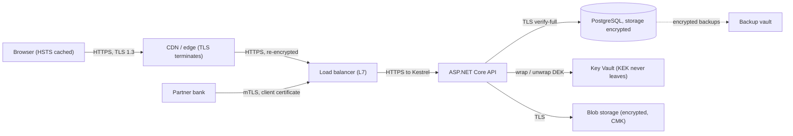
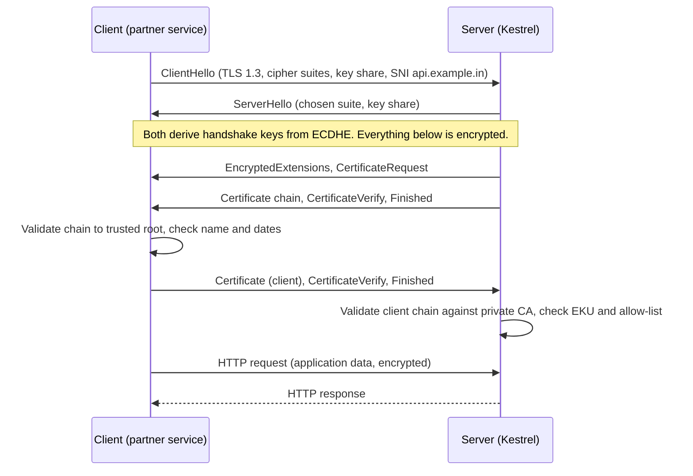
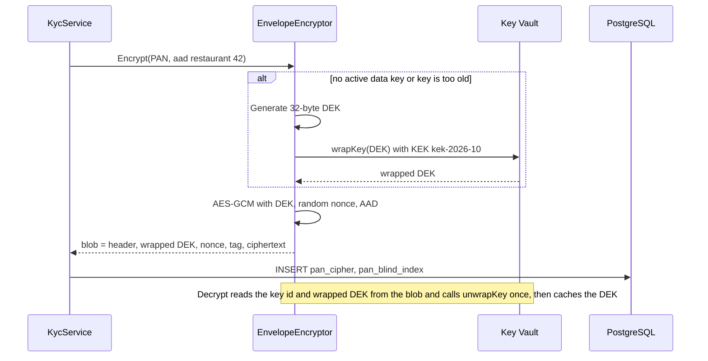

Every system that handles money, identity documents or contracts has two questions to answer: *can someone read the data while it moves between machines?* and *can someone read it if they get hold of the disk, the backup or the database dump?* The first is answered by **TLS** (encryption in transit). The second is answered by **encryption at rest**. Both sound like "tick the box" features. In practice, most real incidents come from the details: an expired certificate that takes the site down on a Sunday, a backup copied to a laptop without encryption, or a key stored right next to the data it protects.

## Learning objectives

By the end of this lesson you will be able to:

1. Explain what TLS protects (confidentiality, integrity, server identity) and what it does not (a compromised server, a malicious client, data after it arrives).
2. Walk through a TLS 1.3 handshake and say where the certificate check, key exchange and first encrypted byte happen.
3. Read a certificate chain, explain the chain of trust, and diagnose the four most common certificate errors.
4. Configure HTTPS, HSTS and mutual TLS (mTLS) in ASP.NET Core, and connect to PostgreSQL with full certificate verification.
5. Choose between disk encryption, transparent database encryption and column-level encryption by the threat each one stops.
6. Implement envelope encryption with AES-GCM in C#, including key ids, associated data, data-key caching and key rotation.
7. Decide when field-level encryption is overkill and platform encryption is enough.

## Prerequisites

- [HTTP fundamentals](#/lesson/m10-http-fundamentals): you should know what a request, a response and a header are.
- [Secure password storage and secret management](#/lesson/m14-passwords-secrets): hashing is not encryption, and keys are secrets that live in a vault.
- [Configuration in ASP.NET Core](#/lesson/m03-configuration): we bind options from configuration.

## Explain it like I'm a beginner

Imagine you send a signed contract from Gurgaon to a client in Pune by courier.

**In transit**, three things can go wrong. Someone can open the envelope and read it. Someone can swap a page. Or the "courier" at your door is not really from the courier company at all. TLS fixes all three for network traffic:

- It puts the letter in a **locked box** that only you and the receiver can open (encryption).
- It adds a **tamper seal**: if one byte changes on the way, the receiver notices (integrity).
- It checks the courier's **ID card**, issued by an authority you already trust (the certificate and the chain of trust).

**At rest**, the letter now sits in the client's filing cabinet. Encrypting the cabinet (disk encryption) protects you if someone steals the whole cabinet. It does nothing if someone with the cabinet key, the office clerk, simply opens the drawer. For the most sensitive pages, such as a PAN card copy, you lock that one page in its own small safe (column-level encryption). And you keep the safe's key with a key service, not taped to the safe (key management).

One more idea: **envelope encryption**. The small safe has its own key (a data key). You don't carry thousands of data keys around. You lock each data key inside a master safe at the bank (a key-encryption key in a key vault), and store the locked data key next to the data. To read the page, you ask the bank to unlock the data key. The bank never hands out its master key.

## First-principles explanation

### What TLS gives you, and what it doesn't

TLS (Transport Layer Security) is the protocol under HTTPS, under `sslmode=verify-full` for PostgreSQL, under AMQPS for RabbitMQ and under most gRPC traffic. It provides three properties between two endpoints:

| Property | Meaning | Mechanism |
|---|---|---|
| Confidentiality | Nobody on the path can read the bytes | Symmetric encryption (AES-GCM or ChaCha20-Poly1305) with keys agreed fresh per connection |
| Integrity | Nobody can change the bytes without detection | The same AEAD cipher (authenticated encryption) adds a tag to every record |
| Authentication | You are talking to the real `api.example.in` | The server proves it holds the private key for a certificate that a trusted authority issued for that name |

What TLS does **not** give you: protection once data reaches the server (an SQL injection still reads everything, see [OWASP](#/lesson/m14-owasp)), protection from the client itself, or proof of who the *user* is. TLS authenticates machines. Users are authenticated by [OIDC, cookies or tokens](#/lesson/m14-authn-vs-authz) on top.

### The TLS 1.3 handshake

Before any HTTP byte is sent, the client and server run a handshake. In TLS 1.3 it takes **one round trip** (TLS 1.2 needed two):

1. **ClientHello.** The client sends the TLS versions and cipher suites it supports, the server name it wants (SNI, so one IP can host many sites), and a fresh **key share**: the public half of a one-time elliptic-curve key pair (ECDHE).
2. **ServerHello.** The server picks a cipher suite and sends its own key share. Now both sides can compute the same shared secret without ever sending it. This is the Diffie-Hellman trick. From here on, everything is encrypted.
3. **Certificate, CertificateVerify, Finished.** The server sends its certificate chain, then signs a hash of the whole handshake with its private key. This signature proves it really holds the key for the certificate, not just a copy of the public certificate.
4. **Client checks.** The client validates the chain up to a root it trusts, checks that the name matches (`api.example.in` is in the certificate's Subject Alternative Names), checks dates, and checks the signature.
5. **Client Finished.** The client confirms, and application data flows.

Because the session keys come from one-time key pairs, recording traffic today and stealing the server's private key next year does not let an attacker decrypt it. This property is called **forward secrecy**, and TLS 1.3 makes it mandatory.

Why round trips matter: the round-trip time (RTT) from Mumbai to a server in Frankfurt is roughly 110–130 ms (an estimate; measure your own). TLS 1.2 adds about 2 × 120 = 240 ms before the first request. TLS 1.3 adds about 120 ms. On a mobile network that is the difference between "snappy" and "laggy". Keep-alive connections and HTTP/2 pay this cost once per connection, not per request, which is one reason connection reuse ([HttpClient factory](#/lesson/m10-http-fundamentals)) matters.

### Certificates and the chain of trust

A certificate is a signed statement: "the public key `04:ab:...` belongs to `api.example.in`, valid from 1 March to 17 September, signed by Intermediate CA X". The browser does not know Intermediate CA X. It knows a small set of **root CAs** that ship with the operating system or browser (the trust store). So the server sends a chain:

```text
leaf:          CN=api.example.in          signed by → R11 (intermediate)
intermediate:  CN=R11                     signed by → ISRG Root X1 (root)
root:          CN=ISRG Root X1            self-signed, already in the client's trust store
```

The client checks each signature up the chain until it reaches a root it already trusts. The root's private key sits offline in a hardware security module, which is why CAs sign with intermediates day to day.

Four certificate errors cause most production incidents: a missing intermediate, a name not in the SAN list, an expired certificate, and a wrong client clock. Exercise 2 walks through each one.

Certificate lifetimes are shrinking: the CA/Browser Forum schedule cuts the maximum for public TLS certificates to 200 days from March 2026, 100 days from March 2027 and 47 days from March 2029. Renewal must be automated (ACME, managed certificates, Key Vault auto-renewal, cert-manager).

### HSTS: stop the first insecure request

If a user types `example.in`, the browser first tries plain `http://`. Your server answers with a redirect to HTTPS, but that first request travelled in clear text. On café Wi-Fi an attacker can intercept it and keep the user on HTTP (an SSL-stripping attack).

**HSTS** (HTTP Strict Transport Security) fixes this. The server sends a header once over HTTPS:

```text
Strict-Transport-Security: max-age=31536000; includeSubDomains
```

For the next year (31,536,000 seconds), the browser converts every `http://` URL for this domain to `https://` *before* sending anything. The **preload list** goes one step further: browsers ship with your domain already marked, so even the very first visit is protected. Preload needs `max-age` of at least one year, `includeSubDomains` and `preload`, and it is hard to undo. If any subdomain (an old intranet `reports.example.in` on HTTP) cannot do HTTPS, it breaks. Roll out in steps: 5 minutes, then 1 week, then 1 year, then preload.

### Mutual TLS: the client shows an ID card too

In normal TLS only the server has a certificate. In **mutual TLS (mTLS)** the server also asks the client for one (the `CertificateRequest` message), and the client proves it holds the matching private key. Typical uses:

- Service-to-service traffic inside a platform (a service mesh such as Istio or Linkerd issues short-lived certificates to every pod automatically).
- Partner and bank integrations, where a payment gateway only accepts calls from your registered certificate.
- Devices in the field, such as delivery-bike telematics units or smart parcel lockers that upload data.

mTLS answers "which machine or service is calling", not "which user". The cost is operational: issuing, rotating and revoking client certificates. For a handful of internal services, a managed-identity token is often simpler.

### Where TLS terminates

A CDN or load balancer often decrypts traffic (TLS termination) and forwards it. Ask whether each later hop (to Kestrel, PostgreSQL, Redis) is encrypted too. Zero-trust networks re-encrypt every hop. If you accept plain HTTP inside a private network, make that a written decision, not an accident.

For PostgreSQL, `sslmode=require` encrypts but **does not check the certificate**, so a machine in the middle can still impersonate the database. Use `verify-full` (Npgsql: `SSL Mode=VerifyFull`), which checks the chain and the host name. Managed services such as Azure Database for PostgreSQL publish the CA certificates to trust.

### Encryption at rest: three layers, three threats

"Encrypted at rest" can mean very different things. Match each layer to the threat it actually stops:

| Layer | What is encrypted | Who can still read plaintext | Stops |
|---|---|---|---|
| Disk / volume encryption (BitLocker, LUKS, cloud disk encryption) | Whole disk blocks | The OS, every process, every DB user | Stolen disks, decommissioned drives, a lost laptop |
| Database-level / transparent data encryption (TDE) | Data files, WAL and backups of the database | Anyone who can log in to the database | Stolen data files or backup files |
| Column-level / application-level encryption | Specific fields, encrypted by the app before they reach the DB | Only code holding the key (via the key service) | A DBA, an SQL dump, a read replica given to analysts, an SQL injection that reads the column |

Cloud providers encrypt managed disks and databases by default, optionally with customer-managed keys (CMK). Community PostgreSQL 17 has no built-in TDE, so "PostgreSQL is encrypted at rest" on a managed service means storage encryption: it stops a lost disk, not a leaked database password. That is why the most sensitive fields (PAN, bank accounts, health data) get **column-level encryption**.

### AES-GCM: the right default cipher

For application-level encryption in .NET, use **AES-GCM** (`System.Security.Cryptography.AesGcm`). It is authenticated encryption (AEAD): it encrypts *and* produces a 16-byte tag, so any tampering is detected on decryption. Rules that matter:

- **Key**: 256 bits (32 bytes) from a secure random generator or a key service. Never derived from a password without a proper KDF.
- **Nonce**: 12 bytes, and **never reused with the same key**. Reusing a nonce with GCM is catastrophic: it leaks the XOR of two plaintexts and lets an attacker forge tags. With random nonces, NIST SP 800-38D limits one key to about 2³² (≈ 4.3 billion) encryptions. That sounds like a lot, until a busy service encrypts 2,000 values a second: 2³² ÷ 2,000 ≈ 2.1 million seconds, about 25 days. Rotate data keys well before that.
- **Associated data (AAD)**: extra bytes that are authenticated but not encrypted. Put the record's identity in it (`restaurant:42:pan`). Then an attacker with database write access cannot copy the encrypted PAN of restaurant 7 into restaurant 42's row: decryption fails because the AAD differs.
- **Never** use AES-ECB, or AES-CBC without a MAC, for new work.

### Envelope encryption and key management

If one key encrypts every PAN in the database, that key is extremely valuable and you cannot rotate it without re-encrypting everything. **Envelope encryption** splits the job:

- A **data encryption key (DEK)** encrypts the actual data. DEKs are generated by the app, used for a limited time or number of messages, and stored *wrapped* next to the ciphertext.
- A **key encryption key (KEK)** lives in a key service (Azure Key Vault or Managed HSM, AWS KMS, HashiCorp Vault). It never leaves. The app asks the service to `wrap` and `unwrap` DEKs.

Benefits: the KEK never touches your servers, every unwrap is logged by the key service (an audit trail of who decrypted what, see [audit trails](#/lesson/m14-least-privilege-audit)), and **rotating the KEK only means re-wrapping DEKs** (a few hundred bytes each), not re-encrypting terabytes of data. Revoking the KEK makes all data unreadable at once, which is called crypto-shredding. It is useful for deleting a tenant's data from backups you cannot edit.

The cost: every unwrap is a network call (often 5–20 ms, an estimate) and key services have rate limits. So you **cache** unwrapped DEKs in memory for a short time, and reuse one DEK for many encryptions.

### Searching encrypted columns

`WHERE pan = @pan` cannot work on ciphertext, because random nonces make equal PANs encrypt differently. For exact-match lookup, store a **blind index**: `HMAC-SHA256(indexKey, normalisedPan)` in a separate indexed column. It leaks only equality. Range queries and `LIKE` on encrypted data are not practical.

## Visual explanation

### Where encryption happens in a typical deployment



How to read it. Every solid arrow is a network hop, and every hop has its own TLS session. The browser's TLS session ends at the CDN, which decrypts, inspects and re-encrypts towards the load balancer. If you skip the re-encryption, traffic inside the provider's network travels in clear. The partner bank uses mutual TLS, so the load balancer (or Kestrel) checks the bank's client certificate. The API connects to PostgreSQL with `verify-full`, so a rogue machine cannot pose as the database. The API never sees the KEK: it sends wrapped data keys to Key Vault and gets plaintext data keys back, briefly, in memory. The dotted arrow shows backups. They inherit storage encryption, and column-encrypted fields stay encrypted in the backup too, which is a large part of why column-level encryption is worth its cost for very sensitive data.

### The TLS 1.3 handshake with mutual TLS



The first two messages travel in clear, but they contain only public values (supported versions, public key shares). From the moment both sides have the shared secret, all messages are encrypted, including the certificates, which hides which client is connecting from observers. `CertificateVerify` is the proof of possession: a signature over the handshake transcript made with the private key. A stolen certificate file without its private key cannot produce it. In plain (non-mutual) TLS, the `CertificateRequest` and the client's certificate messages are simply absent. The whole exchange costs one round trip before the HTTP request can go.

### Envelope encryption flow



The encryptor calls Key Vault only when it needs a fresh data key, not on every encryption. That keeps latency low and stays within the key service's rate limits. The blob is self-describing: it carries the KEK id and the wrapped DEK. So any instance, years later, can decrypt it, and after a KEK rotation old blobs still name the old KEK.

## Step-by-step example

**Scenario.** A food-delivery platform onboards 18,000 restaurants a year through its partner app. Each restaurant owner submits a PAN, a GST number and a bank account for weekly payouts. An audit finding says: "PAN and bank details are visible to anyone with read access to the database, including the reporting replica used by the analytics team." We fix it in steps.

### Step 1 — HTTPS everywhere, verified

- Public site: managed certificate on the load balancer, auto-renewing, alerts at 30 days before expiry.
- `UseHttpsRedirection()` and `UseHsts()` in the app, HSTS rolled out from 1 week to 1 year.
- App to PostgreSQL: `SSL Mode=VerifyFull` with the provider's CA bundle.

### Step 2 — decide what to encrypt at column level

Only three fields qualify: PAN, bank account number and IFSC + account combination. Name, city and GST number are needed for reports and search, and the GST number is public anyway. That keeps the blast radius of "we can't query this" small.

### Step 3 — the naive version (don't ship this)

```csharp
// One static key in appsettings.json, AES-CBC, no MAC, IV of zeros.
var aes = Aes.Create();
aes.Key = Convert.FromBase64String(config["PanKey"]!);
aes.IV = new byte[16];
var cipher = aes.EncryptCbc(Encoding.UTF8.GetBytes(pan), aes.IV);
```

Problems: the key sits in the same config as the database connection string, so a leaked config file leaks both. A zero IV makes equal PANs encrypt to equal bytes. There is no integrity check, and there is no way to rotate the key.

### Step 4 — envelope encryption with AES-GCM

Design choices, with numbers:

- **DEK reuse**: one DEK per instance for up to 1 hour or 1,000,000 encryptions, whichever comes first. With 18,000 onboardings a year that is a few DEKs a day. With a busy service it still stays far below the 2³² GCM limit.
- **AAD**: `restaurant:{id}:pan`, so a ciphertext copied to another row fails to decrypt.
- **Blind index** with a *separate* HMAC key, so "PAN already registered?" is one indexed lookup.
- **Blob format** that carries the KEK id, so we can rotate KEKs yearly.

### Step 5 — rotation plan

KEK rotation (yearly, or on suspicion) creates a new key in Key Vault and re-wraps old DEKs in a background job (exercise 3). DEKs rotate automatically by age and count. Blind-index keys are expensive to rotate (every index value is recomputed), so protect them well.

## Production-style C# implementation

Project structure:

```text
Kyc.Api/
  Program.cs
  Crypto/IKeyWrapper.cs
  Crypto/LocalKeyWrapper.cs
  Crypto/CipherBlob.cs
  Crypto/EnvelopeEncryptor.cs
  Crypto/BlindIndexer.cs
  Kyc/KycService.cs
```

```csharp file=Crypto/IKeyWrapper.cs
namespace Kyc.Api.Crypto;

/// <summary>A data key wrapped (encrypted) by a key-encryption key identified by KeyId.</summary>
public sealed record WrappedKey(string KeyId, byte[] Ciphertext);

/// <summary>Wraps and unwraps data keys with a key-encryption key that never leaves the key service.
/// Production: Azure Key Vault / Managed HSM wrapKey and unwrapKey. Tests and local dev: LocalKeyWrapper.</summary>
public interface IKeyWrapper
{
    Task<WrappedKey> WrapAsync(byte[] dataKey, CancellationToken ct = default);
    Task<byte[]> UnwrapAsync(WrappedKey wrapped, CancellationToken ct = default);
}
```

```csharp file=Crypto/LocalKeyWrapper.cs
using System.Security.Cryptography;

namespace Kyc.Api.Crypto;

/// <summary>In-process key wrapper for development and tests ONLY. In production the KEK must live in a key service.</summary>
public sealed class LocalKeyWrapper : IKeyWrapper
{
    private const int NonceSize = 12, TagSize = 16;
    private readonly IReadOnlyDictionary<string, byte[]> _keks;
    public string CurrentKeyId { get; }

    public LocalKeyWrapper(IReadOnlyDictionary<string, byte[]> keks, string currentKeyId)
    {
        if (!keks.ContainsKey(currentKeyId)) throw new ArgumentException($"Unknown current KEK '{currentKeyId}'.", nameof(currentKeyId));
        if (keks.Values.Any(k => k.Length != 32)) throw new ArgumentException("Every KEK must be 32 bytes (AES-256).", nameof(keks));
        _keks = keks;
        CurrentKeyId = currentKeyId;
    }

    public static LocalKeyWrapper CreateRandom(string keyId = "local-dev") =>
        new(new Dictionary<string, byte[]> { [keyId] = RandomNumberGenerator.GetBytes(32) }, keyId);

    public Task<WrappedKey> WrapAsync(byte[] dataKey, CancellationToken ct = default)
    {
        var nonce = RandomNumberGenerator.GetBytes(NonceSize);
        var output = new byte[NonceSize + TagSize + dataKey.Length];
        nonce.CopyTo(output, 0);
        using var aes = new AesGcm(_keks[CurrentKeyId], TagSize);
        aes.Encrypt(nonce, dataKey, output.AsSpan(NonceSize + TagSize), output.AsSpan(NonceSize, TagSize),
                    System.Text.Encoding.UTF8.GetBytes(CurrentKeyId));
        return Task.FromResult(new WrappedKey(CurrentKeyId, output));
    }

    public Task<byte[]> UnwrapAsync(WrappedKey wrapped, CancellationToken ct = default)
    {
        if (!_keks.TryGetValue(wrapped.KeyId, out var kek))
            throw new CryptographicException($"Key-encryption key '{wrapped.KeyId}' is not available.");
        var data = wrapped.Ciphertext;
        var plain = new byte[data.Length - NonceSize - TagSize];
        using var aes = new AesGcm(kek, TagSize);
        aes.Decrypt(data.AsSpan(0, NonceSize), data.AsSpan(NonceSize + TagSize), data.AsSpan(NonceSize, TagSize), plain,
                    System.Text.Encoding.UTF8.GetBytes(wrapped.KeyId));
        return Task.FromResult(plain);
    }
}
```

```csharp file=Crypto/CipherBlob.cs
using System.Buffers.Binary;
using System.Security.Cryptography;
using System.Text;

namespace Kyc.Api.Crypto;

/// <summary>Self-describing ciphertext layout:
/// [version:1][kidLen:1][kid][wrappedLen:2][wrappedDek][nonce:12][tag:16][ciphertext].</summary>
public sealed record CipherBlob(WrappedKey Key, byte[] Nonce, byte[] Tag, byte[] Ciphertext)
{
    public const byte Version = 1;
    public const int NonceSize = 12, TagSize = 16;

    public byte[] ToBytes()
    {
        var kid = Encoding.UTF8.GetBytes(Key.KeyId);
        if (kid.Length > byte.MaxValue) throw new InvalidOperationException("Key id too long.");
        var size = 1 + 1 + kid.Length + 2 + Key.Ciphertext.Length + NonceSize + TagSize + Ciphertext.Length;
        var buffer = new byte[size];
        var span = buffer.AsSpan();
        span[0] = Version;
        span[1] = (byte)kid.Length;
        var pos = 2;
        kid.CopyTo(span[pos..]); pos += kid.Length;
        BinaryPrimitives.WriteUInt16BigEndian(span[pos..], (ushort)Key.Ciphertext.Length); pos += 2;
        Key.Ciphertext.CopyTo(span[pos..]); pos += Key.Ciphertext.Length;
        Nonce.CopyTo(span[pos..]); pos += NonceSize;
        Tag.CopyTo(span[pos..]); pos += TagSize;
        Ciphertext.CopyTo(span[pos..]);
        return buffer;
    }

    public static CipherBlob Parse(ReadOnlySpan<byte> data)
    {
        if (data.Length < 2 || data[0] != Version) throw new CryptographicException("Unsupported ciphertext version.");
        var pos = 2;
        int kidLen = data[1];
        if (data.Length < pos + kidLen + 2) throw new CryptographicException("Truncated ciphertext.");
        var kid = Encoding.UTF8.GetString(data.Slice(pos, kidLen)); pos += kidLen;
        int wrappedLen = BinaryPrimitives.ReadUInt16BigEndian(data[pos..]); pos += 2;
        if (data.Length < pos + wrappedLen + NonceSize + TagSize) throw new CryptographicException("Truncated ciphertext.");
        var wrapped = data.Slice(pos, wrappedLen).ToArray(); pos += wrappedLen;
        var nonce = data.Slice(pos, NonceSize).ToArray(); pos += NonceSize;
        var tag = data.Slice(pos, TagSize).ToArray(); pos += TagSize;
        return new CipherBlob(new WrappedKey(kid, wrapped), nonce, tag, data[pos..].ToArray());
    }
}
```

```csharp file=Crypto/EnvelopeEncryptor.cs
using System.Security.Cryptography;
using Microsoft.Extensions.Caching.Memory;
using Microsoft.Extensions.Options;

namespace Kyc.Api.Crypto;

public sealed class EnvelopeOptions
{
    /// <summary>Re-key well below the ~2^32 random-nonce limit for AES-GCM.</summary>
    public long MaxMessagesPerDataKey { get; set; } = 1_000_000;
    public TimeSpan DataKeyLifetime { get; set; } = TimeSpan.FromHours(1);
    public TimeSpan UnwrappedKeyCacheTime { get; set; } = TimeSpan.FromMinutes(10);
}

public interface IFieldEncryptor
{
    Task<byte[]> EncryptAsync(byte[] plaintext, byte[] associatedData, CancellationToken ct = default);
    Task<byte[]> DecryptAsync(byte[] blob, byte[] associatedData, CancellationToken ct = default);
}

/// <summary>Envelope encryption: AES-256-GCM with a cached data key, wrapped by a KEK in the key service.</summary>
public sealed class EnvelopeEncryptor(IKeyWrapper wrapper, IMemoryCache cache, TimeProvider clock, IOptions<EnvelopeOptions> options)
    : IFieldEncryptor
{
    private sealed class ActiveKey(byte[] plain, WrappedKey wrapped, DateTimeOffset createdAt)
    {
        public byte[] Plain { get; } = plain;
        public WrappedKey Wrapped { get; } = wrapped;
        public DateTimeOffset CreatedAt { get; } = createdAt;
        public long Uses;
    }

    private readonly EnvelopeOptions _o = options.Value;
    private readonly SemaphoreSlim _rotateGate = new(1, 1);
    private volatile ActiveKey? _active;

    public async Task<byte[]> EncryptAsync(byte[] plaintext, byte[] associatedData, CancellationToken ct = default)
    {
        var key = await GetActiveKeyAsync(ct);
        var nonce = RandomNumberGenerator.GetBytes(CipherBlob.NonceSize);
        var cipher = new byte[plaintext.Length];
        var tag = new byte[CipherBlob.TagSize];
        using (var aes = new AesGcm(key.Plain, CipherBlob.TagSize))
            aes.Encrypt(nonce, plaintext, cipher, tag, associatedData);
        return new CipherBlob(key.Wrapped, nonce, tag, cipher).ToBytes();
    }

    public async Task<byte[]> DecryptAsync(byte[] blob, byte[] associatedData, CancellationToken ct = default)
    {
        var parsed = CipherBlob.Parse(blob);
        var dek = await UnwrapCachedAsync(parsed.Key, ct);
        var plain = new byte[parsed.Ciphertext.Length];
        using var aes = new AesGcm(dek, CipherBlob.TagSize);
        // Throws AuthenticationTagMismatchException (a CryptographicException) if data, tag or AAD were changed.
        aes.Decrypt(parsed.Nonce, parsed.Ciphertext, parsed.Tag, plain, associatedData);
        return plain;
    }

    private async Task<ActiveKey> GetActiveKeyAsync(CancellationToken ct)
    {
        var current = _active;
        if (current is not null && IsUsable(current) && Interlocked.Increment(ref current.Uses) <= _o.MaxMessagesPerDataKey)
            return current;

        await _rotateGate.WaitAsync(ct);
        try
        {
            current = _active;
            if (current is not null && IsUsable(current) && Interlocked.Increment(ref current.Uses) <= _o.MaxMessagesPerDataKey)
                return current;
            var dek = RandomNumberGenerator.GetBytes(32);
            var wrapped = await wrapper.WrapAsync(dek, ct);
            var fresh = new ActiveKey(dek, wrapped, clock.GetUtcNow()) { Uses = 1 };
            _active = fresh;
            return fresh;
        }
        finally { _rotateGate.Release(); }
    }

    private bool IsUsable(ActiveKey k) => clock.GetUtcNow() - k.CreatedAt < _o.DataKeyLifetime;

    private async Task<byte[]> UnwrapCachedAsync(WrappedKey wrapped, CancellationToken ct)
    {
        var cacheKey = $"dek:{wrapped.KeyId}:{Convert.ToBase64String(SHA256.HashData(wrapped.Ciphertext))}";
        if (cache.TryGetValue(cacheKey, out byte[]? dek) && dek is not null) return dek;
        dek = await wrapper.UnwrapAsync(wrapped, ct);
        cache.Set(cacheKey, dek, _o.UnwrappedKeyCacheTime);
        return dek;
    }
}
```

```csharp file=Crypto/BlindIndexer.cs
using System.Security.Cryptography;
using System.Text;

namespace Kyc.Api.Crypto;

/// <summary>Deterministic HMAC so equal values can be found with an indexed equality lookup.
/// Uses a key separate from the encryption keys. Leaks equality, nothing else.</summary>
public sealed class BlindIndexer(byte[] indexKey)
{
    private readonly byte[] _key = indexKey.Length >= 32 ? indexKey : throw new ArgumentException("Index key must be at least 32 bytes.");

    public string Compute(string purpose, string normalisedValue)
    {
        var mac = HMACSHA256.HashData(_key, Encoding.UTF8.GetBytes($"{purpose}|{normalisedValue}"));
        return Convert.ToHexString(mac, 0, 16); // 128 bits is plenty for lookups
    }
}
```

```csharp file=Kyc/KycService.cs
using System.Collections.Concurrent;
using System.Text;
using System.Text.RegularExpressions;
using Kyc.Api.Crypto;

namespace Kyc.Api.Kyc;

public sealed record RestaurantPanRow(Guid RestaurantId, byte[] PanCipher, string PanIndex);

public interface IPanStore
{
    Task SaveAsync(RestaurantPanRow row, CancellationToken ct);
    Task<RestaurantPanRow?> GetAsync(Guid restaurantId, CancellationToken ct);
    Task<Guid?> FindByIndexAsync(string panIndex, CancellationToken ct);
}

/// <summary>Stand-in for a PostgreSQL table with a UNIQUE index on pan_index.</summary>
public sealed class InMemoryPanStore : IPanStore
{
    private readonly ConcurrentDictionary<Guid, RestaurantPanRow> _rows = new();
    public Task SaveAsync(RestaurantPanRow row, CancellationToken ct) { _rows[row.RestaurantId] = row; return Task.CompletedTask; }
    public Task<RestaurantPanRow?> GetAsync(Guid id, CancellationToken ct) => Task.FromResult(_rows.TryGetValue(id, out var r) ? r : null);
    public Task<Guid?> FindByIndexAsync(string idx, CancellationToken ct) =>
        Task.FromResult(_rows.Values.Where(r => r.PanIndex == idx).Select(r => (Guid?)r.RestaurantId).FirstOrDefault());
}

public sealed class DuplicatePanException(Guid existing) : Exception($"PAN already registered to restaurant {existing}.")
{
    public Guid ExistingRestaurantId { get; } = existing;
}

public sealed partial class KycService(IFieldEncryptor encryptor, BlindIndexer indexer, IPanStore store)
{
    [GeneratedRegex("^[A-Z]{5}[0-9]{4}[A-Z]$")]
    private static partial Regex PanFormat();

    private static byte[] Aad(Guid restaurantId) => Encoding.UTF8.GetBytes($"restaurant:{restaurantId:N}:pan");

    public static string Normalise(string pan) => pan.Trim().Replace(" ", "").ToUpperInvariant();

    public async Task RegisterPanAsync(Guid restaurantId, string pan, CancellationToken ct = default)
    {
        var p = Normalise(pan);
        if (!PanFormat().IsMatch(p)) throw new ArgumentException("PAN must look like ABCDE1234F.", nameof(pan));
        var index = indexer.Compute("pan", p);
        var existing = await store.FindByIndexAsync(index, ct);
        if (existing is { } other && other != restaurantId) throw new DuplicatePanException(other);
        var cipher = await encryptor.EncryptAsync(Encoding.UTF8.GetBytes(p), Aad(restaurantId), ct);
        await store.SaveAsync(new RestaurantPanRow(restaurantId, cipher, index), ct);
    }

    /// <summary>Most screens only need the masked value: ABCDE****F.</summary>
    public async Task<string?> GetMaskedPanAsync(Guid restaurantId, CancellationToken ct = default)
    {
        var pan = await GetPanAsync(restaurantId, ct);
        return pan is null ? null : $"{pan[..5]}****{pan[^1]}";
    }

    /// <summary>Full value: call only from flows that need it (weekly payout file generation), and audit the call.</summary>
    public async Task<string?> GetPanAsync(Guid restaurantId, CancellationToken ct = default)
    {
        var row = await store.GetAsync(restaurantId, ct);
        if (row is null) return null;
        var plain = await encryptor.DecryptAsync(row.PanCipher, Aad(restaurantId), ct);
        return Encoding.UTF8.GetString(plain);
    }
}
```

```csharp file=Program.cs
using System.Security.Authentication;
using Kyc.Api.Crypto;
using Kyc.Api.Kyc;
using Microsoft.AspNetCore.Server.Kestrel.Https;

var builder = WebApplication.CreateBuilder(args);

// Transport security
builder.Services.AddHsts(o =>
{
    o.MaxAge = TimeSpan.FromDays(365);   // raise in steps: 5 min, 1 week, then 1 year
    o.IncludeSubDomains = true;
    o.Preload = false;                    // only after every subdomain serves HTTPS
});
builder.Services.AddHttpsRedirection(o => o.HttpsPort = 443);
builder.WebHost.ConfigureKestrel(k => k.ConfigureHttpsDefaults(https =>
{
    https.SslProtocols = SslProtocols.Tls12 | SslProtocols.Tls13;
    // Allow (not require) client certificates, so only the partner endpoint demands one.
    https.ClientCertificateMode = ClientCertificateMode.AllowCertificate;
}));

// Encryption at rest (application level)
builder.Services.AddMemoryCache();
builder.Services.AddSingleton(TimeProvider.System);
builder.Services.Configure<EnvelopeOptions>(builder.Configuration.GetSection("Encryption:Envelope"));
// DEV ONLY. In production register a Key Vault-backed IKeyWrapper and read the index key from the vault.
builder.Services.AddSingleton<IKeyWrapper>(_ => LocalKeyWrapper.CreateRandom());
builder.Services.AddSingleton<IFieldEncryptor, EnvelopeEncryptor>();
builder.Services.AddSingleton(_ => new BlindIndexer(System.Security.Cryptography.RandomNumberGenerator.GetBytes(32)));
builder.Services.AddSingleton<IPanStore, InMemoryPanStore>();
builder.Services.AddScoped<KycService>();

var app = builder.Build();

if (!app.Environment.IsDevelopment()) app.UseHsts();
app.UseHttpsRedirection();

app.MapPut("/restaurants/{id:guid}/pan", async (Guid id, PanRequest body, KycService kyc, CancellationToken ct) =>
{
    try { await kyc.RegisterPanAsync(id, body.Pan, ct); return Results.NoContent(); }
    catch (ArgumentException ex) { return Results.Problem(ex.Message, statusCode: StatusCodes.Status400BadRequest); }
    catch (DuplicatePanException) { return Results.Problem("This PAN is already registered.", statusCode: StatusCodes.Status409Conflict); }
});

app.MapGet("/restaurants/{id:guid}/pan", async (Guid id, KycService kyc, CancellationToken ct) =>
    await kyc.GetMaskedPanAsync(id, ct) is { } masked ? Results.Ok(new { pan = masked }) : Results.NotFound());

app.Run();

public sealed record PanRequest(string Pan);
```

Notes on the code:

- **The wrapper is an interface.** In production you implement `IKeyWrapper` with the Azure Key Vault `CryptographyClient` (`WrapKeyAsync` / `UnwrapKeyAsync` with `RSA-OAEP-256` or AES key wrap on Managed HSM), authenticated with a managed identity so no secret is stored at all. That code needs the `Azure.Security.KeyVault.Keys` package, so it is not compiled here.
- **The KEK id is authenticated.** `LocalKeyWrapper` passes the key id as AAD, so a wrapped key cannot be relabelled as another KEK's.
- **The double-checked rotation** in `GetActiveKeyAsync` means 200 concurrent requests at rotation time cause one wrap call, not 200.
- **The API never returns the full PAN.** Only the weekly payout-file job calls `GetPanAsync`, and that call should be written to the audit log.

### Mutual TLS for the partner endpoint

Certificate authentication needs the `Microsoft.AspNetCore.Authentication.Certificate` package, so this is a sketch, not a compiled file:

```csharp
builder.Services.AddAuthentication(CertificateAuthenticationDefaults.AuthenticationScheme)
    .AddCertificate(o =>
    {
        o.AllowedCertificateTypes = CertificateTypes.Chained;
        o.ChainTrustValidationMode = X509ChainTrustMode.CustomRootTrust;
        o.CustomTrustStore.Add(X509CertificateLoader.LoadCertificateFromFile("partner-ca.cer"));
        o.RevocationMode = X509RevocationMode.Online;
        o.Events = new CertificateAuthenticationEvents
        {
            OnCertificateValidated = ctx =>
            {
                var allowed = ctx.HttpContext.RequestServices.GetRequiredService<IPartnerRegistry>();
                if (!allowed.IsKnownThumbprint(ctx.ClientCertificate.Thumbprint)) ctx.Fail("Unknown partner certificate.");
                return Task.CompletedTask;
            }
        };
    });
```

When TLS terminates at a load balancer or at Azure App Service, the client certificate arrives in a header (for example `X-ARR-ClientCert`), and you use `AddCertificateForwarding` to read it. Only trust that header from the proxy itself, never directly from the internet.

### PostgreSQL connection string

```text
Host=pg-prod.postgres.database.azure.com;Database=kyc;Username=kyc_app;
SSL Mode=VerifyFull;Root Certificate=/etc/ssl/certs/pg-ca.pem
```

## Bad design vs good design

| Bad | Why it hurts | Good |
|---|---|---|
| `ServerCertificateCustomValidationCallback = (_, _, _, _) => true` "because the staging cert is self-signed" | Copied to production, it turns off authentication. Anyone in the path can impersonate the server | Trust the staging CA explicitly (custom trust store) or use real certificates in staging |
| `sslmode=require` to PostgreSQL | Encrypts but never checks who answers | `verify-full` with the provider's CA |
| One AES key in `appsettings.json` for all data, forever | Leaked config leaks every record. Rotation needs a full re-encryption | Envelope encryption: KEK in a vault, DEKs wrapped, rotation by re-wrap |
| Random or counter nonces without a limit on messages per key | Nonce reuse breaks GCM completely | Random 12-byte nonce plus a data-key usage limit, or a misuse-resistant mode where offered |
| Encrypting every column "to be safe" | No reports, slow queries, key service on every read | Classify data, then encrypt only the few fields that need it |
| HSTS preload on day one | An HTTP-only subdomain breaks for a year or more | Step up `max-age`, inventory subdomains, then preload |
| Certificates renewed by a calendar reminder | Outage on the day someone is on leave | ACME or managed certificates, plus expiry alerts |

:::callout type=mistake title="Encryption is not access control"
If your API endpoint `GET /restaurants/{id}/pan` returns the decrypted PAN to any logged-in user, column-level encryption protected nothing: the attacker simply calls the API. Encryption at rest narrows *who can read data through other paths* (DBA, dump, backup, replica). Authorization still decides who reads it through the application. See [RBAC and PBAC](#/lesson/m14-rbac-pbac).
:::

:::callout type=tradeoff title="Platform encryption is often enough"
Managed disks, managed PostgreSQL, Blob Storage and Service Bus are all encrypted at rest by default. For most fields, that plus least-privilege database access and TLS everywhere is the right answer. Column-level encryption costs real things: no SQL filtering or sorting on those columns, harder reporting, and the key service on the hot path ("Key Vault throttled us and checkout failed"). Add customer-managed keys when a contract requires you to control or revoke keys. Add column-level encryption only for the handful of fields where a database reader must not see plaintext.
:::

## Practical playground

Run the program. It encrypts a PAN with AES-GCM, then shows three tampering attempts: flipping one ciphertext byte, changing the associated data (moving the value to another restaurant's row), and reusing the same nonce for two messages to show what leaks. Change the code and watch which attempts the tag detects.

:::playground type=csharp title="AES-GCM tamper lab"
```csharp file=Program.cs
using System;
using System.Linq;
using System.Security.Cryptography;
using System.Text;

public static class Program
{
    static byte[] Encrypt(byte[] key, byte[] nonce, string text, string aad, out byte[] tag)
    {
        var plain = Encoding.UTF8.GetBytes(text);
        var cipher = new byte[plain.Length];
        tag = new byte[16];
        using var gcm = new AesGcm(key, 16);
        gcm.Encrypt(nonce, plain, cipher, tag, Encoding.UTF8.GetBytes(aad));
        return cipher;
    }

    static string TryDecrypt(byte[] key, byte[] nonce, byte[] cipher, byte[] tag, string aad)
    {
        try
        {
            var plain = new byte[cipher.Length];
            using var gcm = new AesGcm(key, 16);
            gcm.Decrypt(nonce, cipher, tag, plain, Encoding.UTF8.GetBytes(aad));
            return "decrypted: " + Encoding.UTF8.GetString(plain);
        }
        catch (CryptographicException ex) { return "REJECTED (" + ex.GetType().Name + ")"; }
    }

    public static void Main()
    {
        var key = RandomNumberGenerator.GetBytes(32);
        var nonce = RandomNumberGenerator.GetBytes(12);
        var cipher = Encrypt(key, nonce, "ABCDE1234F", "restaurant:42:pan", out var tag);
        Console.WriteLine("ciphertext: " + Convert.ToHexString(cipher));
        Console.WriteLine("1. untouched     -> " + TryDecrypt(key, nonce, cipher, tag, "restaurant:42:pan"));

        var flipped = cipher.ToArray(); flipped[3] ^= 0x01;
        Console.WriteLine("2. one bit flip  -> " + TryDecrypt(key, nonce, flipped, tag, "restaurant:42:pan"));
        Console.WriteLine("3. moved to #7   -> " + TryDecrypt(key, nonce, cipher, tag, "restaurant:7:pan"));

        // Nonce reuse: XOR of two ciphertexts equals XOR of the two plaintexts. Never do this.
        var c2 = Encrypt(key, nonce, "PQRST9876Z", "restaurant:43:pan", out _);
        var xorC = cipher.Zip(c2, (a, b) => (byte)(a ^ b)).ToArray();
        var xorP = Encoding.UTF8.GetBytes("ABCDE1234F").Zip(Encoding.UTF8.GetBytes("PQRST9876Z"), (a, b) => (byte)(a ^ b)).ToArray();
        Console.WriteLine("4. nonce reuse   -> c1^c2 == p1^p2 ? " + xorC.SequenceEqual(xorP));
    }
}
```
:::

## Exercises

:::exercise id=m14-tls-encryption-ex1 difficulty=beginner kind=code title="A small AES-GCM field cipher"
Implement `GcmFieldCipher`, which encrypts one field with AES-256-GCM and returns a single byte array laid out as `nonce (12) | tag (16) | ciphertext`. It must bind the ciphertext to associated data such as `"invoice:INV-2026-0042:bank_account"`.
::requirements
- `Encrypt(plaintext, aad)` uses a fresh random 12-byte nonce on every call.
- `Decrypt(blob, aad)` returns the original bytes, or throws a `CryptographicException` if anything was changed (ciphertext, tag, nonce or AAD).
- The constructor rejects keys that are not exactly 32 bytes with `ArgumentException`.
::acceptance
- Encrypt then decrypt with the same AAD returns the original text.
- Encrypting the same text twice gives different blobs.
- Flipping any byte, or decrypting with a different AAD, throws a `CryptographicException` (or subclass).
- A 16-byte key is rejected.
::hint
`AesGcm` needs four buffers for encryption: nonce, plaintext, ciphertext (same length as the plaintext) and tag (16 bytes).
::hint
Use `RandomNumberGenerator.GetBytes(12)` for the nonce. Never use `new Random()` for cryptography.
::hint
Allocate one output array of `12 + 16 + plaintext.Length` and encrypt straight into slices of it with `AsSpan(start, length)`.
::hint
For decryption, slice the same three regions back out and call `aes.Decrypt(nonce, cipher, tag, plain, aad)`. `AuthenticationTagMismatchException` already derives from `CryptographicException`.
::hint
```csharp
using var aes = new AesGcm(_key, TagSize);
aes.Encrypt(nonce, plaintext, output.AsSpan(NonceSize + TagSize), output.AsSpan(NonceSize, TagSize), aad);
```
::starter
```csharp file=GcmFieldCipher.cs
using System;
using System.Security.Cryptography;

public sealed class GcmFieldCipher
{
    public const int NonceSize = 12;
    public const int TagSize = 16;
    private readonly byte[] _key;

    public GcmFieldCipher(byte[] key)
    {
        throw new NotImplementedException();
    }

    public byte[] Encrypt(byte[] plaintext, byte[] aad) => throw new NotImplementedException();

    public byte[] Decrypt(byte[] blob, byte[] aad) => throw new NotImplementedException();
}
```
::tests
```csharp file=GcmFieldCipherTests.cs
using System;
using System.Security.Cryptography;
using System.Text;
using Xunit;

public class GcmFieldCipherTests
{
    private static readonly byte[] Key = RandomNumberGenerator.GetBytes(32);
    private static readonly byte[] Aad = Encoding.UTF8.GetBytes("invoice:INV-2026-0042:bank_account");
    private static readonly byte[] Plain = Encoding.UTF8.GetBytes("50100234567890");

    [Fact]
    public void Round_trip_returns_original()
    {
        var c = new GcmFieldCipher(Key);
        Assert.Equal("50100234567890", Encoding.UTF8.GetString(c.Decrypt(c.Encrypt(Plain, Aad), Aad)));
    }

    [Fact]
    public void Same_plaintext_gives_different_blobs()
    {
        var c = new GcmFieldCipher(Key);
        Assert.NotEqual(Convert.ToHexString(c.Encrypt(Plain, Aad)), Convert.ToHexString(c.Encrypt(Plain, Aad)));
    }

    [Fact]
    public void Blob_has_expected_length()
    {
        var c = new GcmFieldCipher(Key);
        Assert.Equal(12 + 16 + Plain.Length, c.Encrypt(Plain, Aad).Length);
    }

    [Theory]
    [InlineData(0)]
    [InlineData(15)]
    [InlineData(30)]
    public void Any_flipped_byte_is_rejected(int index)
    {
        var c = new GcmFieldCipher(Key);
        var blob = c.Encrypt(Plain, Aad);
        blob[index] ^= 0x01;
        Assert.ThrowsAny<CryptographicException>(() => c.Decrypt(blob, Aad));
    }

    [Fact]
    public void Different_aad_is_rejected()
    {
        var c = new GcmFieldCipher(Key);
        var blob = c.Encrypt(Plain, Aad);
        Assert.ThrowsAny<CryptographicException>(() => c.Decrypt(blob, Encoding.UTF8.GetBytes("invoice:INV-2026-0043:bank_account")));
    }

    [Fact]
    public void Short_key_is_rejected() =>
        Assert.Throws<ArgumentException>(() => new GcmFieldCipher(new byte[16]));
}
```
::solution
Allocate one buffer, put the nonce first, then the tag, then the ciphertext. Decryption slices the same regions back out. GCM checks the tag over the ciphertext and the AAD, so any change fails.

```csharp file=GcmFieldCipher.cs
using System;
using System.Security.Cryptography;

public sealed class GcmFieldCipher
{
    public const int NonceSize = 12;
    public const int TagSize = 16;
    private readonly byte[] _key;

    public GcmFieldCipher(byte[] key)
    {
        ArgumentNullException.ThrowIfNull(key);
        if (key.Length != 32) throw new ArgumentException("AES-256 needs a 32-byte key.", nameof(key));
        _key = (byte[])key.Clone();
    }

    public byte[] Encrypt(byte[] plaintext, byte[] aad)
    {
        var output = new byte[NonceSize + TagSize + plaintext.Length];
        RandomNumberGenerator.Fill(output.AsSpan(0, NonceSize));
        using var aes = new AesGcm(_key, TagSize);
        aes.Encrypt(output.AsSpan(0, NonceSize), plaintext, output.AsSpan(NonceSize + TagSize),
                    output.AsSpan(NonceSize, TagSize), aad);
        return output;
    }

    public byte[] Decrypt(byte[] blob, byte[] aad)
    {
        if (blob.Length < NonceSize + TagSize) throw new CryptographicException("Ciphertext is too short.");
        var plain = new byte[blob.Length - NonceSize - TagSize];
        using var aes = new AesGcm(_key, TagSize);
        aes.Decrypt(blob.AsSpan(0, NonceSize), blob.AsSpan(NonceSize + TagSize), blob.AsSpan(NonceSize, TagSize), plain, aad);
        return plain;
    }
}
```

Copying the key in the constructor stops a caller from changing it later through the array they passed in.
::mistakes
- Using a fixed or counter nonce that resets on every restart, which reuses nonces across runs.
- Returning only the ciphertext and forgetting to store the nonce and tag, so the value can never be decrypted.
- Catching `CryptographicException` and returning an empty string, which hides tampering.
- Putting the AAD inside the blob and reading it back from there. AAD must come from the context (the row's id), or it proves nothing.
::extensions
Add a version byte and a key id at the front, so you can rotate keys and change formats later without guessing.
:::

:::exercise id=m14-tls-encryption-ex2 difficulty=beginner kind=written title="Diagnose four TLS failures"
Your ASP.NET Core service calls four partner APIs with `HttpClient`. Each fails with an `HttpRequestException` whose inner `AuthenticationException` says "The remote certificate is invalid according to the validation procedure". `SslPolicyErrors` and a quick `openssl s_client` session tell you:

1. Partner A: `RemoteCertificateChainErrors`. `openssl` shows only one certificate (depth 0). It works in Chrome.
2. Partner B: `RemoteCertificateNameMismatch`. You call `https://10.20.4.17/api`.
3. Partner C: `RemoteCertificateChainErrors`, status `NotTimeValid`. The certificate is valid from 1 Oct 2026 to 30 Mar 2027. It fails only on the payouts team's office PC, whose clock shows 14 Jan 2025.
4. Partner D: `RemoteCertificateChainErrors`, status `UntrustedRoot`. It is an internal service with a certificate from the company's private CA.

For each, explain the root cause, the correct fix, and the tempting wrong fix.
::acceptance
- A: missing intermediate. The fix is on the server (send the full chain). Explains why Chrome still works.
- B: the name is not in the SAN. Call by DNS name (or add the IP to the SAN). Never disable name checking.
- C: client clock. Fix with NTP. The certificate is fine.
- D: trust the private CA explicitly (OS trust store, or a custom trust store on a dedicated handler), not "accept all".
- Names the wrong fix (`ServerCertificateCustomValidationCallback` returning true) and why it is dangerous.
::hint
Which side owns each problem: the server's configuration, the client's environment, or the client's trust settings?
::hint
Browsers fetch or cache missing intermediates (AIA fetching, preloaded intermediates). Many non-browser clients don't.
::hint
For D, look at `SocketsHttpHandler.SslOptions.CertificateChainPolicy` with `X509ChainTrustMode.CustomRootTrust`.
::solution
**A — incomplete chain.** The server sends only the leaf. Chrome copes because it cached the intermediate or fetched it from the AIA URL. .NET on Linux, Java and curl often don't. Fix: serve the full chain (leaf then intermediates). Wrong fix: trusting the intermediate as a root on the client, which breaks at its next rotation.

**B — name mismatch.** TLS checks the name you *dialled*, and `10.20.4.17` is not in the SAN list. Fix: call `https://api.partner-b.in` (private DNS if needed), or have the partner add the IP as a SAN. Wrong fix: ignoring the mismatch, which lets any publicly trusted certificate impersonate the partner.

**C — client clock.** The machine thinks it is 2025. Fix: NTP time sync and drift monitoring. The certificate is fine.

**D — private CA.** The root is not in the OS trust store. Fix: install it through device management, or give this one client a custom trust store:

```csharp
var handler = new SocketsHttpHandler();
handler.SslOptions.CertificateChainPolicy = new X509ChainPolicy
{
    TrustMode = X509ChainTrustMode.CustomRootTrust,
    CustomTrustStore = { X509CertificateLoader.LoadCertificateFromFile("corp-root.cer") },
    RevocationMode = X509RevocationMode.Online,
};
```

**The wrong fix for all four** is `ServerCertificateCustomValidationCallback = (_, _, _, _) => true`. It turns TLS into encryption with an unknown party: a machine in the middle reads and changes everything, including your bearer tokens. Such lines also survive into production via copy-paste.
::mistakes
- Treating all four as "the partner's problem". C is entirely on your side.
- Adding the private root to the trust store of *every* service, when only one client needs it.
:::

:::exercise id=m14-tls-encryption-ex3 difficulty=intermediate kind=code title="Rotate the key-encryption key by re-wrapping"
The security team created a new KEK, `kek-2027`, and made it current. Ten thousand records still hold data keys wrapped by `kek-2026`. Implement `KekRotator.Rewrap`, which re-wraps every data key that is not wrapped by the current KEK. The data ciphertext must not change.
::requirements
- `IKeyWrapper` (synchronous here, for simplicity) exposes `CurrentKeyId`, `Wrap` and `Unwrap`.
- `Rewrap` returns the number of records it changed.
- Records already on the current KEK are left untouched (same object).
- If a record names an unknown KEK, throw `CryptographicException` and change nothing for the remaining records after it. Report which record failed in the message.
::acceptance
- After rotation, every record's `WrappedDek.KeyId` is the current id.
- Unwrapping the new wrapped key returns exactly the same data key as before.
- `DataCiphertext` is the same array instance as before (no re-encryption).
- The return value counts only records that changed.
::hint
Rotation of the KEK is a key-level operation. What is the smallest thing that has to change for each record?
::hint
For each record: if its key id is current, skip. Otherwise `Unwrap` with the old id, then `Wrap` with the current one.
::hint
Records are immutable `record` types. Build a new one with `with { WrappedDek = ... }` and write it back to the list at the same index.
::hint
Clear the plaintext data key from memory after re-wrapping with `CryptographicOperations.ZeroMemory`.
::starter
```csharp file=KekRotator.cs
using System;
using System.Collections.Generic;
using System.Security.Cryptography;

public sealed record WrappedDek(string KeyId, byte[] Bytes);
public sealed record EncryptedRecord(Guid Id, WrappedDek WrappedDek, byte[] DataCiphertext);

public interface IKeyWrapper
{
    string CurrentKeyId { get; }
    WrappedDek Wrap(byte[] dek);
    byte[] Unwrap(WrappedDek wrapped);
}

/// <summary>Test-friendly wrapper holding several KEKs in memory.</summary>
public sealed class InMemoryKeyWrapper : IKeyWrapper
{
    private readonly Dictionary<string, byte[]> _keks;
    public string CurrentKeyId { get; set; }
    public InMemoryKeyWrapper(Dictionary<string, byte[]> keks, string current) { _keks = keks; CurrentKeyId = current; }

    public WrappedDek Wrap(byte[] dek)
    {
        var nonce = RandomNumberGenerator.GetBytes(12);
        var output = new byte[12 + 16 + dek.Length];
        nonce.CopyTo(output, 0);
        using var aes = new AesGcm(_keks[CurrentKeyId], 16);
        aes.Encrypt(nonce, dek, output.AsSpan(28), output.AsSpan(12, 16));
        return new WrappedDek(CurrentKeyId, output);
    }

    public byte[] Unwrap(WrappedDek wrapped)
    {
        if (!_keks.TryGetValue(wrapped.KeyId, out var kek)) throw new CryptographicException($"Unknown KEK {wrapped.KeyId}");
        var b = wrapped.Bytes;
        var dek = new byte[b.Length - 28];
        using var aes = new AesGcm(kek, 16);
        aes.Decrypt(b.AsSpan(0, 12), b.AsSpan(28), b.AsSpan(12, 16), dek);
        return dek;
    }
}

public static class KekRotator
{
    public static int Rewrap(IList<EncryptedRecord> records, IKeyWrapper wrapper) => throw new NotImplementedException();
}
```
::tests
```csharp file=KekRotatorTests.cs
using System;
using System.Collections.Generic;
using System.Linq;
using System.Security.Cryptography;
using Xunit;

public class KekRotatorTests
{
    private static InMemoryKeyWrapper NewWrapper() => new(new Dictionary<string, byte[]>
    {
        ["kek-2026"] = RandomNumberGenerator.GetBytes(32),
        ["kek-2027"] = RandomNumberGenerator.GetBytes(32),
    }, "kek-2026");

    [Fact]
    public void Old_records_move_to_current_kek_with_same_dek()
    {
        var w = NewWrapper();
        var deks = Enumerable.Range(0, 5).Select(_ => RandomNumberGenerator.GetBytes(32)).ToList();
        var records = deks.Select(d => new EncryptedRecord(Guid.NewGuid(), w.Wrap(d), new byte[] { 1, 2, 3 })).ToList();
        var ciphertexts = records.Select(r => r.DataCiphertext).ToList();
        w.CurrentKeyId = "kek-2027";

        var changed = KekRotator.Rewrap(records, w);

        Assert.Equal(5, changed);
        Assert.All(records, r => Assert.Equal("kek-2027", r.WrappedDek.KeyId));
        for (var i = 0; i < 5; i++)
        {
            Assert.Equal(Convert.ToHexString(deks[i]), Convert.ToHexString(w.Unwrap(records[i].WrappedDek)));
            Assert.Same(ciphertexts[i], records[i].DataCiphertext);
        }
    }

    [Fact]
    public void Records_on_current_kek_are_untouched()
    {
        var w = NewWrapper();
        w.CurrentKeyId = "kek-2027";
        var current = new EncryptedRecord(Guid.NewGuid(), w.Wrap(RandomNumberGenerator.GetBytes(32)), new byte[] { 9 });
        var records = new List<EncryptedRecord> { current };
        Assert.Equal(0, KekRotator.Rewrap(records, w));
        Assert.Same(current, records[0]);
    }

    [Fact]
    public void Unknown_kek_throws_and_names_the_record()
    {
        var w = NewWrapper();
        var bad = new EncryptedRecord(Guid.NewGuid(), new WrappedDek("kek-2019", new byte[60]), new byte[] { 1 });
        var later = new EncryptedRecord(Guid.NewGuid(), w.Wrap(RandomNumberGenerator.GetBytes(32)), new byte[] { 2 });
        w.CurrentKeyId = "kek-2027";
        var records = new List<EncryptedRecord> { bad, later };
        var ex = Assert.ThrowsAny<CryptographicException>(() => KekRotator.Rewrap(records, w));
        Assert.Contains(bad.Id.ToString(), ex.Message);
        Assert.Equal("kek-2026", records[1].WrappedDek.KeyId);
    }
}
```
::solution
Only the wrapped data key changes. Unwrap with the old KEK, wrap with the current one, and keep the same data ciphertext.

```csharp file=KekRotator.cs
using System;
using System.Collections.Generic;
using System.Security.Cryptography;

public sealed record WrappedDek(string KeyId, byte[] Bytes);
public sealed record EncryptedRecord(Guid Id, WrappedDek WrappedDek, byte[] DataCiphertext);

public interface IKeyWrapper
{
    string CurrentKeyId { get; }
    WrappedDek Wrap(byte[] dek);
    byte[] Unwrap(WrappedDek wrapped);
}

/// <summary>Test-friendly wrapper holding several KEKs in memory.</summary>
public sealed class InMemoryKeyWrapper : IKeyWrapper
{
    private readonly Dictionary<string, byte[]> _keks;
    public string CurrentKeyId { get; set; }
    public InMemoryKeyWrapper(Dictionary<string, byte[]> keks, string current) { _keks = keks; CurrentKeyId = current; }

    public WrappedDek Wrap(byte[] dek)
    {
        var nonce = RandomNumberGenerator.GetBytes(12);
        var output = new byte[12 + 16 + dek.Length];
        nonce.CopyTo(output, 0);
        using var aes = new AesGcm(_keks[CurrentKeyId], 16);
        aes.Encrypt(nonce, dek, output.AsSpan(28), output.AsSpan(12, 16));
        return new WrappedDek(CurrentKeyId, output);
    }

    public byte[] Unwrap(WrappedDek wrapped)
    {
        if (!_keks.TryGetValue(wrapped.KeyId, out var kek)) throw new CryptographicException($"Unknown KEK {wrapped.KeyId}");
        var b = wrapped.Bytes;
        var dek = new byte[b.Length - 28];
        using var aes = new AesGcm(kek, 16);
        aes.Decrypt(b.AsSpan(0, 12), b.AsSpan(28), b.AsSpan(12, 16), dek);
        return dek;
    }
}

public static class KekRotator
{
    public static int Rewrap(IList<EncryptedRecord> records, IKeyWrapper wrapper)
    {
        var changed = 0;
        for (var i = 0; i < records.Count; i++)
        {
            var r = records[i];
            if (r.WrappedDek.KeyId == wrapper.CurrentKeyId) continue;
            byte[] dek;
            try { dek = wrapper.Unwrap(r.WrappedDek); }
            catch (CryptographicException ex)
            {
                throw new CryptographicException($"Cannot re-wrap record {r.Id}: {ex.Message}", ex);
            }
            try { records[i] = r with { WrappedDek = wrapper.Wrap(dek) }; }
            finally { CryptographicOperations.ZeroMemory(dek); }
            changed++;
        }
        return changed;
    }
}
```

In production this runs as a background job over the database in batches of, say, 500 rows, with a checkpoint so it can resume. It is safe to run while traffic flows, because both KEKs stay enabled until the job reports zero records left. Only then do you disable the old KEK.
::mistakes
- Decrypting and re-encrypting the data itself. It works, but costs hours instead of minutes and risks corrupting data.
- Disabling the old KEK before re-wrapping finishes. Every unprocessed record becomes unreadable.
- Leaving plaintext data keys in memory longer than needed.
::extensions
Make it resumable: process records ordered by id in batches, persist the last id, and emit a metric `kek_rewrap_remaining`.
:::

:::exercise id=m14-tls-encryption-ex4 difficulty=intermediate kind=hld title="Sealed submissions for an online exam portal"
A university's online exam portal collects final-project submissions (a report plus code and a demo video) for take-home exams. Rules: nobody, including portal administrators and DBAs, may read a submission before the published unsealing time, because some students have approved deadline extensions and must not be able to obtain other students' work through a friendly insider. At unsealing, the exam board (three exam controllers, at least two must approve) releases the submissions to evaluators. Peak load is the last hour before a deadline: about 4,000 submissions of 20–200 MB each for a large course. Submissions are kept for 10 years for re-evaluation requests and accreditation audits. Extend the starter graph and explain: where TLS terminates, how submission files are encrypted, where keys live, how "not before unsealing time" and "two of three controllers" are enforced, and how you would prove nobody opened a submission early.
::acceptance
- TLS on every hop, with HSTS on the portal and verified TLS to the database and storage.
- Submission files encrypted with per-submission or per-exam data keys before they are stored. Keys wrapped by a KEK in an HSM-backed key service.
- The unwrap permission is not available to the app's normal identity before unsealing time. A separate unsealing service and an approval step (two of three) enable it.
- Every unwrap is audited (key-service logs plus the app's own tamper-evident audit log).
- Capacity reasoning for the upload peak and storage size, with arithmetic.
::hint
Ask who could read the data in each place: the browser, the load balancer, the app server, blob storage, a backup, a DBA.
::hint
Peak: 4,000 submissions × 100 MB average ÷ 3,600 s ≈ 111 MB/s ≈ 0.9 Gbit/s inbound. Upload directly to object storage with short-lived upload URLs instead of streaming through the API.
::hint
Encrypting in the browser (client-side, with a public key per exam) means even the portal servers never see plaintext. What does that cost?
::hint
Use a key per exam: generate it when the exam is published, and wrap it with an HSM key whose release policy requires an approval workflow at or after unsealing time.
::starter
```json
{
  "nodes": [
    { "id": "student", "type": "client", "label": "Student browser", "props": { "rps": 2 } },
    { "id": "lb", "type": "load-balancer", "label": "Load balancer (TLS)" },
    { "id": "api", "type": "app-server", "label": "Exam API", "props": { "instances": 3 } },
    { "id": "db", "type": "database", "label": "PostgreSQL" },
    { "id": "blob", "type": "object-storage", "label": "Submission files" }
  ],
  "edges": [
    { "from": "student", "to": "lb", "kind": "sync" },
    { "from": "lb", "to": "api", "kind": "sync" },
    { "from": "api", "to": "db", "kind": "sync" },
    { "from": "api", "to": "blob", "kind": "sync" }
  ]
}
```
::solution
**Capacity.** 4,000 submissions × 100 MB = 400 GB in the last hour ÷ 3,600 s ≈ 111 MB/s ≈ 0.9 Gbit/s, more in the last 10 minutes (students submit late). The API issues 15-minute single-object upload URLs, and browsers upload straight to object storage in blocks. Storage (estimate): 30 large exams a month × 400 GB ≈ 12 TB a month ≈ 1.4 PB over 10 years, so tier to cold storage after results are published.

**Encryption (client-side envelope).** At publication, the key service creates a key pair for the exam inside the HSM and publishes only the public key. The browser encrypts each submission with a random AES-256-GCM data key, in 4 MB chunks with the chunk index in the AAD (so chunks can't be reordered), and wraps the data key with the exam's public key. The portal stores ciphertext, the wrapped key and a signed hash of each chunk, and gives the student a receipt with that hash. Servers, DBAs and storage never see plaintext.

**Unsealing.** Only the *unsealing service* identity can be granted `decrypt` on the exam key, and only through a workflow: at or after unsealing time, two of three exam controllers approve with MFA, and the grant lasts a short window.

**Proof nobody opened early.** The key service logs every decrypt with caller and time, exported to a write-once store, and the app writes hash-chained audit entries (see [audit trails](#/lesson/m14-least-privilege-audit)). No decrypt before unsealing time means no submission could have been read.

```json
{
  "nodes": [
    { "id": "student", "type": "client", "label": "Student browser (encrypts with exam public key)", "props": { "rps": 2 } },
    { "id": "cdn", "type": "cdn", "label": "CDN / WAF (TLS 1.3, HSTS)" },
    { "id": "lb", "type": "load-balancer", "label": "Load balancer (re-encrypts)" },
    { "id": "api", "type": "app-server", "label": "Exam API (issues upload URLs)", "props": { "instances": 3 } },
    { "id": "db", "type": "database", "label": "PostgreSQL (submission metadata, wrapped keys, hashes)", "props": { "replicas": 1, "multiAz": true } },
    { "id": "blob", "type": "object-storage", "label": "Submission ciphertext (immutable, 10-year retention)" },
    { "id": "kms", "type": "external", "label": "HSM-backed key service (exam keys)" },
    { "id": "open", "type": "worker", "label": "Unsealing service (2-of-3 approval)" },
    { "id": "audit", "type": "monitoring", "label": "Write-once audit log store" }
  ],
  "edges": [
    { "from": "student", "to": "cdn", "kind": "sync", "label": "HTTPS" },
    { "from": "cdn", "to": "lb", "kind": "sync", "label": "HTTPS" },
    { "from": "lb", "to": "api", "kind": "sync", "label": "HTTPS" },
    { "from": "student", "to": "blob", "kind": "sync", "label": "direct upload of ciphertext" },
    { "from": "api", "to": "db", "kind": "sync", "label": "TLS verify-full" },
    { "from": "open", "to": "kms", "kind": "sync", "label": "decrypt after approval" },
    { "from": "open", "to": "blob", "kind": "sync" },
    { "from": "kms", "to": "audit", "kind": "async", "label": "every key operation" },
    { "from": "open", "to": "audit", "kind": "async" }
  ]
}
```

**What breaks first.** The upload peak. Mitigate with direct-to-storage, resumable uploads and a "submit early" reminder. The worst risk is losing the exam's private key, which makes every submission unreadable, so back it up within the HSM domain.
::alternatives
Server-side encryption with a per-exam key is simpler for students (no browser cryptography), but the API sees plaintext during upload. That can be acceptable if the API is tightly controlled and audited.
::mistakes
- Relying on storage encryption only. Every admin with storage access can read submissions.
- Letting the regular API identity hold decrypt permission "for convenience".
- Streaming 400 GB an hour through API servers.
:::

:::exercise id=m14-tls-encryption-ex5 difficulty=advanced kind=code title="Validate partner client certificates for mutual TLS"
A payment partner calls your webhook over mutual TLS. Certificates are issued by your private CA. Implement `ClientCertificatePolicy.Validate`, which checks, in this order, and returns the first failure reason:

1. `"not-yet-valid"` or `"expired"`, using the injected `TimeProvider` (not the machine clock).
2. `"wrong-usage"` if the certificate has no Extended Key Usage for client authentication (OID `1.3.6.1.5.5.7.3.2`).
3. `"untrusted"` if the chain does not build to the configured private root (do not use the OS trust store).
4. `"not-allowed"` if the certificate's common name is not in the allow-list.

Otherwise return `"ok"`.
::requirements
- Use `X509Chain` with `X509ChainTrustMode.CustomRootTrust` and the configured root in `CustomTrustStore`.
- Set the chain's verification time from the `TimeProvider`.
- Revocation checking is disabled here (`NoCheck`) because the tests have no CRL. Say in a comment what production should do.
::acceptance
- A certificate issued by the private CA with client-auth usage and an allowed name returns `ok`.
- A certificate from another CA with an allowed name returns `untrusted`.
- A server-auth-only certificate returns `wrong-usage`.
- An expired certificate returns `expired`, judged by the fake clock.
- An unknown common name returns `not-allowed`.
::hint
Check cheap, local things (dates, usage) before building the chain.
::hint
`cert.Extensions.OfType<X509EnhancedKeyUsageExtension>()` gives you the EKU extension. Its `EnhancedKeyUsages` is an `OidCollection`.
::hint
`chain.ChainPolicy.TrustMode = X509ChainTrustMode.CustomRootTrust`, then `chain.ChainPolicy.CustomTrustStore.Add(root)`. Set `VerificationTimeIgnored = false` and `VerificationTime = now.UtcDateTime`.
::hint
`cert.GetNameInfo(X509NameType.SimpleName, false)` returns the CN. Compare with an ordinal, case-sensitive set.
::hint
```csharp
using var chain = new X509Chain();
chain.ChainPolicy.RevocationMode = X509RevocationMode.NoCheck;
if (!chain.Build(cert)) return "untrusted";
```
::starter
```csharp file=ClientCertificatePolicy.cs
using System;
using System.Collections.Generic;
using System.Linq;
using System.Security.Cryptography;
using System.Security.Cryptography.X509Certificates;

public sealed class ClientCertificatePolicy
{
    public const string ClientAuthOid = "1.3.6.1.5.5.7.3.2";
    private readonly X509Certificate2 _root;
    private readonly IReadOnlySet<string> _allowed;
    private readonly TimeProvider _clock;

    public ClientCertificatePolicy(X509Certificate2 privateRoot, IReadOnlySet<string> allowedCommonNames, TimeProvider clock)
    {
        _root = privateRoot;
        _allowed = allowedCommonNames;
        _clock = clock;
    }

    public string Validate(X509Certificate2 cert) => throw new NotImplementedException();
}
```
::tests
```csharp file=ClientCertificatePolicyTests.cs
using System;
using System.Collections.Generic;
using System.Security.Cryptography;
using System.Security.Cryptography.X509Certificates;
using Xunit;

public class ClientCertificatePolicyTests
{
    private sealed class FixedClock(DateTimeOffset now) : TimeProvider
    {
        public override DateTimeOffset GetUtcNow() => now;
    }

    private static readonly DateTimeOffset Now = new(2026, 10, 20, 6, 0, 0, TimeSpan.Zero);

    private static X509Certificate2 MakeCa(string name)
    {
        using var key = ECDsa.Create(ECCurve.NamedCurves.nistP256);
        var req = new CertificateRequest($"CN={name}", key, HashAlgorithmName.SHA256);
        req.CertificateExtensions.Add(new X509BasicConstraintsExtension(true, false, 0, true));
        req.CertificateExtensions.Add(new X509KeyUsageExtension(X509KeyUsageFlags.KeyCertSign | X509KeyUsageFlags.CrlSign, true));
        req.CertificateExtensions.Add(new X509SubjectKeyIdentifierExtension(req.PublicKey, false));
        return req.CreateSelfSigned(Now.AddYears(-1), Now.AddYears(5));
    }

    private static X509Certificate2 MakeLeaf(X509Certificate2 ca, string cn, string ekuOid, DateTimeOffset from, DateTimeOffset to)
    {
        using var key = ECDsa.Create(ECCurve.NamedCurves.nistP256);
        var req = new CertificateRequest($"CN={cn}", key, HashAlgorithmName.SHA256);
        req.CertificateExtensions.Add(new X509BasicConstraintsExtension(false, false, 0, false));
        req.CertificateExtensions.Add(new X509KeyUsageExtension(X509KeyUsageFlags.DigitalSignature, true));
        req.CertificateExtensions.Add(new X509EnhancedKeyUsageExtension(new OidCollection { new Oid(ekuOid) }, false));
        return req.Create(ca, from, to, RandomNumberGenerator.GetBytes(8));
    }

    private static readonly X509Certificate2 Ca = MakeCa("Example Partner CA");
    private static readonly X509Certificate2 OtherCa = MakeCa("Someone Else CA");
    private static ClientCertificatePolicy Policy() =>
        new(Ca, new HashSet<string> { "paygate-prod" }, new FixedClock(Now));

    [Fact]
    public void Valid_partner_certificate_is_ok() =>
        Assert.Equal("ok", Policy().Validate(MakeLeaf(Ca, "paygate-prod", ClientCertificatePolicy.ClientAuthOid, Now.AddDays(-10), Now.AddDays(80))));

    [Fact]
    public void Certificate_from_other_ca_is_untrusted() =>
        Assert.Equal("untrusted", Policy().Validate(MakeLeaf(OtherCa, "paygate-prod", ClientCertificatePolicy.ClientAuthOid, Now.AddDays(-10), Now.AddDays(80))));

    [Fact]
    public void Server_only_certificate_has_wrong_usage() =>
        Assert.Equal("wrong-usage", Policy().Validate(MakeLeaf(Ca, "paygate-prod", "1.3.6.1.5.5.7.3.1", Now.AddDays(-10), Now.AddDays(80))));

    [Fact]
    public void Expired_certificate_is_rejected_by_fake_clock() =>
        Assert.Equal("expired", Policy().Validate(MakeLeaf(Ca, "paygate-prod", ClientCertificatePolicy.ClientAuthOid, Now.AddDays(-100), Now.AddDays(-1))));

    [Fact]
    public void Future_certificate_is_not_yet_valid() =>
        Assert.Equal("not-yet-valid", Policy().Validate(MakeLeaf(Ca, "paygate-prod", ClientCertificatePolicy.ClientAuthOid, Now.AddDays(2), Now.AddDays(90))));

    [Fact]
    public void Unknown_name_is_not_allowed() =>
        Assert.Equal("not-allowed", Policy().Validate(MakeLeaf(Ca, "paygate-test", ClientCertificatePolicy.ClientAuthOid, Now.AddDays(-10), Now.AddDays(80))));
}
```
::solution
Do the cheap checks first, then build the chain against only the private root, then apply the allow-list.

```csharp file=ClientCertificatePolicy.cs
using System;
using System.Collections.Generic;
using System.Linq;
using System.Security.Cryptography;
using System.Security.Cryptography.X509Certificates;

public sealed class ClientCertificatePolicy
{
    public const string ClientAuthOid = "1.3.6.1.5.5.7.3.2";
    private readonly X509Certificate2 _root;
    private readonly IReadOnlySet<string> _allowed;
    private readonly TimeProvider _clock;

    public ClientCertificatePolicy(X509Certificate2 privateRoot, IReadOnlySet<string> allowedCommonNames, TimeProvider clock)
    {
        _root = privateRoot;
        _allowed = allowedCommonNames;
        _clock = clock;
    }

    public string Validate(X509Certificate2 cert)
    {
        var now = _clock.GetUtcNow();
        if (now < cert.NotBefore.ToUniversalTime()) return "not-yet-valid";
        if (now > cert.NotAfter.ToUniversalTime()) return "expired";

        var eku = cert.Extensions.OfType<X509EnhancedKeyUsageExtension>().FirstOrDefault();
        if (eku is null || !eku.EnhancedKeyUsages.Cast<Oid>().Any(o => o.Value == ClientAuthOid)) return "wrong-usage";

        using var chain = new X509Chain();
        chain.ChainPolicy.TrustMode = X509ChainTrustMode.CustomRootTrust;
        chain.ChainPolicy.CustomTrustStore.Add(_root);
        // Production: X509RevocationMode.Online (CRL/OCSP), or very short-lived certificates.
        chain.ChainPolicy.RevocationMode = X509RevocationMode.NoCheck;
        chain.ChainPolicy.VerificationTimeIgnored = false;
        chain.ChainPolicy.VerificationTime = now.UtcDateTime;
        if (!chain.Build(cert)) return "untrusted";
        var builtRoot = chain.ChainElements[^1].Certificate;
        if (!builtRoot.RawData.AsSpan().SequenceEqual(_root.RawData)) return "untrusted";

        var cn = cert.GetNameInfo(X509NameType.SimpleName, false);
        return _allowed.Contains(cn) ? "ok" : "not-allowed";
    }
}
```

The final root comparison is defence in depth: it confirms the chain ended at *our* root and not at some other anchor. Allow-listing by common name is fine for a private CA you control. With a public CA you would pin by thumbprint or public-key hash instead, because anyone can get a public certificate with almost any name they own.
::mistakes
- Using the OS trust store, so any public CA certificate with the right CN is accepted.
- Checking `cert.Verify()`, which uses the machine clock and the OS store.
- Forgetting the EKU check, so a server certificate stolen from a web server can be used as a client certificate.
- Comparing names case-insensitively or with `Contains` on a string, so `paygate-prod-evil` matches.
::extensions
Accept a certificate either by allowed CN or by a pinned SHA-256 public-key hash, and support two pins at once during the partner's certificate rotation.
:::

## Automated testing

Security code that silently accepts bad input is worse than code that crashes, so test the *rejections* as carefully as the happy path.

**1. Crypto round trips and tamper tests.** For `EnvelopeEncryptor`, use `LocalKeyWrapper` and a fake clock:

```csharp
public class EnvelopeEncryptorTests
{
    private sealed class ManualClock : TimeProvider
    {
        public DateTimeOffset Now { get; set; } = new(2026, 10, 20, 0, 0, 0, TimeSpan.Zero);
        public override DateTimeOffset GetUtcNow() => Now;
    }

    private sealed class CountingWrapper(IKeyWrapper inner) : IKeyWrapper
    {
        public int Wraps, Unwraps;
        public Task<WrappedKey> WrapAsync(byte[] k, CancellationToken ct = default) { Wraps++; return inner.WrapAsync(k, ct); }
        public Task<byte[]> UnwrapAsync(WrappedKey w, CancellationToken ct = default) { Unwraps++; return inner.UnwrapAsync(w, ct); }
    }

    [Fact]
    public async Task Reuses_data_key_until_it_expires()
    {
        var clock = new ManualClock();
        var wrapper = new CountingWrapper(LocalKeyWrapper.CreateRandom());
        var enc = new EnvelopeEncryptor(wrapper, new MemoryCache(new MemoryCacheOptions()), clock,
                                        Options.Create(new EnvelopeOptions { DataKeyLifetime = TimeSpan.FromHours(1) }));
        for (var i = 0; i < 100; i++) await enc.EncryptAsync("x"u8.ToArray(), "aad"u8.ToArray());
        Assert.Equal(1, wrapper.Wraps);
        clock.Now = clock.Now.AddMinutes(61);
        await enc.EncryptAsync("x"u8.ToArray(), "aad"u8.ToArray());
        Assert.Equal(2, wrapper.Wraps);
    }

    [Fact]
    public async Task Ciphertext_moved_to_another_row_fails()
    {
        var enc = /* as above */;
        var blob = await enc.EncryptAsync("ABCDE1234F"u8.ToArray(), "restaurant:1:pan"u8.ToArray());
        await Assert.ThrowsAnyAsync<CryptographicException>(() => enc.DecryptAsync(blob, "restaurant:2:pan"u8.ToArray()));
    }
}
```

**2. Known-answer tests for the format.** Hard-code one blob produced by version 1 of your code in a test. If a refactor changes the layout, the test fails before production data becomes unreadable. This is the most valuable test in an encryption module.

**3. Configuration and environment checks.** A `WebApplicationFactory` test in the `Production` environment asserts the `Strict-Transport-Security` header and the HTTP-to-HTTPS redirect. A TLS scanner (for example `testssl.sh`) in the pipeline fails on TLS 1.0/1.1, weak suites or a missing intermediate. A scheduled job exports `tls_cert_expiry_days{host}` for every endpoint, with alerts at 30 and 14 days ([alerting](#/lesson/m14-alerting-incidents)).

## Real-world application

- **Banks and payment gateways** commonly require mutual TLS or signed payloads for server-to-server APIs. Integration teams keep two certificates valid at once during each rotation.
- **Cloud key services** (Azure Key Vault and Managed HSM, AWS KMS, Google Cloud KMS) expose wrap/unwrap of data keys. Their own "customer-managed key" storage encryption is envelope encryption.
- **SQL Server Always Encrypted** keeps column keys on the client side, so the engine never sees plaintext. PostgreSQL has no equivalent, so the application encrypts (as here), or uses `pgcrypto`, where the database sees the key in the SQL, a weaker model.
- **Food-delivery and ride-hailing platforms** hold restaurant and driver KYC (PAN, bank accounts, licence numbers): good candidates for column-level encryption. Menu photos and proof-of-delivery images usually need only storage encryption and access control.

## Interview questions

:::interview
::q beginner
What does TLS protect, and what does it not protect?
::a
TLS protects data **in transit** between two endpoints. It gives confidentiality (nobody on the path can read it), integrity (nobody can change it unnoticed) and server authentication (the certificate proves you reached the real host). It does not protect data once it arrives: a vulnerable app, an SQL injection, a compromised server or a malicious client are all outside its scope. It also doesn't identify the *user*. That is the job of authentication on top (cookies, OIDC, tokens). With mutual TLS it can also authenticate the client machine.
::q beginner
What is HSTS and why is a redirect from HTTP to HTTPS not enough?
::a
A redirect still means the first request goes over plain HTTP, which an attacker on the network can intercept and keep on HTTP (SSL stripping). HSTS is a response header (`Strict-Transport-Security: max-age=...; includeSubDomains`) that tells the browser to use HTTPS for that domain, for the given time, before sending anything. The preload list builds this into browsers so even the first visit is protected. Roll it out with increasing `max-age` and check that all subdomains support HTTPS first.
::q intermediate
Explain envelope encryption and why it makes key rotation cheap.
::a
Data is encrypted with a data key (DEK). The DEK is encrypted (wrapped) by a key-encryption key (KEK) held in a key service or HSM, and the wrapped DEK is stored with the data. To decrypt, the app asks the key service to unwrap the DEK. Rotating the KEK only requires re-wrapping DEKs, which are small, instead of re-encrypting all the data. Other benefits: the KEK never leaves the HSM, every unwrap is audited, and disabling the KEK makes all its data unreadable (crypto-shredding). Costs: a network call to unwrap, so DEKs are cached briefly, and a dependency on the key service's availability and rate limits.
::q intermediate
Disk encryption, TDE or column-level encryption: how do you choose?
::a
By threat. Disk encryption protects against physical theft of disks. TDE protects the database files and backups if they are copied. Neither helps against someone who can query the database, because the engine decrypts transparently for any authorised session. Column-level (application-level) encryption protects specific fields from DBAs, dumps, replicas and many injection attacks, because the database holds only ciphertext. But you lose SQL filtering and sorting on those columns, and you need key management. Use platform encryption everywhere (it's usually on by default), and column-level only for the few fields where database readers must not see plaintext.
::q advanced
Why is nonce reuse with AES-GCM so dangerous, and how do you prevent it at scale?
::a
GCM is counter mode plus a polynomial MAC. With the same key and nonce, two messages are XORed with the same keystream, so `c1 ⊕ c2 = p1 ⊕ p2`, which leaks plaintext relationships. Worse, an attacker can recover the authentication subkey and forge tags. Prevention: random 96-bit nonces from a CSPRNG, plus a hard limit on encryptions per key (NIST guidance is about 2³² with random nonces), which in practice means rotating data keys by count and age, as with envelope encryption. Alternatives: deterministic counters per key (hard across many instances), or misuse-resistant modes such as AES-GCM-SIV where available.
::q advanced
Design certificate management for 300 internal services that use mutual TLS.
::a
Manual issuance does not scale. Use a private CA (ideally an HSM-backed root kept offline, with an online intermediate), and automate issuance: a service mesh (Istio/Linkerd) or cert-manager issues short-lived certificates (hours to days) bound to workload identity, and rotates them automatically. Short lifetimes reduce the need for revocation lists. Services validate peers by identity (a SPIFFE ID in the SAN, or namespace and service name), not just by "signed by our CA", and authorization policies say which service may call which. Monitor expiry and issuance failures, plan root and intermediate rotation (trust bundles carrying both roots during overlap), and keep a break-glass path. For a small number of services, managed identities and tokens are often simpler than running a PKI.
:::

## Summary and revision

**Key takeaways**

- TLS gives confidentiality, integrity and server authentication on one hop. Check every hop, including load balancer to app and app to database (`verify-full`).
- TLS 1.3 needs one round trip and always has forward secrecy. Reuse connections so you pay for the handshake once.
- The chain of trust runs leaf → intermediate → root in the trust store. Most production errors are missing intermediates, name mismatches, expiry and clock problems. Never disable validation to "fix" them.
- HSTS stops the first insecure request. Roll it out in steps before preloading.
- mTLS authenticates the calling machine or service. It is great for partners, devices and meshes, and costly to run by hand.
- Encryption at rest comes in layers (disk, database, column). Pick by threat, and remember that platform encryption doesn't stop anyone who can query the database.
- Use AES-256-GCM with random 12-byte nonces, associated data that binds the ciphertext to its row, and a limit on messages per key.
- Envelope encryption keeps the KEK in a vault, stores wrapped DEKs with the data, and makes rotation a re-wrap.

**Terminology**: TLS, handshake, ECDHE, forward secrecy, certificate, SAN, intermediate CA, root CA, trust store, HSTS, preload, mTLS, TLS termination, TDE, column-level encryption, AEAD, nonce, AAD, DEK, KEK, envelope encryption, blind index, crypto-shredding.

:::flashcards
Q: How many round trips does a full TLS 1.3 handshake add before the first request?
A: One (TLS 1.2 needed two). Resumption with 0-RTT can avoid even that, at the cost of replay risk.
Q: What does the CertificateVerify message prove?
A: That the sender holds the private key for the certificate it presented, by signing the handshake transcript.
Q: Most common reason a .NET HttpClient on Linux rejects a certificate that Chrome accepts?
A: The server sends only the leaf, not the intermediate. Browsers fill the gap, many other clients don't.
Q: What does sslmode=require do for PostgreSQL that verify-full doesn't — and vice versa?
A: Both encrypt. Only verify-full checks the certificate chain and host name, so only it stops impersonation.
Q: What does HSTS preload require?
A: max-age of at least one year, includeSubDomains, and the preload directive — and it is slow to undo.
Q: AES-GCM nonce size and the cardinal rule?
A: 12 bytes, never reused with the same key.
Q: What is associated data (AAD) for in AES-GCM?
A: It is authenticated but not encrypted. Bind ciphertext to its context (row id, field) so it can't be moved to another row.
Q: Why does envelope encryption make KEK rotation cheap?
A: Only the small wrapped data keys are re-wrapped. The bulk data ciphertext is untouched.
Q: What is a blind index?
A: An HMAC of a normalised value with a separate key, stored for equality lookups on an encrypted column. It leaks equality only.
Q: Does cloud disk encryption stop a leaked database password from exposing data?
A: No. The database decrypts transparently for any authenticated session. Only column-level encryption (or access control) helps.
:::

## Knowledge check

:::quiz pass=70
::q single
Your API runs behind a CDN that terminates TLS. The CDN forwards to the load balancer over plain HTTP "because it is all inside the cloud provider". Which statement is most accurate?
- [ ] That's fine: TLS is end-to-end by definition once the browser shows a padlock.
- [x] Traffic between the CDN and the load balancer is readable by anyone who can observe that path, so it should be re-encrypted, or the risk accepted explicitly.
- [ ] HSTS will encrypt that hop automatically.
- [ ] mTLS between browser and CDN would fix it.
> The padlock describes only the browser-to-CDN session. Each hop has its own TLS session. HSTS affects browser behaviour only.
::q single
A partner's API works in Chrome but your `HttpClient` on Linux fails with `RemoteCertificateChainErrors`. `openssl s_client` shows a single certificate. What is the right fix?
- [ ] Set `ServerCertificateCustomValidationCallback` to return true for that host.
- [ ] Add the partner's leaf certificate to your trust store as a root.
- [x] Ask the partner to configure the full chain (leaf plus intermediate) on their server.
- [ ] Switch to TLS 1.2.
> The server is not sending its intermediate. Browsers compensate, many clients don't. Disabling validation or trusting the leaf directly are both unsafe workarounds.
::q single
An attacker with read access to a PostgreSQL read replica runs `SELECT * FROM restaurants`. Which layer stops them from reading the PAN numbers?
- [ ] Disk encryption on the replica's volumes.
- [ ] TLS between the replica and the primary.
- [x] Column-level encryption done by the application, with keys the replica's users can't reach.
- [ ] HSTS on the admin portal.
> Disk and storage encryption are transparent to any authenticated session. Only application-level encryption leaves ciphertext in the database.
::q single
A service encrypts 3,000 small messages a second with one AES-GCM key and random 12-byte nonces, and never rotates it. What is the main problem?
- [ ] AES-GCM can't encrypt small messages.
- [x] It approaches the safe limit of about 2³² random nonces per key in roughly 17 days, raising the risk of nonce reuse.
- [ ] Random nonces must be 16 bytes.
- [ ] GCM needs a separate HMAC for integrity.
> 2³² ≈ 4.3 billion. 4.3 × 10⁹ ÷ 3,000 per second ≈ 1.43 million seconds ≈ 16.6 days. Rotate data keys by count and age.
::q multi
Which are real benefits of envelope encryption with a cloud key service? (Select all that apply.)
- [x] The key-encryption key never leaves the key service.
- [x] Rotating the KEK only requires re-wrapping data keys.
- [ ] It removes the need for access control in the API.
- [x] Every unwrap can be logged and audited by the key service.
- [ ] It makes encrypted columns searchable with LIKE.
> Envelope encryption narrows who can decrypt and makes rotation cheap. It doesn't replace authorization, and it doesn't make ciphertext searchable.
::q single
Why include `restaurant:{id}:pan` as associated data when encrypting a PAN?
- [ ] It makes the ciphertext shorter.
- [ ] It hides the restaurant id.
- [x] Ciphertext copied into another restaurant's row fails to decrypt, because the authenticated context differs.
- [ ] It replaces the need for a nonce.
> AAD is authenticated, not encrypted. It binds the value to its place without being stored inside the ciphertext.
::q single
You plan to enable HSTS with `includeSubDomains` and `preload` tomorrow. An old reporting site `mis.example.in` is HTTP-only. What happens?
- [ ] Nothing: preload affects only the apex domain.
- [x] Browsers will refuse plain HTTP for `mis.example.in`, breaking it, and removal from preload lists takes a long time.
- [ ] Browsers will fall back to HTTP after a warning.
- [ ] HSTS will automatically obtain a certificate for it.
> `includeSubDomains` covers every subdomain. Inventory them and step up `max-age` before preloading.
::q single
A payment partner requires mutual TLS. Which check is most important to add beyond "the chain builds to the partner CA"?
- [ ] That the certificate uses RSA, not ECDSA.
- [x] That the certificate is meant for client authentication and identifies the specific allowed partner (name or pinned key).
- [ ] That the certificate's serial number is even.
- [ ] That the certificate is valid for more than one year.
> A chain check alone accepts *any* certificate the CA issued, including server certificates and other customers' certificates. Check usage and identity.
:::

## Completion criteria

You have finished this lesson when you can:

- [ ] Score at least 70 % on the knowledge check.
- [ ] Complete exercises 1 and 3, with `dotnet test` passing.
- [ ] Draw the TLS 1.3 handshake from memory and point to where the server proves possession of its private key.
- [ ] Explain, for one real system you work on, which hops use TLS, which data is encrypted at which layer, and where the keys live.
- [ ] Complete exercise 4 or 5 and compare your answer with the solution.
