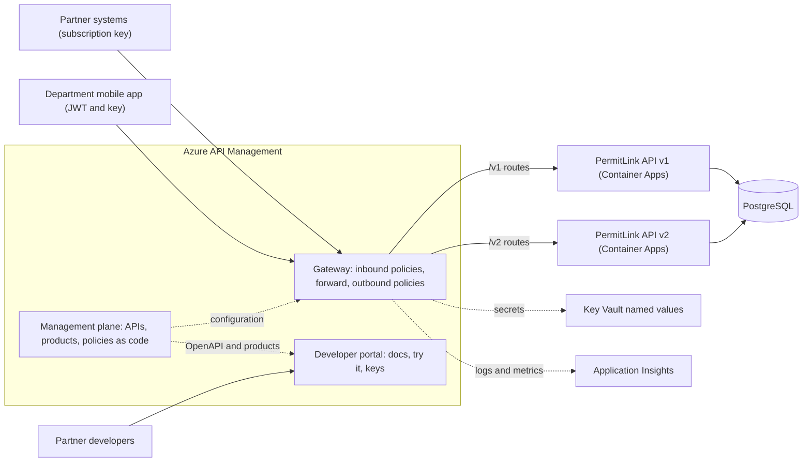
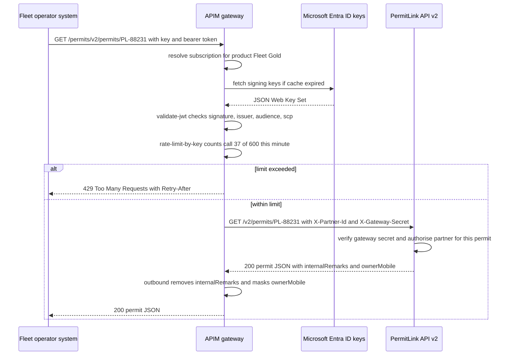

**PermitLink** is a state transport department's API for interstate goods-vehicle permits. The department's own mobile app uses it, and so do about 40 partners: logistics companies checking a truck's permit before dispatch, insurers verifying vehicle details, and a few large fleet operators who apply for hundreds of permits a day. Today every partner gets the same shared API key by email, one fleet operator's buggy script recently sent 3,000 requests a minute and slowed the API for everyone, and the team wants to release a v2 with a new permit format without breaking the 40 integrations. They could write all of this into the ASP.NET Core API itself: key management, per-partner limits, usage reports, version routing, a documentation site for partners. Or they could put an **API gateway** in front that does it for every API they own. Azure API Management (APIM) is Azure's managed API gateway.

## Learning objectives

By the end of this lesson you will be able to:

1. Explain the parts of API Management (gateway, management plane, developer portal) and its core concepts: APIs, operations, products, subscriptions and policies.
2. Write policies for rate limiting, quotas, JWT validation, header and body transformation and backend routing, and explain policy scopes and `<base />`.
3. Version an API with version sets (path, header or query) and ship non-breaking changes with revisions.
4. Make the backend ASP.NET Core app cooperate with the gateway: accept traffic only from it, read the partner identity it forwards, and keep defence-in-depth limits.
5. Compare APIM with a YARP gateway and other options, including cost and the extra network hop.
6. Build a free local equivalent with YARP and ASP.NET Core's rate limiter in Docker.

## Prerequisites

- [API gateways, reverse proxies and load balancers](#/lesson/m10-gateways-proxies-lb): APIM is an API gateway.
- [Rate limiting algorithms](#/lesson/m10-rate-limiting): fixed windows, sliding windows and token buckets.
- [JWT validation and limitations](#/lesson/m14-jwt): APIM validates tokens before they reach your code.
- [Reverse proxies and IIS hosting](#/lesson/m15-reverse-proxy-iis): forwarded headers and YARP basics.

## Explain it like I'm a beginner

Think of a large wholesale market's main gate. Every trader who wants to enter shows a **pass**. The guard checks it, notes the time, and stops a trader who has already entered 50 times today. Traders with a gold pass may enter 500 times. The guard also hands every trader a map and a price list at the entrance, and if the market moves the fish section from Gate 2 to Gate 5, the guard redirects traders so their habits keep working.

API Management is that gate for APIs.

- An **API** is a market section (PermitLink v1). Its **operations** are the stalls (`GET /permits/{id}`, `POST /applications`).
- A **product** is a type of pass: "Partner Basic" or "Fleet Gold". It bundles one or more APIs with rules like "100 calls a minute".
- A **subscription** is one trader's actual pass: a pair of secret keys that identify who is calling and which product they bought.
- **Policies** are the guard's instructions: check the pass, count the visits, check the ID card (JWT), remove the internal notes from what is handed back.
- The **developer portal** is the map and price list: a website where partners read the API documentation, try calls and get their keys.

Your backend API is the market behind the gate. It still does the real business, but it no longer has to check passes or count visits itself.

## First-principles explanation

### What a gateway is for

An API gateway handles the **cross-cutting** work that every API needs and that is the same regardless of business logic:

| Concern | Without a gateway | With APIM |
|---|---|---|
| Who is calling | Each API stores and checks keys | Subscriptions and keys, per product |
| How much they may call | Each API implements limits | `rate-limit`, `quota` policies |
| Token checks | Each API validates JWTs | `validate-jwt` once at the edge, before traffic reaches the backend |
| Shape of requests and responses | Each API maps and hides fields | `set-header`, `set-body`, `rewrite-uri` |
| Versions | Each API routes versions | Version sets and revisions |
| Documentation and onboarding | A wiki and emails | Developer portal with self-service keys |
| Usage reports | Custom logging | Built-in analytics and Application Insights integration |

This is the **Gateway Offloading** pattern: move shared concerns out of every service into one place. The cost: one more network hop, one more component that can fail or be misconfigured, and a monthly bill.

### The three parts of APIM

- **Gateway (data plane)**: receives every API call, runs the policies, forwards to the backend, returns the response. This is what partners hit (`https://permitlink.azure-api.net` or your custom domain).
- **Management plane**: where you define APIs, products, policies and users, through the Azure portal, ARM or Bicep, Terraform, or the REST API. Treat it as code ([Infrastructure as Code](#/lesson/m15-iac)).
- **Developer portal**: a customisable website generated from your API definitions (OpenAPI), where partners sign up, read docs, try operations and manage their subscription keys.

### Products and subscriptions

A **subscription** has a primary and a secondary key. The caller sends one in the `Ocp-Apim-Subscription-Key` header (or the `subscription-key` query parameter, which you should disable because URLs end up in logs). Two keys allow rotation without downtime: the partner switches to the secondary, you regenerate the primary.

A **product** groups APIs and carries policies. PermitLink might define:

| Product | APIs | Rate limit | Quota | Approval |
|---|---|---|---|---|
| Partner Basic | Permits read | 60 calls/min | 50,000 calls/month | Automatic |
| Fleet Gold | Permits read and apply | 600 calls/min | 2,000,000 calls/month | Department approves |
| Internal Mobile | All, with JWT | Per user, 30 calls/min | None | Not subscription-based |

Subscriptions identify **applications**, not end users. For the mobile app, the subscription key is embedded in the app and is therefore not secret, so user identity must come from a **JWT** validated at the gateway.

### Policies: a pipeline of XML statements

A **policy** is an XML document with four sections:

```xml
<policies>
  <inbound>   <!-- runs on the request, before the backend -->  </inbound>
  <backend>   <!-- controls forwarding to the backend -->       </backend>
  <outbound>  <!-- runs on the response, before the client -->  </outbound>
  <on-error>  <!-- runs if anything above fails -->             </on-error>
</policies>
```

Policies can be set at several **scopes**: global (all APIs), workspace, product, API and operation. They combine through the `<base />` element: wherever a scope writes `<base />`, the policies of the enclosing scope are inserted at that point. If a scope **omits** `<base />`, the outer scope's policies for that section are **not applied**, which is a classic way to accidentally drop a global security policy.

Policy expressions are small C# snippets inside `@(...)` or `@{...}` with access to a `context` object: `context.Request.Headers`, `context.Subscription.Id`, `context.Product.Name`, `context.Response.StatusCode` and more. They let you compute counter keys, set headers, or transform bodies without deploying code.

### Rate limits and quotas

APIM has two families:

- **Rate limits** protect the backend from bursts over short periods: `rate-limit` (per subscription) and `rate-limit-by-key` (any key you compute, such as the client IP or a JWT claim). When exceeded, the gateway returns **429 Too Many Requests** with a `Retry-After` header.
- **Quotas** enforce a business allowance over a long period: `quota` and `quota-by-key`, counting calls and/or bandwidth over, say, a month. When exceeded, the gateway returns **403 Forbidden**.

```xml
<inbound>
  <base />
  <!-- burst protection: 100 calls per 60 s per subscription -->
  <rate-limit-by-key calls="100" renewal-period="60"
                     counter-key="@(context.Subscription.Id)" />
  <!-- business allowance: 50,000 calls per 30 days -->
  <quota-by-key calls="50000" renewal-period="2592000"
                counter-key="@(context.Subscription.Id)" />
</inbound>
```

Two cautions. First, rate-limit counters in a distributed gateway are **approximate**: with several gateway instances or regions, a partner can occasionally exceed the limit slightly. Use them to protect capacity, not as a billing meter. Second, the numbers come from capacity, not from feeling. If the backend handles about 400 requests per second comfortably (measure it with a load test), and you expect at most 10 fleet partners to burst at once, 600 calls per minute each (10 per second) leaves headroom: 10 × 10 = 100 RPS of bursts on top of normal traffic.

### JWT validation at the edge

`validate-jwt` (and the Entra-specific `validate-azure-ad-token`) checks a bearer token's signature against the identity provider's published keys, its issuer, audience, expiry and required claims, before the request reaches the backend:

```xml
<validate-jwt header-name="Authorization" require-scheme="Bearer"
              failed-validation-httpcode="401"
              failed-validation-error-message="Unauthorized">
  <openid-config url="https://login.microsoftonline.com/{tenant-id}/v2.0/.well-known/openid-configuration" />
  <audiences><audience>api://permitlink</audience></audiences>
  <issuers><issuer>https://login.microsoftonline.com/{tenant-id}/v2.0</issuer></issuers>
  <required-claims>
    <claim name="scp" match="any" separator=" ">
      <value>permits.read</value>
      <value>permits.apply</value>
    </claim>
  </required-claims>
</validate-jwt>
```

One Entra ID detail trips many teams: tokens issued **on behalf of a user** (the mobile app) carry delegated permissions in `scp`, while tokens a partner's server obtains for itself with the client-credentials flow carry **app roles in `roles`** and have no `scp` at all. A policy that only checks `scp` rejects every machine-to-machine partner call; check `roles` on the partner operations (or both, in separate policies per product).

Validating at the gateway rejects garbage early and keeps a consistent rule for all APIs. The backend should **still** authorise: the gateway answers "is this a valid token for this API?", the backend answers "may this user see *this* permit?". If the backend can be reached without the gateway, it must also validate the token itself.

### Transformation

Gateways commonly reshape traffic so backends and clients can evolve separately:

```xml
<inbound>
  <base />
  <set-header name="X-Partner-Id" exists-action="override">
    <value>@(context.Subscription?.Id ?? "anonymous")</value>
  </set-header>
  <set-header name="X-Partner-Tier" exists-action="override">
    <value>@(context.Product?.Name ?? "none")</value>
  </set-header>
  <set-header name="X-Gateway-Secret" exists-action="override">
    <value>{{backend-gateway-secret}}</value>   <!-- named value backed by Key Vault -->
  </set-header>
</inbound>
<outbound>
  <base />
  <set-header name="X-Powered-By" exists-action="delete" />
  <set-body>@{
      var body = context.Response.Body.As<JObject>();
      body.Remove("internalRemarks");
      var phone = (string)body["ownerMobile"];
      if (phone != null && phone.Length > 4)
          body["ownerMobile"] = new string('X', phone.Length - 4) + phone.Substring(phone.Length - 4);
      return body.ToString();
  }</set-body>
</outbound>
```

Inbound, the gateway tells the backend which partner is calling (and overrides any value a client tried to send). Outbound, it removes an internal field and masks the owner's mobile number. Body transformations cost CPU on the gateway and are invisible to the backend team; keep them small, and prefer fixing the backend's response shape when you own it.

Other everyday policies: `rewrite-uri` and `set-backend-service` (routing), `cache-lookup` and `cache-store` (response caching), `retry`, `ip-filter`, `cors`, `mock-response` (return sample data before the backend exists), and `authentication-managed-identity` (the gateway gets a token for the backend using its own managed identity).

### Versions and revisions

- A **version** is for **breaking** changes. A **version set** groups `v1` and `v2` of PermitLink and chooses how callers select the version: a **path** segment (`/permits/v2/...`), a **header** (`Api-Version: v2`) or a **query** parameter (`?api-version=v2`). Each version is a separate API definition with its own operations and policies, often pointing at a different backend path or service. Old versions keep working until you retire them on a published schedule.
- A **revision** is for **non-breaking** changes to one version: add an optional field, fix a policy. You edit revision 2 while revision 1 serves traffic, test it with `;rev=2` in the URL, then make it current. A change log is visible in the developer portal.

See [API contracts and versioning](#/lesson/m10-versioning-contracts) for what counts as breaking.

### Protecting the backend from bypass

A gateway only helps if callers cannot go around it. Options, from strongest to simplest:

1. **Private networking**: the backend accepts traffic only from the gateway's virtual network (VNet integration, private endpoints, App Service access restrictions or Container Apps internal ingress).
2. **Gateway identity**: APIM's managed identity obtains an Entra ID token for the backend (`authentication-managed-identity`), and the backend validates it.
3. **Client certificates**: APIM presents a certificate, the backend checks it (mutual TLS).
4. **A shared secret header**: APIM adds `X-Gateway-Secret` from a Key Vault-backed named value; the backend compares it in constant time. Simple, but a leaked secret works until rotated, so combine it with network restrictions.

### Tiers, cost and latency

APIM has two families of tiers. The **classic** tiers are Consumption, Developer, Basic, Standard and Premium; the newer **v2** tiers are Basic v2, Standard v2 and Premium v2, which provision in minutes instead of the classic tiers' much longer deployments and are where new networking features land. Roughly:

- **Consumption** is serverless and billed per call, good for low or spiky traffic. It has no developer portal of its own and some policies are not available on it (check each policy's "supported tiers" table; historically the `*-by-key` rate-limit and quota policies were not).
- **Developer** (classic) is for non-production only and has **no SLA**.
- **Basic v2 / Standard v2** (or classic Basic / Standard) suit most single-region production use. Standard v2 can reach a backend inside a VNet through outbound VNet integration.
- **Premium / Premium v2** add full VNet injection (a gateway with no public endpoint), availability zones, workspaces and (on classic Premium at the time of writing) multi-region gateways, at a much higher fixed monthly cost.

Tier features and prices change often, so read the current feature-comparison and pricing pages before you decide; the descriptions above are a planning guide, not a contract. For cost planning, compare "fixed monthly unit price × units" against "price per million calls × expected calls".

A back-of-the-envelope for PermitLink: 40 partners averaging 20,000 calls a day plus the mobile app at 300,000 calls a day is 40 × 20,000 + 300,000 = 1.1 million calls a day, about 33 million a month, an average of 1.1 million ÷ 86,400 ≈ 13 RPS with peaks perhaps 5 times higher (about 65 RPS, an estimate). That volume is small for any gateway; the decision is driven by features (VNet, multi-region, SLA) and fixed cost, not throughput.

The gateway adds a hop: TLS termination, policy execution, a new connection or a pooled one to the backend. Expect a few milliseconds of added latency per request (estimate; it grows with heavy body transformations and validate-jwt key refreshes). Place the gateway in the same region as the backend.

### Self-hosted gateway and local alternatives

APIM offers a **self-hosted gateway**: a container image you run in your own Kubernetes cluster or Docker host (for example in a state data centre), managed from the Azure APIM instance. It is available on specific tiers and still needs an APIM instance, so it is not a free option.

For learning and local development with **no Azure cost**, build the same behaviour with:

- **YARP** in a Docker container as the gateway (routing, headers, versions as routes),
- **ASP.NET Core rate limiting middleware** partitioned by API key (fixed window, sliding window or token bucket),
- **JWT bearer authentication** in the gateway, validating tokens from a local identity provider (for example Keycloak in Docker),
- a static **OpenAPI** file served by Swagger UI or Scalar as a minimal developer portal.

Open-source gateways such as Kong, Tyk, KrakenD and Envoy-based gateways are also options, on-premises or in other clouds.

### APIM versus YARP versus building it in the API

| | Azure API Management | YARP gateway | Inside each API |
|---|---|---|---|
| Keys, products, self-service portal | Built in | You build or buy them | You build them, per API |
| Policies | XML plus C# expressions, no deployment of code | C# middleware, deployed as code | Code in every service |
| Analytics | Built in plus Application Insights | OpenTelemetry you wire up | Per service |
| Cost | Monthly tier price or per call | Compute only | Compute only |
| Operations | Managed by Azure (SLA per tier) | You run, patch and scale it | No extra component |
| Best when | Many external consumers, partner onboarding, governance across many APIs | Internal gateway, custom logic, .NET team, on-premises | One API, few known clients |

### What breaks first, and how it fails

| Failure | Symptom | Mitigation |
|---|---|---|
| Scope without `<base />` | Global JWT or IP policy silently not applied to one API | Policy review, tests that call each API without a token and expect 401 |
| Backend reachable directly | Limits and JWT checks bypassed | Private networking or gateway identity |
| Rate limit too low for a real burst | Partners see 429 at month-end permit rush | Size limits from load tests, alert on 429 rate per product |
| Quota used as a hard safety limit | Partner locked out for the rest of the month by a bug | Alert at 80 %, contact partner, temporary quota override |
| Key in query string | Keys in proxy and browser logs | Header only, disable query parameter |
| Heavy body transforms | Gateway CPU and latency grow | Fix response shape in backend |
| Gateway in another region | Every call pays cross-region latency | Co-locate |

### When a simpler design is enough

One internal API with three known client apps does not need APIM. Use JWT authentication in the API, ASP.NET Core's rate limiter, an OpenAPI document, and a reverse proxy you already have. Reach for APIM when you have **external consumers to onboard and govern**, many APIs that need consistent policies, or a requirement for usage analytics and self-service keys.

## Visual explanation

### Where API Management sits



Partners and the mobile app call only the gateway. The gateway runs the inbound policies (keys, JWT, limits, headers), routes by version to the v1 or v2 backend, and runs the outbound policies on the response. Secrets such as the backend shared secret come from Key Vault through named values, and every call is logged to Application Insights. The management plane, ideally driven from Bicep or Terraform, pushes configuration to the gateway and API definitions to the developer portal. Partner developers use the portal to read docs and get keys. Both backend versions share one PostgreSQL database during the migration from v1 to v2.

### One call through the policy pipeline



The fleet operator's system sends its subscription key and a bearer token. The gateway maps the key to a subscription in the Fleet Gold product, validates the JWT (fetching the identity provider's signing keys only when its cached copy expires) and counts the call against the per-subscription rate limit. If the limit is exceeded, the gateway answers 429 itself and the backend never sees the request. Otherwise it rewrites the path for the v2 backend, adds the partner identity and the gateway secret, and forwards. The backend checks that the request really came through the gateway and that this partner may see this permit. On the way back, the outbound policy strips the internal remarks and masks the mobile number before the partner receives the response.

## Step-by-step example

### Step 1: import the API

Export PermitLink's OpenAPI document from the ASP.NET Core app (`/openapi/v1.json` with `AddOpenApi`) and import it into APIM as **PermitLink v1**, in a version set using the **path** scheme. Set the backend URL to the Container Apps app.

### Step 2: create products and subscriptions

Create **Partner Basic** and **Fleet Gold** products, attach the API, and require approval for Fleet Gold. Give each of the 40 partners its own subscription. Revoke the shared key everyone had by email.

### Step 3: add policies

Global: `cors` for the mobile app's web version, and an `on-error` section that returns a consistent problem-details body. Product: `rate-limit-by-key` and `quota-by-key` with the numbers from the table. API: `validate-jwt` for operations that act on behalf of users, inbound headers for the backend, outbound masking.

### Step 4: lock the backend

Restrict the Container App's ingress to the gateway's network, and add the gateway secret header check in the app as a second layer.

### Step 5: release v2 alongside v1

Add **PermitLink v2** to the version set with the new permit format, routed to `/v2/...` on the backend. Announce v1's retirement date in the developer portal (for example, six months later) and watch v1 traffic per partner in analytics.

### Step 6: rebuild it locally for development

Run YARP plus the rate limiter in Docker Compose in front of the API, so developers test limits and headers without an Azure subscription.

## Production-style C# implementation

The gateway configuration is infrastructure (shown as XML and Bicep text); the C# below is the backend side, plus a local gateway that mimics the policies.

### APIM resources as Bicep (excerpt)

```bicep
resource apim 'Microsoft.ApiManagement/service@2024-05-01' existing = {
  name: 'apim-permitlink-prod'
}

resource versionSet 'Microsoft.ApiManagement/service/apiVersionSets@2024-05-01' = {
  parent: apim
  name: 'permitlink'
  properties: { displayName: 'PermitLink', versioningScheme: 'Segment' }
}

resource apiV2 'Microsoft.ApiManagement/service/apis@2024-05-01' = {
  parent: apim
  name: 'permitlink-v2'
  properties: {
    displayName: 'PermitLink'
    path: 'permits'
    apiVersion: 'v2'
    apiVersionSetId: versionSet.id
    protocols: ['https']
    serviceUrl: 'https://permitlink-api.internal.example.gov.in/v2'
    subscriptionRequired: true
    format: 'openapi+json-link'
    value: 'https://permitlink-api.internal.example.gov.in/openapi/v2.json'
  }
}

resource fleetGold 'Microsoft.ApiManagement/service/products@2024-05-01' = {
  parent: apim
  name: 'fleet-gold'
  properties: { displayName: 'Fleet Gold', subscriptionRequired: true, approvalRequired: true, state: 'published' }
}

resource fleetGoldPolicy 'Microsoft.ApiManagement/service/products/policies@2024-05-01' = {
  parent: fleetGold
  name: 'policy'
  properties: { format: 'rawxml', value: loadTextContent('policies/fleet-gold.xml') }
}
```

Keeping policies in files (`policies/fleet-gold.xml`) under version control means every change is reviewed and deployed through the pipeline, never typed into the portal. API versions in resource types change over time; use the current stable one (the excerpt uses `2024-05-01`) rather than a `-preview` version in production templates.

### Backend: trust only the gateway

```csharp file=Gateway/GatewayTrust.cs
using System.Security.Cryptography;
using System.Text;
using Microsoft.Extensions.Options;

namespace PermitLink.Gateway;

public sealed class GatewayTrustOptions
{
    public bool Required { get; set; } = true;
    public string HeaderName { get; set; } = "X-Gateway-Secret";
    /// <summary>Current and previous secret, so rotation never causes an outage.</summary>
    public List<string> Secrets { get; set; } = [];
    /// <summary>Paths reachable without the gateway (platform health probes).</summary>
    public List<string> ExemptPaths { get; set; } = ["/health/live", "/health/ready"];
}

/// <summary>Second line of defence behind network restrictions: reject requests that did not
/// come through API Management (or the local YARP gateway).</summary>
public sealed class GatewayTrustMiddleware(RequestDelegate next, IOptions<GatewayTrustOptions> options, ILogger<GatewayTrustMiddleware> log)
{
    public async Task InvokeAsync(HttpContext context)
    {
        var o = options.Value;
        var exempt = o.ExemptPaths.Any(p => context.Request.Path.StartsWithSegments(p, StringComparison.OrdinalIgnoreCase));
        if (!o.Required || exempt || IsTrusted(context.Request.Headers[o.HeaderName].ToString(), o.Secrets))
        {
            await next(context);
            return;
        }

        log.LogWarning("Rejected request to {Path} that bypassed the gateway from {Ip}", context.Request.Path, context.Connection.RemoteIpAddress);
        context.Response.StatusCode = StatusCodes.Status403Forbidden;
        await context.Response.WriteAsJsonAsync(new { error = "Use the PermitLink API gateway." });
    }

    public static bool IsTrusted(string presented, IReadOnlyList<string> secrets)
    {
        if (string.IsNullOrEmpty(presented)) return false;
        // Hash first so both sides are always 32 bytes: FixedTimeEquals returns early on a length
        // mismatch, which would otherwise leak the secret's length through timing.
        var presentedHash = SHA256.HashData(Encoding.UTF8.GetBytes(presented));
        var match = false;
        foreach (var s in secrets)
        {
            if (string.IsNullOrEmpty(s)) continue;
            // Constant-time comparison: timing must not reveal how many bytes matched.
            match |= CryptographicOperations.FixedTimeEquals(presentedHash, SHA256.HashData(Encoding.UTF8.GetBytes(s)));
        }
        return match;
    }
}
```

```csharp file=Gateway/PartnerContext.cs
namespace PermitLink.Gateway;

/// <summary>Who is calling, as asserted by the gateway. Only meaningful after GatewayTrustMiddleware.</summary>
public sealed class PartnerContext
{
    public string PartnerId { get; private set; } = "anonymous";
    public string Tier { get; private set; } = "none";
    public string CorrelationId { get; private set; } = "";

    public bool IsFleet => Tier.Contains("Fleet", StringComparison.OrdinalIgnoreCase);

    internal void Populate(HttpRequest request)
    {
        PartnerId = Header(request, "X-Partner-Id") ?? "anonymous";
        Tier = Header(request, "X-Partner-Tier") ?? "none";
        CorrelationId = Header(request, "X-Correlation-Id") ?? request.HttpContext.TraceIdentifier;
    }

    private static string? Header(HttpRequest r, string name) =>
        r.Headers.TryGetValue(name, out var v) && !string.IsNullOrWhiteSpace(v) ? v.ToString() : null;
}

public sealed class PartnerContextMiddleware(RequestDelegate next)
{
    public Task InvokeAsync(HttpContext context, PartnerContext partner)
    {
        partner.Populate(context.Request);
        context.Response.Headers["X-Correlation-Id"] = partner.CorrelationId;
        return next(context);
    }
}
```

```csharp file=Gateway/PartnerRateLimiting.cs
using System.Threading.RateLimiting;
using Microsoft.AspNetCore.RateLimiting;

namespace PermitLink.Gateway;

public sealed class PartnerLimitOptions
{
    public int BasicPerMinute { get; set; } = 60;
    public int FleetPerMinute { get; set; } = 600;
}

/// <summary>Used twice: in the local YARP gateway as the main limiter, and in the backend as a
/// generous defence-in-depth limit in case a gateway policy is misconfigured.</summary>
public static class PartnerRateLimiting
{
    public const string PolicyName = "per-partner";

    public static IServiceCollection AddPartnerRateLimiting(this IServiceCollection services, PartnerLimitOptions limits)
    {
        services.AddRateLimiter(o =>
        {
            o.RejectionStatusCode = StatusCodes.Status429TooManyRequests;
            o.OnRejected = (ctx, _) =>
            {
                if (ctx.Lease.TryGetMetadata(MetadataName.RetryAfter, out var retryAfter))
                    ctx.HttpContext.Response.Headers.RetryAfter = ((int)Math.Ceiling(retryAfter.TotalSeconds)).ToString();
                return ValueTask.CompletedTask;
            };
            o.AddPolicy(PolicyName, http =>
            {
                var partner = http.Request.Headers["X-Partner-Id"].ToString();
                var tier = http.Request.Headers["X-Partner-Tier"].ToString();
                var key = string.IsNullOrEmpty(partner) ? $"ip:{http.Connection.RemoteIpAddress}" : $"partner:{partner}";
                var permit = tier.Contains("Fleet", StringComparison.OrdinalIgnoreCase) ? limits.FleetPerMinute : limits.BasicPerMinute;
                return RateLimitPartition.GetFixedWindowLimiter(key, _ => new FixedWindowRateLimiterOptions
                {
                    PermitLimit = permit,
                    Window = TimeSpan.FromMinutes(1),
                    QueueLimit = 0,
                });
            });
        });
        return services;
    }
}
```

```csharp file=Program.cs
using PermitLink.Gateway;

var builder = WebApplication.CreateBuilder(args);

builder.Services.Configure<GatewayTrustOptions>(builder.Configuration.GetSection("GatewayTrust"));
builder.Services.AddScoped<PartnerContext>();

// Backend limit is 2x the gateway's: it only trips if the gateway policy is missing or wrong.
var limits = builder.Configuration.GetSection("PartnerLimits").Get<PartnerLimitOptions>()
             ?? new PartnerLimitOptions { BasicPerMinute = 120, FleetPerMinute = 1200 };
builder.Services.AddPartnerRateLimiting(limits);
builder.Services.AddHealthChecks();

var app = builder.Build();

app.UseMiddleware<GatewayTrustMiddleware>();
app.UseMiddleware<PartnerContextMiddleware>();
app.UseRateLimiter();

app.MapHealthChecks("/health/live");
app.MapHealthChecks("/health/ready");

// v1 and v2 live side by side. APIM's version set maps /permits/v1/... and /permits/v2/... here.
var v1 = app.MapGroup("/v1").RequireRateLimiting(PartnerRateLimiting.PolicyName);
v1.MapGet("/permits/{permitNo}", (string permitNo, PartnerContext partner) => Results.Ok(new
{
    permitNo,
    vehicle = "MH12AB1234",
    validTill = "2027-03-31",
    states = "MH,GJ,RJ",           // v1: comma-separated string
    requestedBy = partner.PartnerId,
}));

var v2 = app.MapGroup("/v2").RequireRateLimiting(PartnerRateLimiting.PolicyName);
v2.MapGet("/permits/{permitNo}", (string permitNo, PartnerContext partner) => Results.Ok(new
{
    permitNo,
    vehicle = new { registration = "MH12AB1234", category = "N3" },
    validity = new { from = "2026-04-01", till = "2027-03-31" },
    states = new[] { "MH", "GJ", "RJ" },   // v2: an array, which is why it is a new version
    ownerMobile = "9876543210",            // masked by the gateway's outbound policy
    internalRemarks = "fee waiver approved by DTO",   // removed by the gateway
    requestedBy = partner.PartnerId,
}));

app.Run();
```

### Free local gateway with YARP in Docker

```yaml
# compose.gateway-lab.yaml
services:
  gateway:
    image: permitlink-gateway:dev        # an ASP.NET Core app: YARP + AddPartnerRateLimiting
    ports: ["8080:8080"]
    environment:
      ReverseProxy__Routes__v2__ClusterId: "api"
      ReverseProxy__Routes__v2__Match__Path: "/permits/v2/{**rest}"
      ReverseProxy__Routes__v2__Transforms__0__PathPattern: "/v2/{**rest}"
      ReverseProxy__Routes__v2__Transforms__1__RequestHeader: "X-Gateway-Secret"
      ReverseProxy__Routes__v2__Transforms__1__Set: "${GATEWAY_SECRET}"
      ReverseProxy__Clusters__api__Destinations__d1__Address: "http://api:8080/"
      PartnerLimits__BasicPerMinute: "60"
      PartnerLimits__FleetPerMinute: "600"
  api:
    image: permitlink-api:dev
    environment:
      GatewayTrust__Secrets__0: "${GATEWAY_SECRET}"
    # no ports: reachable only through the gateway on the Compose network
```

The local gateway maps API keys to partners with a small in-memory table (or a JSON file) and sets `X-Partner-Id` and `X-Partner-Tier` itself, exactly as APIM would. The backend is not published to the host, which mimics private networking.

Design notes:

- **Defence in depth, not duplication.** The backend's limits are deliberately twice the gateway's. They never trip in normal operation; they exist for the day someone removes `<base />` from a policy.
- **Two secrets for rotation.** The backend accepts the current and previous gateway secret. Rotate by adding the new one to the backend, switching the named value in APIM, then removing the old one.
- **Partner identity comes only from the gateway.** The gateway overrides `X-Partner-Id` on every request, so a client cannot impersonate another partner by sending the header itself.
- **Versions are explicit route groups.** v1 and v2 are separate endpoints that can share services underneath. Retiring v1 means deleting one group and one API in APIM.

## Bad design vs good design

**Bad**: a gateway in name only.

```text
- One subscription key shared by all 40 partners, sent by email
- Key accepted in the query string (?subscription-key=...)
- validate-jwt at global scope, but the PermitLink API policy has no <base />
- Backend has a public URL and no check that traffic came through the gateway
- rate-limit of 10 calls/min "to be safe", raised by hand in the portal when partners complain
- v2 changes the response shape of v1 in place "because the gateway can transform it back"
- Policies edited directly in the Azure portal, no history
```

What goes wrong: one leaked key exposes everyone, and you can't tell partners apart in analytics or revoke one. Keys appear in access logs. The API that omitted `<base />` accepts requests without a token. Anyone who finds the backend URL bypasses every control. Limits based on guesswork cause outages during the month-end rush, and manual portal edits are lost on the next deployment. Transforming v2 back into v1 in the gateway moves business logic into XML that nobody tests.

**Good**: one subscription per partner, keys in headers only, rotated with primary/secondary; policies in Git, deployed by the pipeline; `<base />` in every scope by default, with tests that verify unauthenticated calls fail on every API; backend reachable only from the gateway, plus a gateway secret or identity check; limits sized from load tests and alerting on 429 rates; breaking changes as new versions with a published retirement date.

:::callout type=mistake title="Removing <base /> by accident"
When you replace an API's policy with your own XML, keep `<base />` in every section unless you deliberately want to drop the outer scope's policies. Treat a missing `<base />` like a missing `[Authorize]`.
:::

:::callout type=tradeoff title="Gateway policies versus backend code"
Policies change without deploying the backend, which is powerful and dangerous. Keep policies to cross-cutting concerns (identity, limits, headers, routing). Business rules such as "fleet partners see extra fields" belong in the backend where they are unit tested.
:::

## Practical playground

The canvas shows PermitLink today: partners and the mobile app call the API directly with one shared key. Redesign it with a gateway.

1. Add an API gateway node. Which clients must go through it, and how do you make sure they can't skip it?
2. Add the v2 backend next to v1. Where is the version chosen?
3. Add a rate limiter and an identity provider. Which checks happen at the gateway and which in the backend?
4. Add monitoring that alerts on 429 rates per partner product. What threshold would you choose?

:::playground type=hld title="Put API Management in front of PermitLink"
```json
{
  "nodes": [
    { "id": "partners", "type": "client", "label": "40 partner systems (one shared key)", "props": { "rps": 30 } },
    { "id": "mobile", "type": "client", "label": "Department mobile app", "props": { "rps": 20 } },
    { "id": "api", "type": "app-server", "label": "PermitLink API (public URL)", "props": { "instances": 2 } },
    { "id": "db", "type": "database", "label": "PostgreSQL 17" }
  ],
  "edges": [
    { "from": "partners", "to": "api", "kind": "sync", "label": "shared key in query string" },
    { "from": "mobile", "to": "api", "kind": "sync" },
    { "from": "api", "to": "db", "kind": "sync" }
  ]
}
```
:::

## Exercises

:::exercise id=m15-apim-ex1 difficulty=beginner kind=written title="Review a policy set"
The team proposes these policies. Global scope:

```xml
<policies>
  <inbound>
    <validate-jwt header-name="Authorization" failed-validation-httpcode="401">
      <openid-config url="https://login.example.gov.in/.well-known/openid-configuration" />
      <audiences><audience>api://permitlink</audience></audiences>
    </validate-jwt>
  </inbound>
  <backend><forward-request /></backend>
  <outbound />
  <on-error />
</policies>
```

PermitLink v2 API scope:

```xml
<policies>
  <inbound>
    <set-header name="X-Partner-Id" exists-action="skip">
      <value>@(context.Subscription.Id)</value>
    </set-header>
    <rate-limit calls="5000" renewal-period="1" />
  </inbound>
  <backend><base /></backend>
  <outbound><base /></outbound>
  <on-error><base /></on-error>
</policies>
```

List the problems, explain the effect of each, and write the corrected API-scope inbound section.
::acceptance
- Notices that the API inbound section has no `<base />`, so the global `validate-jwt` does not run for v2.
- Notices `exists-action="skip"` lets a client set its own `X-Partner-Id`.
- Notices the rate limit (5,000 calls per second per subscription) protects nothing, and that it is per subscription only.
- Mentions that the global JWT policy has no issuer check (and possibly no required scope), and that a JWT is mandatory for partners who only have keys, which may be unintended.
- Corrected inbound includes `<base />`, `exists-action="override"` and a sensible `rate-limit-by-key` with a reason for the number.
::hint
Start by working out the effective inbound pipeline for a v2 request: which policies from which scope run, in which order?
::hint
What does `skip` do when the header already exists on the incoming request, and who controls the incoming request?
::hint
`renewal-period` is in seconds.
::solution
**Problems**

1. **No `<base />` in the API's inbound section.** The global inbound policies are not inserted, so `validate-jwt` never runs for v2. Every v2 request is accepted without a token. This is the most serious issue.
2. **`exists-action="skip"`** keeps an existing header. A client can send `X-Partner-Id: big-fleet-co` and the gateway will not overwrite it, so the backend attributes the call (and its permissions) to another partner. Use `override`.
3. **`rate-limit calls="5000" renewal-period="1"`** is 5,000 calls per second per subscription, far above what the backend can handle (estimated at about 400 RPS), so it never protects anything. Size it from capacity, for example 600 per 60 seconds for Fleet Gold, preferably at product scope so tiers differ.
4. **Global JWT policy**: no `<issuers>` restriction (accepting any issuer that the configured keys can sign for is usually fine with a single tenant, but be explicit), no required scope or role claim, and no `require-scheme="Bearer"`. Also, requiring a JWT globally for *all* APIs may break partner integrations that only use subscription keys; decide per API or product.
5. **Global `<backend><forward-request /></backend>`** is fine, but the API's `<backend><base /></backend>` depends on it. Keep it explicit.

**Corrected API inbound**

```xml
<inbound>
  <base />
  <set-header name="X-Partner-Id" exists-action="override">
    <value>@(context.Subscription?.Id ?? "anonymous")</value>
  </set-header>
  <rate-limit-by-key calls="600" renewal-period="60"
                     counter-key="@(context.Subscription?.Id ?? context.Request.IpAddress)" />
</inbound>
```

Then add a test to the deployment pipeline that calls every API without a token and without a key and expects 401, so a missing `<base />` is caught before production.
::mistakes
- Fixing the JWT problem by copying `validate-jwt` into every API, so future global changes don't reach them. Use `<base />`.
- Assuming `renewal-period` is in minutes.
:::

:::exercise id=m15-apim-ex2 difficulty=beginner kind=code title="A keyed fixed-window rate limiter"
Model APIM's `rate-limit-by-key` (simplified). `KeyedFixedWindowLimiter(calls, renewalPeriod, clock)`:

- Each key has its own window, which starts at that key's first call and lasts `renewalPeriod`.
- `TryAcquire(key)` allows the call if fewer than `calls` were allowed in the current window, and returns the number of calls **remaining** after this one.
- A rejected call returns `Allowed = false`, `Remaining = 0` and `RetryAfterSeconds` = seconds until the window ends, **rounded up**. Rejected calls are not counted.
- When the window has ended, the next call starts a new window.
- Allowed calls return `RetryAfterSeconds = 0`.
::acceptance
- With 3 calls per 60 s, the first three calls are allowed with 2, 1, 0 remaining, and the fourth is rejected with retry-after 60.
- 45 s later it is rejected with retry-after 15, and at 59.5 s with retry-after 1.
- At 60 s a new window starts.
- Keys are independent.
::hint
Store, per key, the window start and the count of allowed calls.
::hint
The window has ended when `now >= start + renewalPeriod`.
::hint
`(int)Math.Ceiling((windowEnd - now).TotalSeconds)` gives the rounded-up retry-after.
::starter
```csharp file=KeyedFixedWindowLimiter.cs
using System;

public sealed record RateDecision(bool Allowed, int Remaining, int RetryAfterSeconds);

public sealed class KeyedFixedWindowLimiter
{
    public KeyedFixedWindowLimiter(int calls, TimeSpan renewalPeriod, Func<DateTimeOffset> clock)
        => throw new NotImplementedException();

    public RateDecision TryAcquire(string key) => throw new NotImplementedException();
}
```
::tests
```csharp file=KeyedFixedWindowLimiterTests.cs
using System;
using Xunit;

public class KeyedFixedWindowLimiterTests
{
    private DateTimeOffset _now = new(2026, 10, 20, 10, 0, 0, TimeSpan.Zero);
    private KeyedFixedWindowLimiter Create() => new(3, TimeSpan.FromSeconds(60), () => _now);

    [Fact]
    public void Allows_up_to_limit_then_rejects()
    {
        var l = Create();
        Assert.Equal(new RateDecision(true, 2, 0), l.TryAcquire("fleet-1"));
        Assert.Equal(new RateDecision(true, 1, 0), l.TryAcquire("fleet-1"));
        Assert.Equal(new RateDecision(true, 0, 0), l.TryAcquire("fleet-1"));
        Assert.Equal(new RateDecision(false, 0, 60), l.TryAcquire("fleet-1"));
    }

    [Fact]
    public void Retry_after_counts_down_and_rounds_up()
    {
        var l = Create();
        for (var i = 0; i < 3; i++) l.TryAcquire("k");
        _now = _now.AddSeconds(45);
        Assert.Equal(15, l.TryAcquire("k").RetryAfterSeconds);
        _now = _now.AddSeconds(14.5);
        Assert.Equal(1, l.TryAcquire("k").RetryAfterSeconds);
    }

    [Fact]
    public void New_window_after_renewal_period()
    {
        var l = Create();
        for (var i = 0; i < 4; i++) l.TryAcquire("k");
        _now = _now.AddSeconds(60);
        Assert.Equal(new RateDecision(true, 2, 0), l.TryAcquire("k"));
    }

    [Fact]
    public void Keys_are_independent()
    {
        var l = Create();
        for (var i = 0; i < 3; i++) l.TryAcquire("a");
        Assert.False(l.TryAcquire("a").Allowed);
        Assert.True(l.TryAcquire("b").Allowed);
    }

    [Fact]
    public void Rejected_calls_do_not_extend_or_consume()
    {
        var l = Create();
        for (var i = 0; i < 10; i++) l.TryAcquire("k");
        _now = _now.AddSeconds(60);
        Assert.Equal(2, l.TryAcquire("k").Remaining);
    }
}
```
::solution
A dictionary of windows, with a lock for thread safety.

```csharp file=KeyedFixedWindowLimiter.cs
using System;
using System.Collections.Generic;

public sealed record RateDecision(bool Allowed, int Remaining, int RetryAfterSeconds);

public sealed class KeyedFixedWindowLimiter
{
    private sealed class Window
    {
        public DateTimeOffset Start;
        public int Count;
    }

    private readonly int _calls;
    private readonly TimeSpan _period;
    private readonly Func<DateTimeOffset> _clock;
    private readonly Dictionary<string, Window> _windows = new(StringComparer.Ordinal);
    private readonly object _gate = new();

    public KeyedFixedWindowLimiter(int calls, TimeSpan renewalPeriod, Func<DateTimeOffset> clock)
    {
        if (calls <= 0) throw new ArgumentOutOfRangeException(nameof(calls));
        _calls = calls;
        _period = renewalPeriod;
        _clock = clock;
    }

    public RateDecision TryAcquire(string key)
    {
        lock (_gate)
        {
            var now = _clock();
            if (!_windows.TryGetValue(key, out var w) || now >= w.Start + _period)
            {
                w = new Window { Start = now, Count = 0 };
                _windows[key] = w;
            }

            if (w.Count < _calls)
            {
                w.Count++;
                return new RateDecision(true, _calls - w.Count, 0);
            }

            var retry = (int)Math.Ceiling((w.Start + _period - now).TotalSeconds);
            return new RateDecision(false, 0, Math.Max(1, retry));
        }
    }
}
```

A fixed window lets a client send `calls` requests at the end of one window and `calls` more at the start of the next, so the short-term peak can be twice the limit. Sliding windows and token buckets smooth that out; see [rate limiting algorithms](#/lesson/m10-rate-limiting). In production, old keys must also be evicted, or the dictionary grows with every IP address ever seen.
::mistakes
- Counting rejected calls, so a client that keeps retrying never gets back in.
- Rounding retry-after down to 0, which invites an immediate retry storm.
- One global window instead of one per key.
::extensions
Add eviction: remove windows that ended more than one period ago, every 1,000 calls.
:::

:::exercise id=m15-apim-ex3 difficulty=intermediate kind=code title="Resolve API versions like a version set"
Implement version resolution for a version set:

- The request path must start with `ApiPath` on a segment boundary, case-insensitively; otherwise return 404 with error `"api not found"`.
- **Path** scheme: the next segment is the version (`/permits/v2/permits/PL-1`). **Header** and **Query** schemes: the version comes from the header or query parameter named `ParameterName` (header names are case-insensitive; query names are case-sensitive).
- If no version is given: use `DefaultVersion` if set, otherwise return 400 `"version required"`.
- The version must match one of `Versions` case-insensitively; the canonical spelling from `Versions` is used. Otherwise return 404 `"unknown version"`.
- `BackendPath` is `/` + version + the rest of the path after `ApiPath` (and after the version segment for the path scheme). If the rest is empty, it is just `/` + version.
- Success returns status 200 with `Resolved` set.
::acceptance
- `/permits/v2/permits/PL-1` with the path scheme resolves to `v2` and `/v2/permits/PL-1`.
- `/Permits/V1` resolves to `v1` and `/v1`.
- Header scheme reads `api-version` case-insensitively; missing version falls back to the default.
- `/permitsx/v1` is 404, `v9` is 404, missing version without default is 400.
::hint
Write `RestAfterPrefix(path, prefix)` that returns `null` if the prefix doesn't match on a segment boundary, or the remaining path (possibly empty).
::hint
For the path scheme, split the rest on `/` once: `"/v2/permits/PL-1"` → version `v2`, remaining `/permits/PL-1`.
::hint
Use `Versions.FirstOrDefault(v => string.Equals(v, candidate, StringComparison.OrdinalIgnoreCase))` to find the canonical version.
::starter
```csharp file=ApiVersionResolver.cs
using System;
using System.Collections.Generic;

public enum VersioningScheme { Path, Header, Query }

public sealed record VersionSet(string ApiPath, VersioningScheme Scheme, string ParameterName, IReadOnlyList<string> Versions, string? DefaultVersion);

public sealed record ResolvedRequest(string Version, string BackendPath);

public sealed record VersionResolution(ResolvedRequest? Resolved, int StatusCode, string? Error);

public static class ApiVersionResolver
{
    public static VersionResolution Resolve(VersionSet set, string path, IReadOnlyDictionary<string, string> headers, IReadOnlyDictionary<string, string> query)
        => throw new NotImplementedException();
}
```
::tests
```csharp file=ApiVersionResolverTests.cs
using System.Collections.Generic;
using Xunit;

public class ApiVersionResolverTests
{
    private static readonly Dictionary<string, string> None = new();
    private static VersionSet PathSet(string? def = null) => new("/permits", VersioningScheme.Path, "", new[] { "v1", "v2" }, def);
    private static VersionSet HeaderSet(string? def = null) => new("/permits", VersioningScheme.Header, "Api-Version", new[] { "v1", "v2" }, def);

    [Fact]
    public void Path_scheme()
    {
        var r = ApiVersionResolver.Resolve(PathSet(), "/permits/v2/permits/PL-1", None, None);
        Assert.Equal(200, r.StatusCode);
        Assert.Equal(new ResolvedRequest("v2", "/v2/permits/PL-1"), r.Resolved);
    }

    [Fact]
    public void Path_scheme_is_case_insensitive_and_handles_empty_rest() =>
        Assert.Equal(new ResolvedRequest("v1", "/v1"), ApiVersionResolver.Resolve(PathSet(), "/Permits/V1", None, None).Resolved);

    [Fact]
    public void Header_scheme_and_default()
    {
        var headers = new Dictionary<string, string> { ["api-version"] = "V2" };
        Assert.Equal(new ResolvedRequest("v2", "/v2/permits/PL-1"), ApiVersionResolver.Resolve(HeaderSet(), "/permits/permits/PL-1", headers, None).Resolved);
        Assert.Equal(new ResolvedRequest("v1", "/v1/permits/PL-1"), ApiVersionResolver.Resolve(HeaderSet("v1"), "/permits/permits/PL-1", None, None).Resolved);
    }

    [Fact]
    public void Query_scheme()
    {
        var set = new VersionSet("/permits", VersioningScheme.Query, "api-version", new[] { "2025-01-01", "2026-06-01" }, null);
        var q = new Dictionary<string, string> { ["api-version"] = "2026-06-01" };
        Assert.Equal(new ResolvedRequest("2026-06-01", "/2026-06-01/applications"), ApiVersionResolver.Resolve(set, "/permits/applications", None, q).Resolved);
    }

    [Fact]
    public void Errors()
    {
        Assert.Equal(404, ApiVersionResolver.Resolve(PathSet(), "/permitsx/v1", None, None).StatusCode);
        var unknown = ApiVersionResolver.Resolve(PathSet(), "/permits/v9/permits", None, None);
        Assert.Equal(404, unknown.StatusCode);
        Assert.Equal("unknown version", unknown.Error);
        var missing = ApiVersionResolver.Resolve(HeaderSet(), "/permits/permits", None, None);
        Assert.Equal(400, missing.StatusCode);
        Assert.Null(missing.Resolved);
        Assert.Equal(400, ApiVersionResolver.Resolve(PathSet(), "/permits", None, None).StatusCode);
    }
}
```
::solution
Match the API path, extract the candidate version according to the scheme, then validate and build the backend path.

```csharp file=ApiVersionResolver.cs
using System;
using System.Collections.Generic;
using System.Linq;

public enum VersioningScheme { Path, Header, Query }

public sealed record VersionSet(string ApiPath, VersioningScheme Scheme, string ParameterName, IReadOnlyList<string> Versions, string? DefaultVersion);

public sealed record ResolvedRequest(string Version, string BackendPath);

public sealed record VersionResolution(ResolvedRequest? Resolved, int StatusCode, string? Error);

public static class ApiVersionResolver
{
    public static VersionResolution Resolve(VersionSet set, string path, IReadOnlyDictionary<string, string> headers, IReadOnlyDictionary<string, string> query)
    {
        var rest = RestAfterPrefix(path, set.ApiPath.TrimEnd('/'));
        if (rest is null) return new(null, 404, "api not found");

        string? candidate;
        switch (set.Scheme)
        {
            case VersioningScheme.Path:
                var trimmed = rest.TrimStart('/');
                var slash = trimmed.IndexOf('/');
                candidate = trimmed.Length == 0 ? null : slash < 0 ? trimmed : trimmed[..slash];
                rest = slash < 0 ? "" : trimmed[slash..];
                break;
            case VersioningScheme.Header:
                candidate = headers.FirstOrDefault(h => string.Equals(h.Key, set.ParameterName, StringComparison.OrdinalIgnoreCase)).Value;
                break;
            default:
                candidate = query.TryGetValue(set.ParameterName, out var q) ? q : null;
                break;
        }

        if (string.IsNullOrWhiteSpace(candidate))
        {
            if (set.DefaultVersion is null) return new(null, 400, "version required");
            candidate = set.DefaultVersion;
        }

        var version = set.Versions.FirstOrDefault(v => string.Equals(v, candidate, StringComparison.OrdinalIgnoreCase));
        if (version is null) return new(null, 404, "unknown version");

        return new(new ResolvedRequest(version, "/" + version + rest), 200, null);
    }

    private static string? RestAfterPrefix(string path, string prefix)
    {
        if (path.Equals(prefix, StringComparison.OrdinalIgnoreCase)) return "";
        return path.StartsWith(prefix + "/", StringComparison.OrdinalIgnoreCase) ? path[prefix.Length..] : null;
    }
}
```

Which scheme to choose: **path** versions are visible in logs and easy to route and cache, and are the most common for public APIs. **Header** versions keep URLs stable but are invisible in browser address bars and harder to test casually. **Query** versions (`api-version=2026-06-01`) are what many Azure APIs themselves use. Pick one per organisation and stick to it.
::mistakes
- Treating `/permitsx` as a match for `/permits`.
- Returning the caller's spelling (`V2`) instead of the canonical `v2`, producing backend paths that don't exist on a case-sensitive server.
- Defaulting silently to the *latest* version, which breaks clients when a new version ships. Default to the oldest supported version or require one.
:::

:::exercise id=m15-apim-ex4 difficulty=intermediate kind=code title="The checks inside validate-jwt"
Signature checking needs the identity provider's keys, so assume it already passed. Implement the remaining checks on a decoded token, in this order, returning the first failure code:

1. `missing-token` if the token is null.
2. `invalid-issuer` unless the issuer equals one of the policy's issuers (ordinal).
3. `invalid-audience` unless at least one token audience is in the policy's audiences (ordinal).
4. `missing-expiration` if `Expires` is null and the policy requires it; `expired` if `Expires + ClockSkew <= now`.
5. `not-yet-valid` if `NotBefore - ClockSkew > now`.
6. For each required claim in order: `missing-claim:<name>` if the token lacks it; `claim-mismatch:<name>` if the values don't satisfy it. A claim value is split by `Separator` when one is given (trim parts, ignore empty ones). `MatchAll` requires every listed value to be present; otherwise any one is enough.

Success returns `Valid = true` and `Failure = null`.
::acceptance
- A good token for `api://permitlink` with `scp = "permits.read permits.apply"` passes.
- Each failure code is returned in the specified order.
- Clock skew of 5 minutes accepts a token that expired 4 minutes ago and rejects one that expired 6 minutes ago.
- `MatchAll` and separators work as described.
::hint
Return early on each failure; the order matters for the tests.
::hint
`token.Audiences.Any(a => policy.Audiences.Contains(a))`.
::hint
For claims: `var parts = c.Separator is char s ? value.Split(s, StringSplitOptions.RemoveEmptyEntries | StringSplitOptions.TrimEntries) : new[] { value };`
::starter
```csharp file=JwtPolicyValidator.cs
using System;
using System.Collections.Generic;

public sealed record JwtToken(string Issuer, IReadOnlyList<string> Audiences, DateTimeOffset? NotBefore, DateTimeOffset? Expires, IReadOnlyDictionary<string, string> Claims);

public sealed record RequiredClaim(string Name, IReadOnlyList<string> Values, bool MatchAll, char? Separator);

public sealed record JwtPolicy(IReadOnlyList<string> Issuers, IReadOnlyList<string> Audiences, TimeSpan ClockSkew, bool RequireExpiration, IReadOnlyList<RequiredClaim> RequiredClaims);

public sealed record JwtCheck(bool Valid, string? Failure);

public static class JwtPolicyValidator
{
    public static JwtCheck Validate(JwtPolicy policy, JwtToken? token, DateTimeOffset now)
        => throw new NotImplementedException();
}
```
::tests
```csharp file=JwtPolicyValidatorTests.cs
using System;
using System.Collections.Generic;
using Xunit;

public class JwtPolicyValidatorTests
{
    private static readonly DateTimeOffset Now = new(2026, 10, 20, 12, 0, 0, TimeSpan.Zero);
    private const string Iss = "https://login.example.gov.in/tenant-1/v2.0";

    private static JwtPolicy Policy(bool matchAll = false) => new(
        new[] { Iss }, new[] { "api://permitlink" }, TimeSpan.FromMinutes(5), true,
        new[] { new RequiredClaim("scp", new[] { "permits.read", "permits.apply" }, matchAll, ' ') });

    private static JwtToken Token(string scp = "permits.read permits.apply", DateTimeOffset? exp = null, DateTimeOffset? nbf = null,
        string iss = Iss, string aud = "api://permitlink") =>
        new(iss, new[] { aud, "other" }, nbf ?? Now.AddMinutes(-10), exp ?? Now.AddMinutes(50), new Dictionary<string, string> { ["scp"] = scp });

    [Fact]
    public void Valid_token_passes() => Assert.Equal(new JwtCheck(true, null), JwtPolicyValidator.Validate(Policy(true), Token(), Now));

    [Fact]
    public void Failures_in_order()
    {
        Assert.Equal("missing-token", JwtPolicyValidator.Validate(Policy(), null, Now).Failure);
        Assert.Equal("invalid-issuer", JwtPolicyValidator.Validate(Policy(), Token(iss: "https://evil.example", aud: "nope"), Now).Failure);
        Assert.Equal("invalid-audience", JwtPolicyValidator.Validate(Policy(), Token(aud: "api://other"), Now).Failure);
        Assert.Equal("not-yet-valid", JwtPolicyValidator.Validate(Policy(), Token(nbf: Now.AddMinutes(10)), Now).Failure);
    }

    [Fact]
    public void Expiry_with_clock_skew()
    {
        Assert.True(JwtPolicyValidator.Validate(Policy(), Token(exp: Now.AddMinutes(-4)), Now).Valid);
        Assert.Equal("expired", JwtPolicyValidator.Validate(Policy(), Token(exp: Now.AddMinutes(-6)), Now).Failure);
        var noExp = new JwtToken(Iss, new[] { "api://permitlink" }, null, null, new Dictionary<string, string> { ["scp"] = "permits.read" });
        Assert.Equal("missing-expiration", JwtPolicyValidator.Validate(Policy(), noExp, Now).Failure);
    }

    [Fact]
    public void Claims_any_and_all()
    {
        Assert.True(JwtPolicyValidator.Validate(Policy(matchAll: false), Token(scp: " permits.read "), Now).Valid);
        Assert.Equal("claim-mismatch:scp", JwtPolicyValidator.Validate(Policy(matchAll: true), Token(scp: "permits.read"), Now).Failure);
        Assert.Equal("claim-mismatch:scp", JwtPolicyValidator.Validate(Policy(), Token(scp: "profile email"), Now).Failure);
        var noScp = new JwtToken(Iss, new[] { "api://permitlink" }, null, Now.AddMinutes(5), new Dictionary<string, string>());
        Assert.Equal("missing-claim:scp", JwtPolicyValidator.Validate(Policy(), noScp, Now).Failure);
    }
}
```
::solution
A straight sequence of guard clauses.

```csharp file=JwtPolicyValidator.cs
using System;
using System.Collections.Generic;
using System.Linq;

public sealed record JwtToken(string Issuer, IReadOnlyList<string> Audiences, DateTimeOffset? NotBefore, DateTimeOffset? Expires, IReadOnlyDictionary<string, string> Claims);

public sealed record RequiredClaim(string Name, IReadOnlyList<string> Values, bool MatchAll, char? Separator);

public sealed record JwtPolicy(IReadOnlyList<string> Issuers, IReadOnlyList<string> Audiences, TimeSpan ClockSkew, bool RequireExpiration, IReadOnlyList<RequiredClaim> RequiredClaims);

public sealed record JwtCheck(bool Valid, string? Failure);

public static class JwtPolicyValidator
{
    public static JwtCheck Validate(JwtPolicy policy, JwtToken? token, DateTimeOffset now)
    {
        if (token is null) return Fail("missing-token");
        if (!policy.Issuers.Contains(token.Issuer, StringComparer.Ordinal)) return Fail("invalid-issuer");
        if (!token.Audiences.Any(a => policy.Audiences.Contains(a, StringComparer.Ordinal))) return Fail("invalid-audience");

        if (token.Expires is null)
        {
            if (policy.RequireExpiration) return Fail("missing-expiration");
        }
        else if (token.Expires.Value + policy.ClockSkew <= now) return Fail("expired");

        if (token.NotBefore is DateTimeOffset nbf && nbf - policy.ClockSkew > now) return Fail("not-yet-valid");

        foreach (var claim in policy.RequiredClaims)
        {
            if (!token.Claims.TryGetValue(claim.Name, out var raw)) return Fail($"missing-claim:{claim.Name}");
            var present = claim.Separator is char sep
                ? raw.Split(sep, StringSplitOptions.RemoveEmptyEntries | StringSplitOptions.TrimEntries)
                : new[] { raw.Trim() };
            var ok = claim.MatchAll
                ? claim.Values.All(v => present.Contains(v, StringComparer.Ordinal))
                : claim.Values.Any(v => present.Contains(v, StringComparer.Ordinal));
            if (!ok) return Fail($"claim-mismatch:{claim.Name}");
        }

        return new JwtCheck(true, null);
    }

    private static JwtCheck Fail(string code) => new(false, code);
}
```

This is roughly what the gateway (and ASP.NET Core's JWT bearer handler) does after verifying the signature. The `scp` claim is a space-separated list in Entra ID tokens, which is why the separator matters: without it, `"permits.read permits.apply"` would be compared as one string and never match `permits.read`.
::mistakes
- Comparing the whole `scp` string to one required value.
- Applying clock skew in the wrong direction (subtracting it from the expiry), which rejects valid tokens on servers with slightly fast clocks.
- Treating a missing `exp` as "never expires".
:::

:::exercise id=m15-apim-ex5 difficulty=advanced kind=code title="Compose effective policies across scopes"
APIM combines policies from global, product, API and operation scopes using `<base />`. Implement `PolicyComposer.EffectiveInbound(scopes)` where scopes are ordered **outermost first**. Each scope lists its inbound policy names; the special entry `"base"` means "insert the enclosing scope's effective policies here".

- The outermost scope's `base` inserts nothing.
- A scope **without** `base` discards the enclosing scope's policies entirely.
- A scope with `base` more than once throws `InvalidOperationException`.
- Return each effective policy with the name of the scope it came from, in execution order.
- Also implement `MissingBase(scopes)`: names of scopes (other than the outermost) that have no `base`, in order. A deployment check can fail on these unless explicitly allowed.
::acceptance
- Global `[cors]`, product `[base, rate-limit]`, API `[validate-jwt, base]`, operation `[base, set-header]` gives `validate-jwt (api), cors (global), rate-limit (product), set-header (operation)`.
- An API scope without `base` drops `cors` and `rate-limit`, and `MissingBase` reports it.
- Duplicate `base` throws.
- Zero scopes gives an empty list.
::hint
Fold from outer to inner: keep `effective` (a list of (policy, scope) pairs) and build a new list per scope.
::hint
When you meet `"base"`, append all of the current `effective` list.
::hint
Count `base` entries before building, to throw on duplicates.
::starter
```csharp file=PolicyComposer.cs
using System;
using System.Collections.Generic;

public sealed record PolicyScope(string Name, IReadOnlyList<string> Inbound);

public sealed record EffectivePolicy(string Policy, string FromScope);

public static class PolicyComposer
{
    public static IReadOnlyList<EffectivePolicy> EffectiveInbound(IReadOnlyList<PolicyScope> scopesOuterFirst)
        => throw new NotImplementedException();

    public static IReadOnlyList<string> MissingBase(IReadOnlyList<PolicyScope> scopesOuterFirst)
        => throw new NotImplementedException();
}
```
::tests
```csharp file=PolicyComposerTests.cs
using System;
using System.Collections.Generic;
using System.Linq;
using Xunit;

public class PolicyComposerTests
{
    private static List<PolicyScope> Scopes(params string[][] lists)
    {
        var names = new[] { "global", "product", "api", "operation" };
        return lists.Select((l, i) => new PolicyScope(names[i], l)).ToList();
    }

    private static string Show(IReadOnlyList<EffectivePolicy> e) => string.Join(", ", e.Select(p => $"{p.Policy} ({p.FromScope})"));

    [Fact]
    public void Base_inserts_parent_policies_at_its_position()
    {
        var s = Scopes(new[] { "cors" }, new[] { "base", "rate-limit" }, new[] { "validate-jwt", "base" }, new[] { "base", "set-header" });
        Assert.Equal("validate-jwt (api), cors (global), rate-limit (product), set-header (operation)", Show(PolicyComposer.EffectiveInbound(s)));
        Assert.Empty(PolicyComposer.MissingBase(s));
    }

    [Fact]
    public void Missing_base_drops_parent_policies()
    {
        var s = Scopes(new[] { "cors" }, new[] { "base", "rate-limit" }, new[] { "set-header" }, new[] { "base" });
        Assert.Equal("set-header (api)", Show(PolicyComposer.EffectiveInbound(s)));
        Assert.Equal(new[] { "api" }, PolicyComposer.MissingBase(s).ToArray());
    }

    [Fact]
    public void Outermost_base_is_empty()
    {
        var s = Scopes(new[] { "base", "ip-filter" });
        Assert.Equal("ip-filter (global)", Show(PolicyComposer.EffectiveInbound(s)));
    }

    [Fact]
    public void Duplicate_base_throws()
    {
        var s = Scopes(new[] { "cors" }, new[] { "base", "rate-limit", "base" });
        Assert.Throws<InvalidOperationException>(() => PolicyComposer.EffectiveInbound(s));
    }

    [Fact]
    public void No_scopes() => Assert.Empty(PolicyComposer.EffectiveInbound(new List<PolicyScope>()));
}
```
::solution
A left fold over the scopes. Each scope's list is a template; `base` is the hole where the accumulated list goes.

```csharp file=PolicyComposer.cs
using System;
using System.Collections.Generic;
using System.Linq;

public sealed record PolicyScope(string Name, IReadOnlyList<string> Inbound);

public sealed record EffectivePolicy(string Policy, string FromScope);

public static class PolicyComposer
{
    private const string Base = "base";

    public static IReadOnlyList<EffectivePolicy> EffectiveInbound(IReadOnlyList<PolicyScope> scopesOuterFirst)
    {
        var effective = new List<EffectivePolicy>();
        foreach (var scope in scopesOuterFirst)
        {
            if (scope.Inbound.Count(p => p == Base) > 1)
                throw new InvalidOperationException($"Scope '{scope.Name}' contains <base /> more than once.");

            var next = new List<EffectivePolicy>();
            foreach (var policy in scope.Inbound)
            {
                if (policy == Base) next.AddRange(effective);
                else next.Add(new EffectivePolicy(policy, scope.Name));
            }
            effective = next;
        }
        return effective;
    }

    public static IReadOnlyList<string> MissingBase(IReadOnlyList<PolicyScope> scopesOuterFirst) =>
        scopesOuterFirst.Skip(1).Where(s => !s.Inbound.Contains(Base)).Select(s => s.Name).ToList();
}
```

Run `MissingBase` over every API and operation in the deployment pipeline (parsing the policy XML files with `XDocument`) and fail the build unless the scope is on an explicit allow-list. That turns the most dangerous APIM mistake into a red build. The "Calculate effective policy" view in the Azure portal shows the same composition for one operation.
::mistakes
- Appending the parent's policies at the start regardless of where `base` is, so `validate-jwt` in the API scope runs after rate limiting instead of before.
- Treating a missing `base` as "inherit anyway", which is the opposite of APIM's behaviour.
:::

:::exercise id=m15-apim-ex6 difficulty=intermediate kind=hld title="Gateway for PermitLink: APIM or YARP?"
Design the gateway layer for PermitLink with these facts: 40 external partners (growing to about 150), the department's mobile app, about 33 million calls a month, v1 and v2 running together for six months, an audit requirement to report calls per partner monthly, and a team of three .NET developers with no dedicated operations staff. Produce a design using APIM, then state what would change if the department forbade public cloud and you had to use a YARP gateway in the state data centre.
::acceptance
- APIM design: products per tier, one subscription per partner, JWT for the mobile app, versions with a path version set, backend reachable only from the gateway, policies in Git.
- Shows the call-rate arithmetic and uses it to judge the tier choice.
- Usage reporting per partner is addressed (analytics or logs).
- YARP alternative: lists what the team must build (key store, limits per tier, portal, usage reports, high availability) and the operational cost.
::hint
33 million calls a month is roughly how many per second on average? At peak?
::hint
For the YARP version, list each APIM feature you used and who provides it now.
::hint
Reporting "calls per partner per month" needs a partner id on every log line, wherever the gateway is.
::starter
```json
{
  "nodes": [
    { "id": "partners", "type": "client", "label": "Partner systems", "props": { "rps": 30 } },
    { "id": "mobile", "type": "client", "label": "Mobile app", "props": { "rps": 20 } },
    { "id": "api", "type": "app-server", "label": "PermitLink API", "props": { "instances": 2 } },
    { "id": "db", "type": "database", "label": "PostgreSQL" }
  ],
  "edges": [
    { "from": "partners", "to": "api", "kind": "sync" },
    { "from": "mobile", "to": "api", "kind": "sync" },
    { "from": "api", "to": "db", "kind": "sync" }
  ]
}
```
::solution
```json
{
  "nodes": [
    { "id": "partners", "type": "client", "label": "Partner systems (key per partner)", "props": { "rps": 30 } },
    { "id": "mobile", "type": "client", "label": "Mobile app (JWT and app key)", "props": { "rps": 20 } },
    { "id": "devs", "type": "client", "label": "Partner developers" },
    { "id": "idp", "type": "external", "label": "Identity provider (Entra ID) for citizens and officers" },
    { "id": "apim", "type": "api-gateway", "label": "API Management: products Basic and Fleet Gold, version set v1 and v2" },
    { "id": "portal", "type": "app-server", "label": "Developer portal" },
    { "id": "kv", "type": "external", "label": "Key Vault named values" },
    { "id": "v1", "type": "app-server", "label": "PermitLink /v1 (Container Apps, internal ingress)", "props": { "instances": 2 } },
    { "id": "v2", "type": "app-server", "label": "PermitLink /v2 (same app, new route group)", "props": { "instances": 2 } },
    { "id": "db", "type": "database", "label": "PostgreSQL 17 flexible server" },
    { "id": "ai", "type": "monitoring", "label": "Application Insights and Log Analytics: calls per partner, 429s" }
  ],
  "edges": [
    { "from": "partners", "to": "apim", "kind": "sync" },
    { "from": "mobile", "to": "apim", "kind": "sync" },
    { "from": "mobile", "to": "idp", "kind": "sync", "label": "sign in" },
    { "from": "devs", "to": "portal", "kind": "sync" },
    { "from": "apim", "to": "kv", "kind": "sync" },
    { "from": "apim", "to": "v1", "kind": "sync", "label": "private network" },
    { "from": "apim", "to": "v2", "kind": "sync", "label": "private network" },
    { "from": "v1", "to": "db", "kind": "sync" },
    { "from": "v2", "to": "db", "kind": "sync" },
    { "from": "apim", "to": "ai", "kind": "async", "label": "per-call logs with subscription id" }
  ]
}
```

**Load.** 33 million calls ÷ 30 days ≈ 1.1 million a day ÷ 86,400 s ≈ 13 RPS on average. Permit traffic is concentrated in business hours and at month end; assume a peak of about 5× average, about 65 RPS (estimate). That is modest for any tier, so the choice is about features and fixed cost: a Basic or Standard tier (classic or v2) covers it in one region; Premium is only justified if VNet isolation or multiple regions are mandatory. Consumption could also work, priced per call; compare its cost at 33 million calls with a fixed tier.

**APIM design.** Products Partner Basic (60/min, 50,000/month) and Fleet Gold (600/min, 2,000,000/month, approval required), one subscription per partner, keys in headers only. The mobile app has its own product with `validate-jwt` and `rate-limit-by-key` keyed on the user's `oid` claim, because the app's subscription key is not secret. A path version set routes `/permits/v1` and `/permits/v2` to the matching backend route groups, and the developer portal shows v1's retirement date. The backend uses internal ingress (reachable only from the gateway's network) plus the gateway secret check. All APIs, products and policies live in Bicep and XML files in Git, deployed by the pipeline, with a check for missing `<base />`.

**Audit reporting.** APIM's diagnostic logs to Log Analytics include the subscription id per call; a monthly Kusto query groups by subscription (partner) and API version. Keep the logs for the audit retention period.

**If public cloud is forbidden (YARP in the state data centre).** The team must now provide:

- **Gateway hosting and HA**: two or more YARP instances behind the data centre's load balancer, patched and monitored by a team with no ops staff. This is the biggest cost.
- **Keys and partners**: a table of partners, hashed API keys, tiers and status in PostgreSQL, an admin screen to issue and rotate keys.
- **Limits**: ASP.NET Core rate limiting partitioned by partner; for limits shared across gateway instances, a Redis-backed counter (a local limiter per instance allows N × limit in total).
- **Quotas**: monthly counters persisted in the database, with alerts at 80 %.
- **JWT**: JWT bearer authentication in the gateway against the identity provider.
- **Versions**: YARP routes per version with path transforms.
- **Portal**: a static site with the OpenAPI documents and a sign-up form handled by the department.
- **Usage reports**: structured logs with partner id shipped to the data centre's log store, and a monthly report job.

Estimate several developer-weeks of work plus ongoing operations, versus a monthly APIM bill. For a three-person team, APIM is the better trade unless the cloud is truly not an option, in which case a self-hosted gateway (APIM's container gateway, which still needs an APIM instance) or an open-source gateway with a portal (Kong, Tyk) are worth evaluating before building everything on YARP.
::mistakes
- Choosing Premium for throughput that a lower tier handles easily.
- Relying on the mobile app's subscription key for identity.
- In the YARP version, using an in-memory limiter per instance and assuming the limit is global.
:::

## Automated testing

**1. Unit-test policy logic you own.** The limiter, version resolver, JWT checks and policy composer above are pure code. Policy XML itself can be validated by parsing it with `XDocument` and asserting structure: every non-global scope has `<base />` in each section, no `subscription-key` query parameter is allowed, `exists-action` is `override` for identity headers.

**2. Backend integration tests with `WebApplicationFactory`.** Send requests without `X-Gateway-Secret` and assert 403; with the secret and `X-Partner-Id` assert that the endpoint sees the partner; send 121 requests for a Basic partner within a minute and assert 429 with `Retry-After` from the defence-in-depth limiter.

**3. Gateway contract tests after deployment.** From the pipeline, against the staging gateway:

```text
GET /permits/v2/permits/PL-1                              (no key)           -> 401
GET /permits/v2/permits/PL-1  key=basic-test              (no JWT, partner)  -> 200, ownerMobile masked
GET /permits/v2/permits/PL-1  key=basic-test  x61 in 60 s                    -> 429 with Retry-After
GET https://<backend-url>/v2/permits/PL-1                 (bypass)           -> connection refused or 403
GET /permits/v9/permits/PL-1  key=basic-test                                 -> 404
```

**4. Local lab in CI.** Start the YARP gateway and API with Compose and run the same contract tests, so the policies' intent is tested on every pull request even before the APIM deployment.

**5. Load test the limits.** A short load test at the expected peak (about 65 RPS) through the gateway confirms that the limits protect the backend without rejecting normal traffic, and measures the gateway's added latency.

## Real-world application

- **Government open-data and partner APIs** commonly sit behind a gateway with per-consumer keys, published limits and a developer portal, because onboarding dozens of external organisations by email doesn't scale.
- **Banks and payment providers** use API gateways for partner APIs with strict limits, mutual TLS and full call auditing.
- **Azure's own REST APIs** use query-string versions (`api-version=...`), the same scheme as exercise 3.
- **Internal platforms** often use a code-based gateway such as YARP, Envoy or Kong for service-to-service traffic, and a managed gateway like APIM only for externally published APIs.
- **AI APIs** are increasingly fronted by gateways too, for per-team token limits and logging, using the same policy ideas.

## Interview questions

:::interview
::q beginner
What problems does an API gateway like Azure API Management solve?
::a
It centralises cross-cutting concerns for many APIs: identifying callers with keys or tokens, rate limits and quotas, JWT validation, request and response transformation, routing and versioning, caching, usage analytics and a developer portal for documentation and self-service keys. Backends focus on business logic. The costs are an extra network hop, another component to configure and secure, and the gateway's price.
::q beginner
What are products and subscriptions in APIM?
::a
A product bundles one or more APIs with terms such as rate limits, quotas and whether approval is required, for example "Partner Basic" or "Fleet Gold". A subscription is a consumer's access to a product, represented by a primary and secondary key sent in the `Ocp-Apim-Subscription-Key` header. Keys identify the calling application, so you can limit, report on and revoke each consumer separately; they don't identify end users.
::q intermediate
Explain policy scopes and the `<base />` element. What goes wrong if you forget it?
::a
Policies can be defined at global, workspace, product, API and operation scope, each with inbound, backend, outbound and on-error sections. In each section, `<base />` marks where the enclosing scope's policies run, so you control whether your policies run before or after them. If a scope omits `<base />`, the outer policies are not applied for that section. Forgetting it can silently drop a global JWT validation or IP filter for one API, so calls without tokens succeed. Protect against it with reviews and automated checks that every scope includes `<base />` and that unauthenticated calls return 401 on every API.
::q intermediate
What is the difference between a rate limit and a quota, and how would you size them?
::a
A rate limit protects capacity over short periods (calls per second or minute) and returns 429 with `Retry-After` when exceeded. A quota enforces a business allowance over long periods (calls or bandwidth per month) and returns 403. Size rate limits from the backend's measured capacity and how many consumers may burst at once, with headroom, and alert on 429 rates. Size quotas from commercial agreements or fair-use policy, alert consumers at around 80 %, and don't treat gateway counters as exact billing data because they are approximate across gateway instances.
::q advanced
How do you stop clients from bypassing APIM and calling the backend directly?
::a
Layer controls. Network: put the backend on a private network reachable only from the gateway (VNet integration, private endpoints, internal ingress or access restrictions allowing only the gateway). Identity: have APIM authenticate to the backend with its managed identity and an Entra ID token the backend validates, or with a client certificate (mTLS). As a simpler extra layer, a secret header from a Key Vault-backed named value, compared in constant time and rotated with a current-and-previous scheme. Also make the gateway override identity headers like `X-Partner-Id` so clients can't forge them, and test bypass attempts in the deployment pipeline.
::q advanced
When would you choose YARP over API Management, and what would you have to build?
::a
YARP fits when the gateway is mainly internal (service-to-service or a BFF), needs custom routing or logic best written in C#, must run on-premises or in another cloud, or when cost matters more than managed features. You'd build or integrate: API key storage and rotation, per-consumer limits (with a shared store like Redis if limits must be global across instances), quotas, JWT validation, version routing, usage analytics, a developer portal, and the gateway's own high availability and patching. APIM fits when you publish APIs to many external consumers and want onboarding, products, analytics and policy governance without building them, accepting its monthly cost and configuration model.
:::

## Summary and revision

**Key takeaways**

- APIM is a managed API gateway: gateway (runs policies), management plane (configuration as code) and developer portal (docs and keys).
- APIs contain operations; products bundle APIs with terms; subscriptions give each consumer keys. Keys identify applications, JWTs identify users.
- Policies are XML pipelines (inbound, backend, outbound, on-error) at several scopes, combined with `<base />`. A missing `<base />` drops outer policies.
- Rate limits (429, short-term capacity) differ from quotas (403, long-term allowance). Counters are approximate; size limits from measured capacity.
- `validate-jwt` rejects bad tokens at the edge; the backend still authorises.
- Versions for breaking changes (path, header or query version sets), revisions for non-breaking ones.
- The backend must not be reachable around the gateway: private networking first, then gateway identity, certificates or a secret header.
- For free local development, YARP plus ASP.NET Core's rate limiter and JWT bearer auth in Docker reproduce the essentials.

**Terminology**: API gateway, gateway offloading, management plane, developer portal, API, operation, product, subscription key, policy, scope, `<base />`, policy expression, named value, rate limit, quota, `validate-jwt`, version set, revision, self-hosted gateway, YARP.

:::flashcards
Q: What does a subscription key identify in APIM?
A: The calling application or consumer (via its product subscription), not an end user.
Q: What happens if an API-scope policy section omits <base />?
A: The enclosing scopes' policies for that section are not applied to that API.
Q: Rate limit versus quota in APIM?
A: Rate limit: short-term burst protection, returns 429. Quota: long-term allowance (for example per month), returns 403.
Q: Version or revision for adding an optional response field?
A: A revision. Versions are for breaking changes.
Q: Three ways callers can select an API version in a version set?
A: A path segment, a header, or a query parameter.
Q: Why must the gateway override (not skip) an X-Partner-Id header?
A: With skip, a client can send its own value and impersonate another partner.
Q: Best way to stop backend bypass?
A: Make the backend reachable only from the gateway's network, plus a gateway identity check.
Q: What is a free local stand-in for APIM?
A: A YARP gateway in Docker with ASP.NET Core rate limiting partitioned by key and JWT bearer authentication.
:::

## Knowledge check

:::quiz pass=70
::q single
After a policy change, v2 calls without any token succeed, while v1 still requires one. JWT validation is defined at global scope. What is the most likely cause?
- [ ] The token signing keys were rotated.
- [x] The v2 API's inbound section no longer contains `<base />`.
- [ ] Rate limiting runs before JWT validation.
- [ ] v2 uses a header version scheme.
> Without `<base />`, the global inbound policies (including validate-jwt) don't run for that API.
::q single
A partner's script exceeds 600 calls per minute. What does APIM's rate-limit policy return?
- [ ] 403 Forbidden for the rest of the month
- [x] 429 Too Many Requests with a Retry-After header
- [ ] 503 Service Unavailable
- [ ] The request is queued until capacity is available
> Rate limits answer 429 with Retry-After. Quotas, for long-term allowances, return 403.
::q single
The mobile app embeds a subscription key. How should the API identify individual users?
- [ ] By the subscription key, since each install has one.
- [x] By a JWT from the identity provider, validated at the gateway, with per-user limits keyed on a claim.
- [ ] By the client IP address.
- [ ] By a custom header the app sets.
> A key embedded in an app is not secret and identifies the app, not the user.
::q multi
Which changes are breaking and need a new API version rather than a revision? (Select all that apply.)
- [x] Changing `states` from a comma-separated string to an array.
- [ ] Adding an optional `category` field to the response.
- [x] Removing the `/permits/{id}/fees` operation.
- [x] Making a previously optional query parameter required.
> Breaking changes alter or remove what existing clients rely on. Adding optional fields is usually safe.
::q single
Which is the strongest protection against clients calling the backend directly?
- [ ] An obscure backend URL.
- [ ] A secret header alone.
- [x] Private networking so only the gateway can reach the backend, plus a gateway identity check.
- [ ] CORS rules on the backend.
> Obscurity and CORS don't stop server-to-server calls. Network isolation plus identity does.
::q single
PermitLink handles 33 million calls a month. Roughly what is the average request rate?
- [ ] 1.3 RPS
- [x] 13 RPS
- [ ] 130 RPS
- [ ] 1,300 RPS
> 33,000,000 ÷ 30 ÷ 86,400 ≈ 12.7 requests per second on average.
::q single
A team of three .NET developers needs a gateway for five internal services with custom tenant routing, running on-premises. Which fits best?
- [ ] Azure API Management Premium with multi-region.
- [x] A YARP gateway with custom middleware, deployed as two instances behind the existing load balancer.
- [ ] No gateway; each service implements its own routing.
- [ ] A CDN.
> Internal, on-premises and custom C# logic point to YARP. APIM shines for external consumers and managed onboarding.
:::

## Completion criteria

You have finished this lesson when you can:

- [ ] Score at least 70 % on the knowledge check.
- [ ] Complete exercise 1 and pass the tests for exercise 2.
- [ ] Complete exercise 3, 4 or 5 with all tests passing.
- [ ] Run a YARP gateway and the API in Docker Compose, and show a 429 with Retry-After, a 403 on bypass, and a masked field in the response.
- [ ] Explain, using the sequence diagram, every check a request passes through before and after it reaches the backend.
