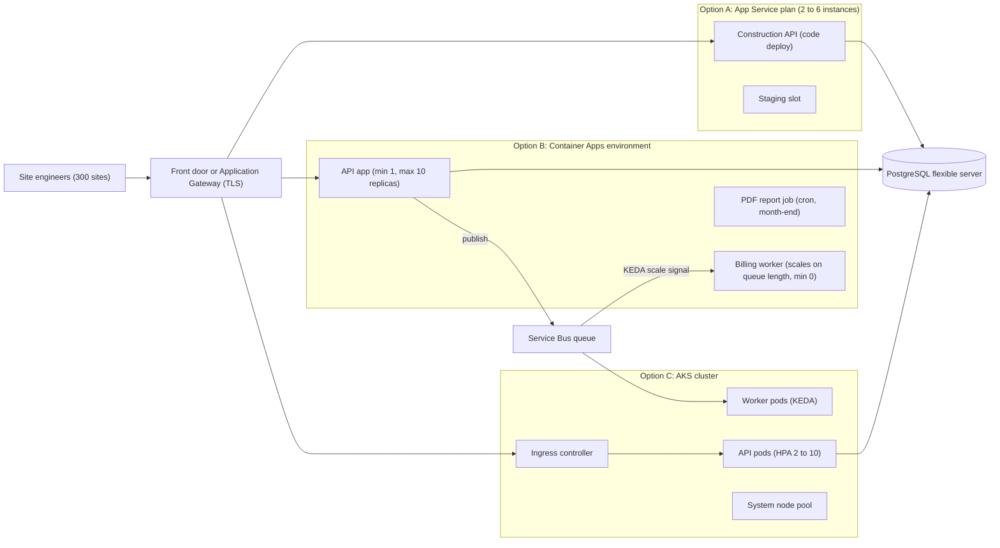
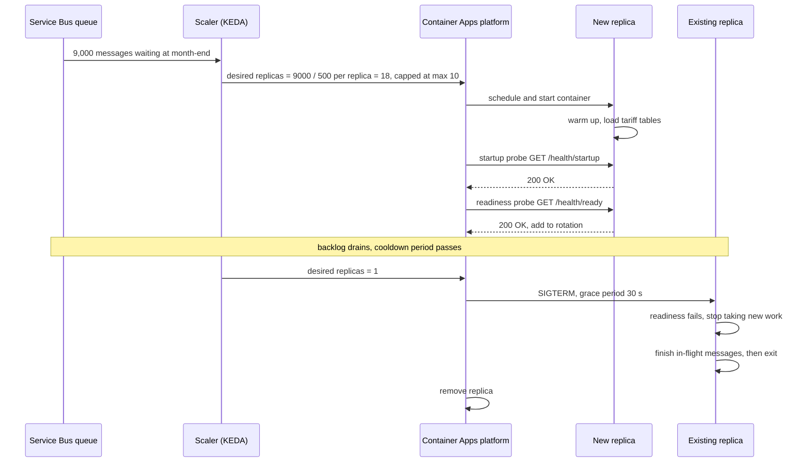

A team runs a construction-management API on two virtual machines in a company data centre. Site engineers upload daily progress from 300 project sites, monthly bills are generated on the 1st, and a PDF report generator eats all the CPU for two hours at month-end. The VMs are patched by hand, the second one sits idle 28 days a month, and nobody wants to be on call for the operating system. The team is told to "move to Azure". The first real decision is not the database or the network. It is: **where will our code run, and how much of the machine do we still want to own?**

## Learning objectives

By the end of this lesson you will be able to:

1. Explain what Azure App Service, Azure Container Apps and Azure Kubernetes Service (AKS) each manage for you, and what stays your job.
2. Pick a compute option for a workload using a decision table, and defend the choice with team size, scaling pattern and cost drivers.
3. Describe how each option scales out, how fast, and what breaks first when it does.
4. Estimate a monthly bill from the cost drivers of each option, with clearly labelled assumptions.
5. Make an ASP.NET Core app platform-ready: liveness, readiness and startup probes, forwarded headers, configuration from environment variables, and graceful shutdown.
6. Reproduce each hosting model locally with Docker, Docker Compose or a local Kubernetes cluster, without paying for cloud resources.

## Prerequisites

- [Docker, Dockerfiles and Docker Compose](#/lesson/m15-docker): you should be able to build and run an image.
- [Development, testing, staging and production](#/lesson/m15-environments): why environments differ and how configuration changes between them.
- [Vertical versus horizontal scaling and elasticity](#/lesson/m11-scaling) and [Stateless versus stateful services](#/lesson/m11-stateless): scaling out only works for stateless instances.

## Explain it like I'm a beginner

Think about how you might get lunch at work.

- **Cook at home (virtual machines).** You buy the vegetables, own the stove, wash the dishes. Full control, full effort.
- **A tiffin service (App Service).** You say "two rotis, one dal, delivered at 1 p.m." and it arrives. You choose the menu (your code), they run the kitchen. You can't ask them to install a tandoor.
- **A food court with many counters (Container Apps).** Each counter is a small kitchen in a standard box (a container). Busy counters get more staff at lunch, closed counters cost nothing at night. You bring the recipe in a standard box; the food court handles staff, electricity and cleaning.
- **Renting a whole restaurant kitchen (AKS).** You get industrial equipment and can arrange it any way you like, run many cuisines, hire your own kitchen manager. The landlord maintains the building (the Kubernetes control plane), but the kitchen staff rota, the fire safety and the cleaning schedule are yours.

Each step down the list gives you more control and more responsibility. The right choice is the one where you hand over everything you don't *need* to control.

The technical name for this spectrum is **"shared responsibility"**: Infrastructure as a Service (IaaS, the VM), Platform as a Service (PaaS, App Service), serverless containers (Container Apps) and managed Kubernetes (AKS).

## First-principles explanation

### What every compute platform must do

Whatever you choose, something has to:

1. **Run your process** on a machine with CPU and memory.
2. **Route requests** to healthy copies of it (a load balancer and TLS termination).
3. **Replace copies** that crash or stop answering health checks.
4. **Add and remove copies** as load changes (autoscaling).
5. **Roll out new versions** without dropping requests.
6. **Patch** the operating system, the runtime and the platform itself.
7. **Collect logs and metrics.**

The three Azure options differ in *who does which of these*, and in how much you can customise the answer.

### Azure App Service: a managed web host

App Service runs web apps and APIs. You deploy either **code** (a published .NET app, which App Service runs on its own Windows or Linux image) or a **container image**. Azure patches the OS and the runtime, terminates TLS, gives you a `*.azurewebsites.net` hostname, and load-balances across instances.

Key ideas:

- **App Service plan.** You pay for a *plan*: a number of instances of a chosen size (tier). Every app in the plan runs on every instance of the plan. Ten small apps on one plan share the same machines, which is cheap but means a noisy app slows its neighbours.
- **Tiers.** Free and Basic for experiments and small internal tools, Standard and Premium (v3, and newer v4) for production, Isolated v2 for a dedicated, network-isolated environment (App Service Environment). Higher tiers add more instances, deployment slots, faster CPUs, zone redundancy and private networking.
- **Deployment slots** (Standard and above). A staging copy of the app with its own hostname. You deploy to staging, warm it up, then **swap**: Azure switches routing so the warmed staging instances become production. Swap back if something breaks.
- **Scaling.** Manual instance count, rule-based autoscale (for example "add 2 instances when CPU > 70 % for 10 minutes"), or *automatic scaling* on Premium tiers, which scales on HTTP load and keeps pre-warmed instances. Scale-out adds whole instances of the plan and typically takes a few minutes, not seconds (an estimate; measure yours). It never scales to zero instances: you always pay for at least one.
- **Health check.** You give App Service a path such as `/health/ready`. It pings each instance and stops routing to instances that keep failing, then replaces them. App Service limits how many instances it will remove at once, so a dependency outage that fails every instance doesn't take the whole app out of rotation.
- **Configuration.** "App settings" in the portal or in infrastructure as code become **environment variables** inside the app. `ConnectionStrings__Main` becomes `ConnectionStrings:Main` in ASP.NET Core configuration.

When it fits: one to a handful of web apps or APIs, a small team, steady or slowly changing traffic, and a wish to never think about containers or nodes. Many production systems belong here and never need to move.

### Azure Container Apps: serverless containers

Container Apps runs **containers** without you seeing servers or Kubernetes. Underneath it is built on Kubernetes, KEDA (an event-driven autoscaler) and Envoy (a proxy), but you never run `kubectl`.

Key ideas:

- **Environment.** A boundary that groups apps sharing a virtual network and a log destination. Apps in one environment can call each other by name.
- **Container app, revision, replica.** A *container app* is your service. Every change to its template (new image, new environment variable) creates an immutable **revision**. Each revision runs one or more **replicas** (copies of the container). In multiple-revision mode you can split traffic, for example 90 % to revision 12 and 10 % to revision 13, which gives you a canary release for free.
- **Scale rules.** Replicas scale on HTTP concurrency, TCP connections, CPU or memory, or any **KEDA scaler**: Azure Service Bus queue length, Kafka lag, a cron schedule, Redis list length and dozens more. If you don't define a rule, an HTTP rule is applied by default. You set `minReplicas` and `maxReplicas`.
- **Scale to zero.** With `minReplicas: 0`, an idle app has no replicas and, on the Consumption plan, costs nothing for compute. The price is a **cold start**: the first request waits while a replica is scheduled, the image is pulled (if not cached) and your app starts. That is seconds, depending on image size and startup work (an estimate; measure yours). For a user-facing API, `minReplicas: 1` is usually worth it.
- **Plans.** The **Consumption** plan bills per second of vCPU and memory used, plus requests, with a monthly free grant per subscription. **Workload profiles** add *dedicated* profiles: you pick a VM size and pay per instance, useful for steady heavy loads, large memory or GPUs.
- **Jobs.** Container Apps jobs run to completion: manually, on a schedule (cron), or per event (one job execution per queue message batch). Perfect for the month-end PDF generator.
- **Built-in extras.** Ingress with TLS, internal-only ingress for private services, managed identity, secrets, optional Dapr sidecars for pub/sub and state.

When it fits: several services (say 3 to 30), containers already in use, bursty or event-driven traffic, background workers that should scale with a queue, and no wish to operate Kubernetes.

### Azure Kubernetes Service: managed Kubernetes

AKS gives you a real Kubernetes cluster. Azure runs the **control plane** (API server, scheduler, etcd); you run **node pools** (groups of VMs) and everything on them. You deploy with Kubernetes manifests, Helm charts or GitOps tools.

Key ideas:

- **You pay for nodes.** Node VMs, their disks, load balancers and public IPs are billed whether pods use them or not. The control plane has a Free tier (no financially backed uptime SLA, fine for dev) and a paid Standard tier with an uptime SLA; a Premium tier adds long-term support for Kubernetes versions.
- **Two levels of scaling.** The **Horizontal Pod Autoscaler (HPA)** adds pods based on CPU, memory or custom metrics; **KEDA** (available as an AKS add-on) adds event-driven scaling. When pods don't fit on existing nodes, the **cluster autoscaler** (or node auto-provisioning) adds VMs, which takes minutes. Pods start in seconds once a node has room.
- **Full Kubernetes API.** Custom resources and operators (for example a PostgreSQL operator), DaemonSets (one agent per node), service meshes, network policies, GPU node pools, Windows node pools, fine-grained scheduling (taints, tolerations, affinity). This is the reason to choose AKS.
- **Your responsibilities.** Kubernetes minor version upgrades several times a year (AKS supports a limited window of versions), node image updates, capacity planning per node pool, ingress controller, certificate management, network policies, RBAC, cost allocation, and the people who know how to do all this. **AKS Automatic** reduces this by choosing sensible defaults (node provisioning, scaling, security baselines), but it is still Kubernetes.

When it fits: many services (often 20+), a platform team (or at least two engineers with real Kubernetes experience), needs that only the Kubernetes API meets, or a requirement to run the same platform on-premises and in the cloud.

### The decision table

| Question | App Service | Container Apps | AKS |
|---|---|---|---|
| What do you deploy? | Code or a container | A container | Containers plus Kubernetes manifests |
| Who runs the servers? | Azure | Azure | Azure runs control plane, you size and upgrade node pools |
| Scale unit | Plan instance (whole VM) | Replica (container), per second | Pod, and node underneath |
| Scale to zero | No | Yes (Consumption) | Only with extra tooling (KEDA, and nodes still cost) |
| Event-driven scaling | Limited (rules on metrics) | Built in (KEDA scalers) | KEDA add-on or HPA custom metrics |
| Typical scale-out time (estimate) | Minutes | Seconds (warm), more from zero | Seconds for pods, minutes for new nodes |
| Blue-green / canary | Deployment slots and swap | Revisions with traffic weights | Your choice: rolling, Argo Rollouts, Flagger, mesh |
| Background jobs | WebJobs, or a separate worker app | Container Apps jobs | Kubernetes Jobs and CronJobs |
| Kubernetes API access | No | No | Yes |
| Operational effort | Low | Low to medium | High |
| Team that fits | 1–5 developers, no ops | Small team comfortable with containers | Platform team plus product teams |
| Main cost driver | Plan instances × hours | vCPU-seconds, GiB-seconds and requests (or dedicated profiles) | Node VMs × hours, plus control plane tier, load balancers, disks, logs |

Other options worth knowing: **Azure Functions** for small event handlers that run for seconds, **Static Web Apps** for front-ends, and plain **virtual machines** when you need OS-level control or software that can't be containerised.

### How scaling really behaves

Autoscaling is a feedback loop: *measure → decide → add capacity → wait for it to be ready*. Every step takes time:

- **Measure.** Metrics are sampled every few seconds to a minute. Container Apps polls KEDA scalers at an interval (30 seconds by default).
- **Decide.** Rules usually look at an average over a window, so a short spike doesn't trigger a scale-out.
- **Add capacity.** A new App Service instance or a new AKS node is a VM boot: minutes. A new container replica on existing capacity: seconds.
- **Ready.** Your app must start, warm caches and pass its readiness probe. A .NET app that loads 200 MB of reference data on startup can take longer than the container did.

**What breaks first** when you scale out is almost never the compute. It is the **database**. If each replica's connection pool allows 20 connections and the app scales from 3 to 30 replicas, PostgreSQL suddenly sees up to 600 connections. A General Purpose managed PostgreSQL server has a `max_connections` limit tied to its size, and each connection costs memory. Mitigations: a connection pooler (PgBouncer, built into Azure Database for PostgreSQL flexible server), smaller per-replica pools, and a `maxReplicas` set from the database's capacity, not from hope. The second thing to break is usually a downstream API with its own rate limit.

**Scaling in** has its own trap: when a replica is removed, it receives `SIGTERM` and has a grace period (30 seconds by default in Kubernetes and Container Apps) to finish requests. An app that exits immediately drops in-flight requests; an app that ignores the signal is killed mid-request. Graceful shutdown is part of being platform-ready.

### Cost drivers, with an illustrative calculation

Prices change by region, tier and month, and discounts (reserved instances, savings plans) change them again, so **use the Azure pricing calculator for real numbers**. What matters for design is the *shape* of each bill.

Assume (illustrative numbers only, not a price list) that one production-grade compute instance with 2 vCPU and 8 GB costs about ₹12,000 per month, and the construction API needs 2 such instances on a normal day and 6 for two hours at month-end.

- **App Service.** You pay for plan instances. With autoscale: 2 instances all month plus 4 more for about 2 hours ≈ 2 × ₹12,000 + a small extra ≈ **₹24,000–25,000**. Without autoscale you'd run 6 all month: ₹72,000. Deployment slots run on the same plan, so a warm staging slot uses the same instances' capacity.
- **Container Apps (Consumption).** You pay for vCPU-seconds and GiB-seconds actually allocated to replicas. Two replicas running all month cost roughly what two small instances would; the month-end burst adds a few hours of extra replicas; the PDF job only costs while it runs. If the API can scale to zero at night (internal tools often can), the bill drops further. For steady, heavy load, a dedicated workload profile can be cheaper than per-second billing.
- **AKS.** You pay for nodes. A production cluster typically has a system node pool (2–3 nodes for Kubernetes' own components) plus user nodes for your pods, plus the Standard tier control plane fee for the SLA. For one API this is clearly more expensive; for 40 services packed densely onto nodes, it can be the cheapest per service.

Costs people forget on every option: **log ingestion** (verbose logs into Log Analytics can cost more than the compute), **outbound data transfer**, **NAT gateways and private endpoints**, **container registry** storage, and idle non-production environments left running 24×7.

### When a simpler design is enough

A single API with a few hundred requests per second, a React front-end and a background job does not need Kubernetes. App Service with a staging slot, or one Container Apps environment with three apps and a job, will be cheaper, simpler and more reliable *for that team*, because the most common cause of outages is human error in a system nobody fully understands. Choose AKS when you can name the Kubernetes feature you need, and the people who will run it.

### Running all three locally, for free

You don't need an Azure subscription to learn how these platforms behave:

| Azure option | Local stand-in | What it teaches |
|---|---|---|
| App Service (container) | `docker run -p 8080:8080 -e ConnectionStrings__Main=... myapi` | App settings as environment variables, health path, one instance |
| Container Apps | Docker Compose with `--scale api=3` behind an Nginx or YARP container, a worker service, and Compose `healthcheck:` | Multiple replicas, ingress, health checks, graceful shutdown with `docker compose stop` |
| AKS | kind, k3d, minikube or Docker Desktop's built-in Kubernetes, with metrics-server for the HPA | The same Deployment, Service, probes and HPA manifests you'd use on AKS |

What you can't reproduce locally: real autoscaling latency on Azure, managed identity, regional zones and the bill. Those you learn from a small, time-boxed experiment in a sandbox subscription, deleted the same day.

## Visual explanation

### Architecture: the same platform on the three options



How to read it: the users, the front door and the database are the same in every option; only the middle box changes. In **option A**, the API runs on the plan's instances, and the staging slot sits on the same plan, ready to swap. There is no natural home for the queue worker, so it becomes a second app or a WebJob. In **option B**, each component is its own container app with its own scale rule: the API scales on HTTP concurrency, the worker scales on Service Bus queue length (the arrow from the queue to the worker is the KEDA scale signal, not a message push), and the PDF generator is a job that exists only at month-end. In **option C**, you also own the ingress controller and a system node pool that runs Kubernetes' own components, which is capacity you pay for before your first pod. All three options point at one PostgreSQL server, which is why `maxReplicas` must be chosen with the database's connection limit in mind.

### Sequence: a scale-out followed by a graceful scale-in on Container Apps



The queue length, not CPU, drives the scale decision: with a target of 500 messages per replica, 9,000 messages ask for 18 replicas, and `maxReplicas` caps it at 10 to protect the database. The new replica is not sent traffic or work until its **startup** probe (has it finished booting?) and then its **readiness** probe (can it take work now?) succeed. A slow warm-up is therefore safe: it delays capacity but never sends requests to a half-started app. When the backlog is gone and the cooldown passes, the platform scales in. The chosen replica gets `SIGTERM`, immediately reports *not ready* so no new work is routed to it, finishes what it was doing within the grace period, and exits cleanly. Without that last part, scale-in would abandon messages mid-processing, and they would reappear after their lock expired, as duplicates.

## Step-by-step example

We'll take the construction API from "runs on a VM" to "runs on Container Apps", rehearsing everything locally first.

### Step 1 — classify the workloads

| Component | Traffic shape | Needs |
|---|---|---|
| Construction API | 150 RPS daytime, near zero at night, 600 RPS on the 1st (estimates from logs) | Low latency, always on |
| Billing worker | Bursty: 9,000 messages on the 1st, few otherwise | Scale with queue, can be zero |
| PDF report generator | 2 hours a month, CPU heavy | Runs to completion |

Three components, bursty, event-driven, no Kubernetes-specific needs, a team of four developers with no platform engineers. The decision table points to **Container Apps**. App Service would also host the API well; it is the worker and the job that tip the balance.

### Step 2 — containerise with a lean, non-root image

```dockerfile
FROM mcr.microsoft.com/dotnet/sdk:10.0 AS build
WORKDIR /src
COPY . .
RUN dotnet publish Construction.Api/Construction.Api.csproj -c Release -o /app

FROM mcr.microsoft.com/dotnet/aspnet:10.0
WORKDIR /app
COPY --from=build /app .
USER $APP_UID
EXPOSE 8080
ENTRYPOINT ["dotnet", "Construction.Api.dll"]
```

.NET container images listen on port 8080 by default and include a non-root user (`APP_UID`). Smaller images pull faster, which directly shortens scale-out and cold starts.

### Step 3 — make the app platform-ready

Add three health endpoints (live, ready, startup), honour `X-Forwarded-Proto` because TLS ends at the platform's ingress, read every setting from environment variables, and drain on `SIGTERM`. The full code is in the next section.

### Step 4 — rehearse locally with Docker Compose

```yaml
services:
  api:
    build: .
    environment:
      ConnectionStrings__Main: "Host=db;Database=construction;Username=app;Password=dev-only"
      Shutdown__DrainDelay: "00:00:05"
    healthcheck:
      test: ["CMD", "curl", "-f", "http://localhost:8080/health/ready"]
      interval: 10s
      retries: 3
    stop_grace_period: 30s
    deploy:
      replicas: 3
  proxy:
    image: nginx:1.27
    ports: ["8080:80"]
    volumes: ["./nginx.conf:/etc/nginx/conf.d/default.conf:ro"]
    depends_on: [api]
  db:
    image: postgres:17
    environment:
      POSTGRES_PASSWORD: dev-only
```

Run `docker compose up --build`, call `/whoami` through the proxy several times, and watch the instance id change. Then `docker compose stop api` and read the logs: each replica should log "draining" and exit within the grace period. (The ASP.NET Core image doesn't ship `curl`; install it in a debug image or use a tiny health-probe binary. Container Apps and Kubernetes probe over HTTP from outside, so production images don't need it.)

### Step 5 — describe the Container App

In infrastructure as code (see [Infrastructure as Code](#/lesson/m15-iac)), the important part of the API's definition looks like this:

```bicep
template: {
  containers: [
    {
      name: 'api'
      image: 'myregistry.azurecr.io/construction-api:1.8.0'
      resources: { cpu: json('0.5'), memory: '1Gi' }
      probes: [
        { type: 'Startup',   httpGet: { path: '/health/startup', port: 8080 }, periodSeconds: 5, failureThreshold: 24 }
        { type: 'Readiness', httpGet: { path: '/health/ready',   port: 8080 }, periodSeconds: 10 }
        { type: 'Liveness',  httpGet: { path: '/health/live',    port: 8080 }, periodSeconds: 15 }
      ]
    }
  ]
  scale: {
    minReplicas: 1
    maxReplicas: 10
    rules: [ { name: 'http', http: { metadata: { concurrentRequests: '50' } } } ]
  }
}
```

`minReplicas: 1` avoids cold starts for users. `maxReplicas: 10` comes from the database: 10 replicas × 20 pooled connections = 200, comfortably under the server's limit with room for the worker. The startup probe allows 24 × 5 = 120 seconds of warm-up before the liveness probe can restart the container.

### Step 6 — verify the scaling assumptions

In a sandbox subscription, run a 20-minute load test at 600 RPS, record how long a new replica takes to become ready and the peak database connection count, then delete the resource group. Update `maxReplicas`, pool sizes and probe timings from what you measured, not from this lesson.

## Production-style C# implementation

The app doesn't know or care which Azure option runs it, but it must behave the way platforms expect. This implementation provides:

- separate **startup**, **readiness** and **liveness** endpoints with clear meanings;
- a **warm-up** background service that flips startup and readiness when the app is ready for traffic;
- a **drain on shutdown** lifecycle hook that fails readiness and waits before Kestrel stops, so in-flight requests finish and the load balancer stops routing first;
- **platform detection** from environment variables, for logs and a `/whoami` diagnostic endpoint;
- **forwarded headers** so redirects and generated links use `https` behind the platform's TLS termination.

```text
Compute.Hosting/
  Program.cs
  Hosting/PlatformDetector.cs
  Hosting/Lifecycle.cs
```

```csharp file=Hosting/PlatformDetector.cs
namespace Compute.Hosting;

public enum HostingPlatform { Local, AppService, ContainerApps, Kubernetes }

public sealed record PlatformInfo(HostingPlatform Platform, string InstanceId, string? Revision, string? AppName);

/// <summary>Works out where the app is running from environment variables each platform sets.
/// Used for logs and diagnostics only: business logic must never branch on the platform.</summary>
public static class PlatformDetector
{
    public static PlatformInfo Detect(Func<string, string?> env)
    {
        string? Get(string name)
        {
            var value = env(name);
            return string.IsNullOrWhiteSpace(value) ? null : value;
        }

        // Container Apps runs on Kubernetes, so check it before the generic Kubernetes variable.
        if (Get("CONTAINER_APP_NAME") is { } appName)
            return new PlatformInfo(HostingPlatform.ContainerApps,
                Get("CONTAINER_APP_REPLICA_NAME") ?? Get("HOSTNAME") ?? "unknown",
                Get("CONTAINER_APP_REVISION"), appName);

        if (Get("WEBSITE_SITE_NAME") is { } siteName)
            return new PlatformInfo(HostingPlatform.AppService,
                Get("WEBSITE_INSTANCE_ID") ?? Get("COMPUTERNAME") ?? "unknown", null, siteName);

        if (Get("KUBERNETES_SERVICE_HOST") is not null)
            return new PlatformInfo(HostingPlatform.Kubernetes, Get("HOSTNAME") ?? "unknown", null, null);

        return new PlatformInfo(HostingPlatform.Local, Get("HOSTNAME") ?? Get("COMPUTERNAME") ?? "local", null, null);
    }
}
```

```csharp file=Hosting/Lifecycle.cs
using Microsoft.Extensions.Diagnostics.HealthChecks;
using Microsoft.Extensions.Options;

namespace Compute.Hosting;

public sealed class ShutdownOptions
{
    /// <summary>How long to keep serving after SIGTERM while the platform removes this instance
    /// from rotation. Must be shorter than the platform's grace period (30 s by default).</summary>
    public TimeSpan DrainDelay { get; set; } = TimeSpan.FromSeconds(10);
}

/// <summary>Shared, thread-safe view of where this instance is in its life.</summary>
public sealed class LifecycleState
{
    private volatile bool _warmedUp;
    private volatile bool _draining;

    public bool WarmedUp => _warmedUp;
    public bool Draining => _draining;

    public void MarkWarmedUp() => _warmedUp = true;
    public void BeginDraining() => _draining = true;
}

/// <summary>Startup probe: has the app finished booting? Failing this only delays traffic.</summary>
public sealed class StartupHealthCheck(LifecycleState state) : IHealthCheck
{
    public Task<HealthCheckResult> CheckHealthAsync(HealthCheckContext context, CancellationToken cancellationToken = default) =>
        Task.FromResult(state.WarmedUp
            ? HealthCheckResult.Healthy("Warm-up complete.")
            : HealthCheckResult.Unhealthy("Still warming up."));
}

/// <summary>Readiness probe: should the load balancer send this instance new requests right now?</summary>
public sealed class ReadinessHealthCheck(LifecycleState state) : IHealthCheck
{
    public Task<HealthCheckResult> CheckHealthAsync(HealthCheckContext context, CancellationToken cancellationToken = default) =>
        Task.FromResult(state switch
        {
            { Draining: true } => HealthCheckResult.Unhealthy("Draining before shutdown."),
            { WarmedUp: false } => HealthCheckResult.Unhealthy("Not warmed up yet."),
            _ => HealthCheckResult.Healthy("Ready for traffic."),
        });
}

/// <summary>Loads reference data and primes caches before the instance takes traffic.</summary>
public sealed class WarmupService(LifecycleState state, ILogger<WarmupService> logger) : BackgroundService
{
    protected override async Task ExecuteAsync(CancellationToken stoppingToken)
    {
        // Real work here: load tariff tables, open the first pooled DB connections, JIT hot paths.
        await Task.Delay(TimeSpan.FromSeconds(2), stoppingToken);
        state.MarkWarmedUp();
        logger.LogInformation("Warm-up complete, instance is ready");
    }
}

/// <summary>On SIGTERM: fail readiness, keep serving for DrainDelay, then let the host stop.
/// StoppingAsync runs before hosted services (including the web server) are stopped.</summary>
public sealed class DrainOnShutdownService(LifecycleState state, IOptions<ShutdownOptions> options,
    ILogger<DrainOnShutdownService> logger) : IHostedLifecycleService
{
    public Task StartingAsync(CancellationToken cancellationToken) => Task.CompletedTask;
    public Task StartAsync(CancellationToken cancellationToken) => Task.CompletedTask;
    public Task StartedAsync(CancellationToken cancellationToken) => Task.CompletedTask;

    public async Task StoppingAsync(CancellationToken cancellationToken)
    {
        state.BeginDraining();
        var delay = options.Value.DrainDelay;
        logger.LogInformation("Shutdown requested, draining for {DrainDelay}", delay);
        try { await Task.Delay(delay, cancellationToken); }
        catch (OperationCanceledException) { /* host shutdown timeout reached: stop now */ }
    }

    public Task StopAsync(CancellationToken cancellationToken) => Task.CompletedTask;
    public Task StoppedAsync(CancellationToken cancellationToken) => Task.CompletedTask;
}
```

```csharp file=Program.cs
using Compute.Hosting;
using Microsoft.AspNetCore.Diagnostics.HealthChecks;
using Microsoft.AspNetCore.HttpOverrides;

var builder = WebApplication.CreateBuilder(args);

// Every setting comes from configuration, which on all three platforms is fed by environment
// variables: "ConnectionStrings__Main" becomes ConnectionStrings:Main.
builder.Services.Configure<ShutdownOptions>(builder.Configuration.GetSection("Shutdown"));

// Total time the host may take to stop: drain delay plus finishing in-flight work,
// kept below the platform's 30-second grace period.
builder.Services.Configure<HostOptions>(o => o.ShutdownTimeout = TimeSpan.FromSeconds(25));

var platform = PlatformDetector.Detect(Environment.GetEnvironmentVariable);
builder.Services.AddSingleton(platform);
builder.Services.AddSingleton<LifecycleState>();
builder.Services.AddHostedService<WarmupService>();
builder.Services.AddHostedService<DrainOnShutdownService>();

builder.Services.AddHealthChecks()
    .AddCheck<StartupHealthCheck>("startup", tags: ["startup"])
    .AddCheck<ReadinessHealthCheck>("readiness", tags: ["ready"]);

// TLS ends at the platform's ingress, which forwards plain HTTP with X-Forwarded-* headers.
// Trusting any proxy is acceptable only because the container is reachable solely through that ingress.
builder.Services.Configure<ForwardedHeadersOptions>(o =>
{
    o.ForwardedHeaders = ForwardedHeaders.XForwardedFor | ForwardedHeaders.XForwardedProto;
    o.KnownIPNetworks.Clear();
    o.KnownProxies.Clear();
});

var app = builder.Build();

app.UseForwardedHeaders();

// Liveness: is the process alive and able to answer at all? No dependency checks here,
// or a database outage would make the platform restart every healthy container.
app.MapHealthChecks("/health/live", new HealthCheckOptions { Predicate = _ => false });
app.MapHealthChecks("/health/startup", new HealthCheckOptions { Predicate = r => r.Tags.Contains("startup") });
app.MapHealthChecks("/health/ready", new HealthCheckOptions { Predicate = r => r.Tags.Contains("ready") });

app.MapGet("/whoami", (PlatformInfo p, HttpContext ctx) => Results.Ok(new
{
    platform = p.Platform.ToString(),
    instance = p.InstanceId,
    revision = p.Revision,
    scheme = ctx.Request.Scheme,
}));

app.Logger.LogInformation("Starting on {Platform}, instance {Instance}", platform.Platform, platform.InstanceId);
app.Run();
```

Design notes:

- **Three probes, three questions.** *Startup*: has it booted? *Readiness*: should it get traffic now? *Liveness*: is it stuck and in need of a restart? Mixing them is the most common production mistake. A liveness probe that checks the database turns a database blip into a restart storm across every replica.
- **Readiness can include critical dependencies, carefully.** If an instance truly can't serve without the database, failing readiness takes it out of rotation. But when *every* instance fails readiness at once, the platform has nothing to route to. Prefer degrading gracefully (serve cached data, return a clear 503 from the endpoint) over failing readiness for shared dependencies.
- **Drain before stop.** Platforms remove an instance from the load balancer and send `SIGTERM` at about the same time, and the removal takes a moment to propagate. Keeping Kestrel open for a few seconds after `SIGTERM` (the `DrainDelay`) avoids "connection refused" errors during deployments and scale-in. `DrainDelay` plus your longest request must fit in the `ShutdownTimeout`, which must fit in the platform's grace period.
- **App Service on Linux** sets `WEBSITE_SITE_NAME` and routes to port 80 or 8080 automatically for most images; set the `WEBSITES_PORT` app setting if your container listens elsewhere. Point the App Service *Health check* path at `/health/ready`.
- **Platform detection is for diagnostics only.** The same image must behave identically on all platforms; differences belong in configuration.

## Bad design vs good design

**Bad**: the "lift the VM habits into the cloud" deployment.

```text
- AKS chosen "because Netflix uses Kubernetes" for one API and one worker, team of 3, nobody has run a cluster
- Single /health endpoint used for liveness and readiness, which queries PostgreSQL and Redis
- maxReplicas 50, connection pool 100 per replica, database max_connections around 800
- App exits the moment it receives SIGTERM
- Connection string and API keys baked into the image
- Dev, test and staging clusters run 24x7 at production size
```

What goes wrong: Redis has a 20-second failover, every pod fails liveness, Kubernetes restarts all of them at once, and the cold-starting pods hammer the database together (a self-inflicted outage). At month-end the HPA scales to 50 pods × 100 connections, PostgreSQL refuses connections, and the API fails harder the more it scales. Every deployment drops a few hundred requests. The team spends its time upgrading Kubernetes instead of shipping features, and the non-production clusters cost more than production.

**Good**: Container Apps (or App Service for the API alone), separate startup, readiness and liveness probes with liveness checking only the process, `maxReplicas` derived from the database connection budget, PgBouncer in front of PostgreSQL, drain on shutdown, settings and secrets injected as environment variables or Key Vault references, non-production apps scaled to zero outside office hours.

:::callout type=tradeoff title="Control versus responsibility"
Every feature AKS gives you over Container Apps is also something you must configure, secure, upgrade and debug at 2 a.m. Pick the option where you can name every responsibility you keep and the person who owns it.
:::

:::callout type=mistake title="Scaling compute past the database"
Autoscaling compute without capping it to the database's connection budget turns a traffic spike into a database outage. Work out replicas × pool size before setting `maxReplicas`.
:::

## Practical playground

The canvas shows the construction platform as it would look lifted straight onto one large App Service plan: the API, a billing worker and the PDF generator all on the same plan instances, talking to one PostgreSQL server. Improve it:

1. Split the components by scaling pattern. Which ones should scale on HTTP, which on queue length, and which should run only on a schedule?
2. Add a queue between the API and the billing worker. What scale signal does the worker now use?
3. Set `instances` on each compute node so that instances × pool size stays under 300 database connections, with 20 connections per instance.
4. Mark which nodes can scale to zero, and say what a cold start would cost each one.
5. Write next to each compute node which Azure option you chose and why.

:::playground type=hld title="Re-platform the construction API"
```json
{
  "nodes": [
    { "id": "users", "type": "client", "label": "Site engineers and project managers", "props": { "rps": 600 } },
    { "id": "lb", "type": "load-balancer", "label": "App Service front end (TLS)" },
    { "id": "plan", "type": "app-server", "label": "One App Service plan: API + billing worker + PDF generator", "props": { "instances": 6 } },
    { "id": "pg", "type": "database", "label": "PostgreSQL flexible server", "props": { "replicas": 0 } },
    { "id": "blob", "type": "object-storage", "label": "Report PDFs" }
  ],
  "edges": [
    { "from": "users", "to": "lb", "kind": "sync" },
    { "from": "lb", "to": "plan", "kind": "sync" },
    { "from": "plan", "to": "pg", "kind": "sync", "label": "SQL, pool 100 per instance" },
    { "from": "plan", "to": "blob", "kind": "sync", "label": "write PDFs" }
  ]
}
```
:::

## Exercises

:::exercise id=m15-azure-compute-ex1 difficulty=beginner kind=code title="Encode the compute decision table"
Turn the lesson's decision table into a small advisor that a team can run against its own workloads. It returns a choice and the reasons, so the decision is explainable in a design review.
::requirements
- `ComputeAdvisor.Recommend(WorkloadNeeds needs)` returns a `ComputeRecommendation(Choice, Reasons)`.
- `ServiceCount` below 1 throws `ArgumentOutOfRangeException`.
- Rule 1: `NeedsKubernetesApi` → `Aks` with reason `"needs the Kubernetes API"`. If there is no platform team, also add `"warning: no platform team to run the cluster"`.
- Rule 2: otherwise, `ServiceCount >= 20` and `HasPlatformTeam` → `Aks` with reason `"many services and a platform team"`.
- Rule 3: otherwise, collect every reason that applies: `NeedsScaleToZero` → `"scale to zero"`, `EventDrivenScaling` → `"event-driven scaling"`, `ServiceCount >= 4` → `"several services"`. If any applied → `ContainerApps` with those reasons in that order.
- Rule 4: otherwise `AppService` with `"simple web workload"`, plus `"deploy code directly, no image needed"` when `IsContainerised` is false.
::acceptance
- One API, not containerised, no special needs → App Service with both reasons.
- A queue-driven worker that must scale to zero → Container Apps with both reasons.
- An app that needs a PostgreSQL operator (Kubernetes API) with no platform team → AKS plus the warning.
- 25 services without a platform team → Container Apps, not AKS.
::hint
Write the rules in the order given and return as soon as one matches. The order *is* the policy.
::hint
For rule 3, build a `List<string>` and only decide after checking all three conditions.
::hint
Rule 2 requires *both* conditions. 25 services and no platform team falls through to rule 3, where `ServiceCount >= 4` applies.
::hint
```csharp
var reasons = new List<string>();
if (needs.NeedsScaleToZero) reasons.Add("scale to zero");
// ...
if (reasons.Count > 0) return new(ComputeChoice.ContainerApps, reasons);
```
::starter
```csharp file=ComputeAdvisor.cs
using System;
using System.Collections.Generic;

public enum ComputeChoice { AppService, ContainerApps, Aks }

public sealed record WorkloadNeeds(
    int ServiceCount,
    bool NeedsKubernetesApi,
    bool HasPlatformTeam,
    bool NeedsScaleToZero,
    bool EventDrivenScaling,
    bool IsContainerised);

public sealed record ComputeRecommendation(ComputeChoice Choice, IReadOnlyList<string> Reasons);

public static class ComputeAdvisor
{
    public static ComputeRecommendation Recommend(WorkloadNeeds needs) => throw new NotImplementedException();
}
```
::tests
```csharp file=ComputeAdvisorTests.cs
using System;
using Xunit;

public class ComputeAdvisorTests
{
    [Fact]
    public void Simple_api_goes_to_app_service()
    {
        var r = ComputeAdvisor.Recommend(new WorkloadNeeds(1, false, false, false, false, IsContainerised: false));
        Assert.Equal(ComputeChoice.AppService, r.Choice);
        Assert.Equal(new[] { "simple web workload", "deploy code directly, no image needed" }, r.Reasons);
    }

    [Fact]
    public void Containerised_simple_api_has_one_reason()
    {
        var r = ComputeAdvisor.Recommend(new WorkloadNeeds(2, false, false, false, false, true));
        Assert.Equal(ComputeChoice.AppService, r.Choice);
        Assert.Single(r.Reasons);
    }

    [Fact]
    public void Queue_worker_that_scales_to_zero_goes_to_container_apps()
    {
        var r = ComputeAdvisor.Recommend(new WorkloadNeeds(1, false, false, true, true, true));
        Assert.Equal(ComputeChoice.ContainerApps, r.Choice);
        Assert.Equal(new[] { "scale to zero", "event-driven scaling" }, r.Reasons);
    }

    [Fact]
    public void Kubernetes_api_without_team_warns()
    {
        var r = ComputeAdvisor.Recommend(new WorkloadNeeds(3, true, false, false, false, true));
        Assert.Equal(ComputeChoice.Aks, r.Choice);
        Assert.Contains("warning: no platform team to run the cluster", r.Reasons);
    }

    [Fact]
    public void Many_services_without_platform_team_is_not_aks()
    {
        var r = ComputeAdvisor.Recommend(new WorkloadNeeds(25, false, false, false, false, true));
        Assert.Equal(ComputeChoice.ContainerApps, r.Choice);
        Assert.Equal(new[] { "several services" }, r.Reasons);
    }

    [Fact]
    public void Many_services_with_platform_team_is_aks()
    {
        var r = ComputeAdvisor.Recommend(new WorkloadNeeds(25, false, true, true, false, true));
        Assert.Equal(ComputeChoice.Aks, r.Choice);
        Assert.Equal(new[] { "many services and a platform team" }, r.Reasons);
    }

    [Fact]
    public void Zero_services_throws() =>
        Assert.Throws<ArgumentOutOfRangeException>(() => ComputeAdvisor.Recommend(new WorkloadNeeds(0, false, false, false, false, true)));
}
```
::solution
```csharp file=ComputeAdvisor.cs
using System;
using System.Collections.Generic;

public enum ComputeChoice { AppService, ContainerApps, Aks }

public sealed record WorkloadNeeds(
    int ServiceCount,
    bool NeedsKubernetesApi,
    bool HasPlatformTeam,
    bool NeedsScaleToZero,
    bool EventDrivenScaling,
    bool IsContainerised);

public sealed record ComputeRecommendation(ComputeChoice Choice, IReadOnlyList<string> Reasons);

public static class ComputeAdvisor
{
    public static ComputeRecommendation Recommend(WorkloadNeeds needs)
    {
        if (needs.ServiceCount < 1) throw new ArgumentOutOfRangeException(nameof(needs), "At least one service is required.");

        if (needs.NeedsKubernetesApi)
        {
            var aksReasons = new List<string> { "needs the Kubernetes API" };
            if (!needs.HasPlatformTeam) aksReasons.Add("warning: no platform team to run the cluster");
            return new ComputeRecommendation(ComputeChoice.Aks, aksReasons);
        }

        if (needs.ServiceCount >= 20 && needs.HasPlatformTeam)
            return new ComputeRecommendation(ComputeChoice.Aks, new[] { "many services and a platform team" });

        var reasons = new List<string>();
        if (needs.NeedsScaleToZero) reasons.Add("scale to zero");
        if (needs.EventDrivenScaling) reasons.Add("event-driven scaling");
        if (needs.ServiceCount >= 4) reasons.Add("several services");
        if (reasons.Count > 0) return new ComputeRecommendation(ComputeChoice.ContainerApps, reasons);

        var simple = new List<string> { "simple web workload" };
        if (!needs.IsContainerised) simple.Add("deploy code directly, no image needed");
        return new ComputeRecommendation(ComputeChoice.AppService, simple);
    }
}
```

The order of rules encodes the policy: a hard requirement (the Kubernetes API) wins over everything, then the "do we have the people" check, then the workload shape, and App Service is the default. The warning in rule 1 matters: a team that genuinely needs an operator but has no platform skills should hear about the risk in the same breath as the recommendation.
::alternatives
A scoring model (points per criterion, highest score wins) is more flexible but harder to explain; ordered rules are easier to review. Some teams add a "Functions" outcome for short event handlers that run for seconds.
::mistakes
- Treating `ServiceCount >= 20` alone as a reason for AKS, ignoring who will run it.
- Returning on the first Container Apps reason and losing the others, which makes the explanation incomplete.
- Comparing reason lists by reference instead of by content in tests.
::extensions
Add `NeedsDeploymentSlots` and `NeedsWindowsOnlyDependencies` and decide where they fit in the rule order.
:::

:::exercise id=m15-azure-compute-ex2 difficulty=beginner kind=written title="Pick compute for four workloads"
For each workload, choose App Service, Container Apps or AKS (or say another service fits better), and justify it in two or three sentences using the decision table: what you deploy, how it scales, who runs it, and what drives the cost.

1. A GST invoice-validation API for a mid-sized distributor: 40 RPS steady during office hours, a team of two .NET developers, no containers yet.
2. A drone-imagery processing pipeline: uploads arrive in bursts after each survey flight, each image takes 20–60 seconds of CPU to tile, nothing happens for days in between.
3. A national logistics company with 45 microservices, an existing platform team of six, a requirement to run the same platform in its own data centre, and a service mesh already chosen.
4. A citizen-facing grievance portal with a web front-end, an API and a nightly SLA-escalation job, run by a team of five that already builds Docker images.
::acceptance
- Each answer names the deciding factor, not just the service.
- Workload 2 discusses scale to zero and cold starts, and uses a job or queue-driven worker.
- Workload 3 justifies AKS with a concrete Kubernetes-only need and the team.
- At least one answer explicitly rejects a more complex option as unnecessary.
::hint
Start with the team: who will be on call for this platform?
::hint
Then the traffic shape: steady, bursty, event-driven or scheduled?
::hint
Ask whether any requirement names a Kubernetes feature or a portability need.
::solution
1. **App Service.** Steady, modest web traffic, a tiny team and no containers: deploy the published app straight to an App Service plan with two instances in Standard or Premium, a staging slot for releases and the Health check path set. Containers or Kubernetes would add work with no benefit here. Cost is simply the plan instances, which is predictable for the finance team.
2. **Container Apps with a queue-driven worker or event-driven jobs.** Uploads go to Blob Storage and a message goes to a queue; a worker with `minReplicas: 0` scales on queue length, so days of silence cost nothing for compute. A cold start of a few seconds is irrelevant for a 20–60 second batch task. Per-second billing matches the bursty shape far better than a plan that runs all month.
3. **AKS.** Forty-five services, a platform team that already exists, a service mesh, and a hybrid requirement (the same Kubernetes API on-premises and in Azure) are exactly the needs AKS meets. Container Apps would hide the Kubernetes API they explicitly need. Dense packing of many services onto shared node pools also makes per-service cost reasonable at this scale.
4. **Container Apps** (App Service is a close second). Three components (front-end, API, scheduled job) and a team already building images fit one Container Apps environment: the API with `minReplicas: 2` for availability, the front-end as a static site or another app, and a scheduled job for escalations. AKS would be over-engineering for three components and five developers.
::mistakes
- Choosing AKS for workload 4 "for the future" without naming a need.
- Ignoring cold starts entirely, or treating them as fatal for a batch workload.
- Justifying choices with brand names rather than workload shape and team.
:::

:::exercise id=m15-azure-compute-ex3 difficulty=intermediate kind=code title="Estimate a Container Apps consumption bill"
Build a cost estimator for the Consumption plan's billing *shape*. Rates are inputs (take them from the current pricing page for your region), because prices change and this lesson won't invent them.
::requirements
- `ConsumptionCostEstimator.Estimate(AppUsage usage, ConsumptionRates rates, FreeGrant grant)` returns `CostBreakdown(Vcpu, Memory, Requests)` with a computed `Total`.
- vCPU-seconds: active = `Replicas × VcpuPerReplica × ActiveSecondsPerReplica`, idle = `Replicas × VcpuPerReplica × IdleSecondsPerReplica`. Memory (GiB-seconds) the same with `GibPerReplica`.
- The free grant is applied to **active** usage first, then any remainder to **idle** usage. Billable usage is never negative.
- vCPU cost = billable active × active rate + billable idle × idle rate. Memory the same with memory rates.
- Requests: billable = requests above the free grant, cost = billable ÷ 1,000,000 × `PerMillionRequests`.
- Any negative input (replicas, sizes, seconds, requests, rates, grant values) throws `ArgumentOutOfRangeException`.
::acceptance
- Usage entirely inside the free grant costs 0.
- With no grant, the cost is the straightforward product of usage and rates.
- When the grant covers active usage and part of idle usage, only the remaining idle usage is billed at the idle rate.
- Results are `decimal`, so money arithmetic is exact.
::hint
Write one private helper that takes active units, idle units and a free allowance, and returns the billable active and idle units.
::hint
`billableActive = max(0, active - free)`, then `freeLeft = max(0, free - active)`, then `billableIdle = max(0, idle - freeLeft)`.
::hint
Use `decimal` everywhere and `Math.Max(0m, x)`. Convert `long` seconds to `decimal` before multiplying.
::hint
```csharp
static (decimal active, decimal idle) Bill(decimal active, decimal idle, decimal free)
{
    var billActive = Math.Max(0m, active - free);
    var freeLeft = Math.Max(0m, free - active);
    return (billActive, Math.Max(0m, idle - freeLeft));
}
```
::starter
```csharp file=ConsumptionCostEstimator.cs
using System;

public sealed record ConsumptionRates(decimal ActiveVcpuSecond, decimal IdleVcpuSecond, decimal ActiveGibSecond, decimal IdleGibSecond, decimal PerMillionRequests);

public sealed record FreeGrant(decimal VcpuSeconds, decimal GibSeconds, long Requests);

public sealed record AppUsage(int Replicas, decimal VcpuPerReplica, decimal GibPerReplica, long ActiveSecondsPerReplica, long IdleSecondsPerReplica, long Requests);

public sealed record CostBreakdown(decimal Vcpu, decimal Memory, decimal Requests)
{
    public decimal Total => Vcpu + Memory + Requests;
}

public static class ConsumptionCostEstimator
{
    public static CostBreakdown Estimate(AppUsage usage, ConsumptionRates rates, FreeGrant grant) => throw new NotImplementedException();
}
```
::tests
```csharp file=ConsumptionCostEstimatorTests.cs
using System;
using Xunit;

public class ConsumptionCostEstimatorTests
{
    // Illustrative rates only, not real prices.
    private static readonly ConsumptionRates Rates = new(0.002m, 0.00025m, 0.0002m, 0.0001m, 0.40m);
    private static readonly FreeGrant Grant = new(180_000m, 360_000m, 2_000_000);
    private static readonly FreeGrant NoGrant = new(0m, 0m, 0);
    private static readonly AppUsage TwoReplicas = new(2, 0.5m, 1m, 100_000, 200_000, 3_000_000);

    [Fact]
    public void Grant_covers_active_then_part_of_idle()
    {
        var c = ConsumptionCostEstimator.Estimate(TwoReplicas, Rates, Grant);
        Assert.Equal(30m, c.Vcpu);      // 120,000 idle vCPU-s x 0.00025
        Assert.Equal(24m, c.Memory);    // 240,000 idle GiB-s x 0.0001
        Assert.Equal(0.40m, c.Requests);
        Assert.Equal(54.40m, c.Total);
    }

    [Fact]
    public void No_grant_is_plain_product()
    {
        var c = ConsumptionCostEstimator.Estimate(TwoReplicas, Rates, NoGrant);
        Assert.Equal(250m, c.Vcpu);
        Assert.Equal(80m, c.Memory);
        Assert.Equal(1.2m, c.Requests);
        Assert.Equal(331.2m, c.Total);
    }

    [Fact]
    public void Small_app_inside_grant_is_free()
    {
        var c = ConsumptionCostEstimator.Estimate(new AppUsage(1, 0.25m, 0.5m, 100_000, 0, 10_000), Rates, Grant);
        Assert.Equal(0m, c.Total);
    }

    [Fact]
    public void Negative_replicas_throw() =>
        Assert.Throws<ArgumentOutOfRangeException>(() =>
            ConsumptionCostEstimator.Estimate(new AppUsage(-1, 0.5m, 1m, 1, 1, 1), Rates, Grant));

    [Fact]
    public void Negative_rate_throws() =>
        Assert.Throws<ArgumentOutOfRangeException>(() =>
            ConsumptionCostEstimator.Estimate(TwoReplicas, Rates with { IdleGibSecond = -0.1m }, Grant));
}
```
::solution
```csharp file=ConsumptionCostEstimator.cs
using System;

public sealed record ConsumptionRates(decimal ActiveVcpuSecond, decimal IdleVcpuSecond, decimal ActiveGibSecond, decimal IdleGibSecond, decimal PerMillionRequests);

public sealed record FreeGrant(decimal VcpuSeconds, decimal GibSeconds, long Requests);

public sealed record AppUsage(int Replicas, decimal VcpuPerReplica, decimal GibPerReplica, long ActiveSecondsPerReplica, long IdleSecondsPerReplica, long Requests);

public sealed record CostBreakdown(decimal Vcpu, decimal Memory, decimal Requests)
{
    public decimal Total => Vcpu + Memory + Requests;
}

public static class ConsumptionCostEstimator
{
    public static CostBreakdown Estimate(AppUsage usage, ConsumptionRates rates, FreeGrant grant)
    {
        NonNegative(usage.Replicas, nameof(usage.Replicas));
        NonNegative(usage.VcpuPerReplica, nameof(usage.VcpuPerReplica));
        NonNegative(usage.GibPerReplica, nameof(usage.GibPerReplica));
        NonNegative(usage.ActiveSecondsPerReplica, nameof(usage.ActiveSecondsPerReplica));
        NonNegative(usage.IdleSecondsPerReplica, nameof(usage.IdleSecondsPerReplica));
        NonNegative(usage.Requests, nameof(usage.Requests));
        NonNegative(rates.ActiveVcpuSecond, nameof(rates.ActiveVcpuSecond));
        NonNegative(rates.IdleVcpuSecond, nameof(rates.IdleVcpuSecond));
        NonNegative(rates.ActiveGibSecond, nameof(rates.ActiveGibSecond));
        NonNegative(rates.IdleGibSecond, nameof(rates.IdleGibSecond));
        NonNegative(rates.PerMillionRequests, nameof(rates.PerMillionRequests));
        NonNegative(grant.VcpuSeconds, nameof(grant.VcpuSeconds));
        NonNegative(grant.GibSeconds, nameof(grant.GibSeconds));
        NonNegative(grant.Requests, nameof(grant.Requests));

        decimal replicas = usage.Replicas;
        decimal active = usage.ActiveSecondsPerReplica;
        decimal idle = usage.IdleSecondsPerReplica;

        var (vActive, vIdle) = Billable(replicas * usage.VcpuPerReplica * active, replicas * usage.VcpuPerReplica * idle, grant.VcpuSeconds);
        var (gActive, gIdle) = Billable(replicas * usage.GibPerReplica * active, replicas * usage.GibPerReplica * idle, grant.GibSeconds);

        var vcpu = vActive * rates.ActiveVcpuSecond + vIdle * rates.IdleVcpuSecond;
        var memory = gActive * rates.ActiveGibSecond + gIdle * rates.IdleGibSecond;
        var billableRequests = Math.Max(0m, (decimal)usage.Requests - grant.Requests);
        var requests = billableRequests / 1_000_000m * rates.PerMillionRequests;

        return new CostBreakdown(vcpu, memory, requests);
    }

    private static (decimal Active, decimal Idle) Billable(decimal active, decimal idle, decimal free)
    {
        var billActive = Math.Max(0m, active - free);
        var freeLeft = Math.Max(0m, free - active);
        return (billActive, Math.Max(0m, idle - freeLeft));
    }

    private static void NonNegative(decimal value, string name)
    {
        if (value < 0) throw new ArgumentOutOfRangeException(name, value, "Must not be negative.");
    }
}
```

The interesting part is the *shape*: an always-on API with `minReplicas: 2` pays mostly for idle seconds at night, while a queue worker with `minReplicas: 0` pays only for active seconds. Feed in your own measured replica-hours and the current regional rates to compare with an App Service plan or a dedicated workload profile. In this model the free grant offsets active usage first; check the pricing page for how the real grant is applied.
::alternatives
For steady 24×7 load, model a dedicated workload profile instead: instances × hours × instance rate, plus the environment's fixed fee. The crossover point between the two is the real decision.
::mistakes
- Using `double` for money and getting 54.400000000001.
- Applying the free grant twice (once to active and again in full to idle).
- Forgetting that `minReplicas > 0` means paying idle charges all night.
::extensions
Add a `CompareWithPlan(instanceMonthlyRate, instances)` method that returns which option is cheaper for the given usage and by how much.
:::

:::exercise id=m15-azure-compute-ex4 difficulty=intermediate kind=written title="Size the month-end scale-out without breaking PostgreSQL"
The billing worker runs on Container Apps with a KEDA Service Bus scaler. On the 1st of the month 12,000 billing messages arrive within 5 minutes. Each replica processes about 8 messages per second and holds a connection pool of up to 15 PostgreSQL connections. The API uses up to 10 replicas × 20 connections. The PostgreSQL server allows about 500 connections, of which you keep 50 for admin, migrations and monitoring.

1. What is the largest safe `maxReplicas` for the worker?
2. With that maximum, roughly how long does the backlog take to drain? Ignore scale-out time first, then add 60 seconds for replicas to start.
3. The scaler's target is 100 messages per replica. How many replicas does it ask for at the peak, and what does `maxReplicas` do with that number?
4. Name two changes that would let the backlog drain faster without raising the database's connection limit.
::acceptance
- Shows the connection-budget arithmetic explicitly.
- Shows drain-time arithmetic with units.
- Explains that KEDA's desired count is capped by `maxReplicas`.
- Proposes at least one change that reduces connections per unit of work rather than adding replicas.
::hint
Connections available to the worker = total − reserved − API's maximum.
::hint
Drain time = messages ÷ (replicas × messages per second per replica).
::hint
Desired replicas = queue length ÷ target per replica.
::hint
Think about what each message does to the database: one transaction per message, or batches?
::solution
1. **Connection budget.** 500 − 50 reserved − (10 × 20 = 200 for the API) = 250 for the worker. 250 ÷ 15 per replica = 16.7, so **`maxReplicas` = 16** (round down). In practice keep a margin, say 14, because pools can briefly exceed their steady size during reconnects and the API might gain replicas.
2. **Drain time.** 16 replicas × 8 msg/s = 128 msg/s. 12,000 ÷ 128 ≈ 94 seconds of processing. With 60 seconds of scale-out first, about **2.5 minutes** in total (more if messages keep arriving during the 5-minute burst: then the backlog peaks lower but the drain finishes around 5–6 minutes after the burst starts). That's fine for monthly billing.
3. **Desired count.** 12,000 ÷ 100 = **120 replicas** requested. `maxReplicas` caps it at 16. The cap is doing its job: it protects the database at the cost of a slightly longer drain.
4. **Faster without more connections.** (a) Process messages in **batches** (for example 50 messages per receive, one transaction with one multi-row insert), so each connection does more work per round trip. (b) Put **PgBouncer** in transaction-pooling mode in front of PostgreSQL so many client connections share fewer server connections. (c) Lower the worker's pool size to what it actually uses concurrently (often 2–4 for a single-threaded consumer loop), which lets more replicas fit in the same budget. (d) Make the work cheaper: precompute tariffs, avoid N+1 queries.
::mistakes
- Setting `maxReplicas` from the queue size alone.
- Forgetting the API's connections share the same server.
- Rounding 16.7 up to 17.
:::

:::exercise id=m15-azure-compute-ex5 difficulty=advanced kind=hld title="Re-platform a state infrastructure-monitoring system"
A state public-works department runs a project-monitoring platform: a citizen dashboard (read-heavy, 2,000 RPS peak during monsoon flood alerts, 50 RPS normally), an officer API (200 RPS in office hours), a geospatial tile renderer that is CPU heavy and spiky, a nightly job that recomputes project rankings for 4,000 projects, and a PostgreSQL 17 database with PostGIS. The in-house team is eight developers, two of whom have run Kubernetes before. Budget scrutiny is high, and a vendor has proposed "one AKS cluster for everything".

Design the compute layer. For each component, choose the Azure option, its scaling rule and its min/max, and explain what breaks first during a flood-alert spike.
::acceptance
- Each component has a compute choice, scale signal and min/max with a reason.
- Read-heavy dashboard traffic uses caching or a CDN before more compute.
- The renderer's scaling is isolated so it can't starve the APIs.
- Connection budget for PostgreSQL is computed and respected.
- Responds to the vendor's AKS proposal with a reasoned verdict, including team and cost.
- Names the first bottleneck during the spike and its mitigation.
::hint
2,000 RPS of mostly identical dashboard reads: does that need 2,000 RPS of compute?
::hint
Isolate the noisy CPU workload. Separate apps scale and fail separately.
::hint
Two engineers with Kubernetes experience is not a platform team on call 24×7.
::hint
Add a database connection pooler and a read replica before raising `maxReplicas`.
::starter
```json
{
  "nodes": [
    { "id": "citizens", "type": "client", "label": "Citizens (dashboard)", "props": { "rps": 2000 } },
    { "id": "officers", "type": "client", "label": "Officers", "props": { "rps": 200 } },
    { "id": "lb", "type": "load-balancer", "label": "Ingress" },
    { "id": "aks", "type": "app-server", "label": "Proposed: one AKS cluster running everything", "props": { "instances": 8 } },
    { "id": "pg", "type": "database", "label": "PostgreSQL 17 + PostGIS", "props": { "replicas": 0 } }
  ],
  "edges": [
    { "from": "citizens", "to": "lb", "kind": "sync" },
    { "from": "officers", "to": "lb", "kind": "sync" },
    { "from": "lb", "to": "aks", "kind": "sync" },
    { "from": "aks", "to": "pg", "kind": "sync" }
  ]
}
```
::solution
```json
{
  "nodes": [
    { "id": "citizens", "type": "client", "label": "Citizens (dashboard)", "props": { "rps": 2000 } },
    { "id": "officers", "type": "client", "label": "Officers", "props": { "rps": 200 } },
    { "id": "cdn", "type": "cdn", "label": "CDN: static dashboard + cached JSON (TTL 30 s) + tiles (TTL 1 h)", "props": { "ttlSeconds": 30 } },
    { "id": "lb", "type": "load-balancer", "label": "Front door with WAF" },
    { "id": "dash", "type": "app-server", "label": "Dashboard API: Container App, HTTP rule, min 2 max 8", "props": { "instances": 2 } },
    { "id": "officer", "type": "app-server", "label": "Officer API: Container App, internal + auth, min 2 max 6", "props": { "instances": 2 } },
    { "id": "tiles", "type": "worker", "label": "Tile renderer: Container App on dedicated profile, min 0 max 6", "props": { "instances": 1 } },
    { "id": "rank", "type": "scheduler", "label": "Ranking job: Container Apps scheduled job, 02:00 nightly" },
    { "id": "cache", "type": "cache", "label": "Redis: dashboard aggregates", "props": { "ttlSeconds": 30 } },
    { "id": "bouncer", "type": "app-server", "label": "PgBouncer (built into flexible server)" },
    { "id": "pg", "type": "database", "label": "PostgreSQL 17 + PostGIS, zone-redundant HA", "props": { "replicas": 1, "multiAz": true } },
    { "id": "replica", "type": "read-replica", "label": "Read replica for dashboard and tiles", "props": { "replicas": 1 } },
    { "id": "mon", "type": "monitoring", "label": "Replica count, DB connections, CDN hit ratio" }
  ],
  "edges": [
    { "from": "citizens", "to": "cdn", "kind": "sync" },
    { "from": "cdn", "to": "lb", "kind": "sync", "label": "cache misses only" },
    { "from": "officers", "to": "lb", "kind": "sync" },
    { "from": "lb", "to": "dash", "kind": "sync" },
    { "from": "lb", "to": "officer", "kind": "sync" },
    { "from": "lb", "to": "tiles", "kind": "sync", "label": "/tiles" },
    { "from": "dash", "to": "cache", "kind": "sync" },
    { "from": "dash", "to": "bouncer", "kind": "sync" },
    { "from": "officer", "to": "bouncer", "kind": "sync" },
    { "from": "tiles", "to": "bouncer", "kind": "sync" },
    { "from": "rank", "to": "bouncer", "kind": "sync" },
    { "from": "bouncer", "to": "pg", "kind": "sync" },
    { "from": "bouncer", "to": "replica", "kind": "sync", "label": "read-only pool" },
    { "from": "pg", "to": "replica", "kind": "async", "label": "streaming replication" },
    { "from": "dash", "to": "mon", "kind": "async" },
    { "from": "pg", "to": "mon", "kind": "async" }
  ]
}
```

**Caching before compute.** Flood-alert traffic is thousands of citizens reading the same district summaries. With a CDN caching JSON for 30 seconds and tiles for an hour, a 90 % hit ratio (an estimate to verify) turns 2,000 RPS into about 200 RPS reaching the dashboard API. Redis holds the aggregates the API serves, so most of those 200 requests never touch PostgreSQL.

**Compute choices.** One Container Apps environment. The dashboard API scales on HTTP concurrency between 2 and 8 replicas. The officer API is separate (different auth, different traffic, and it must stay fast during a citizen spike) with 2 to 6 replicas. The tile renderer runs on a **dedicated workload profile** so its CPU bursts can't starve the APIs, scales to zero when nobody requests uncached tiles, and is capped at 6. The ranking recomputation is a **scheduled job** that exists only while it runs.

**Connection budget.** Assume the server allows about 400 connections, with 40 reserved. Through PgBouncer in transaction mode, app pools can be small: dashboard 8 × 10, officer 6 × 15, tiles 6 × 10, job 10 = 80 + 90 + 60 + 10 = 240 client connections, multiplexed onto far fewer server connections. Read-heavy dashboard and tile queries go to the read replica.

**What breaks first in a spike.** Not compute: the **database**, through uncached PostGIS queries for tiles nobody requested before, and through connection storms when replicas scale out. Mitigations: CDN and Redis first, the read replica for reads, PgBouncer, `maxReplicas` set from the budget, and pre-rendering popular tile zoom levels when an alert is issued.

**Verdict on the AKS proposal.** Nothing here needs the Kubernetes API, and two engineers with past experience are not a 24×7 platform team. AKS would add a system node pool, an ingress controller, upgrades and node capacity that is paid for even at 50 RPS. Container Apps meets every scaling need with less operational risk and a bill that follows the monsoon. Revisit AKS if the department later consolidates many more services or needs on-premises parity.
::mistakes
- Scaling compute to 2,000 RPS instead of caching identical reads.
- Running the CPU-heavy renderer in the same app or node pool as the APIs.
- Accepting AKS without asking who will upgrade and operate it.
- Leaving the database connection budget implicit.
:::

## Automated testing

**Unit-test the lifecycle logic.** Health checks and drain behaviour are plain classes; test them without a server:

```csharp
[Fact]
public async Task Readiness_fails_while_draining()
{
    var state = new LifecycleState();
    state.MarkWarmedUp();
    var check = new ReadinessHealthCheck(state);
    Assert.Equal(HealthStatus.Healthy, (await check.CheckHealthAsync(new HealthCheckContext())).Status);

    state.BeginDraining();
    Assert.Equal(HealthStatus.Unhealthy, (await check.CheckHealthAsync(new HealthCheckContext())).Status);
}

[Fact]
public void Detects_container_apps_before_kubernetes()
{
    var env = new Dictionary<string, string?>
    {
        ["CONTAINER_APP_NAME"] = "construction-api",
        ["CONTAINER_APP_REVISION"] = "construction-api--r12",
        ["KUBERNETES_SERVICE_HOST"] = "10.0.0.1",
    };
    var info = PlatformDetector.Detect(name => env.GetValueOrDefault(name));
    Assert.Equal(HostingPlatform.ContainerApps, info.Platform);
}
```

**Integration-test the endpoints** with `WebApplicationFactory`: `/health/live` returns 200 immediately, `/health/ready` returns 503 until warm-up completes, and `/whoami` reports `https` when a request carries `X-Forwarded-Proto: https`.

**Test shutdown locally.** In Docker Compose, send traffic with a load tool while running `docker compose stop api`; assert zero failed requests. Repeat with `DrainDelay` set to zero to see the failures the delay prevents.

**Load-test the scaling assumptions** in a short-lived sandbox: time from the scale trigger to a ready replica, peak database connections, and p95 latency during scale-out. Feed the measurements back into `maxReplicas`, probe timings and pool sizes.

**Test the image, not just the code.** A CI step that runs the built container and polls `/health/startup` catches missing files, wrong ports and permission problems from running as a non-root user.

## Real-world application

- **Small and mid-sized product teams** commonly run their APIs on App Service for years: slots, autoscale and managed patching cover their needs, and the team's time goes into the product.
- **Event-driven back-ends** (document processing, IoT telemetry, notification fan-out) are a natural fit for Container Apps, because queue-driven scaling and scale to zero match their traffic.
- **Large organisations with many teams** often build an internal platform on AKS (or another Kubernetes service) so dozens of teams deploy the same way, with a central platform team owning upgrades, security baselines and cost allocation.
- **Government and regulated workloads** in India and elsewhere often add requirements for private networking, data residency in specific regions and audit logging; all three options support private networking, but the configuration effort grows from App Service to AKS.
- **Hybrid estates**: organisations that must run on-premises and in the cloud tend to standardise on Kubernetes so the same manifests work in both places.

## Interview questions

:::interview
::q beginner
What is the difference between App Service, Container Apps and AKS in one sentence each?
::a
App Service is a managed web host: you give it code or a container and it runs, patches and load-balances it on plan instances you pay for. Container Apps runs containers serverlessly: it scales replicas on HTTP or events (including to zero) and you never manage servers or Kubernetes. AKS is managed Kubernetes: Azure runs the control plane, you run node pools and get the full Kubernetes API, with the operational work that implies.
::q beginner
Why should a liveness probe not check the database?
::a
Liveness answers "is this process stuck and in need of a restart?". If it checks the database, a database outage makes every instance fail liveness at once and the platform restarts all of them, which doesn't fix the database and adds a cold-start storm on top. Liveness should check only the process itself. Dependency health belongs in readiness (carefully) or in degraded responses and alerts.
::q intermediate
Your API on Container Apps scaled from 3 to 30 replicas during a spike and then started failing harder. What probably happened and how do you fix it?
::a
Most likely the database ran out of connections: 30 replicas × the pool size exceeded PostgreSQL's limit, so new connections were refused and requests failed. Scaling out made it worse. Fixes: set `maxReplicas` from the connection budget (total minus reserved minus other apps, divided by per-replica pool), shrink per-replica pools, put PgBouncer in front of PostgreSQL, move reads to a replica or cache, and alert on connection usage. Also check downstream rate limits, which fail the same way.
::q intermediate
How do you deploy without dropping requests on these platforms?
::a
Combine platform features with app behaviour. Platform: App Service deployment slots with warm-up and swap; Container Apps revisions with traffic weights; Kubernetes rolling updates with `maxUnavailable: 0` and readiness gates. App: a startup probe so traffic waits for warm-up, a readiness probe that fails as soon as `SIGTERM` arrives, a short drain delay while the load balancer stops routing, and finishing in-flight requests within a shutdown timeout shorter than the platform's grace period. Database changes must be backward compatible (expand/contract) because old and new versions run side by side.
::q advanced
A team of six wants to move 12 services from VMs to Azure and is split between Container Apps and AKS. How do you decide?
::a
List the requirements that only the Kubernetes API meets (operators, DaemonSets, a service mesh, custom schedulers, on-premises parity) and the people available to run a cluster 24×7, including upgrades several times a year. If the list is empty or the people don't exist, Container Apps wins: it covers HTTP and event scaling, revisions for canaries, jobs, managed identity and private networking. Compare costs with the shapes: AKS pays for nodes and a system pool continuously, Container Apps pays per second or per dedicated profile. Run a two-week spike of the most demanding service on Container Apps to find real gaps. Keep the app portable (standard container, probes, config from environment) so moving to AKS later is a deployment change, not a rewrite.
::q advanced
What are the hidden cost drivers of running containers in Azure, and how would you control them?
::a
Beyond compute: log ingestion into Log Analytics (often the largest surprise; control with log levels, sampling and table plans), outbound data transfer, NAT gateways and private endpoints billed per hour and per GB, container registry storage and geo-replication, load balancers and public IPs per environment, AKS system node pools and the Standard tier control plane fee, and idle non-production environments. Control them with tags and budgets per environment, scaling non-production to zero out of hours, right-sizing replicas from measured usage, reserved capacity or savings plans for steady baselines, and a monthly cost review next to the reliability review.
:::

## Summary and revision

**Key takeaways**

- App Service, Container Apps and AKS differ in how much of the platform you hand to Azure. Hand over everything you don't need to control.
- App Service: plan instances, slots, simple autoscale, no scale to zero. Great default for a few web apps.
- Container Apps: containers, revisions, KEDA scaling, scale to zero, jobs. Great for several services and event-driven work.
- AKS: full Kubernetes API, node pools, you own upgrades and capacity. Choose it for a named need and a team to run it.
- Scaling takes time at every step. Compute rarely breaks first: the database connection limit usually does. Cap `maxReplicas` from the connection budget.
- Be platform-ready: separate startup, readiness and liveness probes, config from environment variables, forwarded headers, graceful drain on `SIGTERM`.
- Cost follows the billing shape: instances × hours, vCPU-seconds and GiB-seconds, or nodes × hours, plus logs, egress and networking. Use the pricing calculator, not memory.
- Everything except real autoscaling latency, managed identity and the bill can be rehearsed locally with Docker, Compose and kind or k3d.

**Terminology**: IaaS, PaaS, App Service plan, deployment slot, swap, Container Apps environment, revision, replica, scale rule, KEDA, scale to zero, cold start, workload profile, Container Apps job, AKS, control plane, node pool, HPA, cluster autoscaler, startup, readiness and liveness probes, grace period, drain.

:::flashcards
Q: What do you pay for on App Service?
A: Plan instances (count × tier × hours), shared by every app in the plan, whether busy or idle.
Q: What is a Container Apps revision?
A: An immutable snapshot of a container app's template. Each change creates a new one, and traffic can be split between revisions.
Q: What does KEDA add to Container Apps and AKS?
A: Event-driven scaling: replica counts driven by queue length, stream lag, schedules and other external metrics, including scaling to zero.
Q: Name three things that stay your job on AKS.
A: Kubernetes version upgrades, node pool sizing and updates, and ingress, network policy and RBAC configuration.
Q: Startup, readiness, liveness: one question each.
A: Has it booted? Should it get traffic now? Is it stuck and in need of a restart?
Q: What usually breaks first when compute scales out?
A: The database, through too many connections (replicas × pool size), followed by downstream rate limits.
Q: Why drain after SIGTERM?
A: The load balancer needs a moment to stop routing to the instance. Serving a few more seconds and finishing in-flight work avoids dropped requests.
Q: A local stand-in for AKS?
A: kind, k3d, minikube or Docker Desktop's Kubernetes, using the same manifests, with metrics-server for the HPA.
:::

## Knowledge check

:::quiz pass=70
::q single
A team of three runs one ASP.NET Core API with steady office-hours traffic and no containers. Which option fits best?
- [x] App Service with a staging slot and autoscale.
- [ ] AKS with an HPA.
- [ ] Container Apps with scale to zero.
- [ ] Virtual machines with a load balancer.
> The workload is simple and steady, the team is small and has no images. App Service runs published code directly and needs the least operation.
::q single
A queue-driven worker sits idle for days and then receives thousands of messages. Which configuration matches it best?
- [ ] App Service with 3 always-on instances.
- [x] Container Apps with a Service Bus scale rule and `minReplicas: 0`.
- [ ] AKS with a fixed 10-node pool.
- [ ] A larger App Service tier.
> Event-driven scaling with scale to zero pays only while there is work. Cold starts don't matter for batch work.
::q single
During a Redis failover, every pod of your API is restarted by Kubernetes. What is the most likely design flaw?
- [ ] The HPA's target CPU is too low.
- [x] The liveness probe checks Redis, so a dependency blip fails liveness on every pod.
- [ ] The readiness probe is missing.
- [ ] The image is too large.
> Liveness should check only the process. Dependency failures should never trigger restarts across all instances.
::q single
The API has 20 connections per replica, PostgreSQL allows 500 with 60 reserved, and a worker uses 120. What is the largest safe `maxReplicas` for the API?
- [ ] 25
- [x] 16
- [ ] 22
- [ ] 30
> (500 − 60 − 120) ÷ 20 = 16. Set it from the budget, ideally with a margin.
::q multi
Which make a rolling deployment drop no requests? (Select all that apply.)
- [x] A readiness probe that fails as soon as SIGTERM arrives.
- [x] A short drain delay before the web server stops.
- [x] A shutdown timeout shorter than the platform's grace period.
- [ ] Exiting the process immediately on SIGTERM.
- [ ] A liveness probe that checks the database.
> The instance must leave rotation, keep serving briefly while routing updates, finish in-flight work and exit before being killed.
::q single
Which requirement most clearly justifies AKS over Container Apps?
- [ ] The API needs HTTPS.
- [ ] The worker must scale on queue length.
- [x] The team must run a PostgreSQL operator and a DaemonSet-based security agent, and has a platform team.
- [ ] The team wants canary releases.
> Operators and DaemonSets need the Kubernetes API. HTTPS, queue scaling and canaries are available on Container Apps.
::q single
A Container App has `minReplicas: 2`. What does that mean for the Consumption bill at night with no traffic?
- [ ] Nothing is billed at night.
- [x] Two replicas keep running and are billed at the idle rate.
- [ ] Billing switches to an App Service plan.
- [ ] Only requests are billed.
> Minimum replicas always run. They avoid cold starts but cost idle charges. Use `minReplicas: 0` only where cold starts are acceptable.
::q single
You want to learn Kubernetes Deployments, probes and an HPA without an Azure subscription. What do you use?
- [ ] Azure App Service Free tier.
- [x] A local cluster such as kind or k3d with metrics-server, using the same manifests.
- [ ] Docker Compose with `--scale`.
- [ ] Nothing, it requires AKS.
> Local Kubernetes runs the same API objects. Compose teaches replicas and health checks, but not Kubernetes objects.
:::

## Completion criteria

You have finished this lesson when you can:

- [ ] Score at least 70 % on the knowledge check.
- [ ] Complete exercises 1 and 3 with all tests passing.
- [ ] Explain your choices for the four workloads in exercise 2 using the decision table.
- [ ] Size `maxReplicas` from a connection budget, as in exercise 4.
- [ ] Defend a compute design for the infrastructure-monitoring system in exercise 5, including a verdict on AKS.
- [ ] Run the API locally with three replicas behind a proxy and show zero dropped requests during `docker compose stop`.
