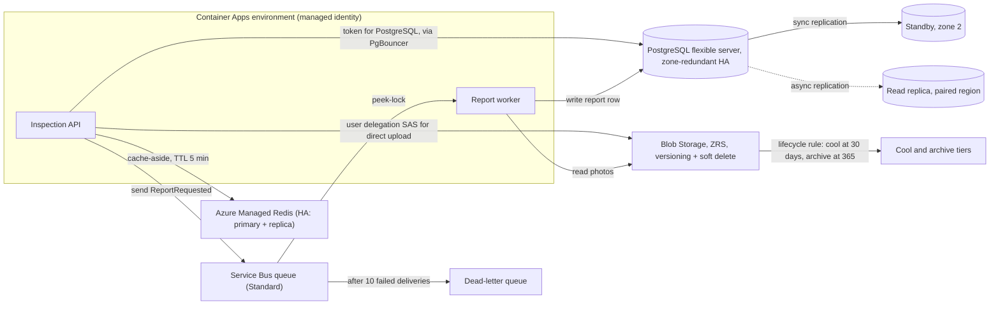
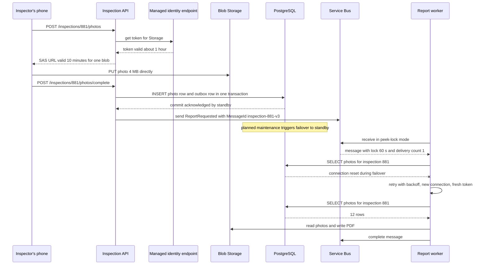

**WheelDeal** is a used-car marketplace. When someone wants to sell a car, an inspector visits their home, works through a 200-point checklist and takes about 40 photos, and buyers later see an inspection report with those photos. About 1,200 cars are inspected every day. Today it runs on one VM: PostgreSQL on the same disk as the photos, a cron job that emails the reports, and a Redis container nobody remembers starting. Moving to Azure, the team could install all of this again on VMs. Or it could rent each piece as a **managed service** and stop patching, backing up and failing over four different systems by hand. This lesson is about what each managed service really gives you, what it costs in money and in constraints, and what is still your job.

## Learning objectives

By the end of this lesson you will be able to:

1. Explain what Azure Database for PostgreSQL flexible server, Azure Managed Redis (and the Azure Cache for Redis service it replaces), Azure Service Bus and Azure Blob Storage each manage for you.
2. Choose a tier for each service from availability, feature and cost needs.
3. Describe how high availability and failover work for each, and what your app sees during a failover.
4. Connect from ASP.NET Core without passwords using managed identity, and explain why tokens must be refreshed.
5. Run free local equivalents (PostgreSQL, Redis, the Service Bus emulator and Azurite) in Docker Compose.
6. Design dependency health checks and abstractions that keep the app testable without cloud resources.

## Prerequisites

- [Azure App Service, Container Apps and AKS](#/lesson/m15-azure-compute): where the app runs.
- [Choosing and scaling the database tier](#/lesson/m11-database-architecture), [Redis data structures and use cases](#/lesson/m12-redis), [Message queues](#/lesson/m12-message-queues) and [Object storage](#/lesson/m11-object-storage): the concepts behind each service.

## Explain it like I'm a beginner

Think of four services you might use when you move into a new city:

- **A bank locker (PostgreSQL).** Your important records, carefully kept, with strict rules about who can open it. The bank handles the vault, guards and backups of the register. You decide what goes in and how it's organised.
- **A sticky note on the fridge (Redis).** Fast to read, holds a little, and if it falls off you can rewrite it from the real records. Never the only copy of anything that matters.
- **A courier company (Service Bus).** You hand over a parcel and get a receipt. The courier keeps trying to deliver; if the address keeps refusing, the parcel goes to a "return to sender" shelf (a dead-letter queue) instead of vanishing.
- **A warehouse (Blob Storage).** Huge, cheap, stores boxes of any size. Boxes you open daily sit near the door (hot tier); boxes you need once a year go to the back (cool and cold tiers) or to a deep basement where fetching takes hours (archive tier).

Each is a **managed service** (Platform as a Service, PaaS): Azure runs the servers, patching, replication and backups. You choose the size and the safety level (the **tier**), and you remain responsible for using it correctly.

## First-principles explanation

### What "managed" does and does not mean

A managed service takes over: provisioning, OS and engine patching, hardware failure, replication inside the service, backups (for databases), monitoring hooks and an SLA. It does **not** take over: your schema and queries, your connection handling, choosing the right tier and redundancy, testing restores, retry logic in your app, cost control, and access control design. Every managed service also has **planned maintenance**, which often means a brief failover. Your app will see dropped connections a few times a year by design, so it must reconnect and retry.

### Azure Database for PostgreSQL flexible server

The managed PostgreSQL service (the older "Single Server" offering has been retired; use flexible server). It runs community PostgreSQL, including PostgreSQL 17, with a curated list of extensions (PostGIS, pg_stat_statements, pgvector, pg_cron and more) that you enable through the `azure.extensions` server parameter.

**Compute tiers:**

| Tier | VM family | Use for |
|---|---|---|
| Burstable | B-series, CPU credits | Dev, test, small internal tools. Performance drops when credits run out. |
| General Purpose | D-series | Most production OLTP workloads. |
| Memory Optimized | E-series | Large working sets, heavy caching in shared buffers, analytics. |

Storage is provisioned separately (with optional auto-grow) and IOPS scale with storage size on Premium SSD, or can be set independently on newer storage options. `max_connections` depends on the compute size.

**High availability.** Optional. With **zone-redundant HA**, Azure keeps a standby server in another availability zone and replicates synchronously, so a committed transaction exists in both zones. If the primary fails, Azure promotes the standby and moves the DNS name; Microsoft documents typical failover times of one to two minutes. **Same-zone HA** keeps the standby in the same zone (protects against server failure, not zone failure). HA roughly doubles the compute cost, and the synchronous commit adds a small write latency. Your app sees connections drop and must reconnect: the hostname stays the same.

**Read replicas.** Asynchronous replicas (in the same or another region) for read scaling and regional DR. Replication lag applies ([Read replicas and replication lag](#/lesson/m09-replicas)). A replica can be promoted to a standalone server in a disaster.

**Backups.** Automatic, with point-in-time restore inside a retention window of 7 to 35 days, optionally geo-redundant. A restore creates a **new** server ([Backups, disaster recovery, RTO and RPO](#/lesson/m14-dr)).

**Built-in PgBouncer.** A connection pooler you can enable on the server, which matters as soon as many app replicas connect ([Database connection pooling](#/lesson/m09-connection-pooling)).

**Cost levers.** Burstable for non-production, stop/start for dev servers (a stopped server restarts automatically after 7 days), reserved capacity for steady production, and right-sizing from `pg_stat_statements` evidence instead of guessing.

### Azure Cache for Redis and Azure Managed Redis

A managed Redis. Use it for caching, sessions, rate-limit counters, distributed locks with fencing, and short-lived coordination.

| Tier (Azure Cache for Redis, existing estates) | What you get |
|---|---|
| Basic | One node, no replica, no SLA. Dev and test only. |
| Standard | Primary plus replica with automatic failover, SLA. |
| Premium | Standard plus clustering (sharding), persistence (RDB/AOF), virtual network injection, zone redundancy, geo-replication. |
| Enterprise, Enterprise Flash | Redis Enterprise features and modules (search, JSON, time series), active geo-replication. |

Microsoft now offers **Azure Managed Redis** (built on Redis Enterprise, with tiers named Memory Optimized, Balanced, Compute Optimized and Flash Optimized) as the successor service, and has announced the retirement of Azure Cache for Redis, including dates after which new caches can no longer be created. **For a new project, start on Azure Managed Redis**; treat the Azure Cache for Redis tiers above as what you will meet in existing systems and migrate from. Check the current retirement timeline on Microsoft Learn rather than relying on dates in a course. The design concepts below apply to both.

What matters for design:

- **Redis is not your source of truth.** Even with persistence, design every key so it can be rebuilt from PostgreSQL. Cache-aside with TTLs ([Cache-aside, read-through, write-through and write-behind](#/lesson/m12-cache-patterns)).
- **Failover blips.** With high availability on (Standard and above in Azure Cache for Redis; the default in Azure Managed Redis), patching and failures trigger a failover to the replica. Connections drop for seconds; writes in flight may be lost because replication is asynchronous. Clients must reconnect (StackExchange.Redis does) and callers must tolerate a cache miss or a timeout.
- **Memory is the limit.** Pick an eviction policy (`allkeys-lru` or `volatile-lru` for caches), alert on memory and evictions, and don't store 5 MB values.
- **TLS only.** Managed Redis enforces TLS by default; local Redis usually doesn't. Make TLS a configuration setting, not a code change.

### Azure Service Bus

A managed message broker for commands and events between services.

- **Queues**: one message, one consumer (competing consumers scale out).
- **Topics and subscriptions**: publish once, each subscription gets a copy, with optional filters (for example `region = 'south'`).
- **Peek-lock** (the default receive mode): the receiver gets the message plus a **lock** (default 1 minute, maximum 5 minutes, renewable). It must **complete** the message to remove it; **abandon** releases it for redelivery; if the lock expires, it is redelivered. Each delivery increases the **delivery count**; when it exceeds **max delivery count** (default 10) the message moves to the **dead-letter queue (DLQ)** with a reason. That is at-least-once delivery, so consumers must be idempotent ([Idempotent consumers and inbox deduplication](#/lesson/m12-idempotent-consumers)).
- **Duplicate detection**: the broker drops a message whose `MessageId` was seen within a configured window, which protects against a producer retrying a send.
- **Sessions**: ordered, one-at-a-time processing per session id (for example per car listing id), giving FIFO where you need it.
- **Scheduled messages and deferral**: deliver at a time, or set aside and fetch later by sequence number.
- **Transactions**: complete one message and send another atomically, within the same namespace.

| Tier | Highlights |
|---|---|
| Basic | Queues only, no topics, no sessions or transactions. Cheap, limited. |
| Standard | Queues and topics, shared capacity, billed per operation, message size up to 256 KB. Throughput can vary with neighbours. |
| Premium | Dedicated capacity in messaging units, predictable latency, larger messages (up to 100 MB), private networking, zone redundancy, geo-replication. |

Large payloads belong in Blob Storage with a reference in the message (the **claim-check** pattern), whatever the tier.

### Azure Blob Storage

Object storage inside a **storage account**: containers hold blobs (block blobs for files, append blobs for logs, page blobs for disks).

**Access tiers** trade storage price against access price:

| Tier | Storage price | Access price | Minimum stay before early-deletion charge | Read latency |
|---|---|---|---|---|
| Hot | Highest | Lowest | None | Milliseconds |
| Cool | Lower | Higher | 30 days | Milliseconds |
| Cold | Lower still | Higher still | 90 days | Milliseconds |
| Archive | Lowest | Highest, plus rehydration | 180 days | Hours (must rehydrate first) |

**Lifecycle management** rules move or delete blobs automatically, for example "move to cool 30 days after last access, to archive after 180, delete after 7 years".

**Redundancy** is chosen per account:

| Option | Copies | Survives |
|---|---|---|
| LRS | 3 in one data centre | Disk and rack failures |
| ZRS | 3 across availability zones | A zone outage |
| GRS / RA-GRS | LRS plus asynchronous copy to the paired region (RA = readable secondary) | A regional disaster, with some data loss possible |
| GZRS / RA-GZRS | ZRS plus asynchronous copy to the paired region | Zone and regional failures |

Microsoft publishes durability targets for each (from at least eleven nines for LRS upwards). Replication copies deletes and overwrites too, so protection against mistakes and ransomware comes from **soft delete, versioning and immutability policies**, not from redundancy.

**Access.** Prefer Microsoft Entra ID with role assignments (for example *Storage Blob Data Contributor*) and managed identity. For letting a browser upload or download directly, issue a short-lived **user delegation SAS** (shared access signature) for one blob: the **valet key** pattern, so files never pass through your API.

### Passwordless connections: managed identity

A **managed identity** is an identity Azure gives to your App Service, Container App or AKS workload. The app asks the platform for an **access token** for a target service (PostgreSQL, Storage, Service Bus, Redis), and the target checks the token and the role assignments. There is no password to leak, rotate or commit to Git.

Key mechanics:

- The app requests a token for a **scope**, such as `https://ossrdbms-aad.database.windows.net/.default` for PostgreSQL or `https://storage.azure.com/.default` for Storage.
- Tokens **expire** (typically after about an hour). SDKs refresh them automatically; for PostgreSQL, the token is used as the connection **password**, so your connection pool must fetch a fresh token for new physical connections.
- In development, the same code uses your developer login (`DefaultAzureCredential` tries environment, workload identity, managed identity, Visual Studio and Azure CLI credentials in order), or you switch to a local password-based setup.
- In production, Microsoft's own guidance is to prefer a **specific** credential (`ManagedIdentityCredential`, or a `ChainedTokenCredential` you control) over `DefaultAzureCredential`: probing several sources slows startup and can silently pick up an unexpected identity from an environment variable.

### Local equivalents, all free

| Azure service | Local stand-in in Docker | Differences to remember |
|---|---|---|
| PostgreSQL flexible server | `postgres:17` (add `postgis/postgis` if needed) | No Entra auth, no HA, no built-in PgBouncer unless you add a container |
| Azure Managed Redis / Cache for Redis | `redis:8` or `valkey/valkey` | No TLS by default, no failover unless you run Sentinel |
| Service Bus | The official **Azure Service Bus emulator** container (uses a SQL Server container for storage), configured from a JSON file | Local development only, no ARM management, limits differ from the cloud |
| Blob Storage | **Azurite** (`mcr.microsoft.com/azure-storage/azurite`), blob endpoint on port 10000 | Development account key, no tiers or lifecycle rules enforced like the cloud |

```yaml
services:
  db:
    image: postgres:17
    environment: { POSTGRES_PASSWORD: dev-only, POSTGRES_DB: inspections }
    ports: ["5432:5432"]
  cache:
    image: redis:8
    ports: ["6379:6379"]
  storage:
    image: mcr.microsoft.com/azure-storage/azurite
    command: azurite-blob --blobHost 0.0.0.0
    ports: ["10000:10000"]
  # Service Bus emulator: follow Microsoft's published compose file, which pairs the emulator
  # with a SQL Server container and mounts a Config.json declaring queues and topics.
```

The app reads `Storage:Mode = Local` and connects with the Azurite development connection string, or `Storage:Mode = ManagedIdentity` with an account URL in Azure. Same code, different configuration.

### When a simpler design is enough

A small internal tool doesn't need four services. PostgreSQL alone can hold a job queue (`SELECT ... FOR UPDATE SKIP LOCKED`), a small cache table, and even small files. Add Redis when measured latency or load demands it, Service Bus when you need fan-out, scheduled delivery or cross-team decoupling, and Blob Storage as soon as files exceed a few megabytes or grow without bound. Each extra managed service is another bill, another failure mode and another thing to monitor.

## Visual explanation

### Architecture: WheelDeal's inspection data tier



How to read it: every arrow from the compute box is authenticated with the apps' managed identity, so no passwords live in configuration. PostgreSQL has a synchronous standby in a second zone (no data loss on a zone failure) and an asynchronous read replica in the paired region (seconds of lag, used for DR and heavy reads). Redis sits beside the API as a cache that can be lost without losing data. Photos never flow through the API: it hands the phone a short-lived SAS URL and the phone uploads straight to Blob Storage. The API then sends a small `ReportRequested` message; the worker receives it with peek-lock, fetches the photos, writes the report and completes the message. Messages that keep failing land in the dead-letter queue for a human to inspect, rather than blocking the queue. Lifecycle rules move old photos to cheaper tiers automatically.

### Sequence: a photo upload and report, with a PostgreSQL failover in the middle



The phone uploads directly to storage with a single-blob SAS, so the API handles only small JSON requests. The photo row and an outbox row are written in one transaction, so a crash between "save" and "send" can't lose the report request ([Transactional outbox](#/lesson/m12-outbox)). The message carries a deterministic `MessageId`, so if the API retries the send, duplicate detection drops the copy. Mid-flow, a planned failover resets the worker's connection: the worker retries with backoff and opens a new connection to the *same hostname*, which now points to the promoted standby. Because the lock is still held (60 seconds), the message isn't redelivered meanwhile. If the worker had crashed instead, the lock would expire and another worker would get the message with delivery count 2, which is why report generation must be idempotent.

## Step-by-step example

### Step 1 — list each piece of data and its needs

| Data | Volume (estimate) | Needs | Service and tier |
|---|---|---|---|
| Inspections, checklist results, cars, users | 30 GB, 150 writes/s peak | Transactions, PostGIS, PITR, zone failure tolerance | PostgreSQL flexible server, General Purpose, zone-redundant HA |
| Make and model lists, listing-page aggregates | 2 GB | Fast reads, rebuildable | Azure Managed Redis (small Balanced tier, HA on) |
| Report requests | 40,000 per day | Retries, DLQ, duplicate detection | Service Bus Standard queue |
| Photos | 1,200 inspections/day × 40 photos × 4 MB ≈ 190 GB/day | Cheap, durable, direct upload, 7-year retention (disputes and regulatory records) | Blob Storage, ZRS, lifecycle tiers |

Photos dominate storage: 190 GB/day × 365 ≈ 70 TB per year. Tiering is not optional at this size: once a car is sold (usually within 30 days) almost nobody opens its photos.

### Step 2 — decide redundancy and HA from the failure you must survive

The business requirement is "a zone outage must not lose submitted inspections" (an inspector cannot go back to the seller's house to redo it). So: PostgreSQL zone-redundant HA (synchronous), Blob ZRS, Service Bus with zone redundancy where the tier supports it. For a regional disaster, the RPO of a few minutes is acceptable: a PostgreSQL read replica in the paired region and GZRS (or object replication) for photos.

### Step 3 — make everything passwordless

Enable managed identity on both container apps. Grant: the API *Storage Blob Data Contributor* on the photos container and *Azure Service Bus Data Sender* on the queue; the worker *Storage Blob Data Reader* and *Azure Service Bus Data Receiver*. Create PostgreSQL roles mapped to each identity with only the table privileges they need. Disable shared-key access on the storage account once nothing uses it.

### Step 4 — run it locally first

Start the Compose file from earlier. Configure the app with `Storage:Mode = Local`, `Postgres:UseEntraAuth = false` with a dev password, and the emulator's connection string for Service Bus. All integration tests run against these containers in CI, for free.

### Step 5 — add health checks that don't cause outages

Each dependency gets a cheap probe (a `SELECT 1`, a Redis `PING`, a blob container existence check). These go on a **`/health/deps`** endpoint that monitoring scrapes and alerts on. They do **not** go on the liveness probe, and only PostgreSQL (without which the API is useless) affects readiness, if at all.

### Step 6 — rehearse a failover

On a non-production server, trigger a forced failover of PostgreSQL and a Redis reboot during a load test. Measure errors and recovery time. The usual findings: a connection pool that keeps dead connections, missing retries on the worker, and a cache client that throws instead of falling back to the database.

## Production-style C# implementation

The app code keeps vendor SDKs at the edge behind small interfaces, validates configuration at startup, handles token-based passwords for PostgreSQL, and exposes dependency health on its own endpoint. Everything below compiles without Azure SDKs; the SDK wiring that replaces the fakes is shown after.

```text
Data.Platform/
  Program.cs
  Platform/DataOptions.cs
  Platform/AccessTokens.cs
  Platform/PostgresConnectionStrings.cs
  Platform/Storage.cs
  Platform/DependencyHealth.cs
```

```csharp file=Platform/DataOptions.cs
using Microsoft.Extensions.Options;

namespace Data.Platform;

public sealed class PostgresOptions
{
    public string Host { get; set; } = "localhost";
    public int Port { get; set; } = 5432;
    public string Database { get; set; } = "inspections";
    public string Username { get; set; } = "app";
    /// <summary>Only for local development. Must be empty when UseEntraAuth is true.</summary>
    public string? Password { get; set; }
    /// <summary>True in Azure: the password is a Microsoft Entra access token from the managed identity.</summary>
    public bool UseEntraAuth { get; set; }
    public string SslMode { get; set; } = "Require";
    public int MaxPoolSize { get; set; } = 15;
}

public enum StorageMode { Local, ManagedIdentity }

public sealed class StorageOptions
{
    public StorageMode Mode { get; set; } = StorageMode.Local;
    public string AccountUrl { get; set; } = "http://127.0.0.1:10000/devstoreaccount1";
    public string PhotosContainer { get; set; } = "photos";
    public TimeSpan UploadUrlLifetime { get; set; } = TimeSpan.FromMinutes(10);
}

public sealed class MessagingOptions
{
    /// <summary>Fully qualified namespace in Azure, e.g. inspections.servicebus.windows.net, or the emulator host.</summary>
    public string Namespace { get; set; } = "localhost";
    public string ReportQueue { get; set; } = "report-requests";
}

/// <summary>Fails startup with a clear message instead of failing the first request.</summary>
public sealed class PostgresOptionsValidator : IValidateOptions<PostgresOptions>
{
    public ValidateOptionsResult Validate(string? name, PostgresOptions o)
    {
        var errors = new List<string>();
        if (string.IsNullOrWhiteSpace(o.Host)) errors.Add("Postgres:Host is required.");
        if (o.MaxPoolSize is < 1 or > 100) errors.Add("Postgres:MaxPoolSize must be between 1 and 100.");
        if (o.UseEntraAuth && !string.IsNullOrEmpty(o.Password))
            errors.Add("Postgres:Password must be empty when UseEntraAuth is true. Remove the secret.");
        if (!o.UseEntraAuth && string.IsNullOrEmpty(o.Password))
            errors.Add("Postgres:Password is required when UseEntraAuth is false.");
        if (o.UseEntraAuth && !string.Equals(o.SslMode, "Require", StringComparison.OrdinalIgnoreCase)
                           && !string.Equals(o.SslMode, "VerifyFull", StringComparison.OrdinalIgnoreCase))
            errors.Add("Postgres:SslMode must be Require or VerifyFull when sending access tokens.");
        return errors.Count == 0 ? ValidateOptionsResult.Success : ValidateOptionsResult.Fail(errors);
    }
}
```

```csharp file=Platform/AccessTokens.cs
namespace Data.Platform;

public sealed record AccessToken(string Token, DateTimeOffset ExpiresOn);

/// <summary>Seam over the identity SDK. In Azure this wraps DefaultAzureCredential or ManagedIdentityCredential.</summary>
public interface IAccessTokenSource
{
    ValueTask<AccessToken> GetTokenAsync(string scope, CancellationToken cancellationToken);
}

public static class TokenScopes
{
    public const string PostgreSql = "https://ossrdbms-aad.database.windows.net/.default";
    public const string Storage = "https://storage.azure.com/.default";
    public const string ServiceBus = "https://servicebus.azure.net/.default";
    public const string Redis = "https://redis.azure.com/.default";
}

/// <summary>Caches a token per scope and refreshes it a margin before expiry, so a request never
/// starts with a token that expires halfway through opening a connection.</summary>
public sealed class CachingTokenSource(IAccessTokenSource inner, TimeProvider time) : IAccessTokenSource
{
    private static readonly TimeSpan RefreshMargin = TimeSpan.FromMinutes(5);
    private readonly Dictionary<string, AccessToken> _cache = new(StringComparer.Ordinal);
    private readonly SemaphoreSlim _gate = new(1, 1);

    public async ValueTask<AccessToken> GetTokenAsync(string scope, CancellationToken cancellationToken)
    {
        await _gate.WaitAsync(cancellationToken);
        try
        {
            if (_cache.TryGetValue(scope, out var cached) && cached.ExpiresOn - time.GetUtcNow() > RefreshMargin)
                return cached;

            var fresh = await inner.GetTokenAsync(scope, cancellationToken);
            _cache[scope] = fresh;
            return fresh;
        }
        finally
        {
            _gate.Release();
        }
    }
}

/// <summary>Local development stand-in: issues a fake token so the code path runs without Azure.</summary>
public sealed class DevelopmentTokenSource(TimeProvider time) : IAccessTokenSource
{
    public ValueTask<AccessToken> GetTokenAsync(string scope, CancellationToken cancellationToken) =>
        ValueTask.FromResult(new AccessToken($"dev-token-for-{scope}", time.GetUtcNow().AddHours(1)));
}
```

```csharp file=Platform/PostgresConnectionStrings.cs
using System.Text;
using Microsoft.Extensions.Options;

namespace Data.Platform;

/// <summary>Builds the connection string for each new physical connection. With Entra auth the
/// password is a short-lived token, so it must be fetched per connection open, not once at startup.</summary>
public sealed class PostgresConnectionStrings(IOptions<PostgresOptions> options, IAccessTokenSource tokens)
{
    public async ValueTask<string> BuildAsync(CancellationToken cancellationToken)
    {
        var o = options.Value;
        var password = o.UseEntraAuth
            ? (await tokens.GetTokenAsync(TokenScopes.PostgreSql, cancellationToken)).Token
            : o.Password!;

        var sb = new StringBuilder();
        Append(sb, "Host", o.Host);
        Append(sb, "Port", o.Port.ToString(System.Globalization.CultureInfo.InvariantCulture));
        Append(sb, "Database", o.Database);
        Append(sb, "Username", o.Username);
        Append(sb, "Password", password);
        Append(sb, "SSL Mode", o.SslMode);
        Append(sb, "Maximum Pool Size", o.MaxPoolSize.ToString(System.Globalization.CultureInfo.InvariantCulture));
        return sb.ToString();
    }

    /// <summary>For logs: never print the password or token.</summary>
    public string Describe() =>
        $"Host={options.Value.Host};Database={options.Value.Database};Username={options.Value.Username};Auth={(options.Value.UseEntraAuth ? "Entra" : "Password")}";

    private static void Append(StringBuilder sb, string key, string value)
    {
        // Quote values that contain separators, as connection-string parsers expect.
        var needsQuotes = value.Contains(';') || value.Contains('=') || value.Contains('"');
        sb.Append(key).Append('=')
          .Append(needsQuotes ? "\"" + value.Replace("\"", "\"\"") + "\"" : value)
          .Append(';');
    }
}
```

```csharp file=Platform/Storage.cs
using System.Collections.Concurrent;
using Microsoft.Extensions.Options;

namespace Data.Platform;

public sealed record UploadTicket(Uri UploadUrl, string BlobName, DateTimeOffset ExpiresAt);

public interface IPhotoStore
{
    /// <summary>Returns a short-lived URL that allows writing exactly one blob (valet key).</summary>
    ValueTask<UploadTicket> CreateUploadTicketAsync(long inspectionId, string fileName, CancellationToken cancellationToken);
    ValueTask<bool> ExistsAsync(string blobName, CancellationToken cancellationToken);
}

public sealed record OutgoingMessage(string MessageId, string Subject, string Body);

public interface IMessageSender
{
    ValueTask SendAsync(string queue, OutgoingMessage message, CancellationToken cancellationToken);
}

/// <summary>In-memory stand-in used in tests and when no emulator is running.</summary>
public sealed class InMemoryPhotoStore(IOptions<StorageOptions> options, TimeProvider time) : IPhotoStore
{
    private readonly ConcurrentDictionary<string, byte[]> _blobs = new();

    public ValueTask<UploadTicket> CreateUploadTicketAsync(long inspectionId, string fileName, CancellationToken cancellationToken)
    {
        var safeName = Path.GetFileName(fileName);
        if (string.IsNullOrWhiteSpace(safeName)) throw new ArgumentException("A file name is required.", nameof(fileName));
        var blobName = $"inspections/{inspectionId}/{Guid.NewGuid():N}-{safeName}";
        var expires = time.GetUtcNow() + options.Value.UploadUrlLifetime;
        var url = new Uri($"{options.Value.AccountUrl.TrimEnd('/')}/{options.Value.PhotosContainer}/{blobName}?fake-sas=1");
        return ValueTask.FromResult(new UploadTicket(url, blobName, expires));
    }

    public void SimulateUpload(string blobName, byte[] content) => _blobs[blobName] = content;

    public ValueTask<bool> ExistsAsync(string blobName, CancellationToken cancellationToken) =>
        ValueTask.FromResult(_blobs.ContainsKey(blobName));
}

public sealed class InMemoryMessageSender : IMessageSender
{
    private readonly ConcurrentDictionary<string, OutgoingMessage> _sent = new();

    /// <summary>Mimics broker duplicate detection: the same MessageId is stored once.</summary>
    public ValueTask SendAsync(string queue, OutgoingMessage message, CancellationToken cancellationToken)
    {
        _sent.TryAdd($"{queue}/{message.MessageId}", message);
        return ValueTask.CompletedTask;
    }

    public IReadOnlyCollection<OutgoingMessage> Sent => _sent.Values.ToArray();
}
```

```csharp file=Platform/DependencyHealth.cs
using Microsoft.Extensions.Diagnostics.HealthChecks;

namespace Data.Platform;

/// <summary>One cheap probe per dependency: SELECT 1, PING, container exists.</summary>
public interface IDependencyProbe
{
    string Name { get; }
    bool Critical { get; }
    Task ProbeAsync(CancellationToken cancellationToken);
}

/// <summary>Turns a probe into a health check with a timeout, so a hung dependency reports
/// Unhealthy quickly instead of hanging the health endpoint.</summary>
public sealed class ProbeHealthCheck(IDependencyProbe probe, TimeSpan timeout) : IHealthCheck
{
    public async Task<HealthCheckResult> CheckHealthAsync(HealthCheckContext context, CancellationToken cancellationToken = default)
    {
        using var cts = CancellationTokenSource.CreateLinkedTokenSource(cancellationToken);
        cts.CancelAfter(timeout);
        var started = System.Diagnostics.Stopwatch.GetTimestamp();
        try
        {
            await probe.ProbeAsync(cts.Token);
            var ms = System.Diagnostics.Stopwatch.GetElapsedTime(started).TotalMilliseconds;
            return HealthCheckResult.Healthy($"{probe.Name} answered in {ms:F0} ms.");
        }
        catch (OperationCanceledException) when (!cancellationToken.IsCancellationRequested)
        {
            return Fail($"{probe.Name} did not answer within {timeout.TotalMilliseconds:F0} ms.");
        }
        catch (Exception ex)
        {
            return Fail($"{probe.Name} failed: {ex.GetType().Name}.");
        }
    }

    // Non-critical dependencies (the cache) report Degraded so the app keeps serving from the database.
    private HealthCheckResult Fail(string message) =>
        probe.Critical ? HealthCheckResult.Unhealthy(message) : HealthCheckResult.Degraded(message);
}

/// <summary>Development probe that always succeeds. Replace with real probes per dependency.</summary>
public sealed class AlwaysUpProbe(string name, bool critical) : IDependencyProbe
{
    public string Name => name;
    public bool Critical => critical;
    public Task ProbeAsync(CancellationToken cancellationToken) => Task.CompletedTask;
}
```

```csharp file=Program.cs
using Microsoft.Extensions.Diagnostics.HealthChecks;
using Data.Platform;
using Microsoft.AspNetCore.Diagnostics.HealthChecks;
using Microsoft.Extensions.Options;

var builder = WebApplication.CreateBuilder(args);

builder.Services.AddOptions<PostgresOptions>().Bind(builder.Configuration.GetSection("Postgres")).ValidateOnStart();
builder.Services.AddSingleton<IValidateOptions<PostgresOptions>, PostgresOptionsValidator>();
builder.Services.AddOptions<StorageOptions>().Bind(builder.Configuration.GetSection("Storage"));
builder.Services.AddOptions<MessagingOptions>().Bind(builder.Configuration.GetSection("Messaging"));

builder.Services.AddSingleton(TimeProvider.System);
// In Azure, register an adapter over Azure.Identity's DefaultAzureCredential here instead.
builder.Services.AddSingleton<DevelopmentTokenSource>();
builder.Services.AddSingleton<IAccessTokenSource>(sp =>
    new CachingTokenSource(sp.GetRequiredService<DevelopmentTokenSource>(), sp.GetRequiredService<TimeProvider>()));
builder.Services.AddSingleton<PostgresConnectionStrings>();

builder.Services.AddSingleton<InMemoryPhotoStore>();
builder.Services.AddSingleton<IPhotoStore>(sp => sp.GetRequiredService<InMemoryPhotoStore>());
builder.Services.AddSingleton<IMessageSender, InMemoryMessageSender>();

var probeTimeout = TimeSpan.FromSeconds(2);
builder.Services.AddHealthChecks()
    .Add(new HealthCheckRegistration("postgres", _ => new ProbeHealthCheck(new AlwaysUpProbe("postgres", critical: true), probeTimeout), null, ["deps"]))
    .Add(new HealthCheckRegistration("redis", _ => new ProbeHealthCheck(new AlwaysUpProbe("redis", critical: false), probeTimeout), null, ["deps"]))
    .Add(new HealthCheckRegistration("blob", _ => new ProbeHealthCheck(new AlwaysUpProbe("blob", critical: true), probeTimeout), null, ["deps"]));

var app = builder.Build();

app.Logger.LogInformation("PostgreSQL target: {Target}", app.Services.GetRequiredService<PostgresConnectionStrings>().Describe());

// Monitoring and dashboards scrape this. It is NOT the liveness probe.
app.MapHealthChecks("/health/deps", new HealthCheckOptions { Predicate = r => r.Tags.Contains("deps") });

app.MapPost("/inspections/{id:long}/photos", async (long id, string fileName, IPhotoStore store, CancellationToken ct) =>
    Results.Ok(await store.CreateUploadTicketAsync(id, fileName, ct)));

app.MapPost("/inspections/{id:long}/photos/complete", async (long id, string blobName, int version,
    IPhotoStore store, IMessageSender sender, IOptions<MessagingOptions> messaging, CancellationToken ct) =>
{
    // The blob name comes from the client: make sure it belongs to this inspection before trusting it.
    if (!blobName.StartsWith($"inspections/{id}/", StringComparison.Ordinal)) return Results.BadRequest("Blob does not belong to this inspection.");
    if (!await store.ExistsAsync(blobName, ct)) return Results.BadRequest("Upload not found.");
    // In production: insert the photo row and an outbox row in one PostgreSQL transaction,
    // and let an outbox relay send this message. Sent directly here to keep the sample small.
    var message = new OutgoingMessage($"inspection-{id}-v{version}", "ReportRequested", $"{{\"inspectionId\":{id}}}");
    await sender.SendAsync(messaging.Value.ReportQueue, message, ct);
    return Results.Accepted();
});

app.Run();
```

Wiring the real SDKs (these packages are not part of the compiled sample):

```csharp
// Azure.Identity: one credential for every service, managed identity in Azure, developer login locally.
var credential = new DefaultAzureCredential();

// Npgsql: fetch a fresh Entra token periodically and use it as the password for new connections.
var dsb = new NpgsqlDataSourceBuilder($"Host={pg.Host};Database={pg.Database};Username={pg.Username};SSL Mode=Require");
dsb.UsePeriodicPasswordProvider(async (_, ct) =>
    (await credential.GetTokenAsync(new TokenRequestContext([TokenScopes.PostgreSql]), ct)).Token,
    successRefreshInterval: TimeSpan.FromMinutes(30), failureRefreshInterval: TimeSpan.FromSeconds(10));
await using var dataSource = dsb.Build();

// Blob Storage and Service Bus SDKs accept the credential directly and refresh tokens themselves.
var blobs = new BlobServiceClient(new Uri(storage.AccountUrl), credential);
await using var bus = new ServiceBusClient(messaging.Namespace, credential);
```

Design notes:

- **Configuration decides the environment.** Local Docker, CI and Azure run the same code; only `Postgres:UseEntraAuth`, `Storage:Mode` and endpoints change. The validator refuses a mixed setup (a token mode *and* a leftover password).
- **Tokens are passwords with a clock.** The caching source refreshes 5 minutes early; for PostgreSQL the token is read when a new physical connection opens, so long-lived pooled connections are unaffected by expiry.
- **Valet key for files.** The API never streams 4 MB photos. It issues single-blob, short-lived upload URLs.
- **Dependency health is for humans and dashboards.** `/health/deps` uses timeouts and reports the cache as *Degraded*, not *Unhealthy*, because the app works (slower) without it.

## Bad design vs good design

**Bad**: "managed means safe".

```text
- PostgreSQL Burstable B2s in production "because it's managed", no HA, 7-day backups, never restored
- Redis Basic tier holding user sessions and the only copy of half-filled inspection checklists
- Service Bus queue consumer uses receive-and-delete, so a crash loses the message
- Photos uploaded through the API into a Hot-tier LRS account, no versioning, kept forever
- Connection strings with account keys in appsettings.json, committed to Git
```

What goes wrong: Burstable credits run out at month-end and queries slow tenfold. Basic Redis restarts during patching and inspectors lose half-filled checklists while standing next to the car. A worker crash silently drops reports. Storage reaches 70 TB of Hot LRS in a year, paying top price for photos nobody opens, with no protection from an accidental container delete. A leaked key gives full access to every blob.

**Good**: General Purpose PostgreSQL with zone-redundant HA, PgBouncer and tested PITR; Redis with HA (Azure Managed Redis, or Standard on an existing Cache for Redis) used only for rebuildable data; Service Bus peek-lock with idempotent consumers, duplicate detection and DLQ monitoring; direct-to-blob uploads with SAS, ZRS, versioning, soft delete and lifecycle tiering; managed identity everywhere and shared keys disabled.

:::callout type=warning title="Redundancy is not backup"
ZRS, GRS and HA replicas copy deletes, overwrites and corrupt writes as faithfully as good data. Soft delete, versioning, immutability and point-in-time restore are what let you undo a mistake.
:::

:::callout type=tradeoff title="Premium tiers buy predictability"
Standard Service Bus and lower Redis tiers share capacity and are cheaper. Premium tiers cost more but give dedicated capacity, private networking and zone redundancy. Pay for Premium when a noisy neighbour or a missing network feature would break a requirement, not by default.
:::

## Practical playground

The canvas shows WheelDeal's inspection platform lifted onto one VM's worth of services: the API writes photos to the database and uses one Redis for everything. Improve it:

1. Move photos to object storage with direct uploads. What does the API return to the phone?
2. Add a queue between the API and a report worker, and a dead-letter path.
3. Mark which nodes need zone redundancy to meet "a zone outage must not lose submitted inspections".
4. Decide which data in Redis is safe to lose, and move anything that isn't.
5. Add a read replica only if you can name the reads it serves.

:::playground type=hld title="Give WheelDeal's inspection platform a managed data tier"
```json
{
  "nodes": [
    { "id": "phones", "type": "client", "label": "Inspectors' phones", "props": { "rps": 150 } },
    { "id": "api", "type": "app-server", "label": "Inspection API", "props": { "instances": 2 } },
    { "id": "pg", "type": "database", "label": "PostgreSQL (photos stored as bytea)", "props": { "replicas": 0 } },
    { "id": "redis", "type": "cache", "label": "Redis Basic: sessions, drafts, cache", "props": { "ttlSeconds": 0 } }
  ],
  "edges": [
    { "from": "phones", "to": "api", "kind": "sync", "label": "4 MB photo uploads" },
    { "from": "api", "to": "pg", "kind": "sync" },
    { "from": "api", "to": "redis", "kind": "sync" }
  ]
}
```
:::

## Exercises

:::exercise id=m15-azure-data-ex1 difficulty=beginner kind=code title="Choose a blob access tier without paying early-deletion charges"
Write the rule a lifecycle review tool uses to suggest a tier for each blob.
::requirements
- `BlobTierAdvisor.Choose(int daysSinceLastAccess, int daysUntilDeletion, bool needsImmediateRead)` returns `AccessTier.Hot`, `Cool`, `Cold` or `Archive`.
- Negative arguments throw `ArgumentOutOfRangeException`.
- Accessed within the last 30 days → `Hot`.
- Otherwise `Archive` when the blob doesn't need immediate reads, hasn't been accessed for at least 180 days, and will be kept at least 180 more days.
- Otherwise `Cold` when not accessed for at least 90 days and kept at least 90 more days.
- Otherwise `Cool` when it will be kept at least 30 more days.
- Otherwise `Hot` (moving it would only trigger an early-deletion charge).
::acceptance
- A photo opened yesterday stays Hot.
- A 2-year-old contract kept for 5 more years, rarely read and never urgently, goes to Archive.
- The same contract with `needsImmediateRead = true` goes to Cold.
- A blob to be deleted in 10 days stays Hot even if untouched for a year.
::hint
Each colder tier has a minimum stay: 30, 90 and 180 days. Moving a blob that will be deleted sooner costs more, not less.
::hint
Check the rules from the coldest tier down, after the "recently used" rule.
::hint
Archive needs hours to read. `needsImmediateRead` rules it out.
::hint
```csharp
if (daysSinceLastAccess < 30) return AccessTier.Hot;
if (!needsImmediateRead && daysSinceLastAccess >= 180 && daysUntilDeletion >= 180) return AccessTier.Archive;
```
::starter
```csharp file=BlobTierAdvisor.cs
using System;

public enum AccessTier { Hot, Cool, Cold, Archive }

public static class BlobTierAdvisor
{
    public static AccessTier Choose(int daysSinceLastAccess, int daysUntilDeletion, bool needsImmediateRead) =>
        throw new NotImplementedException();
}
```
::tests
```csharp file=BlobTierAdvisorTests.cs
using System;
using Xunit;

public class BlobTierAdvisorTests
{
    [Fact] public void Recent_stays_hot() => Assert.Equal(AccessTier.Hot, BlobTierAdvisor.Choose(1, 3000, false));
    [Fact] public void Old_long_lived_goes_archive() => Assert.Equal(AccessTier.Archive, BlobTierAdvisor.Choose(730, 1825, false));
    [Fact] public void Immediate_read_blocks_archive() => Assert.Equal(AccessTier.Cold, BlobTierAdvisor.Choose(730, 1825, true));
    [Fact] public void Short_remaining_life_stays_hot() => Assert.Equal(AccessTier.Hot, BlobTierAdvisor.Choose(365, 10, false));
    [Fact] public void Forty_days_unused_is_cool() => Assert.Equal(AccessTier.Cool, BlobTierAdvisor.Choose(40, 400, false));
    [Fact] public void Old_but_deleted_in_100_days_is_cold() => Assert.Equal(AccessTier.Cold, BlobTierAdvisor.Choose(400, 100, false));
    [Fact] public void Boundary_30_days_is_cool() => Assert.Equal(AccessTier.Cool, BlobTierAdvisor.Choose(30, 30, false));
    [Fact] public void Negative_throws() => Assert.Throws<ArgumentOutOfRangeException>(() => BlobTierAdvisor.Choose(-1, 10, false));
}
```
::solution
```csharp file=BlobTierAdvisor.cs
using System;

public enum AccessTier { Hot, Cool, Cold, Archive }

public static class BlobTierAdvisor
{
    public static AccessTier Choose(int daysSinceLastAccess, int daysUntilDeletion, bool needsImmediateRead)
    {
        if (daysSinceLastAccess < 0) throw new ArgumentOutOfRangeException(nameof(daysSinceLastAccess));
        if (daysUntilDeletion < 0) throw new ArgumentOutOfRangeException(nameof(daysUntilDeletion));

        if (daysSinceLastAccess < 30) return AccessTier.Hot;
        if (!needsImmediateRead && daysSinceLastAccess >= 180 && daysUntilDeletion >= 180) return AccessTier.Archive;
        if (daysSinceLastAccess >= 90 && daysUntilDeletion >= 90) return AccessTier.Cold;
        if (daysUntilDeletion >= 30) return AccessTier.Cool;
        return AccessTier.Hot;
    }
}
```

The two inputs pull in opposite directions: *how cold is the data* (days since last access) and *how long will it stay* (days until deletion). A cold tier only saves money if the blob stays long enough to beat the minimum-stay charge. In Azure you'd express the same idea as lifecycle management rules using `daysAfterLastAccessTimeGreaterThan` (with last-access tracking enabled) and a delete rule.
::mistakes
- Moving short-lived blobs to colder tiers and paying early-deletion charges.
- Sending documents that support urgent legal requests to Archive, where reads take hours.
- Using days since *creation* when access patterns are what matter.
::extensions
Add `averageReadsPerMonth` and an estimated monthly cost per tier (rates as inputs), and choose the cheapest tier rather than following fixed rules.
:::

:::exercise id=m15-azure-data-ex2 difficulty=beginner kind=written title="Match needs to services and tiers"
For each need, name the service and tier (or configuration) you'd choose, and one thing that is still your responsibility.

1. A GST e-invoice reconciliation job must process each invoice message exactly once in effect, even if the worker crashes mid-way.
2. A fantasy-cricket app needs sub-millisecond reads of contest leaderboards that are recomputed every 5 minutes.
3. Car inspection photos must survive an availability-zone outage and an accidental `DELETE` of a container by an administrator.
4. An online auction site's database must not lose any committed bid if a zone fails, and must restore to any second in the last 30 days.
5. A dev environment for four developers should cost as little as possible.
::acceptance
- Each answer names a concrete tier or setting, not just a service.
- Answer 1 mentions peek-lock, idempotency and the DLQ.
- Answer 3 distinguishes redundancy from soft delete or versioning.
- Answer 5 uses local containers or the cheapest tiers with stop/start.
::hint
"Exactly once in effect" = at-least-once delivery + idempotent handling.
::hint
Which feature protects against a zone, and which against a person?
::hint
For PostgreSQL, HA and PITR solve different problems. You need both here.
::solution
1. **Service Bus Standard queue, peek-lock, duplicate detection on, max delivery count 10.** Your job: an idempotent handler (record processed invoice ids in PostgreSQL in the same transaction as the effect), completing the message only after commit, and alerting on DLQ depth.
2. **Azure Managed Redis with HA (or Azure Cache for Redis Standard on an existing estate), cache-aside with a 5-minute TTL**, recomputed by a scheduled job. Your job: treat Redis as rebuildable, handle failover blips by falling back to PostgreSQL, and alert on evictions.
3. **Blob Storage with ZRS** for the zone, plus **container soft delete, blob soft delete and versioning** for the human mistake (and an immutability policy if regulation demands it). Your job: set retention periods, use least-privilege roles, and test restoring a deleted container.
4. **PostgreSQL flexible server, General Purpose, zone-redundant HA, backup retention 30–35 days** (geo-redundant backup if regional DR matters). Your job: test PITR restores, handle reconnects in the app, and size `max_connections` and PgBouncer.
5. **Docker Compose locally** (postgres:17, redis:8, Azurite, the Service Bus emulator), plus at most one shared Burstable PostgreSQL server that is stopped out of hours. Your job: keep configuration identical in shape to production so nothing works only in dev.
::mistakes
- Saying "Service Bus guarantees exactly-once processing".
- Using GRS alone as protection against deletes.
- Choosing Basic Redis for anything with an SLA.
:::

:::exercise id=m15-azure-data-ex3 difficulty=intermediate kind=code title="Model peek-lock delivery and dead-lettering"
Build an in-memory queue with Service Bus-like peek-lock semantics, for use in tests of consumers.
::requirements
- `PeekLockQueue(int maxDeliveryCount, TimeSpan duplicateWindow, Func<DateTimeOffset> clock)`.
- `bool Send(string messageId, string body)`: returns false and stores nothing if the same `messageId` was sent within `duplicateWindow` (measured from the first send).
- `LockedMessage? Receive(TimeSpan lockDuration)`: returns the oldest available message (never delivered, abandoned, or with an expired lock), increments its `DeliveryCount`, assigns a new `LockToken` (`Guid`) and a lock expiring at `now + lockDuration`. Returns null if none is available.
- Before delivering, if a message's `DeliveryCount` has already reached `maxDeliveryCount`, move it to the dead-letter list with reason `"MaxDeliveryCountExceeded"` and try the next message.
- `bool Complete(Guid lockToken)`: removes the message if the token is the current, unexpired lock; otherwise false (the lock was lost).
- `bool Abandon(Guid lockToken)`: releases the lock immediately if valid, otherwise false.
- `IReadOnlyList<DeadLetter> DeadLetters` and `int ActiveCount` (messages not completed and not dead-lettered).
::acceptance
- A message received and completed is gone.
- An expired lock makes the message available again with a higher delivery count, and the old token can't complete it.
- With max delivery count 3, the fourth receive attempt dead-letters the message.
- Duplicate sends inside the window are dropped; after the window they're accepted.
::hint
Keep a list of entries in send order with fields: id, body, delivery count, current lock token and lock expiry.
::hint
"Available" = no lock token, or lock expiry ≤ now.
::hint
A lock token is valid only if it equals the entry's current token *and* the lock hasn't expired.
::hint
Store `messageId → first sent time` for duplicate detection, separate from the live entries.
::hint
```csharp
foreach (var e in _entries.ToList())
{
    if (e.LockToken is not null && e.LockedUntil > now) continue;
    if (e.DeliveryCount >= _max) { _entries.Remove(e); _dead.Add(...); continue; }
    // lock and return
}
```
::starter
```csharp file=PeekLockQueue.cs
using System;
using System.Collections.Generic;

public sealed record LockedMessage(string MessageId, string Body, int DeliveryCount, Guid LockToken, DateTimeOffset LockedUntil);
public sealed record DeadLetter(string MessageId, string Body, string Reason);

public sealed class PeekLockQueue
{
    public PeekLockQueue(int maxDeliveryCount, TimeSpan duplicateWindow, Func<DateTimeOffset> clock) => throw new NotImplementedException();

    public bool Send(string messageId, string body) => throw new NotImplementedException();
    public LockedMessage? Receive(TimeSpan lockDuration) => throw new NotImplementedException();
    public bool Complete(Guid lockToken) => throw new NotImplementedException();
    public bool Abandon(Guid lockToken) => throw new NotImplementedException();
    public IReadOnlyList<DeadLetter> DeadLetters => throw new NotImplementedException();
    public int ActiveCount => throw new NotImplementedException();
}
```
::tests
```csharp file=PeekLockQueueTests.cs
using System;
using Xunit;

public class PeekLockQueueTests
{
    private DateTimeOffset _now = new(2026, 10, 1, 9, 0, 0, TimeSpan.FromHours(5.5));
    private PeekLockQueue NewQueue(int max = 3) => new(max, TimeSpan.FromMinutes(10), () => _now);
    private static readonly TimeSpan Lock = TimeSpan.FromSeconds(60);

    [Fact]
    public void Complete_removes_message()
    {
        var q = NewQueue();
        Assert.True(q.Send("inv-1", "{}"));
        var m = q.Receive(Lock)!;
        Assert.Equal(1, m.DeliveryCount);
        Assert.True(q.Complete(m.LockToken));
        Assert.Equal(0, q.ActiveCount);
        Assert.Null(q.Receive(Lock));
    }

    [Fact]
    public void Locked_message_is_invisible_until_lock_expires()
    {
        var q = NewQueue();
        q.Send("inv-1", "{}");
        var first = q.Receive(Lock)!;
        Assert.Null(q.Receive(Lock));
        _now = _now.AddSeconds(61);
        var second = q.Receive(Lock)!;
        Assert.Equal(2, second.DeliveryCount);
        Assert.False(q.Complete(first.LockToken));
        Assert.True(q.Complete(second.LockToken));
    }

    [Fact]
    public void Abandon_releases_immediately()
    {
        var q = NewQueue();
        q.Send("inv-1", "{}");
        var m = q.Receive(Lock)!;
        Assert.True(q.Abandon(m.LockToken));
        Assert.False(q.Abandon(m.LockToken));
        Assert.Equal(2, q.Receive(Lock)!.DeliveryCount);
    }

    [Fact]
    public void Dead_letters_after_max_deliveries()
    {
        var q = NewQueue(max: 3);
        q.Send("poison", "bad");
        for (var i = 0; i < 3; i++) q.Abandon(q.Receive(Lock)!.LockToken);
        Assert.Null(q.Receive(Lock));
        var dl = Assert.Single(q.DeadLetters);
        Assert.Equal("poison", dl.MessageId);
        Assert.Equal("MaxDeliveryCountExceeded", dl.Reason);
        Assert.Equal(0, q.ActiveCount);
    }

    [Fact]
    public void Poison_message_does_not_block_the_next_one()
    {
        var q = NewQueue(max: 1);
        q.Send("poison", "bad");
        q.Send("good", "ok");
        q.Abandon(q.Receive(Lock)!.LockToken);
        var next = q.Receive(Lock)!;
        Assert.Equal("good", next.MessageId);
        Assert.Single(q.DeadLetters);
    }

    [Fact]
    public void Duplicate_detection_window()
    {
        var q = NewQueue();
        Assert.True(q.Send("inv-9", "a"));
        _now = _now.AddMinutes(5);
        Assert.False(q.Send("inv-9", "a"));
        Assert.Equal(1, q.ActiveCount);
        _now = _now.AddMinutes(6);
        Assert.True(q.Send("inv-9", "a"));
        Assert.Equal(2, q.ActiveCount);
    }
}
```
::solution
```csharp file=PeekLockQueue.cs
using System;
using System.Collections.Generic;
using System.Linq;

public sealed record LockedMessage(string MessageId, string Body, int DeliveryCount, Guid LockToken, DateTimeOffset LockedUntil);
public sealed record DeadLetter(string MessageId, string Body, string Reason);

public sealed class PeekLockQueue
{
    private sealed class Entry
    {
        public required string MessageId { get; init; }
        public required string Body { get; init; }
        public int DeliveryCount { get; set; }
        public Guid? LockToken { get; set; }
        public DateTimeOffset LockedUntil { get; set; }
    }

    private readonly int _maxDeliveryCount;
    private readonly TimeSpan _duplicateWindow;
    private readonly Func<DateTimeOffset> _clock;
    private readonly List<Entry> _entries = new();
    private readonly List<DeadLetter> _deadLetters = new();
    private readonly Dictionary<string, DateTimeOffset> _firstSent = new(StringComparer.Ordinal);

    public PeekLockQueue(int maxDeliveryCount, TimeSpan duplicateWindow, Func<DateTimeOffset> clock)
    {
        if (maxDeliveryCount < 1) throw new ArgumentOutOfRangeException(nameof(maxDeliveryCount));
        _maxDeliveryCount = maxDeliveryCount;
        _duplicateWindow = duplicateWindow;
        _clock = clock;
    }

    public bool Send(string messageId, string body)
    {
        var now = _clock();
        if (_firstSent.TryGetValue(messageId, out var first) && now - first < _duplicateWindow) return false;
        _firstSent[messageId] = now;
        _entries.Add(new Entry { MessageId = messageId, Body = body });
        return true;
    }

    public LockedMessage? Receive(TimeSpan lockDuration)
    {
        var now = _clock();
        foreach (var e in _entries.ToList())
        {
            if (e.LockToken is not null && e.LockedUntil > now) continue;
            if (e.DeliveryCount >= _maxDeliveryCount)
            {
                _entries.Remove(e);
                _deadLetters.Add(new DeadLetter(e.MessageId, e.Body, "MaxDeliveryCountExceeded"));
                continue;
            }
            e.DeliveryCount++;
            e.LockToken = Guid.NewGuid();
            e.LockedUntil = now + lockDuration;
            return new LockedMessage(e.MessageId, e.Body, e.DeliveryCount, e.LockToken.Value, e.LockedUntil);
        }
        return null;
    }

    public bool Complete(Guid lockToken)
    {
        var e = FindValid(lockToken);
        if (e is null) return false;
        _entries.Remove(e);
        return true;
    }

    public bool Abandon(Guid lockToken)
    {
        var e = FindValid(lockToken);
        if (e is null) return false;
        e.LockToken = null;
        return true;
    }

    public IReadOnlyList<DeadLetter> DeadLetters => _deadLetters;
    public int ActiveCount => _entries.Count;

    private Entry? FindValid(Guid lockToken)
    {
        var now = _clock();
        return _entries.FirstOrDefault(e => e.LockToken == lockToken && e.LockedUntil > now);
    }
}
```

The key behaviours are the ones that bite in production. A lock that expires while your handler is still working means another consumer gets the same message, and your `Complete` fails with "lock lost": keep handlers shorter than the lock or renew it, and make them idempotent. A poison message that always throws is retried `maxDeliveryCount` times and then moved aside, so it can't block the queue. Duplicate detection only works if the producer sets a deterministic `MessageId` (for example `inspection-881-v3`), not a random GUID per attempt.
::alternatives
Use this fake behind an `IMessageReceiver` interface in consumer tests. For integration tests, run the Service Bus emulator in Docker; it behaves like the real broker for these semantics.
::mistakes
- Letting a stale lock token complete a message that has been redelivered to someone else.
- Dead-lettering on the Nth failure instead of before the (N+1)th delivery, or the reverse, and getting off-by-one counts.
- Checking duplicates against live entries only, so a completed message can be re-sent within the window.
::extensions
Add `RenewLock(Guid lockToken, TimeSpan extension)` and sessions: messages with the same session id are delivered one at a time, in order.
:::

:::exercise id=m15-azure-data-ex4 difficulty=intermediate kind=sql ordered=true title="Find photos that should leave the Hot tier"
A nightly blob inventory is loaded into `blob_inventory`. As of `2026-10-20`, find, per container, the **Hot**-tier blobs whose `last_accessed` is more than 30 days earlier (before `2026-09-20`). Return `container`, `blobs_to_move` and `gb_to_move` (sum of `size_bytes` ÷ 1,000,000,000, rounded to 2 decimals). Order by `gb_to_move` descending, then `container`.
::acceptance
- Only Hot-tier blobs are counted.
- The 30-day cut-off is applied to `last_accessed`, not `created_at`.
- Containers with nothing to move don't appear.
::hint
Filter first (`WHERE tier = 'Hot' AND last_accessed < ...`), then `GROUP BY container`.
::hint
`date '2026-10-20' - 30` gives `2026-09-20` in PostgreSQL.
::hint
`round(sum(size_bytes) / 1e9, 2)` keeps the result numeric with two decimals.
::setup
```sql
CREATE TABLE blob_inventory (
  container text NOT NULL,
  name text NOT NULL,
  size_bytes bigint NOT NULL,
  tier text NOT NULL,
  created_at date NOT NULL,
  last_accessed date NOT NULL,
  PRIMARY KEY (container, name)
);
INSERT INTO blob_inventory
SELECT 'photos', 'p' || g, 4000000, 'Hot', date '2026-01-01' + (g % 280), date '2026-01-01' + (g % 290)
FROM generate_series(1, 5000) AS g;
INSERT INTO blob_inventory
SELECT 'reports', 'r' || g, 250000, CASE WHEN g % 4 = 0 THEN 'Cool' ELSE 'Hot' END,
       date '2026-03-01' + (g % 200), date '2026-03-01' + (g % 230)
FROM generate_series(1, 2000) AS g;
INSERT INTO blob_inventory
SELECT 'exports', 'e' || g, 90000000, 'Hot', date '2026-10-01', date '2026-10-15'
FROM generate_series(1, 30) AS g;
INSERT INTO blob_inventory
SELECT 'contracts', 'c' || g, 1500000, 'Cold', date '2024-01-01', date '2025-01-01'
FROM generate_series(1, 400) AS g;
```
::check
```sql
SELECT container,
       count(*) AS blobs_to_move,
       round(sum(size_bytes) / 1e9, 2) AS gb_to_move
FROM blob_inventory
WHERE tier = 'Hot'
  AND last_accessed < date '2026-10-20' - 30
GROUP BY container
ORDER BY gb_to_move DESC, container;
```
::solution
```sql
SELECT container,
       count(*) AS blobs_to_move,
       round(sum(size_bytes) / 1e9, 2) AS gb_to_move
FROM blob_inventory
WHERE tier = 'Hot'
  AND last_accessed < date '2026-10-20' - 30
GROUP BY container
ORDER BY gb_to_move DESC, container;
```

`photos` dominates: thousands of 4 MB photos untouched for more than a month. `reports` contributes a little (only its Hot blobs count), `exports` was accessed recently, and `contracts` is already Cold. This is exactly the evidence you need before writing a lifecycle rule ("move to Cool when not accessed for 30 days"): it shows the saving is real and which containers the rule should target. Azure's blob inventory feature can export this data to a storage container on a schedule.
::mistakes
- Filtering on `created_at`, which moves recently viewed old photos.
- Forgetting the tier filter and counting blobs already in Cool or Cold.
- Using integer division and losing the decimals.
:::

:::exercise id=m15-azure-data-ex5 difficulty=advanced kind=hld title="Design the data tier for a university admissions portal"
A state university's admissions portal runs admissions for 3,000 programmes across its affiliated colleges. During the final hour before the main application deadline, about 4,000 applicants upload documents (mark sheets, certificates, a portfolio; average 25 MB each) and submit their applications. Requirements: no submitted application may be lost even in a zone failure; application documents must be immutable for 10 years; applicants must see a submission receipt within 5 seconds; email and SMS notifications can lag by minutes; and the team must be able to develop and test without an Azure subscription.

Design the data tier: services, tiers, redundancy, HA, how uploads flow, how notifications flow, and the local development setup. Include capacity arithmetic for the closing hour.
::acceptance
- Upload volume and rate for the closing hour are calculated.
- Documents bypass the API using SAS, with immutability and versioning.
- PostgreSQL configuration meets "no committed application lost in a zone failure".
- Notifications use a queue with retries, DLQ and idempotent consumers.
- Redis use (if any) is limited to rebuildable data.
- A Docker-based local setup is described.
::hint
4,000 × 25 MB in one hour: how many GB, and how many MB/s on average? What if half of it arrives in the last 10 minutes?
::hint
A receipt within 5 seconds should depend only on PostgreSQL and storage, not on the notification path.
::hint
Immutability for 10 years is a storage policy (WORM), not an application promise.
::hint
Think about what the API stores in the database for each document: name, size, SHA-256, blob version id.
::starter
```json
{
  "nodes": [
    { "id": "applicants", "type": "client", "label": "Applicants", "props": { "rps": 400 } },
    { "id": "api", "type": "app-server", "label": "Admissions API", "props": { "instances": 4 } },
    { "id": "pg", "type": "database", "label": "PostgreSQL", "props": { "replicas": 0 } },
    { "id": "files", "type": "object-storage", "label": "Application documents" }
  ],
  "edges": [
    { "from": "applicants", "to": "api", "kind": "sync", "label": "upload 25 MB documents" },
    { "from": "api", "to": "files", "kind": "sync" },
    { "from": "api", "to": "pg", "kind": "sync" }
  ]
}
```
::solution
```json
{
  "nodes": [
    { "id": "applicants", "type": "client", "label": "Applicants", "props": { "rps": 400 } },
    { "id": "api", "type": "app-server", "label": "Admissions API (managed identity)", "props": { "instances": 4, "multiAz": true } },
    { "id": "files", "type": "object-storage", "label": "Blob Storage GZRS: versioning, 10-year immutability policy, direct SAS uploads", "props": { "multiAz": true } },
    { "id": "pg", "type": "database", "label": "PostgreSQL flexible server, General Purpose, zone-redundant HA, PITR 35 days", "props": { "replicas": 1, "multiAz": true } },
    { "id": "bouncer", "type": "app-server", "label": "Built-in PgBouncer" },
    { "id": "relay", "type": "worker", "label": "Outbox relay", "props": { "instances": 1 } },
    { "id": "bus", "type": "queue", "label": "Service Bus Premium: topic application-submitted, duplicate detection" },
    { "id": "notify", "type": "worker", "label": "Email and SMS workers (idempotent, DLQ alerts)", "props": { "instances": 2 } },
    { "id": "cache", "type": "cache", "label": "Redis: programme listings cache only", "props": { "ttlSeconds": 60 } },
    { "id": "mon", "type": "monitoring", "label": "Upload errors, DLQ depth, PG failover events" }
  ],
  "edges": [
    { "from": "applicants", "to": "api", "kind": "sync", "label": "request SAS, submit application" },
    { "from": "applicants", "to": "files", "kind": "sync", "label": "PUT documents with SAS" },
    { "from": "api", "to": "files", "kind": "sync", "label": "verify size, hash, version id" },
    { "from": "api", "to": "bouncer", "kind": "sync" },
    { "from": "bouncer", "to": "pg", "kind": "sync", "label": "application + outbox in one transaction" },
    { "from": "api", "to": "cache", "kind": "sync" },
    { "from": "relay", "to": "pg", "kind": "sync", "label": "read outbox" },
    { "from": "relay", "to": "bus", "kind": "async" },
    { "from": "bus", "to": "notify", "kind": "async", "label": "peek-lock" },
    { "from": "bus", "to": "mon", "kind": "async" },
    { "from": "pg", "to": "mon", "kind": "async" }
  ]
}
```

**Capacity.** 4,000 applicants × 25 MB = 100,000 MB ≈ **100 GB** in the hour. Average: 100,000 MB ÷ 3,600 s ≈ 28 MB/s. If half arrives in the last 10 minutes: 50,000 MB ÷ 600 s ≈ **83 MB/s**, around 670 Mbit/s. Pushed through 4 API instances that is a lot of memory, threads and egress. Uploaded directly to Blob Storage with SAS, it is well within what a storage account handles (check the current scalability targets), and the API only handles small JSON calls.

**Upload flow.** The API issues one SAS per document (write-only, 15 minutes, one blob name). The applicant's browser uploads directly, computing SHA-256 as it goes, and the API verifies the blob's size and content hash, records the blob **version id**, and only then accepts the application. The container has versioning on and a **time-based immutability policy** (10 years, locked), so neither university staff nor an attacker can alter or delete a submitted document.

**Application submission.** The application row, document references and an outbox row are written in **one transaction** on PostgreSQL with **zone-redundant HA**: the commit is acknowledged only after the standby in another zone has it, so a zone failure loses nothing committed. The receipt (application number, timestamp, document hashes) is returned immediately, well within 5 seconds, because it depends only on PostgreSQL and the hash check. PgBouncer keeps connections under control when the API scales out.

**Notifications.** The outbox relay publishes `ApplicationSubmitted` with `MessageId = application-{id}` to a Service Bus topic (duplicate detection on). Email and SMS subscriptions are processed by idempotent workers with peek-lock; failures retry and finally dead-letter, and DLQ depth pages someone. Premium is justified by the closing-hour burst and private networking; Standard would work for a smaller university.

**Redis.** Only for programme listing pages (60-second TTL). Never for applications or sessions that matter.

**Local development.** Docker Compose with `postgres:17`, Azurite (SAS uploads work against it), the Service Bus emulator with a `Config.json` declaring the topic and subscriptions, and `redis:8`. The same code runs with `Storage:Mode = Local` and password auth. Integration tests in CI use the same Compose file.
::mistakes
- Uploading 100 GB through the API instances.
- Relying on application code to "not delete" documents instead of an immutability policy.
- Making the application receipt wait for email delivery.
- Using Redis to hold submitted applications "for speed".
:::

## Automated testing

**Unit tests with fakes.** `InMemoryPhotoStore`, `InMemoryMessageSender` and the `PeekLockQueue` from exercise 3 let you test handlers and endpoints without any service. Test token caching with a fake `TimeProvider`:

```csharp
[Fact]
public async Task Token_is_refreshed_five_minutes_before_expiry()
{
    var time = new ManualTime(new DateTimeOffset(2026, 10, 20, 9, 0, 0, TimeSpan.Zero));
    var inner = new CountingTokenSource(time, lifetime: TimeSpan.FromMinutes(60));
    var source = new CachingTokenSource(inner, time);

    await source.GetTokenAsync(TokenScopes.PostgreSql, default);
    time.Advance(TimeSpan.FromMinutes(50));
    await source.GetTokenAsync(TokenScopes.PostgreSql, default);
    Assert.Equal(1, inner.Calls);   // 10 minutes left: still cached

    time.Advance(TimeSpan.FromMinutes(6));
    await source.GetTokenAsync(TokenScopes.PostgreSql, default);
    Assert.Equal(2, inner.Calls);   // 4 minutes left: refreshed
}
```

**Options validation tests.** Assert that `UseEntraAuth = true` with a password fails startup, so a leftover secret can't sneak into production configuration.

**Integration tests against containers.** In CI, start the Compose file (or use Testcontainers) and run real queries, real blob uploads to Azurite and real sends to the Service Bus emulator. These catch SQL errors, serialisation issues and permission mistakes that fakes can't.

**Failure tests.** Kill the PostgreSQL container mid-test and assert the worker retries and completes; stop Redis and assert the API still answers (slower) from the database; send a poison message and assert it reaches the DLQ after the configured deliveries.

**Cloud smoke tests.** After each deployment, a small job uses the app's managed identity to run `SELECT 1`, write and delete a test blob, and send a message to a test queue, proving role assignments are correct.

## Real-world application

- **Managed PostgreSQL** is a common default for line-of-business systems on Azure: teams trade some control (superuser access, arbitrary extensions) for automatic backups, HA and patching.
- **Redis as a cache in front of PostgreSQL** is standard in read-heavy portals: dashboards, listing pages and session-like data that can be rebuilt.
- **Service Bus** is often the backbone for enterprise integration on Azure, for example ERP-to-portal messages, payment notifications and document-processing pipelines, where dead-lettering and duplicate detection matter more than raw throughput.
- **Blob Storage with lifecycle policies** holds large media archives (drone imagery, CCTV, scanned documents), where tiering often decides whether the storage bill is affordable.
- **Regulated sectors** (government records, finance, healthcare, education) rely on immutability policies and Entra-based access with audit logs rather than shared keys.

## Interview questions

:::interview
::q beginner
What does a managed database service do for you, and what is still your job?
::a
It provisions servers, patches the OS and engine, takes automatic backups with point-in-time restore, offers HA with automatic failover and read replicas, and exposes metrics. Still your job: schema and query design, indexing, choosing tier and HA options, connection pooling and reconnect logic, testing restores, access control, and cost. You also accept constraints such as no superuser and an approved extension list.
::q beginner
What is the difference between LRS, ZRS and GRS in Blob Storage?
::a
LRS keeps three copies in one data centre, surviving disk and rack failures. ZRS keeps three copies across availability zones in a region, surviving a zone outage. GRS adds an asynchronous copy in the paired region (readable with RA-GRS), surviving a regional disaster with possible loss of the most recent writes. GZRS combines ZRS and geo-replication. None of them protects against deletes or overwrites, which are replicated too; that needs soft delete, versioning or immutability.
::q intermediate
Explain peek-lock in Service Bus and what can go wrong with it.
::a
The receiver gets the message with a time-limited lock; it must complete it to delete it, or abandon it to release it. If the lock expires, the message is redelivered and the delivery count increases; after max delivery count it goes to the dead-letter queue. Problems: a handler slower than the lock duration causes duplicate processing and a "lock lost" error on complete, so keep work short, renew locks or use a longer duration; delivery is at-least-once so handlers must be idempotent; poison messages need DLQ monitoring and a replay process.
::q intermediate
How does your app connect to Azure PostgreSQL without a password, and what is the catch?
::a
Enable a managed identity on the app, create a PostgreSQL role mapped to that identity and grant it privileges, and at connect time request a Microsoft Entra token for the PostgreSQL scope and send it as the password over TLS. The catch is that tokens expire (around an hour), so the pool must fetch a fresh token for new physical connections, for example with Npgsql's periodic password provider. Locally, use the developer's login through `DefaultAzureCredential` or a password-based local container, chosen by configuration.
::q advanced
During a planned maintenance failover of PostgreSQL and Redis, users see errors for about a minute. How would you reduce the impact?
::a
Accept that failovers happen and make them boring. App: retry transient connection errors with backoff and jitter on idempotent operations; make the pool discard broken connections; keep the same hostname (never cache IPs); for Redis, fall back to the database on timeouts with a short timeout so requests don't hang. Platform: use zone-redundant HA, schedule maintenance windows for low-traffic hours and get notifications in advance. Design: move non-urgent writes to a queue so they wait instead of failing; make readiness not depend on Redis. Verify with forced-failover drills in non-production during load tests and measure the error count.
::q advanced
Your blob storage bill doubled in six months. How do you investigate and fix it?
::a
Break the bill down: capacity per tier, transactions, data retrieval, egress, geo-replication and early-deletion charges. Use blob inventory reports to find large containers, Hot data not accessed for weeks, old versions and soft-deleted data piling up. Fixes: lifecycle rules (Cool after 30 days without access, Cold or Archive later, delete versions after N days), shorter soft-delete retention where allowed, compressing or resizing images at upload, a CDN for public downloads to reduce egress, and checking whether GZRS is needed for every container or only for irreplaceable data. Watch for side effects: early-deletion charges and retrieval fees if archived data turns out to be read often.
:::

## Summary and revision

**Key takeaways**

- Managed services take over servers, patching, replication and backups, not your design, your retries or your restore tests.
- PostgreSQL flexible server: pick Burstable only for non-production; zone-redundant HA for no-loss zone failover; read replicas for reads and DR; PITR 7–35 days; built-in PgBouncer.
- Redis: cache and rebuildable data only; Standard or higher for an SLA; handle failover blips; Azure Managed Redis is the successor and the default for new projects.
- Service Bus: peek-lock, delivery count, DLQ, duplicate detection, sessions; at-least-once means idempotent consumers; Premium for dedicated capacity and private networking.
- Blob Storage: tiers trade storage price against access price and minimum stay; redundancy (LRS to GZRS) is not backup; use SAS for direct uploads and lifecycle rules for cost.
- Managed identity removes secrets; tokens expire, so pools must refresh them.
- Everything runs locally for free: postgres, redis, the Service Bus emulator and Azurite in Docker Compose.

**Terminology**: flexible server, Burstable, General Purpose, Memory Optimized, zone-redundant HA, read replica, PITR, PgBouncer, Azure Managed Redis, eviction policy, peek-lock, lock duration, delivery count, dead-letter queue, duplicate detection, session, claim check, access tier, early deletion, lifecycle management, LRS, ZRS, GRS, GZRS, soft delete, versioning, immutability, SAS, user delegation SAS, managed identity, Azurite.

:::flashcards
Q: What does zone-redundant HA give Azure PostgreSQL flexible server?
A: A synchronous standby in another availability zone with automatic failover, so committed transactions survive a zone failure. Expect about a minute or two of reconnects.
Q: Why must Redis data be rebuildable?
A: Failovers, evictions and restarts can lose keys. Redis is a cache or coordination store, not the source of truth.
Q: What happens when a Service Bus message exceeds max delivery count?
A: It moves to the dead-letter queue with a reason, so it no longer blocks the queue.
Q: What makes Service Bus duplicate detection work?
A: A deterministic MessageId set by the producer, so a retried send carries the same id within the detection window.
Q: Hot, Cool, Cold, Archive minimum stays?
A: None, 30 days, 90 days, 180 days. Archive also needs rehydration (hours) before reading.
Q: Does GRS protect against an accidental delete?
A: No. The delete is replicated. Use soft delete, versioning or immutability policies.
Q: Why refresh Entra tokens for PostgreSQL connections?
A: The token is the password and expires after about an hour, so new physical connections need a fresh one.
Q: Local stand-ins for the four services?
A: postgres:17, redis:8 (or Valkey), the Azure Service Bus emulator, and Azurite for Blob Storage.
:::

## Knowledge check

:::quiz pass=70
::q single
Production PostgreSQL slows down tenfold every month-end and recovers afterwards. It runs on a Burstable tier. What is the most likely cause?
- [ ] Too many read replicas.
- [x] CPU credits run out under sustained load, throttling the server.
- [ ] Zone-redundant HA adds latency only at month-end.
- [ ] PgBouncer is enabled.
> Burstable servers accumulate credits when idle and are throttled when they run out. Use General Purpose for production.
::q single
A worker's handler takes 90 seconds, the queue's lock duration is 60 seconds. What happens?
- [ ] The broker extends the lock automatically in every SDK and mode.
- [x] The lock expires, another worker receives the same message, and the first worker's complete fails with a lost lock.
- [ ] The message goes straight to the dead-letter queue.
- [ ] Nothing, locks are only advisory.
> Keep handlers shorter than the lock, renew the lock (SDK processors can auto-renew), and make handlers idempotent.
::q multi
Which protect car inspection photos from an administrator accidentally deleting the container? (Select all that apply.)
- [x] Container soft delete.
- [ ] GZRS redundancy.
- [x] Blob versioning and soft delete.
- [x] A locked immutability policy where regulation allows.
- [ ] Moving photos to the Cool tier.
> Redundancy copies the delete. Soft delete, versioning and immutability keep recoverable or undeletable copies.
::q single
Inspectors upload 4 MB photos through the API, which then writes them to Blob Storage. What is the better design?
- [ ] Increase API instance count.
- [x] Return a short-lived, single-blob SAS so the phone uploads directly, then confirm with a small API call.
- [ ] Store photos in Redis first.
- [ ] Use Service Bus messages to carry the photos.
> The valet key pattern removes large payloads from the API path. Messages and caches are the wrong place for 4 MB files.
::q single
A message with a random new GUID as MessageId is sent twice because the producer retried after a timeout. Duplicate detection is on. What happens?
- [ ] The broker drops the second copy.
- [x] Both copies are accepted, because their MessageIds differ.
- [ ] The second copy is dead-lettered.
- [ ] The sender gets an error.
> Duplicate detection matches on MessageId. Use a deterministic id such as inspection-881-v3.
::q single
Which statement about running these services locally is true?
- [ ] There is no way to develop without an Azure subscription.
- [x] Azurite, the Service Bus emulator, postgres and redis containers let you run the full app locally, with configuration choosing endpoints and auth.
- [ ] Azurite enforces lifecycle rules exactly like Azure.
- [ ] Managed identity works locally inside Docker by default.
> Local stand-ins cover the APIs, not every cloud behaviour. Auth and endpoints switch through configuration.
::q single
Your Redis cache (with HA) fails over during patching. What should the API do?
- [ ] Return 500 until Redis is back.
- [x] Use a short timeout, fall back to PostgreSQL for reads, and let the client reconnect.
- [ ] Mark itself not live so it gets restarted.
- [ ] Switch to an in-memory cache permanently.
> A cache outage should make things slower, not broken. Liveness must not depend on Redis.
:::

## Completion criteria

You have finished this lesson when you can:

- [ ] Score at least 70 % on the knowledge check.
- [ ] Complete exercises 1 and 3 with all tests passing.
- [ ] Write the lifecycle query in exercise 4 and explain the rule it justifies.
- [ ] Defend the admissions-portal data tier in exercise 5, including capacity arithmetic.
- [ ] Run PostgreSQL, Redis, Azurite and the Service Bus emulator locally and point the app at them by configuration only.
