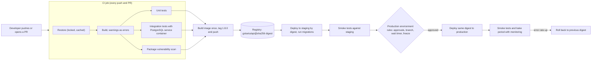
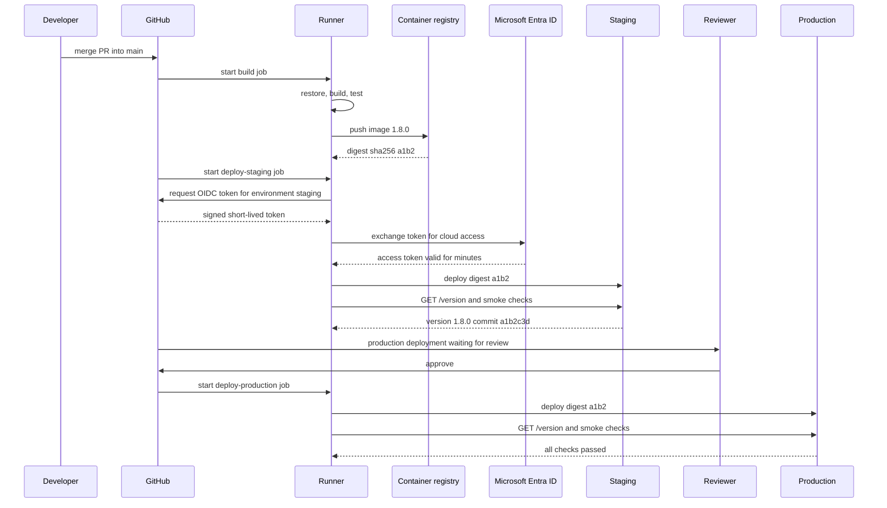

**GSTSetu** is an ASP.NET Core API that reconciles small businesses' purchase invoices with the GST portal's data. Four developers ship to it. Today, "deploying" means Rakesh right-clicks **Publish** in Visual Studio on his laptop on Friday evening, copies the folder to the server, and edits `appsettings.json` there by hand. Last month he published a build with an uncommitted debug flag, and nobody could say which commit was running in production. Tests exist, but only run when someone remembers. This lesson replaces that ritual with a pipeline: every commit is built and tested by a machine, exactly one artifact is produced, and that same artifact moves through staging to production with recorded approvals.

## Learning objectives

By the end of this lesson you will be able to:

1. Explain continuous integration, continuous delivery and continuous deployment, and what each one demands from a team.
2. Read and write a GitHub Actions workflow and an Azure Pipelines YAML file with build, test, artifact and deployment stages.
3. Apply "build once, deploy many": produce one immutable, versioned artifact and promote it, by digest, through environments.
4. Configure environments with approvals, branch rules, wait timers and freeze windows, and explain who can bypass them.
5. Authenticate pipelines to the cloud with short-lived OIDC tokens instead of stored keys, and keep secrets out of logs.
6. Add app-side support for pipelines in ASP.NET Core: an embedded version, a `/version` endpoint and a post-deployment smoke test.
7. Run a complete pipeline with no paid cloud account, using a self-hosted runner and Docker Compose as the "server".

## Prerequisites

- [Development, testing, staging and production](#/lesson/m15-environments): the pipeline is what moves code between those environments.
- [Docker, Dockerfiles and Docker Compose](#/lesson/m15-docker): the artifact in this lesson is a container image.
- [Unit testing and debugging fundamentals](#/lesson/m01-testing-debugging): a pipeline is only as good as the tests it runs.

## Explain it like I'm a beginner

Think of a busy restaurant kitchen. A cook who tastes every dish only at the end of the night discovers on Saturday that the dal was too salty since Tuesday. A good kitchen tastes each dish **as it is made**, and has a fixed pass where every plate is checked before a waiter carries it out.

- **Continuous integration (CI)** is tasting every dish as it's made. Every time someone pushes code, a machine fetches it, compiles it and runs the tests within minutes. If it breaks, the person who broke it hears about it while the change is still fresh in their head.
- **Continuous delivery (CD)** is the pass. Every change that survives CI becomes a packaged, ready-to-serve dish (an **artifact**), and moving it to customers is one approved button press, not a manual project.
- **Continuous deployment** goes one step further: no button. Every change that passes all checks goes to production automatically.

A **pipeline** is the written recipe for all of this, stored as a YAML file in the same Git repository as the code (pipeline as code). **GitHub Actions** and **Azure DevOps Pipelines** are two popular kitchens that read such recipes and run them on machines called **runners** (GitHub's word) or **agents** (Azure DevOps' word).

## First-principles explanation

### What problem CI actually solves

Merging is cheap when changes are small and recent, and painful when they are big and old. If four developers each work for two weeks on a separate branch, the merge on day 14 combines four large, untested-together changes. CI's rule is: integrate into the main branch **at least daily**, and have a machine verify every integration. The machine matters because it is impartial: it has no stale `bin` folder, no locally installed SDK preview and no forgotten environment variable. If the build passes on a clean runner, it does not depend on anyone's laptop.

A CI build that takes 40 minutes is ignored, so speed is part of the design. A useful target for an API like GSTSetu (an estimate, not a benchmark): restore, build and unit tests in under 5 minutes, integration tests in under 10.

### Delivery versus deployment

| Practice | Every green commit becomes... | Production release is... | Needs |
|---|---|---|---|
| Continuous integration | Built and tested | Manual, separate process | Automated tests, short-lived branches |
| Continuous delivery | A release candidate artifact, deployed to staging | One approved click | Everything above, plus automated deployment and environment parity |
| Continuous deployment | Released to production | Automatic | Everything above, plus strong automated tests, monitoring and fast rollback or feature flags |

Most regulated teams (banking, tax, government) practise continuous delivery with a human approval before production. That is not a failure to "do DevOps"; it is a deliberate control. The important part is that the approval is **recorded** and the thing being approved is **exactly** what was tested.

### Anatomy of a pipeline

Both tools share the same building blocks with slightly different names:

| Concept | GitHub Actions | Azure Pipelines |
|---|---|---|
| Pipeline file | `.github/workflows/*.yml` (a **workflow**) | `azure-pipelines.yml` |
| What starts it | `on:` (push, pull_request, schedule, workflow_dispatch) | `trigger:`, `pr:`, `schedules:` |
| Group of jobs | (workflow level) | `stages:` |
| Unit of work on one machine | `jobs:` | `jobs:` |
| One command or action | `steps:` (`run:` or `uses:`) | `steps:` (`script:` or `task:`) |
| Machine | runner (`runs-on:`) | agent (`pool:`) |
| Ordering | `needs:` | `dependsOn:` |
| Reusable logic | actions, reusable workflows | templates (`template:`, `extends:`) |
| Files passed between jobs | `actions/upload-artifact`, `download-artifact` | `PublishPipelineArtifact`, `DownloadPipelineArtifact` |
| Deployment target with rules | `environment:` | `environment:` on a `deployment` job |

Each **job** runs on a fresh machine (for hosted runners), so jobs share nothing except what you explicitly pass as artifacts or outputs. Jobs without dependencies run **in parallel**; that is how you keep the total time down.

### Build once, deploy many

The single most important CD rule: **build the artifact once, then promote that same artifact** from staging to production. Never rebuild for production. A rebuild can pick up a different base image, a newer NuGet patch, or a different commit if someone pushed in between. Then what you tested is not what you shipped.

For a container-based app the artifact is an image, identified by an immutable **digest** (`sha256:...`). For a non-container app (IIS, App Service zip deploy) it is a zip of `dotnet publish` output, stored as a pipeline artifact with a checksum. Configuration that differs between environments (connection strings, feature flags, URLs) is injected at deploy time, never compiled in.

### Versioning the artifact

Every artifact needs a version a human can read and a link back to its source. A common scheme:

- `1.8.0` for releases from `main`, from a Git tag or computed from commit messages ([Conventional Commits](https://www.conventionalcommits.org/): `feat:` bumps the minor version, `fix:` the patch, `!` or `BREAKING CHANGE:` the major).
- `1.8.0-feature-e-invoice.57` for builds from other branches (a pre-release suffix with the branch and build number).
- The full commit SHA as metadata, embedded into the app so `/version` can answer "what is running?" in one request.

### Tests in the pipeline: what runs where

A practical layering for GSTSetu:

1. **On every pull request**: restore with a lock file, build with warnings as errors, unit tests, integration tests against a throwaway PostgreSQL **service container**, a vulnerability scan of NuGet packages (`dotnet list package --vulnerable`), and a container build (not pushed).
2. **On merge to `main`**: everything above, then push the image to the registry with its version tag and record its digest.
3. **After deploying to staging**: database migrations, smoke tests (a handful of HTTP calls against the real deployment) and optionally a short load test.
4. **After deploying to production**: the same smoke tests, then monitoring watches error rate and latency for a bake period.

GitHub Actions **service containers** (`services:` on a job) and Azure Pipelines **service containers** (`services:` on a container job) start a PostgreSQL container next to the job, so integration tests use the real database engine with no cloud cost.

### Environments, approvals and checks

An **environment** is a named deployment target (`staging`, `production`) that carries protection rules. Rules are configured in the tool's settings, not in the YAML, so a developer cannot remove them in a pull request:

- **Required reviewers or approvals**: named people or groups must approve. GitHub can additionally **prevent self-review**, so the person who triggered the run cannot approve it.
- **Branch rules**: only `main` or `release/*` may deploy to production.
- **Wait timer**: a delay (for example 15 minutes) after staging before production may start, so alerts have time to fire.
- **Business-hour or freeze windows**: Azure Pipelines has a business-hours check; teams often add a freeze calendar (no releases during Diwali sales or year-end GST filing) via a custom check or a gate job.
- **Other checks** (Azure Pipelines): query Azure Monitor alerts, call a REST API, require an exclusive lock so two runs never deploy to the same environment at once.

Approvals are also an audit trail: who approved which version, when. For a government or banking client that record is often a compliance requirement.

### Secrets and cloud authentication

The pipeline needs credentials to push images and deploy. The old way stored a long-lived service principal secret in the CI tool's secret store. If it leaks (printed in a log, exfiltrated by a malicious third-party action) it works until someone notices.

The modern way is **workload identity federation (OIDC)**. The CI system issues a short-lived signed token that says "this is repository `gstsetu/api`, branch `main`, environment `production`". Azure (Microsoft Entra ID) is configured to trust tokens with exactly those claims and exchanges them for a cloud access token valid for minutes. No secret is stored anywhere. Both GitHub Actions (`permissions: id-token: write` plus `azure/login`) and Azure DevOps (service connections using workload identity federation) support it.

For the secrets the *application* needs (database passwords, API keys), the pipeline should not carry them at all. The app reads them at runtime from a secret store (Azure Key Vault via managed identity, or Docker secrets / environment files on a local host). See [secure secret management](#/lesson/m14-passwords-secrets).

Pipeline hygiene rules:

- Give the workflow token the **least permissions** it needs (`permissions: contents: read` by default).
- **Pin third-party actions to a full commit SHA**, not a moving tag like `@v4`. A compromised tag can run code with your secrets. First-party actions from `actions/` are lower risk but pinning still helps reproducibility.
- Never echo secrets. Both tools mask registered secrets in logs, but masking fails on transformed values (a base64-encoded secret is not masked).
- Pull requests from forks do not receive secrets by default. Do not work around this with `pull_request_target` plus a checkout of the fork's code; that is a well-known way to leak secrets.

### Pipeline speed: what breaks first

As the team grows, the pipeline usually degrades in this order:

1. **Queue time**: not enough runners or parallel jobs, so builds wait. Fix: more parallelism, or self-hosted runners.
2. **Restore time**: every job downloads all NuGet packages. Fix: cache `~/.nuget/packages` keyed on the hash of `packages.lock.json`, and restore in `--locked-mode` so the cache key is meaningful.
3. **Slow integration tests**: serial tests against one database. Fix: run test projects in parallel jobs, use a fresh schema per test class, keep slow end-to-end tests to a small smoke set.
4. **Flaky tests**: a test that fails 2 % of the time fails a 20-test-suite pipeline far more often if many tests are flaky. With 10 independent 2 % flaky tests, the chance a run is clean is 0.98^10 ≈ 82 %, so roughly one run in five fails for no reason. Quarantine and fix flaky tests aggressively; retries hide them.

A rough estimate for GSTSetu: 25 pushes a day × 8 minutes = 200 runner-minutes a day, around 4,400 a month for 22 working days. That fits inside many free or low tiers for hosted runners, but check your provider's current limits; private repositories and larger runners consume minutes faster.

### Running it all without a paid cloud

You do not need an Azure subscription to learn real CD:

- **GitHub**: public repositories get hosted runner minutes free; for private ones, a **self-hosted runner** on your own laptop or an office VM is free to use. Register it, label it `local-docker`, and `runs-on: [self-hosted, local-docker]`.
- **Azure DevOps**: the free tier includes a self-hosted parallel job; the agent can itself run in a Docker container.
- **Deployment target**: a Docker Compose stack on the same machine (or a cheap VM) is "staging". The deploy step is `docker compose pull && docker compose up -d --wait`.
- **Registry**: GitHub Container Registry (ghcr.io), or a local `registry:2` container on port 5000.
- **Running workflows locally**: the open-source tool `act` runs many GitHub Actions workflows in local containers, useful for quick feedback on YAML changes (it does not emulate everything, such as environment approvals).

### When a simpler setup is enough

A solo developer with one small internal app does not need multi-stage approvals, OIDC federation and a smoke-test framework. One workflow that builds, runs tests and deploys `main` to a single server is a large improvement over right-click publish. Add environments and approvals when there is more than one person, a real staging environment, or an audit requirement. What you should never skip, even when small: tests on every push, a versioned artifact, and no secrets in the repository.

## Visual explanation

### The pipeline from commit to production



Read it left to right. A push starts the CI job, where restore feeds the build, and three checks (unit tests, integration tests against a real PostgreSQL container, and a package scan) run in parallel after the build. Only if all three pass is the image built and pushed, once, to the registry, where it gets an immutable digest. The staging deployment uses that digest and runs the database migrations. Smoke tests then exercise the real deployment. The diamond is the production environment: the pipeline pauses until its rules are satisfied. Production receives the **same digest** that staging tested. After deployment the pipeline (or monitoring) watches error rates during a bake period, and a bad signal rolls back to the previous digest, which is still in the registry.

### One run with an approval



The merge triggers the build job, which pushes the image and receives its digest. The staging job asks GitHub for an OIDC token scoped to the `staging` environment and exchanges it with Microsoft Entra ID for a short-lived cloud token, so no password is stored in GitHub. It deploys the digest and calls `/version`, which proves that staging is running the expected commit, and then runs the smoke checks. The production job is blocked by the environment's required-reviewer rule, so GitHub notifies the reviewer. After approval, a new job deploys the *same digest* to production and runs the same checks. Every step is logged against the run, which gives the audit trail.

## Step-by-step example

### Step 1: the starting point

Rakesh's process, written down honestly: pull latest, build in Visual Studio (Release, hopefully), run tests if time permits, publish to a folder, copy over RDP, edit `appsettings.json` on the server. No version, no record, no repeatability.

### Step 2: CI on every pull request

Add `.github/workflows/ci.yml` that restores, builds and tests on `pull_request` and on `push` to `main`. Turn on branch protection so `main` requires the CI check to pass. Merges with failing tests now become impossible.

### Step 3: integration tests against a real PostgreSQL

Add a `services: postgres` container to the test job and point the integration tests at `localhost:5432` on the runner. Tests that passed against an in-memory fake but failed on real PostgreSQL (case-sensitive collations, `numeric` rounding of GST amounts) now fail in CI instead of production.

### Step 4: one artifact with a version

After tests pass on `main`, build the Docker image once, tag it with the computed version, push it, and save its digest as a job output. Embed the version and commit into the image as environment variables so the app can report them.

### Step 5: environments and approvals

Create `staging` and `production` environments in the repository settings. `production` gets two required reviewers with self-review prevented, a 15-minute wait timer and a branch rule allowing only `main`. Add OIDC federation so deploy jobs need no stored cloud secret.

### Step 6: verify every deployment

After each deployment the pipeline calls `/version` and expects the exact commit it just deployed, then runs five smoke checks. A failed smoke check fails the job and triggers rollback.

## Production-style C# implementation

First the pipeline files, then the small amount of application code that makes the pipeline's job easier.

### GitHub Actions workflow

```yaml
# .github/workflows/ci-cd.yml
name: ci-cd

on:
  pull_request:
  push:
    branches: [main]
  workflow_dispatch:

permissions:
  contents: read          # least privilege by default; jobs widen it only where needed

concurrency:
  group: ci-cd-${{ github.ref }}
  cancel-in-progress: ${{ github.event_name == 'pull_request' }}   # never cancel a running deploy

env:
  DOTNET_NOLOGO: true
  IMAGE: ghcr.io/gstsetu/api

jobs:
  build-test:
    runs-on: ubuntu-24.04
    services:
      postgres:
        image: postgres:17.6
        env:
          POSTGRES_USER: ci
          POSTGRES_PASSWORD: ci-only-password     # throwaway container, not a real secret
          POSTGRES_DB: gstsetu_test
        ports: ["5432:5432"]
        options: >-
          --health-cmd "pg_isready -U ci -d gstsetu_test"
          --health-interval 5s --health-timeout 3s --health-retries 12
    outputs:
      version: ${{ steps.version.outputs.version }}
    steps:
      - uses: actions/checkout@v4        # pin third-party actions to a full commit SHA
        with: { fetch-depth: 0 }         # full history for version calculation
      - uses: actions/setup-dotnet@v4
        with:
          dotnet-version: 10.0.x
          cache: true                    # keyed on packages.lock.json
      - run: dotnet restore --locked-mode
      - run: dotnet build --no-restore -c Release -warnaserror
      - run: dotnet test --no-build -c Release --logger trx --results-directory test-results
        env:
          ConnectionStrings__Postgres: "Host=localhost;Port=5432;Database=gstsetu_test;Username=ci;Password=ci-only-password"
      - run: dotnet list package --vulnerable --include-transitive 2>&1 | tee vuln.txt && ! grep -q -i "critical\|high" vuln.txt
      - id: version
        run: echo "version=$(dotnet tool run nbgv get-version -v SemVer2 2>/dev/null || echo 0.0.0-ci.${{ github.run_number }})" >> "$GITHUB_OUTPUT"
      - uses: actions/upload-artifact@v4
        if: always()
        with: { name: test-results, path: test-results }

  image:
    needs: build-test
    if: github.ref == 'refs/heads/main'
    runs-on: ubuntu-24.04
    permissions:
      contents: read
      packages: write                    # push to ghcr.io only from this job
    outputs:
      digest: ${{ steps.push.outputs.digest }}
    steps:
      - uses: actions/checkout@v4
      - uses: docker/login-action@v3
        with: { registry: ghcr.io, username: "${{ github.actor }}", password: "${{ secrets.GITHUB_TOKEN }}" }
      - id: push
        uses: docker/build-push-action@v6
        with:
          context: .
          file: src/GstSetu.Api/Dockerfile
          push: true
          tags: ${{ env.IMAGE }}:${{ needs.build-test.outputs.version }}
          build-args: |
            BUILD_VERSION=${{ needs.build-test.outputs.version }}
            GIT_SHA=${{ github.sha }}
            BUILD_NUMBER=${{ github.run_number }}

  deploy-staging:
    needs: [build-test, image]
    runs-on: ubuntu-24.04
    environment: staging                 # rules live in repo settings, not here
    permissions: { contents: read, id-token: write }
    steps:
      - uses: actions/checkout@v4
      - uses: azure/login@v2             # OIDC: no stored cloud secret
        with:
          client-id: ${{ vars.AZURE_CLIENT_ID }}
          tenant-id: ${{ vars.AZURE_TENANT_ID }}
          subscription-id: ${{ vars.AZURE_SUBSCRIPTION_ID }}
      - run: ./deploy/deploy.sh staging "${{ env.IMAGE }}@${{ needs.image.outputs.digest }}"
      - run: ./deploy/smoke.sh "${{ vars.STAGING_URL }}" "${{ github.sha }}"

  deploy-production:
    needs: [build-test, image, deploy-staging]
    runs-on: ubuntu-24.04
    environment: production              # required reviewers, wait timer, main only
    permissions: { contents: read, id-token: write }
    steps:
      - uses: actions/checkout@v4
      - uses: azure/login@v2
        with:
          client-id: ${{ vars.AZURE_CLIENT_ID }}
          tenant-id: ${{ vars.AZURE_TENANT_ID }}
          subscription-id: ${{ vars.AZURE_SUBSCRIPTION_ID }}
      - run: ./deploy/deploy.sh production "${{ env.IMAGE }}@${{ needs.image.outputs.digest }}"
      - run: ./deploy/smoke.sh "${{ vars.PRODUCTION_URL }}" "${{ github.sha }}"
```

Points worth noticing: `deploy-production` uses `needs.image.outputs.digest`, the same digest as staging, so nothing is rebuilt. The `concurrency` group cancels superseded pull-request runs but never a deployment in progress. `id-token: write` appears only on the deploy jobs. The version step here uses Nerdbank.GitVersioning (`nbgv`) as one option; exercise 3 builds a commit-message based versioner instead.

### The same pipeline in Azure Pipelines

```yaml
# azure-pipelines.yml
trigger:
  branches: { include: [main] }
pr:
  branches: { include: ['*'] }

variables:
  image: gstsetu/api
  buildConfiguration: Release

stages:
- stage: Build
  jobs:
  - job: BuildTest
    pool: { vmImage: ubuntu-24.04 }      # or: pool: { name: OnPremAgents } for self-hosted
    services:
      postgres: postgres                 # service container declared under resources
    steps:
    - task: UseDotNet@2
      inputs: { packageType: sdk, version: 10.0.x }
    - script: dotnet restore --locked-mode
    - script: dotnet build --no-restore -c $(buildConfiguration) -warnaserror
    - script: dotnet test --no-build -c $(buildConfiguration) --logger trx
      env:
        ConnectionStrings__Postgres: "Host=postgres;Port=5432;Database=gstsetu_test;Username=ci;Password=ci-only-password"
    - task: PublishTestResults@2
      condition: always()
      inputs: { testResultsFormat: VSTest, testResultsFiles: '**/*.trx' }
    - task: Docker@2
      condition: and(succeeded(), eq(variables['Build.SourceBranch'], 'refs/heads/main'))
      inputs:
        containerRegistry: acr-gstsetu    # service connection using workload identity federation
        repository: $(image)
        command: buildAndPush
        tags: $(Build.BuildNumber)

- stage: Staging
  dependsOn: Build
  condition: and(succeeded(), eq(variables['Build.SourceBranch'], 'refs/heads/main'))
  jobs:
  - deployment: DeployStaging
    environment: gstsetu-staging         # approvals and checks are configured on the environment
    pool: { vmImage: ubuntu-24.04 }
    strategy:
      runOnce:
        deploy:
          steps:
          - checkout: self
          - script: ./deploy/deploy.sh staging $(image):$(Build.BuildNumber)
          - script: ./deploy/smoke.sh $(StagingUrl) $(Build.SourceVersion)

- stage: Production
  dependsOn: Staging
  jobs:
  - deployment: DeployProduction
    environment: gstsetu-production      # required approvers, business hours, exclusive lock
    pool: { vmImage: ubuntu-24.04 }
    strategy:
      runOnce:
        deploy:
          steps:
          - checkout: self
          - script: ./deploy/deploy.sh production $(image):$(Build.BuildNumber)
          - script: ./deploy/smoke.sh $(ProductionUrl) $(Build.SourceVersion)

resources:
  containers:
  - container: postgres
    image: postgres:17.6
    env: { POSTGRES_USER: ci, POSTGRES_PASSWORD: ci-only-password, POSTGRES_DB: gstsetu_test }
```

In Azure Pipelines, a `deployment` job targeting an `environment` pauses until the environment's **approvals and checks** pass. Those are configured in the Environments page (approvers, business hours, Azure Monitor alerts, invoke REST API, exclusive lock), so the YAML stays free of policy that developers could edit away. Variable groups can be linked to Key Vault for values the deploy scripts need.

### The Dockerfile carries version metadata

```dockerfile
# src/GstSetu.Api/Dockerfile (final stage only; build stage as in the Docker lesson)
FROM mcr.microsoft.com/dotnet/aspnet:10.0-noble-chiseled AS final
ARG BUILD_VERSION=0.0.0-local
ARG GIT_SHA=unknown
ARG BUILD_NUMBER=local
# Not secrets: safe to store in image metadata.
ENV Build__Version=$BUILD_VERSION \
    Build__Commit=$GIT_SHA \
    Build__BuildNumber=$BUILD_NUMBER
WORKDIR /app
COPY --from=build /app/publish .
ENTRYPOINT ["dotnet", "GstSetu.Api.dll"]
```

### Free local alternative: self-hosted runner plus Compose

```yaml
# .github/workflows/deploy-local.yml (runs on your own machine, no cloud bill)
on:
  push:
    branches: [main]
jobs:
  deploy-local:
    runs-on: [self-hosted, local-docker]
    environment: local-staging
    steps:
      - uses: actions/checkout@v4
      - run: docker build -t localhost:5000/gstsetu/api:${{ github.run_number }} --build-arg GIT_SHA=${{ github.sha }} -f src/GstSetu.Api/Dockerfile .
      - run: docker push localhost:5000/gstsetu/api:${{ github.run_number }}
      - run: API_TAG=${{ github.run_number }} docker compose -f deploy/compose.staging.yaml up -d --wait
      - run: ./deploy/smoke.sh http://localhost:8080 "${{ github.sha }}"
```

`localhost:5000` is a `registry:2` container (`docker run -d -p 5000:5000 registry:2`). The Compose file references `localhost:5000/gstsetu/api:${API_TAG}`. You get a real pipeline, a real registry and a real deployment target for free.

### Application side: version endpoint and smoke tests

```csharp file=Build/BuildInfo.cs
namespace GstSetu.Build;

/// <summary>Bound from the "Build" configuration section. The Dockerfile sets
/// Build__Version, Build__Commit and Build__BuildNumber from pipeline build arguments.</summary>
public sealed class BuildInfo
{
    public string Version { get; set; } = "0.0.0-local";
    public string Commit { get; set; } = "unknown";
    public string BuildNumber { get; set; } = "local";

    public string ShortCommit => Commit.Length > 7 ? Commit[..7] : Commit;

    /// <summary>True when the running build is the commit the pipeline expects.
    /// Accepts a full or short SHA from the caller.</summary>
    public bool Matches(string expectedCommit) =>
        !string.IsNullOrWhiteSpace(expectedCommit)
        && expectedCommit.Length >= 7
        && Commit.StartsWith(expectedCommit, StringComparison.OrdinalIgnoreCase);
}
```

```csharp file=Deploy/SmokeTestRunner.cs
using System.Net.Http.Json;

namespace GstSetu.Deploy;

public sealed record SmokeCheck(string Name, string Path, int ExpectedStatus = 200, string? MustContain = null);

public sealed record SmokeResult(string Name, bool Passed, int? StatusCode, int Attempts, string? Error);

public sealed record SmokeReport(IReadOnlyList<SmokeResult> Results)
{
    public bool AllPassed => Results.Count > 0 && Results.All(r => r.Passed);
}

public sealed class SmokeTestOptions
{
    public int MaxAttempts { get; set; } = 5;
    public TimeSpan DelayBetweenAttempts { get; set; } = TimeSpan.FromSeconds(3);
    public TimeSpan PerRequestTimeout { get; set; } = TimeSpan.FromSeconds(5);
}

/// <summary>Runs a short list of HTTP checks against a fresh deployment. New instances may
/// still be warming up, so each check is retried a few times before it is declared failed.</summary>
public sealed class SmokeTestRunner(HttpClient http, SmokeTestOptions options)
{
    public async Task<SmokeReport> RunAsync(IReadOnlyList<SmokeCheck> checks, CancellationToken ct = default)
    {
        var results = new List<SmokeResult>(checks.Count);
        foreach (var check in checks)
            results.Add(await RunOneAsync(check, ct));
        return new SmokeReport(results);
    }

    private async Task<SmokeResult> RunOneAsync(SmokeCheck check, CancellationToken ct)
    {
        int? lastStatus = null;
        string? lastError = null;
        for (var attempt = 1; attempt <= options.MaxAttempts; attempt++)
        {
            using var timeout = CancellationTokenSource.CreateLinkedTokenSource(ct);
            timeout.CancelAfter(options.PerRequestTimeout);
            try
            {
                using var response = await http.GetAsync(check.Path, timeout.Token);
                lastStatus = (int)response.StatusCode;
                var body = await response.Content.ReadAsStringAsync(timeout.Token);
                var statusOk = lastStatus == check.ExpectedStatus;
                var bodyOk = check.MustContain is null || body.Contains(check.MustContain, StringComparison.OrdinalIgnoreCase);
                if (statusOk && bodyOk)
                    return new SmokeResult(check.Name, true, lastStatus, attempt, null);
                lastError = statusOk ? $"body did not contain '{check.MustContain}'" : $"expected {check.ExpectedStatus}, got {lastStatus}";
            }
            catch (Exception ex) when ((ex is HttpRequestException || ex is OperationCanceledException) && !ct.IsCancellationRequested)
            {
                lastError = ex is OperationCanceledException ? "timed out" : ex.Message;
            }

            if (attempt < options.MaxAttempts)
                await Task.Delay(options.DelayBetweenAttempts, ct);
        }
        return new SmokeResult(check.Name, false, lastStatus, options.MaxAttempts, lastError);
    }

    /// <summary>The standard checks after every GSTSetu deployment. The first one proves the
    /// right build is live, so a deploy that silently kept the old version fails loudly.</summary>
    public static IReadOnlyList<SmokeCheck> DefaultChecks(string expectedCommit) =>
    [
        new SmokeCheck("version", $"/version?expect={Uri.EscapeDataString(expectedCommit)}", 200, "\"matches\":true"),
        new SmokeCheck("ready", "/health/ready"),
        new SmokeCheck("gstin lookup", "/api/gstins/27AAPFU0939F1ZV/summary", 200, "27AAPFU0939F1ZV"),
        new SmokeCheck("unknown route is 404", "/api/does-not-exist", 404),
    ];
}
```

```csharp file=Program.cs
using GstSetu.Build;
using GstSetu.Deploy;
using Microsoft.Extensions.Options;

var builder = WebApplication.CreateBuilder(args);

builder.Services.Configure<BuildInfo>(builder.Configuration.GetSection("Build"));
builder.Services.AddHealthChecks();

// Used by the deploy tooling project; registered here so the same code is unit-testable with a fake handler.
builder.Services.Configure<SmokeTestOptions>(builder.Configuration.GetSection("Smoke"));
builder.Services.AddHttpClient<SmokeTestRunner>((sp, client) =>
{
    var baseUrl = builder.Configuration["Smoke:BaseUrl"] ?? "http://localhost:8080";
    client.BaseAddress = new Uri(baseUrl);
});
builder.Services.AddTransient(sp => sp.GetRequiredService<IOptions<SmokeTestOptions>>().Value);

var app = builder.Build();

app.MapHealthChecks("/health/ready");

// "What is running?" in one request. ?expect=<sha> lets the pipeline assert the exact build.
app.MapGet("/version", (IOptions<BuildInfo> build, string? expect) =>
{
    var b = build.Value;
    return Results.Ok(new
    {
        version = b.Version,
        commit = b.ShortCommit,
        buildNumber = b.BuildNumber,
        matches = expect is null ? (bool?)null : b.Matches(expect),
    });
});

app.MapGet("/api/gstins/{gstin}/summary", (string gstin) =>
    gstin.Length == 15
        ? Results.Ok(new { gstin, invoices = 128, mismatched = 3, taxGapPaise = 1_845_000L })
        : Results.BadRequest(new { error = "GSTIN must be 15 characters" }));

app.Run();
```

Design notes:

- **The app proves its own identity.** `/version?expect=<sha>` returns `"matches":true` only if the running commit is the one the pipeline deployed. This catches a classic failure: the deployment "succeeded" but the platform kept serving the old version (a stuck slot swap, a cached image tag, a load balancer still pointing at the old pool).
- **Smoke tests retry a few times.** A fresh instance may take seconds to warm up. Five attempts three seconds apart allows about 15 seconds of warm-up; a check failing after that is a real failure.
- **Smoke tests are not full tests.** Four to ten checks covering "the app starts, can reach its database, the main path works, routing works". Everything else was tested before the artifact was built.
- **The version is configuration, not code.** It arrives through `Build__*` environment variables set from build arguments, so the same compiled code reports whatever the pipeline stamped on it.

## Bad design vs good design

**Bad**: a pipeline in name only.

```text
- One job: build, test, publish and deploy production on every push to any branch
- Production deploy rebuilds from source with "dotnet publish" on the deploy server
- Cloud service principal secret stored in pipeline secrets, valid for two years
- appsettings.Production.json with real passwords committed "because the pipeline needs it"
- Third-party actions referenced by moving tags (some-org/deploy-action@main)
- "continue-on-error: true" on the test step because one test is flaky
- No record of who released what; rollback means "revert and rebuild"
```

What goes wrong: a push to a feature branch can overwrite production. The production build can differ from what was tested. A leaked long-lived secret works for months. Anyone with repository read access sees production passwords. A compromised third-party action runs with your deploy credentials. Ignored test failures turn the pipeline into theatre. Rollback takes as long as a full build, during an incident.

**Good**: separate CI and CD stages; CI on every PR with required checks; one image built from `main`, pushed once, promoted by digest; environments with approvals, branch rules and self-review prevention; OIDC for cloud access; runtime secrets from a vault; actions pinned to SHAs; flaky tests quarantined and tracked; `/version` checks and smoke tests after every deploy; rollback by redeploying the previous digest in under five minutes.

:::callout type=mistake title="Approving a different artifact from the one tested"
If the production stage rebuilds, or deploys a tag like `latest` that someone can move, the approver is approving a name, not a build. Pass the digest from the build job's outputs to every deploy job.
:::

:::callout type=tradeoff title="Speed versus safety in approvals"
Every manual approval adds waiting time, often hours if the approver is busy. Many teams require approval only for production and only for changes touching certain paths (database migrations, payment code), and rely on automated checks plus fast rollback elsewhere. Measure lead time from merge to production; if it grows to days, approvals have become the bottleneck.
:::

## Practical playground

The canvas shows GSTSetu's delivery path as it is today: a developer laptop publishing straight to the production server. Redesign it into a pipeline.

1. Add a source host, a CI runner and a container registry. Which arrows are synchronous and which asynchronous?
2. Add staging and production as separate targets. Where do approvals sit?
3. Add a monitoring node that the pipeline consults after deploying. What does it check?
4. Where would a self-hosted runner have to live if production were in a state data centre with no inbound internet access?

:::playground type=hld title="From right-click publish to a pipeline"
```json
{
  "nodes": [
    { "id": "dev", "type": "client", "label": "Developer laptop (Visual Studio publish)" },
    { "id": "prod", "type": "app-server", "label": "Production server (files copied over RDP)", "props": { "instances": 1 } },
    { "id": "db", "type": "database", "label": "PostgreSQL 17" }
  ],
  "edges": [
    { "from": "dev", "to": "prod", "kind": "sync", "label": "copy publish folder" },
    { "from": "prod", "to": "db", "kind": "sync" }
  ]
}
```
:::

## Exercises

:::exercise id=m15-ci-cd-ex1 difficulty=beginner kind=written title="Review a risky workflow"
A teammate opens a pull request adding this workflow. Write a review: list every problem, explain the risk in one sentence each, and propose the corrected structure (you may describe it or write YAML).

```yaml
name: deploy
on: [push]
permissions: write-all
jobs:
  all:
    runs-on: ubuntu-latest
    steps:
      - uses: actions/checkout@v4
      - uses: some-org/dotnet-helper@main
      - run: dotnet test || true
      - run: echo "Deploying with key ${{ secrets.AZURE_SP_SECRET }}"
      - run: dotnet publish -c Release -o out
      - run: az login --service-principal -u ${{ secrets.AZURE_SP_ID }} -p ${{ secrets.AZURE_SP_SECRET }} --tenant ${{ secrets.TENANT }}
      - run: az webapp deploy --name gstsetu-prod --src-path out.zip
```
::acceptance
- Identifies at least six problems among: deploys on push to any branch, `write-all` permissions, third-party action on a moving ref, `|| true` hides test failures, echoing a secret, long-lived service principal secret, no staging or approval, artifact not versioned or reused, single job mixing CI and CD.
- Explains the risk of each in one sentence.
- Proposes separate build and deploy jobs, environment protection, OIDC login and digest or artifact promotion.
::hint
Read the `on:` line first. Which branches can reach production with this file?
::hint
Ask of each step: if this step misbehaves or is compromised, what could it do with the permissions and secrets available?
::hint
`|| true` turns any exit code into success. What is the test step now worth?
::hint
Structure the fix as: build-test job (all branches) → package job (main only) → deploy job with `environment: production` and `id-token: write`.
::solution
**Problems**

1. `on: [push]` with no branch filter: any branch, including an experiment, deploys to production.
2. `permissions: write-all`: every step, including third-party code, gets write access to the repository, packages and more.
3. `some-org/dotnet-helper@main`: third-party code on a moving ref runs with those permissions and the secrets; a compromise of that repository compromises yours. Pin to a full commit SHA, or avoid it.
4. `dotnet test || true`: test failures are ignored, so the pipeline deploys broken code while showing green.
5. `echo ... secrets.AZURE_SP_SECRET`: printing secrets is never acceptable; masking is best-effort and fails for transformed values.
6. A long-lived service principal secret: if it leaks it works until rotated. Use OIDC federation.
7. No staging, no environment, no approval: nothing stands between a push and production, and there is no audit record.
8. The artifact is not versioned and not stored; rollback means rebuilding an old commit. Also `out.zip` is never created (the publish output is a folder), so the deploy step would fail anyway.
9. One job mixes CI and CD, so pull requests from contributors would run deployment steps.

**Corrected structure**

```yaml
on:
  pull_request:
  push: { branches: [main] }
permissions: { contents: read }
jobs:
  build-test:            # runs for PRs and main
    steps: [checkout, setup-dotnet, restore --locked-mode, build -warnaserror, test, publish, zip, upload-artifact named with version]
  deploy-staging:
    needs: build-test
    if: github.ref == 'refs/heads/main'
    environment: staging
    permissions: { contents: read, id-token: write }
    steps: [download-artifact, azure/login with OIDC, deploy zip, smoke tests]
  deploy-production:
    needs: deploy-staging
    environment: production     # required reviewers, self-review prevented, main only
    permissions: { contents: read, id-token: write }
    steps: [download the SAME artifact, azure/login with OIDC, deploy, smoke tests]
```

Then delete the old service principal secret and rotate it, because it was printed to logs.
::mistakes
- Fixing `|| true` with `continue-on-error: true`, which has the same effect.
- Assuming log masking makes `echo` of a secret safe.
- Moving approvals into the YAML (for example an "if actor == lead" condition) instead of environment protection rules that developers cannot edit in a PR.
:::

:::exercise id=m15-ci-cd-ex2 difficulty=beginner kind=code title="Plan pipeline waves and the critical path"
Jobs with no unmet dependencies run in parallel. Given jobs with `needs` and an estimated duration, compute:

- `Waves(jobs)`: groups of job names that can run at the same time, in order. A job is in the first wave whose earlier waves contain all its needs. Names inside a wave are sorted ordinally.
- `CriticalPathMinutes(jobs)`: the minimum total pipeline time with unlimited runners, which is the longest chain of durations through the dependencies.

Throw `ArgumentException` for a duplicate job name or a need that names a missing job, and `InvalidOperationException` if the dependencies contain a cycle.
::acceptance
- The GSTSetu pipeline produces waves `[build, lint]`, `[test-integration, test-unit]`, `[publish]`, `[deploy-staging]`.
- Its critical path is 19 minutes.
- Unknown needs and duplicates throw `ArgumentException`, cycles throw `InvalidOperationException`.
- An empty pipeline has no waves and a critical path of 0.
::hint
This is a topological sort, done one "layer" at a time.
::hint
Keep a set of finished job names. Each round, the next wave is every unfinished job whose needs are all in the set.
::hint
If a round finds no job but some are unfinished, the remaining jobs form (or depend on) a cycle.
::hint
For the critical path, walk the waves in order: `finish[job] = minutes + max(finish[need])` (0 when there are no needs). The answer is the largest finish time.
::starter
```csharp file=PipelinePlanner.cs
using System;
using System.Collections.Generic;

public sealed record JobSpec(string Name, IReadOnlyList<string> Needs, int Minutes);

public static class PipelinePlanner
{
    public static IReadOnlyList<IReadOnlyList<string>> Waves(IReadOnlyList<JobSpec> jobs)
        => throw new NotImplementedException();

    public static int CriticalPathMinutes(IReadOnlyList<JobSpec> jobs)
        => throw new NotImplementedException();
}
```
::tests
```csharp file=PipelinePlannerTests.cs
using System;
using System.Collections.Generic;
using System.Linq;
using Xunit;

public class PipelinePlannerTests
{
    private static List<JobSpec> GstSetu() => new()
    {
        new JobSpec("build", new string[0], 4),
        new JobSpec("lint", new string[0], 2),
        new JobSpec("test-unit", new[] { "build" }, 3),
        new JobSpec("test-integration", new[] { "build" }, 8),
        new JobSpec("publish", new[] { "test-unit", "test-integration", "lint" }, 2),
        new JobSpec("deploy-staging", new[] { "publish" }, 5),
    };

    [Fact]
    public void Waves_group_parallel_jobs()
    {
        var waves = PipelinePlanner.Waves(GstSetu()).Select(w => string.Join(",", w)).ToArray();
        Assert.Equal(new[] { "build,lint", "test-integration,test-unit", "publish", "deploy-staging" }, waves);
    }

    [Fact]
    public void Critical_path_is_longest_chain() =>
        Assert.Equal(19, PipelinePlanner.CriticalPathMinutes(GstSetu()));

    [Fact]
    public void Unknown_need_throws()
    {
        var jobs = new List<JobSpec> { new("deploy", new[] { "biuld" }, 1) };
        Assert.Throws<ArgumentException>(() => PipelinePlanner.Waves(jobs));
    }

    [Fact]
    public void Duplicate_name_throws()
    {
        var jobs = new List<JobSpec> { new("build", new string[0], 1), new("build", new string[0], 2) };
        Assert.Throws<ArgumentException>(() => PipelinePlanner.Waves(jobs));
    }

    [Fact]
    public void Cycle_throws()
    {
        var jobs = new List<JobSpec>
        {
            new("build", new string[0], 1),
            new("a", new[] { "build", "b" }, 1),
            new("b", new[] { "a" }, 1),
        };
        Assert.Throws<InvalidOperationException>(() => PipelinePlanner.Waves(jobs));
    }

    [Fact]
    public void Empty_pipeline()
    {
        Assert.Empty(PipelinePlanner.Waves(new List<JobSpec>()));
        Assert.Equal(0, PipelinePlanner.CriticalPathMinutes(new List<JobSpec>()));
    }
}
```
::solution
Validate first, then peel off layers of ready jobs (Kahn's algorithm by layers). The critical path reuses the waves, because by the time a job's wave is processed, all its needs already have finish times.

```csharp file=PipelinePlanner.cs
using System;
using System.Collections.Generic;
using System.Linq;

public sealed record JobSpec(string Name, IReadOnlyList<string> Needs, int Minutes);

public static class PipelinePlanner
{
    public static IReadOnlyList<IReadOnlyList<string>> Waves(IReadOnlyList<JobSpec> jobs)
    {
        var byName = new Dictionary<string, JobSpec>(StringComparer.Ordinal);
        foreach (var job in jobs)
            if (!byName.TryAdd(job.Name, job))
                throw new ArgumentException($"Duplicate job '{job.Name}'.");
        foreach (var job in jobs)
            foreach (var need in job.Needs)
                if (!byName.ContainsKey(need))
                    throw new ArgumentException($"Job '{job.Name}' needs unknown job '{need}'.");

        var done = new HashSet<string>(StringComparer.Ordinal);
        var waves = new List<IReadOnlyList<string>>();
        while (done.Count < jobs.Count)
        {
            var wave = jobs
                .Where(j => !done.Contains(j.Name) && j.Needs.All(done.Contains))
                .Select(j => j.Name)
                .OrderBy(n => n, StringComparer.Ordinal)
                .ToList();
            if (wave.Count == 0)
            {
                var stuck = jobs.Where(j => !done.Contains(j.Name)).Select(j => j.Name);
                throw new InvalidOperationException($"Dependency cycle among: {string.Join(", ", stuck)}");
            }
            waves.Add(wave);
            foreach (var name in wave) done.Add(name);
        }
        return waves;
    }

    public static int CriticalPathMinutes(IReadOnlyList<JobSpec> jobs)
    {
        var byName = jobs.ToDictionary(j => j.Name, StringComparer.Ordinal);
        var finish = new Dictionary<string, int>(StringComparer.Ordinal);
        foreach (var wave in Waves(jobs))
            foreach (var name in wave)
            {
                var job = byName[name];
                var start = job.Needs.Count == 0 ? 0 : job.Needs.Max(n => finish[n]);
                finish[name] = start + job.Minutes;
            }
        return finish.Count == 0 ? 0 : finish.Values.Max();
    }
}
```

The critical path is build (4) → test-integration (8) → publish (2) → deploy-staging (5) = 19 minutes. Making unit tests faster saves nothing; making integration tests faster saves minutes one-for-one, until another chain becomes the longest. This is how you decide where to spend pipeline optimisation effort.
::mistakes
- Summing all durations (24 minutes) instead of following the longest chain.
- Taking the maximum duration per wave and summing waves. That over-estimates when a long job in one wave feeds only a short branch.
- Detecting cycles only for direct two-job loops.
::extensions
Add a `runnerLimit` parameter: with only two runners, how long does the pipeline take? (List scheduling: at each moment start the ready jobs on the critical path first.)
:::

:::exercise id=m15-ci-cd-ex3 difficulty=intermediate kind=code title="Version releases from commit messages"
Implement a Conventional Commits versioner for the pipeline:

- `SemVer.Parse("v1.4.2")` accepts an optional leading `v` and exactly three numeric parts; anything else throws `FormatException`.
- `ReleaseVersioner.Next(last, messages)`: a message whose header is `type(scope)!: subject` or `type!: subject`, or with any line starting `BREAKING CHANGE:` or `BREAKING-CHANGE:`, is **major**. Type `feat` is **minor**. Types `fix` and `perf` are **patch**. Other types and non-conventional messages do not bump. The biggest bump wins, lower parts reset to 0. No bump returns `last` unchanged. Types are case-insensitive.
- `ReleaseVersioner.ForBranch(version, branch, buildNumber)`: strip a `refs/heads/` prefix. `main` gives `1.5.0`. Other branches give `1.5.0-<branch>.<build>`, where the branch is lower-cased, every run of characters outside `a-z0-9` becomes a single `-`, and leading or trailing `-` are trimmed.
::acceptance
- `fix:` after 1.4.2 gives 1.4.3, `feat:` gives 1.5.0, `feat(api)!:` gives 2.0.0.
- A `BREAKING CHANGE:` footer in a multi-line message gives a major bump.
- Only `chore:`/`docs:` or "Fix typo" (not conventional) leave the version unchanged.
- `feature/GST-114_e-invoice` build 42 gives `1.5.0-feature-gst-114-e-invoice.42`.
::hint
Split each message into lines. The first line is the header; the rest may contain footers.
::hint
A regular expression for the header: `^(?<type>[A-Za-z]+)(\([^)]*\))?(?<bang>!)?: ` (note the space after the colon).
::hint
Represent bumps as an enum `None < Patch < Minor < Major` and keep the maximum.
::hint
For the branch, `Regex.Replace(lower, "[^a-z0-9]+", "-").Trim('-')`.
::starter
```csharp file=ReleaseVersioner.cs
using System;
using System.Collections.Generic;

public sealed record SemVer(int Major, int Minor, int Patch)
{
    public static SemVer Parse(string text) => throw new NotImplementedException();
    public override string ToString() => $"{Major}.{Minor}.{Patch}";
}

public static class ReleaseVersioner
{
    public static SemVer Next(SemVer last, IReadOnlyList<string> commitMessages)
        => throw new NotImplementedException();

    public static string ForBranch(SemVer version, string branch, int buildNumber)
        => throw new NotImplementedException();
}
```
::tests
```csharp file=ReleaseVersionerTests.cs
using System;
using Xunit;

public class ReleaseVersionerTests
{
    private static readonly SemVer Last = new(1, 4, 2);

    [Fact]
    public void Parse_accepts_v_prefix_and_rejects_bad_input()
    {
        Assert.Equal(new SemVer(1, 4, 2), SemVer.Parse("v1.4.2"));
        Assert.Equal(new SemVer(10, 0, 3), SemVer.Parse("10.0.3"));
        Assert.Throws<FormatException>(() => SemVer.Parse("1.4"));
        Assert.Throws<FormatException>(() => SemVer.Parse("1.4.x"));
    }

    [Fact]
    public void Fix_bumps_patch() =>
        Assert.Equal("1.4.3", ReleaseVersioner.Next(Last, new[] { "fix: round GST to paise", "docs: readme" }).ToString());

    [Fact]
    public void Feat_bumps_minor_and_resets_patch() =>
        Assert.Equal("1.5.0", ReleaseVersioner.Next(Last, new[] { "fix(recon): null GSTIN", "feat(einvoice): IRN lookup" }).ToString());

    [Fact]
    public void Bang_is_major() =>
        Assert.Equal("2.0.0", ReleaseVersioner.Next(Last, new[] { "feat(api)!: drop v1 endpoints" }).ToString());

    [Fact]
    public void Breaking_footer_is_major() =>
        Assert.Equal("2.0.0", ReleaseVersioner.Next(Last, new[] { "refactor: rename fields\n\nBREAKING CHANGE: taxAmount is now taxAmountPaise" }).ToString());

    [Fact]
    public void Non_releasable_commits_do_not_bump()
    {
        Assert.Equal(Last, ReleaseVersioner.Next(Last, new[] { "chore: bump tooling", "docs: fix typo", "Fix typo" }));
        Assert.Equal("1.4.3", ReleaseVersioner.Next(Last, new[] { "FIX: uppercase type" }).ToString());
    }

    [Fact]
    public void Branch_suffixes()
    {
        var v = new SemVer(1, 5, 0);
        Assert.Equal("1.5.0", ReleaseVersioner.ForBranch(v, "main", 42));
        Assert.Equal("1.5.0", ReleaseVersioner.ForBranch(v, "refs/heads/main", 42));
        Assert.Equal("1.5.0-feature-gst-114-e-invoice.42", ReleaseVersioner.ForBranch(v, "refs/heads/feature/GST-114_e-invoice", 42));
    }
}
```
::solution
Classify each message into a bump level, take the maximum, and apply it.

```csharp file=ReleaseVersioner.cs
using System;
using System.Collections.Generic;
using System.Linq;
using System.Text.RegularExpressions;

public sealed record SemVer(int Major, int Minor, int Patch)
{
    public static SemVer Parse(string text)
    {
        var t = text.Trim();
        if (t.StartsWith('v') || t.StartsWith('V')) t = t[1..];
        var parts = t.Split('.');
        if (parts.Length != 3) throw new FormatException($"'{text}' is not MAJOR.MINOR.PATCH.");
        var nums = new int[3];
        for (var i = 0; i < 3; i++)
            if (!int.TryParse(parts[i], out nums[i]) || nums[i] < 0)
                throw new FormatException($"'{text}' has a non-numeric part.");
        return new SemVer(nums[0], nums[1], nums[2]);
    }

    public override string ToString() => $"{Major}.{Minor}.{Patch}";
}

public static class ReleaseVersioner
{
    private enum Bump { None, Patch, Minor, Major }

    private static readonly Regex Header = new(@"^(?<type>[A-Za-z]+)(\([^)]*\))?(?<bang>!)?: ", RegexOptions.CultureInvariant);

    public static SemVer Next(SemVer last, IReadOnlyList<string> commitMessages)
    {
        var bump = commitMessages.Select(Classify).DefaultIfEmpty(Bump.None).Max();
        return bump switch
        {
            Bump.Major => new SemVer(last.Major + 1, 0, 0),
            Bump.Minor => new SemVer(last.Major, last.Minor + 1, 0),
            Bump.Patch => last with { Patch = last.Patch + 1 },
            _ => last,
        };
    }

    private static Bump Classify(string message)
    {
        var lines = message.Replace("\r\n", "\n").Split('\n');
        if (lines.Skip(1).Any(l => l.StartsWith("BREAKING CHANGE:", StringComparison.Ordinal)
                                || l.StartsWith("BREAKING-CHANGE:", StringComparison.Ordinal)))
            return Bump.Major;

        var m = Header.Match(lines[0]);
        if (!m.Success) return Bump.None;
        if (m.Groups["bang"].Success) return Bump.Major;
        return m.Groups["type"].Value.ToLowerInvariant() switch
        {
            "feat" => Bump.Minor,
            "fix" or "perf" => Bump.Patch,
            _ => Bump.None,
        };
    }

    public static string ForBranch(SemVer version, string branch, int buildNumber)
    {
        const string prefix = "refs/heads/";
        var name = branch.StartsWith(prefix, StringComparison.Ordinal) ? branch[prefix.Length..] : branch;
        if (name == "main") return version.ToString();
        var slug = Regex.Replace(name.ToLowerInvariant(), "[^a-z0-9]+", "-").Trim('-');
        return $"{version}-{slug}.{buildNumber}";
    }
}
```

SemVer orders pre-releases below the release, so `1.5.0-feature-gst-114-e-invoice.42` sorts before `1.5.0`, which is what you want: a branch build never looks newer than the real release.
::alternatives
Tools such as Nerdbank.GitVersioning and GitVersion compute versions from Git history and tags without commit-message conventions. Release tools such as semantic-release or release-please add changelog generation and tagging on top of Conventional Commits. A hand-rolled versioner is fine for learning and small teams; for larger ones, a maintained tool saves edge cases.
::mistakes
- Bumping minor but forgetting to reset patch (1.4.2 → 1.5.2).
- Treating "Fix typo" as a fix because it starts with "Fix" without the colon convention.
- Producing pre-release identifiers with `/` or `_`, which are not valid in SemVer.
:::

:::exercise id=m15-ci-cd-ex4 difficulty=intermediate kind=code title="Evaluate environment protection rules"
Implement the decision a CD system makes before a production deployment. `DeploymentGate.Evaluate(rules, request, now)` returns whether the deployment may start, the reasons it may not, and the earliest time it could start if it is blocked only by time.

Rules, checked in this order, each adding one reason when it fails:

1. **branch**: after stripping `refs/heads/`, the branch must equal a pattern, or match a pattern ending in `/*` by prefix (`release/*` matches `release/2.3`, not `release`).
2. **approvals**: distinct approvers (case-insensitive) must be at least `RequiredApprovals`. If `PreventSelfApproval`, the person who triggered the run does not count.
3. **wait**: `now` must be at least `RequestedAt + WaitTimer`.
4. **freeze**: if `now` is inside a freeze window (`Start <= now < End`) and the request is not a hotfix, the deployment is blocked. Hotfixes skip freezes but not approvals.

`EarliestStart` is the latest of the wait-timer end and the freeze end among the time rules that failed, or `null` if no time rule failed.
::acceptance
- A `main` deployment with two independent approvals after the wait timer is allowed.
- A self-approval does not count when prevention is on.
- During the Diwali freeze, a normal release is blocked with `EarliestStart` at the freeze end; a hotfix is allowed.
- A `release/*` pattern matches `release/2.3` but not `release`.
::hint
Collect reasons in a `List<string>`, and track `DateTimeOffset? earliest`.
::hint
Use `HashSet<string>(StringComparer.OrdinalIgnoreCase)` for approvers, then remove the triggering user when required.
::hint
`DateTimeOffset` comparisons work across offsets, so IST and UTC times compare correctly.
::hint
```csharp
bool Matches(string p, string b) => p.EndsWith("/*")
    ? b.StartsWith(p[..^1], StringComparison.Ordinal)
    : string.Equals(p, b, StringComparison.Ordinal);
```
::starter
```csharp file=DeploymentGate.cs
using System;
using System.Collections.Generic;

public sealed record FreezeWindow(DateTimeOffset Start, DateTimeOffset End, string Reason);

public sealed record EnvironmentRules(
    string Name,
    IReadOnlyList<string> AllowedBranchPatterns,
    int RequiredApprovals,
    bool PreventSelfApproval,
    TimeSpan WaitTimer,
    IReadOnlyList<FreezeWindow> Freezes);

public sealed record DeploymentRequest(
    string Branch,
    string TriggeredBy,
    DateTimeOffset RequestedAt,
    IReadOnlyList<string> ApprovedBy,
    bool IsHotfix);

public sealed record GateDecision(bool Allowed, IReadOnlyList<string> Reasons, DateTimeOffset? EarliestStart);

public static class DeploymentGate
{
    public static GateDecision Evaluate(EnvironmentRules rules, DeploymentRequest request, DateTimeOffset now)
        => throw new NotImplementedException();
}
```
::tests
```csharp file=DeploymentGateTests.cs
using System;
using System.Linq;
using Xunit;

public class DeploymentGateTests
{
    private static readonly TimeSpan Ist = new(5, 30, 0);
    private static DateTimeOffset At(int day, int hour, int minute = 0) => new(2026, 11, day, hour, minute, 0, Ist);

    private static readonly EnvironmentRules Prod = new(
        "production",
        new[] { "main", "release/*" },
        RequiredApprovals: 2,
        PreventSelfApproval: true,
        WaitTimer: TimeSpan.FromMinutes(15),
        Freezes: new[] { new FreezeWindow(At(7, 0), At(10, 0), "Diwali sale freeze") });

    [Fact]
    public void Allowed_when_all_rules_pass()
    {
        var req = new DeploymentRequest("refs/heads/main", "rakesh", At(3, 10), new[] { "anita", "imran" }, false);
        var d = DeploymentGate.Evaluate(Prod, req, At(3, 10, 20));
        Assert.True(d.Allowed);
        Assert.Empty(d.Reasons);
        Assert.Null(d.EarliestStart);
    }

    [Fact]
    public void Self_approval_does_not_count()
    {
        var req = new DeploymentRequest("main", "Rakesh", At(3, 10), new[] { "rakesh", "anita", "ANITA" }, false);
        var d = DeploymentGate.Evaluate(Prod, req, At(3, 11));
        Assert.False(d.Allowed);
        Assert.Single(d.Reasons);
        Assert.True(d.Reasons[0].Contains("approval", StringComparison.OrdinalIgnoreCase));
    }

    [Fact]
    public void Wait_timer_sets_earliest_start()
    {
        var req = new DeploymentRequest("main", "rakesh", At(3, 10), new[] { "anita", "imran" }, false);
        var d = DeploymentGate.Evaluate(Prod, req, At(3, 10, 5));
        Assert.False(d.Allowed);
        Assert.Equal(At(3, 10, 15), d.EarliestStart);
    }

    [Fact]
    public void Freeze_blocks_normal_release_but_not_hotfix()
    {
        var normal = new DeploymentRequest("main", "rakesh", At(8, 9), new[] { "anita", "imran" }, false);
        var blocked = DeploymentGate.Evaluate(Prod, normal, At(8, 12));
        Assert.False(blocked.Allowed);
        Assert.Contains(blocked.Reasons, r => r.Contains("Diwali", StringComparison.Ordinal));
        Assert.Equal(At(10, 0), blocked.EarliestStart);

        var hotfix = normal with { IsHotfix = true };
        Assert.True(DeploymentGate.Evaluate(Prod, hotfix, At(8, 12)).Allowed);
    }

    [Fact]
    public void Branch_patterns()
    {
        var ok = new DeploymentRequest("release/2.3", "rakesh", At(3, 10), new[] { "anita", "imran" }, false);
        Assert.True(DeploymentGate.Evaluate(Prod, ok, At(3, 11)).Allowed);

        var bad = ok with { Branch = "release" };
        var d = DeploymentGate.Evaluate(Prod, bad, At(3, 11));
        Assert.False(d.Allowed);
        Assert.True(d.Reasons.Single().Contains("branch", StringComparison.OrdinalIgnoreCase));
        Assert.Null(d.EarliestStart);
    }
}
```
::solution
Each rule is a small independent check that appends a reason; time-based rules also push `EarliestStart` later.

```csharp file=DeploymentGate.cs
using System;
using System.Collections.Generic;
using System.Linq;

public sealed record FreezeWindow(DateTimeOffset Start, DateTimeOffset End, string Reason);

public sealed record EnvironmentRules(
    string Name,
    IReadOnlyList<string> AllowedBranchPatterns,
    int RequiredApprovals,
    bool PreventSelfApproval,
    TimeSpan WaitTimer,
    IReadOnlyList<FreezeWindow> Freezes);

public sealed record DeploymentRequest(
    string Branch,
    string TriggeredBy,
    DateTimeOffset RequestedAt,
    IReadOnlyList<string> ApprovedBy,
    bool IsHotfix);

public sealed record GateDecision(bool Allowed, IReadOnlyList<string> Reasons, DateTimeOffset? EarliestStart);

public static class DeploymentGate
{
    public static GateDecision Evaluate(EnvironmentRules rules, DeploymentRequest request, DateTimeOffset now)
    {
        var reasons = new List<string>();
        DateTimeOffset? earliest = null;
        void Later(DateTimeOffset t) => earliest = earliest is null || t > earliest ? t : earliest;

        const string prefix = "refs/heads/";
        var branch = request.Branch.StartsWith(prefix, StringComparison.Ordinal) ? request.Branch[prefix.Length..] : request.Branch;
        if (!rules.AllowedBranchPatterns.Any(p => Matches(p, branch)))
            reasons.Add($"Branch '{branch}' may not deploy to {rules.Name}.");

        var approvers = new HashSet<string>(request.ApprovedBy, StringComparer.OrdinalIgnoreCase);
        if (rules.PreventSelfApproval) approvers.Remove(request.TriggeredBy);
        if (approvers.Count < rules.RequiredApprovals)
            reasons.Add($"Needs {rules.RequiredApprovals} approvals from people other than the requester, has {approvers.Count}.");

        var waitEnds = request.RequestedAt + rules.WaitTimer;
        if (now < waitEnds)
        {
            reasons.Add($"Wait timer runs until {waitEnds:O}.");
            Later(waitEnds);
        }

        if (!request.IsHotfix)
            foreach (var f in rules.Freezes.Where(f => f.Start <= now && now < f.End))
            {
                reasons.Add($"Freeze in effect: {f.Reason} (until {f.End:O}).");
                Later(f.End);
            }

        return new GateDecision(reasons.Count == 0, reasons, reasons.Count == 0 ? null : earliest);
    }

    private static bool Matches(string pattern, string branch) =>
        pattern.EndsWith("/*", StringComparison.Ordinal)
            ? branch.StartsWith(pattern[..^1], StringComparison.Ordinal)
            : string.Equals(pattern, branch, StringComparison.Ordinal);
}
```

`pattern[..^1]` turns `release/*` into `release/`, so `release` alone does not match. Comparing `DateTimeOffset` values compares instants, so a freeze defined in IST and a `now` in UTC compare correctly.
::mistakes
- Comparing approver names case-sensitively, so "Anita" and "anita" count as two approvals.
- Letting hotfixes skip approvals too. A hotfix skips the freeze, not the four-eyes rule.
- Comparing `DateTime` values with different `Kind`s instead of `DateTimeOffset`.
::extensions
Add a `MaxOpenDeployments` rule (an exclusive lock): the gate takes the list of currently running deployments for the environment and blocks if one is in progress, mirroring Azure Pipelines' exclusive lock check.
:::

:::exercise id=m15-ci-cd-ex5 difficulty=advanced kind=hld title="CD into a state data centre with no inbound internet"
A state transport department runs GSTSetu-like services. Source code lives on GitHub. Staging runs in Azure. Production **must** run in the state data centre on Linux VMs with Docker, and the data centre allows **no inbound connections from the internet**; outbound HTTPS through a proxy is allowed to an approved list of hosts. Auditors require: every production release approved by two named officers, a record of exactly which image ran when, and no cloud credentials stored on data-centre machines.

Design the delivery path: where builds run, where artifacts live, how production pulls them, how approvals and audit work, how migrations run, and how rollback works.
::acceptance
- Production deployments are pulled by an agent inside the data centre (outbound only), not pushed from the cloud.
- Images are promoted by digest; the data centre pulls from a registry or a mirror it can reach.
- Approvals use environment protection with named reviewers and produce an audit record.
- Migrations run once, before the app switch, and are backward compatible.
- Rollback redeploys the previous digest without a rebuild.
- States at least two failure modes (proxy outage, registry outage, runner offline) and a mitigation for each.
::hint
A self-hosted runner or Azure Pipelines agent only makes outbound connections to the CI service. That fits a "no inbound" rule.
::hint
What if the data centre cannot reach your public registry? A registry mirror inside the data centre, filled by a controlled sync job, solves it.
::hint
Approvals belong to the `production` environment, whose jobs are pinned to the data-centre runner label.
::hint
Write down the order: pull image → run migration container → rolling restart of app containers behind the internal load balancer → smoke tests → record digest in the release log.
::starter
```json
{
  "nodes": [
    { "id": "gh", "type": "external", "label": "GitHub repository and Actions" },
    { "id": "stg", "type": "app-server", "label": "Staging in Azure", "props": { "instances": 2 } },
    { "id": "prod", "type": "app-server", "label": "Production VMs in state data centre", "props": { "instances": 3 } },
    { "id": "db", "type": "database", "label": "PostgreSQL in data centre" }
  ],
  "edges": [
    { "from": "gh", "to": "stg", "kind": "sync" },
    { "from": "gh", "to": "prod", "kind": "sync", "label": "blocked: no inbound" },
    { "from": "prod", "to": "db", "kind": "sync" }
  ]
}
```
::solution
```json
{
  "nodes": [
    { "id": "gh", "type": "external", "label": "GitHub: repo, Actions, environments with required reviewers" },
    { "id": "hosted", "type": "worker", "label": "Hosted runners: build, test, scan, push image" },
    { "id": "reg", "type": "object-storage", "label": "Cloud registry (ghcr.io or ACR), images by digest" },
    { "id": "stg", "type": "app-server", "label": "Staging in Azure (deployed via OIDC)", "props": { "instances": 2 } },
    { "id": "proxy", "type": "load-balancer", "label": "Data centre outbound HTTPS proxy (allow-list)" },
    { "id": "runner", "type": "worker", "label": "Self-hosted runner in DC, label dc-prod, outbound only", "props": { "instances": 2 } },
    { "id": "mirror", "type": "object-storage", "label": "Registry mirror in DC (pull-through or synced)" },
    { "id": "lb", "type": "load-balancer", "label": "Internal load balancer" },
    { "id": "prod", "type": "app-server", "label": "Production app containers on 3 VMs", "props": { "instances": 3 } },
    { "id": "mig", "type": "worker", "label": "One-off migration container" },
    { "id": "db", "type": "database", "label": "PostgreSQL primary and standby" },
    { "id": "log", "type": "monitoring", "label": "Release log: run id, approvers, digest, start and end time" }
  ],
  "edges": [
    { "from": "gh", "to": "hosted", "kind": "async", "label": "push to main" },
    { "from": "hosted", "to": "reg", "kind": "sync", "label": "push once" },
    { "from": "hosted", "to": "stg", "kind": "sync", "label": "deploy digest, smoke" },
    { "from": "runner", "to": "proxy", "kind": "sync" },
    { "from": "proxy", "to": "gh", "kind": "sync", "label": "long-poll for jobs" },
    { "from": "mirror", "to": "proxy", "kind": "sync", "label": "pull by digest" },
    { "from": "proxy", "to": "reg", "kind": "sync" },
    { "from": "runner", "to": "mig", "kind": "sync", "label": "1 run migrations" },
    { "from": "mig", "to": "db", "kind": "sync" },
    { "from": "runner", "to": "prod", "kind": "sync", "label": "2 rolling update, one VM at a time" },
    { "from": "prod", "to": "mirror", "kind": "sync", "label": "pull image" },
    { "from": "lb", "to": "prod", "kind": "sync" },
    { "from": "prod", "to": "db", "kind": "sync" },
    { "from": "runner", "to": "log", "kind": "async", "label": "3 record release" }
  ]
}
```

**Builds** run on GitHub-hosted runners: restore, build, test, scan, and push the image once to a cloud registry. The digest is the release identity.

**Staging** is deployed by a job using OIDC, followed by smoke tests.

**Production** jobs use `runs-on: [self-hosted, dc-prod]` and `environment: production`. The self-hosted runner lives inside the data centre and only makes outbound HTTPS connections, through the proxy, to GitHub (it long-polls for jobs). Nothing connects inward. The production environment requires two named officers as reviewers with self-review prevented, and allows only `main`. GitHub records who approved which run; the runner also writes a release log entry (run id, approvers, digest, start and finish) to a system inside the data centre, so auditors have a local record.

**Images** are pulled by digest through a registry mirror inside the data centre. The mirror can be a pull-through cache or filled by a sync job; either way app VMs never need direct internet access, and the mirror keeps the last N releases available for rollback even if the internet link fails.

**Credentials**: the runner needs a registration with GitHub and pull access to the registry (a read-only, scoped token, rotated regularly, or the mirror holds the credential). No cloud deployment credentials exist in the data centre because production is not in the cloud. Database passwords live in the data centre's vault and are injected at runtime.

**Order**: pull image to mirror → run the migration container once (it takes a PostgreSQL advisory lock, applies only backward-compatible changes; see [database migrations during deployments](#/lesson/m15-db-migrations-deploy)) → rolling update of app containers one VM at a time behind the internal load balancer, waiting for readiness → smoke tests including `/version` → record the release.

**Rollback**: rerun the production job for the previous successful run (or a `workflow_dispatch` with the previous digest). It pulls the old digest from the mirror and rolls it out. No rebuild, typically minutes.

**Failure modes**:
- *Proxy or internet link down*: no new deployments, but production keeps running and rollback still works from the mirror. Accept, or add a second link.
- *Runner VM down*: run two runners with the same label on different hosts.
- *Cloud registry outage*: the mirror already holds recent releases; deployments of a new digest wait.
- *Migration fails halfway*: migrations are small and transactional where possible, and the old app version still works with the expanded schema, so the release stops without downtime.
::mistakes
- Opening an inbound firewall port so the cloud can push to production, which breaks the department's rule and adds attack surface.
- Rebuilding the image inside the data centre "because it can't reach the registry", which means production runs an untested build.
- Approvals implemented as a Slack message instead of an enforced environment rule.
:::

## Automated testing

**1. Unit tests for pipeline logic.** The planner, versioner and gate above are pure functions, tested with xUnit like any other code. Keep logic in testable code and keep YAML thin.

**2. Test the smoke runner with a fake handler.** `SmokeTestRunner` takes an `HttpClient`, so a test can pass `new HttpClient(new FakeHandler(...)) { BaseAddress = ... }` where `FakeHandler : HttpMessageHandler` returns 503 twice and then 200, and assert that the result reports `Attempts == 3` and `Passed == true`. Set `DelayBetweenAttempts` to zero in tests.

**3. Lint the workflow files.** Tools such as `actionlint` catch YAML and expression errors before they reach the CI server. Add it as the first step of CI, so a broken pipeline file fails fast.

**4. Test the pipeline itself on a branch.** Use `workflow_dispatch` on a feature branch with a `dry-run` input, or deploy to a disposable environment. For local feedback, `act` can run many workflows in containers.

**5. Assert the deployment.** The `/version` check with `expect=<sha>` turns "the deploy step exited 0" into "the expected build is serving traffic".

**6. Measure the pipeline.** Track the four DORA metrics: deployment frequency, lead time for changes, change failure rate and time to restore service. They tell you whether the pipeline is helping.

## Real-world application

- **Open-source projects** such as the .NET runtime and ASP.NET Core run large CI systems on every pull request; a PR cannot merge until required checks pass. You can read their public pipeline definitions to see the patterns at scale.
- **Regulated industries** (banks, insurers, tax platforms) typically use continuous delivery with recorded approvals on production environments, because the approval record is evidence for auditors.
- **Government and infrastructure projects** that host production in a state data centre often use self-hosted agents inside the network and a registry mirror, exactly as in exercise 5, because inbound connections are forbidden.
- **Teams with high deployment frequency** pair continuous deployment with feature flags and canary releases ([deployment strategies](#/lesson/m15-deployment-strategies)), so a merged change can be deployed without being visible to all users yet.
- **Supply-chain security** practices such as SLSA provenance and signed images build on the same idea as "build once": an artifact with a verifiable record of how and from which commit it was built.

## Interview questions

:::interview
::q beginner
What is the difference between continuous integration, continuous delivery and continuous deployment?
::a
Continuous integration means developers merge small changes into the main branch frequently and a machine builds and tests every change automatically. Continuous delivery extends that: every change that passes becomes a deployable artifact, deployed automatically to staging, and production release is one approved action. Continuous deployment removes the manual step, so every passing change goes to production automatically, which needs strong tests, monitoring and fast rollback or feature flags.
::q beginner
Why should you build an artifact once and promote it, instead of building for each environment?
::a
A rebuild can differ from what was tested: a different base image, a newer package patch, or a different commit. Building once and promoting the same artifact (an image by digest, or a stored zip with a checksum) guarantees production runs exactly what staging tested. Environment differences belong in configuration injected at deploy time. It also makes rollback fast, because the previous artifact still exists and does not need rebuilding.
::q intermediate
How do you give a GitHub Actions workflow access to Azure without storing a secret?
::a
Use workload identity federation with OIDC. In Microsoft Entra ID, create an app registration or user-assigned managed identity and add a federated credential that trusts tokens from GitHub for a specific repository and environment (or branch). In the workflow, grant `permissions: id-token: write` on the deploy job and use `azure/login` with the client id, tenant id and subscription id, which are not secrets. GitHub issues a short-lived signed token, Entra ID validates its issuer and subject claims and returns a short-lived Azure token. Nothing long-lived exists to leak, and scoping the federated credential to the `production` environment means only jobs that passed that environment's approvals can get production access.
::q intermediate
Your CI pipeline takes 35 minutes and developers have started merging without waiting. How do you approach it?
::a
Measure first: break down time per job and step, and compute the critical path, because only jobs on it affect total time. Typical fixes: cache NuGet packages keyed on the lock file, run test projects and independent checks in parallel jobs, move slow end-to-end tests out of the PR path into a post-merge or nightly stage while keeping a small smoke set, split integration tests by fixture, remove queue time with more runners, and quarantine flaky tests. Also make the required checks mandatory with branch protection, so waiting is enforced while the pipeline gets faster.
::q advanced
Design approvals for a team that wants fast delivery but must satisfy auditors that no single person can release to production.
::a
Put the control in the production environment, not in YAML: required reviewers from a release-approver group with self-review prevented, so the person who merged or triggered cannot approve; branch rules allowing only `main`; and OIDC federated credentials scoped to that environment so even a modified workflow cannot reach production without passing it. Branch protection requires a reviewed pull request, so code also needs a second person. Promote by digest so the approved build is the tested build. Keep the audit trail: run logs, approvals, digest and timestamps, exported to a long-term store. To stay fast, keep approvals to production only, allow batching of several merged changes into one release, and use automated checks (monitoring alerts, smoke tests) and a wait timer rather than extra manual sign-offs. Hotfix paths can skip freeze windows but not the four-eyes approval.
::q advanced
A deployment step reported success, but users still see the old behaviour. What could cause it and how would you make the pipeline catch it?
::a
Causes include: the platform kept the old version (a slot swap that did not complete, an orchestrator that could not pull the new image and kept old pods), the deploy referenced a moving tag that resolved to the old image, a CDN or reverse proxy cache served stale responses, or traffic still routed to the old pool. To catch it, have the app expose its version and commit, and make the pipeline call `/version` on the public endpoint (through the same load balancer users hit) and fail unless it reports the exact commit just deployed, retrying briefly during warm-up. Deploy by digest rather than tag, and add smoke checks for the changed behaviour where possible.
:::

## Summary and revision

**Key takeaways**

- CI: integrate small changes often, and let a clean machine build and test every push. CD: every green build becomes a deployable artifact with a one-click, approved release. Continuous deployment removes the click.
- Pipelines are YAML in the repository. GitHub Actions uses workflows, jobs, steps and runners; Azure Pipelines uses stages, jobs, steps and agents. Jobs share nothing except artifacts and outputs.
- Build once, promote by digest. Configuration and secrets are injected at deploy or run time.
- Use real dependencies in CI through service containers; keep the pipeline fast by caching, parallelism and watching the critical path.
- Environments carry protection rules (reviewers, self-review prevention, branches, wait timers, freezes) configured outside the YAML, and give an audit trail.
- Authenticate to the cloud with OIDC federation, give tokens least privilege, pin third-party actions, never print secrets.
- Verify every deployment with `/version` and smoke tests, and roll back by redeploying the previous digest.
- You can practise all of this for free with a self-hosted runner, a local registry and Docker Compose.

**Terminology**: continuous integration, continuous delivery, continuous deployment, pipeline, workflow, stage, job, step, runner, agent, artifact, digest, environment, approval, check, OIDC, workload identity federation, service container, smoke test, critical path, DORA metrics.

:::flashcards
Q: Continuous delivery versus continuous deployment?
A: Delivery: every green build is deployable and production release is one approved action. Deployment: every green build goes to production automatically.
Q: What does "build once, deploy many" mean?
A: Build one immutable artifact, then promote that same artifact (by digest or checksum) through every environment. Never rebuild for production.
Q: Where should production approval rules live, and why?
A: On the environment in the CI tool's settings, so developers cannot remove them by editing YAML in a pull request.
Q: What does OIDC federation replace in a pipeline?
A: Long-lived cloud secrets. The CI system issues a short-lived signed token that the cloud exchanges for a short-lived access token.
Q: Why pin third-party actions to a commit SHA?
A: A moving tag can be repointed to malicious code that then runs with your workflow's permissions and secrets.
Q: What is a service container in CI?
A: A container (such as PostgreSQL) started alongside a job so integration tests run against the real dependency.
Q: How does /version?expect=<sha> help a pipeline?
A: It proves the expected build is actually serving traffic, catching deployments that reported success but left the old version running.
Q: What is a pipeline's critical path?
A: The longest chain of dependent job durations. Only speeding up jobs on it reduces total pipeline time.
:::

## Knowledge check

:::quiz pass=70
::q single
The production job runs `docker build` again from the same commit that staging tested. What is the main risk?
- [ ] Production deployments will be slower by a few minutes.
- [x] The rebuilt image can differ from the tested one (base image, package patches), so production runs an untested artifact.
- [ ] Docker cannot build the same commit twice.
- [ ] The image will be larger.
> Promote the exact artifact staging tested, by digest. Speed is a side benefit; correctness is the point.
::q single
A developer opens a PR that removes the `environment: production` line from the deploy job to "speed things up". What stops this from bypassing approvals?
- [ ] Nothing, YAML is the source of truth for approvals.
- [x] OIDC federated credentials scoped to the production environment, plus branch protection requiring review of workflow changes, so a job without the environment cannot obtain production access.
- [ ] GitHub refuses to run workflows that changed in a PR.
- [ ] The runner checks the commit author.
> Approval rules live on the environment, and cloud trust is tied to it. Removing the environment line removes access, not the control.
::q multi
Which make a CI pipeline faster without reducing safety? (Select all that apply.)
- [x] Caching NuGet packages keyed on the lock file.
- [x] Running unit and integration test projects in parallel jobs.
- [ ] Adding `|| true` to the integration test step.
- [x] Moving long end-to-end suites to a post-merge stage while keeping smoke tests on PRs.
> Ignoring failures is not speed, it is removing the check.
::q single
Your pipeline has these jobs: build 4 min, unit tests 3 min (needs build), integration tests 8 min (needs build), publish 2 min (needs both tests). With unlimited runners, how long does it take?
- [ ] 17 minutes
- [x] 14 minutes
- [ ] 8 minutes
- [ ] 12 minutes
> Critical path: build 4 + integration 8 + publish 2 = 14. Unit tests run in parallel with integration tests.
::q single
Which commit message produces a major version bump under Conventional Commits?
- [ ] `feat: add e-invoice IRN lookup`
- [ ] `fix!` written in the body of a chore commit
- [x] `feat(api)!: remove v1 reconciliation endpoints`
- [ ] `perf: faster GSTIN validation`
> The `!` before the colon in the header, or a `BREAKING CHANGE:` footer, marks a breaking change.
::q single
The deploy step succeeded but `/version?expect=a1b2c3d` on production returns `"matches":false`. What should the pipeline do?
- [ ] Mark the run successful, the deploy command exited 0.
- [x] Fail the job (after a few retries for warm-up) and alert or roll back, because the expected build is not serving traffic.
- [ ] Rebuild the image and deploy again.
- [ ] Ignore it if the health check is green.
> The version check exists to catch exactly this. Health only says the app runs, not which build runs.
::q single
Production is in a data centre that forbids inbound internet connections. How can GitHub Actions deploy there?
- [ ] Open port 22 to GitHub's IP ranges.
- [x] Run a self-hosted runner inside the data centre that connects outbound to GitHub and pulls jobs.
- [ ] Email the artifact to the operations team.
- [ ] It cannot; switch to manual deployments.
> Runners and agents poll for work over outbound HTTPS, which fits "no inbound" network rules.
:::

## Completion criteria

You have finished this lesson when you can:

- [ ] Score at least 70 % on the knowledge check.
- [ ] Complete exercise 1 and pass the tests for exercise 2.
- [ ] Complete exercise 3 or 4 with all tests passing.
- [ ] Set up a workflow on one of your own repositories that builds, tests with a PostgreSQL service container, and deploys to a local Docker Compose stack using a self-hosted runner.
- [ ] Explain, using the sequence diagram, how the production job gets cloud access without a stored secret and why it deploys the same digest as staging.
