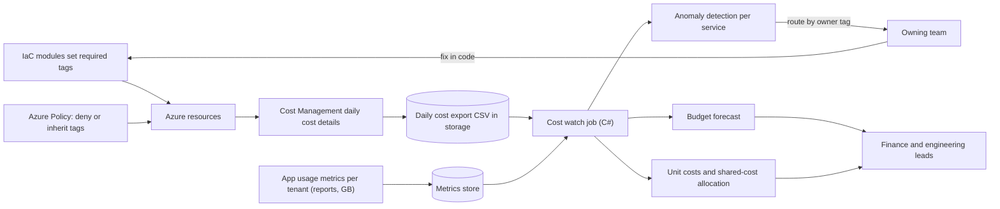
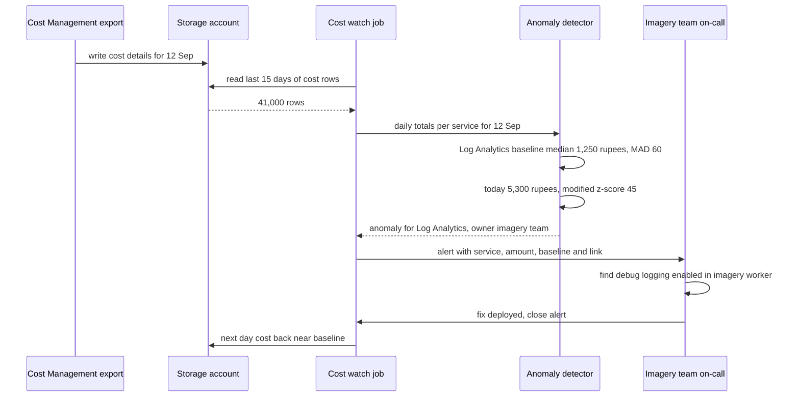

**FarmLens** is a SaaS platform for agri-businesses: field agents walk farms every morning, upload crop photos and drone images, the platform tiles the imagery into zoomable field maps, spots pest and water stress, and generates a daily crop-health report for each farm, which goes to clients such as crop insurers, seed companies and food processors. About 300 agri-business organisations (farmer cooperatives, insurers, contract-farming companies) use it. In July the Azure bill was ₹3.1 lakh. In October it was ₹5.4 lakh, revenue had grown by only 12 %, and nobody could say why. The finance head asked three questions: "What are we paying for? Which customers cost us the most? Why did it jump?" A week later a zone-level outage in the region took the single-zone PostgreSQL server down for 70 minutes during the morning report rush, and the CTO asked the opposite question: "Why aren't we paying for zone redundancy?" This lesson is about answering both kinds of question with data: **what does it cost, and what does it buy**.

## Learning objectives

By the end of this lesson you will be able to:

1. Make cloud spend visible and attributable with a tagging standard, cost exports and allocation of shared costs.
2. Set budgets with actual and forecast alerts, and explain what budgets do and don't do.
3. Express cost as unit economics (₹ per crop report, per tenant, per GB) and use it to make design decisions.
4. Find and act on the main cost drivers: over-sized compute, always-on non-production, log ingestion, storage tiers, egress, idle resources, and commitment discounts.
5. Detect cost anomalies with a robust statistical method (median and MAD) and implement it in C#.
6. Trade reliability against cost using SLOs, composite availability arithmetic and the cost of downtime, and decide when zone or region redundancy is worth paying for.
7. Practise all of this without a paid subscription, using cost CSVs, Prometheus and Grafana in Docker, OpenCost and Infracost.

## Prerequisites

- [Cost estimation](#/lesson/m11-cost-estimation): estimating compute, storage and egress before you build.
- [Availability, reliability and the nines](#/lesson/m11-availability): serial and parallel availability.
- [SLI, SLO, SLA and error budgets](#/lesson/m14-sli-slo-sla): the reliability targets cost decisions should follow.
- [Infrastructure as Code](#/lesson/m15-iac): tags and sizes are set in IaC, so cost fixes are code changes.

## Explain it like I'm a beginner

Think of a household electricity bill. One month it doubles. To understand why, you need three things:

- **Labels**: which appliance used what. A smart meter per room is like **tags** on cloud resources: "this server belongs to the billing team, production".
- **A limit and a warning**: "tell me when we've used 80 % of what we planned this month", before the bill arrives. That's a **budget alert**.
- **A sense of normal**: the geyser always uses more in winter, but if the fridge suddenly uses five times its usual amount, something is wrong. That's **anomaly detection**.

Then there's the other side: an inverter and battery cost money every month, but they keep the lights on during a power cut. Whether that's worth it depends on how much a power cut costs *you*. A hospital buys a generator; a weekend cottage doesn't. That is the **reliability versus cost** trade-off, and the answer comes from your targets (**SLOs**) and the cost of downtime, not from fear.

The practice of managing cloud spend as a shared responsibility of engineering, finance and the business is called **FinOps**.

## First-principles explanation

### Why cloud costs drift upward

Cloud pricing is pay-for-what-you-provision, and provisioning is easy: anyone with access can create a 16-vCore database in two minutes. Costs drift up because:

- resources are created for a test and never deleted,
- sizes are chosen for a peak that happens two hours a week,
- non-production runs 24 hours a day, 7 days a week, although people use it about 50 hours a week,
- logging and telemetry grow silently with traffic (and with one verbose debug flag),
- data is kept in the most expensive storage tier forever,
- nobody owns the bill, so nobody looks.

The fix is not a one-time clean-up but a loop. The FinOps Framework describes it as phases: **Inform** (visibility and allocation), **Optimise** (rates and usage), **Operate** (continuous governance).

### Inform: tags and allocation

Tags are key-value labels on resources (and resource groups) that appear in cost data. A minimal standard for FarmLens:

| Tag | Example | Why |
|---|---|---|
| `environment` | `prod`, `staging`, `dev` | Separate production cost from everything else |
| `workload` | `farmlens-imagery` | Which product or component |
| `costCentre` | `ENG-PLATFORM-02` | Who pays (showback or chargeback) |
| `owner` | `imagery-team@farmlens.example` | Who to ask about a resource |
| `managedBy` | `bicep` | Whether it is safe to change by hand (it isn't) |

Rules that make tags work:

- **Set them in IaC** modules, so every resource gets them by default ([Infrastructure as Code](#/lesson/m15-iac)).
- **Enforce them** with Azure Policy (deny resources without required tags, or append or inherit tags from the resource group).
- **Measure compliance as spend, not as count**: "6 % of last month's cost is untagged" is actionable; "41 resources are untagged" might be 41 free resources.
- Some costs can't carry your tags directly (certain marketplace or shared platform charges). Allocate them with rules instead.

**Shared costs** (a Kubernetes cluster, a Log Analytics workspace, a VPN gateway, the API gateway) serve many tenants or teams. Allocate them by a usage measure: requests, CPU-seconds, GB processed, reports generated. Proportional allocation needs care with rounding so that the allocated parts add up to the bill exactly (exercise 3).

**Cost exports**: Azure Cost Management can export daily cost details to a storage account as CSV or Parquet files. That export is the raw material for your own reports, anomaly detection and unit economics, and the format is easy to reproduce locally.

### Budgets: alerts, not brakes

A **budget** in Azure Cost Management has an amount, a period (usually monthly) and alert thresholds on **actual** spend (for example 50 %, 80 %, 100 %) and **forecast** spend (for example 100 %). When a threshold is crossed, Azure emails the contacts or triggers an action group.

What budgets **don't** do: they don't stop spending. For most subscription types, crossing 100 % sends an alert and nothing else. If you need hard stops, automate the response (an action group calling an automation runbook that scales down non-production), and never automatically shut down production because of a budget.

Use **forecast** thresholds: a forecast alert on day 9 ("you're on track for ₹5.6 lakh against ₹4 lakh") gives three weeks to react. An actual-100 % alert on day 27 gives three days. Exercise-style arithmetic: month-to-date ₹1.62 lakh after 9 days, recent run rate ₹18,000 a day, 22 days left: forecast = 1,62,000 + 18,000 × 22 = ₹5,58,000.

Azure Cost Management also offers **anomaly alerts** on subscriptions. They are useful, but building your own detector on the export lets you work per service, per tag and per tenant, with your own thresholds and routing.

### Unit economics: cost per something the business understands

"₹5.4 lakh a month" means nothing on its own. **Unit economics** divides cost by a business driver:

| Metric | July | October |
|---|---|---|
| Total cost | ₹3,10,000 | ₹5,40,000 |
| Crop reports generated | 62,000 | 70,000 |
| Cost per crop report | ₹5.00 | ₹7.71 |
| Imagery GB processed | 18,500 | 21,000 |
| Cost per imagery GB | ₹16.8 | ₹25.7 |

Volume grew about 13 %, cost per unit grew about 54 %. That rules out "we just have more customers" and says the system became less efficient. Unit costs also guide pricing (a tenant that uploads 4 TB of drone imagery a month on a flat plan is unprofitable) and design (a change that halves cost per GB is worth more than a 5 % compute discount).

To compute unit costs, the application has to **count** the units, per tenant, as metrics. That is app-side work: the C# section emits counters with a `tenant` dimension using `System.Diagnostics.Metrics`, which OpenTelemetry exports alongside the usual telemetry.

### Optimise: the usual cost drivers

| Driver | Typical symptom | Fix | Trade-off |
|---|---|---|---|
| Over-sized compute and databases | p95 CPU under 20 % for weeks | **Right-size** to the smallest size that keeps p95 under a target (for example 70 %) | Less headroom for spikes; autoscale or keep a margin |
| Always-on non-production | Dev and staging cost 40 % of production | Scale to zero, stop on a schedule (nights and weekends), smaller SKUs | Morning start-up delay |
| Log and telemetry ingestion | Logging cost grows faster than traffic | Lower default log levels, sample traces, drop noisy categories, use cheaper log tiers for verbose data, set retention | Less detail during incidents |
| Storage tiers | Years of images in the hot tier | Lifecycle rules to cool, cold or archive tiers, delete raw uploads after processing | Retrieval cost and latency from colder tiers |
| Egress | Large downloads from the region | CDN for tiles and reports, compress, keep processing in-region | CDN cost and invalidation |
| Idle resources | Unattached disks, old snapshots, unused public IPs, empty App Service plans | Regular clean-up job, tag `expiresOn` for temporary resources | Need a safe review before deleting |
| No commitment discounts | Steady 24×7 workloads at pay-as-you-go prices | **Reservations** or **savings plans** (1 or 3 years) for the stable baseline | Commitment; pay even if you scale down |
| Batch on regular capacity | Imagery tiling jobs on on-demand nodes | **Spot** capacity for interruptible batch work | Evictions; jobs must checkpoint and retry |

Simple arithmetic shows why non-production schedules matter: an environment used 10 hours a day on weekdays runs 50 of 168 hours a week. Stopping it outside those hours saves about (168 − 50) ÷ 168 ≈ 70 % of its compute cost. Storage and some services keep charging while stopped, so the real saving is lower; measure it.

Commitment discounts apply to the **baseline**, not the peak. If production always runs at least 4 vCores of database and 6 container replicas, commit for those, and pay as you go for the autoscaled part above.

### Right-sizing: data, not guesses

Right-size with at least two to four weeks of metrics, including a month-end or seasonal peak:

- Look at **p95** (or p99) CPU and memory, not the average. An average of 15 % can hide a daily 85 % peak.
- Keep a target utilisation at p95 (often 60–75 %), so a spike doesn't immediately saturate the resource.
- Memory usually matters more than CPU for databases (cache hit ratio) and .NET apps (GC behaviour). Downsizing a database's memory can turn a fast system into a disk-bound one; watch the cache hit ratio and query latency after the change.
- Change one thing at a time, during a quiet period, with a rollback plan (an IaC parameter change you can revert).

### Detecting anomalies

A cost anomaly is a day whose cost is far from what's normal **for that service**. Two practical points:

- **Use robust statistics.** The mean and standard deviation are pulled around by the very spikes you want to detect. The **median** and the **median absolute deviation (MAD)** are not. The modified z-score is 0.6745 × (x − median) ÷ MAD; values above about 3.5 are a common rule of thumb for outliers.
- **Respect seasonality.** Many costs follow a weekly pattern (fewer uploads on Sundays). Compare a Monday with previous Mondays (exercise 5).
- **Ignore tiny changes.** A 400 % jump from ₹50 to ₹250 is statistically huge and financially irrelevant. Require a minimum absolute increase (for example ₹2,000 a day) before alerting.
- **Route alerts to owners** using the `owner` tag, with the service, the amount, the baseline and a link to the cost view. An alert nobody owns is noise.

Cost data usually arrives with a delay (often several hours to a day, and can be revised), so cost anomaly detection catches problems within a day or two. For faster detection, alert on the **usage** metrics that drive cost (log GB ingested per hour, instance count, egress bytes), which arrive in minutes.

### Reliability costs money, so decide with numbers

Every reliability feature has a price. For FarmLens:

| Feature | What it protects against | Rough cost effect (estimate) |
|---|---|---|
| Zone-redundant PostgreSQL HA | Loss of one zone or the primary server | About double the database compute (a standby runs all the time) |
| Multiple app replicas across zones | Loss of an instance or a zone | At least 2–3 replicas instead of 1 |
| Geo-redundant backups | Loss of the region (restore elsewhere) | Extra backup storage |
| Warm standby region | Loss of the region, with fast failover | Close to a second copy of production |
| Longer log retention | Slower investigations | Storage per GB per month |

Decide with three numbers: the **SLO**, the **availability** each design can achieve, and the **cost of downtime**.

**Availability arithmetic** (assumptions for illustration; use the providers' published SLAs and your own measurements):

- App tier with replicas across zones: assume 99.95 %.
- Single-zone database: assume 99.9 %. Zone-redundant HA database: assume 99.99 %.
- Serial dependencies multiply: app × database.
  - Single-zone database: 0.9995 × 0.999 ≈ 0.9985, about 99.85 %, which allows about 0.0015 × 43,800 minutes ≈ 66 minutes of downtime a month (a month is about 43,800 minutes).
  - Zone-redundant database: 0.9995 × 0.9999 ≈ 0.9994, about 99.94 %, about 26 minutes a month.

If FarmLens's SLO is 99.9 % (about 44 minutes a month), the single-zone design **can't meet it on paper**, which matches the 70-minute outage. Zone-redundant HA can.

**Cost of downtime** (estimate): during the morning rush, about 1,200 report submissions an hour are blocked; contracts include service credits of, say, 5 % of the monthly fee when availability drops below 99.9 %; and field agents stand in farms unable to submit, while insurers' claim decisions wait. If one 70-minute outage triggers credits worth ₹1.5 lakh plus support effort and churn risk, while zone-redundant HA adds perhaps ₹35,000 a month to the database bill (estimate; price it for your SKU), the decision is easy. For a dev environment the answer is the opposite: no HA, scale to zero.

The general rule: **spend on reliability where the SLO and the cost of downtime justify it, and save everywhere else.** Error budgets connect the two: if you consistently use only 10 % of your error budget, you may be over-paying for reliability; if you keep exhausting it, invest.

### Reliability that costs little

Some of the best reliability improvements are cheap:

- **Health checks and readiness** so platforms route around bad instances.
- **Timeouts, retries with backoff and circuit breakers** so dependency blips don't cascade.
- **Autoscaling with sensible minimums and maximums**, and checking **subscription quotas** (vCPU limits per region) so a scale-out isn't blocked during a spike.
- **Tested restores**: a backup that has never been restored is a hope, not a plan ([backups and DR](#/lesson/m14-dr)).
- **Load shedding** for non-critical work (thumbnail generation can wait; report submission can't).
- **Chaos experiments** in staging to verify the redundancy you pay for actually works ([chaos engineering](#/lesson/m14-chaos)).

### Free and open-source alternatives for practice

No subscription is needed to learn the techniques:

- **Cost data**: generate or download a sample cost export CSV (the C# code reads a simple CSV format) and run the detector and allocator locally.
- **Usage metrics**: run **Prometheus and Grafana in Docker Compose**, scrape the app's OpenTelemetry metrics, and build per-tenant usage dashboards.
- **Kubernetes cost allocation**: **OpenCost** (a CNCF project) allocates cluster cost to namespaces, deployments and labels, and runs on a local kind or k3d cluster.
- **Cost in pull requests**: **Infracost** estimates the monthly cost change of a Terraform plan and can comment it on pull requests, so "this PR adds ₹42,000 a month" is visible before merge.
- **Budgets**: implement the forecast logic yourself (the C# section does) against the local CSV.

### What breaks first

As spend grows, the first failures are organisational: nobody owns the bill, untagged spend grows, and alerts go to a shared inbox nobody reads. Then technical: log ingestion grows with traffic, non-production mirrors production sizes, and "temporary" resources accumulate. On the reliability side, single points of failure that were acceptable at 30 customers become unacceptable at 300, and quotas or capacity limits block scale-out during the first big spike.

### When a simpler approach is enough

A startup spending ₹15,000 a month doesn't need a custom anomaly detector or chargeback. Set one budget with forecast alerts, tag by environment, scale non-production to zero, and look at the cost analysis view once a week. Build the rest when the bill is large enough that 10 % of it pays for the engineering time, or when several teams share one bill.

## Visual explanation

### The cost visibility loop



Tags are set by IaC modules and enforced by Azure Policy, so every resource's cost is attributable. Cost Management produces daily cost details, exported as CSV to a storage account. In parallel, the application emits usage metrics per tenant. A scheduled C# job combines the two: it detects anomalies per service, computes unit costs and allocates shared costs, and forecasts the month against the budget. Anomalies go to the team named in the `owner` tag; forecasts and unit costs go to finance and engineering leads. Fixes are made in IaC, which closes the loop.

### A daily anomaly check



Each morning the export writes the previous day's cost details to storage. The job reads the last 15 days, sums cost per service per day, and passes the totals to the detector. For Log Analytics on 12 September, the 14-day median is about ₹1,250 with a MAD of ₹60, so ₹5,300 gives a modified z-score of 0.6745 × 4,050 ÷ 60 ≈ 45, far above 3.5, and the ₹4,050 increase is above the ₹2,000 minimum. The job looks up the owner tag and alerts the imagery team with the numbers and a link. The team finds a debug log level left on in the imagery worker by that day's release, fixes it, and the next day's cost returns to normal. Had this job existed in September, the largest cause of the October bill would have been caught the day after it started.

## Step-by-step example

### Step 1: tag everything, measure untagged spend

Add the five required tags to every IaC module and an Azure Policy that inherits `environment`, `costCentre` and `owner` from resource groups. Compute last month's untagged spend: 18 %. Target: under 3 % within a month.

### Step 2: export and baseline

Enable a daily cost export. Load three months into the cost watch job and compute daily totals per service and per environment.

### Step 3: find the October jump

Group by service and compare July with October:

| Service | July | October | Change |
|---|---|---|---|
| Log Analytics | ₹38,000 | ₹1,52,000 | +₹1,14,000 |
| Storage (imagery) | ₹61,000 | ₹1,08,000 | +₹47,000 |
| Container Apps | ₹72,000 | ₹96,000 | +₹24,000 |
| PostgreSQL | ₹84,000 | ₹88,000 | +₹4,000 |
| Bandwidth (egress) | ₹21,000 | ₹46,000 | +₹25,000 |
| Other | ₹34,000 | ₹50,000 | +₹16,000 |

Three causes explain most of the ₹2.3 lakh increase: verbose logging in the imagery worker since a September release, raw drone and photo uploads kept in the hot tier after processing, and imagery tiles served directly from storage rather than through a CDN.

### Step 4: fix the causes, not the symptoms

Reset log levels and add sampling for traces; add a lifecycle rule moving raw uploads to the cool tier after 30 days and deleting them after 180 (processed tiles are kept); put a CDN in front of tile downloads. Schedule dev and staging to stop at night. Each fix is an IaC or app-config change with an expected saving written in the pull request.

### Step 5: decide on reliability

Calculate composite availability for the current and zone-redundant database designs against the 99.9 % SLO, and price zone-redundant HA. Approve it for production, using part of the savings from step 4.

### Step 6: operate

Budget ₹4.2 lakh with forecast alerts at 90 % and 100 %; the anomaly job runs daily; unit costs per crop report and per imagery GB go on the monthly engineering review.

## Production-style C# implementation

```csharp file=Costs/CostModel.cs
namespace FarmLens.Costs;

/// <summary>One row of a daily cost export (simplified). Tags as exported, keys case-insensitive.</summary>
public sealed record CostRecord(DateOnly Date, string Service, string ResourceId, decimal CostInr, IReadOnlyDictionary<string, string> Tags);

public sealed record CostAnomaly(DateOnly Date, string Service, decimal ActualInr, decimal BaselineInr, double Score, string Reason, string? Owner);

public interface ICostSource
{
    Task<IReadOnlyList<CostRecord>> GetAsync(DateOnly from, DateOnly to, CancellationToken ct);
}

public interface IAlertSink
{
    Task SendAsync(CostAnomaly anomaly, CancellationToken ct);
}

/// <summary>Reads the simplified export format:
/// date,service,resourceId,costInr,tags  where tags look like "owner=imagery-team;environment=prod".</summary>
public sealed class CsvCostSource(Func<CancellationToken, Task<string>> readCsv) : ICostSource
{
    public async Task<IReadOnlyList<CostRecord>> GetAsync(DateOnly from, DateOnly to, CancellationToken ct)
    {
        var text = await readCsv(ct);
        var rows = new List<CostRecord>();
        foreach (var line in text.Split('\n').Skip(1))
        {
            var parts = line.TrimEnd('\r').Split(',');
            if (parts.Length < 4) continue;
            var date = DateOnly.Parse(parts[0], System.Globalization.CultureInfo.InvariantCulture);
            if (date < from || date > to) continue;
            var tags = (parts.Length > 4 ? parts[4] : "")
                .Split(';', StringSplitOptions.RemoveEmptyEntries)
                .Select(t => t.Split('=', 2))
                .Where(kv => kv.Length == 2)
                .ToDictionary(kv => kv[0].Trim(), kv => kv[1].Trim(), StringComparer.OrdinalIgnoreCase);
            rows.Add(new CostRecord(date, parts[1], parts[2], decimal.Parse(parts[3], System.Globalization.CultureInfo.InvariantCulture), tags));
        }
        return rows;
    }
}

public sealed class LogAlertSink(ILogger<LogAlertSink> log) : IAlertSink
{
    public Task SendAsync(CostAnomaly a, CancellationToken ct)
    {
        log.LogWarning("Cost anomaly {Service} on {Date}: ₹{Actual:N0} vs baseline ₹{Baseline:N0} (score {Score:F1}, {Reason}). Owner: {Owner}",
            a.Service, a.Date, a.ActualInr, a.BaselineInr, a.Score, a.Reason, a.Owner ?? "unowned");
        return Task.CompletedTask;
    }
}
```

```csharp file=Costs/CostAnomalyDetector.cs
using Microsoft.Extensions.Options;

namespace FarmLens.Costs;

public sealed class AnomalyOptions
{
    public int LookbackDays { get; set; } = 14;
    public int MinHistoryDays { get; set; } = 7;
    public double ModifiedZThreshold { get; set; } = 3.5;
    /// <summary>Ignore statistically large but financially small changes.</summary>
    public decimal MinAbsoluteIncreaseInr { get; set; } = 2_000m;
    /// <summary>When the baseline is perfectly flat (MAD = 0), flag increases above this ratio.</summary>
    public double FlatBaselineIncreaseRatio { get; set; } = 0.5;
}

/// <summary>Per-service daily anomaly detection with median and MAD (robust to past spikes).</summary>
public sealed class CostAnomalyDetector(IOptions<AnomalyOptions> options)
{
    public IReadOnlyList<CostAnomaly> Detect(IReadOnlyList<CostRecord> records, DateOnly day)
    {
        var o = options.Value;
        var daily = records
            .GroupBy(r => (r.Service, r.Date))
            .ToDictionary(g => g.Key, g => g.Sum(r => r.CostInr));
        var owners = records
            .Where(r => r.Tags.TryGetValue("owner", out _))
            .GroupBy(r => r.Service)
            .ToDictionary(g => g.Key, g => g.First().Tags["owner"]);

        var anomalies = new List<CostAnomaly>();
        foreach (var service in daily.Keys.Where(k => k.Date == day).Select(k => k.Service).Distinct().OrderBy(s => s, StringComparer.Ordinal))
        {
            var actual = daily[(service, day)];
            var history = Enumerable.Range(1, o.LookbackDays)
                .Select(i => day.AddDays(-i))
                .Select(d => daily.TryGetValue((service, d), out var c) ? (decimal?)c : null)
                .ToList();
            var daysWithData = history.Count(h => h is not null);
            var values = history.Select(h => h ?? 0m).ToList();
            owners.TryGetValue(service, out var owner);

            if (daysWithData < o.MinHistoryDays)
            {
                if (actual >= o.MinAbsoluteIncreaseInr)
                    anomalies.Add(new CostAnomaly(day, service, actual, 0m, double.NaN, "new-spend", owner));
                continue;
            }

            var median = Median(values);
            var increase = actual - median;
            if (increase < o.MinAbsoluteIncreaseInr) continue;

            var mad = Median(values.Select(v => Math.Abs(v - median)).ToList());
            if (mad == 0m)
            {
                var ratio = median == 0m ? double.PositiveInfinity : (double)(increase / median);
                if (ratio > o.FlatBaselineIncreaseRatio)
                    anomalies.Add(new CostAnomaly(day, service, actual, median, double.PositiveInfinity, "flat-baseline-jump", owner));
                continue;
            }

            var score = 0.6745 * (double)(increase / mad);
            if (score > o.ModifiedZThreshold)
                anomalies.Add(new CostAnomaly(day, service, actual, median, score, "spike", owner));
        }
        return anomalies;
    }

    public static decimal Median(IReadOnlyList<decimal> values)
    {
        if (values.Count == 0) return 0m;
        var sorted = values.OrderBy(v => v).ToList();
        var mid = sorted.Count / 2;
        return sorted.Count % 2 == 1 ? sorted[mid] : (sorted[mid - 1] + sorted[mid]) / 2m;
    }
}
```

```csharp file=Costs/BudgetForecaster.cs
namespace FarmLens.Costs;

public sealed record BudgetStatus(
    decimal MonthToDateInr,
    decimal DailyRunRateInr,
    decimal ForecastInr,
    decimal BudgetInr,
    IReadOnlyList<int> ActualThresholdsCrossed,
    IReadOnlyList<int> ForecastThresholdsCrossed);

public static class BudgetForecaster
{
    /// <summary>Forecast = month-to-date + (average of the last up-to-7 days in this month) x days remaining.
    /// Simple and explainable. Cost Management's own forecast uses more history and seasonality.</summary>
    public static BudgetStatus Evaluate(IReadOnlyList<CostRecord> records, DateOnly asOf, decimal budgetInr, IReadOnlyList<int> thresholdsPercent)
    {
        var monthStart = new DateOnly(asOf.Year, asOf.Month, 1);
        var daysInMonth = DateTime.DaysInMonth(asOf.Year, asOf.Month);
        var byDay = records
            .Where(r => r.Date >= monthStart && r.Date <= asOf)
            .GroupBy(r => r.Date)
            .ToDictionary(g => g.Key, g => g.Sum(r => r.CostInr));

        var mtd = byDay.Values.Sum();
        var elapsed = asOf.Day;
        var window = Math.Min(7, elapsed);
        var recent = Enumerable.Range(0, window).Select(i => byDay.GetValueOrDefault(asOf.AddDays(-i))).Sum();
        var runRate = window == 0 ? 0m : decimal.Round(recent / window, 2);
        var forecast = mtd + runRate * (daysInMonth - elapsed);

        List<int> Crossed(decimal amount) =>
            thresholdsPercent.Where(t => budgetInr > 0 && amount >= budgetInr * t / 100m).OrderBy(t => t).ToList();

        return new BudgetStatus(mtd, runRate, forecast, budgetInr, Crossed(mtd), Crossed(forecast));
    }
}
```

```csharp file=Costs/UsageMetrics.cs
using System.Diagnostics.Metrics;

namespace FarmLens.Costs;

/// <summary>Business units for unit economics, per tenant. Exported by OpenTelemetry (or scraped
/// by Prometheus locally) and joined with cost data: cost per crop report, cost per imagery GB.</summary>
public sealed class UsageMetrics
{
    public const string MeterName = "FarmLens.Usage";

    private readonly Counter<long> _reports;
    private readonly Counter<long> _imageryBytes;

    public UsageMetrics(IMeterFactory meterFactory)
    {
        var meter = meterFactory.Create(MeterName);
        _reports = meter.CreateCounter<long>("farmlens.report.generated", unit: "{report}", description: "Daily crop-health reports generated");
        _imageryBytes = meter.CreateCounter<long>("farmlens.imagery.processed", unit: "By", description: "Imagery bytes processed");
    }

    // Keep the tenant dimension bounded (about 300 tenants). Never tag with user ids or URLs.
    public void ReportGenerated(string tenantId) =>
        _reports.Add(1, new KeyValuePair<string, object?>("tenant", tenantId));

    public void ImageryProcessed(string tenantId, long bytes) =>
        _imageryBytes.Add(bytes, new KeyValuePair<string, object?>("tenant", tenantId));
}
```

```csharp file=Costs/CostWatchService.cs
using Microsoft.Extensions.Options;

namespace FarmLens.Costs;

public sealed class CostWatchOptions
{
    public bool Enabled { get; set; } = true;
    public TimeSpan Interval { get; set; } = TimeSpan.FromHours(24);
    public decimal MonthlyBudgetInr { get; set; } = 4_20_000m;
    public List<int> ThresholdsPercent { get; set; } = [50, 80, 90, 100];
}

/// <summary>Daily: read the export, detect anomalies for yesterday (cost data lags), forecast the month.</summary>
public sealed class CostWatchService(
    ICostSource source,
    CostAnomalyDetector detector,
    IAlertSink alerts,
    IOptions<CostWatchOptions> options,
    IOptions<AnomalyOptions> anomalyOptions,
    TimeProvider time,
    ILogger<CostWatchService> log) : BackgroundService
{
    protected override async Task ExecuteAsync(CancellationToken stoppingToken)
    {
        if (!options.Value.Enabled) return;
        using var timer = new PeriodicTimer(options.Value.Interval, time);
        do
        {
            try { await RunOnceAsync(stoppingToken); }
            catch (Exception ex) when (ex is not OperationCanceledException)
            {
                log.LogError(ex, "Cost watch run failed. Will retry next interval.");
            }
        }
        while (await timer.WaitForNextTickAsync(stoppingToken));
    }

    public async Task<IReadOnlyList<CostAnomaly>> RunOnceAsync(CancellationToken ct)
    {
        var today = DateOnly.FromDateTime(time.GetUtcNow().UtcDateTime);
        var day = today.AddDays(-1);
        var from = day.AddDays(-anomalyOptions.Value.LookbackDays);
        var monthStart = new DateOnly(day.Year, day.Month, 1);
        var rows = await source.GetAsync(from < monthStart ? from : monthStart, day, ct);

        var anomalies = detector.Detect(rows, day);
        foreach (var a in anomalies) await alerts.SendAsync(a, ct);

        var o = options.Value;
        var budget = BudgetForecaster.Evaluate(rows, day, o.MonthlyBudgetInr, o.ThresholdsPercent);
        log.LogInformation("Month to date ₹{Mtd:N0}, forecast ₹{Forecast:N0} of ₹{Budget:N0}. Forecast thresholds crossed: {Crossed}",
            budget.MonthToDateInr, budget.ForecastInr, budget.BudgetInr, string.Join(",", budget.ForecastThresholdsCrossed));
        return anomalies;
    }
}
```

```csharp file=Program.cs
using FarmLens.Costs;

var builder = WebApplication.CreateBuilder(args);

builder.Services.AddSingleton(TimeProvider.System);
builder.Services.Configure<AnomalyOptions>(builder.Configuration.GetSection("Costs:Anomaly"));
builder.Services.Configure<CostWatchOptions>(builder.Configuration.GetSection("Costs:Watch"));
builder.Services.AddSingleton<CostAnomalyDetector>();
builder.Services.AddSingleton<IAlertSink, LogAlertSink>();

// Locally: a CSV file. In Azure: the daily export in Blob Storage, read with the app's managed identity.
var exportPath = builder.Configuration["Costs:ExportPath"] ?? "data/cost-export.csv";
builder.Services.AddSingleton<ICostSource>(new CsvCostSource(ct => File.Exists(exportPath)
    ? File.ReadAllTextAsync(exportPath, ct)
    : Task.FromResult("date,service,resourceId,costInr,tags\n")));

builder.Services.AddSingleton<CostWatchService>();
builder.Services.AddHostedService(sp => sp.GetRequiredService<CostWatchService>());

builder.Services.AddSingleton<UsageMetrics>();

var app = builder.Build();

// Business endpoints count the units that drive cost.
app.MapPost("/api/tenants/{tenantId}/reports", (string tenantId, UsageMetrics usage) =>
{
    usage.ReportGenerated(tenantId);
    return Results.Accepted(value: new { tenantId, status = "queued" });
});

app.MapPost("/api/tenants/{tenantId}/imagery", async (string tenantId, HttpRequest request, UsageMetrics usage) =>
{
    var length = request.ContentLength ?? 0;
    await request.Body.CopyToAsync(Stream.Null);
    usage.ImageryProcessed(tenantId, length);
    return Results.Accepted(value: new { tenantId, bytes = length });
});

// On-demand run for the FinOps review, internal only.
app.MapPost("/internal/costs/check", async (CostWatchService watch, CancellationToken ct) =>
    Results.Ok(await watch.RunOnceAsync(ct)));

app.Run();
```

### Cost controls as code

```bicep
// Budget with actual and forecast alerts, deployed with the environment (resource group scope)
resource budget 'Microsoft.Consumption/budgets@2023-05-01' = {
  name: 'budget-farmlens-prd'
  properties: {
    category: 'Cost'
    amount: 420000
    timeGrain: 'Monthly'
    timePeriod: { startDate: '2026-11-01' }
    notifications: {
      actual80: { enabled: true, operator: 'GreaterThanOrEqualTo', threshold: 80, thresholdType: 'Actual', contactEmails: ['finops@farmlens.example'] }
      forecast100: { enabled: true, operator: 'GreaterThanOrEqualTo', threshold: 100, thresholdType: 'Forecasted', contactEmails: ['finops@farmlens.example', 'cto@farmlens.example'] }
    }
  }
}
```

```json
{
  "rules": [
    {
      "name": "raw-uploads-tiering",
      "type": "Lifecycle",
      "definition": {
        "filters": { "blobTypes": ["blockBlob"], "prefixMatch": ["raw-uploads/"] },
        "actions": {
          "baseBlob": {
            "tierToCool": { "daysAfterModificationGreaterThan": 30 },
            "delete": { "daysAfterModificationGreaterThan": 180 }
          }
        }
      }
    }
  ]
}
```

```yaml
# Local practice: Prometheus and Grafana for per-tenant usage (no cloud account)
services:
  api:
    image: farmlens-api:dev
    environment:
      OTEL_EXPORTER_OTLP_ENDPOINT: "http://otel-collector:4317"
      Costs__ExportPath: "/data/cost-export.csv"
    volumes: ["./sample-data:/data:ro"]
  otel-collector:
    image: otel/opentelemetry-collector-contrib:0.111.0
    volumes: ["./otel-config.yaml:/etc/otelcol-contrib/config.yaml:ro"]   # OTLP in, Prometheus exporter out
  prometheus:
    image: prom/prometheus:v2.54.1
    volumes: ["./prometheus.yml:/etc/prometheus/prometheus.yml:ro"]
  grafana:
    image: grafana/grafana:11.2.0
    ports: ["3000:3000"]
```

Design notes:

- **Yesterday, not today.** Cost exports lag and get revised, so the job evaluates the previous day.
- **Robust baseline and a money floor.** Median and MAD ignore last week's spike; the ₹2,000 floor keeps tiny services quiet.
- **Owners from tags.** The alert names the owning team, which is why tag compliance comes first.
- **Usage metrics stay low-cardinality.** A `tenant` dimension with about 300 values is fine; per-user or per-URL dimensions would multiply metric cost, the very thing being controlled.
- **Controls live in IaC.** Budgets, lifecycle rules and tags are deployed with the environment, so they exist in every environment and are reviewed like code.

## Bad design vs good design

**Bad**: cost as someone else's problem.

```text
- No tags; cost report grouped by "resource group: rg-prod" only
- One budget at 100 % actual, emails go to a shared mailbox
- Dev and staging are clones of production, running 24x7, zone redundant
- Log level Debug in production "to help support", 90-day retention on everything
- All drone imagery and raw photos kept in the hot tier forever
- Reservations bought for the peak, now 40 % unused
- Zone redundancy rejected as "too expensive" without knowing the SLO or the cost of downtime
```

What goes wrong: nobody can say which feature or customer drives cost. The alert arrives after the money is spent, and nobody reads it. Non-production costs as much as production. Logging becomes the largest line item. Storage grows forever. Commitments waste money. The first zone outage breaches the SLA and costs more in credits than redundancy would have.

**Good**: required tags enforced by policy and set by IaC; untagged spend measured and kept small; budgets with forecast alerts routed to named owners; daily anomaly detection per service; unit costs per crop report and per GB reviewed monthly; non-production scaled to zero or scheduled; sensible log levels, sampling and retention; storage lifecycle rules; commitments sized to the steady baseline; reliability spend decided per environment from SLOs, availability arithmetic and the cost of downtime.

:::callout type=warning title="Budgets don't stop spending"
For most Azure subscriptions a budget only alerts. Treat it as a smoke detector, not a sprinkler. If you need automatic action, wire an action group to a runbook that scales down non-production, and keep production changes in human hands.
:::

:::callout type=tradeoff title="Saving money versus saving time"
An engineer-week spent saving ₹3,000 a month pays back in years. Prioritise by size: sort cost by service, fix the top three, and stop. Revisit monthly. The largest wins usually come from design (logging, storage tiers, CDN, scale to zero), not from squeezing SKUs.
:::

## Practical playground

The simulator shows an autoscaled service during a traffic spike. Use it to see the cost side of reliability: every extra instance is cost, every dropped request is unreliability.

1. Run with the defaults and note the dropped percentage and the average instance count (a proxy for cost).
2. Raise the starting `instances` until nothing drops without autoscaling. How much higher is the average instance count than in the autoscaled run? That gap is the cost of provisioning for peak.
3. Lower `targetUtil` from 0.7 to 0.5. Drops fall and cost rises. Which matches a 99.9 % SLO better?
4. Increase `provisionSec` to 180 (slow cold starts). How much extra minimum capacity does that force you to pay for?

:::playground type=sim sim=scaling title="Cost versus dropped requests during the morning report rush" instances=3 capacityPerInstance=120 provisionSec=60 cooldownSec=60 spikeMultiplier=3 targetUtil=0.7 maxInstances=20
:::

## Exercises

:::exercise id=m15-cost-reliability-ex1 difficulty=beginner kind=written title="Find the savings in a cost breakdown"
FarmLens's October bill is ₹5,40,000. Using the table and facts below, propose the **five** most valuable actions. For each, estimate the monthly saving in rupees (show the arithmetic), name the trade-off, and say how you'd verify the saving.

| Line item | October | Facts |
|---|---|---|
| Log Analytics ingestion | ₹1,52,000 | Imagery worker logs at Debug since 12 Sep; 70 % of ingested GB come from it |
| Blob Storage (hot) | ₹1,08,000 | 62 % of stored data is raw drone and photo uploads older than 30 days, never read after processing |
| Container Apps (prod) | ₹96,000 | 6 replicas minimum, p95 CPU 22 % outside 08:00–11:00 |
| PostgreSQL (prod) | ₹88,000 | 8 vCores, p95 CPU 18 %, buffer cache hit ratio 99.6 % |
| Dev and staging (all services) | ₹50,000 | Run 24×7; used about 10 hours on weekdays |
| Bandwidth | ₹46,000 | 80 % is imagery tile downloads by clients across India |
::acceptance
- Each action has a rupee estimate with visible arithmetic, labelled as an estimate.
- Logging fix (log level, sampling, retention) is identified as the largest win.
- Storage lifecycle for raw uploads, and a CDN for tiles, are proposed with their trade-offs.
- Non-production schedules use the 50 of 168 hours arithmetic, with a caveat that not all cost stops.
- Database downsizing is treated cautiously (memory and cache hit ratio), not just by CPU.
- Each action has a verification method (compare the cost line and a usage metric after the change).
::hint
Start with the biggest line and the clearest cause. Which single change affects ₹1 lakh or more?
::hint
For storage: what fraction of the hot-tier bill is raw uploads, and what does the cool tier cost relative to hot? You can assume roughly half per GB for this estimate.
::hint
For non-production: (168 − 50) ÷ 168 ≈ 70 % of running time. Assume about two-thirds of non-production cost is compute that actually stops.
::solution
All figures are estimates to be verified against the next month's cost data.

1. **Fix imagery-worker logging** (largest win). 70 % of ₹1,52,000 ≈ ₹1,06,000 comes from one component logging at Debug. Return it to Information, sample verbose categories, and move high-volume diagnostic logs to a cheaper log tier or shorter retention. If that component's volume drops by 85 %, saving ≈ ₹1,06,000 × 0.85 ≈ **₹90,000/month**. Trade-off: less detail during incidents; mitigate with dynamic log levels that can be raised temporarily. Verify: ingested GB per day by table and by component, and the Log Analytics line.
2. **Lifecycle rule for raw uploads.** 62 % of ₹1,08,000 ≈ ₹67,000 is raw uploads older than 30 days. Moving them to cool (assume about half the per-GB price) saves about ₹33,000; deleting them after 180 days (keeping processed tiles) saves more over time. Estimate **₹33,000–45,000/month** within two months. Trade-off: retrieval charges and latency if anyone needs a raw file; deletion is irreversible, so agree retention with customers. Verify: capacity per tier and the storage line.
3. **CDN for imagery tiles.** 80 % of ₹46,000 ≈ ₹37,000 is tile downloads. With a CDN and a high hit ratio, origin egress drops sharply, but CDN delivery has its own cost. Net saving perhaps **₹10,000–20,000/month** (estimate; depends on hit ratio and CDN pricing), plus faster tile loading for users far from the region. Trade-off: cache invalidation when tiles are regenerated (use versioned URLs). Verify: origin egress GB and CDN hit ratio.
4. **Schedule dev and staging.** Running 50 of 168 hours saves about 70 % of running time. If about two-thirds of ₹50,000 is compute that stops, saving ≈ ₹50,000 × 0.67 × 0.70 ≈ **₹23,000/month**. Trade-off: morning start-up delay and a process for out-of-hours testing. Verify: the cost of resources tagged `environment=dev|staging`.
5. **Right-size production compute, carefully.** Container Apps: lower minimum replicas from 6 to 3 outside 08:00–11:00 with scheduled or metric-based scaling for the rush; if half the replica-hours go, saving ≈ ₹96,000 × 0.4 ≈ **₹38,000/month** (estimate). PostgreSQL: CPU p95 is 18 %, but the 99.6 % cache hit ratio depends on memory, and General Purpose sizes tie memory to vCores. Test 8 → 4 vCores in staging with production-like data and load; only proceed if the hit ratio and p95 query latency hold. If they do, saving ≈ ₹40,000/month, but that money may be better spent on zone-redundant HA (see the reliability decision). Verify: replica-hours, p95 latency, cache hit ratio, and the SLO.

Together, roughly ₹1.9–2.1 lakh a month, bringing the bill back near ₹3.4 lakh, with cost per crop report back to about ₹4.9.
::mistakes
- Proposing reservations first. Commit only after removing waste, or you commit to the waste.
- Downsizing the database on CPU alone.
- Claiming exact savings without labelling them as estimates or saying how to verify them.
:::

:::exercise id=m15-cost-reliability-ex2 difficulty=beginner kind=code title="Tag compliance measured in rupees"
Implement a tag compliance report:

- Each `TagRule` has a key and optionally a list of allowed values. Keys match **case-insensitively**; values are compared case-insensitively against the allowed list.
- A tag that is absent, empty or whitespace is `"missing"`. A value not in the allowed list is `"invalid:<value>"`.
- Violations are ordered by resource id (ordinal), then by rule order.
- A resource with any violation is non-compliant. `NonCompliantCostInr` is the sum of their monthly costs; `TotalCostInr` the sum of all; `NonCompliantPercent` is 100 × non-compliant ÷ total, rounded to one decimal (0 if the total is 0).
::acceptance
- A fully tagged resource has no violations.
- Missing, blank and invalid values are reported as specified.
- Key matching is case-insensitive (`Environment` satisfies `environment`).
- The non-compliant spend percentage is correct.
::hint
Build a case-insensitive dictionary from each resource's tags: `new Dictionary<string, string>(r.Tags, StringComparer.OrdinalIgnoreCase)`.
::hint
Track a `bool compliant` per resource while checking the rules.
::hint
`Math.Round((double)(nonCompliant / total * 100m), 1)`.
::starter
```csharp file=TagCompliance.cs
using System;
using System.Collections.Generic;

public sealed record TaggedResource(string ResourceId, decimal MonthlyCostInr, IReadOnlyDictionary<string, string> Tags);

public sealed record TagRule(string Key, IReadOnlyList<string>? AllowedValues = null);

public sealed record TagViolation(string ResourceId, string Key, string Problem);

public sealed record TagReport(IReadOnlyList<TagViolation> Violations, decimal NonCompliantCostInr, decimal TotalCostInr, double NonCompliantPercent);

public static class TagCompliance
{
    public static TagReport Evaluate(IReadOnlyList<TaggedResource> resources, IReadOnlyList<TagRule> rules)
        => throw new NotImplementedException();
}
```
::tests
```csharp file=TagComplianceTests.cs
using System.Collections.Generic;
using System.Linq;
using Xunit;

public class TagComplianceTests
{
    private static readonly List<TagRule> Rules = new()
    {
        new("environment", new[] { "dev", "staging", "prod" }),
        new("owner"),
        new("costCentre"),
    };

    private static TaggedResource R(string id, decimal cost, params (string k, string v)[] tags) =>
        new(id, cost, tags.ToDictionary(t => t.k, t => t.v));

    [Fact]
    public void Fully_tagged_is_compliant()
    {
        var report = TagCompliance.Evaluate(new[] { R("psql-prd", 88000m, ("Environment", "Prod"), ("OWNER", "data-team"), ("costcentre", "ENG-02")) }, Rules);
        Assert.Empty(report.Violations);
        Assert.Equal(0d, report.NonCompliantPercent);
    }

    [Fact]
    public void Missing_blank_and_invalid()
    {
        var report = TagCompliance.Evaluate(new[]
        {
            R("st-imagery", 108000m, ("environment", "production"), ("owner", "  ")),
            R("ca-api", 96000m, ("environment", "prod"), ("owner", "api-team"), ("costCentre", "ENG-01")),
        }, Rules);
        Assert.Equal(new[] { "st-imagery:environment:invalid:production", "st-imagery:owner:missing", "st-imagery:costCentre:missing" },
            report.Violations.Select(v => $"{v.ResourceId}:{v.Key}:{v.Problem}").ToArray());
    }

    [Fact]
    public void Non_compliant_spend_percentage()
    {
        var report = TagCompliance.Evaluate(new[]
        {
            R("log-main", 152000m),
            R("ca-api", 96000m, ("environment", "prod"), ("owner", "api-team"), ("costCentre", "ENG-01")),
            R("vm-test-old", 12000m, ("environment", "dev")),
        }, Rules);
        Assert.Equal(164000m, report.NonCompliantCostInr);
        Assert.Equal(260000m, report.TotalCostInr);
        Assert.Equal(63.1, report.NonCompliantPercent);
        Assert.Equal("log-main", report.Violations.First().ResourceId);
    }

    [Fact]
    public void Empty_input() =>
        Assert.Equal(0d, TagCompliance.Evaluate(new List<TaggedResource>(), Rules).NonCompliantPercent);
}
```
::solution
Normalise each resource's tags into a case-insensitive dictionary, then check rules in order.

```csharp file=TagCompliance.cs
using System;
using System.Collections.Generic;
using System.Linq;

public sealed record TaggedResource(string ResourceId, decimal MonthlyCostInr, IReadOnlyDictionary<string, string> Tags);

public sealed record TagRule(string Key, IReadOnlyList<string>? AllowedValues = null);

public sealed record TagViolation(string ResourceId, string Key, string Problem);

public sealed record TagReport(IReadOnlyList<TagViolation> Violations, decimal NonCompliantCostInr, decimal TotalCostInr, double NonCompliantPercent);

public static class TagCompliance
{
    public static TagReport Evaluate(IReadOnlyList<TaggedResource> resources, IReadOnlyList<TagRule> rules)
    {
        var violations = new List<TagViolation>();
        decimal nonCompliant = 0m, total = 0m;

        foreach (var r in resources.OrderBy(r => r.ResourceId, StringComparer.Ordinal))
        {
            total += r.MonthlyCostInr;
            var tags = new Dictionary<string, string>(StringComparer.OrdinalIgnoreCase);
            foreach (var (k, v) in r.Tags) tags[k] = v;

            var compliant = true;
            foreach (var rule in rules)
            {
                if (!tags.TryGetValue(rule.Key, out var value) || string.IsNullOrWhiteSpace(value))
                {
                    violations.Add(new(r.ResourceId, rule.Key, "missing"));
                    compliant = false;
                }
                else if (rule.AllowedValues is not null && !rule.AllowedValues.Contains(value.Trim(), StringComparer.OrdinalIgnoreCase))
                {
                    violations.Add(new(r.ResourceId, rule.Key, $"invalid:{value}"));
                    compliant = false;
                }
            }
            if (!compliant) nonCompliant += r.MonthlyCostInr;
        }

        var percent = total == 0m ? 0d : Math.Round((double)(nonCompliant / total * 100m), 1);
        return new TagReport(violations, nonCompliant, total, percent);
    }
}
```

Here 63 % of spend is non-compliant even though only two of three resources fail, because the biggest line (Log Analytics) has no tags. That's why compliance should be measured in money: fixing one resource fixes most of the problem.
::mistakes
- Case-sensitive key matching, so `Environment` and `environment` count as different tags (Azure tag names are case-insensitive for lookups, but values may keep their case).
- Reporting compliance as a resource count, which hides that one untagged resource is most of the bill.
:::

:::exercise id=m15-cost-reliability-ex3 difficulty=intermediate kind=code title="Allocate shared costs to tenants, to the paisa"
The shared imagery cluster and Log Analytics cost ₹48,750.00 this month. Allocate it to tenants in proportion to crop reports generated, so that:

- Each tenant's share is in rupees with exactly two decimals (paise).
- The shares add up to **exactly** the shared cost.
- Use the **largest remainder** method: floor every exact share to the paisa, then give the leftover paise one at a time to the tenants with the largest fractional remainders (ties broken by tenant id, ordinal).
- If total usage is 0, split equally with the same method.
- Negative cost or usage, or no tenants, throws `ArgumentException`.
::acceptance
- ₹48,750.00 split by 12,400 / 7,900 / 2,100 reports gives 26,986.61 / 17,193.08 / 4,570.31.
- ₹1,00,000 split equally among three tenants gives 33,333.34 / 33,333.33 / 33,333.33, with the extra paisa to the first id.
- The sum always equals the input exactly.
- Invalid input throws.
::hint
Work in paise as integers: `totalPaise = (long)(cost * 100)`.
::hint
Exact share in paise is `totalPaise * usage / totalUsage` as a decimal; the floor is the integer part, the remainder is the fraction.
::hint
`leftover = totalPaise - sum(floors)`; sort tenants by remainder descending, then id, and add 1 paisa to the first `leftover` of them.
::starter
```csharp file=SharedCostAllocator.cs
using System;
using System.Collections.Generic;

public static class SharedCostAllocator
{
    public static IReadOnlyDictionary<string, decimal> Allocate(decimal sharedCostInr, IReadOnlyDictionary<string, long> usageByTenant)
        => throw new NotImplementedException();
}
```
::tests
```csharp file=SharedCostAllocatorTests.cs
using System;
using System.Collections.Generic;
using System.Linq;
using Xunit;

public class SharedCostAllocatorTests
{
    [Fact]
    public void Proportional_with_largest_remainder()
    {
        var shares = SharedCostAllocator.Allocate(48_750.00m, new Dictionary<string, long>
        {
            ["kisan-coop-12"] = 12_400,
            ["orchard-insure"] = 7_900,
            ["agriseed-west"] = 2_100,
        });
        Assert.Equal(26_986.61m, shares["kisan-coop-12"]);
        Assert.Equal(17_193.08m, shares["orchard-insure"]);
        Assert.Equal(4_570.31m, shares["agriseed-west"]);
        Assert.Equal(48_750.00m, shares.Values.Sum());
    }

    [Fact]
    public void Equal_usage_tie_goes_to_first_id()
    {
        var shares = SharedCostAllocator.Allocate(1_00_000m, new Dictionary<string, long> { ["c"] = 5, ["a"] = 5, ["b"] = 5 });
        Assert.Equal(33_333.34m, shares["a"]);
        Assert.Equal(33_333.33m, shares["b"]);
        Assert.Equal(33_333.33m, shares["c"]);
        Assert.Equal(1_00_000m, shares.Values.Sum());
    }

    [Fact]
    public void Zero_usage_splits_equally()
    {
        var shares = SharedCostAllocator.Allocate(10.00m, new Dictionary<string, long> { ["x"] = 0, ["y"] = 0, ["z"] = 0 });
        Assert.Equal(new[] { 3.34m, 3.33m, 3.33m }, new[] { shares["x"], shares["y"], shares["z"] });
    }

    [Fact]
    public void Sum_is_always_exact()
    {
        var usage = Enumerable.Range(1, 37).ToDictionary(i => $"t{i:00}", i => (long)(i * i % 17 + 1));
        Assert.Equal(12_345.67m, SharedCostAllocator.Allocate(12_345.67m, usage).Values.Sum());
    }

    [Fact]
    public void Invalid_input_throws()
    {
        Assert.Throws<ArgumentException>(() => SharedCostAllocator.Allocate(-1m, new Dictionary<string, long> { ["a"] = 1 }));
        Assert.Throws<ArgumentException>(() => SharedCostAllocator.Allocate(10m, new Dictionary<string, long> { ["a"] = -1 }));
        Assert.Throws<ArgumentException>(() => SharedCostAllocator.Allocate(10m, new Dictionary<string, long>()));
    }
}
```
::solution
Integer paise avoid floating-point surprises; the largest remainder method distributes the rounding leftovers fairly.

```csharp file=SharedCostAllocator.cs
using System;
using System.Collections.Generic;
using System.Linq;

public static class SharedCostAllocator
{
    public static IReadOnlyDictionary<string, decimal> Allocate(decimal sharedCostInr, IReadOnlyDictionary<string, long> usageByTenant)
    {
        if (sharedCostInr < 0) throw new ArgumentException("Cost cannot be negative.", nameof(sharedCostInr));
        if (usageByTenant.Count == 0) throw new ArgumentException("At least one tenant is required.", nameof(usageByTenant));
        if (usageByTenant.Values.Any(u => u < 0)) throw new ArgumentException("Usage cannot be negative.", nameof(usageByTenant));

        var totalPaise = (long)decimal.Round(sharedCostInr * 100m);
        var totalUsage = usageByTenant.Values.Sum();
        var weights = usageByTenant.ToDictionary(kv => kv.Key, kv => totalUsage == 0 ? 1m : kv.Value);
        var totalWeight = weights.Values.Sum();

        var parts = weights
            .Select(kv =>
            {
                var exact = totalPaise * kv.Value / totalWeight;
                var floor = decimal.Floor(exact);
                return (Tenant: kv.Key, Floor: (long)floor, Remainder: exact - floor);
            })
            .ToList();

        var leftover = totalPaise - parts.Sum(p => p.Floor);
        var bonus = parts
            .OrderByDescending(p => p.Remainder)
            .ThenBy(p => p.Tenant, StringComparer.Ordinal)
            .Take((int)leftover)
            .Select(p => p.Tenant)
            .ToHashSet(StringComparer.Ordinal);

        return parts.ToDictionary(
            p => p.Tenant,
            p => (p.Floor + (bonus.Contains(p.Tenant) ? 1 : 0)) / 100m,
            StringComparer.Ordinal);
    }
}
```

For FarmLens: kisan-coop-12's exact share is 2,698,660.714 paise, orchard-insure's 1,719,308.036 and agriseed-west's 457,031.25. The floors sum to 4,874,999, one paisa short; kisan-coop-12 has the largest remainder (0.714) and gets it. Finance can now issue showback reports whose lines add up to the invoice, which is the first thing finance checks.
::alternatives
Allocate by a weighted mix of drivers (for example 60 % by CPU-seconds, 40 % by GB stored) when one driver doesn't reflect cost well. Keep the method simple enough to explain to a customer, especially if allocation feeds chargeback or pricing.
::mistakes
- Rounding each share independently with `Math.Round`, so the parts add up to ₹48,749.99 or ₹48,750.01.
- Using `double`, which introduces binary rounding errors in money.
- Dividing by zero when no tenant has usage yet.
:::

:::exercise id=m15-cost-reliability-ex4 difficulty=intermediate kind=code title="Right-size from p95 usage"
Recommend a size for a server from a catalogue (prices are illustrative estimates):

- If fewer than 14 days of data were observed, keep the current SKU with reason `"insufficient-data"`.
- A SKU **fits** if `p95Cpu <= VCpu × targetUtil` and `p95Memory <= MemoryGb × targetUtil`.
- Recommend the **cheapest** fitting SKU (ties: fewer vCPUs, then name ordinal). If none fits, keep the current SKU with reason `"no-fit"`.
- Reason: `"keep"` if the recommendation is the current SKU, `"downsize"` if cheaper, `"upsize"` if more expensive. `MonthlySavingInr` = current price − recommended price (negative for upsizing; 0 when kept).
- An unknown current SKU throws `ArgumentException`.
::acceptance
- An 8-vCPU server using 1.9 cores and 6.5 GB at p95 is downsized to the 4-vCPU general-purpose SKU, saving ₹14,000.
- A memory-heavy workload is moved to the memory-optimised SKU.
- An overloaded server is upsized with a negative saving.
- Less than 14 days of data, or nothing fitting, keeps the current SKU.
::hint
Filter the catalogue with the two `<=` conditions, then `OrderBy(price).ThenBy(vCpu).ThenBy(name)`.
::hint
Look up the current SKU first and throw if it isn't in the catalogue.
::hint
Return early for the insufficient-data and no-fit cases.
::starter
```csharp file=RightSizer.cs
using System;
using System.Collections.Generic;

public sealed record Sku(string Name, double VCpu, double MemoryGb, decimal MonthlyInr);

public sealed record Utilisation(double P95CpuCores, double P95MemoryGb, int ObservedDays);

public sealed record SizingAdvice(string Recommended, decimal MonthlySavingInr, string Reason);

public static class RightSizer
{
    public static SizingAdvice Recommend(IReadOnlyList<Sku> catalogue, string currentSku, Utilisation usage, double targetUtil = 0.7)
        => throw new NotImplementedException();
}
```
::tests
```csharp file=RightSizerTests.cs
using System;
using System.Collections.Generic;
using Xunit;

public class RightSizerTests
{
    private static readonly List<Sku> Catalogue = new()
    {
        new("D2", 2, 8, 7_000m),
        new("F4", 4, 8, 12_000m),
        new("D4", 4, 16, 14_000m),
        new("E4", 4, 32, 18_500m),
        new("D8", 8, 32, 28_000m),
    };

    [Fact]
    public void Downsize_over_provisioned() =>
        Assert.Equal(new SizingAdvice("D4", 14_000m, "downsize"), RightSizer.Recommend(Catalogue, "D8", new Utilisation(1.9, 6.5, 28)));

    [Fact]
    public void Memory_heavy_goes_to_memory_optimised() =>
        Assert.Equal(new SizingAdvice("E4", -4_500m, "upsize"), RightSizer.Recommend(Catalogue, "D4", new Utilisation(2.0, 20, 30)));

    [Fact]
    public void Overloaded_is_upsized() =>
        Assert.Equal(new SizingAdvice("D8", -14_000m, "upsize"), RightSizer.Recommend(Catalogue, "D4", new Utilisation(3.5, 10, 30)));

    [Fact]
    public void Keep_when_already_right() =>
        Assert.Equal(new SizingAdvice("D2", 0m, "keep"), RightSizer.Recommend(Catalogue, "D2", new Utilisation(1.0, 4, 21)));

    [Fact]
    public void Insufficient_data_and_no_fit()
    {
        Assert.Equal(new SizingAdvice("D8", 0m, "insufficient-data"), RightSizer.Recommend(Catalogue, "D8", new Utilisation(1.0, 2, 5)));
        Assert.Equal(new SizingAdvice("D8", 0m, "no-fit"), RightSizer.Recommend(Catalogue, "D8", new Utilisation(7.0, 30, 30)));
    }

    [Fact]
    public void Unknown_current_sku_throws() =>
        Assert.Throws<ArgumentException>(() => RightSizer.Recommend(Catalogue, "Z9", new Utilisation(1, 1, 30)));
}
```
::solution
Filter, sort, compare with the current SKU.

```csharp file=RightSizer.cs
using System;
using System.Collections.Generic;
using System.Linq;

public sealed record Sku(string Name, double VCpu, double MemoryGb, decimal MonthlyInr);

public sealed record Utilisation(double P95CpuCores, double P95MemoryGb, int ObservedDays);

public sealed record SizingAdvice(string Recommended, decimal MonthlySavingInr, string Reason);

public static class RightSizer
{
    public static SizingAdvice Recommend(IReadOnlyList<Sku> catalogue, string currentSku, Utilisation usage, double targetUtil = 0.7)
    {
        var current = catalogue.FirstOrDefault(s => s.Name == currentSku)
            ?? throw new ArgumentException($"Unknown SKU '{currentSku}'.", nameof(currentSku));

        if (usage.ObservedDays < 14) return new SizingAdvice(current.Name, 0m, "insufficient-data");

        var best = catalogue
            .Where(s => usage.P95CpuCores <= s.VCpu * targetUtil && usage.P95MemoryGb <= s.MemoryGb * targetUtil)
            .OrderBy(s => s.MonthlyInr)
            .ThenBy(s => s.VCpu)
            .ThenBy(s => s.Name, StringComparer.Ordinal)
            .FirstOrDefault();

        if (best is null) return new SizingAdvice(current.Name, 0m, "no-fit");
        if (best.Name == current.Name) return new SizingAdvice(current.Name, 0m, "keep");

        var saving = current.MonthlyInr - best.MonthlyInr;
        return new SizingAdvice(best.Name, saving, saving > 0 ? "downsize" : "upsize");
    }
}
```

The F4 is cheaper than D4 but fails the first case on memory (6.5 GB > 8 × 0.7 = 5.6 GB), which is exactly the trap of right-sizing on CPU alone. In production add guard rails: never recommend less than a configured minimum for databases, require a successful staging test before applying, and apply through IaC so the change is reviewed and reversible.
::mistakes
- Using average utilisation instead of p95.
- Ignoring memory, or comparing usage to 100 % of capacity with no headroom.
- Recommending a change after a week of data that didn't include a month-end peak.
:::

:::exercise id=m15-cost-reliability-ex5 difficulty=advanced kind=code title="Anomalies that respect the weekly pattern"
FarmLens's costs follow a weekly cycle: Sundays are quiet, Mondays busy. Implement a detector that compares each service's cost on `day` with the **same weekday** in the previous `weeks` weeks:

- Sum costs per service per date first (a service can have several rows a day).
- For each service with cost on `day` (in ordinal order):
  - Baseline values are the costs on `day − 7`, `day − 14`, ... (`weeks` values), with missing days counted as 0.
  - If **none** of those days has any cost for the service, it is `"new-spend"` when the cost is at least `minIncreaseInr`.
  - Otherwise compute the median and MAD of the baseline values. If `actual − median < minIncreaseInr`, there's no anomaly. If MAD is 0, it's a `"spike"`. Otherwise it's a `"spike"` when `0.6745 × (actual − median) ÷ MAD > threshold`.
- `Baseline` in the result is the median (0 for new spend).
::acceptance
- A Monday Log Analytics cost of ₹9,000 against Mondays of about ₹2,000 is a spike.
- A normal Saturday is not flagged, but a Saturday at Monday levels is.
- A new service above the minimum is new-spend; below it, nothing.
- Small absolute increases are ignored even with a high score; a flat baseline with a large jump is a spike.
::hint
Group into a dictionary keyed by `(service, date)` first.
::hint
`Enumerable.Range(1, weeks).Select(w => day.AddDays(-7 * w))` gives the comparison dates.
::hint
Write a `Median(List<decimal>)` helper and reuse it for the MAD: `Median(values.Select(v => Math.Abs(v - median)).ToList())`.
::starter
```csharp file=WeekdayAnomalyDetector.cs
using System;
using System.Collections.Generic;

public sealed record DailyCost(DateOnly Date, string Service, decimal CostInr);

public sealed record WeekdayAnomaly(DateOnly Date, string Service, decimal ActualInr, decimal BaselineInr, string Kind);

public static class WeekdayAnomalyDetector
{
    public static IReadOnlyList<WeekdayAnomaly> Detect(IReadOnlyList<DailyCost> costs, DateOnly day, int weeks = 4, double threshold = 3.5, decimal minIncreaseInr = 1_000m)
        => throw new NotImplementedException();
}
```
::tests
```csharp file=WeekdayAnomalyDetectorTests.cs
using System;
using System.Collections.Generic;
using System.Linq;
using Xunit;

public class WeekdayAnomalyDetectorTests
{
    private static readonly DateOnly Monday = new(2026, 10, 19);
    private static readonly DateOnly Saturday = new(2026, 10, 17);

    private static IEnumerable<DailyCost> Weekly(string service, DateOnly day, params decimal[] previousWeeks) =>
        previousWeeks.Select((c, i) => new DailyCost(day.AddDays(-7 * (i + 1)), service, c));

    [Fact]
    public void Monday_spike_is_detected()
    {
        var costs = Weekly("Log Analytics", Monday, 2000, 2100, 1900, 2050).ToList();
        costs.Add(new DailyCost(Monday, "Log Analytics", 5000));
        costs.Add(new DailyCost(Monday, "Log Analytics", 4000));       // two rows on the same day: 9,000 total
        var a = Assert.Single(WeekdayAnomalyDetector.Detect(costs, Monday));
        Assert.Equal("spike", a.Kind);
        Assert.Equal(9000m, a.ActualInr);
        Assert.Equal(2025m, a.BaselineInr);
    }

    [Fact]
    public void Weekly_pattern_is_respected()
    {
        var costs = new List<DailyCost>();
        costs.AddRange(Weekly("Container Apps", Saturday, 500, 520, 480, 510));
        costs.AddRange(Weekly("Container Apps", Monday, 6000, 6100, 5900, 6050));
        costs.Add(new DailyCost(Saturday, "Container Apps", 520));
        costs.Add(new DailyCost(Monday, "Container Apps", 6080));
        Assert.Empty(WeekdayAnomalyDetector.Detect(costs, Saturday));
        Assert.Empty(WeekdayAnomalyDetector.Detect(costs, Monday));

        costs.Add(new DailyCost(Saturday, "Container Apps", 5480));     // Saturday at Monday levels: 6,000 total
        Assert.Equal("spike", Assert.Single(WeekdayAnomalyDetector.Detect(costs, Saturday)).Kind);
    }

    [Fact]
    public void New_spend()
    {
        var costs = new List<DailyCost> { new(Monday, "Azure OpenAI", 4500), new(Monday, "Key Vault", 300) };
        var a = Assert.Single(WeekdayAnomalyDetector.Detect(costs, Monday));
        Assert.Equal("Azure OpenAI", a.Service);
        Assert.Equal("new-spend", a.Kind);
        Assert.Equal(0m, a.BaselineInr);
    }

    [Fact]
    public void Small_increase_ignored_flat_baseline_jump_flagged()
    {
        var costs = Weekly("Storage", Monday, 2000, 2100, 1900, 2050).ToList();
        costs.Add(new DailyCost(Monday, "Storage", 2900));
        Assert.Empty(WeekdayAnomalyDetector.Detect(costs, Monday));

        var flat = Weekly("Bandwidth", Monday, 1000, 1000, 1000, 1000).ToList();
        flat.Add(new DailyCost(Monday, "Bandwidth", 2500));
        Assert.Equal("spike", Assert.Single(WeekdayAnomalyDetector.Detect(flat, Monday)).Kind);
    }

    [Fact]
    public void Results_sorted_by_service()
    {
        var costs = new List<DailyCost> { new(Monday, "b-service", 5000), new(Monday, "a-service", 5000) };
        Assert.Equal(new[] { "a-service", "b-service" }, WeekdayAnomalyDetector.Detect(costs, Monday).Select(x => x.Service).ToArray());
    }
}
```
::solution
Aggregate, build the same-weekday baseline, then apply the median and MAD rule with a money floor.

```csharp file=WeekdayAnomalyDetector.cs
using System;
using System.Collections.Generic;
using System.Linq;

public sealed record DailyCost(DateOnly Date, string Service, decimal CostInr);

public sealed record WeekdayAnomaly(DateOnly Date, string Service, decimal ActualInr, decimal BaselineInr, string Kind);

public static class WeekdayAnomalyDetector
{
    public static IReadOnlyList<WeekdayAnomaly> Detect(IReadOnlyList<DailyCost> costs, DateOnly day, int weeks = 4, double threshold = 3.5, decimal minIncreaseInr = 1_000m)
    {
        var daily = costs
            .GroupBy(c => (c.Service, c.Date))
            .ToDictionary(g => g.Key, g => g.Sum(c => c.CostInr));

        var result = new List<WeekdayAnomaly>();
        var services = daily.Keys.Where(k => k.Date == day).Select(k => k.Service).Distinct().OrderBy(s => s, StringComparer.Ordinal);
        foreach (var service in services)
        {
            var actual = daily[(service, day)];
            var dates = Enumerable.Range(1, weeks).Select(w => day.AddDays(-7 * w)).ToList();
            var seen = dates.Where(d => daily.ContainsKey((service, d))).ToList();

            if (seen.Count == 0)
            {
                if (actual >= minIncreaseInr) result.Add(new(day, service, actual, 0m, "new-spend"));
                continue;
            }

            var values = dates.Select(d => daily.GetValueOrDefault((service, d))).ToList();
            var median = Median(values);
            var increase = actual - median;
            if (increase < minIncreaseInr) continue;

            var mad = Median(values.Select(v => Math.Abs(v - median)).ToList());
            if (mad == 0m || 0.6745 * (double)(increase / mad) > threshold)
                result.Add(new(day, service, actual, median, "spike"));
        }
        return result;
    }

    private static decimal Median(List<decimal> values)
    {
        values.Sort();
        var mid = values.Count / 2;
        return values.Count % 2 == 1 ? values[mid] : (values[mid - 1] + values[mid]) / 2m;
    }
}
```

The Saturday case shows why seasonality matters. A detector comparing with the last 14 days would see ₹6,000 as ordinary (half the recent days are about ₹6,000) and stay silent, while the same-weekday detector sees a Saturday 12 times its usual cost. The trade-off is less history per comparison (4 values instead of 14), which makes the baseline noisier; 4–6 weeks is a common compromise, and holidays like Diwali week need either a suppression calendar or acceptance of a few false alarms.
::alternatives
Seasonal decomposition (separating trend, weekly cycle and residual) or forecasting models flag anomalies as large residuals and handle trends better. They're harder to explain to the team receiving the alert; a median-based rule people understand is often more useful than a better model nobody trusts.
::mistakes
- Using the mean and standard deviation, so last month's spike inflates the baseline and hides this month's.
- Treating a missing baseline day as "no data" in one place and as zero in another, which makes new services look like spikes or hides real ones.
- Alerting on percentage change alone, so ₹50 → ₹300 pages someone at night.
:::

:::exercise id=m15-cost-reliability-ex6 difficulty=intermediate kind=hld title="Reliability you can justify"
FarmLens's SLO is 99.9 % monthly availability for crop-report submission; contracts give 5 % service credits when it's missed. Today: one region, app with 3 replicas across zones, single-zone PostgreSQL, Blob Storage with locally redundant storage, no CDN. A zone outage caused 70 minutes of downtime last month. Design the production reliability architecture for the next year, and justify each reliability feature with availability arithmetic, the cost of downtime, or both. Also say what you would **not** buy yet, and why.
::acceptance
- Shows composite availability for the current and proposed designs (with stated assumptions) against 99.9 % (about 44 minutes a month).
- Adds zone-redundant HA for PostgreSQL and zone-redundant storage with a cost estimate, labelled as an estimate.
- Keeps non-production cheap (no HA, scale to zero).
- Discusses region-level DR (geo-redundant backups and a tested restore) versus a warm standby region, and chooses with reasons.
- Mentions cheap reliability work: readiness probes, timeouts and retries, quotas, restore drills, load shedding.
::hint
Multiply the availabilities of the serial components. Which one dominates the result?
::hint
Compare one month's expected service credits and support cost with the monthly price of zone redundancy.
::hint
A warm standby region nearly doubles cost. What RTO does the business actually need for a full region loss?
::starter
```json
{
  "nodes": [
    { "id": "users", "type": "client", "label": "Field agents and client reviewers", "props": { "rps": 40 } },
    { "id": "app", "type": "app-server", "label": "FarmLens API (3 replicas across zones)", "props": { "instances": 3, "multiAz": true } },
    { "id": "pg", "type": "database", "label": "PostgreSQL single zone" },
    { "id": "blob", "type": "object-storage", "label": "Blob Storage LRS (imagery)" }
  ],
  "edges": [
    { "from": "users", "to": "app", "kind": "sync" },
    { "from": "app", "to": "pg", "kind": "sync" },
    { "from": "app", "to": "blob", "kind": "sync" }
  ]
}
```
::solution
```json
{
  "nodes": [
    { "id": "users", "type": "client", "label": "Field agents and client reviewers", "props": { "rps": 40 } },
    { "id": "cdn", "type": "cdn", "label": "CDN for imagery tiles and report PDFs (versioned URLs)" },
    { "id": "app", "type": "app-server", "label": "FarmLens API, 3+ replicas across 3 zones, autoscale 3-12", "props": { "instances": 3, "multiAz": true } },
    { "id": "worker", "type": "worker", "label": "Imagery workers on spot capacity, checkpointing", "props": { "instances": 4 } },
    { "id": "q", "type": "queue", "label": "Job queue (tiling, report PDFs): shed or delay under load" },
    { "id": "pg", "type": "database", "label": "PostgreSQL zone-redundant HA, geo-redundant backups", "props": { "replicas": 1, "multiAz": true } },
    { "id": "blob", "type": "object-storage", "label": "Blob Storage ZRS, lifecycle to cool after 30 days", "props": { "multiAz": true } },
    { "id": "dr", "type": "object-storage", "label": "DR: IaC for second region + geo-restore runbook, drilled twice a year", "props": { "region": "secondary" } },
    { "id": "mon", "type": "monitoring", "label": "SLO burn-rate alerts, quota and cost dashboards" }
  ],
  "edges": [
    { "from": "users", "to": "cdn", "kind": "sync" },
    { "from": "users", "to": "app", "kind": "sync", "label": "Report submission (SLO path)" },
    { "from": "cdn", "to": "blob", "kind": "sync" },
    { "from": "app", "to": "pg", "kind": "sync" },
    { "from": "app", "to": "blob", "kind": "sync" },
    { "from": "app", "to": "q", "kind": "async" },
    { "from": "q", "to": "worker", "kind": "async" },
    { "from": "worker", "to": "blob", "kind": "sync" },
    { "from": "pg", "to": "dr", "kind": "async", "label": "geo-redundant backups" },
    { "from": "mon", "to": "app", "kind": "sync" }
  ]
}
```

**Availability (assumptions for illustration; use current published SLAs and your own measurements).** App across zones 99.95 %, single-zone database 99.9 %, zone-redundant database 99.99 %, storage 99.9 % for reads that the SLO path needs (assumed similar for LRS and ZRS on the SLA, but ZRS survives a zone loss, which is the failure we actually saw).

- Current: 0.9995 × 0.999 × 0.999 ≈ 0.9975, about 99.75 %, roughly 110 minutes a month allowed by the components' own targets. The SLO of 99.9 % (about 44 minutes) can't be met on paper, and the 70-minute zone outage confirms it.
- Proposed: 0.9995 × 0.9999 × 0.999 ≈ 0.9984 on paper, and in practice a zone loss no longer takes down the database or storage, which removes the failure mode that actually happened. Report submission can also tolerate short storage blips by queueing photo uploads, which takes storage partly off the synchronous path.

**Cost of downtime versus redundancy (estimates).** Missing the SLO triggers 5 % credits: on monthly revenue of, say, ₹30 lakh, that's ₹1.5 lakh, plus support load and churn risk. Zone-redundant HA roughly doubles database compute: on ₹88,000, about +₹80,000 a month (or less after right-sizing to 4 vCores, about +₹40,000). ZRS costs somewhat more per GB than LRS, partly offset by lifecycle tiering. One avoided SLO breach every few months pays for both.

**Cheap reliability work first.** Readiness probes that check the database, timeouts and retries with backoff on storage and database calls, autoscale minimum 3 across zones, a check that the subscription's vCPU quota allows scaling to 12 replicas plus workers, load shedding (thumbnail and PDF generation go through the queue and can be delayed during incidents), SLO burn-rate alerts, and monthly restore drills.

**What not to buy yet.** A warm standby region: it would roughly double cost for protection against a full region loss, which is far rarer than a zone loss. Instead, keep IaC that can build the second region (see [Infrastructure as Code](#/lesson/m15-iac)), geo-redundant database backups and geo-replicated container images, and drill a restore twice a year; target an RTO of about 4 hours for a region loss, and confirm with customers that this is acceptable. Revisit if contracts start requiring regional failover. Also no HA in dev or staging: they scale to zero overnight.

**Paying for it.** The savings from exercise 1 (about ₹2 lakh a month) fund this several times over: cost and reliability decisions belong in the same review.
::mistakes
- Adding redundancy everywhere, including non-production, because "reliability is good".
- Calculating availability for the app tier only and ignoring the serial database dependency.
- Buying a second region before fixing the zone-level single point of failure that actually failed.
:::

## Automated testing

**1. Unit tests for the cost logic.** Detector, forecaster, allocator, tag compliance and right-sizing are pure functions over records; test them with small hand-built datasets like the exercises, including edge cases: flat baselines, new services, month boundaries, zero usage.

**2. A sample-data regression test.** Keep a few months of anonymised export rows in the repository and assert that the detector finds the known incidents (the September logging spike) and nothing else. Re-run it when you tune thresholds, so tuning doesn't silently hide real anomalies.

**3. Cost checks in pull requests.** Run Infracost (Terraform) or a what-if plus a price lookup (Bicep) on infrastructure PRs and post the monthly cost difference as a comment. Require an explicit approval for changes above a threshold, for example ₹25,000 a month.

**4. Policy tests.** Deploy a resource without required tags into a test resource group and assert that Azure Policy denies it or appends the tags.

**5. Metric tests.** With `MeterListener` (or the `Microsoft.Extensions.Diagnostics.Testing` metric collector, if available in your setup), assert that calling the report endpoint records one `farmlens.report.generated` measurement with the right `tenant` tag.

**6. Reliability tests.** Chaos experiments in staging that stop a zone's instances or fail over the database, verifying that the redundancy you pay for works, and restore drills that measure real RTO.

## Real-world application

- **FinOps teams** in large organisations run the inform, optimise and operate loop: tagging standards, showback dashboards per team, monthly reviews of unit costs, and central purchasing of reservations and savings plans for the steady baseline.
- **SaaS companies** track cost per tenant and gross margin per plan; tenants whose usage makes them unprofitable lead to plan changes or usage-based pricing.
- **Kubernetes users** commonly use OpenCost or similar tools to allocate cluster cost by namespace and label, because node-level bills don't map to teams.
- **Enterprise and public-sector clients** often require cost reports per business unit, contract or scheme (for example per crop-insurance scheme or per state), which is the same tag-and-allocate technique.
- **Reliability decisions** in mature teams are written as SLOs with error budgets; spending on redundancy is justified when the error budget is under pressure, and reduced when it is consistently unused.

## Interview questions

:::interview
::q beginner
Why are tags important for cloud cost management?
::a
Tags label resources with business context (environment, workload, cost centre, owner), and they appear in cost data, so you can group spend by team, product or environment, route alerts to owners and do showback or chargeback. Without tags, a bill only says which services cost money, not why or for whom. Set tags in IaC, enforce them with policy, and measure compliance as a share of spend.
::q beginner
What does a budget in Azure Cost Management do, and what doesn't it do?
::a
A budget tracks actual and forecast spend for a scope and period, and sends alerts or triggers action groups when thresholds (for example 80 % actual, 100 % forecast) are crossed. For most subscription types it doesn't stop or cap spending. Use forecast thresholds to get warnings early in the month, route alerts to people who can act, and automate responses only for non-production.
::q intermediate
What are unit economics in cloud cost, and why do they matter?
::a
Unit economics divides cost by a business driver, for example cost per report, per tenant, per order or per GB processed. They show whether the system is getting more or less efficient as it grows: total cost rising with volume can be healthy, but cost per unit rising means waste or a design regression. They also inform pricing and design choices. The application must emit the driver counts (ideally per tenant) as metrics so they can be joined with cost data.
::q intermediate
How would you right-size a production database safely?
::a
Collect at least two to four weeks of metrics including peak periods. Look at p95 CPU and memory, and database-specific signals: buffer cache hit ratio, IOPS, connection count and query latency. Choose the smallest size that keeps p95 under a target utilisation such as 70 % and doesn't reduce memory below what the working set needs. Test the new size in staging with production-like data and load, apply the change through IaC during a quiet period, monitor latency, hit ratio and the SLO closely, and keep a quick revert. Consider whether the saving is better spent on reliability, for example zone-redundant HA.
::q advanced
Design a cost anomaly detection system for a multi-team Azure estate.
::a
Use the daily cost export as the source, aggregated per service and per owner tag (and per tenant where allocated). For each series, compute a robust baseline: the median and MAD over recent history, ideally comparing the same weekday to handle weekly seasonality. Flag a day when the modified z-score exceeds a threshold and the absolute increase exceeds a money floor, so small services don't page anyone. Flag new spend separately. Evaluate yesterday's data, because exports lag and are revised. Route alerts by owner tag with amount, baseline and a link, and track acknowledgement. For faster detection, add near-real-time alerts on usage drivers (log ingestion GB per hour, instance counts, egress), since those arrive in minutes. Keep a labelled history of past incidents to regression-test threshold changes, and use the provider's built-in anomaly alerts as a backstop.
::q advanced
The CTO asks whether to pay for zone-redundant database HA. How do you decide?
::a
Start from the SLO and the cost of missing it. Compute composite availability for the current and proposed designs with stated assumptions, for example app 99.95 % × single-zone database 99.9 % ≈ 99.85 %, which can't meet a 99.9 % SLO, versus about 99.94 % with zone-redundant HA. Estimate the cost of downtime: service credits, lost transactions, support effort, reputation, using real incident data. Price the HA option (roughly double database compute). If expected downtime costs exceed the HA price, buy it for production; don't buy it for non-production. Also check cheaper improvements first (health checks, retries, quotas, restore drills), and consider whether savings elsewhere can fund it. Revisit with error-budget data: if the budget is consistently unused after the change, you may be over-provisioned elsewhere.
:::

## Summary and revision

**Key takeaways**

- Cloud costs drift upward by default; manage them in a continuous loop: inform, optimise, operate.
- Tag everything in IaC, enforce with policy, measure untagged spend in money, and allocate shared costs by usage with exact rounding.
- Budgets alert, they don't cap. Use forecast thresholds and route alerts to owners.
- Unit economics (₹ per crop report, per tenant, per GB) show efficiency; the app must emit the driver metrics.
- The big levers: logging volume, storage tiers and lifecycle, CDN for egress, non-production schedules, right-sizing on p95 with headroom, commitments for the steady baseline, spot for batch.
- Detect anomalies with median and MAD, same-weekday baselines and a money floor; evaluate yesterday because cost data lags.
- Reliability costs money: decide with SLOs, composite availability arithmetic and the cost of downtime. Buy redundancy where it pays (production database HA), save elsewhere (non-production).
- Practise for free with CSV exports, Prometheus and Grafana in Docker, OpenCost and Infracost.

**Terminology**: FinOps, tag, cost allocation, showback, chargeback, cost export, budget, forecast alert, anomaly, median absolute deviation, modified z-score, unit economics, right-sizing, reservation, savings plan, spot capacity, storage lifecycle, egress, SLO, error budget, composite availability, zone redundancy, cost of downtime.

:::flashcards
Q: Does an Azure budget stop resources when it's exceeded?
A: No, for most subscriptions it only alerts or triggers an action group. Automate responses yourself, and only for non-production.
Q: Why measure tag compliance in money rather than resource count?
A: One untagged expensive resource can be most of the bill, while many untagged resources may cost nothing.
Q: What is unit economics in cloud cost?
A: Cost divided by a business driver, such as cost per report, per tenant or per GB processed.
Q: Why use median and MAD for cost anomaly detection?
A: They aren't distorted by past spikes, unlike the mean and standard deviation.
Q: Why compare a Monday with previous Mondays?
A: Many costs follow a weekly cycle; comparing with all recent days hides spikes on quiet days and flags normal busy days.
Q: How much running time does stopping an environment outside 50 working hours a week save?
A: About (168 − 50) ÷ 168 ≈ 70 % of running time; actual savings are lower because storage and some services keep charging.
Q: What should commitment discounts (reservations, savings plans) cover?
A: The steady baseline that always runs, not the peak.
Q: Composite availability of serial components?
A: Multiply them: 99.95 % × 99.9 % ≈ 99.85 %.
Q: When is zone-redundant HA worth paying for?
A: When the SLO can't be met without it and the expected cost of downtime exceeds its price, typically in production, not non-production.
:::

## Knowledge check

:::quiz pass=70
::q single
The bill rose 74 % while report volume rose 13 %. What does this tell you first?
- [ ] Growth explains the increase.
- [x] Cost per unit rose sharply, so the system became less efficient. Look for waste or a design change.
- [ ] The cloud provider raised prices.
- [ ] Nothing until the next month's bill.
> Unit economics separates "more business" from "less efficient". Here cost per crop report rose by about half.
::q single
A budget of ₹4.2 lakh has an alert at 100 % actual. What happens when spend reaches ₹4.2 lakh?
- [ ] Azure stops all resources in the subscription.
- [x] An alert is sent (or an action group triggered); resources keep running and charging.
- [ ] Resources are scaled down automatically.
- [ ] The subscription becomes read-only.
> Budgets are alerts. Use forecast thresholds to act earlier, and automate only for non-production.
::q single
Which baseline should an anomaly detector use to avoid being fooled by last week's spike?
- [ ] The mean of the last 14 days.
- [x] The median of the last 14 days, with the MAD as the measure of spread.
- [ ] The maximum of the last 14 days.
- [ ] Yesterday's value.
> Median and MAD are robust to outliers in the history.
::q multi
Which are good reasons not to downsize the production database from 8 to 4 vCores immediately, despite 18 % p95 CPU? (Select all that apply.)
- [x] Memory shrinks with vCores on General Purpose sizes, which can lower the cache hit ratio and raise latency.
- [x] The observation period may not include a month-end peak.
- [ ] CPU usage is the only metric that matters for databases.
- [x] It should be tested in staging with production-like load and applied through IaC with a revert path.
> Right-size on CPU and memory, over a representative period, with a test and a rollback plan.
::q single
App availability 99.95 % and single-zone database 99.9 % are both required for report submission. Roughly what composite availability can you expect?
- [ ] 99.95 %
- [ ] 99.9 %
- [x] About 99.85 %
- [ ] About 99.99 %
> Serial dependencies multiply: 0.9995 × 0.999 ≈ 0.9985.
::q single
Imagery tile downloads make up most of the egress bill. What is the most effective change?
- [ ] Move storage to the archive tier.
- [x] Serve tiles through a CDN with versioned URLs, so most downloads are served from the edge.
- [ ] Compress the database.
- [ ] Buy a reservation for bandwidth.
> A CDN cuts origin egress and improves latency for distant users; archive tier would make tiles slow and costly to read.
::q single
Which reliability purchase should FarmLens defer?
- [ ] Zone-redundant HA for the production database.
- [ ] Zone-redundant storage for imagery.
- [x] A warm standby in a second region, until contracts require regional failover; keep IaC and tested geo-restore instead.
- [ ] Readiness probes.
> A warm standby nearly doubles cost for a rarer failure. Fix the zone-level single points of failure first.
:::

## Completion criteria

You have finished this lesson when you can:

- [ ] Score at least 70 % on the knowledge check.
- [ ] Complete exercise 1 and pass the tests for exercise 2.
- [ ] Complete exercise 3, 4 or 5 with all tests passing.
- [ ] Run the app locally with a sample cost CSV, trigger `/internal/costs/check`, and see an anomaly logged with an owner.
- [ ] Explain, using the sequence diagram, how a cost spike becomes an alert to the right team, and, using availability arithmetic, why zone-redundant HA is or isn't justified for a given SLO.
