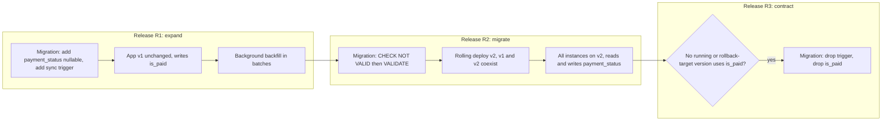
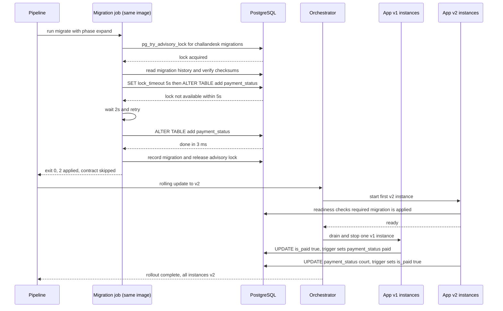

**ChallanDesk** issues and collects traffic fines (e-challans) for a city traffic police: cameras and officers' handhelds create about 25,000 challans a day, citizens pay by UPI or card, and some cases go to a virtual court. The `challans` table has 60 million rows. Today a challan has a boolean `is_paid`. The new release replaces it with `payment_status` (`unpaid`, `paid`, `court`, `waived`) because "sent to court" and "waived" were being squeezed into `is_paid = true` with a remark. The API runs as four instances behind a load balancer and is updated with a **rolling deployment**: for several minutes, old and new versions serve traffic side by side. The first attempt put `ALTER TABLE challans RENAME COLUMN is_paid TO payment_status` in an EF Core migration that ran when each new instance started. Within seconds, the old instances started failing every payment with "column is_paid does not exist", and one migration attempt sat waiting for a lock behind a long-running report query, freezing every write to `challans` for 40 seconds. This lesson is about changing a database **while the application keeps running**.

## Learning objectives

By the end of this lesson you will be able to:

1. Explain why deployments create a window where two application versions use one database, and what that means for schema changes and rollbacks.
2. Plan a schema change as expand, migrate and contract across several releases, keeping every step compatible with the versions running at that moment.
3. Choose where migrations run (pipeline step, one-off job, not every instance at start-up), and use EF Core migration bundles or idempotent scripts.
4. Make a migration runner safe: one runner at a time (advisory lock), short lock timeouts with retries, checksums, and correct handling of statements that can't run in a transaction.
5. Keep two representations in sync during a transition with application dual-writes or a database trigger, and backfill without blocking users.
6. Gate application readiness on the schema version, and roll forward instead of rolling back the database.

## Prerequisites

- [Migrations and schema evolution](#/lesson/m09-migrations-evolution): what `ALTER TABLE` locks, the lock queue, batched backfills and the expand/contract idea in detail. This lesson builds the deployment side on top of it.
- [Blue-green, canary and rolling deployments](#/lesson/m15-deployment-strategies): the strategies that create mixed-version windows.
- [CI/CD with GitHub Actions and Azure DevOps](#/lesson/m15-ci-cd): where the migration step sits in the pipeline.
- [Deadlocks, optimistic and pessimistic locking](#/lesson/m09-locking): locks and how they queue.

## Explain it like I'm a beginner

Imagine replacing the signboards in a busy railway station. You can't close the station, and the announcement system (old) and the new digital displays (new) will both be running for a while. If you take down the old platform numbers before every announcer has switched to the new system, passengers go to the wrong platform.

So you do it in stages:

1. **Expand**: put up the new signs **next to** the old ones. Both systems can find their way.
2. **Migrate**: switch every announcer to the new system, one at a time. Some use old signs, some new; both work.
3. **Contract**: only when nobody uses the old signs any more (and you're sure you won't switch back), take them down.

A database schema is the station's signage, and application versions are the announcers. During a rolling deployment, old and new versions run at the same time, so every schema change must work for **both**. Renaming a column in one step is like replacing all signs overnight while half the announcers still read the old ones.

## First-principles explanation

### The mixed-version window

Every deployment strategy except "stop everything, then start" has a period where two versions of the application share one database:

| Strategy | Who runs at the same time | How long (typical, estimate) |
|---|---|---|
| Rolling | Old and new instances, mixed behind the load balancer | Minutes |
| Blue-green | Old (blue) live, new (green) warming up against the same database; then the switch | Minutes to hours, and blue stays ready for rollback |
| Canary | A small percentage on new, the rest on old | Hours to days |
| Rollback of any of the above | New schema, old code | Until the next fix |

The last row is the one people forget. If release N+1 includes a migration and you roll the **application** back to N, version N now runs against N+1's schema. So the rule has two halves:

- **Backward compatible**: the new schema must work with the **old** application (for the mixed window and for rollbacks).
- **Forward compatible**: the old schema must work with the **new** application, if the new application can start before the migration finishes (for example, in blue-green, green may start first).

The practical way to satisfy both is to never make a breaking change in a single release.

### Expand, migrate, contract (parallel change)

Split every breaking change into steps that ship in **separate releases**:

| Release | Database step | Application step | Safe because |
|---|---|---|---|
| R1 | **Expand**: add `payment_status` (nullable), add a sync trigger | Old code, unchanged | Old code ignores the new column; trigger fills it |
| R1 (background) | **Backfill** existing rows in batches | | No long locks; resumable |
| R2 | (optional) add `CHECK` / `NOT NULL` safely | New code reads and writes `payment_status` | Old instances still write `is_paid`, trigger keeps both in sync |
| R3 | **Contract**: drop trigger, drop `is_paid` | New code no longer mentions `is_paid` | No running or rollback-target version uses `is_paid` |

R3 must wait until R2 is fully rolled out **and** you no longer intend to roll back to R1. A common rule: contract no earlier than one full release after the code stopped using the old column.

What counts as breaking (needs expand/contract) versus safe in one step, for PostgreSQL 17:

| Change | One step? | Why |
|---|---|---|
| `CREATE TABLE` | Safe | Nothing uses it yet |
| `ADD COLUMN` nullable, or with a constant `DEFAULT` | Safe | Catalog-only change since PostgreSQL 11; old code ignores it |
| `ADD COLUMN ... NOT NULL` without default | Breaking | Fails if rows exist; old code's inserts would fail too |
| `CREATE INDEX` (not concurrent) on a big table | Risky | Blocks writes for the whole build |
| `CREATE INDEX CONCURRENTLY` | Safe, but must run outside a transaction | Builds without blocking writes |
| `ADD CONSTRAINT ... CHECK/FOREIGN KEY` | Risky | Validates every row under a strong lock; use `NOT VALID`, then `VALIDATE CONSTRAINT` |
| `ALTER COLUMN ... SET NOT NULL` | Risky | Scans the table under an exclusive lock, unless a validated `CHECK (col IS NOT NULL)` already exists |
| `RENAME COLUMN` / `RENAME TABLE` | Breaking | Old code uses the old name |
| `DROP COLUMN` / `DROP TABLE` | Breaking until no code uses it | Contract step only |
| `ALTER COLUMN ... TYPE` | Breaking and usually a full rewrite | New column plus backfill instead |

[Migrations and schema evolution](#/lesson/m09-migrations-evolution) explains the locking behind each row in depth.

### The lock queue, briefly

Most `ALTER TABLE` forms need an `ACCESS EXCLUSIVE` lock, even for a millisecond of catalog work. If a long report query holds a weaker lock on `challans`, the `ALTER` **waits**, and every new query on `challans`, including simple `SELECT`s, queues **behind the waiting ALTER**. A "1-millisecond" migration becomes a 40-second outage. The fix is to never wait long:

```sql
SET lock_timeout = '5s';        -- give up instead of blocking everyone
SET statement_timeout = '15min';
ALTER TABLE challans ADD COLUMN payment_status text;
```

If the lock isn't granted in 5 seconds, PostgreSQL raises error `55P03` (lock not available), the runner waits a little and retries. Users see at most a 5-second hiccup on that table, not an outage.

### Where should migrations run?

| Option | Pros | Cons | Verdict |
|---|---|---|---|
| Every app instance at start-up (`Database.Migrate()` in `Program.cs`) | Simple, no pipeline step | All instances race; start-up becomes slow and can fail health probes; the app's database user needs DDL rights; a failed migration crash-loops the fleet | Avoid in production with more than one instance |
| Kubernetes **init container** | Runs before the app container | Still once **per pod**, so the same race | Avoid for migrations |
| **Pipeline step** before the app deploy | Runs once, visible in the pipeline, can be approved | Needs network access from the runner to the database | Good |
| **One-off job** (Kubernetes `Job`, Helm pre-upgrade hook, Container Apps job, or a container run by the pipeline) using the same image | Runs once, inside the private network, same artifact as the app | A bit more setup | Best for most teams |
| DBA applies a reviewed SQL script | Maximum control, fits strict change management | Slower, manual | Common in regulated environments; use idempotent scripts |

Whatever you choose: migrations run **once per environment per release**, with a dedicated database identity that has DDL rights (the app's runtime identity should not), and they run **before** the new application version takes traffic.

### EF Core's tools for this

EF Core offers three ways to apply migrations, and its documentation recommends against applying them at application start-up in production:

```text
# 1. SQL script for review or DBA execution. --idempotent wraps each migration in
#    "IF NOT EXISTS (SELECT ... FROM __EFMigrationsHistory ...)" so it can run against any version.
dotnet ef migrations script --idempotent --project src/ChallanDesk.Data --startup-project src/ChallanDesk.Api -o artifacts/migrate.sql

# 2. Migration bundle: a single executable containing the migrations. Build it in CI (it is
#    part of the release artifact), run it in the target environment. No SDK or source needed there.
dotnet ef migrations bundle --project src/ChallanDesk.Data --startup-project src/ChallanDesk.Api --self-contained -r linux-x64 -o artifacts/efbundle
./efbundle --connection "$MIGRATION_CONNECTION_STRING"

# 3. Runtime: context.Database.Migrate() or MigrateAsync(). Fine for tests and single-instance tools.
```

Points to know:

- EF Core records applied migrations in `__EFMigrationsHistory` (`MigrationId`, `ProductVersion`).
- Recent EF Core versions take a database lock while migrating to stop concurrent runs (the mechanism is provider-specific; check that your provider supports it), and warn when the model has changes that have no migration yet.
- PostgreSQL supports transactional DDL, so most migrations run in a transaction and either fully apply or not at all. Statements that **can't** run in a transaction, such as `CREATE INDEX CONCURRENTLY`, need `migrationBuilder.Sql("...", suppressTransaction: true)` and should be alone in their migration, written to be re-runnable (`IF NOT EXISTS`).
- Auto-generated migrations for a property rename emit `RENAME COLUMN`. EF does what you ask; it can't know you're doing a rolling deployment. Review every generated migration.

Other tools follow the same model: DbUp, FluentMigrator, Flyway, Liquibase and Sqitch keep a history table, apply pending scripts in order, and most validate checksums of already-applied scripts.

### Keeping two columns in sync during the transition

While old and new versions both write, `is_paid` and `payment_status` must stay consistent. Two options:

- **Application dual-write**: the new version writes both columns. Simple, but only the new version does it; rows written by old instances during the window have only `is_paid`, so you still need a backfill afterwards.
- **Database trigger**: a `BEFORE INSERT OR UPDATE` trigger derives whichever column the writer didn't set. Every writer (old app, new app, ad-hoc scripts) is covered, and the trigger can fill rows lazily as they are touched. The cost is a small overhead per write and logic in the database that must be removed in the contract step.

For ChallanDesk, the trigger is the safer choice because the old and new versions coexist, and an SMS-payment worker that the team doesn't control also updates `is_paid`. Exercise 3 writes it.

### Backfill: a data migration, not a schema migration

Updating 60 million rows in one statement holds row locks for a long time, generates a huge amount of WAL (write-ahead log, which also has to reach every replica), and can't be resumed if it fails. Run backfills as **batched, idempotent background work**: 5,000 rows per batch selected with `FOR UPDATE SKIP LOCKED`, a pause between batches, progress tracked by "rows still needing work" rather than by an offset. At, say, 5,000 rows per batch and 10 batches a second (an estimate; measure your replication lag while it runs), 60 million rows take about 60,000,000 ÷ 50,000 ≈ 1,200 seconds, around 20 minutes. Keep the backfill out of the deployment's critical path: it can run for hours after R1 without blocking R2's preparation. The batching technique is covered in [Migrations and schema evolution](#/lesson/m09-migrations-evolution).

### The pipeline with migrations

```text
build ─► test ─► package (image + efbundle)
   staging:   migrate --phase=expand ─► deploy app ─► smoke tests
   approval
   production: migrate --phase=expand ─► rolling deploy app ─► smoke tests ─► bake period
   (a later release)  migrate --phase=contract  once no running or rollback-target version needs the old schema
```

Two phases per release:

- **Pre-deploy (expand)**: only additive, backward compatible migrations, run before the new app version.
- **Post-deploy (contract)**: removals, run only when every running version (and the version you'd roll back to) no longer needs what is removed. Many teams run contract migrations as the pre-deploy step of the **next** release, which naturally guarantees the previous release finished.

### Readiness should know the schema version

A new app instance that starts before its migration has run will fail on the first query that touches a new column. Make readiness depend on the schema: the app declares the oldest migration it needs, and its readiness check reports "not ready" until that migration appears in the history table. In a rolling or blue-green deployment, the orchestrator then never routes traffic to it too early, and a forgotten migration step shows up as a stalled rollout rather than as errors in front of users.

### Rollback: roll forward

"Down" migrations look attractive but are rarely safe in production: after R1's expand, real data lands in `payment_status`; a down migration that drops it destroys that data. Prefer:

- **Roll back the application only**, which works because every schema step is backward compatible.
- **Roll forward** with a new migration that fixes the problem.
- **Restore from backup or point-in-time recovery** only for real data corruption, accepting the data written since ([backups and disaster recovery](#/lesson/m14-dr)).

### What breaks first

In order of how often it hurts: a breaking change shipped in one release (old instances fail), a lock queue behind a long query (everything on the table freezes), migrations racing from several instances (duplicate work, failures, crash loops), an index built without `CONCURRENTLY` (writes blocked for minutes), a huge one-statement backfill (replica lag, bloat), and a contract step run while a rollback target still needs the old column.

### When a simpler approach is enough

An internal tool with one instance and a 20-minute maintenance window every Sunday can stop the app, run `efbundle`, and start the new version. A table with 2,000 rows doesn't need batched backfills. The expand/contract discipline is for systems that must stay up during deployments, have more than one instance, or have tables large enough for locks and rewrites to matter. ChallanDesk is all three.

## Visual explanation

### The release timeline



Release R1 only adds: a nullable `payment_status` column and a trigger that keeps it in sync with `is_paid`. The application doesn't change, and a background job backfills old rows. In R2 the migration adds a constraint in the lock-friendly two-step way, then the rolling deployment brings in v2, which reads and writes `payment_status`, while v1 instances still write `is_paid` and the trigger keeps both consistent. Only when every instance runs v2 and nobody would roll back to v1 does R3 remove the trigger and the old column. Each arrow crosses a point where every running version still works.

### Pre-deploy migration job and a rolling update



The pipeline starts the migration job from the same image as the app. The job takes a PostgreSQL advisory lock so no other runner can migrate at the same time, verifies that already-applied migrations haven't been edited, and applies the pending expand migrations with a 5-second lock timeout. The first `ALTER` can't get its lock because a report query is running, so instead of queueing everyone behind it, the job gives up, waits two seconds and retries, and the second attempt takes 3 milliseconds. Contract migrations are skipped in this phase. Only after the job exits successfully does the orchestrator begin the rolling update. Each v2 instance becomes ready only when its required migration is in the history. While v1 and v2 overlap, v1 writes `is_paid` and v2 writes `payment_status`, and the trigger derives the other column in both cases.

## Step-by-step example

### Step 1: undo the dangerous migration

Replace the generated `RenameColumn` migration with an additive one: add `payment_status text` (nullable) and the sync trigger. Remove `Database.Migrate()` from `Program.cs`.

### Step 2: package the runner with the app

The same container image accepts `migrate --phase=expand` and `migrate --phase=contract` arguments. The pipeline runs it as a one-off job before the deployment, using a migration identity with DDL rights. The app's own identity has only `SELECT, INSERT, UPDATE, DELETE`.

### Step 3: release R1

Pre-deploy job applies the expand migration in milliseconds (with lock timeout and retries). App v1 is redeployed unchanged (or not at all). The trigger starts filling `payment_status` for every touched row; a background job backfills the rest over about 20 minutes.

### Step 4: release R2

Pre-deploy job adds `CHECK (payment_status IN (...)) NOT VALID` and then `VALIDATE CONSTRAINT` (which allows normal reads and writes while it scans). App v2 rolls out, reading and writing `payment_status`. Readiness requires migration `20261002_1105_sync_trigger`.

### Step 5: release R3

After R2 has run for a full release cycle with no rollback, the contract job drops the trigger and `is_paid`. EF Core's model no longer contains `IsPaid`.

### Step 6: rehearse

Run all three phases against a restored copy of production (60 million rows) in staging, with a load generator replaying writes, and record lock waits and durations.

## Production-style C# implementation

The runner is provider-neutral behind `IMigrationStore`; a PostgreSQL implementation is shown afterwards as a snippet, because it needs the Npgsql package.

```csharp file=Migrations/MigrationModel.cs
using System.Security.Cryptography;
using System.Text;

namespace ChallanDesk.Migrations;

public enum MigrationPhase { Expand, Contract }

public enum RunMode { PreDeploy, PostDeploy }

/// <summary>One migration. Ids sort in the order they must run (timestamp prefix).</summary>
public sealed record Migration(string Id, MigrationPhase Phase, string Sql, bool RunInTransaction = true)
{
    /// <summary>Detects edits to a migration after it was applied somewhere.</summary>
    public string Checksum => Convert.ToHexString(SHA256.HashData(Encoding.UTF8.GetBytes(Sql.ReplaceLineEndings("\n").Trim())));
}

public sealed record AppliedMigration(string Id, string Checksum, DateTimeOffset AppliedAt);

public interface IMigrationSource
{
    IReadOnlyList<Migration> All();
}

public interface IMigrationStore
{
    /// <summary>Returns null if another runner holds the lock after waiting up to <paramref name="wait"/>.</summary>
    Task<IAsyncDisposable?> TryAcquireRunnerLockAsync(TimeSpan wait, CancellationToken ct);
    Task<IReadOnlyList<AppliedMigration>> GetAppliedAsync(CancellationToken ct);
    /// <summary>Executes the SQL with the given lock_timeout and records it in the history,
    /// in one transaction when the migration allows it. Throws MigrationLockTimeoutException on 55P03.</summary>
    Task ApplyAsync(Migration migration, TimeSpan lockTimeout, CancellationToken ct);
}

public sealed class MigrationLockTimeoutException(string migrationId)
    : Exception($"Migration {migrationId} could not get its table lock in time.")
{
    public string MigrationId { get; } = migrationId;
}
```

```csharp file=Migrations/MigrationRunner.cs
using Microsoft.Extensions.Options;

namespace ChallanDesk.Migrations;

public sealed class MigrationRunnerOptions
{
    public TimeSpan RunnerLockWait { get; set; } = TimeSpan.FromMinutes(2);
    public TimeSpan StatementLockTimeout { get; set; } = TimeSpan.FromSeconds(5);
    public int MaxLockAttempts { get; set; } = 6;
    public TimeSpan RetryDelay { get; set; } = TimeSpan.FromSeconds(2);
}

public sealed record MigrationRunResult(IReadOnlyList<string> Applied, IReadOnlyList<string> Deferred);

public sealed class MigrationRunner(
    IMigrationSource source,
    IMigrationStore store,
    IOptions<MigrationRunnerOptions> options,
    ILogger<MigrationRunner> log)
{
    public async Task<MigrationRunResult> RunAsync(RunMode mode, CancellationToken ct)
    {
        var o = options.Value;
        await using var runnerLock = await store.TryAcquireRunnerLockAsync(o.RunnerLockWait, ct)
            ?? throw new InvalidOperationException("Another migration runner is active. Refusing to run concurrently.");

        var applied = (await store.GetAppliedAsync(ct)).ToDictionary(a => a.Id, StringComparer.Ordinal);
        var all = source.All().OrderBy(m => m.Id, StringComparer.Ordinal).ToList();

        foreach (var m in all)
            if (applied.TryGetValue(m.Id, out var a) && !string.Equals(a.Checksum, m.Checksum, StringComparison.OrdinalIgnoreCase))
                throw new InvalidOperationException($"Migration {m.Id} was changed after it was applied. Add a new migration instead.");

        var pending = all.Where(m => !applied.ContainsKey(m.Id)).ToList();
        var done = new List<string>();
        var deferred = new List<string>();

        for (var i = 0; i < pending.Count; i++)
        {
            var m = pending[i];
            if (mode == RunMode.PreDeploy && m.Phase == MigrationPhase.Contract)
            {
                // Order matters: everything after the first contract waits for the post-deploy phase.
                deferred.AddRange(pending.Skip(i).Select(p => p.Id));
                break;
            }
            await ApplyWithRetryAsync(m, o, ct);
            done.Add(m.Id);
        }

        log.LogInformation("Migrations ({Mode}): applied {Applied}, deferred {Deferred}", mode, done.Count, deferred.Count);
        return new MigrationRunResult(done, deferred);
    }

    private async Task ApplyWithRetryAsync(Migration m, MigrationRunnerOptions o, CancellationToken ct)
    {
        for (var attempt = 1; ; attempt++)
        {
            try
            {
                log.LogInformation("Applying {Id} (attempt {Attempt})", m.Id, attempt);
                await store.ApplyAsync(m, o.StatementLockTimeout, ct);
                return;
            }
            catch (MigrationLockTimeoutException) when (attempt < o.MaxLockAttempts)
            {
                // Someone holds a conflicting lock (a long report, a vacuum). Give way, then try again.
                log.LogWarning("Lock timeout on {Id}, retrying in {Delay}", m.Id, o.RetryDelay);
                await Task.Delay(o.RetryDelay, ct);
            }
        }
    }
}
```

```csharp file=Migrations/ChallanMigrations.cs
namespace ChallanDesk.Migrations;

/// <summary>The is_paid to payment_status change, split across releases.</summary>
public sealed class ChallanMigrations : IMigrationSource
{
    public IReadOnlyList<Migration> All() =>
    [
        new("20261002_1100_add_payment_status", MigrationPhase.Expand,
            "ALTER TABLE challans ADD COLUMN IF NOT EXISTS payment_status text;"),

        new("20261002_1105_sync_trigger", MigrationPhase.Expand, """
            CREATE OR REPLACE FUNCTION sync_payment_status() RETURNS trigger LANGUAGE plpgsql AS $$
            BEGIN
              IF TG_OP = 'INSERT' THEN
                IF NEW.payment_status IS NULL THEN
                  NEW.payment_status := CASE WHEN NEW.is_paid THEN 'paid' ELSE 'unpaid' END;
                ELSE
                  NEW.is_paid := NEW.payment_status <> 'unpaid';
                END IF;
              ELSIF NEW.payment_status IS DISTINCT FROM OLD.payment_status THEN
                NEW.is_paid := NEW.payment_status <> 'unpaid';
              ELSIF NEW.is_paid IS DISTINCT FROM OLD.is_paid OR NEW.payment_status IS NULL THEN
                NEW.payment_status := CASE WHEN NEW.is_paid THEN 'paid' ELSE 'unpaid' END;
              END IF;
              RETURN NEW;
            END $$;
            DROP TRIGGER IF EXISTS trg_sync_payment_status ON challans;
            CREATE TRIGGER trg_sync_payment_status BEFORE INSERT OR UPDATE ON challans
              FOR EACH ROW EXECUTE FUNCTION sync_payment_status();
            """),

        // Cannot run inside a transaction. Re-runnable thanks to IF NOT EXISTS.
        new("20261009_0900_index_payment_status", MigrationPhase.Expand,
            "CREATE INDEX CONCURRENTLY IF NOT EXISTS ix_challans_payment_status ON challans (payment_status) WHERE payment_status <> 'paid';",
            RunInTransaction: false),

        new("20261009_0910_check_payment_status", MigrationPhase.Expand, """
            ALTER TABLE challans ADD CONSTRAINT ck_challans_payment_status
              CHECK (payment_status IN ('unpaid', 'paid', 'court', 'waived')) NOT VALID;
            ALTER TABLE challans VALIDATE CONSTRAINT ck_challans_payment_status;
            """),

        // Release R3. Only after every running and rollback-target version stopped using is_paid.
        new("20261023_1000_drop_is_paid", MigrationPhase.Contract, """
            DROP TRIGGER IF EXISTS trg_sync_payment_status ON challans;
            DROP FUNCTION IF EXISTS sync_payment_status();
            ALTER TABLE challans DROP COLUMN IF EXISTS is_paid;
            """),
    ];
}
```

```csharp file=Migrations/InMemoryMigrationStore.cs
namespace ChallanDesk.Migrations;

/// <summary>Test and local-development store. Production uses the PostgreSQL store shown below.</summary>
public sealed class InMemoryMigrationStore : IMigrationStore
{
    private readonly SemaphoreSlim _runnerLock = new(1, 1);
    private readonly List<AppliedMigration> _applied = [];
    private readonly object _gate = new();

    public Func<Migration, int, bool> FailWithLockTimeout { get; set; } = (_, _) => false;
    private readonly Dictionary<string, int> _attempts = new(StringComparer.Ordinal);

    public async Task<IAsyncDisposable?> TryAcquireRunnerLockAsync(TimeSpan wait, CancellationToken ct) =>
        await _runnerLock.WaitAsync(wait, ct) ? new Releaser(_runnerLock) : null;

    public Task<IReadOnlyList<AppliedMigration>> GetAppliedAsync(CancellationToken ct)
    {
        lock (_gate) return Task.FromResult<IReadOnlyList<AppliedMigration>>(_applied.ToList());
    }

    public Task ApplyAsync(Migration migration, TimeSpan lockTimeout, CancellationToken ct)
    {
        lock (_gate)
        {
            var attempt = _attempts[migration.Id] = _attempts.GetValueOrDefault(migration.Id) + 1;
            if (FailWithLockTimeout(migration, attempt)) throw new MigrationLockTimeoutException(migration.Id);
            _applied.Add(new AppliedMigration(migration.Id, migration.Checksum, DateTimeOffset.UtcNow));
        }
        return Task.CompletedTask;
    }

    private sealed class Releaser(SemaphoreSlim s) : IAsyncDisposable
    {
        public ValueTask DisposeAsync() { s.Release(); return ValueTask.CompletedTask; }
    }
}
```

```csharp file=Migrations/SchemaVersionHealthCheck.cs
using Microsoft.Extensions.Diagnostics.HealthChecks;
using Microsoft.Extensions.Options;

namespace ChallanDesk.Migrations;

public sealed class SchemaRequirementOptions
{
    /// <summary>The oldest migration this app version needs, e.g. "20261002_1105_sync_trigger".</summary>
    public string RequiredMigrationId { get; set; } = "";
}

/// <summary>Readiness: do not take traffic until the schema this version needs exists.</summary>
public sealed class SchemaVersionHealthCheck(IMigrationStore store, IOptions<SchemaRequirementOptions> options) : IHealthCheck
{
    public async Task<HealthCheckResult> CheckHealthAsync(HealthCheckContext context, CancellationToken cancellationToken = default)
    {
        var required = options.Value.RequiredMigrationId;
        if (string.IsNullOrEmpty(required)) return HealthCheckResult.Healthy("No schema requirement configured.");

        var applied = await store.GetAppliedAsync(cancellationToken);
        return applied.Any(a => a.Id == required)
            ? HealthCheckResult.Healthy($"Schema includes {required}.")
            : HealthCheckResult.Unhealthy($"Waiting for migration {required}. Was the pre-deploy migration step run?");
    }
}
```

```csharp file=Program.cs
using ChallanDesk.Migrations;

var builder = WebApplication.CreateBuilder(args);

builder.Services.AddSingleton<IMigrationSource, ChallanMigrations>();
builder.Services.AddSingleton<IMigrationStore, InMemoryMigrationStore>();   // production: the PostgreSQL store
builder.Services.Configure<MigrationRunnerOptions>(builder.Configuration.GetSection("Migrations"));
builder.Services.Configure<SchemaRequirementOptions>(builder.Configuration.GetSection("Schema"));
builder.Services.AddSingleton<MigrationRunner>();
builder.Services.AddHealthChecks()
    .AddCheck<SchemaVersionHealthCheck>("schema", tags: ["ready"]);

// Same image, two entry points: "migrate --phase=expand|contract" runs once as a job and exits.
if (args.Length > 0 && args[0] == "migrate")
{
    var mode = args.Contains("--phase=contract") ? RunMode.PostDeploy : RunMode.PreDeploy;
    using var host = builder.Build();
    var runner = host.Services.GetRequiredService<MigrationRunner>();
    try
    {
        var result = await runner.RunAsync(mode, CancellationToken.None);
        Console.WriteLine($"Applied: {string.Join(", ", result.Applied)}. Deferred: {string.Join(", ", result.Deferred)}");
        return 0;
    }
    catch (Exception ex)
    {
        Console.Error.WriteLine($"Migration failed: {ex.Message}");
        return 1;
    }
}

var app = builder.Build();
app.MapHealthChecks("/health/ready", new() { Predicate = r => r.Tags.Contains("ready") });
app.MapHealthChecks("/health/live", new() { Predicate = _ => false });

app.MapPost("/api/challans/{id:long}/payments", (long id, string method) =>
    Results.Ok(new { id, paymentStatus = "paid", method, receivedAtIst = "2026-10-20T11:42:00+05:30" }));

app.Run();
return 0;
```

The PostgreSQL store (needs the Npgsql package, so shown without a `file=`):

```csharp
public sealed class NpgsqlMigrationStore(NpgsqlDataSource db) : IMigrationStore
{
    private const long LockKey = 0x43_48_41_4C_4C_41_4E;   // any constant shared by all runners of this app

    public async Task<IAsyncDisposable?> TryAcquireRunnerLockAsync(TimeSpan wait, CancellationToken ct)
    {
        var conn = await db.OpenConnectionAsync(ct);          // session-level lock lives on this connection
        var deadline = DateTime.UtcNow + wait;
        while (DateTime.UtcNow < deadline)
        {
            await using var cmd = new NpgsqlCommand("SELECT pg_try_advisory_lock(@k)", conn);
            cmd.Parameters.AddWithValue("k", LockKey);
            if ((bool)(await cmd.ExecuteScalarAsync(ct))!) return new LockHandle(conn, LockKey);
            await Task.Delay(TimeSpan.FromSeconds(2), ct);
        }
        await conn.DisposeAsync();
        return null;
    }

    public async Task ApplyAsync(Migration m, TimeSpan lockTimeout, CancellationToken ct)
    {
        await using var conn = await db.OpenConnectionAsync(ct);
        await using var tx = m.RunInTransaction ? await conn.BeginTransactionAsync(ct) : null;
        try
        {
            await Exec(conn, $"SET lock_timeout = '{(int)lockTimeout.TotalMilliseconds}ms'", ct);
            await Exec(conn, m.Sql, ct);
            await using var rec = new NpgsqlCommand(
                "INSERT INTO schema_migrations_history (migration_id, checksum, applied_at) VALUES (@id, @sum, now())", conn);
            rec.Parameters.AddWithValue("id", m.Id);
            rec.Parameters.AddWithValue("sum", m.Checksum);
            await rec.ExecuteNonQueryAsync(ct);
            if (tx is not null) await tx.CommitAsync(ct);
        }
        catch (PostgresException ex) when (ex.SqlState == PostgresErrorCodes.LockNotAvailable)   // 55P03
        {
            throw new MigrationLockTimeoutException(m.Id);
        }
    }
    // GetAppliedAsync reads schema_migrations_history; LockHandle runs pg_advisory_unlock and closes the connection.
}
```

### Running it from the pipeline

```yaml
# GitHub Actions excerpt (production job, after approval)
- name: Pre-deploy migrations (expand only)
  run: |
    az containerapp job start --name job-challandesk-migrate-prd --resource-group rg-challandesk-prd \
      --image "$IMAGE@$DIGEST" --args "migrate,--phase=expand"
    ./deploy/wait-for-job.sh job-challandesk-migrate-prd      # fails the step if the job fails
- name: Rolling deploy
  run: az containerapp update --name ca-challandesk-prd --resource-group rg-challandesk-prd --image "$IMAGE@$DIGEST"
```

```yaml
# Kubernetes alternative: a Job (or a Helm pre-upgrade hook), never an init container
apiVersion: batch/v1
kind: Job
metadata:
  name: challandesk-migrate-r42
spec:
  backoffLimit: 0                 # the runner retries lock timeouts itself
  activeDeadlineSeconds: 1800
  template:
    spec:
      restartPolicy: Never
      serviceAccountName: challandesk-migrator      # identity with DDL rights
      containers:
        - name: migrate
          image: registry.example/challandesk/api@sha256:9f2c...
          args: ["migrate", "--phase=expand"]
```

### Free local practice

Run PostgreSQL 17 in Docker (`docker run -d -p 5432:5432 -e POSTGRES_PASSWORD=local postgres:17.6`), create `challans` with a few million generated rows (`INSERT ... SELECT FROM generate_series(1, 5000000)`), then, in one terminal, hold a lock with `BEGIN; SELECT count(*) FROM challans; SELECT pg_sleep(60);` and in another run the migration with and without `SET lock_timeout = '5s'`. Watch `pg_stat_activity` and `pg_locks` to see the lock queue form. The SQL exercises below run in the in-browser playground.

Design notes:

- **One image, two entry points.** The migration job runs exactly the build that will be deployed, so migrations and code can't drift apart.
- **The runner refuses to run concurrently** and refuses edited migrations. Both failures are loud and early.
- **Expand and contract are data, not convention.** Each migration declares its phase, so the pre-deploy step can't run a contract migration by accident.
- **Readiness knows the schema.** A rollout started without its migration stalls safely instead of failing requests.
- **Least privilege.** The migration job's identity can run DDL; the app's identity can't, so a SQL injection in the app can't drop a table.

## Bad design vs good design

**Bad**: migrations as a side effect of start-up.

```text
- Program.cs calls db.Database.Migrate() on every instance
- One migration renames is_paid to payment_status and changes its type
- No lock_timeout: ALTER waits behind a 30-minute report, the whole table freezes
- CREATE INDEX (not CONCURRENTLY) on 60 million rows during business hours
- UPDATE challans SET payment_status = ... for all rows in one statement
- "Down" migration used to roll back after a day of new data
- App database user owns the schema and can DROP anything
```

What goes wrong: four instances race to migrate; three fail and crash-loop while the first holds the lock. Old instances break the moment the rename commits. A lock queue turns a millisecond change into an outage. Writes block during the index build. The giant update causes replica lag and table bloat, and can't be resumed. The down migration deletes a day of court referrals. A compromised app account could drop the schema.

**Good**: one migration job per release, run from the release image by the pipeline before deployment; additive expand migrations with `lock_timeout` and retries; concurrent index builds in their own non-transactional migrations; `NOT VALID` then `VALIDATE` constraints; a trigger or dual-write during the mixed window; batched background backfills; contract migrations one release later; readiness gated on schema version; roll forward instead of down migrations; separate migration and runtime identities.

:::callout type=warning title="EF Core generates what you asked for"
Renaming a property produces `RenameColumn`, and changing a type produces `AlterColumn`. Both are breaking in a rolling deployment. Treat every generated migration as a draft: read the SQL (`dotnet ef migrations script`), and rewrite breaking changes as expand and contract steps.
:::

:::callout type=tradeoff title="Trigger or application dual-write?"
A trigger covers every writer, including old versions and scripts, and keeps the data consistent at the database level, but it adds per-write overhead and hidden logic that must be removed later. Application dual-write is visible in code and easy to test, but only covers the new version. During a mixed-version window with other writers, prefer the trigger; for a short window with one writer, dual-write is often enough.
:::

## Practical playground

The playground database has a `challans` table at the start of release R1 (only `is_paid`, no `payment_status`), and a migration history table. Try:

1. Add `payment_status` as a nullable column and confirm existing queries still work.
2. Write the sync trigger from exercise 3 and test inserts in the "old app" style (only `is_paid`) and the "new app" style (only `payment_status`).
3. Backfill 3 rows at a time with `FOR UPDATE SKIP LOCKED` until nothing is left.
4. Record each step in `schema_migrations_history` and write a query listing pending migrations.

:::playground type=sql title="ChallanDesk at release R1"
```sql
CREATE TABLE challans (
  id bigint PRIMARY KEY,
  registration_no text NOT NULL,
  offence_code text NOT NULL,
  fine_paise bigint NOT NULL CHECK (fine_paise > 0),
  issued_at timestamptz NOT NULL,
  is_paid boolean NOT NULL DEFAULT false
);
INSERT INTO challans (id, registration_no, offence_code, fine_paise, issued_at, is_paid) VALUES
  (1, 'MH12AB1234', 'SPEED',   200000, '2026-10-01 09:15+05:30', true),
  (2, 'KA01MJ2024', 'SIGNAL',  100000, '2026-10-02 18:40+05:30', false),
  (3, 'DL3CAF0042', 'HELMET',   50000, '2026-10-03 08:05+05:30', true),
  (4, 'TN09BX7777', 'PARKING',  50000, '2026-10-04 12:30+05:30', false),
  (5, 'GJ05KL1010', 'SPEED',   200000, '2026-10-05 22:10+05:30', false),
  (6, 'UP32HH4321', 'SEATBELT', 100000, '2026-10-06 07:55+05:30', true),
  (7, 'WB02PQ0099', 'SIGNAL',  100000, '2026-10-07 16:20+05:30', false);
CREATE TABLE schema_migrations_history (
  migration_id text PRIMARY KEY,
  checksum text NOT NULL,
  applied_at timestamptz NOT NULL DEFAULT now()
);
INSERT INTO schema_migrations_history (migration_id, checksum) VALUES
  ('20260901_0900_create_challans', 'A1F3'),
  ('20260915_1030_add_offence_code', '9C2E');
```
:::

## Exercises

:::exercise id=m15-db-migrations-deploy-ex1 difficulty=beginner kind=written title="Classify migrations for a rolling deployment"
ChallanDesk deploys with rolling updates (old and new instances overlap for about 10 minutes) and may roll the app back within 24 hours. For each statement, say whether it is **safe in one release**, **safe with care** (and what care), or **breaking** (and how to split it). The `challans` table has 60 million rows.

1. `CREATE TABLE court_referrals (challan_id bigint PRIMARY KEY REFERENCES challans(id), court_case_no text NOT NULL);`
2. `ALTER TABLE challans ADD COLUMN officer_badge text;`
3. `ALTER TABLE challans ADD COLUMN source text NOT NULL DEFAULT 'camera';`
4. `ALTER TABLE challans RENAME COLUMN registration_no TO vehicle_reg_no;`
5. `CREATE INDEX ix_challans_issued_at ON challans (issued_at);`
6. `ALTER TABLE challans ALTER COLUMN fine_paise TYPE numeric(12,2);`
7. `ALTER TABLE challans ADD CONSTRAINT fk_offence FOREIGN KEY (offence_code) REFERENCES offences(code);`
8. `ALTER TABLE challans DROP COLUMN is_paid;` (in the same release that stops using it)
::acceptance
- 1 and 2 are safe; 3 is safe on PostgreSQL 11+ (constant default is catalog-only).
- 4 and 6 are breaking and need a new column, sync and backfill, then contract.
- 5 needs `CONCURRENTLY` in its own non-transactional migration.
- 7 needs `NOT VALID` then `VALIDATE CONSTRAINT`.
- 8 must move to a later release, after no running or rollback-target version uses the column.
- Mentions `lock_timeout` for statements that take strong locks.
::hint
For each, ask: will the **old** version still work after this runs? And: how long will this hold a strong lock on 60 million rows?
::hint
A rollback within 24 hours means the old version must work against the new schema for 24 hours, not 10 minutes.
::hint
Since PostgreSQL 11, `ADD COLUMN ... DEFAULT <constant>` doesn't rewrite the table.
::solution
1. **Safe.** A new table affects nothing existing. The foreign key on a new, empty table validates instantly. (It takes a lock on `challans` briefly to add the reference; keep `lock_timeout` set.)
2. **Safe.** Nullable column, catalog-only. Old code ignores it.
3. **Safe on PostgreSQL 11 and later.** A constant default is stored in the catalog; no rewrite. Old code that inserts without `source` gets `'camera'`. With a volatile default (like `now()` or `gen_random_uuid()`), it would rewrite the table: split it into add-nullable, backfill, then set the default.
4. **Breaking.** Old instances (and a rolled-back version) query `registration_no`. Split: R1 add `vehicle_reg_no`, sync with a trigger, backfill; R2 app reads and writes `vehicle_reg_no`; R3 drop `registration_no`. Often the honest answer is "don't rename": map the new property name to the old column in EF Core (`HasColumnName("registration_no")`).
5. **Safe with care.** A plain `CREATE INDEX` blocks writes for the whole build on 60 million rows. Use `CREATE INDEX CONCURRENTLY IF NOT EXISTS`, alone in a migration with the transaction suppressed. If it fails, it leaves an invalid index: drop it and retry.
6. **Breaking and a full table rewrite** under an exclusive lock. Add `fine_rupees numeric(12,2)`, sync and backfill, switch the app, then drop `fine_paise`. Also question the change: paise in `bigint` is usually the better representation.
7. **Safe with care.** Adding a foreign key validates every row while holding locks. Use `ADD CONSTRAINT ... NOT VALID` (fast, enforced for new rows), then `VALIDATE CONSTRAINT` (scans, but doesn't block normal reads and writes). Make sure every existing `offence_code` exists in `offences` first.
8. **Breaking in this release.** Old instances during the rollout and the rollback target both use `is_paid`. Move the drop to a later release, once the version that stopped using it is fully deployed and rollback to the older version is no longer planned.

For every statement that takes an `ACCESS EXCLUSIVE` lock (2, 3, 4, 7's `ADD`, 8), set `lock_timeout` (for example 5 seconds) and retry, to avoid the lock queue.
::mistakes
- Calling 3 unsafe because "adding NOT NULL is dangerous". With a constant default on modern PostgreSQL, it's fine.
- Fixing 5 with `CONCURRENTLY` but leaving it in a transactional migration, which fails immediately.
- Treating the 10-minute rollout as the only window and forgetting the 24-hour rollback window.
:::

:::exercise id=m15-db-migrations-deploy-ex2 difficulty=beginner kind=sql ordered=true title="What will the pre-deploy step run?"
The release contains six migrations. The history shows what production has already applied (including a hotfix index that was applied by hand and has no file in the release). Write a query returning the `id` and `description` of migrations the **pre-deploy** step must run: not yet applied, phase `expand`, and with an `id` **lower than the first pending contract migration** (everything after a pending contract waits for the post-deploy phase). Order by `id`.
::setup
```sql
CREATE TABLE release_migrations (
  id text PRIMARY KEY,
  phase text NOT NULL CHECK (phase IN ('expand', 'contract')),
  description text NOT NULL
);
INSERT INTO release_migrations VALUES
  ('20260901_0900_create_challans',      'expand',   'Create challans'),
  ('20260915_1030_add_offence_code',     'expand',   'Add offence_code'),
  ('20261002_1100_add_payment_status',   'expand',   'Add payment_status (nullable)'),
  ('20261002_1105_sync_trigger',         'expand',   'Trigger keeping is_paid and payment_status in sync'),
  ('20261009_0900_index_payment_status', 'expand',   'Partial index on unpaid challans (concurrently)'),
  ('20261012_0800_drop_legacy_remarks',  'contract', 'Drop legacy_remarks column'),
  ('20261015_0900_add_paid_via',         'expand',   'Add paid_via column');
CREATE TABLE schema_migrations_history (
  migration_id text PRIMARY KEY,
  applied_at timestamptz NOT NULL,
  applied_by text NOT NULL
);
INSERT INTO schema_migrations_history VALUES
  ('20260901_0900_create_challans',    '2026-09-01 21:00+05:30', 'pipeline'),
  ('20260915_1030_add_offence_code',   '2026-09-15 21:00+05:30', 'pipeline'),
  ('20260920_0800_hotfix_index',       '2026-09-20 02:10+05:30', 'dba-oncall'),
  ('20261002_1100_add_payment_status', '2026-10-02 21:00+05:30', 'pipeline');
```
::check
```sql
SELECT m.id, m.description
FROM release_migrations m
WHERE m.phase = 'expand'
  AND NOT EXISTS (SELECT 1 FROM schema_migrations_history h WHERE h.migration_id = m.id)
  AND m.id < COALESCE(
        (SELECT min(c.id) FROM release_migrations c
         WHERE c.phase = 'contract'
           AND NOT EXISTS (SELECT 1 FROM schema_migrations_history h2 WHERE h2.migration_id = c.id)),
        'zzzz')
ORDER BY m.id;
```
::acceptance
- Returns exactly `20261002_1105_sync_trigger` and `20261009_0900_index_payment_status`, in that order.
- `20261015_0900_add_paid_via` is excluded because it comes after the pending contract migration.
- Already-applied migrations and the hand-applied hotfix don't appear.
::hint
"Not yet applied" is a `NOT EXISTS` (or `LEFT JOIN ... IS NULL`) against the history.
::hint
Find the first pending contract migration with a subquery using `min(id)`.
::hint
If there is no pending contract, `min` returns NULL and `id < NULL` is never true. Use `COALESCE` with a value that sorts after every id.
::solution
```sql
SELECT m.id, m.description
FROM release_migrations m
WHERE m.phase = 'expand'
  AND NOT EXISTS (SELECT 1 FROM schema_migrations_history h WHERE h.migration_id = m.id)
  AND m.id < COALESCE(
        (SELECT min(c.id) FROM release_migrations c
         WHERE c.phase = 'contract'
           AND NOT EXISTS (SELECT 1 FROM schema_migrations_history h2 WHERE h2.migration_id = c.id)),
        'zzzz')
ORDER BY m.id;
```

Why stop at the first pending contract? Migrations are written assuming the ones before them ran. `add_paid_via` was written after `drop_legacy_remarks` and might depend on it (for example, reusing a name). Running it early would apply migrations out of order. The runner in this lesson does the same: it defers everything from the first contract onwards. The hand-applied `hotfix_index` doesn't appear because the query starts from the release's migrations; a separate check should report history rows that have no file, so the hotfix gets codified.
::mistakes
- Forgetting the `COALESCE`, which returns no rows at all when no contract is pending.
- Filtering only `phase = 'expand'` and running `add_paid_via` before the contract it follows.
:::

:::exercise id=m15-db-migrations-deploy-ex3 difficulty=intermediate kind=sql ordered=true title="A trigger that keeps old and new columns in sync"
Release R1 added a nullable `payment_status` to `challans`; rows 1–3 are backfilled, rows 4 and 5 are not yet. During the rollout, the old app writes only `is_paid`, and the new app writes only `payment_status` (`unpaid`, `paid`, `court`, `waived`). The old meaning of `is_paid` is "nothing more is due", so `is_paid` is true for every status except `unpaid`.

Create a function `sync_payment_status()` and a `BEFORE INSERT OR UPDATE` row trigger `trg_sync_payment_status` on `challans` that:

- On **insert**: if `payment_status` is null, derive it from `is_paid` (`paid` or `unpaid`); otherwise derive `is_paid` from `payment_status`.
- On **update**: if `payment_status` changed, derive `is_paid`; otherwise, if `is_paid` changed **or** `payment_status` is still null, derive `payment_status`.

Then run exactly these statements and finish with the query:

```sql
INSERT INTO challans (id, registration_no, fine_paise, is_paid) VALUES (6, 'KA01MJ2024', 50000, false);
INSERT INTO challans (id, registration_no, fine_paise, payment_status) VALUES (7, 'DL3CAF0042', 200000, 'waived');
UPDATE challans SET is_paid = true WHERE id = 4;
UPDATE challans SET payment_status = 'court' WHERE id = 2;
UPDATE challans SET fine_paise = fine_paise + 10000 WHERE id = 5;
SELECT id, is_paid, payment_status FROM challans ORDER BY id;
```
::setup
```sql
CREATE TABLE challans (
  id bigint PRIMARY KEY,
  registration_no text NOT NULL,
  fine_paise bigint NOT NULL,
  is_paid boolean NOT NULL DEFAULT false,
  payment_status text CHECK (payment_status IN ('unpaid', 'paid', 'court', 'waived'))
);
INSERT INTO challans (id, registration_no, fine_paise, is_paid, payment_status) VALUES
  (1, 'MH12AB1234', 200000, true,  'paid'),
  (2, 'GJ05KL1010', 100000, false, 'unpaid'),
  (3, 'UP32HH4321', 100000, true,  'waived'),
  (4, 'TN09BX7777',  50000, false, NULL),
  (5, 'WB02PQ0099', 100000, false, NULL);
```
::check
```sql
CREATE FUNCTION sync_payment_status() RETURNS trigger LANGUAGE plpgsql AS $$
BEGIN
  IF TG_OP = 'INSERT' THEN
    IF NEW.payment_status IS NULL THEN
      NEW.payment_status := CASE WHEN NEW.is_paid THEN 'paid' ELSE 'unpaid' END;
    ELSE
      NEW.is_paid := NEW.payment_status <> 'unpaid';
    END IF;
  ELSIF NEW.payment_status IS DISTINCT FROM OLD.payment_status THEN
    NEW.is_paid := NEW.payment_status <> 'unpaid';
  ELSIF NEW.is_paid IS DISTINCT FROM OLD.is_paid OR NEW.payment_status IS NULL THEN
    NEW.payment_status := CASE WHEN NEW.is_paid THEN 'paid' ELSE 'unpaid' END;
  END IF;
  RETURN NEW;
END $$;
CREATE TRIGGER trg_sync_payment_status BEFORE INSERT OR UPDATE ON challans
  FOR EACH ROW EXECUTE FUNCTION sync_payment_status();
INSERT INTO challans (id, registration_no, fine_paise, is_paid) VALUES (6, 'KA01MJ2024', 50000, false);
INSERT INTO challans (id, registration_no, fine_paise, payment_status) VALUES (7, 'DL3CAF0042', 200000, 'waived');
UPDATE challans SET is_paid = true WHERE id = 4;
UPDATE challans SET payment_status = 'court' WHERE id = 2;
UPDATE challans SET fine_paise = fine_paise + 10000 WHERE id = 5;
SELECT id, is_paid, payment_status FROM challans ORDER BY id;
```
::acceptance
- Row 6 (old-style insert) is `false, unpaid`; row 7 (new-style insert) is `true, waived`.
- Row 4 (old app marks paid) becomes `true, paid`; row 2 (new app sends to court) becomes `true, court`.
- Row 5, touched by an unrelated old-app update, is lazily backfilled to `false, unpaid`.
- Rows 1 and 3 are unchanged.
::hint
A `BEFORE` row trigger can change `NEW` and must `RETURN NEW`.
::hint
Use `TG_OP` to tell inserts from updates, and `IS DISTINCT FROM` to compare values that may be NULL.
::hint
The `CASE WHEN NEW.is_paid THEN 'paid' ELSE 'unpaid' END` expression derives the status; `NEW.payment_status <> 'unpaid'` derives `is_paid`.
::hint
Structure: `IF TG_OP = 'INSERT' THEN ... ELSIF <status changed> THEN ... ELSIF <is_paid changed or status null> THEN ... END IF;`
::solution
```sql
CREATE FUNCTION sync_payment_status() RETURNS trigger LANGUAGE plpgsql AS $$
BEGIN
  IF TG_OP = 'INSERT' THEN
    IF NEW.payment_status IS NULL THEN
      NEW.payment_status := CASE WHEN NEW.is_paid THEN 'paid' ELSE 'unpaid' END;
    ELSE
      NEW.is_paid := NEW.payment_status <> 'unpaid';
    END IF;
  ELSIF NEW.payment_status IS DISTINCT FROM OLD.payment_status THEN
    NEW.is_paid := NEW.payment_status <> 'unpaid';
  ELSIF NEW.is_paid IS DISTINCT FROM OLD.is_paid OR NEW.payment_status IS NULL THEN
    NEW.payment_status := CASE WHEN NEW.is_paid THEN 'paid' ELSE 'unpaid' END;
  END IF;
  RETURN NEW;
END $$;
CREATE TRIGGER trg_sync_payment_status BEFORE INSERT OR UPDATE ON challans
  FOR EACH ROW EXECUTE FUNCTION sync_payment_status();
INSERT INTO challans (id, registration_no, fine_paise, is_paid) VALUES (6, 'KA01MJ2024', 50000, false);
INSERT INTO challans (id, registration_no, fine_paise, payment_status) VALUES (7, 'DL3CAF0042', 200000, 'waived');
UPDATE challans SET is_paid = true WHERE id = 4;
UPDATE challans SET payment_status = 'court' WHERE id = 2;
UPDATE challans SET fine_paise = fine_paise + 10000 WHERE id = 5;
SELECT id, is_paid, payment_status FROM challans ORDER BY id;
```

The order of the `ELSIF` branches matters: when the new app changes `payment_status`, that is the source of truth, even if `is_paid` (unchanged in the statement) disagrees. When the old app changes `is_paid`, it can only express `paid` or `unpaid`. One limitation to state in the design review: if the old app sets `is_paid = true` on a row whose status is `court`, the trigger overwrites `court` with `paid`. If that can happen, make the rule "only derive the status from `is_paid` when it changes from `false` to `true` and the status is `unpaid`". In the contract release, drop the trigger before dropping `is_paid`.
::mistakes
- An `AFTER` trigger that runs `UPDATE challans ...` again, which fires the trigger recursively.
- Comparing with `<>` instead of `IS DISTINCT FROM`, so changes from NULL are missed.
- Deriving both columns on every update, so the old app's `is_paid` always overwrites the new app's richer status.
:::

:::exercise id=m15-db-migrations-deploy-ex4 difficulty=intermediate kind=code title="Lint migration SQL before it ships"
Write a CI check that flags risky statements in migration SQL. Split the input on `;` (ignore empty statements; you may assume no semicolons inside strings), normalise whitespace and compare case-insensitively. Report one finding per matching rule per statement, with the statement's zero-based index:

| Rule id | Severity | Matches |
|---|---|---|
| `drop` | Breaking | `DROP COLUMN` or `DROP TABLE` |
| `rename` | Breaking | `RENAME COLUMN`, `RENAME TO` |
| `alter-type` | Breaking | `ALTER COLUMN ... TYPE` |
| `add-not-null-no-default` | Breaking | `ADD COLUMN` with `NOT NULL` and without `DEFAULT` |
| `set-not-null` | Risky | `SET NOT NULL` |
| `index-not-concurrent` | Risky | `CREATE INDEX` or `CREATE UNIQUE INDEX` without `CONCURRENTLY` |
| `constraint-validates` | Risky | `ADD CONSTRAINT` with `FOREIGN KEY` or `CHECK`, without `NOT VALID` |
| `concurrent-in-transaction` | Breaking | `CONCURRENTLY` when the migration runs in a transaction |

`Lint(sql, runsInTransaction, phase)` returns the findings ordered by statement index then rule id (ordinal). In the `Contract` phase, `drop` is allowed (not reported).
::acceptance
- Nullable `ADD COLUMN`, `CREATE TABLE` and `ADD CONSTRAINT ... NOT VALID` produce no findings.
- A rename, a type change and an `ADD COLUMN ... NOT NULL` without default are breaking.
- A non-concurrent index is risky; a concurrent index inside a transaction is breaking.
- `DROP COLUMN` is reported in Expand but not in Contract.
- Statement indexes and ordering are correct.
::hint
Normalise each statement: `Regex.Replace(s.Trim(), @"\s+", " ").ToUpperInvariant()`.
::hint
`ALTER COLUMN ... TYPE` can be matched with the regex `ALTER COLUMN \S+ (SET DATA )?TYPE`.
::hint
Collect findings in a list and sort at the end with `OrderBy(index).ThenBy(rule, StringComparer.Ordinal)`.
::starter
```csharp file=MigrationSqlLinter.cs
using System;
using System.Collections.Generic;

public enum LintSeverity { Risky, Breaking }

public enum SqlPhase { Expand, Contract }

public sealed record SqlFinding(int StatementIndex, string Rule, LintSeverity Severity);

public static class MigrationSqlLinter
{
    public static IReadOnlyList<SqlFinding> Lint(string sql, bool runsInTransaction, SqlPhase phase)
        => throw new NotImplementedException();
}
```
::tests
```csharp file=MigrationSqlLinterTests.cs
using System.Linq;
using Xunit;

public class MigrationSqlLinterTests
{
    private static string[] Rules(string sql, bool tx = true, SqlPhase phase = SqlPhase.Expand) =>
        MigrationSqlLinter.Lint(sql, tx, phase).Select(f => $"{f.StatementIndex}:{f.Rule}:{f.Severity}").ToArray();

    [Fact]
    public void Safe_statements_pass()
    {
        Assert.Empty(Rules(@"
            CREATE TABLE court_referrals (challan_id bigint PRIMARY KEY, court_case_no text NOT NULL);
            ALTER TABLE challans ADD COLUMN payment_status text;
            ALTER TABLE challans ADD COLUMN source text NOT NULL DEFAULT 'camera';
            ALTER TABLE challans ADD CONSTRAINT ck_status CHECK (payment_status IN ('paid','unpaid')) NOT VALID;
            ALTER TABLE challans VALIDATE CONSTRAINT ck_status;"));
    }

    [Fact]
    public void Breaking_changes()
    {
        Assert.Equal(new[] { "0:rename:Breaking", "1:alter-type:Breaking", "2:add-not-null-no-default:Breaking" }, Rules(@"
            ALTER TABLE challans RENAME COLUMN is_paid TO payment_status;
            alter table challans alter column fine_paise type numeric(12,2);
            ALTER TABLE challans ADD COLUMN paid_via text NOT NULL;"));
    }

    [Fact]
    public void Index_rules()
    {
        Assert.Equal(new[] { "0:index-not-concurrent:Risky" }, Rules("CREATE INDEX ix_a ON challans (issued_at);"));
        Assert.Equal(new[] { "0:concurrent-in-transaction:Breaking" }, Rules("CREATE INDEX CONCURRENTLY ix_a ON challans (issued_at);", tx: true));
        Assert.Empty(Rules("CREATE INDEX CONCURRENTLY IF NOT EXISTS ix_a ON challans (issued_at);", tx: false));
        Assert.Equal(new[] { "0:index-not-concurrent:Risky" }, Rules("CREATE UNIQUE INDEX ux_reg ON challans (registration_no);"));
    }

    [Fact]
    public void Constraints_and_not_null()
    {
        Assert.Equal(new[] { "0:constraint-validates:Risky", "1:set-not-null:Risky" }, Rules(@"
            ALTER TABLE challans ADD CONSTRAINT fk_offence FOREIGN KEY (offence_code) REFERENCES offences(code);
            ALTER TABLE challans ALTER COLUMN payment_status SET NOT NULL;"));
    }

    [Fact]
    public void Drop_allowed_only_in_contract()
    {
        const string sql = "DROP TRIGGER IF EXISTS trg ON challans; ALTER TABLE challans DROP COLUMN is_paid;";
        Assert.Equal(new[] { "1:drop:Breaking" }, Rules(sql, phase: SqlPhase.Expand));
        Assert.Empty(Rules(sql, phase: SqlPhase.Contract));
    }
}
```
::solution
Normalise, then test each rule with `Contains` or a small regex.

```csharp file=MigrationSqlLinter.cs
using System;
using System.Collections.Generic;
using System.Linq;
using System.Text.RegularExpressions;

public enum LintSeverity { Risky, Breaking }

public enum SqlPhase { Expand, Contract }

public sealed record SqlFinding(int StatementIndex, string Rule, LintSeverity Severity);

public static class MigrationSqlLinter
{
    private static readonly Regex AlterType = new(@"ALTER COLUMN \S+ (SET DATA )?TYPE ", RegexOptions.CultureInvariant);
    private static readonly Regex CreateIndex = new(@"^CREATE (UNIQUE )?INDEX ", RegexOptions.CultureInvariant);

    public static IReadOnlyList<SqlFinding> Lint(string sql, bool runsInTransaction, SqlPhase phase)
    {
        var findings = new List<SqlFinding>();
        var statements = sql.Split(';')
            .Select(s => Regex.Replace(s.Trim(), @"\s+", " ").ToUpperInvariant())
            .Where(s => s.Length > 0)
            .ToList();

        for (var i = 0; i < statements.Count; i++)
        {
            var s = statements[i];
            void Add(string rule, LintSeverity sev) => findings.Add(new SqlFinding(i, rule, sev));

            if (phase != SqlPhase.Contract && (s.Contains("DROP COLUMN") || s.StartsWith("DROP TABLE")))
                Add("drop", LintSeverity.Breaking);
            if (s.Contains("RENAME COLUMN") || s.Contains("RENAME TO"))
                Add("rename", LintSeverity.Breaking);
            if (AlterType.IsMatch(s + " "))
                Add("alter-type", LintSeverity.Breaking);
            if (s.Contains("ADD COLUMN") && s.Contains("NOT NULL") && !s.Contains("DEFAULT"))
                Add("add-not-null-no-default", LintSeverity.Breaking);
            if (s.Contains("SET NOT NULL"))
                Add("set-not-null", LintSeverity.Risky);
            if (CreateIndex.IsMatch(s) && !s.Contains("CONCURRENTLY"))
                Add("index-not-concurrent", LintSeverity.Risky);
            if (s.Contains("ADD CONSTRAINT") && (s.Contains("FOREIGN KEY") || s.Contains("CHECK")) && !s.Contains("NOT VALID"))
                Add("constraint-validates", LintSeverity.Risky);
            if (runsInTransaction && s.Contains("CONCURRENTLY"))
                Add("concurrent-in-transaction", LintSeverity.Breaking);
        }

        return findings.OrderBy(f => f.StatementIndex).ThenBy(f => f.Rule, StringComparer.Ordinal).ToList();
    }
}
```

Run it in CI over the SQL that each migration produces (`dotnet ef migrations script <from> <to>` for EF Core), fail on **Breaking** in the expand phase, and require an explicit reviewer acknowledgement for **Risky**. Text matching has limits (comments, strings containing keywords, dynamic SQL); tools such as Squawk parse PostgreSQL properly. A simple linter still catches most real mistakes.
::mistakes
- Splitting on `;` but forgetting `Trim()`, so the empty last statement shifts nothing but still produces confusing indexes.
- Flagging `ADD CONSTRAINT ... NOT VALID` followed by `VALIDATE CONSTRAINT`, which is the safe pattern.
- Flagging every `DROP` (such as `DROP TRIGGER IF EXISTS`), which teaches people to ignore the linter.
:::

:::exercise id=m15-db-migrations-deploy-ex5 difficulty=intermediate kind=code title="Which migrations may run now?"
Contract migrations must wait until no running app version needs the old schema. Each migration has a phase, and contract migrations declare `SafeFromAppVersion`: the app version from which nothing uses what they remove. Implement `DeploymentPhasePlanner.Select(pending, mode, runningVersions)`:

- `pending` is in the order the migrations must run.
- **PreDeploy**: return expand migrations in order, stopping at the first contract migration (later ones wait).
- **PostDeploy**: also allow a contract migration if **every** running version is greater than or equal to its `SafeFromAppVersion`. Stop at the first contract migration that isn't safe yet.
- Versions are `System.Version` strings like `"2.3.0"`. A contract migration with no `SafeFromAppVersion` is never safe.
- An empty `runningVersions` list is an error in PostDeploy (`ArgumentException`): you can't prove safety without knowing what runs.
::acceptance
- PreDeploy stops at the first contract.
- PostDeploy runs the contract when all instances are on 2.3.0 or later, and stops if one instance still runs 2.2.4.
- A contract without a safe-from version blocks.
- Order is preserved and nothing after a blocked migration is returned.
::hint
Loop over `pending` and `break` at the first migration you can't run.
::hint
Parse versions with `Version.Parse` and compare with `>=`.
::hint
`runningVersions.All(v => Version.Parse(v) >= safe)`.
::starter
```csharp file=DeploymentPhasePlanner.cs
using System;
using System.Collections.Generic;

public enum PlannedPhase { Expand, Contract }

public enum PlannerMode { PreDeploy, PostDeploy }

public sealed record PendingMigration(string Id, PlannedPhase Phase, string? SafeFromAppVersion = null);

public static class DeploymentPhasePlanner
{
    public static IReadOnlyList<string> Select(IReadOnlyList<PendingMigration> pending, PlannerMode mode, IReadOnlyList<string> runningVersions)
        => throw new NotImplementedException();
}
```
::tests
```csharp file=DeploymentPhasePlannerTests.cs
using System;
using System.Collections.Generic;
using System.Linq;
using Xunit;

public class DeploymentPhasePlannerTests
{
    private static List<PendingMigration> Pending() => new()
    {
        new("20261009_0900_index_payment_status", PlannedPhase.Expand),
        new("20261023_1000_drop_is_paid", PlannedPhase.Contract, "2.3.0"),
        new("20261024_0900_add_paid_via", PlannedPhase.Expand),
    };

    [Fact]
    public void Pre_deploy_stops_at_first_contract() =>
        Assert.Equal(new[] { "20261009_0900_index_payment_status" },
            DeploymentPhasePlanner.Select(Pending(), PlannerMode.PreDeploy, new[] { "2.2.4" }).ToArray());

    [Fact]
    public void Post_deploy_runs_contract_when_all_instances_are_new_enough() =>
        Assert.Equal(new[] { "20261009_0900_index_payment_status", "20261023_1000_drop_is_paid", "20261024_0900_add_paid_via" },
            DeploymentPhasePlanner.Select(Pending(), PlannerMode.PostDeploy, new[] { "2.3.0", "2.3.1" }).ToArray());

    [Fact]
    public void One_old_instance_blocks_the_contract() =>
        Assert.Equal(new[] { "20261009_0900_index_payment_status" },
            DeploymentPhasePlanner.Select(Pending(), PlannerMode.PostDeploy, new[] { "2.3.1", "2.2.4" }).ToArray());

    [Fact]
    public void Contract_without_safe_version_blocks()
    {
        var p = new List<PendingMigration> { new("a", PlannedPhase.Contract), new("b", PlannedPhase.Expand) };
        Assert.Empty(DeploymentPhasePlanner.Select(p, PlannerMode.PostDeploy, new[] { "9.0.0" }));
    }

    [Fact]
    public void Post_deploy_requires_known_versions() =>
        Assert.Throws<ArgumentException>(() => DeploymentPhasePlanner.Select(Pending(), PlannerMode.PostDeploy, new string[0]));
}
```
::solution
One pass with an early `break`.

```csharp file=DeploymentPhasePlanner.cs
using System;
using System.Collections.Generic;
using System.Linq;

public enum PlannedPhase { Expand, Contract }

public enum PlannerMode { PreDeploy, PostDeploy }

public sealed record PendingMigration(string Id, PlannedPhase Phase, string? SafeFromAppVersion = null);

public static class DeploymentPhasePlanner
{
    public static IReadOnlyList<string> Select(IReadOnlyList<PendingMigration> pending, PlannerMode mode, IReadOnlyList<string> runningVersions)
    {
        if (mode == PlannerMode.PostDeploy && runningVersions.Count == 0)
            throw new ArgumentException("Running versions are required to decide whether contract migrations are safe.", nameof(runningVersions));

        var running = runningVersions.Select(Version.Parse).ToList();
        var selected = new List<string>();
        foreach (var m in pending)
        {
            if (m.Phase == PlannedPhase.Contract)
            {
                if (mode == PlannerMode.PreDeploy || m.SafeFromAppVersion is null) break;
                var safe = Version.Parse(m.SafeFromAppVersion);
                if (!running.All(v => v >= safe)) break;
            }
            selected.Add(m.Id);
        }
        return selected;
    }
}
```

Where does `runningVersions` come from? Ask the platform: the image tags of the running pods or Container Apps revisions with traffic, or have each instance report its version in a heartbeat table. Include the **rollback target** as a "running" version until you decide you'll never roll back to it; that encodes the rule "contract after the rollback window closes".
::mistakes
- Skipping the blocked contract and continuing with later expand migrations, which runs migrations out of order.
- Trusting the deployment pipeline's idea of "what we deployed" instead of what is actually running (a stuck old pod still counts).
:::

:::exercise id=m15-db-migrations-deploy-ex6 difficulty=advanced kind=code title="Simulate a rollout against the schema"
Prove a deployment plan safe before running it. Model the schema as a set of column names (`table.column`) and each app version as the set of columns it needs. Steps:

- `Migrate(adds, drops, renames)`: apply drops, then renames (`from` → `to`), then adds.
- `StartRollout(newVersion)`: the current version and `newVersion` both run. Throws `InvalidOperationException` if a rollout is already in progress.
- `FinishRollout()`: only the newest version runs; the one it replaced becomes the **rollback target**.
- `Rollback()`: during a rollout, only the old version runs; after a finished rollout, the rollback target runs again (throw `InvalidOperationException` if there is none).

`RolloutSimulator.Check(schema, initialVersion, steps)` returns a violation for every running version and missing column **after** each step (ordered by step index, then running-version order with older first, then column ordinal).

`RolloutSimulator.UnsafeRollbackPoints(...)` returns the indexes of steps after which an immediate `Rollback()` would produce a violation (a step after which no rollback is possible, because there is no target, is not reported).
::acceptance
- Expand, rollout, finish, contract produces no violations, and only the contract step is an unsafe rollback point.
- A rename before the rollout produces violations for v1 at both steps.
- Rolling out v2 before its migration produces a violation for v2.
- Two rollouts in a row throw.
::hint
State: `HashSet<string> schema`, `List<AppVersion> running` (old first), `AppVersion? rollbackTarget`.
::hint
Write `Apply(step)` that mutates the state, then a `Violations(stepIndex)` method that checks every running version.
::hint
For unsafe rollback points, for each `i`, replay steps `0..i` on a fresh state, then apply a `Rollback` and check for violations (skip if `Rollback` throws).
::starter
```csharp file=RolloutSimulator.cs
using System;
using System.Collections.Generic;

public sealed record AppVersion(string Name, IReadOnlySet<string> RequiredColumns);

public abstract record DeployStep;
public sealed record Migrate(IReadOnlyList<string> Adds, IReadOnlyList<string> Drops, IReadOnlyDictionary<string, string> Renames) : DeployStep;
public sealed record StartRollout(AppVersion NewVersion) : DeployStep;
public sealed record FinishRollout : DeployStep;
public sealed record Rollback : DeployStep;

public sealed record Violation(int StepIndex, string Version, string MissingColumn);

public static class RolloutSimulator
{
    public static IReadOnlyList<Violation> Check(IReadOnlySet<string> schema, AppVersion initialVersion, IReadOnlyList<DeployStep> steps)
        => throw new NotImplementedException();

    public static IReadOnlyList<int> UnsafeRollbackPoints(IReadOnlySet<string> schema, AppVersion initialVersion, IReadOnlyList<DeployStep> steps)
        => throw new NotImplementedException();
}
```
::tests
```csharp file=RolloutSimulatorTests.cs
using System;
using System.Collections.Generic;
using System.Linq;
using Xunit;

public class RolloutSimulatorTests
{
    private static readonly HashSet<string> Schema0 = new() { "challans.id", "challans.is_paid" };
    private static readonly AppVersion V1 = new("v1", new HashSet<string> { "challans.id", "challans.is_paid" });
    private static readonly AppVersion V2 = new("v2", new HashSet<string> { "challans.id", "challans.payment_status" });
    private static readonly Dictionary<string, string> NoRenames = new();

    private static Migrate Add(string col) => new(new[] { col }, new string[0], NoRenames);
    private static Migrate Drop(string col) => new(new string[0], new[] { col }, NoRenames);

    private static string Show(IEnumerable<Violation> v) => string.Join(" | ", v.Select(x => $"{x.StepIndex}:{x.Version}:{x.MissingColumn}"));

    [Fact]
    public void Expand_contract_plan_is_safe()
    {
        var steps = new List<DeployStep> { Add("challans.payment_status"), new StartRollout(V2), new FinishRollout(), Drop("challans.is_paid") };
        Assert.Empty(RolloutSimulator.Check(Schema0, V1, steps));
        Assert.Equal(new[] { 3 }, RolloutSimulator.UnsafeRollbackPoints(Schema0, V1, steps).ToArray());
    }

    [Fact]
    public void Rename_breaks_old_version()
    {
        var rename = new Migrate(new string[0], new string[0], new Dictionary<string, string> { ["challans.is_paid"] = "challans.payment_status" });
        var steps = new List<DeployStep> { rename, new StartRollout(V2) };
        Assert.Equal("0:v1:challans.is_paid | 1:v1:challans.is_paid", Show(RolloutSimulator.Check(Schema0, V1, steps)));
    }

    [Fact]
    public void Rollout_before_migration_breaks_new_version()
    {
        var steps = new List<DeployStep> { new StartRollout(V2), Add("challans.payment_status") };
        Assert.Equal("0:v2:challans.payment_status", Show(RolloutSimulator.Check(Schema0, V1, steps)));
    }

    [Fact]
    public void Rollback_during_and_after_rollout()
    {
        var steps = new List<DeployStep> { Add("challans.payment_status"), new StartRollout(V2), new Rollback() };
        Assert.Empty(RolloutSimulator.Check(Schema0, V1, steps));
        var after = new List<DeployStep> { Add("challans.payment_status"), new StartRollout(V2), new FinishRollout(), Drop("challans.is_paid"), new Rollback() };
        Assert.Equal("4:v1:challans.is_paid", Show(RolloutSimulator.Check(Schema0, V1, after)));
    }

    [Fact]
    public void Double_rollout_throws()
    {
        var steps = new List<DeployStep> { new StartRollout(V2), new StartRollout(V2) };
        Assert.Throws<InvalidOperationException>(() => RolloutSimulator.Check(Schema0, V1, steps));
    }
}
```
::solution
A small state machine with a replay helper.

```csharp file=RolloutSimulator.cs
using System;
using System.Collections.Generic;
using System.Linq;

public sealed record AppVersion(string Name, IReadOnlySet<string> RequiredColumns);

public abstract record DeployStep;
public sealed record Migrate(IReadOnlyList<string> Adds, IReadOnlyList<string> Drops, IReadOnlyDictionary<string, string> Renames) : DeployStep;
public sealed record StartRollout(AppVersion NewVersion) : DeployStep;
public sealed record FinishRollout : DeployStep;
public sealed record Rollback : DeployStep;

public sealed record Violation(int StepIndex, string Version, string MissingColumn);

public static class RolloutSimulator
{
    private sealed class State(IReadOnlySet<string> schema, AppVersion initial)
    {
        public readonly HashSet<string> Schema = new(schema, StringComparer.Ordinal);
        public readonly List<AppVersion> Running = [initial];
        public AppVersion? RollbackTarget;

        public void Apply(DeployStep step)
        {
            switch (step)
            {
                case Migrate m:
                    foreach (var d in m.Drops) Schema.Remove(d);
                    foreach (var (from, to) in m.Renames) { Schema.Remove(from); Schema.Add(to); }
                    foreach (var a in m.Adds) Schema.Add(a);
                    break;
                case StartRollout s:
                    if (Running.Count > 1) throw new InvalidOperationException("A rollout is already in progress.");
                    Running.Add(s.NewVersion);
                    break;
                case FinishRollout:
                    if (Running.Count > 1) { RollbackTarget = Running[0]; Running.RemoveAt(0); }
                    break;
                case Rollback:
                    if (Running.Count > 1) Running.RemoveAt(1);
                    else if (RollbackTarget is not null) { Running[0] = RollbackTarget; RollbackTarget = null; }
                    else throw new InvalidOperationException("Nothing to roll back to.");
                    break;
            }
        }

        public IEnumerable<Violation> Violations(int stepIndex) =>
            Running.SelectMany(v => v.RequiredColumns
                .Where(c => !Schema.Contains(c))
                .OrderBy(c => c, StringComparer.Ordinal)
                .Select(c => new Violation(stepIndex, v.Name, c)));
    }

    public static IReadOnlyList<Violation> Check(IReadOnlySet<string> schema, AppVersion initialVersion, IReadOnlyList<DeployStep> steps)
    {
        var state = new State(schema, initialVersion);
        var violations = new List<Violation>();
        for (var i = 0; i < steps.Count; i++)
        {
            state.Apply(steps[i]);
            violations.AddRange(state.Violations(i));
        }
        return violations;
    }

    public static IReadOnlyList<int> UnsafeRollbackPoints(IReadOnlySet<string> schema, AppVersion initialVersion, IReadOnlyList<DeployStep> steps)
    {
        var unsafePoints = new List<int>();
        for (var i = 0; i < steps.Count; i++)
        {
            var state = new State(schema, initialVersion);
            for (var j = 0; j <= i; j++) state.Apply(steps[j]);
            try { state.Apply(new Rollback()); }
            catch (InvalidOperationException) { continue; }
            if (state.Violations(i).Any()) unsafePoints.Add(i);
        }
        return unsafePoints;
    }
}
```

The output says, in data, what the expand/contract rule says in words: every step of the good plan is safe for every running version, and the only point you can't roll back from is after the contract. That's why the contract waits until you are sure you won't roll back. Teams can generate the inputs automatically: required columns from EF Core's model per release, schema changes from the migrations, and run this simulation in CI for every release.
::alternatives
Instead of simulation, some teams run the **previous release's integration tests against the new schema** in CI ("N-1 compatibility tests"). That catches more than missing columns (changed defaults, new constraints) at the cost of keeping old test suites runnable.
::mistakes
- Checking only the new version after a migration, forgetting the old version still running.
- Treating rollback after `FinishRollout` as impossible, which hides exactly the risk the contract step creates.
:::

## Automated testing

**1. Unit tests** for the runner with the in-memory store: concurrent runs (second runner gets no lock and fails), checksum mismatches, lock-timeout retries (`FailWithLockTimeout = (m, attempt) => attempt < 3`), and phase handling (pre-deploy defers contract migrations).

**2. Lint generated SQL in CI** with the linter from exercise 4 or a dedicated tool, failing the build on breaking statements in expand migrations.

**3. Migration tests against real PostgreSQL** in a container (Testcontainers or a Compose service): apply all migrations from empty, apply from the previous release's schema, and run them twice to prove idempotency where expected.

**4. N-1 compatibility test**: apply this release's expand migrations, then run the **previous** release's integration test suite against the database. If it fails, the release isn't backward compatible.

**5. Rehearsal on production-sized data**: restore a recent production backup into staging, replay a sample of write traffic, run the migration job and record lock waits (`pg_stat_activity` where `wait_event_type = 'Lock'`), duration and replication lag. The numbers go into the change request.

**6. Readiness test**: start the app against a database missing its required migration and assert `/health/ready` returns 503.

## Real-world application

- **Large SaaS platforms** that deploy many times a day commonly describe expand/contract (also called parallel change) as a requirement for zero-downtime schema changes, and run migrations as a separate deployment step.
- **Online schema change tools** exist because large tables make naive `ALTER TABLE` dangerous: for MySQL, tools like gh-ost and pt-online-schema-change; for PostgreSQL, the built-in concurrent index builds, `NOT VALID` constraints and catalog-only column additions cover most cases.
- **Kubernetes deployments** typically run migrations as a `Job` or a Helm pre-upgrade hook rather than in init containers, to run them exactly once per release.
- **EF Core's own guidance** recommends migration bundles or SQL scripts for production instead of migrating at application start-up.
- **Regulated organisations** (banks, government) often require DBAs to review and run migration scripts; idempotent scripts generated per release fit that process.

## Interview questions

:::interview
::q beginner
Why can't you just rename a column in a migration when you deploy with rolling updates?
::a
During a rolling update, old and new application instances run at the same time against the same database. When the rename commits, every old instance's queries using the old name fail immediately, and if you roll the application back, the old version fails too. Instead, add the new column, keep both in sync (dual-write or a trigger), backfill, switch the code to the new column, and drop the old one in a later release when nothing uses it.
::q beginner
Where should database migrations run in a production deployment?
::a
Once per release per environment, before the new application version receives traffic, as a dedicated step: a pipeline step or a one-off job (Kubernetes Job, Container Apps job) running the release's migration bundle or reviewed script with an identity that has DDL rights. Not at every instance's start-up, where instances race, start-up slows down, a failure crash-loops the fleet, and the app needs schema-changing permissions.
::q intermediate
What is the expand/contract pattern, and how many releases does a breaking change take?
::a
It splits a breaking schema change into compatible steps. Expand: add new structures (columns, tables) alongside the old ones, keep them in sync and backfill. Migrate: release application code that uses the new structure, while old instances still work with the old one. Contract: remove the old structures once no running version or rollback target uses them. Typically at least two releases (expand plus code in one if the code tolerates both, contract in the next), often three when the code switch is separated from the expand. The key rule is that each step is compatible with every version that may run at that time.
::q intermediate
A one-millisecond `ALTER TABLE ADD COLUMN` caused a 40-second outage. What happened and how do you prevent it?
::a
`ADD COLUMN` needs an `ACCESS EXCLUSIVE` lock, even if the actual work is a catalog update. A long-running query held a conflicting lock, so the `ALTER` waited, and every new query on the table queued behind the waiting `ALTER`, freezing the table until the long query finished. Prevent it by setting `lock_timeout` (for example 5 seconds) in migrations so they give up instead of blocking everyone, retrying a few times with a delay, running migrations at quieter times, and keeping long transactions and reports off the primary (statement timeouts, read replicas).
::q advanced
How would you design a migration runner that's safe with several instances and several pipelines?
::a
Make it a separate entry point of the release image, run once by the pipeline. Inside: take a PostgreSQL session-level advisory lock with a constant key so only one runner works at a time, and fail clearly if it can't get it within a deadline. Read the history table and verify checksums of applied migrations, failing if one was edited. Apply pending migrations in order: each in its own transaction with history recorded in the same transaction, except non-transactional ones like `CREATE INDEX CONCURRENTLY`, which are isolated and re-runnable. Set `lock_timeout` per statement and retry lock timeouts with backoff. Support phases so the pre-deploy step runs only expand migrations and stops at the first contract. Use a dedicated DDL identity, log everything, and gate application readiness on the required migration being present.
::q advanced
Your release applied an expand migration and the new app version has a serious bug. How do you roll back?
::a
Roll back the application only: because the migration was additive and backward compatible, the previous version works against the new schema (the sync trigger keeps the old column correct). Don't run a down migration that drops the new column, since data has already been written to it and dropping it loses that data; it would also be one more risky change during an incident. Fix forward: release a corrected version, or a new migration if the schema itself is wrong. Restore from backup or point-in-time recovery only for real data corruption, accepting the data loss since the restore point. The contract step for this change waits until the fixed version has been stable long enough that rollback to the old version is no longer planned.
:::

## Summary and revision

**Key takeaways**

- Rolling, blue-green and canary deployments, and rollbacks, run two app versions against one schema. Every schema step must work with every version that may run.
- Split breaking changes into expand, migrate and contract across releases. Contract only when no running or rollback-target version needs the old schema.
- Know which PostgreSQL DDL is safe: nullable or constant-default columns and concurrent indexes are; renames, type changes, drops and validating constraints need care.
- Avoid the lock queue with `lock_timeout` and retries.
- Run migrations once per release as a pipeline step or job from the release image, not at every instance's start-up. EF Core bundles and idempotent scripts fit this.
- A good runner takes an advisory lock, checks checksums, applies in order with transactions where possible, handles non-transactional statements, and separates expand from contract.
- Keep old and new columns in sync with a trigger or dual-write; backfill in batches as background work.
- Gate readiness on the schema version. Roll forward; don't use down migrations after data is written.

**Terminology**: mixed-version window, backward and forward compatibility, expand, migrate, contract, parallel change, lock queue, `lock_timeout`, advisory lock, migration bundle, idempotent script, migration history, checksum, dual-write, sync trigger, backfill, schema version gate, roll forward.

:::flashcards
Q: What is the mixed-version window?
A: The period during a deployment (or after a rollback) when two application versions run against the same database schema.
Q: Expand, migrate, contract in one line each?
A: Expand: add new structures alongside old. Migrate: switch code and data to the new ones. Contract: remove the old ones when nothing uses them.
Q: Why not run Database.Migrate() at start-up in production?
A: All instances race, start-up slows, failures crash-loop the fleet, and the app needs DDL rights. Run migrations once as a job instead.
Q: What does lock_timeout protect against in a migration?
A: Waiting in the lock queue and blocking every other query on the table behind the waiting ALTER.
Q: How do you add an index to a 60-million-row table without blocking writes?
A: CREATE INDEX CONCURRENTLY, alone in a migration that runs outside a transaction.
Q: How do you add a foreign key safely on a big table?
A: ADD CONSTRAINT ... NOT VALID, then VALIDATE CONSTRAINT in a separate statement.
Q: What is an EF Core migration bundle?
A: A single executable built in CI that applies the migrations to a target database, with no SDK or source needed there.
Q: Why gate readiness on the schema version?
A: So instances never take traffic before the migration they need has run; a forgotten step stalls the rollout instead of failing requests.
Q: Down migration or roll forward after data was written?
A: Roll forward. Down migrations can destroy data written since the change.
:::

## Knowledge check

:::quiz pass=70
::q single
During a rolling deployment, old instances start failing with "column is_paid does not exist" right after the new version's migration ran. What was the mistake?
- [ ] The migration didn't use a transaction.
- [x] The migration made a breaking change (rename or drop) in the same release, while old instances still used the column.
- [ ] The old instances needed a restart.
- [ ] The migration should have run after the rollout.
> Breaking changes must be split: add alongside, switch code, remove later.
::q single
Which statement is safe to run in one release on a large PostgreSQL 17 table while old app versions are running?
- [ ] `ALTER TABLE challans RENAME COLUMN registration_no TO vehicle_reg_no`
- [x] `ALTER TABLE challans ADD COLUMN source text NOT NULL DEFAULT 'camera'`
- [ ] `ALTER TABLE challans ALTER COLUMN fine_paise TYPE numeric`
- [ ] `ALTER TABLE challans DROP COLUMN is_paid`
> A constant default is stored in the catalog without rewriting the table, and old code keeps working.
::q single
Four instances each call `Database.Migrate()` at start-up. What is the most likely result in production?
- [ ] The migrations run four times faster.
- [x] Instances race for the migration; some fail or wait, start-up slows, and health probes may restart them in a loop.
- [ ] EF Core automatically picks one instance with no side effects in every provider and setup.
- [ ] Nothing, migrations are idempotent.
> Run migrations once per release as a separate step; don't rely on start-up behaviour across a fleet.
::q single
An `ALTER TABLE` waits behind a long report query, and all writes to the table freeze. What prevents this?
- [ ] Running the ALTER in a bigger transaction.
- [x] `SET lock_timeout = '5s'` and retrying, so the ALTER gives up instead of queueing everyone behind it.
- [ ] Adding an index first.
- [ ] Using `VACUUM FULL`.
> The lock queue forms behind the waiting ALTER. A short lock timeout limits the impact to a few seconds.
::q multi
Which belong in the pre-deploy (expand) phase? (Select all that apply.)
- [x] Add a nullable `payment_status` column.
- [x] Create a trigger that keeps `is_paid` and `payment_status` in sync.
- [ ] Drop the `is_paid` column.
- [x] Create an index concurrently on `payment_status`.
> Dropping the old column is a contract step, run only when no running or rollback-target version uses it.
::q single
After deploying R1 (expand only), the new app version has a bad bug. What is the safest response?
- [ ] Run the down migration to drop `payment_status`, then redeploy the old version.
- [x] Roll back the application only; the additive schema still works with the old version. Then fix forward.
- [ ] Restore the database from last night's backup.
- [ ] Keep the bug until the contract release.
> Backward-compatible expand steps make app-only rollbacks safe. Down migrations and restores lose data written since.
::q single
A new instance starts before the migration it needs has run. With the lesson's schema version health check, what happens?
- [ ] It serves traffic and errors on new columns.
- [x] Readiness reports unhealthy, so the orchestrator doesn't route traffic to it and the rollout waits.
- [ ] It runs the migration itself.
- [ ] It crashes immediately.
> The gate turns a forgotten migration step into a stalled rollout rather than user-facing errors.
:::

## Completion criteria

You have finished this lesson when you can:

- [ ] Score at least 70 % on the knowledge check.
- [ ] Complete exercises 1 and 2, and get exercise 2's query to match in the SQL playground.
- [ ] Complete exercise 3 in the SQL playground, and exercise 4, 5 or 6 with all tests passing.
- [ ] Reproduce a lock queue locally in Docker with a long transaction and an `ALTER TABLE`, and show that `lock_timeout` limits the damage.
- [ ] Explain, using both diagrams, why the contract step has to wait for the rollback window to close.
