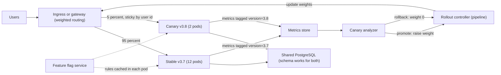
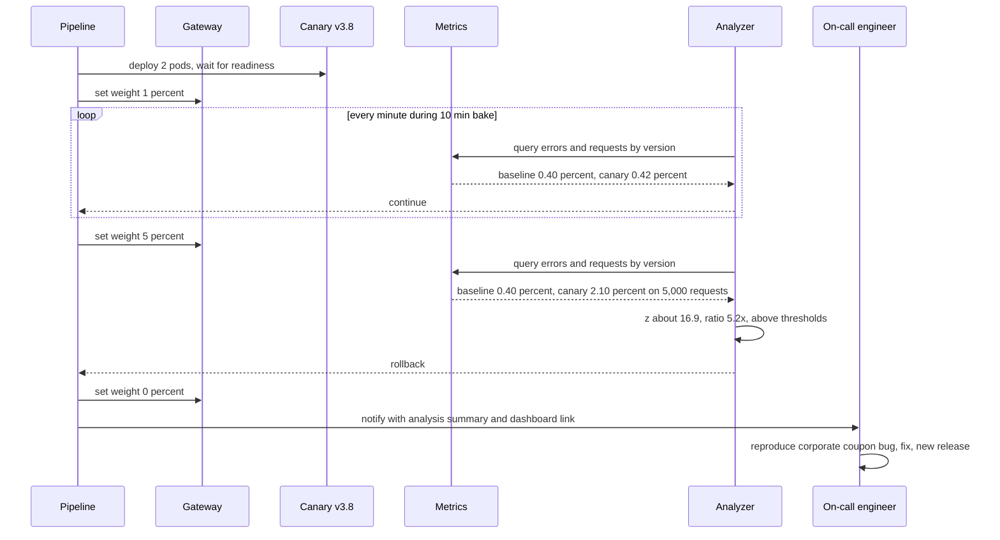

Release 3.8 of an online grocery checkout service went out on a Tuesday at 11 a.m. It changed how coupons are validated. Every automated test passed and staging looked fine. Within six minutes, the error rate on `POST /checkout` went from 0.4 % to 2.1 % across all of Pune and Hyderabad, because a coupon type used only by one large corporate partner was now rejected with a 500 error. The rollout had replaced all twelve servers in four minutes, so every customer was on the new version before the first alert fired. Rolling back took another eleven minutes. The bug itself was small. What made it expensive was **how** the release was shipped: all at once, with no comparison against the old version, and with a slow way back. This lesson is about shipping in a way that makes small bugs stay small.

## Learning objectives

By the end of this lesson you will be able to:

1. Separate **deployment** (putting code on servers) from **release** (exposing behaviour to users), and explain why that separation reduces risk.
2. Compare recreate, rolling, blue-green and canary deployments by risk, rollback time, cost and complexity.
3. Choose traffic-shifting mechanisms (load balancer weights, ingress or service mesh, deployment slots, DNS) and know their limits.
4. Use feature flags for percentage rollouts and kill switches, and manage their lifecycle.
5. Build an automated canary analysis that compares error rates between versions, with sample-size and significance checks.
6. Plan rollbacks that actually work, including when the database has changed.

## Prerequisites

- [CI/CD with GitHub Actions and Azure DevOps](#/lesson/m15-ci-cd): pipelines that build and deploy artefacts.
- [Development, testing, staging and production](#/lesson/m15-environments): why staging never fully predicts production.
- [Load balancing algorithms](#/lesson/m11-load-balancing): how traffic is spread across instances.
- [SLI, SLO, SLA and error budgets](#/lesson/m14-sli-slo-sla): the error-rate and latency signals we will compare.

## Explain it like I'm a beginner

Imagine a restaurant changing its biryani recipe.

- **Recreate**: close the restaurant for an hour, train every cook on the new recipe, reopen. Simple, but nobody eats for an hour, and if the new recipe is bad, everyone gets bad biryani.
- **Rolling**: retrain cooks one at a time while the restaurant stays open. No closing, but for a while some customers get the old recipe and some the new, and if the new one is bad you only notice after half the cooks have switched.
- **Blue-green**: build a second, identical kitchen next door with the new recipe. When it's ready, change the sign at the entrance so new customers go to the new kitchen. If they complain, flip the sign back: the old kitchen is still warm. It's fast to switch both ways, but you pay for two kitchens.
- **Canary**: give the new biryani to one table in twenty. Watch their faces. If they're happy, serve it to five tables, then half the room, then everyone. If they're not, stop serving it. You find problems while only a few people are affected. The name comes from coal miners who carried a canary: if the bird got sick, the miners left before the gas reached them.
- **Feature flag**: the new recipe is already in every kitchen, but each cook checks a switch on the wall before using it. The manager can turn it on for regular customers only, or for 10 % of orders, or off instantly, without retraining anyone.

The key idea: **getting the code onto the servers** and **letting customers use it** are two separate steps. The more separate they are, the less each step can hurt.

## First-principles explanation

### Deployment versus release

- **Deploy**: the new version's binaries run in production.
- **Release**: users experience the new behaviour.

With a plain rolling update they happen together. With blue-green, a deployment happens first (green is running) and the release is the traffic switch. With canaries, the release is gradual. With feature flags, code can be deployed weeks before it's released, and released to one city or one customer segment at a time. Separating them gives you three things: you can verify the deployment before anyone uses it, you can limit how many users a bad release hits (the **blast radius**), and you can undo a release faster than you can redeploy.

### What actually goes wrong in releases

It helps to know what you are protecting against:

- **Code bugs that tests missed**, usually on rare data (the corporate coupon), rare devices or real-world scale.
- **Configuration errors**: a wrong connection string, a feature switched on in the wrong region, a missing secret. Many large public incidents are configuration changes, not code.
- **Performance regressions**: a new query without an index, more allocations, a chatty call to another service. Fine in staging, slow at 3,000 RPS.
- **Incompatibility**: the new version writes data the old one can't read, or calls a new API endpoint that isn't deployed yet.
- **Start-up failures**: the new version crashes on boot because of an environment difference.

Each strategy below catches some of these earlier than others.

### Recreate

Stop all old instances, start all new ones. There is downtime between the two. It's appropriate for internal tools that can accept a maintenance window, and for software that can't run two versions at once (for example, a single-instance job that holds an exclusive lock). Rollback = another recreate.

### Rolling update

Replace instances in small batches: take one or a few out, start the new version, wait for health checks, continue. In Kubernetes, `maxSurge` (how many extra pods may exist above the desired count) and `maxUnavailable` (how many may be missing) control the pace:

- 12 replicas, `maxSurge: 25%`, `maxUnavailable: 0`: surge rounds **up** to 3 extra pods, unavailable rounds **down** to 0. The rollout runs with 12 to 15 pods and never fewer than 12 ready.
- 12 replicas, `maxSurge: 0`, `maxUnavailable: 25%`: no extra capacity needed, but only 9 pods serve during each step. Cheaper, riskier under load.

Strengths: no extra environment, built into every platform, zero downtime if health checks are right. Weaknesses: two versions serve traffic at the same time (your code and data must tolerate that), the rollout stops only if instances fail **health checks**, not if they return wrong answers or more errors, and rollback is another rolling update, which takes as long as the rollout. In the grocery incident, every new pod was "healthy" while returning 500s for one coupon type.

### Blue-green

Run two full production environments. **Blue** serves users. Deploy the new version to **green**, run smoke tests against green's private address, then switch the router so all traffic goes to green. Keep blue running for a while. Rollback = switch back, which takes seconds.

How the switch is done:

| Mechanism | Switch time | Notes |
|---|---|---|
| Load balancer target group or backend pool swap | Seconds | Most common. Existing connections may need draining. |
| Azure App Service deployment slots ("swap") | Seconds to a minute | Warms up the staging slot before swapping. Slot-specific settings stay with the slot. |
| Kubernetes Service selector change (`version: blue` → `version: green`) | Seconds | Two Deployments, one Service. |
| DNS change | Minutes to hours | Clients and resolvers cache records for the TTL and sometimes longer. Avoid for fast rollback. |

Strengths: instant, all-or-nothing switch and instant rollback; the new version is fully tested in production infrastructure before users see it. Weaknesses:

- **Double capacity** during the release window. For a service that normally needs 12 instances, that is 24 for the overlap. If the overlap is 1 hour per daily deploy, the extra cost is about 1 ÷ 24 ≈ 4 % of compute (estimate); if green stays up all day, it's 100 %.
- **All users switch at once**, so a bug still hits everyone, just with a fast way back.
- **Shared state**: both colours usually share the database. The schema must work for both versions at once, or rollback is impossible. See [Database migrations during deployments](#/lesson/m15-db-migrations-deploy).
- **Sessions and in-flight work**: users mid-checkout when you switch must not lose their session; keep sessions in a shared store, not in instance memory.

### Canary

Run the new version on a small share of traffic, compare it with the old version, and increase the share only while it behaves. A typical schedule: 1 % → 5 % → 25 % → 50 % → 100 %, with a **bake time** (for example 10 minutes) at each step.

Traffic shifting options:

- **Weighted routing** at a load balancer, ingress controller or service mesh: "5 % of requests to v3.8".
- **Instance ratio**: 1 canary pod next to 19 stable pods behind the same Service gives about 5 %, but only in steps of the pod count, and it changes when the HPA scales.
- **Sticky assignment by user**: hash the user id into buckets, so the same user always sees the same version during the canary. This avoids a user bouncing between versions on every request, which matters when the versions render different UIs or store different data.
- **Segment targeting**: employees first, then one city, then everyone. Lower risk, but early segments may not represent all users (employees don't use corporate coupons).

What makes a canary valuable is the **comparison**. You compare the canary against the **baseline** (the old version running at the same time, on the same kind of traffic), not against last week. That cancels out traffic changes: if errors rise on both, the problem is not the release.

Signals to compare: error rate (5xx and business-level failures like "payment declined by our code"), latency percentiles (p95, p99), saturation (CPU, memory, connection pool usage), and a few business metrics (checkout completion rate). Keep the list short and meaningful; every extra metric adds a chance of false alarms.

### The statistics of "is it worse?"

Suppose the baseline has 95,000 requests with 380 errors (0.40 %) and the canary at 5 % has 5,000 requests with 105 errors (2.10 %). Obviously worse. But what about a canary with 200 requests and 2 errors (1.0 %)? That could be bad luck. With error rates around 0.4 %, you expect 0.8 errors in 200 requests, and getting 2 happens fairly often by chance.

A **two-proportion z-test** answers "how surprising is this difference if the versions are really the same?":

```text
p_base   = 380 / 95,000 = 0.0040
p_canary =   2 /    200 = 0.0100
p_pooled = (380 + 2) / (95,000 + 200) ≈ 0.00401
se       = sqrt(p_pooled × (1 − p_pooled) × (1/95,000 + 1/200)) ≈ 0.00447
z        = (0.0100 − 0.0040) / 0.00447 ≈ 1.34
```

A z of 1.34 is not unusual (for a one-sided test at 99 % confidence you'd want about 2.33). So: not enough evidence, keep collecting. With the 5,000-request canary, z ≈ 16.9: roll back immediately.

Practical rules that follow:

- **Minimum sample size**: don't judge a canary with fewer than, say, 500–1,000 requests. At 1 % of 300 RPS you get 3 RPS, so 1,000 requests take about 5.5 minutes. That sets your bake time.
- **Absolute ceiling**: regardless of statistics, if the canary's error rate exceeds a hard limit (for example 5 %), roll back. You don't need a p-value to stop a fire.
- **Relative threshold**: require the canary to be meaningfully worse, for example more than 1.5× the baseline, *and* statistically significant. That avoids rolling back for a tiny but statistically detectable difference at high volume.
- **Low-traffic services** can't canary meaningfully by percentage. Use blue-green with thorough smoke tests, or canary by time (run 100 % of a quiet region's traffic for an hour).

### Feature flags

A feature flag (feature toggle) is an `if` in the code whose condition is controlled at run time:

```csharp
if (await flags.IsEnabledAsync("coupon-validation-v2", user))
    return await newValidator.ValidateAsync(cart);
return await legacyValidator.ValidateAsync(cart);
```

Kinds of flags, with very different lifetimes (from Pete Hodgson's article in the references):

- **Release toggles**: hide unfinished or risky code paths until they're ready. Days to weeks. Remove afterwards.
- **Ops toggles / kill switches**: turn off an expensive feature under load ("disable recommendations during the sale"). Can be long-lived.
- **Experiment toggles**: A/B tests. Live for the experiment.
- **Permission toggles**: features for premium users or specific tenants. Long-lived, really a product feature.

Flags give the fastest rollback of all: flipping a flag takes effect in seconds without a deployment. They also let you deploy continuously while releasing deliberately, and roll out by percentage with sticky user bucketing (like a canary, but per feature rather than per build).

Costs and risks:

- **Combinatorial testing**: 10 flags means 1,024 possible combinations. Test the combinations you will actually run (old path, new path), not all of them.
- **Flag debt**: dead flags clutter code and confuse new developers. Give every release flag an owner and an expiry date; fail a CI check when a flag is past expiry.
- **Configuration as risk**: a flag change is a production change. Audit who changed what, roll flags out gradually too, and make the default (when the flag service is unreachable) the safe, old behaviour.
- **Performance**: evaluate flags locally from a cached rule set; never make a network call per request per flag.

In .NET, `Microsoft.FeatureManagement` provides flags with percentage and targeting filters, often backed by Azure App Configuration; commercial and open-source services (LaunchDarkly, Unleash, Flagsmith, OpenFeature-compatible providers) are common too. The C# below builds a small evaluator to show the mechanics.

### Rollback: the part teams forget to rehearse

| Strategy | How to roll back | Typical time |
|---|---|---|
| Feature flag | Turn the flag off | Seconds |
| Canary | Set canary weight to 0 % | Seconds |
| Blue-green | Switch router back to blue (if still running) | Seconds to a minute |
| Rolling | Roll forward to the previous version | As long as the rollout, often minutes |
| Recreate | Redeploy the old version | Minutes, with downtime |

Rollback only works if the old version can still run against the current state. Three things break it:

1. **Database changes** the old version can't handle (a dropped or renamed column). Use expand and contract so every schema change is compatible with the previous version.
2. **Data written in a new format** (new enum value, new JSON field the old code rejects). Make readers tolerant before writers change.
3. **External side effects**: emails sent, payments captured, messages published in a new schema. These can't be rolled back; design consumers to be tolerant and versioned.

"Roll forward" (ship a fix quickly) is sometimes the better choice, for example when the new version has already written data the old one can't read. Decide in advance which you'll prefer for each release, and say it in the release checklist.

### Choosing a strategy

| | Recreate | Rolling | Blue-green | Canary | Feature flag |
|---|---|---|---|---|---|
| Downtime | Yes | No | No | No | No |
| Blast radius of a bug | 100 % | Grows to 100 % | 100 % (briefly) | 1–5 % at first | Configurable |
| Rollback speed | Slow | Slow | Very fast | Very fast | Instant |
| Extra infrastructure | None | Small surge | Up to 2× | Small | None |
| Needs good metrics | No | Health checks | Smoke tests | Yes, essential | Helpful |
| Complexity | Lowest | Low | Medium | High | Medium, grows with flag count |

A sensible default for most ASP.NET Core APIs: **rolling updates with good probes** for routine changes, **feature flags** for risky behaviour changes, and **automated canary** for high-traffic, high-value services once you have reliable metrics. Blue-green fits when you need instant, tested switchover and can afford the second environment, such as App Service slots or a regulated release window.

### When simpler is enough

An internal tool used by 30 people, deployed twice a month, doesn't need canary analysis. A rolling update (or a slot swap) with a smoke test and a documented rollback is enough. Spend on automated canaries where traffic is high, releases are frequent, and an error costs real money.

## Visual explanation

### Architecture: canary with metric comparison



The gateway splits traffic by weight, keeping each user on one version via a hash of their user id. Both versions use the same database, so the schema must be compatible with both (that's the expand phase of a migration). Every request's metrics carry a `version` tag, which is what lets the analyzer compare canary and baseline over the same time window rather than against history. The analyzer gives a verdict to the rollout controller, usually a pipeline stage or a tool such as Argo Rollouts or Flagger, which changes the gateway weights. Feature flags are a separate, finer control inside the code: the rules are cached in each pod so a flag-service outage doesn't break requests.

### Sequence: progressive rollout with automatic rollback



The pipeline deploys the canary pods first but sends them traffic only once they're ready, then starts at 1 %. During the bake time the analyzer queries error and request counts per version every minute; at 1 % the canary looks normal because no corporate-coupon user has hit it yet. At 5 % the comparison is decisive: 2.1 % against 0.4 % on 5,000 requests, far beyond both the ratio and significance thresholds. The analyzer says rollback, the pipeline sets the weight to zero (seconds), and the on-call engineer gets the numbers, not just an alarm. About 5 % of users saw errors for a few minutes, instead of 100 % for seventeen.

## Step-by-step example

We'll redo the grocery release 3.8 with a canary and a feature flag.

### Step 1 — make the change flaggable

Put the new coupon validation behind `coupon-validation-v2`, default **off**. Deploy release 3.8 with a normal rolling update. Nothing changes for users: the deployment is separated from the release.

### Step 2 — make metrics comparable

Tag every request metric with the app version (`service.version` in OpenTelemetry resource attributes) and, for the flagged path, with the flag variant. Define the canary SLIs: `checkout` 5xx rate, p95 latency, and "checkout completed ÷ checkout started".

### Step 3 — size the canary

Checkout gets about 300 RPS at 11 a.m. At 5 %, the canary sees 15 RPS, so 1,000 requests take about 67 seconds. At 1 %, 3 RPS, about 5.5 minutes. Choose steps 1 % (10 min bake), 5 % (10 min), 25 % (10 min), 50 % (10 min), 100 %. Total about 40 minutes, acceptable for a checkout change.

### Step 4 — set the thresholds

- Minimum 1,000 canary requests before judging.
- Absolute ceiling: canary 5xx rate above 5 % → rollback at once.
- Relative: canary rate above 1.5 × baseline and z above 2.33 → rollback.
- p95 latency above 1.2 × baseline + 20 ms for two consecutive checks → rollback.

### Step 5 — run it

Enable the flag for 1 % of users (sticky by user id). At 5 % the analyzer rolls back: the flag goes to 0 %. The fix ships the next morning, and the rollout repeats with employees and the corporate partner's test account first, then 1 %.

### Step 6 — clean up

After 100 % for a week with no issues, delete the old validator and the flag in the next release. Record the rollout timeline and the analyzer's verdicts in the release notes.

## Production-style C# implementation

Four pieces work together: a feature-flag evaluator with sticky percentage rollouts, middleware that tags every response with the version and records outcomes, a thread-safe per-version metrics store, and a canary analyzer that compares error rates with a sample-size check, an absolute ceiling, a ratio threshold and a z-test.

```text
Checkout.Api/
  Program.cs
  Releases/FeatureFlags.cs
  Releases/ReleaseMetrics.cs
  Releases/VersionMiddleware.cs
  Releases/CanaryAnalyzer.cs
```

```csharp file=Releases/FeatureFlags.cs
using System.Collections.Concurrent;
using System.Text;

namespace Checkout.Api.Releases;

/// <summary>A flag's rules. RolloutPercent supports two decimals (0.01 % steps).</summary>
public sealed record FlagDefinition(string Name, bool Enabled, decimal RolloutPercent, IReadOnlySet<string> AllowList)
{
    public static FlagDefinition Off(string name) => new(name, false, 0m, new HashSet<string>());
}

public interface IFeatureFlagStore
{
    FlagDefinition? Get(string name);
    void Upsert(FlagDefinition flag);
}

/// <summary>In production this is a local cache refreshed from a flag service or Azure App Configuration.
/// Reads never make a network call.</summary>
public sealed class InMemoryFlagStore : IFeatureFlagStore
{
    private readonly ConcurrentDictionary<string, FlagDefinition> _flags = new(StringComparer.OrdinalIgnoreCase);
    public FlagDefinition? Get(string name) => _flags.TryGetValue(name, out var f) ? f : null;
    public void Upsert(FlagDefinition flag) => _flags[flag.Name] = flag;
}

public sealed class FeatureFlagEvaluator(IFeatureFlagStore store)
{
    /// <summary>Unknown flag, disabled flag or empty user → the safe default: off.</summary>
    public bool IsEnabled(string flagName, string? userId)
    {
        var flag = store.Get(flagName);
        if (flag is null || !flag.Enabled || string.IsNullOrEmpty(userId)) return false;
        if (flag.AllowList.Contains(userId)) return true;
        // Salt with the flag name so the same users are not always the first 1 % of every rollout.
        return Bucket(flagName + ":" + userId) < (int)(flag.RolloutPercent * 100m);
    }

    /// <summary>Stable bucket 0..9999. FNV-1a, not string.GetHashCode, which is randomised per process.</summary>
    public static int Bucket(string key)
    {
        const uint offset = 2166136261, prime = 16777619;
        var hash = offset;
        foreach (var b in Encoding.UTF8.GetBytes(key)) { hash ^= b; hash *= prime; }
        return (int)(hash % 10_000);
    }
}
```

```csharp file=Releases/ReleaseMetrics.cs
using System.Collections.Concurrent;

namespace Checkout.Api.Releases;

public sealed record VersionSnapshot(string Version, long Requests, long Errors, double MeanLatencyMs)
{
    public double ErrorRate => Requests == 0 ? 0 : (double)Errors / Requests;
}

/// <summary>Per-version request and error counters for the current analysis window.
/// Real systems query a metrics backend (Prometheus, Azure Monitor) by the version label instead;
/// this in-process store keeps the example self-contained and testable.</summary>
public sealed class ReleaseMetrics
{
    private sealed class Counters { public long Requests; public long Errors; public long LatencyMsTotal; }

    private readonly ConcurrentDictionary<string, Counters> _byVersion = new();

    public void Record(string version, bool isError, long latencyMs)
    {
        var c = _byVersion.GetOrAdd(version, _ => new Counters());
        Interlocked.Increment(ref c.Requests);
        if (isError) Interlocked.Increment(ref c.Errors);
        Interlocked.Add(ref c.LatencyMsTotal, latencyMs);
    }

    public VersionSnapshot Snapshot(string version)
    {
        if (!_byVersion.TryGetValue(version, out var c)) return new VersionSnapshot(version, 0, 0, 0);
        var requests = Interlocked.Read(ref c.Requests);
        return new VersionSnapshot(version, requests, Interlocked.Read(ref c.Errors),
            requests == 0 ? 0 : (double)Interlocked.Read(ref c.LatencyMsTotal) / requests);
    }

    /// <summary>Start a new window, for example when the rollout moves to the next step.</summary>
    public void Reset() => _byVersion.Clear();
}
```

```csharp file=Releases/VersionMiddleware.cs
using System.Diagnostics;
using Microsoft.Extensions.Options;

namespace Checkout.Api.Releases;

public sealed class ReleaseOptions
{
    /// <summary>Set by the pipeline per deployment, e.g. from the image tag.</summary>
    public string Version { get; set; } = "0.0.0-local";
}

/// <summary>Adds the version to every response and records the outcome for canary comparison.
/// "Error" means a server fault (5xx). 4xx are the client's problem and would add noise.</summary>
public sealed class VersionMiddleware(RequestDelegate next, ReleaseMetrics metrics, IOptions<ReleaseOptions> options)
{
    public async Task InvokeAsync(HttpContext context)
    {
        var version = options.Value.Version;
        context.Response.Headers["X-App-Version"] = version;
        var started = Stopwatch.GetTimestamp();
        var failed = false;
        try
        {
            await next(context);
        }
        catch
        {
            failed = true;
            throw;
        }
        finally
        {
            if (!context.Request.Path.StartsWithSegments("/healthz") && !context.Request.Path.StartsWithSegments("/release"))
            {
                var isError = failed || context.Response.StatusCode >= 500;
                metrics.Record(version, isError, (long)Stopwatch.GetElapsedTime(started).TotalMilliseconds);
            }
        }
    }
}
```

```csharp file=Releases/CanaryAnalyzer.cs
namespace Checkout.Api.Releases;

public enum CanaryVerdict { Continue, Promote, Rollback }

public sealed class CanaryPolicy
{
    public long MinCanaryRequests { get; set; } = 1000;
    /// <summary>Hard ceiling: above this the canary is rolled back without statistics.</summary>
    public double AbsoluteMaxErrorRate { get; set; } = 0.05;
    /// <summary>Canary must be at least this many times worse than baseline to count as a regression.</summary>
    public double MaxErrorRatio { get; set; } = 1.5;
    /// <summary>One-sided z threshold. 2.33 ≈ 99 % confidence.</summary>
    public double ZThreshold { get; set; } = 2.33;
    /// <summary>Errors allowed above baseline as an absolute floor, so 0 vs 1 error on tiny baselines is not "infinitely worse".</summary>
    public double MinAbsoluteIncrease { get; set; } = 0.001;
}

public sealed record CanaryAnalysis(CanaryVerdict Verdict, double BaselineRate, double CanaryRate, double Ratio, double Z, string Reason);

public static class CanaryAnalyzer
{
    public static CanaryAnalysis Analyze(VersionSnapshot baseline, VersionSnapshot canary, CanaryPolicy policy)
    {
        var pb = baseline.ErrorRate;
        var pc = canary.ErrorRate;
        var ratio = pb == 0 ? (pc == 0 ? 1 : double.PositiveInfinity) : pc / pb;
        var z = TwoProportionZ(baseline.Errors, baseline.Requests, canary.Errors, canary.Requests);

        if (canary.Requests < policy.MinCanaryRequests)
        {
            // Even with little data, a canary that is clearly on fire is stopped.
            if (canary.Requests >= 50 && pc > policy.AbsoluteMaxErrorRate * 2)
                return new(CanaryVerdict.Rollback, pb, pc, ratio, z, $"error rate {pc:P2} on early traffic");
            return new(CanaryVerdict.Continue, pb, pc, ratio, z, $"only {canary.Requests} canary requests, need {policy.MinCanaryRequests}");
        }

        if (pc > policy.AbsoluteMaxErrorRate)
            return new(CanaryVerdict.Rollback, pb, pc, ratio, z, $"error rate {pc:P2} above ceiling {policy.AbsoluteMaxErrorRate:P2}");

        var meaningfullyWorse = ratio > policy.MaxErrorRatio && pc - pb >= policy.MinAbsoluteIncrease;
        if (meaningfullyWorse && z > policy.ZThreshold)
            return new(CanaryVerdict.Rollback, pb, pc, ratio, z, $"canary {pc:P2} vs baseline {pb:P2} (x{ratio:F1}, z={z:F1})");

        return new(CanaryVerdict.Promote, pb, pc, ratio, z, "no significant regression");
    }

    /// <summary>z for "canary rate is higher than baseline rate". 0 when undefined.</summary>
    public static double TwoProportionZ(long baseErrors, long baseRequests, long canaryErrors, long canaryRequests)
    {
        if (baseRequests == 0 || canaryRequests == 0) return 0;
        var p1 = (double)baseErrors / baseRequests;
        var p2 = (double)canaryErrors / canaryRequests;
        var pooled = (double)(baseErrors + canaryErrors) / (baseRequests + canaryRequests);
        var se = Math.Sqrt(pooled * (1 - pooled) * (1.0 / baseRequests + 1.0 / canaryRequests));
        return se == 0 ? 0 : (p2 - p1) / se;
    }
}
```

```csharp file=Program.cs
using Checkout.Api.Releases;

var builder = WebApplication.CreateBuilder(args);

builder.Services.Configure<ReleaseOptions>(builder.Configuration.GetSection("Release"));
builder.Services.Configure<CanaryPolicy>(builder.Configuration.GetSection("Canary"));
builder.Services.AddSingleton<ReleaseMetrics>();
builder.Services.AddSingleton<IFeatureFlagStore, InMemoryFlagStore>();
builder.Services.AddSingleton<FeatureFlagEvaluator>();

var app = builder.Build();

var flags = app.Services.GetRequiredService<IFeatureFlagStore>();
flags.Upsert(new FlagDefinition("coupon-validation-v2", Enabled: true, RolloutPercent: 1m,
    AllowList: new HashSet<string> { "employee-001", "partner-test-77" }));

app.UseMiddleware<VersionMiddleware>();

app.MapPost("/checkout", (string userId, FeatureFlagEvaluator evaluator) =>
{
    var path = evaluator.IsEnabled("coupon-validation-v2", userId) ? "v2" : "legacy";
    return Results.Ok(new { userId, couponValidator = path });
});

// In a real rollout the pipeline calls the analyzer with numbers from the metrics backend.
// This endpoint shows the shape of the decision using in-process counters for two versions.
app.MapGet("/release/analysis", (string baseline, string canary, ReleaseMetrics metrics,
    Microsoft.Extensions.Options.IOptions<CanaryPolicy> policy) =>
    Results.Ok(CanaryAnalyzer.Analyze(metrics.Snapshot(baseline), metrics.Snapshot(canary), policy.Value)));

app.MapPut("/release/flags/{name}", (string name, decimal percent, IFeatureFlagStore store) =>
{
    if (percent < 0 || percent > 100) return Results.BadRequest("percent must be 0..100");
    var current = store.Get(name) ?? FlagDefinition.Off(name);
    store.Upsert(current with { Enabled = percent > 0, RolloutPercent = percent });
    return Results.NoContent();
});

app.Run();
```

Design notes:

- **Safe defaults.** An unknown flag, a disabled flag or an anonymous user gets the old behaviour. If the flag cache is empty after a restart, nothing new is exposed.
- **Sticky, salted buckets.** The same user always lands in the same bucket for a flag, and different flags use different salts so one unlucky group of users isn't first in every experiment.
- **Errors are 5xx and exceptions.** Counting 4xx would let a bot sending bad coupons fail your canary. If business failures matter (payment declined by our own validation), record them as a separate SLI.
- **Four-layer decision.** Not enough data → wait (unless clearly on fire). Above the ceiling → rollback. Meaningfully worse *and* significant → rollback. Otherwise promote. Each layer protects against a different mistake: judging on noise, ignoring a disaster, and rolling back for trivial differences.
- **Secure the release endpoints.** `PUT /release/flags` changes production behaviour; it needs authentication, authorisation and an audit log. Omitted for brevity.

## Bad design vs good design

**Bad**: "the pipeline deploys, then we watch Slack".

```text
- kubectl set image deployment/checkout checkout=checkout:3.8   (maxUnavailable 50%)
- Readiness probe = GET /  (returns 200 even if the coupon service is misconfigured)
- New feature enabled by an appsettings.json value, so turning it off needs a redeploy
- Dashboards show total error rate, not per version
- Rollback = find the previous image tag, run kubectl again
- Migration in the same release dropped the old coupons column
```

What goes wrong: half the capacity disappears at once during each step; health checks pass while users get errors; there's no way to compare old against new because metrics aren't tagged by version; switching the feature off needs a full deployment; and the rollback can't work anyway because the old version reads a column that no longer exists.

**Good**: deploy with a rolling update that keeps full capacity (`maxUnavailable: 0`); release behind a flag or a weighted canary; metrics tagged by version and flag variant; an automated analyzer with minimum samples, ceiling, ratio and significance; rollback by weight or flag in seconds; schema changes in expand/contract steps so the previous version still works; and a release note stating "rollback = flag off; old version compatible until release 3.10".

:::callout type=mistake title="Comparing the canary with yesterday"
Traffic, data and dependencies change hour by hour. A canary compared with last week's error rate will raise false alarms on a busy day and miss regressions on a quiet one. Compare canary and baseline over the same minutes.
:::

:::callout type=tradeoff title="Speed versus safety"
Each canary step adds bake time. Ten-minute steps over five stages is 40 minutes per release. For a service that deploys twenty times a day, use shorter bakes with higher traffic shares, or batch changes. For checkout or payments, 40 minutes is cheap insurance.
:::

## Practical playground

The canvas shows the grocery checkout running as one set of servers behind a load balancer, with PostgreSQL and a payment gateway. Turn it into a release-safe design.

1. Add a second app-server group for the canary or green environment. Label the traffic split on the edges.
2. Add a monitoring node that both versions report to with a version tag, and a scheduler or worker node that runs the canary analysis and changes weights.
3. Decide where sessions and carts live so a switch between versions doesn't log users out.
4. Add a feature flag service and mark the edge as "cached locally". What happens to checkout if the flag service is down?
5. Note on the database node what the schema must satisfy during the release.

:::playground type=hld title="Make the checkout release-safe"
```json
{
  "nodes": [
    { "id": "users", "type": "client", "label": "Shoppers (Pune, Hyderabad)", "props": { "rps": 300 } },
    { "id": "lb", "type": "load-balancer", "label": "Load balancer" },
    { "id": "app", "type": "app-server", "label": "Checkout API v3.7", "props": { "instances": 12 } },
    { "id": "pg", "type": "database", "label": "PostgreSQL", "props": { "replicas": 1 } },
    { "id": "pay", "type": "external", "label": "Payment gateway" }
  ],
  "edges": [
    { "from": "users", "to": "lb", "kind": "sync" },
    { "from": "lb", "to": "app", "kind": "sync" },
    { "from": "app", "to": "pg", "kind": "sync" },
    { "from": "app", "to": "pay", "kind": "sync" }
  ]
}
```
:::

## Exercises

:::exercise id=m15-deployment-strategies-ex1 difficulty=beginner kind=code title="Rolling update arithmetic"
Before changing `maxSurge` and `maxUnavailable`, the team wants to see what a rollout will look like: how many pods can exist at most, how many must stay available, and how much extra capacity is needed.
::requirements
- `RollingUpdatePlan.FromPercent(int replicas, int maxSurgePercent, int maxUnavailablePercent)` and `RollingUpdatePlan.FromCounts(int replicas, int maxSurge, int maxUnavailable)` both return a `RollingUpdatePlan` with `Replicas`, `SurgePods`, `UnavailablePods`, `MaxTotalPods` (replicas + surge) and `MinAvailablePods` (replicas − unavailable).
- Percentages follow Kubernetes rounding: surge rounds **up**, unavailable rounds **down**.
- If both resolved values are 0, Kubernetes rejects the spec: throw `ArgumentException`.
- Negative inputs, or percentages above 100, throw `ArgumentOutOfRangeException`.
- `BlueGreenExtraCost(double instanceCostPerHour, int instances, double overlapHours)` returns the cost of running the second environment during the overlap.
::acceptance
- 12 replicas, 25 % surge, 0 % unavailable → surge 3, max 15, min available 12.
- 10 replicas, 25 % surge, 25 % unavailable → surge 3, unavailable 2.
- 3 replicas, 0 % surge, 10 % unavailable → throws (0.3 rounds down to 0, and surge is 0).
- Blue-green: 12 instances at ₹14 per hour for 1.5 hours costs ₹252.
::hint
Write one private method that validates and builds the plan from counts; have `FromPercent` convert first.
::hint
`(int)Math.Ceiling(replicas * pct / 100.0)` for surge and integer division `replicas * pct / 100` for unavailable.
::hint
Check for "both zero" after rounding, not before.
::hint
Blue-green extra cost is simply instances × cost × hours: the whole second environment runs during the overlap.
::starter
```csharp file=RollingUpdatePlan.cs
using System;

public sealed record RollingUpdatePlan(int Replicas, int SurgePods, int UnavailablePods)
{
    public int MaxTotalPods => throw new NotImplementedException();
    public int MinAvailablePods => throw new NotImplementedException();

    public static RollingUpdatePlan FromPercent(int replicas, int maxSurgePercent, int maxUnavailablePercent) =>
        throw new NotImplementedException();

    public static RollingUpdatePlan FromCounts(int replicas, int maxSurge, int maxUnavailable) =>
        throw new NotImplementedException();

    public static double BlueGreenExtraCost(double instanceCostPerHour, int instances, double overlapHours) =>
        throw new NotImplementedException();
}
```
::tests
```csharp file=RollingUpdatePlanTests.cs
using System;
using Xunit;

public class RollingUpdatePlanTests
{
    [Fact]
    public void Surge_only()
    {
        var p = RollingUpdatePlan.FromPercent(12, 25, 0);
        Assert.Equal(3, p.SurgePods);
        Assert.Equal(0, p.UnavailablePods);
        Assert.Equal(15, p.MaxTotalPods);
        Assert.Equal(12, p.MinAvailablePods);
    }

    [Fact]
    public void Rounding_directions()
    {
        var p = RollingUpdatePlan.FromPercent(10, 25, 25);
        Assert.Equal(3, p.SurgePods);
        Assert.Equal(2, p.UnavailablePods);
        Assert.Equal(8, p.MinAvailablePods);
    }

    [Fact]
    public void Both_zero_after_rounding_throws() =>
        Assert.Throws<ArgumentException>(() => RollingUpdatePlan.FromPercent(3, 0, 10));

    [Fact]
    public void Counts()
    {
        var p = RollingUpdatePlan.FromCounts(6, 1, 1);
        Assert.Equal(7, p.MaxTotalPods);
        Assert.Equal(5, p.MinAvailablePods);
    }

    [Fact] public void Negative_throws() => Assert.Throws<ArgumentOutOfRangeException>(() => RollingUpdatePlan.FromCounts(6, -1, 1));
    [Fact] public void Over_100_percent_throws() => Assert.Throws<ArgumentOutOfRangeException>(() => RollingUpdatePlan.FromPercent(6, 150, 0));
    [Fact] public void Unavailable_cannot_exceed_replicas() => Assert.Throws<ArgumentOutOfRangeException>(() => RollingUpdatePlan.FromCounts(3, 1, 5));

    [Fact] public void Blue_green_cost() => Assert.Equal(252.0, RollingUpdatePlan.BlueGreenExtraCost(14, 12, 1.5), 6);
}
```
::solution
```csharp file=RollingUpdatePlan.cs
using System;

public sealed record RollingUpdatePlan(int Replicas, int SurgePods, int UnavailablePods)
{
    public int MaxTotalPods => Replicas + SurgePods;
    public int MinAvailablePods => Replicas - UnavailablePods;

    public static RollingUpdatePlan FromPercent(int replicas, int maxSurgePercent, int maxUnavailablePercent)
    {
        if (maxSurgePercent is < 0 or > 100) throw new ArgumentOutOfRangeException(nameof(maxSurgePercent));
        if (maxUnavailablePercent is < 0 or > 100) throw new ArgumentOutOfRangeException(nameof(maxUnavailablePercent));
        if (replicas < 0) throw new ArgumentOutOfRangeException(nameof(replicas));

        var surge = (int)Math.Ceiling(replicas * maxSurgePercent / 100.0);
        var unavailable = replicas * maxUnavailablePercent / 100; // integer division rounds down
        return FromCounts(replicas, surge, unavailable);
    }

    public static RollingUpdatePlan FromCounts(int replicas, int maxSurge, int maxUnavailable)
    {
        if (replicas < 0) throw new ArgumentOutOfRangeException(nameof(replicas));
        if (maxSurge < 0) throw new ArgumentOutOfRangeException(nameof(maxSurge));
        if (maxUnavailable < 0 || maxUnavailable > replicas) throw new ArgumentOutOfRangeException(nameof(maxUnavailable));
        if (maxSurge == 0 && maxUnavailable == 0)
            throw new ArgumentException("maxSurge and maxUnavailable cannot both be 0: the rollout could never progress.");
        return new RollingUpdatePlan(replicas, maxSurge, maxUnavailable);
    }

    public static double BlueGreenExtraCost(double instanceCostPerHour, int instances, double overlapHours) =>
        instanceCostPerHour * instances * overlapHours;
}
```

The rounding directions are deliberately conservative: rounding surge up lets the rollout make progress, rounding unavailable down protects capacity. The "both zero" rule exists because the controller could neither add a new pod nor remove an old one.

Compare the two costs: a rolling update with 25 % surge for 10 minutes costs about 3 extra pods × 1/6 hour; a blue-green overlap of 1.5 hours costs 12 × 1.5. That difference is what you pay for instant rollback.
::mistakes
- Rounding both values the same way.
- Validating "both zero" before converting percentages, so 10 % of 3 slips through.
- Forgetting that `maxUnavailable` greater than replicas is meaningless.
::extensions
Estimate rollout duration: given seconds per pod to become ready, compute how many waves the rollout needs and how long it takes.
:::

:::exercise id=m15-deployment-strategies-ex2 difficulty=beginner kind=written title="Pick a release strategy for five changes"
For each change, choose a strategy (recreate, rolling, blue-green, canary, feature flag, or a combination), and justify it in two or three sentences, including how you would roll back.

1. A typo fix in an email template of an internal HR leave-approval tool used by 200 staff.
2. A new fare-calculation engine for a metro-rail ticketing API, about 2,000 RPS at peak.
3. Moving a city water board's bill-payment portal from .NET 8 to .NET 10 (.NET 8 support ends in November 2026), which must happen during an announced Sunday window. Traffic is 20 RPS on Sundays.
4. A new recommendation widget on a shopping app's home page that the product team wants to A/B test.
5. An upgrade of the PostgreSQL driver and connection pool settings in a payments API.
::acceptance
- Each answer names a strategy and a rollback method.
- At least one answer chooses the simplest option and says why that's enough.
- The low-traffic case recognises that percentage canaries need traffic to be meaningful.
- The fare engine answer mentions comparing results, not just errors.
::hint
Ask for each: how many users are hurt if it's wrong, how fast you need to undo it, and is there enough traffic to measure?
::hint
Configuration-like changes (driver, pool size) often show up as latency or connection errors under load, not in tests.
::hint
For the fare engine, consider running the new code in "shadow" mode, computing fares without using them.
::solution
1. **Rolling update** (or slot swap). Tiny risk, few users, a bad email can be fixed by the next deployment. Rollback: redeploy previous version. Canary or flags here are overhead without benefit.
2. **Feature flag with shadow mode, then canary by percentage.** First deploy with the new engine computing fares in parallel and logging differences against the old engine without affecting tickets (a dark launch). When differences are explained, enable for 1 % → 5 % → 25 % → 100 % of riders, comparing error rate, latency and fare distribution per version. Rollback: flag off in seconds. Wrong fares are a business failure that error rates won't show, which is why the comparison of results matters.
3. **Blue-green.** 20 RPS gives a 1 % canary 0.2 requests per second, too little to judge. Build green with .NET 10, run full smoke and regression tests against it privately, switch the load balancer during the window, keep blue running for the rest of the day. Rollback: switch back. The schema must work with both versions.
4. **Feature flag (experiment toggle)** with sticky user bucketing, 50/50 or 10/90, and business metrics (click-through, add-to-cart) per variant; deploy with a normal rolling update. Rollback: flag off. Remove the flag when the experiment ends.
5. **Canary by instances or weight** with close attention to latency, connection pool exhaustion and database connection counts, at peak-like traffic. Pool settings issues appear only under load. Rollback: weight 0, then roll back the deployment. Also check total connections: canary pods plus stable pods must not exceed the database's limit.
::mistakes
- Choosing canary for everything, including a 20 RPS portal.
- Forgetting that a feature-flag change is itself a production change that needs care.
- Treating a fare engine change as safe because its error rate is unchanged.
:::

:::exercise id=m15-deployment-strategies-ex3 difficulty=intermediate kind=code title="An error-rate gate for canary analysis"
Write the decision function the pipeline calls each minute during a canary step.
::requirements
- `ErrorRateGate.Decide(long baseRequests, long baseErrors, long canaryRequests, long canaryErrors, GatePolicy policy)` returns a `GateDecision` (`Wait`, `Pass`, `Fail`).
- Negative counts, or errors greater than requests, throw `ArgumentException`.
- If `canaryRequests < policy.MinRequests` → `Wait`.
- If the canary error rate is greater than `policy.MaxErrorRate` → `Fail`.
- If the baseline has 0 requests → `Wait` (nothing to compare against).
- `Fail` if **both** hold: canary rate > baseline rate × `policy.MaxRatio`, and the two-proportion z-score is greater than `policy.ZThreshold`.
- Otherwise `Pass`.
- `ErrorRateGate.Z(long baseRequests, long baseErrors, long canaryRequests, long canaryErrors)` returns the z-score (0 when the pooled rate is 0 or 1).
::acceptance
- 95,000/380 baseline and 5,000/105 canary → `Fail`.
- 95,000/380 baseline and 200/2 canary with `MinRequests = 100` → `Pass` (not significant).
- Canary 1,200/70 (5.8 %) with a 5 % ceiling → `Fail` even if the baseline were also high.
- A canary slightly worse than baseline at huge volume (ratio 1.1) → `Pass`.
::hint
Do the cheap, decisive checks first: sample size, then ceiling. Statistics last.
::hint
The pooled proportion is total errors ÷ total requests across both versions.
::hint
`se = Math.Sqrt(p * (1 - p) * (1.0 / n1 + 1.0 / n2))`, `z = (p2 - p1) / se`.
::hint
The ratio check uses `canaryRate > baseRate * policy.MaxRatio`. With a baseline rate of 0, any canary error passes the ratio check, so the z-test decides.
::starter
```csharp file=ErrorRateGate.cs
using System;

public enum GateDecision { Wait, Pass, Fail }

public sealed record GatePolicy(long MinRequests = 1000, double MaxErrorRate = 0.05, double MaxRatio = 1.5, double ZThreshold = 2.33);

public static class ErrorRateGate
{
    public static GateDecision Decide(long baseRequests, long baseErrors, long canaryRequests, long canaryErrors, GatePolicy policy) =>
        throw new NotImplementedException();

    public static double Z(long baseRequests, long baseErrors, long canaryRequests, long canaryErrors) =>
        throw new NotImplementedException();
}
```
::tests
```csharp file=ErrorRateGateTests.cs
using System;
using Xunit;

public class ErrorRateGateTests
{
    private static readonly GatePolicy P = new();

    [Fact] public void Clear_regression_fails() => Assert.Equal(GateDecision.Fail, ErrorRateGate.Decide(95_000, 380, 5_000, 105, P));

    [Fact]
    public void Small_noisy_sample_passes() =>
        Assert.Equal(GateDecision.Pass, ErrorRateGate.Decide(95_000, 380, 200, 2, P with { MinRequests = 100 }));

    [Fact] public void Too_few_requests_waits() => Assert.Equal(GateDecision.Wait, ErrorRateGate.Decide(95_000, 380, 999, 50, P));

    [Fact] public void Ceiling_fails() => Assert.Equal(GateDecision.Fail, ErrorRateGate.Decide(10_000, 600, 1_200, 70, P));

    [Fact] public void Small_ratio_at_volume_passes() => Assert.Equal(GateDecision.Pass, ErrorRateGate.Decide(1_000_000, 4_000, 1_000_000, 4_400, P));

    [Fact] public void Healthy_canary_passes() => Assert.Equal(GateDecision.Pass, ErrorRateGate.Decide(95_000, 380, 5_000, 21, P));

    [Fact] public void No_baseline_waits() => Assert.Equal(GateDecision.Wait, ErrorRateGate.Decide(0, 0, 5_000, 10, P));

    [Fact]
    public void Zero_baseline_errors_still_tested()
    {
        Assert.Equal(GateDecision.Fail, ErrorRateGate.Decide(50_000, 0, 5_000, 40, P));
        Assert.Equal(GateDecision.Pass, ErrorRateGate.Decide(50_000, 0, 5_000, 0, P));
    }

    [Fact] public void Errors_above_requests_throw() => Assert.Throws<ArgumentException>(() => ErrorRateGate.Decide(100, 200, 1000, 1, P));
    [Fact] public void Negative_throws() => Assert.Throws<ArgumentException>(() => ErrorRateGate.Decide(100, 1, -5, 0, P));

    [Fact] public void Z_matches_lesson() => Assert.InRange(ErrorRateGate.Z(95_000, 380, 200, 2), 1.30, 1.38);
    [Fact] public void Z_large_for_regression() => Assert.True(ErrorRateGate.Z(95_000, 380, 5_000, 105) > 15);
    [Fact] public void Z_zero_when_no_errors() => Assert.Equal(0, ErrorRateGate.Z(1000, 0, 1000, 0));
}
```
::solution
```csharp file=ErrorRateGate.cs
using System;

public enum GateDecision { Wait, Pass, Fail }

public sealed record GatePolicy(long MinRequests = 1000, double MaxErrorRate = 0.05, double MaxRatio = 1.5, double ZThreshold = 2.33);

public static class ErrorRateGate
{
    public static GateDecision Decide(long baseRequests, long baseErrors, long canaryRequests, long canaryErrors, GatePolicy policy)
    {
        Validate(baseRequests, baseErrors);
        Validate(canaryRequests, canaryErrors);

        if (canaryRequests < policy.MinRequests) return GateDecision.Wait;

        var canaryRate = (double)canaryErrors / canaryRequests;
        if (canaryRate > policy.MaxErrorRate) return GateDecision.Fail;

        if (baseRequests == 0) return GateDecision.Wait;
        var baseRate = (double)baseErrors / baseRequests;

        var worseByRatio = canaryRate > baseRate * policy.MaxRatio;
        var significant = Z(baseRequests, baseErrors, canaryRequests, canaryErrors) > policy.ZThreshold;
        return worseByRatio && significant ? GateDecision.Fail : GateDecision.Pass;
    }

    public static double Z(long baseRequests, long baseErrors, long canaryRequests, long canaryErrors)
    {
        if (baseRequests == 0 || canaryRequests == 0) return 0;
        var p1 = (double)baseErrors / baseRequests;
        var p2 = (double)canaryErrors / canaryRequests;
        var pooled = (double)(baseErrors + canaryErrors) / (baseRequests + canaryRequests);
        if (pooled <= 0 || pooled >= 1) return 0;
        var se = Math.Sqrt(pooled * (1 - pooled) * (1.0 / baseRequests + 1.0 / canaryRequests));
        return (p2 - p1) / se;
    }

    private static void Validate(long requests, long errors)
    {
        if (requests < 0 || errors < 0) throw new ArgumentException("counts must not be negative");
        if (errors > requests) throw new ArgumentException("errors cannot exceed requests");
    }
}
```

Why both ratio **and** significance? At a million requests per side, a rise from 0.40 % to 0.44 % is statistically significant (z is above 4) but probably not worth a rollback; the ratio check (1.1 < 1.5) lets it pass. At 200 requests, 1 % against 0.4 % is a 2.5× ratio but not significant; the z-test makes the pipeline wait for evidence (here, with a lowered minimum, it passes this step, and later steps with more traffic will catch a real regression). The ceiling handles disasters without either.

Running this check every minute is "peeking": testing repeatedly raises the chance of a false alarm compared with a single test. Using a strict threshold (2.33 or higher), a minimum sample and a ratio requirement keeps false alarms rare in practice; tools that need stronger guarantees use sequential tests designed for repeated looks.
::mistakes
- Dividing by zero when the baseline has no errors (ratio = infinity is fine; just make the code handle it).
- Comparing the canary against a fixed historical number rather than the live baseline.
- Counting 4xx responses as errors.
- Putting the statistical test first and failing on tiny samples with one unlucky error.
::extensions
Add a latency gate: fail if the canary's p95 exceeds baseline p95 × 1.2 + 20 ms for two consecutive checks.
:::

:::exercise id=m15-deployment-strategies-ex4 difficulty=intermediate kind=hld title="Blue-green for a municipal property-tax portal"
A municipal corporation's property-tax portal runs on 6 app servers behind a load balancer, with PostgreSQL, Redis (sessions and OTP codes), a payment gateway callback endpoint and a nightly reconciliation job. Peak traffic is 150 RPS on the last three days before the rebate deadline. Releases happen on Thursday nights. The commissioner's office requires: no downtime, rollback within 2 minutes, and no lost payments.

Design a blue-green release process.
::acceptance
- Shows both environments, the switch point and what is shared.
- Handles in-flight payments and gateway callbacks during and after the switch.
- Handles sessions and OTPs so users aren't logged out.
- States the database rules that make rollback possible.
- Handles the nightly job so it doesn't run twice or on the wrong version.
- Estimates the extra cost and how to limit it.
::hint
What URL does the payment gateway call back to, and which colour handles it after you switch?
::hint
If sessions live in Redis and both colours read it, does the session format need to be compatible?
::hint
Background jobs and scheduled tasks need exactly one active colour.
::hint
How long must blue stay up to guarantee a 2-minute rollback?
::starter
```json
{
  "nodes": [
    { "id": "citizens", "type": "client", "label": "Citizens", "props": { "rps": 150 } },
    { "id": "lb", "type": "load-balancer", "label": "Load balancer" },
    { "id": "blue", "type": "app-server", "label": "Tax portal (blue)", "props": { "instances": 6 } },
    { "id": "pg", "type": "database", "label": "PostgreSQL" },
    { "id": "redis", "type": "cache", "label": "Redis sessions + OTP" },
    { "id": "pg_gw", "type": "external", "label": "Payment gateway" }
  ],
  "edges": [
    { "from": "citizens", "to": "lb", "kind": "sync" },
    { "from": "lb", "to": "blue", "kind": "sync" },
    { "from": "blue", "to": "pg", "kind": "sync" },
    { "from": "blue", "to": "redis", "kind": "sync" },
    { "from": "blue", "to": "pg_gw", "kind": "sync" },
    { "from": "pg_gw", "to": "lb", "kind": "async", "label": "payment callback" }
  ]
}
```
::solution
```json
{
  "nodes": [
    { "id": "citizens", "type": "client", "label": "Citizens", "props": { "rps": 150 } },
    { "id": "lb", "type": "load-balancer", "label": "Load balancer: production listener + private test listener" },
    { "id": "blue", "type": "app-server", "label": "Blue v41 (live until switch, kept 24 h)", "props": { "instances": 6 } },
    { "id": "green", "type": "app-server", "label": "Green v42 (smoke-tested privately)", "props": { "instances": 6 } },
    { "id": "pg", "type": "database", "label": "PostgreSQL: expand-only migrations before switch", "props": { "replicas": 1 } },
    { "id": "redis", "type": "cache", "label": "Redis sessions + OTP (versioned, backward-compatible format)" },
    { "id": "pg_gw", "type": "external", "label": "Payment gateway" },
    { "id": "jobs", "type": "scheduler", "label": "Reconciliation job: runs only on the colour holding the active flag" },
    { "id": "mon", "type": "monitoring", "label": "Dashboards per colour: errors, payments started vs confirmed" }
  ],
  "edges": [
    { "from": "citizens", "to": "lb", "kind": "sync" },
    { "from": "lb", "to": "blue", "kind": "sync", "label": "100 percent before switch" },
    { "from": "lb", "to": "green", "kind": "sync", "label": "100 percent after switch" },
    { "from": "blue", "to": "pg", "kind": "sync" },
    { "from": "green", "to": "pg", "kind": "sync" },
    { "from": "blue", "to": "redis", "kind": "sync" },
    { "from": "green", "to": "redis", "kind": "sync" },
    { "from": "green", "to": "pg_gw", "kind": "sync" },
    { "from": "pg_gw", "to": "lb", "kind": "async", "label": "callback to stable public URL" },
    { "from": "jobs", "to": "pg", "kind": "async" },
    { "from": "green", "to": "mon", "kind": "async" },
    { "from": "blue", "to": "mon", "kind": "async" }
  ]
}
```

**Process (Thursday 22:00).**
1. Run **expand-only** migrations (new tables or nullable columns, no drops or renames) while blue serves. Blue must keep working on the new schema; verify that in staging first.
2. Deploy v42 to green. Warm it up. Run smoke tests through the private test listener: log in with a test account, view a property, start a ₹1 test payment in the gateway's test mode, check health endpoints.
3. Switch the load balancer's production listener from blue to green. Connections to blue drain for up to 60 s.
4. Watch errors, payment success rate and callbacks per colour for 30 minutes.
5. Keep blue running for 24 hours with its scheduled jobs disabled. Contract migrations (drops) wait until a later release.

**Payments.** The gateway calls back a stable public URL on the load balancer, not a colour-specific host, so after the switch green handles callbacks for payments that blue started. That only works if both versions agree on the payment record schema and callback handling, and the handler is idempotent (gateways retry callbacks), keyed by gateway transaction id. The reconciliation job catches anything a callback missed.

**Sessions and OTPs.** Both colours share Redis. The session and OTP formats must be readable by both versions; if v42 adds a field, v41 must ignore unknown fields. Data protection keys (for ASP.NET Core cookies) must be shared too, stored centrally, or every user is logged out at the switch.

**Jobs.** Exactly one colour runs scheduled work. Use an "active colour" flag in the database or configuration that the job checks at start; flip it as part of the switch.

**Rollback in 2 minutes.** Flip the listener back to blue and the active-colour flag back. Possible because migrations were expand-only and formats are compatible. Practise it once in staging every release.

**Cost.** Second environment of 6 instances for 24 hours a week ≈ 24 ÷ 168 ≈ 14 % extra compute (estimate). To reduce it, keep blue for 2 hours instead of 24 outside the rebate period; during the deadline week avoid releases entirely (a change freeze), which is the cheapest risk control of all.
::mistakes
- Pointing the gateway callback at a colour-specific URL, so callbacks for blue-started payments are lost after blue is shut down.
- Running a migration that drops a column in the same release, making rollback impossible.
- Forgetting ASP.NET Core data protection keys, logging every user out at the switch.
- Running the reconciliation job on both colours.
:::

:::exercise id=m15-deployment-strategies-ex5 difficulty=advanced kind=code title="A progressive rollout controller"
Implement the state machine that moves a canary through its steps, waits for the bake time, reacts to the gate's decision and supports manual pause.
::requirements
- `ProgressiveRollout(IReadOnlyList<int> stepsPercent, TimeSpan bakeTime, DateTimeOffset startedAt)`: steps must be strictly increasing, start above 0 and end at 100, else `ArgumentException`. The rollout starts `Running` at step 0 (`CurrentPercent = stepsPercent[0]`), with the step started at `startedAt`.
- `Tick(DateTimeOffset now, GateDecision decision)` (the `GateDecision` enum from exercise 3 is included in the starter):
  - Only acts when `Running`.
  - `Fail` → state `RolledBack`, `CurrentPercent = 0`, and record `Reason = "gate failed at N%"`.
  - `Wait` → nothing changes (not enough data; the bake clock keeps running).
  - `Pass` and the current step has baked for at least `bakeTime` → advance to the next step (its bake starts at `now`). If the current step is 100, become `Completed` instead.
  - `Pass` before the bake time has elapsed → nothing changes.
- `Pause()` (from `Running`) → `Paused`. `Resume(DateTimeOffset now)` (from `Paused`) → `Running`, restarting the current step's bake at `now`. Invalid transitions throw `InvalidOperationException`.
- `Abort(string reason)` from `Running` or `Paused` → `RolledBack`, percent 0.
- Expose `State`, `CurrentPercent`, `StepIndex`, `Reason` and a `History` list of `(DateTimeOffset At, int Percent, RolloutState State)`, appended on every change.
::acceptance
- Steps [1, 5, 25, 100] with 10-minute bakes and constant `Pass` reach `Completed` only after four full bakes.
- A `Fail` at 5 % rolls back to 0 and further ticks do nothing.
- `Wait` never advances a step.
- Pause and resume restart the bake for the current step.
- Invalid step lists and transitions throw.
::hint
Model the state as an enum and keep `_stepStartedAt`. Every method starts by checking the state.
::hint
`now - _stepStartedAt >= bakeTime` is the "baked" condition.
::hint
Write a private `Change(now, percent, state)` that updates fields and appends to history, so you can't forget the history.
::hint
At the last step, "advance" means `Completed` with `CurrentPercent` still 100.
::starter
```csharp file=ProgressiveRollout.cs
using System;
using System.Collections.Generic;

public enum GateDecision { Wait, Pass, Fail }
public enum RolloutState { Running, Paused, Completed, RolledBack }

public sealed class ProgressiveRollout
{
    public ProgressiveRollout(IReadOnlyList<int> stepsPercent, TimeSpan bakeTime, DateTimeOffset startedAt) =>
        throw new NotImplementedException();

    public RolloutState State => throw new NotImplementedException();
    public int CurrentPercent => throw new NotImplementedException();
    public int StepIndex => throw new NotImplementedException();
    public string? Reason => throw new NotImplementedException();
    public IReadOnlyList<(DateTimeOffset At, int Percent, RolloutState State)> History => throw new NotImplementedException();

    public void Tick(DateTimeOffset now, GateDecision decision) => throw new NotImplementedException();
    public void Pause() => throw new NotImplementedException();
    public void Resume(DateTimeOffset now) => throw new NotImplementedException();
    public void Abort(string reason) => throw new NotImplementedException();
}
```
::tests
```csharp file=ProgressiveRolloutTests.cs
using System;
using System.Linq;
using Xunit;

public class ProgressiveRolloutTests
{
    private static readonly DateTimeOffset T0 = new(2026, 10, 20, 11, 0, 0, TimeSpan.FromHours(5.5));
    private static readonly TimeSpan Bake = TimeSpan.FromMinutes(10);
    private static ProgressiveRollout New() => new(new[] { 1, 5, 25, 100 }, Bake, T0);

    [Fact]
    public void Completes_after_all_bakes()
    {
        var r = New();
        r.Tick(T0.AddMinutes(5), GateDecision.Pass);
        Assert.Equal(1, r.CurrentPercent);
        r.Tick(T0.AddMinutes(10), GateDecision.Pass);
        Assert.Equal(5, r.CurrentPercent);
        r.Tick(T0.AddMinutes(20), GateDecision.Pass);
        Assert.Equal(25, r.CurrentPercent);
        r.Tick(T0.AddMinutes(30), GateDecision.Pass);
        Assert.Equal(100, r.CurrentPercent);
        Assert.Equal(RolloutState.Running, r.State);
        r.Tick(T0.AddMinutes(40), GateDecision.Pass);
        Assert.Equal(RolloutState.Completed, r.State);
        Assert.Equal(100, r.CurrentPercent);
    }

    [Fact]
    public void Fail_rolls_back_and_stops()
    {
        var r = New();
        r.Tick(T0.AddMinutes(10), GateDecision.Pass);
        r.Tick(T0.AddMinutes(12), GateDecision.Fail);
        Assert.Equal(RolloutState.RolledBack, r.State);
        Assert.Equal(0, r.CurrentPercent);
        Assert.Equal("gate failed at 5%", r.Reason);
        r.Tick(T0.AddMinutes(30), GateDecision.Pass);
        Assert.Equal(0, r.CurrentPercent);
    }

    [Fact]
    public void Wait_never_advances()
    {
        var r = New();
        r.Tick(T0.AddMinutes(15), GateDecision.Wait);
        r.Tick(T0.AddMinutes(25), GateDecision.Wait);
        Assert.Equal(1, r.CurrentPercent);
        r.Tick(T0.AddMinutes(26), GateDecision.Pass);
        Assert.Equal(5, r.CurrentPercent);
    }

    [Fact]
    public void Pause_and_resume_restart_bake()
    {
        var r = New();
        r.Tick(T0.AddMinutes(10), GateDecision.Pass);
        r.Pause();
        r.Tick(T0.AddMinutes(25), GateDecision.Pass);
        Assert.Equal(RolloutState.Paused, r.State);
        Assert.Equal(5, r.CurrentPercent);
        r.Resume(T0.AddMinutes(30));
        r.Tick(T0.AddMinutes(35), GateDecision.Pass);
        Assert.Equal(5, r.CurrentPercent);
        r.Tick(T0.AddMinutes(40), GateDecision.Pass);
        Assert.Equal(25, r.CurrentPercent);
    }

    [Fact]
    public void Invalid_transitions_throw()
    {
        var r = New();
        Assert.Throws<InvalidOperationException>(() => r.Resume(T0));
        r.Abort("manual");
        Assert.Equal(RolloutState.RolledBack, r.State);
        Assert.Throws<InvalidOperationException>(() => r.Pause());
        Assert.Throws<InvalidOperationException>(() => r.Abort("again"));
    }

    [Fact]
    public void Bad_steps_throw()
    {
        Assert.Throws<ArgumentException>(() => new ProgressiveRollout(new[] { 5, 5, 100 }, Bake, T0));
        Assert.Throws<ArgumentException>(() => new ProgressiveRollout(new[] { 0, 50, 100 }, Bake, T0));
        Assert.Throws<ArgumentException>(() => new ProgressiveRollout(new[] { 10, 50 }, Bake, T0));
    }

    [Fact]
    public void History_records_changes()
    {
        var r = New();
        r.Tick(T0.AddMinutes(10), GateDecision.Pass);
        r.Tick(T0.AddMinutes(11), GateDecision.Fail);
        Assert.Equal(new[] { 1, 5, 0 }, r.History.Select(h => h.Percent).ToArray());
        Assert.Equal(RolloutState.RolledBack, r.History.Last().State);
    }
}
```
::solution
```csharp file=ProgressiveRollout.cs
using System;
using System.Collections.Generic;

public enum GateDecision { Wait, Pass, Fail }
public enum RolloutState { Running, Paused, Completed, RolledBack }

public sealed class ProgressiveRollout
{
    private readonly IReadOnlyList<int> _steps;
    private readonly TimeSpan _bake;
    private readonly List<(DateTimeOffset At, int Percent, RolloutState State)> _history = new();
    private DateTimeOffset _stepStartedAt;
    private DateTimeOffset _lastSeen;

    public ProgressiveRollout(IReadOnlyList<int> stepsPercent, TimeSpan bakeTime, DateTimeOffset startedAt)
    {
        if (stepsPercent.Count == 0 || stepsPercent[0] <= 0 || stepsPercent[^1] != 100)
            throw new ArgumentException("steps must start above 0 and end at 100", nameof(stepsPercent));
        for (var i = 1; i < stepsPercent.Count; i++)
            if (stepsPercent[i] <= stepsPercent[i - 1])
                throw new ArgumentException("steps must be strictly increasing", nameof(stepsPercent));

        _steps = stepsPercent;
        _bake = bakeTime;
        _stepStartedAt = startedAt;
        _lastSeen = startedAt;
        Change(startedAt, stepsPercent[0], RolloutState.Running);
    }

    public RolloutState State { get; private set; }
    public int CurrentPercent { get; private set; }
    public int StepIndex { get; private set; }
    public string? Reason { get; private set; }
    public IReadOnlyList<(DateTimeOffset At, int Percent, RolloutState State)> History => _history;

    public void Tick(DateTimeOffset now, GateDecision decision)
    {
        _lastSeen = now;
        if (State != RolloutState.Running) return;

        switch (decision)
        {
            case GateDecision.Fail:
                Reason = $"gate failed at {CurrentPercent}%";
                Change(now, 0, RolloutState.RolledBack);
                break;
            case GateDecision.Pass when now - _stepStartedAt >= _bake:
                if (StepIndex == _steps.Count - 1)
                {
                    Change(now, CurrentPercent, RolloutState.Completed);
                }
                else
                {
                    StepIndex++;
                    _stepStartedAt = now;
                    Change(now, _steps[StepIndex], RolloutState.Running);
                }
                break;
            // Wait, or Pass before the bake has finished: hold.
        }
    }

    public void Pause()
    {
        if (State != RolloutState.Running) throw new InvalidOperationException($"cannot pause when {State}");
        Change(_lastSeen, CurrentPercent, RolloutState.Paused);
    }

    public void Resume(DateTimeOffset now)
    {
        if (State != RolloutState.Paused) throw new InvalidOperationException($"cannot resume when {State}");
        _stepStartedAt = now;
        Change(now, CurrentPercent, RolloutState.Running);
    }

    public void Abort(string reason)
    {
        if (State is not (RolloutState.Running or RolloutState.Paused))
            throw new InvalidOperationException($"cannot abort when {State}");
        Reason = reason;
        Change(_lastSeen, 0, RolloutState.RolledBack);
    }

    private void Change(DateTimeOffset at, int percent, RolloutState state)
    {
        CurrentPercent = percent;
        State = state;
        _history.Add((at, percent, state));
    }
}
```

The pause test checks a subtle point: after a pause, the canary has been running at 5 % with a human investigating, so the evidence from before the pause shouldn't count. Restarting the bake on resume is the conservative choice.

The history test expects exactly `[1, 5, 0]` because `Pass` before the bake ends and `Wait` change nothing, so they add no entries. Production controllers (Argo Rollouts, Flagger, Spinnaker's Kayenta-based analysis) follow the same shape: steps with pauses, analysis runs that return success, failure or inconclusive, and an abort that sets canary weight to zero.
::alternatives
Instead of a fixed bake time, advance when the canary has served a minimum number of requests at the current step. That adapts to traffic: fast at peak, slow at night.
::mistakes
- Letting `Wait` count as `Pass` when the bake time is up, which promotes canaries that never got traffic.
- Continuing to process ticks after a rollback.
- Not resetting the bake clock when advancing a step, so a long first step promotes all later steps instantly.
::extensions
Add a `RequireApprovalAt` set (for example 25 %): the rollout pauses itself when reaching that step and needs `Resume` from a human.
:::

## Automated testing

**Unit-test the decision logic.** Analyzer and rollout controller are pure functions and state machines; test them with fixed numbers and timestamps, as in the exercises. Include the edge cases that cause real incidents: zero baseline errors, tiny samples, very large samples with tiny differences.

**Test flag evaluation for stickiness and distribution.**

```csharp
[Fact]
public void Ten_percent_rollout_hits_about_ten_percent_and_is_sticky()
{
    var store = new InMemoryFlagStore();
    store.Upsert(new FlagDefinition("f", true, 10m, new HashSet<string>()));
    var eval = new FeatureFlagEvaluator(store);
    var on = Enumerable.Range(0, 100_000).Count(i => eval.IsEnabled("f", $"user-{i}"));
    Assert.InRange(on, 9_500, 10_500);
    Assert.Equal(eval.IsEnabled("f", "user-42"), eval.IsEnabled("f", "user-42"));
}
```

**Test both code paths behind a flag.** Run the relevant test suite with the flag on and off. Don't try every combination of every flag.

**Test rollback in the pipeline.** A release stage that deploys to staging, rolls back, and runs smoke tests again catches migrations and data formats that make rollback impossible, before production.

**Synthetic checks against the new version.** Before shifting traffic, run scripted user journeys (log in, search, add to cart, pay in test mode) against the canary or green directly, using a header or private endpoint.

**Measure the release process itself.** Track deployment frequency, change failure rate, and time to restore (DORA-style metrics). If rollbacks take 20 minutes, that's a gap to fix before the next incident.

## Real-world application

- **Kubernetes Deployments** do rolling updates by default; progressive delivery tools such as **Argo Rollouts** and **Flagger** add canary and blue-green steps with automated metric analysis.
- **Azure App Service deployment slots** give blue-green with warm-up and swap, and "testing in production" percentage routing to a slot.
- **Azure Container Apps revisions** support traffic splitting by percentage between revisions, a simple canary without a service mesh.
- **Feature flag platforms** and **Microsoft.FeatureManagement** with Azure App Configuration are common in .NET shops for percentage and targeted releases.
- **Large consumer apps** commonly ship features dark and release them by region or user percentage, which is why two people's apps can look different on the same day.
- **Regulated systems** (banking, government) often combine blue-green with change windows and approval gates, trading speed for auditability.

## Interview questions

:::interview
::q beginner
What's the difference between blue-green and canary deployments?
::a
Blue-green runs two full environments and switches all traffic from the old (blue) to the new (green) at once, keeping blue ready for an instant switch back. Canary sends a small percentage of traffic to the new version, compares its metrics with the old version's, and increases the share gradually while it stays healthy. Blue-green gives fast all-or-nothing switching and rollback but exposes everyone at once and costs a second environment. Canary limits the blast radius and catches problems that only real traffic reveals, but needs weighted routing and good per-version metrics.
::q beginner
Why separate deployment from release?
::a
Deployment puts code on servers; release exposes behaviour to users. Separating them (with feature flags, blue-green or canaries) lets you verify the deployment before anyone uses it, limit how many users a bad release reaches, and undo a release in seconds by flipping a flag or a route instead of redeploying. It also lets teams deploy small changes often while releasing features when the business is ready.
::q intermediate
How would you decide automatically whether a canary is healthy?
::a
Compare it with the baseline over the same time window, using a few key SLIs: server error rate, p95/p99 latency, saturation and a business metric. Require a minimum number of canary requests before judging. Roll back immediately above an absolute ceiling. Otherwise require the canary to be meaningfully worse (for example 1.5× baseline) and statistically significant (for example a two-proportion z-test above 2.33) before rolling back, so noise and trivial differences don't cause false alarms. Repeat the analysis at each step with a bake time sized so the canary gets enough traffic.
::q intermediate
What makes a rollback fail, and how do you prevent it?
::a
The old version must work with the current state. Rollbacks fail when the database schema changed incompatibly (dropped or renamed columns), when the new version wrote data the old one can't read (new enum values, changed JSON), when external side effects can't be undone (emails, payments, published events), or when the old environment was already deleted. Prevent it with expand/contract migrations, tolerant readers before new writers, versioned messages, idempotent consumers, keeping blue alive during the risk window, and rehearsing rollback in staging as part of the pipeline.
::q advanced
Your service gets 15 RPS at night and 2,000 RPS at peak. Design a canary policy that works at both times.
::a
Base progression on traffic, not just time: advance a step only after the canary has served a minimum number of requests (for example 1,000) and a minimum bake (for example 5 minutes). At peak, 1 % gives 20 RPS, so 1,000 requests take under a minute and the bake time dominates. At night, 1 % gives 0.15 RPS, which would take nearly two hours, so either start at a higher percentage at night (for example 10 %), restrict releases to busy hours, or use synthetic traffic plus blue-green with smoke tests for night releases. Keep an absolute ceiling active at all times so early disasters are caught with few requests. Use sticky user bucketing so each user has a consistent experience.
::q advanced
What are the risks of feature flags at scale, and how do you manage them?
::a
Combinatorial behaviour (many flags interacting), stale flags turning into permanent hidden branches, flag changes acting as unreviewed production changes, inconsistent evaluation across services, and latency if flags are fetched per request. Manage them with flag types and lifetimes (release flags expire, ops flags are documented), owners and expiry dates enforced in CI, audit logs and gradual rollout for flag changes, local evaluation from cached rules with safe defaults when the flag service is unavailable, consistent bucketing keys across services, testing the on and off paths that will actually run, and removing the flag and the dead code once a release is complete.
:::

## Summary and revision

**Key takeaways**

- Deployment and release are different steps. The more you separate them, the safer each one is.
- Rolling updates are the default; they stop on failed health checks, not on wrong answers, and roll back slowly.
- Blue-green gives instant switch and rollback at the cost of a second environment and an all-at-once release.
- Canaries limit blast radius and compare new against old on live traffic. They need per-version metrics and enough traffic.
- A canary decision needs a minimum sample, an absolute ceiling, a relative threshold and a significance test.
- Feature flags give the fastest rollback and fine-grained releases, but need lifecycle management and safe defaults.
- Rollback works only if the old version can run on the current schema and data. Plan it with expand/contract.
- Choose the simplest strategy that fits the risk and traffic.

**Terminology**: deployment, release, blast radius, recreate, rolling update, maxSurge, maxUnavailable, blue-green, deployment slot, canary, baseline, bake time, weighted routing, sticky bucketing, dark launch, shadow traffic, feature flag (release, ops, experiment, permission), kill switch, two-proportion z-test, roll back, roll forward, progressive delivery.

:::flashcards
Q: Deployment versus release?
A: Deployment puts code on servers. Release exposes the behaviour to users.
Q: Main cost of blue-green?
A: Running a second full environment during the overlap, and all users switch at once.
Q: What does a canary compare against?
A: The baseline: the old version serving the same kind of traffic during the same minutes.
Q: Why a minimum sample size in canary analysis?
A: With few requests, one or two errors look like a big rate change by chance.
Q: Why both a ratio threshold and a significance test?
A: Significance alone fails on tiny differences at high volume. The ratio alone fails on noise in small samples.
Q: Kubernetes rounding for maxSurge and maxUnavailable percentages?
A: Surge rounds up, unavailable rounds down.
Q: Fastest rollback mechanism?
A: Turning off a feature flag or setting canary weight to 0.
Q: Why use FNV or another stable hash for bucketing, not string.GetHashCode?
A: .NET randomises string hash codes per process, so users would change buckets on every restart and differ between pods.
Q: What breaks rollbacks most often?
A: Incompatible database changes or data formats the old version can't read.
:::

## Knowledge check

:::quiz pass=70
::q single
A rolling update of 12 pods finishes in 4 minutes. Every pod passes readiness, but checkout errors rise from 0.4 % to 2 %. Why didn't the rollout stop?
- [ ] maxSurge was too high.
- [x] Rolling updates stop on failed health checks, not on higher error rates in real traffic.
- [ ] The readiness probe period was too long.
- [ ] The HPA scaled down during the rollout.
> Health checks prove the process is up, not that responses are correct. Catching this needs per-version metric comparison (canary analysis) or a flag.
::q single
Baseline: 80,000 requests, 0.5 % errors. Canary: 150 requests, 2 errors (1.3 %). Your policy requires 1,000 canary requests. What should the analyzer say?
- [ ] Rollback: the rate is more than double.
- [x] Continue/wait: not enough canary data yet.
- [ ] Promote: only 2 errors.
- [ ] Rollback: any canary error is a failure.
> 2 errors in 150 is easily explained by chance. Unless an absolute ceiling is hit, wait for more traffic.
::q single
A state portal gets 10 RPS. What is the most sensible release strategy for a risky change?
- [ ] 1 % canary for 10 minutes
- [x] Blue-green with thorough smoke tests against green before switching, and fast switch-back
- [ ] Recreate during business hours
- [ ] Feature flag at 0.1 %
> At 10 RPS, a small canary gets almost no traffic and can't be judged. Blue-green tests the full stack privately and gives a fast rollback.
::q multi
Which make a blue-green rollback possible? (Select all that apply.)
- [x] Expand-only database migrations before the switch
- [x] Sessions and data protection keys shared by both colours
- [x] Keeping blue running for a while after the switch
- [ ] Dropping old columns in the same release to keep the schema clean
- [ ] Using DNS with a 24-hour TTL for the switch
> Rollback needs the old version to run on current state and a quick way to send traffic back. Drops break the first; long DNS TTLs break the second.
::q single
Why salt a feature flag's bucketing hash with the flag name?
- [ ] To make evaluation faster
- [x] So the same small group of users isn't first in every rollout and experiment
- [ ] To make the result random on each request
- [ ] Because user ids can't be hashed alone
> Without a salt, user X always has the same bucket for every flag, so the same 1 % sees every risky change first.
::q single
You deploy 20 times a day and each canary takes 40 minutes. What's the best improvement?
- [ ] Remove canaries entirely
- [x] Advance steps based on request count and use fewer, larger steps for low-risk services, keeping full canaries for high-risk ones
- [ ] Increase bake time to 30 minutes per step
- [ ] Release everything on Fridays
> Match the safety process to risk and traffic. Request-count-based progression shortens steps at peak without weakening the evidence.
::q single
A new version writes a new enum value `"PartiallyRefunded"` to the orders table. The old version throws on unknown values. What's the consequence?
- [ ] None, rollback is still safe
- [x] After rollback, the old version fails on orders written by the new one, so rollback may be worse than rolling forward
- [ ] The database rejects the value
- [ ] Blue-green avoids this automatically
> Make readers tolerant of unknown values in one release, and only start writing new values in a later one.
:::

## Completion criteria

You have finished this lesson when you can:

- [ ] Score at least 70 % on the knowledge check.
- [ ] Complete exercises 1, 3 and 5 with all tests passing.
- [ ] Choose and defend a release strategy for each change in exercise 2.
- [ ] Design the blue-green process in exercise 4, including payments, sessions and jobs.
- [ ] Explain, without notes, why a canary needs a baseline, a minimum sample and a significance check.
