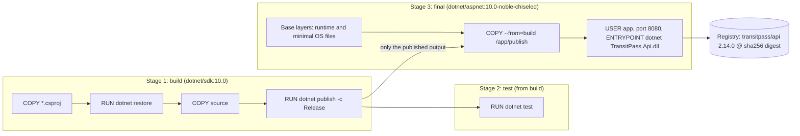
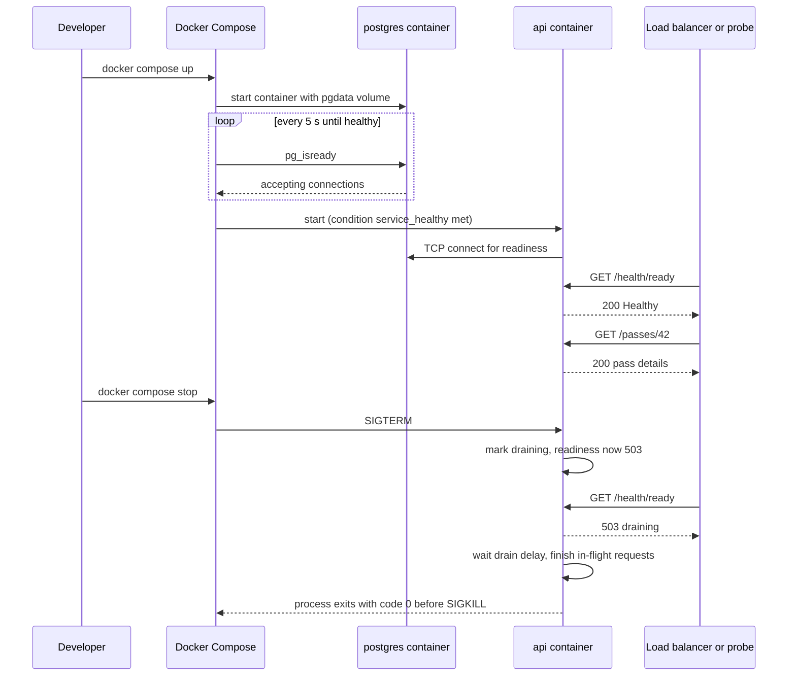

A new developer joins the team building **TransitPass**, a bus-pass and e-ticketing API for a city transport authority. The README says "install PostgreSQL, Redis and RabbitMQ". Two days later she has PostgreSQL 15 (production runs 17), a Redis build for Windows that nobody maintains, and an Erlang version RabbitMQ refuses to start with. Meanwhile, the production server was set up by hand two years ago and nobody is sure which .NET patch it runs. Docker fixes both problems with the same idea: package the app, or a dependency, *together with everything it needs to run*, and run that package the same way everywhere.

## Learning objectives

By the end of this lesson you will be able to:

1. Explain what an image, a container, a layer, a registry, a tag and a digest are, and how a container differs from a virtual machine.
2. Write a multi-stage Dockerfile for an ASP.NET Core API that restores efficiently, runs as a non-root user and produces a small image.
3. Predict which build steps Docker's layer cache will reuse, and order a Dockerfile to make rebuilds fast.
4. Run the API with PostgreSQL, Redis and RabbitMQ using Docker Compose, with health checks, start-up ordering, volumes and no committed secrets.
5. Add liveness and readiness endpoints and graceful shutdown to an ASP.NET Core app so a container platform can start, check and stop it safely.
6. Recognise the common container mistakes: root users, baked-in secrets, `latest` tags, lost data, `localhost` confusion and killed requests.

## Prerequisites

- [Development, testing, staging and production](#/lesson/m15-environments): containers are how "build once, deploy many" is usually done.
- [Health checks and graceful shutdown](#/lesson/m03-health-shutdown): the app side of what Docker and orchestrators expect.
- [Configuration, environment variables and secrets](#/lesson/m03-configuration): containers are configured almost entirely through environment variables.

## Explain it like I'm a beginner

Before the 1950s, ships were loaded sack by sack, barrel by barrel. Every port packed things differently, and every crane had to handle odd shapes. Then came the **shipping container**: one standard steel box. What's inside doesn't matter to the ship, the crane or the truck. They all just move boxes.

Docker does the same for software.

- An **image** is a packed, sealed box: your published app, the .NET runtime it needs, and the minimal operating-system files the runtime depends on. It never changes once built.
- A **container** is a box that has been opened and is running. You can run many containers from one image, just like you can create many objects from one class.
- A **registry** is the warehouse where boxes are stored and fetched from, for example Docker Hub, GitHub Container Registry or Azure Container Registry.
- A **Dockerfile** is the packing list: step-by-step instructions for building the image.
- **Docker Compose** is a delivery plan for several boxes that work together: "start the database box, the cache box and the message-queue box, wire them up, then start the app box".

Because the box contains everything, "it works on my machine" becomes "it works in this image", and the same image runs on a laptop, a CI runner and a production server.

## First-principles explanation

### What a container really is

A container is **not** a small virtual machine. A virtual machine runs a whole guest operating system with its own kernel on emulated hardware. A container is an **ordinary process on the host**, which the Linux kernel isolates using two features:

- **Namespaces** give the process its own view of the system: its own process list (it thinks it is PID 1), its own network interfaces and ports, its own hostname and its own filesystem root.
- **Control groups (cgroups)** limit what it can use: for example at most 1 CPU and 512 MB of memory.

The process sees a filesystem assembled from the image's **layers**. All containers on a host share the host's kernel. That is why a container starts in milliseconds to a couple of seconds instead of the tens of seconds a VM takes, and why you can pack many more of them on a server. It is also why isolation is weaker than a VM's: a kernel bug can affect every container on the host. That is one more reason to run containers as non-root users.

On Windows and macOS, Docker Desktop runs a small Linux VM and your Linux containers run inside it. Windows containers also exist, and IIS-based apps sometimes need them, but most ASP.NET Core apps today run on Linux containers.

### Images and layers

Each instruction in a Dockerfile that changes files (`COPY`, `RUN`, `ADD`) produces a **layer**: a read-only set of file changes on top of the previous layer. The image is the stack of layers plus metadata (the command to run, environment variables, the exposed port, the user).

When a container starts, Docker adds a thin writable layer on top. Anything the app writes inside the container goes there and is **lost when the container is removed**. Data that must survive, such as PostgreSQL's data directory, belongs in a **volume**: storage managed outside the container's layers.

Layers matter for two reasons:

1. **Sharing.** Ten images built on the same `aspnet:10.0` base share its layers on disk and in the registry. Pulling your new version downloads only the layers that changed, often just a few megabytes of your app.
2. **Build caching.** Docker reuses a layer from the previous build if the instruction and its inputs are unchanged *and every layer before it was also reused*. The moment one step changes, every step after it is rebuilt. Order your Dockerfile from "changes rarely" to "changes often".

### Tags and digests

An image name like `ghcr.io/transitpass/api:2.14.0` has a **tag** (`2.14.0`). Tags are labels that can be moved: someone can push a different image under the same tag. A **digest** such as `sha256:9f2c...` is the hash of the image's content and can never point to anything else.

- Never deploy `latest`. It means "whatever was pushed most recently", which is different on every machine at different times.
- Tag images with the version and commit (`2.14.0`, `2.14.0-a1b2c3d`), and have the pipeline deploy by **digest** so that staging and production provably run identical bytes.

### Networking: `localhost` is not your laptop

Inside a container, `localhost` is the container itself. If the API container connects to `localhost:5432`, it looks for PostgreSQL *inside the API container* and fails. In Compose, every service joins a shared network and can reach the others **by service name**: the API connects to `Host=postgres;Port=5432`. To reach a container from your laptop, you **publish** a port: `"8080:8080"` maps host port 8080 to container port 8080.

### The ASP.NET Core container images

Microsoft publishes official images on `mcr.microsoft.com`:

| Image | Contains | Use it for |
|---|---|---|
| `dotnet/sdk:10.0` | Full SDK, compilers, NuGet | The **build** stage only |
| `dotnet/aspnet:10.0` | ASP.NET Core runtime on Ubuntu | Running web apps; has a shell and package manager |
| `dotnet/aspnet:10.0-alpine` | Same runtime on Alpine Linux (musl) | Smaller image; watch out for globalization and native-library differences |
| `dotnet/aspnet:10.0-noble-chiseled` | Runtime plus only the files it needs, no shell, no package manager, non-root by default | Production: smallest attack surface |
| `dotnet/runtime-deps:10.0-...` | Only native dependencies | Self-contained or Native AOT apps |

Two defaults since .NET 8 matter for security and configuration:

- The images include a non-root user called `app` (its user ID is available as `$APP_UID`). Chiseled images use it by default; for the others, add `USER $APP_UID` to your Dockerfile.
- ASP.NET Core in these images listens on **port 8080**, set by `ASPNETCORE_HTTP_PORTS=8080`. Ports below 1024 need root, so 8080 lets the app run without it.

Rough sizes, which vary by version and architecture (estimates, check with `docker images`): the SDK image is several hundred megabytes, the standard ASP.NET runtime image around 200–250 MB uncompressed, and the chiseled image roughly half of that. Smaller images pull faster: on a 100 Mbit/s link (about 12 MB/s), 230 MB takes about 19 seconds and 110 MB about 9. During an autoscaling event or a node replacement, those seconds add up.

Chiseled and Alpine images lack some things you may rely on. Chiseled images have no shell (so no `docker exec ... bash`, and no `curl` for a health check), and the plain chiseled variant ships without ICU and time-zone data. Microsoft publishes `-extra` chiseled variants that include them. Decide whether your app needs culture-aware formatting (₹1,25,000 with Indian digit grouping needs ICU) and `TimeZoneInfo.FindSystemTimeZoneById("Asia/Kolkata")` (needs tzdata) before choosing.

### Multi-stage builds

A **multi-stage** Dockerfile uses one image to build and a different, smaller image to run. The SDK, source code and intermediate files stay in the build stage; only the published output is copied into the final stage. The final image contains no compiler and no source, which makes it smaller and gives an attacker less to work with.

You can also add a `test` stage that runs `dotnet test` and fails the build if tests fail. CI can target that stage, and the production image is built from the same `build` stage, so the tested code and shipped code are the same.

### Containers and process lifecycle

When Docker stops a container (`docker stop`, a deployment, a scale-in), it sends **SIGTERM** to the main process, waits a grace period (10 seconds by default for `docker stop`; 30 seconds by default in Kubernetes), then sends **SIGKILL**, which cannot be caught.

ASP.NET Core handles SIGTERM: it fires `IHostApplicationLifetime.ApplicationStopping`, stops accepting new connections, waits for in-flight requests, then stops hosted services. The total time it allows is `HostOptions.ShutdownTimeout` (30 seconds by default in current .NET). If the platform's grace period is shorter than the time the app needs, requests are cut off mid-way. Two rules:

1. Keep the app's shutdown timeout **shorter** than the platform's grace period.
2. Tell the load balancer you are leaving **before** you stop serving: flip the readiness endpoint to unhealthy, wait a few seconds so the load balancer notices, then let Kestrel shut down.

Also run the app **directly** as the container's main process (`ENTRYPOINT ["dotnet", "TransitPass.Api.dll"]`, the "exec form"). With the "shell form" (`ENTRYPOINT dotnet TransitPass.Api.dll`), a shell becomes PID 1, and the shell may not forward SIGTERM to your app, so every stop becomes a SIGKILL after the grace period.

### Health: liveness versus readiness

Platforms ask two different questions, and your app should answer them on two different endpoints:

- **Liveness**: "Is this process stuck beyond repair? Should I restart it?" Keep it trivial: if the app can answer HTTP, it is alive. Never check the database here. If PostgreSQL is down and liveness depends on it, the platform restarts every API container in a loop, which fixes nothing and adds load.
- **Readiness**: "Should I send this instance traffic right now?" Check the dependencies the app can't serve without (the database), and report "not ready" while starting up or shutting down.

Docker itself has a `HEALTHCHECK` instruction and Compose has a `healthcheck` key. Kubernetes and Azure Container Apps use their own probes against your HTTP endpoints. In all cases the app's job is the same: expose honest `/health/live` and `/health/ready` endpoints.

### Docker Compose

Compose describes several containers in one YAML file: their images or build instructions, environment variables, ports, volumes, networks, health checks and dependencies. `docker compose up` starts them all on a private network, and `docker compose down` removes them (add `-v` to delete volumes too).

`depends_on` alone only controls *start order*: PostgreSQL's container may be started but not yet accepting connections when the API starts. Use `depends_on` with `condition: service_healthy` and give the dependency a real health check (`pg_isready` for PostgreSQL, `redis-cli ping`, `rabbitmq-diagnostics ping`). Even then, the app must still retry on its own, because dependencies can restart at any time in real life.

Compose is excellent for local development, for integration tests in CI and for small single-server deployments. It does not reschedule containers to another machine when a server dies, roll out updates gradually across a fleet or autoscale. For that you need an orchestrator or a managed container service ([Azure compute options](#/lesson/m15-azure-compute), [Kubernetes](#/lesson/m15-kubernetes)).

### Security essentials

- **Non-root user.** If an attacker gets code execution in a root container, they are root inside it and closer to the host. Use the `app` user.
- **No secrets in images.** Anything in `ENV`, `ARG` or a copied file is stored in a layer and visible to anyone who can pull the image (`docker history`, or simply unpacking the layers). Inject secrets at runtime through environment variables from the platform's secret store, mounted files, or managed identity.
- **`.dockerignore`.** Without it, `COPY . .` sends `bin/`, `obj/`, `.git/`, local `appsettings.Development.json` and stray `.env` files into the build.
- **Pin and patch base images.** Pin a specific tag (or digest) for reproducibility, and rebuild regularly (for example weekly, and on every security advisory) so OS and runtime patches reach production. A pinned image that is never rebuilt is a pinned vulnerability.
- **Scan images** in CI for known vulnerabilities, and fail the build on critical findings with an available fix.
- **Read-only root filesystem** where the platform supports it, with a writable `/tmp` volume if needed.

### Memory and CPU limits

The .NET runtime detects cgroup limits: with a 512 MB memory limit, the garbage collector sizes its heap to fit, and with a 1-CPU limit, the thread pool and GC adapt. Set limits explicitly in Compose or the orchestrator. Without them, one container can starve every other container on the host, and with limits that are too tight the app is killed with "out of memory" (exit code 137). You can tune the heap with `DOTNET_GCHeapHardLimitPercent` if the app shares the container with something else.

### What breaks first, and how it fails

| Failure | Symptom | Mitigation |
|---|---|---|
| App connects to `localhost` for the database | Connection refused inside the container | Use the Compose service name or the managed service's host name |
| Data in the container's writable layer | Database empty after `docker compose down` | Named volume for data directories |
| API starts before PostgreSQL accepts connections | Crash loop on startup | `condition: service_healthy` plus retries in the app |
| Shell-form `ENTRYPOINT` | Every stop waits the full grace period, requests killed | Exec form, app as PID 1 |
| Grace period shorter than drain time | 502s during every deployment | Shutdown timeout below grace period, readiness drains first |
| `COPY . .` before `dotnet restore` | Every build restores all packages again | Copy project files, restore, then copy source |
| Secret in `ENV` | Credentials leaked to anyone with pull access | Runtime injection, secret scanning |
| `latest` tag | Different machines run different code | Version tags, deploy by digest |

## Visual explanation

### Multi-stage build and the final image



The left box is the build stage. It starts from the large SDK image, copies only the project files and restores packages first, so that layer is reused until a dependency changes. Then it copies the rest of the source and publishes. The middle box runs the tests from the same build output, and CI can stop here if they fail. The right box is what actually ships: a small runtime base, plus a single `COPY` of the published files from the build stage, plus metadata (non-root user, port, the command). The SDK, source code and test tools never reach the final image. The finished image is pushed to a registry with a version tag and an immutable digest.

### Compose up, a request, and a stop



Compose starts PostgreSQL first and keeps running `pg_isready` until it reports that connections are accepted. Only then does it start the API, because the API's `depends_on` uses `condition: service_healthy`. The API's readiness check confirms it can reach PostgreSQL, and the probe (in production, the load balancer) starts sending real requests. On stop, Compose sends SIGTERM. The app does not just exit: it marks itself as draining, so the next readiness probe returns 503 and the load balancer stops sending new work. After a short delay it finishes in-flight requests and exits cleanly, well before the grace period ends and SIGKILL arrives.

## Step-by-step example

### Step 1: the naive Dockerfile

```dockerfile
FROM mcr.microsoft.com/dotnet/sdk:latest
COPY . /app
WORKDIR /app
ENV ConnectionStrings__Postgres="Host=10.0.4.12;Database=transit;Username=admin;Password=Transit@2024"
RUN dotnet publish -c Release -o out
EXPOSE 80
ENTRYPOINT dotnet out/TransitPass.Api.dll
```

Count the problems: the SDK image ships to production (large, full of tools), `latest` makes builds unrepeatable, `COPY .` comes before restore so every code change re-downloads all packages, the database password is baked into a layer, it runs as root, it expects port 80 (which needs root), and the shell-form `ENTRYPOINT` swallows SIGTERM.

### Step 2: split build and runtime

Move the build into an SDK stage and copy only the publish output into a runtime stage. The image shrinks from the SDK's size to the runtime's.

### Step 3: order for the cache

Copy `*.csproj` (and `Directory.Packages.props` if you use central package management) first, run `dotnet restore`, then copy the rest. Now a change to a `.cs` file reuses the restore layer.

### Step 4: harden

Use the chiseled runtime image (non-root by default), the exec-form `ENTRYPOINT`, port 8080 and a `.dockerignore`. Remove the connection string: Compose or the platform injects it at runtime.

### Step 5: add Compose for local development

One YAML file starts PostgreSQL 17, Redis and RabbitMQ with health checks, and builds the API from the Dockerfile. A new developer runs `docker compose up` and is working in minutes, on the same versions as production.

### Step 6: make the app container-friendly

Add `/health/live` and `/health/ready`, read every setting from environment variables, and drain on SIGTERM.

## Production-style C# implementation

First the infrastructure files, then the ASP.NET Core code they rely on.

```text
TransitPass/
  .dockerignore
  compose.yaml
  .env.example                 (committed; the real .env is git-ignored)
  src/TransitPass.Api/
    Dockerfile
    Program.cs
    Hosting/DependencyProbes.cs
    Hosting/Draining.cs
```

```dockerfile
# src/TransitPass.Api/Dockerfile
# syntax=docker/dockerfile:1

# ---- build: SDK image, never shipped ----
FROM mcr.microsoft.com/dotnet/sdk:10.0 AS build
WORKDIR /src
# 1. Project files only, so the restore layer is reused until dependencies change.
COPY ["Directory.Packages.props", "./"]
COPY ["src/TransitPass.Api/TransitPass.Api.csproj", "src/TransitPass.Api/"]
COPY ["tests/TransitPass.Tests/TransitPass.Tests.csproj", "tests/TransitPass.Tests/"]
RUN --mount=type=cache,target=/root/.nuget/packages \
    dotnet restore "tests/TransitPass.Tests/TransitPass.Tests.csproj"
# 2. Everything else (filtered by .dockerignore).
COPY . .
RUN --mount=type=cache,target=/root/.nuget/packages \
    dotnet publish "src/TransitPass.Api/TransitPass.Api.csproj" -c Release -o /app/publish --no-restore /p:UseAppHost=false

# ---- test: CI runs "docker build --target test ." ----
FROM build AS test
RUN --mount=type=cache,target=/root/.nuget/packages \
    dotnet test "tests/TransitPass.Tests/TransitPass.Tests.csproj" -c Release --no-restore

# ---- final: small, non-root, no shell ----
# -extra adds ICU and tzdata: needed for Indian number formatting and Asia/Kolkata.
FROM mcr.microsoft.com/dotnet/aspnet:10.0-noble-chiseled-extra AS final
WORKDIR /app
COPY --from=build /app/publish .
# Chiseled images already run as the non-root "app" user and listen on 8080.
# On the non-chiseled aspnet image, add:  USER $APP_UID
EXPOSE 8080
ENTRYPOINT ["dotnet", "TransitPass.Api.dll"]
```

```text
# .dockerignore
**/bin/
**/obj/
**/.vs/
**/.vscode/
.git/
.env
**/appsettings.Development.json
**/*.user
**/secrets*.json
```

```yaml
# compose.yaml  (local development and CI integration tests)
services:
  api:
    build:
      context: .
      dockerfile: src/TransitPass.Api/Dockerfile
      target: final
    image: transitpass-api:dev
    ports:
      - "8080:8080"
    environment:
      ASPNETCORE_ENVIRONMENT: Development
      ConnectionStrings__Postgres: "Host=postgres;Port=5432;Database=transitpass;Username=transit;Password=${POSTGRES_PASSWORD}"
      ConnectionStrings__Redis: "redis:6379"
      RabbitMq__Host: "rabbitmq"
      RabbitMq__Password: "${RABBITMQ_PASSWORD}"
      Dependencies__0__Name: "postgres"
      Dependencies__0__Host: "postgres"
      Dependencies__0__Port: "5432"
      Dependencies__1__Name: "redis"
      Dependencies__1__Host: "redis"
      Dependencies__1__Port: "6379"
      Dependencies__1__Required: "false"
      Dependencies__2__Name: "rabbitmq"
      Dependencies__2__Host: "rabbitmq"
      Dependencies__2__Port: "5672"
      Dependencies__2__Required: "false"
    depends_on:
      postgres:
        condition: service_healthy
      redis:
        condition: service_healthy
      rabbitmq:
        condition: service_healthy
    stop_grace_period: 30s
    deploy:
      resources:
        limits:
          cpus: "1.0"
          memory: 512M

  postgres:
    image: postgres:17.6
    environment:
      POSTGRES_DB: transitpass
      POSTGRES_USER: transit
      POSTGRES_PASSWORD: "${POSTGRES_PASSWORD}"
    volumes:
      - pgdata:/var/lib/postgresql/data
      - ./db/init:/docker-entrypoint-initdb.d:ro
    ports:
      - "127.0.0.1:5432:5432"        # reachable from your laptop only, not the whole network
    healthcheck:
      test: ["CMD-SHELL", "pg_isready -U transit -d transitpass"]
      interval: 5s
      timeout: 3s
      retries: 12

  redis:
    image: redis:7.4-alpine
    command: ["redis-server", "--appendonly", "yes"]
    volumes:
      - redisdata:/data
    healthcheck:
      test: ["CMD", "redis-cli", "ping"]
      interval: 5s
      timeout: 3s
      retries: 12

  rabbitmq:
    image: rabbitmq:4.1-management
    environment:
      RABBITMQ_DEFAULT_USER: transit
      RABBITMQ_DEFAULT_PASS: "${RABBITMQ_PASSWORD}"
    ports:
      - "127.0.0.1:15672:15672"      # management UI for developers
    volumes:
      - rabbitdata:/var/lib/rabbitmq
    healthcheck:
      test: ["CMD", "rabbitmq-diagnostics", "-q", "ping"]
      interval: 10s
      timeout: 5s
      retries: 12

volumes:
  pgdata:
  redisdata:
  rabbitdata:
```

```text
# .env.example  -> copy to .env (git-ignored) and change the values
POSTGRES_PASSWORD=change-me-locally
RABBITMQ_PASSWORD=change-me-locally
```

Now the application code. The app has no idea it runs in a container; it simply reads environment variables, answers honest health questions and shuts down politely.

```csharp file=Hosting/DependencyProbes.cs
using System.Net.Sockets;
using Microsoft.Extensions.Diagnostics.HealthChecks;

namespace TransitPass.Hosting;

/// <summary>Bound from configuration: Dependencies__0__Name, Dependencies__0__Host, ...</summary>
public sealed class DependencyEndpoint
{
    public string Name { get; set; } = "";
    public string Host { get; set; } = "";
    public int Port { get; set; }
    /// <summary>Required dependencies make the instance not ready. Optional ones only degrade it.</summary>
    public bool Required { get; set; } = true;
    public int TimeoutMs { get; set; } = 1_000;
}

public interface IDependencyProbe
{
    string Name { get; }
    bool Required { get; }
    Task<bool> CanConnectAsync(CancellationToken ct);
}

/// <summary>Checks that the dependency's port accepts TCP connections. Cheap and dependency-free.
/// A real app usually adds a protocol-level check too, such as "SELECT 1" through Npgsql.</summary>
public sealed class TcpDependencyProbe(DependencyEndpoint endpoint) : IDependencyProbe
{
    public string Name => endpoint.Name;
    public bool Required => endpoint.Required;

    public async Task<bool> CanConnectAsync(CancellationToken ct)
    {
        using var timeout = CancellationTokenSource.CreateLinkedTokenSource(ct);
        timeout.CancelAfter(endpoint.TimeoutMs);
        using var client = new TcpClient();
        try
        {
            await client.ConnectAsync(endpoint.Host, endpoint.Port, timeout.Token);
            return true;
        }
        catch (Exception ex) when (ex is SocketException or OperationCanceledException)
        {
            return false;
        }
    }
}

/// <summary>Readiness: can this instance do useful work right now?</summary>
public sealed class DependenciesHealthCheck(IEnumerable<IDependencyProbe> probes) : IHealthCheck
{
    public async Task<HealthCheckResult> CheckHealthAsync(HealthCheckContext context, CancellationToken cancellationToken = default)
    {
        var list = probes.ToList();
        var results = await Task.WhenAll(list.Select(async p => (Probe: p, Ok: await p.CanConnectAsync(cancellationToken))));
        var data = results.ToDictionary(r => r.Probe.Name, r => (object)(r.Ok ? "up" : "down"));

        var requiredDown = results.Where(r => !r.Ok && r.Probe.Required).Select(r => r.Probe.Name).ToList();
        if (requiredDown.Count > 0)
            return HealthCheckResult.Unhealthy($"Required dependencies down: {string.Join(", ", requiredDown)}", data: data);

        var optionalDown = results.Where(r => !r.Ok).Select(r => r.Probe.Name).ToList();
        return optionalDown.Count > 0
            ? HealthCheckResult.Degraded($"Optional dependencies down: {string.Join(", ", optionalDown)}", data: data)
            : HealthCheckResult.Healthy("All dependencies reachable.", data);
    }
}
```

```csharp file=Hosting/Draining.cs
using Microsoft.Extensions.Diagnostics.HealthChecks;
using Microsoft.Extensions.Hosting;
using Microsoft.Extensions.Logging;
using Microsoft.Extensions.Options;

namespace TransitPass.Hosting;

public sealed class DrainOptions
{
    /// <summary>How long to keep serving after SIGTERM while readiness reports 503,
    /// so the load balancer has time to notice. Must be well below the platform's grace period.</summary>
    public TimeSpan DrainDelay { get; set; } = TimeSpan.FromSeconds(5);
}

public sealed class DrainState
{
    private volatile bool _draining;
    public bool IsDraining => _draining;
    public void BeginDraining() => _draining = true;
}

public sealed class DrainingHealthCheck(DrainState state) : IHealthCheck
{
    public Task<HealthCheckResult> CheckHealthAsync(HealthCheckContext context, CancellationToken cancellationToken = default) =>
        Task.FromResult(state.IsDraining
            ? HealthCheckResult.Unhealthy("Instance is shutting down.")
            : HealthCheckResult.Healthy());
}

/// <summary>On SIGTERM: report not-ready first, keep serving for DrainDelay, then let the host
/// stop the web server, which finishes in-flight requests.</summary>
public sealed class DrainOnShutdownService(DrainState state, IOptions<DrainOptions> options, ILogger<DrainOnShutdownService> log)
    : IHostedLifecycleService
{
    public Task StartingAsync(CancellationToken cancellationToken) => Task.CompletedTask;
    public Task StartAsync(CancellationToken cancellationToken) => Task.CompletedTask;
    public Task StartedAsync(CancellationToken cancellationToken) => Task.CompletedTask;

    public async Task StoppingAsync(CancellationToken cancellationToken)
    {
        state.BeginDraining();
        log.LogInformation("Draining for {Delay} before shutdown", options.Value.DrainDelay);
        try { await Task.Delay(options.Value.DrainDelay, cancellationToken); }
        catch (OperationCanceledException) { /* shutdown timeout reached: stop waiting */ }
    }

    public Task StopAsync(CancellationToken cancellationToken) => Task.CompletedTask;
    public Task StoppedAsync(CancellationToken cancellationToken) => Task.CompletedTask;
}
```

```csharp file=Program.cs
using Microsoft.AspNetCore.Diagnostics.HealthChecks;
using Microsoft.Extensions.Diagnostics.HealthChecks;
using TransitPass.Hosting;

var builder = WebApplication.CreateBuilder(args);
// In the container, ASPNETCORE_HTTP_PORTS=8080 is already set by the base image, and every
// setting below can be supplied as an environment variable (Section__Key).

builder.Services.Configure<HostOptions>(o =>
    o.ShutdownTimeout = builder.Configuration.GetValue("Hosting:ShutdownTimeout", TimeSpan.FromSeconds(20)));
builder.Services.Configure<DrainOptions>(builder.Configuration.GetSection("Hosting:Drain"));

var endpoints = builder.Configuration.GetSection("Dependencies").Get<List<DependencyEndpoint>>() ?? [];
foreach (var e in endpoints)
    builder.Services.AddSingleton<IDependencyProbe>(new TcpDependencyProbe(e));

builder.Services.AddSingleton<DrainState>();
builder.Services.AddHostedService<DrainOnShutdownService>();

builder.Services.AddHealthChecks()
    .AddCheck("self", () => HealthCheckResult.Healthy(), tags: ["live"])
    .AddCheck<DrainingHealthCheck>("draining", tags: ["ready"])
    .AddCheck<DependenciesHealthCheck>("dependencies", tags: ["ready"]);

var app = builder.Build();

// Liveness: only "is the process able to answer?". Never checks the database.
app.MapHealthChecks("/health/live", new HealthCheckOptions { Predicate = r => r.Tags.Contains("live") });

// Readiness: dependencies and draining. Degraded (optional dependency down) still returns 200.
app.MapHealthChecks("/health/ready", new HealthCheckOptions
{
    Predicate = r => r.Tags.Contains("ready"),
    ResultStatusCodes =
    {
        [HealthStatus.Healthy] = StatusCodes.Status200OK,
        [HealthStatus.Degraded] = StatusCodes.Status200OK,
        [HealthStatus.Unhealthy] = StatusCodes.Status503ServiceUnavailable,
    },
});

app.MapGet("/passes/{id:int}", (int id) => Results.Ok(new { id, type = "Monthly", validUntil = "2026-11-30" }));

app.Run();
```

Design notes:

- **Liveness never touches dependencies.** If PostgreSQL is down, restarting the API does not help. Readiness takes the instance out of rotation instead.
- **Optional dependencies degrade, required ones fail.** If Redis (a cache) is down, the API is slower but can still serve; if RabbitMQ is down, an outbox table can hold messages until it returns. Only PostgreSQL is required here. Mapping `Degraded` to 200 keeps degraded instances in rotation.
- **Draining.** `StoppingAsync` runs on SIGTERM before the web server stops. Readiness turns 503, the load balancer stops sending new requests, then Kestrel finishes the in-flight ones. Budget: drain 5 s + in-flight up to about 10 s must fit inside `ShutdownTimeout` 20 s, which must fit inside the 30 s `stop_grace_period`.
- **Configuration only from the environment.** The Compose file supplies the connection strings and dependency list. In production the same image gets different values from the platform and its secret store.
- **TCP probes are a minimum.** A packaged health check such as the community `AspNetCore.HealthChecks.NpgSql` runs a real query. It is shown here as a snippet only, because that package isn't referenced:

```csharp
// With the AspNetCore.HealthChecks.NpgSql package:
builder.Services.AddHealthChecks()
    .AddNpgSql(builder.Configuration.GetConnectionString("Postgres")!, name: "postgres", tags: ["ready"]);
```

## Bad design vs good design

**Bad**: one big image that does everything.

```text
- FROM sdk:latest, source code inside, runs as root on port 80
- PostgreSQL installed inside the same container as the API ("one container is simpler")
- Database files in the container's writable layer
- Connection string with password in ENV in the Dockerfile
- Started with "docker run" commands kept in a wiki page
- Liveness check runs "SELECT 1" against the database
```

What goes wrong: the image is large and full of tools an attacker can use. Two processes in one container means the container can't be restarted, scaled or upgraded separately, and PID 1 can only be one of them. Removing the container deletes the database. Anyone with pull access can read the password with `docker history`. The wiki commands drift from what's actually running. When the database blips, every API container fails liveness and is restarted at once.

**Good**: one process per container, a multi-stage chiseled image running as non-root, data in volumes (or better, a managed database in production), secrets injected at runtime, the whole local stack in `compose.yaml` in Git, separate liveness and readiness endpoints, and drain-then-stop on SIGTERM.

**Do you need Docker at all?** Not always. If you deploy a single ASP.NET Core app to Azure App Service or IIS with a managed PostgreSQL, publishing the app directly can be simpler, and the platform patches the runtime for you. Docker earns its place when you have several services or dependencies to run consistently, when you want the exact same artifact across environments and clouds, or when your target platform is container-based. For local development dependencies (PostgreSQL, Redis, RabbitMQ), Compose is worth it almost always.

:::callout type=warning title="Secrets in layers are forever"
Deleting a secret in a later layer (`RUN rm secrets.json`) does not remove it from the earlier layer that added it. Anyone who pulls the image can extract every layer. If a secret was ever baked into a pushed image, rotate the secret.
:::

:::callout type=tip title="No Dockerfile needed for simple cases"
The .NET SDK can build a container image directly: `dotnet publish -t:PublishContainer` creates an image using Microsoft's base images, a non-root user and port 8080, without a Dockerfile and without Docker installed when you push straight to a registry. Settings are MSBuild properties, for example:

```xml
<PropertyGroup>
  <ContainerRepository>transitpass/api</ContainerRepository>
  <!-- chiseled base with ICU and tzdata, as in the Dockerfile above -->
  <ContainerFamily>noble-chiseled-extra</ContainerFamily>
</PropertyGroup>
```

`dotnet publish -c Release -t:PublishContainer -p ContainerImageTag=2.14.0 -p ContainerRegistry=ghcr.io` builds and pushes in one step, which is handy in CI. Use a Dockerfile when you need custom stages (like a test stage), extra OS packages or full control.
:::

## Practical playground

The canvas shows TransitPass's local setup as it is today: the API in a container talking to PostgreSQL installed on the developer's laptop, and nothing else. Improve it into a proper Compose stack.

1. Move PostgreSQL into its own container with a volume. What changes in the API's connection string?
2. Add Redis and RabbitMQ containers, and a worker container that consumes ticket-sale events from RabbitMQ.
3. Mark which arrows are part of readiness (required) and which are optional.
4. Which services should publish ports to the laptop, and on which interface?
5. Add a monitoring node that scrapes `/health/ready`. What should it alert on locally versus in production?

:::playground type=hld title="Turn a laptop setup into a Compose stack"
```json
{
  "nodes": [
    { "id": "dev", "type": "client", "label": "Developer browser and Postman" },
    { "id": "api", "type": "app-server", "label": "transitpass-api container (port 8080)", "props": { "instances": 1 } },
    { "id": "pg", "type": "database", "label": "PostgreSQL 15 installed on laptop (localhost:5432)" }
  ],
  "edges": [
    { "from": "dev", "to": "api", "kind": "sync", "label": "localhost:8080" },
    { "from": "api", "to": "pg", "kind": "sync", "label": "Host=localhost (fails inside container)" }
  ]
}
```
:::

## Exercises

:::exercise id=m15-docker-ex1 difficulty=beginner kind=written title="Review a Dockerfile"
A teammate opens a pull request with this Dockerfile for the ticket-validation API. Write a review: list every problem, explain the risk in one sentence each, and give the corrected Dockerfile.

```dockerfile
FROM mcr.microsoft.com/dotnet/sdk:latest
WORKDIR /app
COPY . .
ARG NUGET_TOKEN
RUN echo "<configuration><packageSourceCredentials><internal><add key=\"ClearTextPassword\" value=\"$NUGET_TOKEN\" /></internal></packageSourceCredentials></configuration>" > nuget.config
RUN dotnet restore && dotnet publish -c Release -o out
ENV ASPNETCORE_URLS=http://+:80
ENV Jwt__SigningKey=9f8e7d6c5b4a
EXPOSE 80
CMD dotnet out/TicketValidation.Api.dll
```
::acceptance
- Identifies at least six problems among: SDK image at runtime, `latest`, cache-busting `COPY . .` before restore, token written into a layer, signing key in `ENV`, root user and port 80, shell-form `CMD`, no `.dockerignore`.
- Explains why `ARG` plus writing a file leaks the token.
- Corrected Dockerfile is multi-stage, restores before copying source, runs non-root on 8080, uses exec form, and has no secrets.
- Mentions a safe way to supply the NuGet token at build time.
::hint
Read it line by line and ask for each: what ends up in the final image, and who can see it?
::hint
A file written by `RUN` is stored in that layer even if later deleted.
::hint
BuildKit secret mounts (`RUN --mount=type=secret,id=nuget ...`) expose a secret to one `RUN` step without storing it in any layer.
::hint
Port 80 needs root inside the container. The .NET images default to 8080 for a reason.
::solution
**Problems**

1. `sdk:latest` as the runtime image: large, includes compilers and tools, and `latest` changes under you. Use a pinned SDK for building and a pinned runtime image for running.
2. `COPY . .` before restore: any source change invalidates the restore layer, so every build downloads all packages.
3. No `.dockerignore`: `bin/`, `obj/`, `.git/` and local secrets get copied in.
4. The NuGet token is written into `nuget.config` by a `RUN` step, so it is stored in that layer for anyone who pulls the image.
5. `Jwt__SigningKey` in `ENV`: anyone with the image can forge tokens. Secrets must be injected at runtime.
6. Runs as root and binds port 80.
7. Shell-form `CMD`: a shell is PID 1 and may not forward SIGTERM, so requests are killed on every stop.
8. `ASPNETCORE_URLS=http://+:80` overrides the image's safe default of 8080.

**Corrected**

```dockerfile
# syntax=docker/dockerfile:1
FROM mcr.microsoft.com/dotnet/sdk:10.0 AS build
WORKDIR /src
COPY ["nuget.config", "TicketValidation.Api/TicketValidation.Api.csproj", "./TicketValidation.Api/"]
RUN --mount=type=secret,id=nuget_token,env=NUGET_TOKEN \
    --mount=type=cache,target=/root/.nuget/packages \
    dotnet restore TicketValidation.Api/TicketValidation.Api.csproj
COPY . .
RUN --mount=type=cache,target=/root/.nuget/packages \
    dotnet publish TicketValidation.Api/TicketValidation.Api.csproj -c Release -o /app/publish --no-restore /p:UseAppHost=false

FROM mcr.microsoft.com/dotnet/aspnet:10.0-noble-chiseled AS final
WORKDIR /app
COPY --from=build /app/publish .
EXPOSE 8080
ENTRYPOINT ["dotnet", "TicketValidation.Api.dll"]
```

Here `nuget.config` references the token as an environment variable (`%NUGET_TOKEN%`) rather than containing it, and CI passes it with `docker build --secret id=nuget_token,env=NUGET_TOKEN`. The signing key comes from the platform's secret store at runtime as `Jwt__SigningKey`. Add a `.dockerignore`. Because the signing key was in a pushed image, rotate it.
::mistakes
- Moving the signing key from `ENV` to `ARG`. Build arguments are also recorded in the image history.
- Keeping `sdk` as the final image "because it's easier to debug". Debug with a separate debug image or `docker debug`, not in production.
- Forgetting that the leaked key must be rotated, not just removed.
:::

:::exercise id=m15-docker-ex2 difficulty=beginner kind=code title="Predict the layer cache"
Model Docker's build cache. A build is a list of steps, each with an instruction, a hash of its inputs and how many seconds it takes. A step is **cached** if it and *every step before it* have the same instruction and input hash as in the previous build. Implement:

- `CachedSteps(previous, current)` returning one `bool` per current step.
- `RebuildSeconds(previous, current)` returning the total seconds of the steps that are not cached.
::acceptance
- Identical builds are fully cached and take 0 seconds.
- Changing only the source hash in a well-ordered Dockerfile keeps restore cached.
- In a badly ordered Dockerfile (`COPY . .` before restore), the same change rebuilds restore too.
- A step after a changed step is never cached, even if its own inputs are unchanged.
- Seconds are ignored when comparing steps.
::hint
The cache is a chain: once one link breaks, everything after it breaks.
::hint
Keep a `bool chainIntact = true`. For each index, compare with the previous build's step at the same index (if there is one).
::hint
Compare only `Instruction` and `InputHash`. A record's `==` would also compare `Seconds`, so compare the two fields explicitly.
::hint
```csharp
var intact = i < previous.Count && chainIntact
    && previous[i].Instruction == current[i].Instruction
    && previous[i].InputHash == current[i].InputHash;
```
::starter
```csharp file=LayerCache.cs
using System;
using System.Collections.Generic;

public sealed record BuildStep(string Instruction, string InputHash, int Seconds);

public static class LayerCache
{
    public static IReadOnlyList<bool> CachedSteps(IReadOnlyList<BuildStep> previous, IReadOnlyList<BuildStep> current)
        => throw new NotImplementedException();

    public static int RebuildSeconds(IReadOnlyList<BuildStep> previous, IReadOnlyList<BuildStep> current)
        => throw new NotImplementedException();
}
```
::tests
```csharp file=LayerCacheTests.cs
using System.Collections.Generic;
using System.Linq;
using Xunit;

public class LayerCacheTests
{
    private static List<BuildStep> GoodOrder(string csprojHash, string sourceHash) => new()
    {
        new BuildStep("FROM sdk:10.0", "base-1", 0),
        new BuildStep("COPY *.csproj", csprojHash, 1),
        new BuildStep("RUN dotnet restore", "", 60),
        new BuildStep("COPY . .", sourceHash, 2),
        new BuildStep("RUN dotnet publish", "", 40),
    };

    private static List<BuildStep> BadOrder(string sourceHash) => new()
    {
        new BuildStep("FROM sdk:10.0", "base-1", 0),
        new BuildStep("COPY . .", sourceHash, 2),
        new BuildStep("RUN dotnet restore", "", 60),
        new BuildStep("RUN dotnet publish", "", 40),
    };

    [Fact]
    public void Identical_build_is_fully_cached()
    {
        var cached = LayerCache.CachedSteps(GoodOrder("p1", "s1"), GoodOrder("p1", "s1"));
        Assert.True(cached.All(c => c));
        Assert.Equal(0, LayerCache.RebuildSeconds(GoodOrder("p1", "s1"), GoodOrder("p1", "s1")));
    }

    [Fact]
    public void Good_order_keeps_restore_cached_on_source_change()
    {
        var cached = LayerCache.CachedSteps(GoodOrder("p1", "s1"), GoodOrder("p1", "s2"));
        Assert.Equal(new[] { true, true, true, false, false }, cached.ToArray());
        Assert.Equal(42, LayerCache.RebuildSeconds(GoodOrder("p1", "s1"), GoodOrder("p1", "s2")));
    }

    [Fact]
    public void Bad_order_rebuilds_restore_on_source_change()
    {
        Assert.Equal(new[] { true, false, false, false }, LayerCache.CachedSteps(BadOrder("s1"), BadOrder("s2")).ToArray());
        Assert.Equal(102, LayerCache.RebuildSeconds(BadOrder("s1"), BadOrder("s2")));
    }

    [Fact]
    public void Package_change_rebuilds_from_restore_onwards() =>
        Assert.Equal(103, LayerCache.RebuildSeconds(GoodOrder("p1", "s1"), GoodOrder("p2", "s1")));

    [Fact]
    public void Seconds_do_not_affect_cache_and_new_steps_rebuild()
    {
        var prev = new List<BuildStep> { new("FROM sdk:10.0", "base-1", 5) };
        var cur = new List<BuildStep> { new("FROM sdk:10.0", "base-1", 9), new("RUN dotnet test", "", 30) };
        Assert.Equal(new[] { true, false }, LayerCache.CachedSteps(prev, cur).ToArray());
        Assert.Equal(30, LayerCache.RebuildSeconds(prev, cur));
    }
}
```
::solution
Walk the steps in order with a flag that turns false at the first mismatch and never turns back.

```csharp file=LayerCache.cs
using System;
using System.Collections.Generic;
using System.Linq;

public sealed record BuildStep(string Instruction, string InputHash, int Seconds);

public static class LayerCache
{
    public static IReadOnlyList<bool> CachedSteps(IReadOnlyList<BuildStep> previous, IReadOnlyList<BuildStep> current)
    {
        var result = new List<bool>(current.Count);
        var chainIntact = true;
        for (var i = 0; i < current.Count; i++)
        {
            chainIntact = chainIntact
                && i < previous.Count
                && previous[i].Instruction == current[i].Instruction
                && previous[i].InputHash == current[i].InputHash;
            result.Add(chainIntact);
        }
        return result;
    }

    public static int RebuildSeconds(IReadOnlyList<BuildStep> previous, IReadOnlyList<BuildStep> current)
    {
        var cached = CachedSteps(previous, current);
        return current.Where((step, i) => !cached[i]).Sum(step => step.Seconds);
    }
}
```

The numbers show why order matters: with the good order, a code change costs 42 seconds; with the bad order, 102 seconds, every time. Over 30 builds a day, that is 30 minutes of waiting saved per day for one developer (estimate from these example timings).
::mistakes
- Comparing whole records with `==`, so a step with a different duration counts as changed.
- Checking each step independently and forgetting that a broken chain invalidates all later steps.
::extensions
Real BuildKit also caches `RUN --mount=type=cache` directories across builds even when the layer is rebuilt. Add a `UsesCacheMount` flag that halves the seconds of a rebuilt restore step, and compare the totals again.
:::

:::exercise id=m15-docker-ex3 difficulty=intermediate kind=code title="Readiness with timeouts and optional dependencies"
Write the logic behind `/health/ready`. Given a list of probes, run them **in parallel**, give each one its own timeout, and combine the results:

- A probe that returns `false` or throws has failed.
- A probe that doesn't finish within the timeout has failed with `TimedOut = true`, even if it ignores its cancellation token.
- Any **required** probe failed → `NotReady`. Otherwise any optional probe failed → `Degraded`. Otherwise `Ready`. No probes → `Ready`.
- Results come back in the same order as the probes.
::acceptance
- Probes run concurrently (the test only passes if all three are running at the same time).
- A probe that hangs is reported as timed out within roughly the timeout.
- A required failure gives NotReady, an optional failure gives Degraded.
- An exception in a probe is a failure, not a crash of the evaluator.
::hint
Start every probe first, collect the tasks, then `await Task.WhenAll`.
::hint
Each probe needs its own `CancellationTokenSource` with `CancelAfter(timeout)`, linked to the caller's token.
::hint
A probe that ignores its token never completes. `task.WaitAsync(timeout)` stops *waiting* after the timeout and throws `TimeoutException`, whether or not the probe cooperates.
::hint
Wrap each probe in a local async function that returns a `ProbeResult` and catches `TimeoutException`, `OperationCanceledException` (timed out unless the caller cancelled) and any other exception (failed).
::hint
```csharp
async Task<ProbeResult> Run(IProbe p)
{
    using var cts = CancellationTokenSource.CreateLinkedTokenSource(ct);
    cts.CancelAfter(timeout);
    try { return new(p.Name, await p.CheckAsync(cts.Token).WaitAsync(timeout, ct), false); }
    catch (TimeoutException) { return new(p.Name, false, true); }
    ...
}
```
::starter
```csharp file=ReadinessEvaluator.cs
using System;
using System.Collections.Generic;
using System.Threading;
using System.Threading.Tasks;

public interface IProbe
{
    string Name { get; }
    bool Required { get; }
    Task<bool> CheckAsync(CancellationToken ct);
}

public enum Readiness { Ready, Degraded, NotReady }

public sealed record ProbeResult(string Name, bool Passed, bool TimedOut);

public sealed record ReadinessReport(Readiness Status, IReadOnlyList<ProbeResult> Results);

public static class ReadinessEvaluator
{
    public static Task<ReadinessReport> EvaluateAsync(IReadOnlyList<IProbe> probes, TimeSpan perProbeTimeout, CancellationToken ct = default)
        => throw new NotImplementedException();
}
```
::tests
```csharp file=ReadinessEvaluatorTests.cs
using System;
using System.Collections.Generic;
using System.Diagnostics;
using System.Linq;
using System.Threading;
using System.Threading.Tasks;
using Xunit;

public class ReadinessEvaluatorTests
{
    private sealed class FuncProbe(string name, bool required, Func<CancellationToken, Task<bool>> check) : IProbe
    {
        public string Name => name;
        public bool Required => required;
        public Task<bool> CheckAsync(CancellationToken ct) => check(ct);
    }

    private static IProbe Ok(string n, bool req = true) => new FuncProbe(n, req, _ => Task.FromResult(true));
    private static IProbe Down(string n, bool req = true) => new FuncProbe(n, req, _ => Task.FromResult(false));

    [Fact]
    public async Task All_up_is_ready_and_order_is_kept()
    {
        var r = await ReadinessEvaluator.EvaluateAsync(new[] { Ok("postgres"), Ok("redis", false) }, TimeSpan.FromSeconds(1));
        Assert.Equal(Readiness.Ready, r.Status);
        Assert.Equal(new[] { "postgres", "redis" }, r.Results.Select(x => x.Name).ToArray());
    }

    [Fact]
    public async Task Optional_down_is_degraded_required_down_is_not_ready()
    {
        var degraded = await ReadinessEvaluator.EvaluateAsync(new[] { Ok("postgres"), Down("redis", false) }, TimeSpan.FromSeconds(1));
        Assert.Equal(Readiness.Degraded, degraded.Status);

        var notReady = await ReadinessEvaluator.EvaluateAsync(new[] { Down("postgres"), Ok("redis", false) }, TimeSpan.FromSeconds(1));
        Assert.Equal(Readiness.NotReady, notReady.Status);
    }

    [Fact]
    public async Task Exception_counts_as_failure()
    {
        var boom = new FuncProbe("rabbitmq", false, _ => throw new InvalidOperationException("broker gone"));
        var r = await ReadinessEvaluator.EvaluateAsync(new[] { Ok("postgres"), boom }, TimeSpan.FromSeconds(1));
        Assert.Equal(Readiness.Degraded, r.Status);
        Assert.False(r.Results[1].Passed);
        Assert.False(r.Results[1].TimedOut);
    }

    [Fact]
    public async Task Hanging_probe_times_out_even_if_it_ignores_the_token()
    {
        var hang = new FuncProbe("postgres", true, async _ => { await Task.Delay(5_000); return true; });
        var sw = Stopwatch.StartNew();
        var r = await ReadinessEvaluator.EvaluateAsync(new[] { hang }, TimeSpan.FromMilliseconds(100));
        sw.Stop();
        Assert.Equal(Readiness.NotReady, r.Status);
        Assert.True(r.Results[0].TimedOut);
        Assert.True(sw.ElapsedMilliseconds < 3_000, $"took {sw.ElapsedMilliseconds} ms");
    }

    [Fact]
    public async Task Probes_run_in_parallel()
    {
        var started = 0;
        var allStarted = new TaskCompletionSource(TaskCreationOptions.RunContinuationsAsynchronously);
        Func<CancellationToken, Task<bool>> waitForOthers = async ct =>
        {
            if (Interlocked.Increment(ref started) == 3) allStarted.TrySetResult();
            await allStarted.Task.WaitAsync(ct);
            return true;
        };
        var probes = new IProbe[] { new FuncProbe("a", true, waitForOthers), new FuncProbe("b", true, waitForOthers), new FuncProbe("c", true, waitForOthers) };
        var r = await ReadinessEvaluator.EvaluateAsync(probes, TimeSpan.FromSeconds(3));
        Assert.Equal(Readiness.Ready, r.Status);
    }

    [Fact]
    public async Task No_probes_is_ready() =>
        Assert.Equal(Readiness.Ready, (await ReadinessEvaluator.EvaluateAsync(Array.Empty<IProbe>(), TimeSpan.FromSeconds(1))).Status);
}
```
::solution
Start all probes, each wrapped in a function that turns every outcome into a `ProbeResult`, then combine.

```csharp file=ReadinessEvaluator.cs
using System;
using System.Collections.Generic;
using System.Linq;
using System.Threading;
using System.Threading.Tasks;

public interface IProbe
{
    string Name { get; }
    bool Required { get; }
    Task<bool> CheckAsync(CancellationToken ct);
}

public enum Readiness { Ready, Degraded, NotReady }

public sealed record ProbeResult(string Name, bool Passed, bool TimedOut);

public sealed record ReadinessReport(Readiness Status, IReadOnlyList<ProbeResult> Results);

public static class ReadinessEvaluator
{
    public static async Task<ReadinessReport> EvaluateAsync(IReadOnlyList<IProbe> probes, TimeSpan perProbeTimeout, CancellationToken ct = default)
    {
        async Task<ProbeResult> Run(IProbe probe)
        {
            using var cts = CancellationTokenSource.CreateLinkedTokenSource(ct);
            cts.CancelAfter(perProbeTimeout);
            try
            {
                var ok = await probe.CheckAsync(cts.Token).WaitAsync(perProbeTimeout, ct);
                return new ProbeResult(probe.Name, ok, TimedOut: false);
            }
            catch (TimeoutException)
            {
                return new ProbeResult(probe.Name, false, TimedOut: true);
            }
            catch (OperationCanceledException) when (!ct.IsCancellationRequested)
            {
                return new ProbeResult(probe.Name, false, TimedOut: true);
            }
            catch (Exception) when (!ct.IsCancellationRequested)
            {
                return new ProbeResult(probe.Name, false, TimedOut: false);
            }
        }

        var results = await Task.WhenAll(probes.Select(Run));

        var status = Readiness.Ready;
        for (var i = 0; i < probes.Count; i++)
        {
            if (results[i].Passed) continue;
            if (probes[i].Required) { status = Readiness.NotReady; break; }
            status = Readiness.Degraded;
        }
        return new ReadinessReport(status, results);
    }
}
```

`probes.Select(Run)` starts every probe immediately (each call runs until its first `await`), and `Task.WhenAll` keeps the original order. `WaitAsync` bounds the *wait* even for a probe that ignores its token; the abandoned probe task finishes in the background, which is acceptable for a short TCP connect but is one reason to keep probes cheap. If the caller cancels (the health endpoint's request is aborted), the exception propagates instead of being reported as a failure.
::alternatives
ASP.NET Core's health check system already runs registered checks in parallel and supports a per-registration `timeout:` argument on `AddCheck`. Use that in an app; this exercise shows what it does for you.
::mistakes
- Awaiting probes one by one in a `foreach`: three 1-second timeouts become a 3-second readiness check, longer than many probe timeouts.
- Relying only on the cancellation token: a probe that ignores it hangs the endpoint.
- Treating an optional dependency failure as NotReady, which pulls every instance out of rotation when the cache restarts.
::extensions
Cache the last report for 2 seconds so that a load balancer probing 20 times per second doesn't open 20 TCP connections per second to PostgreSQL.
:::

:::exercise id=m15-docker-ex4 difficulty=intermediate kind=hld title="Run TransitPass on a single VM with Compose"
A small city wants TransitPass live in six weeks with a tight budget: about 40,000 riders, peak 150 requests per second during the morning rush (8–10 a.m.), one ₹/month VM budget, and one part-time ops person. The team proposes Docker Compose on a single Linux VM.

Design the production Compose deployment: containers, data, TLS, backups, deployments and monitoring. Say clearly what this design does **not** protect against and when the city should move to a managed container platform.
::acceptance
- A reverse proxy container terminates TLS and forwards to two API replicas.
- PostgreSQL data is in a volume with automated off-VM backups (or the database is a managed service, with the trade-off stated).
- Images are pulled from a registry by version, not built on the VM.
- Health checks, restart policies and resource limits are set.
- States the single-VM failure mode and an RTO estimate for losing the VM.
- Names the triggers for moving to App Service, Container Apps or Kubernetes.
::hint
150 RPS is modest for ASP.NET Core. What breaks first on one VM is not CPU.
::hint
How long would it take to rebuild this VM from scratch and restore the database? That's your RTO.
::hint
A managed PostgreSQL removes the hardest part (backups, patching, failover) for a small monthly fee. Compare that with the cost of one bad restore.
::hint
Deployment on a single host: `docker compose pull && docker compose up -d` replaces containers. How do you avoid dropping requests? Two replicas behind the proxy, updated one at a time.
::starter
```json
{
  "nodes": [
    { "id": "riders", "type": "client", "label": "Rider app and conductor handhelds", "props": { "rps": 150 } },
    { "id": "vm", "type": "app-server", "label": "Single Linux VM running everything", "props": { "instances": 1 } },
    { "id": "pg", "type": "database", "label": "PostgreSQL container" }
  ],
  "edges": [
    { "from": "riders", "to": "vm", "kind": "sync" },
    { "from": "vm", "to": "pg", "kind": "sync" }
  ]
}
```
::solution
```json
{
  "nodes": [
    { "id": "riders", "type": "client", "label": "Rider app and conductor handhelds", "props": { "rps": 150 } },
    { "id": "dns", "type": "dns", "label": "DNS (TTL 300 s)" },
    { "id": "proxy", "type": "load-balancer", "label": "Caddy or Nginx container: TLS, HTTP/2, forwards to api replicas" },
    { "id": "api", "type": "app-server", "label": "transitpass-api x2 (512 MB, 1 CPU each, restart unless-stopped)", "props": { "instances": 2 } },
    { "id": "worker", "type": "worker", "label": "transitpass-worker (ticket-sale events, receipts)", "props": { "instances": 1 } },
    { "id": "mq", "type": "queue", "label": "RabbitMQ container (volume)" },
    { "id": "redis", "type": "cache", "label": "Redis container (cache only, rebuildable)" },
    { "id": "pg", "type": "database", "label": "Managed PostgreSQL 17 (preferred) or container with volume" },
    { "id": "backup", "type": "object-storage", "label": "Off-VM backups: daily base + WAL archive, 30 days" },
    { "id": "reg", "type": "object-storage", "label": "Container registry (images by version and digest)" },
    { "id": "mon", "type": "monitoring", "label": "External uptime check on /health/ready + VM metrics + log shipping" }
  ],
  "edges": [
    { "from": "riders", "to": "dns", "kind": "sync" },
    { "from": "dns", "to": "proxy", "kind": "sync" },
    { "from": "proxy", "to": "api", "kind": "sync", "label": "round robin, passive health" },
    { "from": "api", "to": "pg", "kind": "sync", "label": "required" },
    { "from": "api", "to": "redis", "kind": "sync", "label": "optional" },
    { "from": "api", "to": "mq", "kind": "async", "label": "outbox relay" },
    { "from": "mq", "to": "worker", "kind": "async" },
    { "from": "worker", "to": "pg", "kind": "sync" },
    { "from": "pg", "to": "backup", "kind": "async" },
    { "from": "reg", "to": "api", "kind": "async", "label": "docker compose pull" },
    { "from": "mon", "to": "proxy", "kind": "sync", "label": "probe from outside" }
  ]
}
```

**Capacity.** 150 RPS is small: two API containers with 1 CPU each are plenty for typical CRUD endpoints (estimate; load-test to confirm). What breaks first on a single VM is not throughput but **availability**: the VM, its disk or its zone is a single point of failure.

**Containers.** A reverse proxy (Caddy obtains and renews TLS certificates automatically; Nginx with certbot also works) forwards to two API replicas so one can be replaced while the other serves. Each container has `restart: unless-stopped`, CPU and memory limits, and a health check; the proxy only forwards to healthy replicas. The worker consumes ticket-sale events from RabbitMQ. Redis is cache only, so losing it costs latency, not data.

**Data.** Strong recommendation: use a **managed PostgreSQL** even though the app runs on a VM. Backups, point-in-time restore, patching and an optional standby are handled for a modest fee, and the ops person's hardest job disappears. If the budget forbids it, run PostgreSQL in a container with a named volume on a separate data disk, archive WAL and take daily base backups to object storage outside the VM, and **test a restore monthly**.

**Deployments.** CI builds and pushes images; the VM never builds. A deploy script pulls the new version, recreates `api-1`, waits for its readiness, then recreates `api-2`. Database migrations run as a one-off container before the switch, and must be backward compatible ([database migrations during deployments](#/lesson/m15-db-migrations-deploy)).

**Monitoring.** An external uptime check on `/health/ready` (from outside the VM, so it notices when the VM itself is gone), VM CPU/memory/disk alerts (disk full is a classic single-VM outage: logs and Docker images fill it), and logs shipped off the VM.

**What this does not protect against.** Losing the VM or its zone takes the service down. Estimated RTO: create a new VM from a script or image (15–30 min), pull images (minutes), and if PostgreSQL was on the VM, restore it (tens of minutes to hours depending on size). With managed PostgreSQL, RTO is roughly 30–45 minutes; with self-hosted, possibly several hours (estimates). Riders can show offline QR passes meanwhile if the app caches them, which is a cheap mitigation worth building.

**When to move.** Move to App Service or Container Apps when the city needs better than roughly 99.5 % availability, when traffic needs more than one VM, when deployments need canaries, or when the ops person is spending more than a few hours a week on patching and certificates. The images and health endpoints carry over unchanged; that is the payoff of containerising now.
::mistakes
- Building images on the production VM (`docker compose up --build`): production then runs untested, unreproducible builds.
- Keeping backups on the same VM's disk.
- One API container: every deployment and every crash is downtime.
- Monitoring from inside the VM only: when the VM dies, so does the alert.
:::

:::exercise id=m15-docker-ex5 difficulty=advanced kind=code title="Lint a Compose file before it reaches review"
Teams keep repeating the same Compose mistakes. Write a linter that runs in CI over a parsed Compose model and reports findings. Rules (the rule id is in brackets):

1. **[pinned-image]** The image has no tag, or the tag is `latest`. Images pinned with a digest (`@sha256:`) are fine. Careful: in `localhost:5000/api`, the colon belongs to the registry, not a tag. Only look for a tag after the last `/`.
2. **[plain-secret]** An environment variable whose **name** contains `PASSWORD` or `SECRET` (any case), or whose **value** contains `Password=`, uses a literal value instead of a `${VARIABLE}` reference. For `Password=`, the text right after `Password=` must start with `${`.
3. **[healthcheck-required]** A service is used by another service's `depends_on` with condition `service_healthy`, but has no health check. Report it on the dependency, once.
4. **[unknown-dependency]** `depends_on` names a service that doesn't exist. Report it on the depending service.
5. **[stateful-volume]** A stateful service has no volume.
6. **[exposed-port]** A stateful service publishes a port on all interfaces (host IP empty or `0.0.0.0`).

Return findings ordered by service name, then rule id (both ordinal).
::acceptance
- A clean, well-formed model produces no findings.
- `postgres`, `postgres:latest` are flagged; `postgres:17.6`, `localhost:5000/api:2.1` and `redis@sha256:abc` are not; `localhost:5000/api` is flagged.
- `POSTGRES_PASSWORD: secret123` and a connection string with `Password=abc` are flagged; `${POSTGRES_PASSWORD}` references are not.
- A missing health check on a `service_healthy` dependency is reported once even if two services depend on it.
- Findings are sorted as specified.
::hint
Write one small private method per rule and collect their findings into one list. Sort at the end.
::hint
Image tag: strip anything from `@` onwards (digest = pinned, return early), then take the substring after the last `/` and check for `:`.
::hint
For `Password=`, use `IndexOf("Password=", StringComparison.OrdinalIgnoreCase)` and check whether the text after it starts with `${`.
::hint
For rule 3, build a `HashSet<string>` of services that are depended on with `service_healthy`, then check each one for a health check.
::hint
```csharp
var last = image[(image.LastIndexOf('/') + 1)..];
var colon = last.IndexOf(':');
var tag = colon < 0 ? null : last[(colon + 1)..];
bool unpinned = tag is null || tag.Equals("latest", StringComparison.OrdinalIgnoreCase);
```
::starter
```csharp file=ComposeLinter.cs
using System;
using System.Collections.Generic;

public sealed record PortMapping(string HostIp, int HostPort, int ContainerPort);

public sealed record ServiceSpec(
    string Name,
    string Image,
    IReadOnlyDictionary<string, string> Environment,
    IReadOnlyList<PortMapping> Ports,
    IReadOnlyList<string> Volumes,
    string? HealthCheck,
    IReadOnlyDictionary<string, string> DependsOn,   // dependency name -> condition
    bool IsStateful);

public sealed record LintFinding(string Service, string Rule, string Message);

public static class ComposeLinter
{
    public static IReadOnlyList<LintFinding> Lint(IReadOnlyList<ServiceSpec> services)
        => throw new NotImplementedException();
}
```
::tests
```csharp file=ComposeLinterTests.cs
using System.Collections.Generic;
using System.Linq;
using Xunit;

public class ComposeLinterTests
{
    private static ServiceSpec Svc(string name, string image,
        Dictionary<string, string>? env = null, List<PortMapping>? ports = null, List<string>? volumes = null,
        string? health = "check", Dictionary<string, string>? dependsOn = null, bool stateful = false) =>
        new(name, image, env ?? new Dictionary<string, string>(), ports ?? new List<PortMapping>(),
            volumes ?? new List<string>(), health, dependsOn ?? new Dictionary<string, string>(), stateful);

    private static List<ServiceSpec> Clean() => new()
    {
        Svc("api", "ghcr.io/transitpass/api:2.14.0",
            env: new() { ["ConnectionStrings__Postgres"] = "Host=postgres;Password=${POSTGRES_PASSWORD}" },
            ports: new() { new PortMapping("", 8080, 8080) },
            dependsOn: new() { ["postgres"] = "service_healthy" }),
        Svc("postgres", "postgres:17.6",
            env: new() { ["POSTGRES_PASSWORD"] = "${POSTGRES_PASSWORD}" },
            ports: new() { new PortMapping("127.0.0.1", 5432, 5432) },
            volumes: new() { "pgdata:/var/lib/postgresql/data" }, stateful: true),
    };

    [Fact]
    public void Clean_model_has_no_findings() => Assert.Empty(ComposeLinter.Lint(Clean()));

    [Theory]
    [InlineData("postgres", true)]
    [InlineData("postgres:latest", true)]
    [InlineData("localhost:5000/api", true)]
    [InlineData("postgres:17.6", false)]
    [InlineData("localhost:5000/api:2.1", false)]
    [InlineData("redis@sha256:abc", false)]
    public void Image_pinning(string image, bool flagged)
    {
        var f = ComposeLinter.Lint(new List<ServiceSpec> { Svc("x", image) });
        Assert.Equal(flagged, f.Any(x => x.Rule == "pinned-image"));
    }

    [Fact]
    public void Plain_secrets_are_flagged()
    {
        var s = Svc("api", "api:1.0", env: new()
        {
            ["POSTGRES_PASSWORD"] = "secret123",
            ["ConnectionStrings__Postgres"] = "Host=postgres;Password=abc",
            ["Jwt__Secret"] = "${JWT_SECRET}",
            ["LOG_LEVEL"] = "Information",
        });
        var f = ComposeLinter.Lint(new List<ServiceSpec> { s }).Where(x => x.Rule == "plain-secret").ToList();
        Assert.Equal(2, f.Count);
    }

    [Fact]
    public void Missing_healthcheck_reported_once_on_dependency()
    {
        var services = new List<ServiceSpec>
        {
            Svc("api", "api:1.0", dependsOn: new() { ["redis"] = "service_healthy" }),
            Svc("worker", "worker:1.0", dependsOn: new() { ["redis"] = "service_healthy" }),
            Svc("redis", "redis:7.4", health: null),
        };
        var f = ComposeLinter.Lint(services);
        var finding = Assert.Single(f);
        Assert.Equal("redis", finding.Service);
        Assert.Equal("healthcheck-required", finding.Rule);
    }

    [Fact]
    public void Unknown_dependency_is_reported_on_depending_service()
    {
        var f = ComposeLinter.Lint(new List<ServiceSpec> { Svc("api", "api:1.0", dependsOn: new() { ["postgress"] = "service_started" }) });
        var finding = Assert.Single(f);
        Assert.Equal("api", finding.Service);
        Assert.Equal("unknown-dependency", finding.Rule);
    }

    [Fact]
    public void Stateful_service_rules_and_sorting()
    {
        var services = new List<ServiceSpec>
        {
            Svc("rabbitmq", "rabbitmq", ports: new() { new PortMapping("0.0.0.0", 5672, 5672) }, stateful: true),
            Svc("api", "api", ports: new() { new PortMapping("", 8080, 8080) }),
        };
        var f = ComposeLinter.Lint(services);
        Assert.Equal(
            new[] { "api/pinned-image", "rabbitmq/exposed-port", "rabbitmq/pinned-image", "rabbitmq/stateful-volume" },
            f.Select(x => $"{x.Service}/{x.Rule}").ToArray());
    }
}
```
::solution
One method per rule keeps each rule readable and easy to test on its own; sorting happens once at the end.

```csharp file=ComposeLinter.cs
using System;
using System.Collections.Generic;
using System.Linq;

public sealed record PortMapping(string HostIp, int HostPort, int ContainerPort);

public sealed record ServiceSpec(
    string Name,
    string Image,
    IReadOnlyDictionary<string, string> Environment,
    IReadOnlyList<PortMapping> Ports,
    IReadOnlyList<string> Volumes,
    string? HealthCheck,
    IReadOnlyDictionary<string, string> DependsOn,
    bool IsStateful);

public sealed record LintFinding(string Service, string Rule, string Message);

public static class ComposeLinter
{
    public static IReadOnlyList<LintFinding> Lint(IReadOnlyList<ServiceSpec> services)
    {
        var findings = new List<LintFinding>();
        var byName = services.ToDictionary(s => s.Name, StringComparer.Ordinal);
        var needHealth = new HashSet<string>(StringComparer.Ordinal);

        foreach (var s in services)
        {
            if (!IsPinned(s.Image))
                findings.Add(new(s.Name, "pinned-image", $"Image '{s.Image}' has no version tag or uses 'latest'."));

            foreach (var (key, value) in s.Environment)
                if (IsPlainSecret(key, value))
                    findings.Add(new(s.Name, "plain-secret", $"Environment variable '{key}' contains a literal secret. Use ${{VARIABLE}}."));

            foreach (var (dep, condition) in s.DependsOn)
            {
                if (!byName.ContainsKey(dep))
                    findings.Add(new(s.Name, "unknown-dependency", $"depends_on references unknown service '{dep}'."));
                else if (string.Equals(condition, "service_healthy", StringComparison.Ordinal))
                    needHealth.Add(dep);
            }

            if (s.IsStateful && s.Volumes.Count == 0)
                findings.Add(new(s.Name, "stateful-volume", "Stateful service has no volume: data is lost when the container is removed."));

            if (s.IsStateful && s.Ports.Any(p => p.HostIp is "" or "0.0.0.0"))
                findings.Add(new(s.Name, "exposed-port", "Stateful service is published on all interfaces. Bind to 127.0.0.1 or don't publish."));
        }

        foreach (var dep in needHealth)
            if (byName[dep].HealthCheck is null)
                findings.Add(new(dep, "healthcheck-required", "Other services wait for this one to be healthy, but it has no health check."));

        return findings
            .OrderBy(f => f.Service, StringComparer.Ordinal)
            .ThenBy(f => f.Rule, StringComparer.Ordinal)
            .ToList();
    }

    private static bool IsPinned(string image)
    {
        if (image.Contains("@sha256:", StringComparison.Ordinal)) return true;
        var last = image[(image.LastIndexOf('/') + 1)..];
        var colon = last.IndexOf(':');
        if (colon < 0) return false;
        var tag = last[(colon + 1)..];
        return tag.Length > 0 && !tag.Equals("latest", StringComparison.OrdinalIgnoreCase);
    }

    private static bool IsPlainSecret(string key, string value)
    {
        var sensitiveName = key.Contains("PASSWORD", StringComparison.OrdinalIgnoreCase)
                         || key.Contains("SECRET", StringComparison.OrdinalIgnoreCase);
        if (sensitiveName && !value.TrimStart().StartsWith("${", StringComparison.Ordinal))
            return true;

        var i = value.IndexOf("Password=", StringComparison.OrdinalIgnoreCase);
        return i >= 0 && !value[(i + "Password=".Length)..].StartsWith("${", StringComparison.Ordinal);
    }
}
```

In CI, parse `compose.yaml` with a YAML library into this model (or run `docker compose config --format json` and deserialize the JSON with `System.Text.Json`, which avoids a YAML dependency), then fail the job on any finding. Policies written as code are reviewed, versioned and applied every time; a wiki page of rules is not.
::alternatives
Off-the-shelf tools cover much of this: image scanners flag unpinned or vulnerable images, secret scanners catch literal credentials, and policy engines (for example Open Policy Agent with Conftest) let you write such rules declaratively. A custom linter is worth it for team-specific rules like "stateful services bind to 127.0.0.1".
::mistakes
- Treating `localhost:5000/api` as tagged because it contains a colon.
- Reporting the missing health check once per depending service, so the same problem shows up twice.
- Flagging `${POSTGRES_PASSWORD}` references, which trains people to ignore the linter.
::extensions
Add a rule that flags `build:` in a Compose file used for production deployments, and a rule that requires `deploy.resources.limits.memory` on every service.
:::

## Automated testing

**1. Unit tests** for health logic (exercise 3), draining and options, with fakes for probes. No containers needed.

**2. Image build in CI**, targeting the test stage: `docker build --target test .` runs `dotnet test` inside the same build that produces the final image. A failing test fails the build.

**3. Integration tests against real dependencies.** Start PostgreSQL, Redis and RabbitMQ with `docker compose up -d --wait` (the `--wait` flag blocks until health checks pass), run the integration tests against them, then `docker compose down -v`. The Testcontainers library for .NET does the same from inside the test code, starting a throwaway `postgres:17` container per test class, so tests run against the real engine instead of an in-memory fake.

**4. Container smoke test.** Run the final image with test settings, then check:

```text
docker run -d --name smoke -p 8080:8080 -e Dependencies__0__Name=none transitpass-api:ci
curl -fsS http://localhost:8080/health/live          # must return Healthy
docker exec smoke id                                  # chiseled has no shell: expect this to fail, which proves it
docker inspect --format '{{.Config.User}}' transitpass-api:ci   # must not be empty or root
docker stop -t 30 smoke && docker inspect --format '{{.State.ExitCode}}' smoke   # must be 0, not 137
```

The last line tests graceful shutdown: exit code 137 means the process was killed by SIGKILL after the grace period.

**5. Image scanning and size budget.** Scan the image for known vulnerabilities, and fail the build if the image grows past a budget (for example 150 MB), which catches accidental SDK or asset bloat.

## Real-world application

- **Local development stacks**: most teams that use PostgreSQL, Redis or a message broker run them in Compose locally, so every developer has the same versions with one command.
- **Integration testing**: Testcontainers (for .NET, Java, Go and others) is widely used to run tests against real databases in throwaway containers.
- **Managed container platforms** such as Azure Container Apps, AWS Fargate and Google Cloud Run run your image directly and use your HTTP health endpoints for probes, so the code in this lesson carries over unchanged.
- **Microsoft's own guidance** for .NET containers recommends the patterns used here: multi-stage builds, non-root `app` user, port 8080 and chiseled images for production.
- **Government and infrastructure platforms** that must run on-premises in a state data centre often ship as container images plus a Compose or Kubernetes manifest, because the same images can then run in the vendor's cloud for testing and in the client's data centre for production.

## Interview questions

:::interview
::q beginner
What is the difference between an image and a container?
::a
An image is a read-only, layered package: your app, its runtime and the OS files it needs, plus metadata such as the start command and user. A container is a running instance of an image: an isolated process with its own writable layer on top. You can run many containers from one image, like many objects from one class. Anything written in a container's writable layer is lost when the container is removed, so persistent data goes in volumes.
::q beginner
Why use a multi-stage Dockerfile for ASP.NET Core?
::a
The build needs the .NET SDK (compilers, NuGet, build tools), but running the app needs only the ASP.NET Core runtime. A multi-stage build compiles in an SDK stage and copies only the published output into a small runtime stage. The final image is much smaller, pulls faster, and contains no compiler or source code, which reduces what an attacker could use. You can add a test stage that runs `dotnet test` on the same build output.
::q intermediate
Your Dockerfile runs `dotnet restore` on every build, taking 90 seconds. Why, and how do you fix it?
::a
Docker reuses a layer only if its instruction and inputs are unchanged and all previous layers were reused. If `COPY . .` comes before `dotnet restore`, any source change invalidates the copy layer and therefore the restore layer. Fix: copy only the `.csproj` files (and `Directory.Packages.props`, `nuget.config`) first, run `dotnet restore`, then copy the rest of the source. Restore is then cached until dependencies change. Adding a BuildKit cache mount for the NuGet folder helps even when restore does rerun.
::q intermediate
During every deployment you see a burst of 502 errors. The app runs in containers behind a load balancer. What do you check?
::a
Shutdown and startup behaviour. On stop: is the app PID 1 (exec-form `ENTRYPOINT`) so it receives SIGTERM? Does it flip readiness to unhealthy and wait a few seconds before Kestrel stops, so the load balancer stops routing to it? Is `HostOptions.ShutdownTimeout` shorter than the platform's grace period so in-flight requests finish before SIGKILL (exit code 137 is the giveaway)? On start: does the new container only receive traffic once readiness passes, and does readiness actually check the database? Also check the load balancer's health-check interval and deregistration delay, which must fit inside the drain time.
::q advanced
Compare the standard, Alpine and chiseled ASP.NET Core images. Which would you choose for a production API that formats amounts in Indian rupees and uses IST time zone conversions?
::a
The standard Ubuntu image is the most compatible and has a shell and package manager, but is the largest and has the most packages to patch. Alpine is smaller but uses musl instead of glibc, which can break native dependencies, and it needs ICU and tzdata installed for full globalization. Chiseled images contain only what the runtime needs, have no shell or package manager, run as non-root by default and are the smallest, with the fewest CVEs to track. For this API I'd choose the chiseled `-extra` variant, which includes ICU (needed for `en-IN` digit grouping like ₹1,25,000) and time-zone data (needed for `Asia/Kolkata`). The trade-off is no shell for debugging: use logs, metrics, `docker debug` or an ephemeral debug container instead. If the app needed extra OS packages, I'd use the standard image with `USER $APP_UID` rather than fight a chiseled one.
::q advanced
A colleague wants to use Docker Compose to run production on three VMs. What are the risks and what would you suggest?
::a
Compose manages containers on one host. With three VMs you'd have three independent Compose stacks and nothing that reschedules containers when a VM dies, rolls out updates across hosts, manages a shared load balancer, rotates secrets or autoscales. You'd end up hand-building an orchestrator with scripts. For a single small VM with good backups, Compose can be a reasonable, cheap choice. For multiple hosts, use a managed container platform (Azure Container Apps, App Service for containers) or Kubernetes if the team can operate it. Keep Compose for local development and CI. The images, environment-variable configuration and health endpoints are the same either way, so the move is cheap if the app was containerised properly.
:::

## Summary and revision

**Key takeaways**

- A container is an isolated host process (namespaces plus cgroups) running from a read-only, layered image. It shares the host kernel; it is not a VM.
- Images are identified by moveable tags and immutable digests. Deploy by version or digest, never `latest`.
- Use multi-stage Dockerfiles: build in `sdk`, run in `aspnet` (chiseled for production), copy only the publish output.
- Order instructions from rarely changing to often changing: project files, restore, source, publish.
- Run as non-root on port 8080 with an exec-form `ENTRYPOINT`, and never bake secrets into layers.
- Compose runs multi-container stacks for local development and CI, with health checks, `service_healthy` ordering, named volumes and `${VAR}` secrets.
- The app's part: liveness that checks only the process, readiness that checks required dependencies, drain on SIGTERM within the grace period.

**Terminology**: image, container, layer, registry, tag, digest, multi-stage build, chiseled image, volume, Compose service, health check, SIGTERM, SIGKILL, grace period, liveness, readiness.

:::flashcards
Q: Image versus container?
A: An image is a read-only layered package. A container is a running instance of it with a thin writable layer.
Q: When does Docker reuse a cached layer?
A: When that step's instruction and inputs are unchanged and every previous step was also reused.
Q: Which port does ASP.NET Core listen on in the official .NET 8+ images, and why?
A: 8080 (ASPNETCORE_HTTP_PORTS), so the app can run as a non-root user; ports below 1024 need root.
Q: Why use the exec form of ENTRYPOINT?
A: The app becomes PID 1 and receives SIGTERM directly, so it can shut down gracefully.
Q: What does exit code 137 usually mean?
A: The process was killed with SIGKILL, for example after the stop grace period or because it ran out of memory.
Q: What does depends_on with condition service_healthy do?
A: Starts the service only after the dependency's health check passes, not merely after its container has started.
Q: Liveness versus readiness?
A: Liveness asks whether to restart the process (check only the process). Readiness asks whether to send it traffic (check required dependencies and draining).
Q: Why is "RUN rm secret.json" not enough to remove a secret from an image?
A: The earlier layer that added the file still contains it, and anyone who pulls the image can extract that layer.
Q: What is a chiseled .NET image?
A: An Ubuntu-based image containing only the files the runtime needs, with no shell or package manager, running as non-root by default.
:::

## Knowledge check

:::quiz pass=70
::q single
The API container fails with "connection refused" connecting to `Host=localhost;Port=5432`. PostgreSQL runs as the `postgres` service in the same Compose file. What is wrong?
- [ ] PostgreSQL needs a different port inside Compose.
- [x] Inside the API container, localhost is the API container itself. Use the service name `postgres` as the host.
- [ ] The API must run as root to open network connections.
- [ ] Compose does not allow containers to talk to each other.
> Each container has its own network namespace. Compose puts services on a shared network where they resolve each other by service name.
::q single
A developer changes one line in a controller. With this Dockerfile order, which steps are rebuilt? `FROM sdk`, `COPY *.csproj`, `RUN dotnet restore`, `COPY . .`, `RUN dotnet publish`
- [ ] All of them.
- [ ] Only `RUN dotnet publish`.
- [x] `COPY . .` and `RUN dotnet publish`.
- [ ] `RUN dotnet restore` and everything after it.
> The project files didn't change, so the restore layer is reused. The source copy changed, so it and every later step rebuild.
::q multi
Which of these leak a secret to anyone who can pull the image? (Select all that apply.)
- [x] `ENV Jwt__SigningKey=...` in the Dockerfile.
- [x] Copying `secrets.json` in one step and deleting it in a later `RUN rm` step.
- [ ] Passing the secret at runtime with `docker run -e` from the platform's secret store.
- [ ] Using a BuildKit secret mount for a single `RUN` step.
> Anything stored in any layer, or in image metadata, can be read from the image. Runtime injection and secret mounts don't store the value in a layer.
::q single
On every deployment some requests fail with 502, and stopped containers show exit code 137. What is the most likely fix?
- [ ] Increase the number of instances.
- [ ] Switch from Alpine to the standard image.
- [x] Make the app PID 1 with exec-form ENTRYPOINT, drain readiness on SIGTERM, and keep the shutdown timeout below the grace period.
- [ ] Remove the readiness endpoint.
> 137 means SIGKILL: the app didn't exit in time, often because SIGTERM never reached it or draining took longer than the grace period.
::q single
PostgreSQL goes down for 60 seconds. Your liveness endpoint runs `SELECT 1`. What happens?
- [ ] Nothing, liveness is only informational.
- [x] Every API container fails liveness and is restarted, adding load and fixing nothing.
- [ ] The load balancer routes traffic to PostgreSQL directly.
- [ ] The containers switch to read-only mode automatically.
> Dependency checks belong in readiness, which removes instances from rotation without restarting them.
::q single
Your production API formats rupee amounts with `en-IN` grouping and converts times to `Asia/Kolkata`. Which runtime image fits best?
- [ ] `dotnet/sdk:10.0`
- [ ] Plain chiseled `aspnet:10.0-noble-chiseled` with globalization invariant mode.
- [x] `aspnet:10.0-noble-chiseled-extra`, which adds ICU and time-zone data.
- [ ] Any image tagged `latest`.
> The plain chiseled image lacks ICU and tzdata. The `-extra` variant keeps the small, non-root, shell-less benefits and adds what the app needs.
::q single
Why should production deploy images by digest rather than by tag?
- [ ] Digests are shorter to type.
- [x] A tag can be moved to different content; a digest always identifies exactly the same bytes.
- [ ] Registries delete tagged images after 30 days.
- [ ] Digests make images smaller.
> Deploying by digest guarantees staging and production run the identical image.
:::

## Completion criteria

You have finished this lesson when you can:

- [ ] Score at least 70 % on the knowledge check.
- [ ] Complete exercises 1 and 2, and pass the tests for exercise 2.
- [ ] Complete exercise 3 or 5 with all tests passing.
- [ ] Write a multi-stage, non-root Dockerfile for one of your own ASP.NET Core projects and run it with PostgreSQL in Compose.
- [ ] Explain, using the sequence diagram, what happens between `docker compose stop` and the container exiting with code 0.
