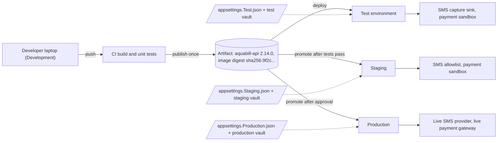
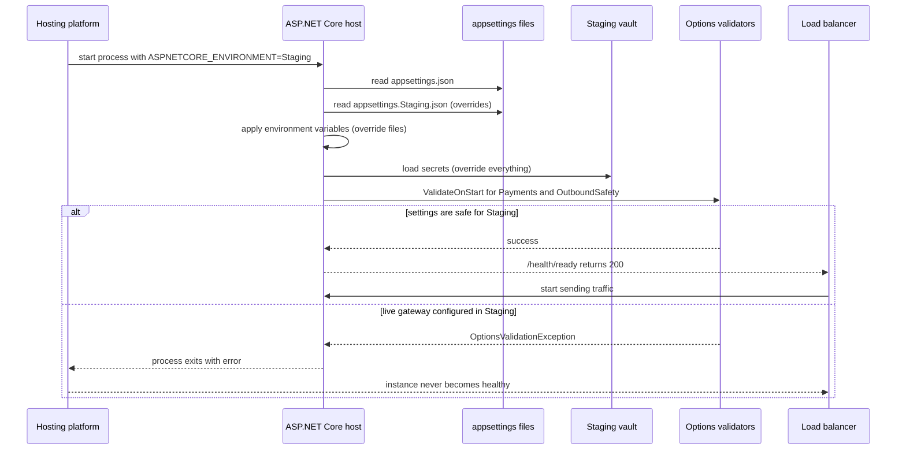

On a Friday evening a QA engineer at a city water-billing company tests the new "overdue reminder" feature. The QA database is a copy of production taken last month, so it holds 80,000 real consumers with real mobile numbers. The QA server still has the real SMS provider's key in its settings, because "we needed it once to test delivery". She clicks **Send reminders**. Within four minutes, 80,000 people receive "Your water bill of ₹0.00 is overdue. Pay now to avoid disconnection." The phones at the call centre ring all weekend. Nothing in the code was wrong. Every problem was in *where* the code ran and *what it was connected to*. This lesson is about getting that right.

## Learning objectives

By the end of this lesson you will be able to:

1. Explain what an environment is, and what development, test, staging and production are each for.
2. Describe "build once, deploy many" and why the same artifact must move through every environment.
3. Judge which differences between staging and production are acceptable (size, cost) and which are dangerous (versions, engines, missing config).
4. Configure an ASP.NET Core app per environment using `ASPNETCORE_ENVIRONMENT`, `appsettings.{Environment}.json`, environment variables and a secret store, and know the order in which they override each other.
5. Fail fast at startup when an environment is wired to the wrong things, using options validation.
6. Choose a strategy for data outside production: synthetic data, masked copies or subsets, and keep real people from being contacted.

## Prerequisites

- [Configuration, environment variables and secrets](#/lesson/m03-configuration): you should know `IConfiguration` and the options pattern.
- [Health checks and graceful shutdown](#/lesson/m03-health-shutdown): we add a liveness endpoint and a version endpoint.
- [Secure password storage and secret management](#/lesson/m14-passwords-secrets): secrets per environment live in a vault, not in files.

## Explain it like I'm a beginner

Think of a theatre company putting on a new play.

- First, actors read their lines at home, in their pyjamas, with a script full of pencil notes. That is **development**: one person, their own machine, anything goes.
- Then the cast rehearses together in a rehearsal room, with chairs standing in for the sofa. That is **test** (often called QA): people check that the parts work together, but the room doesn't look like the real stage.
- Then comes the **dress rehearsal**: the real stage, real lights, real costumes, the full running order, but no paying audience. That is **staging**. Its whole point is to look exactly like opening night, so surprises happen here and not in front of the audience.
- Finally, opening night with a paying audience: **production**. Mistakes here are seen by real people and cost real money.

Two rules follow from the analogy.

1. **The dress rehearsal must be like the real show.** If the dress rehearsal uses a different stage, the actor who trips over the real stage's steps will trip on opening night. In software, that means staging must use the same database engine, the same runtime version and the same kind of network setup as production (parity).
2. **Rehearsals must never reach the audience.** If someone in rehearsal shouts "fire!", it must not empty the real theatre next door. In software, a test copy must never charge real cards, email real customers or write to the production database.

An **environment** is simply one complete, separate copy of your system: its servers, its database, its settings and its connections to the outside world. "Production" is the copy that real users use. Everything else exists to protect it.

## First-principles explanation

### What an environment is made of

An environment is more than a server. It is the whole set of:

| Part | Example in production | Example in staging |
|---|---|---|
| Compute | 4 app instances behind a load balancer | 2 app instances behind a load balancer |
| Data stores | PostgreSQL 17, 400 GB | PostgreSQL 17, 40 GB masked subset |
| Configuration | `appsettings.Production.json` + environment variables | `appsettings.Staging.json` + environment variables |
| Secrets | Production vault | Staging vault (different keys) |
| External connections | Live payment gateway, live SMS provider | Payment gateway sandbox, SMS capture sink |
| Network and identity | Production subscription, private endpoints | Separate subscription, private endpoints |
| Observability | Alerts page the on-call engineer | Alerts go to a team channel |

If any row is shared between two environments, those environments are not really separate. The water-billing story above failed on two rows at once: real data in QA, and a live external connection in QA.

### The usual ladder

Most teams use four rungs. Names vary; the jobs don't.

1. **Development (local).** Each developer's laptop, often with dependencies in containers ([Docker](#/lesson/m15-docker)). Fast feedback, fake or local services, detailed error pages. No shared data.
2. **Test / QA / integration.** A shared environment where the merged code runs together. Automated end-to-end tests and manual exploratory testing happen here. It may be rebuilt often. Many teams also create a short-lived copy per pull request (an ephemeral or preview environment) and destroy it when the pull request is merged.
3. **Staging (pre-production).** As close to production as money allows. Same infrastructure code, same versions, same network shape. Used for the final check of a release, performance tests, migration rehearsals and sign-off. Changes reach staging only through the same pipeline that reaches production.
4. **Production.** Real users, real money, real data. Access is tightly limited and every change is audited.

You do not need all four on day one. A two-person team shipping an internal tool might run *local + production* with good automated tests and be perfectly safe. A team handling payments for a state government needs every rung, plus separate cloud accounts for production. The number of rungs should match the cost of a mistake.

### Build once, deploy many

The single most important rule: **the thing you deploy to production must be the exact thing you tested.** Build the code once, in CI, into one artifact (a zip of the published app, or a container image with a fixed digest). Then *promote* that same artifact from test to staging to production. Only configuration changes between environments.

Why? Because rebuilding changes things you didn't intend to change. A rebuild a week later may pull a newer NuGet package patch, a newer base image or a different compiler. The bytes you tested are then not the bytes you ship. With one artifact, "it passed in staging" means something.

This leads to a design rule for your code: **the app must not know at build time where it will run.** No `#if STAGING`, no separate build per environment. Everything that differs is read at startup from configuration.

### Parity: how alike must environments be?

The Twelve-Factor App names three gaps between development and production:

- **Time gap**: code written today reaches production weeks later. Fix: deploy small changes often ([CI/CD](#/lesson/m15-ci-cd)).
- **Personnel gap**: developers write code, a separate ops team deploys it. Fix: the people who build it help run it, using the same pipeline.
- **Tools gap**: SQLite on the laptop, PostgreSQL in production. Fix: use the same backing services everywhere, which containers make cheap.

Parity doesn't mean "identical in every way". Production might have 12 instances and staging 2, and that's fine. The useful split is between differences of **size** and differences of **kind**.

| Difference | Acceptable? | Why |
|---|---|---|
| Fewer instances, smaller VM sizes | Yes | Same behaviour, lower cost. But staging can't tell you production's capacity. |
| Smaller, masked database | Yes, with care | Query plans on 40 GB can differ from 400 GB; run big performance tests separately. |
| PostgreSQL 16 in staging, 17 in production | **No** | Different planner, different features, different bugs. |
| SQLite or in-memory DB in test instead of PostgreSQL | **No** for integration tests | SQL dialect, locking and transaction behaviour differ. Fine for unit tests that don't touch SQL. |
| .NET 10.0.0 in staging, 10.0.3 in production | Usually no | Patch versions fix bugs and change behaviour occasionally. Pin the same one. |
| No TLS or no reverse proxy in staging | **No** | Forwarded headers, redirects, cookies and HSTS behave differently ([reverse proxies](#/lesson/m15-reverse-proxy-iis)). |
| A configuration key missing in staging | **No** | You will discover the missing key on production's first request. |
| Payment sandbox instead of live gateway | Yes, required | Same API shape, no real money. |

A good test: *if this difference caused a bug, would staging hide it?* If yes, remove the difference or accept the risk in writing.

### Drift

Environments start identical and slowly diverge: someone hot-fixes a setting in production through the portal, someone installs a PostgreSQL extension in staging to try something and forgets. This is **environment drift**. After six months, "it worked in staging" means little. Two habits keep drift under control:

1. **Infrastructure as Code**: every environment is created from the same templates with different parameter files ([Infrastructure as Code](#/lesson/m15-iac)). A manual change shows up as a difference on the next plan.
2. **Compare regularly**: a scheduled job lists versions, extensions and configuration *keys* (not values) in each environment and reports differences. You will build one in exercise 5.

### Configuration per environment in ASP.NET Core

ASP.NET Core reads the environment name from the `ASPNETCORE_ENVIRONMENT` variable (or `DOTNET_ENVIRONMENT` for non-web hosts). The built-in names are `Development`, `Staging` and `Production`. If nothing is set, the app assumes **Production**. That default is deliberate: forgetting to set it gives you the safest behaviour (no developer error pages), not the most dangerous one. You can use your own names too, such as `Test` or `UAT`: `appsettings.Test.json` is picked up automatically, and `env.IsEnvironment("Test")` checks for it, but `IsDevelopment()`, `IsStaging()` and `IsProduction()` only match the three built-in names. A guardrail written as `!env.IsProduction()` therefore treats `Test` and `UAT` as non-production, which is what you want.

`WebApplication.CreateBuilder` then loads configuration sources in this order. **Later sources override earlier ones** for the same key:

1. `appsettings.json`: defaults shared by all environments.
2. `appsettings.{Environment}.json`, for example `appsettings.Staging.json`.
3. User secrets: **only when the environment is Development**. They live in your user profile, outside the repository.
4. Environment variables. A double underscore stands for the `:` separator, so `Payments__Gateway__MerchantId` sets `Payments:Gateway:MerchantId`.
5. Command-line arguments.

In staging and production you add a secret store on top, for example Azure Key Vault through its configuration provider, so that secrets come from the vault and override anything in files.

What goes where:

- **`appsettings.json`**: things that are the same everywhere, like timeouts, feature defaults and logging categories.
- **`appsettings.{Environment}.json`**: non-secret values that differ by environment, such as log levels, the sandbox URL in staging, or "capture outbound SMS" in test.
- **Environment variables / app settings in the hosting platform**: values that differ per deployment (region, instance name), and anything the platform injects.
- **Vault**: connection strings with passwords, API keys, signing keys. Never in a file in Git, not even for staging.

### Don't branch business logic on the environment name

It is tempting to write `if (env.IsStaging()) skipPayment();`. Don't. Code paths that run only in one environment are code paths you never tested in the others. If production runs a branch that staging skipped, staging didn't test production.

Instead, express the *difference* as configuration with a meaningful name: `Payments:Gateway:IsSandbox = true`, `OutboundSafety:Mode = Capture`. The code then has one path that behaves according to settings, and you can test each setting in any environment.

There are two acceptable uses of the environment name:

- **Developer conveniences** that ASP.NET Core already ties to it, such as the detailed exception page in Development.
- **Guardrails** that refuse dangerous combinations at startup: "Production must not use a sandbox key", "a non-production environment must not use the live gateway". These checks don't change behaviour; they stop the app from starting. That is exactly what would have saved the water-billing company.

### Fail fast at startup

A wrong setting found at 3 a.m. on the first real request is expensive. The same wrong setting found when the new version starts, while the old version is still serving traffic, is cheap: the deployment fails and nobody notices. In .NET, bind settings to options classes and call `ValidateOnStart()`. Validation then runs when the host starts, and a missing or dangerous value throws before the app accepts a single request. Combine this with a readiness probe and a rolling deployment ([deployment strategies](#/lesson/m15-deployment-strategies)) and a misconfigured release never receives traffic.

### Data outside production

Non-production environments need data, and the data must be realistic enough to find bugs. There are three main sources:

1. **Synthetic data**: generated by scripts. Safe by construction, easy to reset, good for automated tests. Weakness: it lacks the strange real-world cases (a consumer name with 140 characters, an address in three scripts, a bill with 47 adjustments).
2. **Masked copy of production**: real structure and volumes, with personal fields replaced. Realistic, but you must mask *every* personal field, including those hidden in JSON columns, free-text notes, logs and file attachments. Masking must be **deterministic** (the same input gives the same output) so that relationships survive: if a phone number appears in two tables, both get the same fake number.
3. **Subset**: a slice of production (say, 2 of 40 city wards) with referential integrity kept, then masked. Smaller, faster to restore, cheaper.

India's Digital Personal Data Protection Act, 2023, the EU's GDPR and most sector rules expect personal data to be used only for the purpose it was collected for and protected accordingly. Copying real consumers' phone numbers into a QA database that 30 people, including an outsourced testing vendor, can query is hard to defend under any of them. Treat "real personal data outside production" as an exception that needs approval, not a default.

Even with perfect masking, add a second line of defence for **side effects**: anything that leaves the system (SMS, email, push notifications, webhooks, payments, files sent to government portals). Outside production, these should go to a sandbox or be captured in a local "outbox viewer" so testers can see them, with an explicit allowlist of team phone numbers and email domains for real delivery tests.

### Cost of environments

Environments cost money even when nobody uses them. Illustrative estimate for a mid-sized web app (your numbers will differ):

- Production: 4 app instances + managed PostgreSQL with HA + Redis ≈ ₹2,40,000 per month.
- Staging at the same shape but half the instance count and no HA standby ≈ 40 % of that ≈ ₹96,000.
- Shared test environment, small sizes ≈ 15 % ≈ ₹36,000.
- Ephemeral pull-request environments, each living about 6 hours, 30 per month, using containers and a shared database server ≈ ₹10,000–20,000.

Ways to cut cost without losing parity: scale staging down outside working hours, keep it the same *shape* but smaller *sizes*, share one database server across ephemeral environments with one database per pull request, and destroy anything idle.

### What breaks first, and how it fails

| Failure | How it shows up | Mitigation |
|---|---|---|
| Staging uses production's database or queue | Test data appears in production, or a test deletes real rows | Separate accounts/subscriptions per environment, network isolation, different credentials |
| Real side effects from non-production | Customers get test messages, cards are charged | Sandbox gateways, capture mode, allowlists, startup validation |
| Missing config key in production | Crash or wrong default on first request | `ValidateOnStart`, key-drift comparison, a startup smoke test |
| Drift between staging and production | "Worked in staging" bugs | Infrastructure as Code, scheduled drift reports |
| Rebuilt artifact per environment | Tested bytes differ from shipped bytes | Build once, promote by digest or version |
| Real personal data in test | Data breach from a weakly protected environment | Masked or synthetic data, access review |

## Visual explanation

### One artifact, many environments



Read it left to right. The developer pushes code. CI builds it **once** and publishes a single artifact with a version and an immutable digest. That same artifact is deployed to test, then promoted to staging, then to production: the solid arrows always start from the one artifact, never from a new build. The dotted arrows show what is different per environment: only configuration and secrets. On the right, each environment talks to different outside services. Test captures every SMS, staging only sends to an allowlist of team numbers, and only production reaches real customers and real money.

### What happens at startup



The platform starts the process and tells it which environment it is in. The host reads configuration layer by layer, and each later layer wins: shared file, environment file, environment variables, then the vault. Before accepting requests, the host runs the validators registered with `ValidateOnStart`. If the settings are safe, the readiness endpoint answers and the load balancer starts sending traffic. If someone pasted the live payment key into staging, validation throws, the process exits, and the instance never receives a request. During a rolling deployment the old version keeps serving, so a bad configuration costs a failed deployment, not an outage.

## Step-by-step example

We will make the water-billing API, **AquaBill**, safe to run in four environments.

### Step 1: the naive version

```csharp
// Program.cs (naive)
var smsKey = "LIVE-7c1f...";                                  // hard-coded live key
var db = "Host=prod-db.internal;Database=aquabill;Password=..."; // one connection string for all
#if DEBUG
app.UseDeveloperExceptionPage();
#endif
if (Environment.MachineName.StartsWith("QA")) { /* skip payment */ }
```

Everything that should differ by environment is either hard-coded, chosen at build time (`#if DEBUG`), or guessed from the machine name. Copying this build to QA connects QA to production.

### Step 2: move every difference into configuration

```json
// appsettings.json (shared defaults, committed to Git)
{
  "Payments": { "Gateway": { "TimeoutSeconds": 15 } },
  "OutboundSafety": { "Mode": "Capture" },
  "Deployment": { "Version": "0.0.0-local" }
}
```

```json
// appsettings.Staging.json (non-secret staging values, committed to Git)
{
  "Payments": { "Gateway": { "BaseUrl": "https://sandbox.pay.example/v2/", "IsSandbox": true } },
  "OutboundSafety": { "Mode": "Allowlist", "AllowedRecipients": [ "@aquabill.example", "+919800000001" ] }
}
```

The connection string and API keys are **not** in either file. In staging they come from the staging vault. Notice that the shared default for outbound messages is `Capture`: a new environment that forgets to configure it is safe by default.

### Step 3: set the environment name in the platform, not in code

On App Service, a container or IIS, set `ASPNETCORE_ENVIRONMENT=Staging` as an environment variable or app setting for that environment. Locally, `launchSettings.json` sets `Development`. The build is identical everywhere.

### Step 4: validate at startup

Bind each section to an options class and add a validator that knows the dangerous combinations. This is the only place the environment name is used, and it is used as a guardrail.

### Step 5: guard side effects

Wrap the real SMS sender in a decorator that, outside `Live` mode, captures messages or only lets allowlisted recipients through. Testers see captured messages at `/dev/captured`.

### Step 6: prove which build is running

Add `/version` returning the environment name, version and commit. When someone says "it works in staging", you can check that staging and production run the same version.

## Production-style C# implementation

Project layout:

```text
AquaBill.Api/
  Program.cs
  appsettings.json
  appsettings.Development.json
  appsettings.Staging.json
  appsettings.Production.json
  Hosting/DeploymentInfo.cs
  Hosting/PaymentGatewayOptions.cs
  Hosting/OutboundSafety.cs
```

```csharp file=Hosting/DeploymentInfo.cs
namespace AquaBill.Hosting;

/// <summary>Set by the pipeline as environment variables (Deployment__Version, Deployment__CommitSha).
/// The same artifact runs everywhere, so these come from the deployment, not from the build.</summary>
public sealed class DeploymentOptions
{
    public const string Section = "Deployment";
    public string Version { get; set; } = "0.0.0-local";
    public string CommitSha { get; set; } = "unknown";
    public string Region { get; set; } = "local";
}

public sealed record DeploymentInfo(string Environment, string Version, string CommitSha, string Region, DateTimeOffset StartedAt);
```

```csharp file=Hosting/PaymentGatewayOptions.cs
using Microsoft.Extensions.Hosting;
using Microsoft.Extensions.Options;

namespace AquaBill.Hosting;

public sealed class PaymentGatewayOptions
{
    public const string Section = "Payments:Gateway";
    public Uri? BaseUrl { get; set; }
    public string MerchantId { get; set; } = "";
    /// <summary>Comes from the environment's vault. Never stored in appsettings files.</summary>
    public string ApiKey { get; set; } = "";
    public bool IsSandbox { get; set; } = true;
    public int TimeoutSeconds { get; set; } = 15;
}

/// <summary>The one place where the environment name matters: it refuses dangerous combinations.
/// It never changes behaviour, it only stops the app from starting.</summary>
public sealed class PaymentGatewayOptionsValidator(IHostEnvironment env) : IValidateOptions<PaymentGatewayOptions>
{
    public ValidateOptionsResult Validate(string? name, PaymentGatewayOptions o)
    {
        var failures = new List<string>();
        if (o.BaseUrl is null) failures.Add("Payments:Gateway:BaseUrl is required.");
        else if (o.BaseUrl.Scheme != Uri.UriSchemeHttps) failures.Add("Payments:Gateway:BaseUrl must use HTTPS.");
        if (string.IsNullOrWhiteSpace(o.MerchantId)) failures.Add("Payments:Gateway:MerchantId is required.");
        if (string.IsNullOrWhiteSpace(o.ApiKey)) failures.Add("Payments:Gateway:ApiKey is missing. Check the environment's vault.");
        if (o.TimeoutSeconds is < 1 or > 60) failures.Add("Payments:Gateway:TimeoutSeconds must be between 1 and 60.");

        if (env.IsProduction() && o.IsSandbox)
            failures.Add("Production is configured with the sandbox payment gateway.");
        if (!env.IsProduction() && !o.IsSandbox)
            failures.Add($"Environment '{env.EnvironmentName}' is configured with the LIVE payment gateway. Use the sandbox.");

        return failures.Count == 0 ? ValidateOptionsResult.Success : ValidateOptionsResult.Fail(failures);
    }
}
```

```csharp file=Hosting/OutboundSafety.cs
using System.Collections.Concurrent;
using Microsoft.Extensions.Hosting;
using Microsoft.Extensions.Logging;
using Microsoft.Extensions.Options;

namespace AquaBill.Hosting;

/// <summary>Live: send everything. Allowlist: send only to listed recipients, capture the rest.
/// Capture: send nothing, keep messages for testers to inspect.</summary>
public enum OutboundMode { Live, Allowlist, Capture }

public sealed class OutboundSafetyOptions
{
    public const string Section = "OutboundSafety";
    public OutboundMode Mode { get; set; } = OutboundMode.Capture;   // safe default for any new environment
    /// <summary>Exact phone numbers (+919800000001) or email domains (@aquabill.example).</summary>
    public List<string> AllowedRecipients { get; set; } = [];

    public bool IsAllowed(string recipient) =>
        AllowedRecipients.Any(a => a.StartsWith('@')
            ? recipient.EndsWith(a, StringComparison.OrdinalIgnoreCase)
            : string.Equals(a, recipient, StringComparison.OrdinalIgnoreCase));
}

public sealed class OutboundSafetyOptionsValidator(IHostEnvironment env) : IValidateOptions<OutboundSafetyOptions>
{
    public ValidateOptionsResult Validate(string? name, OutboundSafetyOptions o)
    {
        if (env.IsProduction() && o.Mode != OutboundMode.Live)
            return ValidateOptionsResult.Fail("Production must send notifications (OutboundSafety:Mode = Live).");
        if (!env.IsProduction() && o.Mode == OutboundMode.Live)
            return ValidateOptionsResult.Fail($"Environment '{env.EnvironmentName}' must not use OutboundSafety:Mode = Live.");
        if (o.Mode == OutboundMode.Allowlist && o.AllowedRecipients.Count == 0)
            return ValidateOptionsResult.Fail("Allowlist mode needs at least one entry in OutboundSafety:AllowedRecipients.");
        return ValidateOptionsResult.Success;
    }
}

public sealed record OutboundMessage(string Recipient, string Channel, string Body);

public interface INotificationSender
{
    Task SendAsync(OutboundMessage message, CancellationToken ct);
}

public interface ICapturedMessageStore
{
    void Add(OutboundMessage message);
    IReadOnlyList<OutboundMessage> All();
}

public sealed class InMemoryCapturedMessageStore : ICapturedMessageStore
{
    private const int MaxMessages = 1_000;
    private readonly ConcurrentQueue<OutboundMessage> _messages = new();

    public void Add(OutboundMessage message)
    {
        _messages.Enqueue(message);
        while (_messages.Count > MaxMessages && _messages.TryDequeue(out _)) { }
    }

    public IReadOnlyList<OutboundMessage> All() => _messages.ToArray();
}

/// <summary>Stand-in for the real SMS provider client (an HttpClient call in a real app).</summary>
public sealed class SmsProviderSender(ILogger<SmsProviderSender> log) : INotificationSender
{
    public Task SendAsync(OutboundMessage message, CancellationToken ct)
    {
        log.LogInformation("SMS sent to {Recipient}", message.Recipient);
        return Task.CompletedTask;
    }
}

/// <summary>Decorator around the real sender. The business code calls INotificationSender
/// and never knows which environment it runs in.</summary>
public sealed class EnvironmentGuardedSender(
    INotificationSender inner,
    ICapturedMessageStore capture,
    IOptionsMonitor<OutboundSafetyOptions> options,
    ILogger<EnvironmentGuardedSender> log) : INotificationSender
{
    public Task SendAsync(OutboundMessage message, CancellationToken ct)
    {
        var o = options.CurrentValue;
        var deliver = o.Mode switch
        {
            OutboundMode.Live => true,
            OutboundMode.Allowlist => o.IsAllowed(message.Recipient),
            _ => false,
        };

        if (deliver) return inner.SendAsync(message, ct);

        capture.Add(message);
        log.LogInformation("Captured {Channel} to {Recipient} (mode {Mode})", message.Channel, message.Recipient, o.Mode);
        return Task.CompletedTask;
    }
}
```

```csharp file=Program.cs
using AquaBill.Hosting;
using Microsoft.AspNetCore.Diagnostics.HealthChecks;
using Microsoft.Extensions.Diagnostics.HealthChecks;
using Microsoft.Extensions.Options;

var builder = WebApplication.CreateBuilder(args);

// Sources already loaded by CreateBuilder, lowest to highest priority:
// appsettings.json, appsettings.{Environment}.json, user secrets (Development only),
// environment variables, command-line arguments.
// In Staging and Production, add the vault on top, for example with the Azure Key Vault
// configuration provider (package not referenced in this sample).

builder.Services.AddOptions<DeploymentOptions>()
    .Bind(builder.Configuration.GetSection(DeploymentOptions.Section));

builder.Services.AddOptions<PaymentGatewayOptions>()
    .Bind(builder.Configuration.GetSection(PaymentGatewayOptions.Section))
    .ValidateOnStart();
builder.Services.AddSingleton<IValidateOptions<PaymentGatewayOptions>, PaymentGatewayOptionsValidator>();

builder.Services.AddOptions<OutboundSafetyOptions>()
    .Bind(builder.Configuration.GetSection(OutboundSafetyOptions.Section))
    .ValidateOnStart();
builder.Services.AddSingleton<IValidateOptions<OutboundSafetyOptions>, OutboundSafetyOptionsValidator>();

builder.Services.AddSingleton(sp =>
{
    var d = sp.GetRequiredService<IOptions<DeploymentOptions>>().Value;
    var env = sp.GetRequiredService<IHostEnvironment>();
    return new DeploymentInfo(env.EnvironmentName, d.Version, d.CommitSha, d.Region, DateTimeOffset.UtcNow);
});

builder.Services.AddSingleton<ICapturedMessageStore, InMemoryCapturedMessageStore>();
builder.Services.AddSingleton<SmsProviderSender>();
builder.Services.AddSingleton<INotificationSender>(sp => new EnvironmentGuardedSender(
    sp.GetRequiredService<SmsProviderSender>(),
    sp.GetRequiredService<ICapturedMessageStore>(),
    sp.GetRequiredService<IOptionsMonitor<OutboundSafetyOptions>>(),
    sp.GetRequiredService<ILogger<EnvironmentGuardedSender>>()));

builder.Services.AddHealthChecks()
    .AddCheck("self", () => HealthCheckResult.Healthy(), tags: ["live"]);
// Add dependency checks (database, vault) tagged "ready" in a real app; they gate traffic, not restarts.

var app = builder.Build();

// The developer exception page is enabled automatically in Development.
// Everywhere else, return a generic problem response and log the details.
if (!app.Environment.IsDevelopment())
    app.UseExceptionHandler("/error");

app.MapGet("/error", () => Results.Problem("Something went wrong. The error has been logged."))
   .ExcludeFromDescription();

app.MapHealthChecks("/health/live", new HealthCheckOptions { Predicate = r => r.Tags.Contains("live") });
app.MapHealthChecks("/health/ready");   // all checks; the load balancer routes traffic only when this is 200
app.MapGet("/version", (DeploymentInfo info) => info);

app.MapPost("/bills/{consumerNo}/remind", async (string consumerNo, string phone, INotificationSender sender, CancellationToken ct) =>
{
    await sender.SendAsync(new OutboundMessage(phone, "sms", $"Your water bill for consumer {consumerNo} is due."), ct);
    return Results.Accepted();
});

// Exposed whenever messages are not sent live, which is decided by configuration, not by environment name.
var outbound = app.Services.GetRequiredService<IOptions<OutboundSafetyOptions>>().Value;
if (outbound.Mode != OutboundMode.Live)
    app.MapGet("/dev/captured", (ICapturedMessageStore store) => store.All());

app.Run();
```

The matching settings files:

```json
// appsettings.Production.json (non-secret values only)
{
  "Payments": { "Gateway": { "BaseUrl": "https://api.pay.example/v2/", "IsSandbox": false } },
  "OutboundSafety": { "Mode": "Live" },
  "Logging": { "LogLevel": { "Default": "Information", "Microsoft.AspNetCore": "Warning" } }
}
```

Design notes:

- **Safe defaults.** `OutboundSafety:Mode` defaults to `Capture` and `IsSandbox` defaults to `true`. An environment someone forgot to configure can't send real messages or charge real money. Production must opt in explicitly, and the validator enforces that it does.
- **Two-way guardrails.** Production refuses the sandbox (otherwise customers' payments silently go nowhere), and non-production refuses live. Both mistakes have happened to real teams.
- **One code path.** `/bills/{consumerNo}/remind` runs the same code in every environment. Only the decorator's settings differ.
- **`IOptionsMonitor`** lets an operator change the allowlist in staging without a restart, if the configuration source supports reload.
- **`/dev/captured` holds personal data.** Captured messages contain phone numbers and message text. In a real app, protect the endpoint with the team's sign-in (`RequireAuthorization`) and keep the store bounded, as `InMemoryCapturedMessageStore` does. With several instances, each one captures only its own messages; use a shared store (a table or a mail-catcher service) if testers need one view.
- **`/version`** must not reveal secrets. It shows the environment name, version, commit and region: enough to answer "is staging running what we're about to ship?".

## Bad design vs good design

**Bad**: "staging is just production with a different URL".

```text
- One subscription. Staging app servers sit in the same network as production.
- Staging connection string points at a schema "staging" inside the production database server.
- Staging uses the production Redis with a "stg:" key prefix.
- A nightly job copies production tables into the staging schema, unmasked.
- Secrets for both environments are in one vault that all developers can read.
- Each environment is built from the branch at deploy time.
```

What goes wrong: a heavy staging test slows production's database. A key-prefix bug in staging evicts or overwrites production cache entries. Every developer can read production secrets. A staging migration that drops a column runs against the shared server's catalog and locks tables production is using. Real personal data sits in a schema with weaker access rules. And because each environment is rebuilt from a branch, nobody can prove that production runs what staging tested.

**Good**: separate subscriptions (or cloud accounts) per environment class, separate networks with no route from staging into production, separate database servers and caches, a vault per environment with production access limited to the deployment identity and a small on-call group, masked data for staging, and one artifact promoted through all environments.

**Is full separation always worth it?** For a small internal tool with no personal data, a single subscription with separate resource groups and separate databases may be enough. The non-negotiables are smaller than they look: separate data stores, separate credentials, no real side effects from non-production, and one artifact.

:::callout type=mistake title="Using the environment name as a feature flag"
`if (env.IsStaging()) EnableNewTariffs();` means production runs a code path staging never ran. Use a real feature flag or a named setting such as `Tariffs:UseRevisedSlabs`, test both values in staging, and flip it in production on purpose.
:::

:::callout type=tradeoff title="Staging fidelity versus cost"
A staging environment identical to production in size doubles your infrastructure bill. Match the **shape** (same services, versions, network layout, TLS, proxy) and shrink the **sizes**. Run capacity tests in a temporary full-size environment created from the same templates, then delete it.
:::

## Practical playground

The program below rebuilds ASP.NET Core's configuration layering in memory, so you can see which source wins. Run it, then try:

1. Change `environment` to `"Production"`. Which values change, and why?
2. Remove the environment variable for `OutboundSafety:Mode`. What is the effective value in Staging?
3. Add a command-line style layer that sets `Payments:Gateway:IsSandbox` to `false`. Which layer would you allow to do this in real life?

:::playground type=csharp title="Which configuration source wins?"
```csharp file=Program.cs
using System;
using System.Collections.Generic;
using Microsoft.Extensions.Configuration;

public static class Program
{
    public static void Main()
    {
        var environment = "Staging";

        var shared = new Dictionary<string, string?>
        {
            ["Payments:Gateway:TimeoutSeconds"] = "15",
            ["Payments:Gateway:IsSandbox"] = "true",
            ["OutboundSafety:Mode"] = "Capture",
            ["Deployment:Version"] = "0.0.0-local",
        };

        var perEnvironment = new Dictionary<string, Dictionary<string, string?>>
        {
            ["Staging"] = new() { ["Payments:Gateway:BaseUrl"] = "https://sandbox.pay.example/v2/", ["OutboundSafety:Mode"] = "Allowlist" },
            ["Production"] = new() { ["Payments:Gateway:BaseUrl"] = "https://api.pay.example/v2/", ["Payments:Gateway:IsSandbox"] = "false", ["OutboundSafety:Mode"] = "Live" },
        };

        // Environment variables use "__" for ":" and are applied after the files.
        var environmentVariables = new Dictionary<string, string?>
        {
            ["Deployment__Version"] = "2.14.0",
            ["OutboundSafety__Mode"] = environment == "Staging" ? "Allowlist" : null,
        };

        var envLayer = new Dictionary<string, string?>();
        foreach (var (k, v) in environmentVariables)
            if (v is not null) envLayer[k.Replace("__", ":")] = v;

        // Stands in for the vault: highest priority, secrets only.
        var vault = new Dictionary<string, string?> { ["Payments:Gateway:ApiKey"] = $"{environment.ToLowerInvariant()}-key-from-vault" };

        var config = new ConfigurationBuilder()
            .AddInMemoryCollection(shared)
            .AddInMemoryCollection(perEnvironment.GetValueOrDefault(environment) ?? new Dictionary<string, string?>())
            .AddInMemoryCollection(envLayer)
            .AddInMemoryCollection(vault)
            .Build();

        Console.WriteLine($"Environment: {environment}");
        foreach (var key in new[] { "Payments:Gateway:BaseUrl", "Payments:Gateway:IsSandbox", "Payments:Gateway:TimeoutSeconds",
                                    "Payments:Gateway:ApiKey", "OutboundSafety:Mode", "Deployment:Version" })
            Console.WriteLine($"  {key,-32} = {config[key] ?? "(not set)"}");
    }
}
```
:::

## Exercises

:::exercise id=m15-environments-ex1 difficulty=beginner kind=written title="Acceptable or dangerous differences?"
Your team's staging environment differs from production in the ways listed below. For each one, say whether it is **acceptable**, **acceptable with a mitigation**, or **dangerous**, and explain in one or two sentences.

1. Staging has 2 app instances, production has 6.
2. Staging runs PostgreSQL 16.4, production runs PostgreSQL 17.2.
3. Staging's database is 30 GB of masked data, production's is 600 GB.
4. Staging calls the payment gateway's sandbox, production calls the live gateway.
5. Staging is reached directly on Kestrel over HTTP, production sits behind IIS with TLS.
6. Staging has no `Reports:ExportBucket` setting. The report export feature is "not used in staging".
7. Staging's logs are kept 7 days, production's 90 days.
8. Staging was built from the `release/2.14` branch on Tuesday, production from the same branch on Thursday.
::acceptance
- Each item has a verdict and a reason tied to "would this difference hide a bug?".
- Items 2, 5, 6 and 8 are identified as dangerous, with a fix for each.
- Item 3 mentions query plans or performance testing as the mitigation.
- Item 4 is recognised as a required difference, not a parity problem.
::hint
For each item, imagine a bug caused by the difference. Would staging have caught it?
::hint
Separate differences of size (how much) from differences of kind (what).
::hint
Item 8 is not about infrastructure at all. What exactly is being promoted?
::hint
Item 5: think about redirects to HTTPS, secure cookies and the client IP address the app sees.
::solution
1. **Acceptable.** Same behaviour, smaller size. Staging can't predict production capacity; load-test separately.
2. **Dangerous.** A major PostgreSQL version changes the planner, defaults and features (and `pg_dump`/restore and extension versions are tied to it). A migration or query that works on 16 can behave differently on 17. Upgrade staging first, always.
3. **Acceptable with a mitigation.** Functionally fine, but a query that is fast on 30 GB may pick a different plan on 600 GB. Run performance tests in a temporary full-size environment, or compare `EXPLAIN` plans on a production-sized masked copy before risky releases.
4. **Acceptable and required.** Same API, no real money. Make sure the sandbox is the *same API version* as live.
5. **Dangerous.** Without the proxy, staging never tests forwarded headers, HTTPS redirects, `Secure` cookies, request size limits or IIS-specific behaviour. Put the same kind of proxy and TLS in staging.
6. **Dangerous.** Production's first export will be the first time the code reads that key. Every key that exists in production must exist in staging, even if the value points to a staging bucket. Add a key-drift check.
7. **Acceptable.** Retention differs for cost; behaviour is the same.
8. **Dangerous.** Two builds from the same branch are not the same artifact: dependencies, base images or commits can differ. Build once and promote the identical artifact by version or digest.
::mistakes
- Calling every difference dangerous. Parity is about kind, not size; demanding identical sizes wastes money.
- Missing item 8 because it "looks the same". Same branch is not the same bytes.
- Treating the sandbox gateway as a parity violation.
:::

:::exercise id=m15-environments-ex2 difficulty=beginner kind=code title="Rebuild the configuration override order"
Implement a small model of ASP.NET Core's configuration layering.

- `FromEnvironmentVariables(vars, prefix)` keeps only variables whose name starts with `prefix` (case-insensitive), removes the prefix, and turns `__` into `:`. For example, with prefix `AQUABILL_`, `AQUABILL_Payments__Gateway__MerchantId` becomes `Payments:Gateway:MerchantId`.
- `Merge(layers)` combines layers in order. **Later layers override earlier ones.** Keys are case-insensitive, like `IConfiguration`.
::acceptance
- A key set in the shared layer and the environment layer takes the environment layer's value.
- A key set only in the first layer survives the merge.
- Variables without the prefix are ignored.
- Lookups on the result are case-insensitive.
::hint
Both methods return a `Dictionary<string, string>`. What comparer makes keys case-insensitive?
::hint
For `Merge`, loop through the layers in order and assign with the indexer, so later values overwrite earlier ones.
::hint
For the prefix check use `StartsWith(prefix, StringComparison.OrdinalIgnoreCase)`, then `Substring(prefix.Length)` and `Replace("__", ":")`.
::hint
```csharp
var result = new Dictionary<string, string>(StringComparer.OrdinalIgnoreCase);
foreach (var layer in layers)
    foreach (var (key, value) in layer)
        result[key] = value;
```
::starter
```csharp file=ConfigLayering.cs
using System;
using System.Collections.Generic;

public static class ConfigLayering
{
    public static Dictionary<string, string> FromEnvironmentVariables(IReadOnlyDictionary<string, string> variables, string prefix)
        => throw new NotImplementedException();

    public static Dictionary<string, string> Merge(params IReadOnlyDictionary<string, string>[] layers)
        => throw new NotImplementedException();
}
```
::tests
```csharp file=ConfigLayeringTests.cs
using System.Collections.Generic;
using Xunit;

public class ConfigLayeringTests
{
    [Fact]
    public void Environment_variables_are_filtered_and_translated()
    {
        var vars = new Dictionary<string, string>
        {
            ["AQUABILL_Payments__Gateway__MerchantId"] = "M-42",
            ["aquabill_OutboundSafety__Mode"] = "Capture",
            ["PATH"] = "/usr/bin",
        };
        var result = ConfigLayering.FromEnvironmentVariables(vars, "AQUABILL_");
        Assert.Equal(2, result.Count);
        Assert.Equal("M-42", result["Payments:Gateway:MerchantId"]);
        Assert.Equal("Capture", result["OutboundSafety:Mode"]);
    }

    [Fact]
    public void Later_layers_override_earlier_layers()
    {
        var shared = new Dictionary<string, string> { ["OutboundSafety:Mode"] = "Capture", ["Payments:Gateway:TimeoutSeconds"] = "15" };
        var staging = new Dictionary<string, string> { ["OutboundSafety:Mode"] = "Allowlist" };
        var envVars = new Dictionary<string, string> { ["Deployment:Version"] = "2.14.0" };

        var result = ConfigLayering.Merge(shared, staging, envVars);

        Assert.Equal("Allowlist", result["OutboundSafety:Mode"]);
        Assert.Equal("15", result["Payments:Gateway:TimeoutSeconds"]);
        Assert.Equal("2.14.0", result["Deployment:Version"]);
    }

    [Fact]
    public void Keys_are_case_insensitive_across_layers()
    {
        var a = new Dictionary<string, string> { ["Payments:Gateway:IsSandbox"] = "true" };
        var b = new Dictionary<string, string> { ["payments:gateway:issandbox"] = "false" };
        var result = ConfigLayering.Merge(a, b);
        Assert.Single(result);
        Assert.Equal("false", result["PAYMENTS:GATEWAY:ISSANDBOX"]);
    }

    [Fact]
    public void No_layers_gives_empty_result() => Assert.Empty(ConfigLayering.Merge());
}
```
::solution
Loop in order and let later assignments win. Use `StringComparer.OrdinalIgnoreCase` so `Payments:Gateway:IsSandbox` and `payments:gateway:issandbox` are the same key, which is how `IConfiguration` behaves.

```csharp file=ConfigLayering.cs
using System;
using System.Collections.Generic;

public static class ConfigLayering
{
    public static Dictionary<string, string> FromEnvironmentVariables(IReadOnlyDictionary<string, string> variables, string prefix)
    {
        var result = new Dictionary<string, string>(StringComparer.OrdinalIgnoreCase);
        foreach (var (name, value) in variables)
        {
            if (!name.StartsWith(prefix, StringComparison.OrdinalIgnoreCase)) continue;
            var key = name.Substring(prefix.Length).Replace("__", ":");
            if (key.Length > 0) result[key] = value;
        }
        return result;
    }

    public static Dictionary<string, string> Merge(params IReadOnlyDictionary<string, string>[] layers)
    {
        var result = new Dictionary<string, string>(StringComparer.OrdinalIgnoreCase);
        foreach (var layer in layers)
            foreach (var (key, value) in layer)
                result[key] = value;
        return result;
    }
}
```

This is exactly why a value in the vault beats `appsettings.Production.json`: the vault provider is added last.
::mistakes
- Using the default (case-sensitive) dictionary comparer, so `IsSandbox` and `issandbox` become two different settings.
- Merging in reverse order, so the shared defaults win over the environment file.
- Replacing a single `_` with `:`, which breaks names like `MAX_RETRIES`.
::extensions
Add support for arrays: `OutboundSafety__AllowedRecipients__0` and `__1` should become `OutboundSafety:AllowedRecipients:0` and `:1`, then write a helper that reads them back as a list.
:::

:::exercise id=m15-environments-ex3 difficulty=intermediate kind=code title="Deterministic masking for a staging copy"
Staging gets a masked copy of the billing database. Implement `PiiMasker` so that personal fields are replaced, but the same original value always becomes the same masked value (so joins between tables still work), and a different salt per copy makes the mapping impossible to reuse.

- `MaskPhone(phone)` returns 10 digits starting with `000`. Indian mobile numbers start with 6–9, so these can never be delivered. Input may contain `+91`, spaces or dashes: normalise to the last 10 digits before hashing.
- `MaskEmail(email)` returns `user-` + 8 lowercase hex characters + `@example.invalid`. Normalise by trimming and lower-casing.
- `MaskName(name)` returns `Consumer ` + 6 uppercase hex characters.
- Use HMAC-SHA256 keyed with the salt.
::acceptance
- The same input with the same salt always gives the same output.
- `+91 98100 12345` and `9810012345` give the same masked phone.
- A different salt gives a different output for the same input.
- Masked emails end with `@example.invalid` and masked phones are 10 digits starting with `000`.
::hint
Write one private helper that takes a normalised string and returns the HMAC bytes. All three methods use it.
::hint
`HMACSHA256.HashData(key, data)` (static, .NET 6+) takes two byte arrays. Use `Encoding.UTF8.GetBytes` for both.
::hint
For digits: read the first 4 bytes as a `uint` (`BitConverter.ToUInt32`), take `% 10_000_000`, format with `D7`, and prefix `000`.
::hint
For hex: `Convert.ToHexString(bytes, 0, 4).ToLowerInvariant()` gives 8 characters, `Convert.ToHexString(bytes, 0, 3)` gives 6.
::hint
To normalise a phone: keep only `char.IsDigit` characters, then take the last 10.
::starter
```csharp file=PiiMasker.cs
using System;

public sealed class PiiMasker
{
    private readonly string _salt;

    public PiiMasker(string salt)
    {
        if (string.IsNullOrWhiteSpace(salt)) throw new ArgumentException("A salt is required.", nameof(salt));
        _salt = salt;
    }

    public string MaskPhone(string phone) => throw new NotImplementedException();
    public string MaskEmail(string email) => throw new NotImplementedException();
    public string MaskName(string name) => throw new NotImplementedException();
}
```
::tests
```csharp file=PiiMaskerTests.cs
using System.Linq;
using Xunit;

public class PiiMaskerTests
{
    private readonly PiiMasker _m = new("staging-2026-10");

    [Fact]
    public void Phone_is_deterministic_and_normalised()
    {
        var a = _m.MaskPhone("+91 98100 12345");
        var b = _m.MaskPhone("9810012345");
        Assert.Equal(a, b);
        Assert.Equal(10, a.Length);
        Assert.StartsWith("000", a);
        Assert.True(a.All(char.IsDigit));
        Assert.NotEqual("9810012345", a);
    }

    [Fact]
    public void Email_is_deterministic_and_undeliverable()
    {
        var a = _m.MaskEmail("  Priya.Sharma@Example.com ");
        var b = _m.MaskEmail("priya.sharma@example.com");
        Assert.Equal(a, b);
        Assert.StartsWith("user-", a);
        Assert.EndsWith("@example.invalid", a);
        Assert.Equal("user-".Length + 8 + "@example.invalid".Length, a.Length);
    }

    [Fact]
    public void Different_people_get_different_masks() =>
        Assert.NotEqual(_m.MaskEmail("a@example.com"), _m.MaskEmail("b@example.com"));

    [Fact]
    public void Different_salt_gives_different_mapping() =>
        Assert.NotEqual(_m.MaskName("Ravi Kumar"), new PiiMasker("qa-2026-10").MaskName("Ravi Kumar"));

    [Fact]
    public void Name_has_expected_shape()
    {
        var n = _m.MaskName("Ravi Kumar");
        Assert.StartsWith("Consumer ", n);
        Assert.Equal("Consumer ".Length + 6, n.Length);
    }
}
```
::solution
One keyed hash function feeds all three masks. Keying with a salt (HMAC) matters: a plain SHA-256 of a phone number can be reversed by hashing every possible Indian mobile number. There are only about 4 billion (10 digits starting with 6–9), which a single GPU hashes in seconds and a laptop CPU in well under an hour. With a secret salt that is thrown away after the copy, nobody can rebuild the mapping.

```csharp file=PiiMasker.cs
using System;
using System.Linq;
using System.Security.Cryptography;
using System.Text;

public sealed class PiiMasker
{
    private readonly string _salt;

    public PiiMasker(string salt)
    {
        if (string.IsNullOrWhiteSpace(salt)) throw new ArgumentException("A salt is required.", nameof(salt));
        _salt = salt;
    }

    public string MaskPhone(string phone)
    {
        var digits = new string(phone.Where(char.IsDigit).ToArray());
        if (digits.Length > 10) digits = digits[^10..];
        var h = Hash("phone:" + digits);
        var n = BitConverter.ToUInt32(h, 0) % 10_000_000;
        return "000" + n.ToString("D7");
    }

    public string MaskEmail(string email)
    {
        var h = Hash("email:" + email.Trim().ToLowerInvariant());
        return "user-" + Convert.ToHexString(h, 0, 4).ToLowerInvariant() + "@example.invalid";
    }

    public string MaskName(string name)
    {
        var h = Hash("name:" + name.Trim().ToLowerInvariant());
        return "Consumer " + Convert.ToHexString(h, 0, 3);
    }

    private byte[] Hash(string normalised) =>
        HMACSHA256.HashData(Encoding.UTF8.GetBytes(_salt), Encoding.UTF8.GetBytes(normalised));
}
```

The `phone:`/`email:`/`name:` prefixes stop two different field types with the same text from mapping to related values. The `.invalid` top-level domain is reserved, so a masked email can never be delivered.
::alternatives
PostgreSQL can do the same in SQL during the copy with the `pgcrypto` extension's `hmac()` function, which avoids pulling data through an application. Some teams use a dedicated anonymisation extension or a vendor tool; whichever you pick, keep it deterministic and keyed.
::mistakes
- Using an unsalted hash: phone numbers have so few possible values that the hash is trivially reversible.
- Using random values: the same consumer gets different phone numbers in the `consumers` and `sms_log` tables, and joins break.
- Masking the columns you know about but forgetting free-text notes, JSON columns, audit logs and uploaded files.
- Keeping the salt after the copy. Store it nowhere, or in the vault with tighter access than staging.
::extensions
Add `MaskAddress` that keeps the city and PIN code's first three digits (useful for regional reports) but replaces the street, and argue whether that is still personal data.
:::

:::exercise id=m15-environments-ex4 difficulty=intermediate kind=hld title="Environment topology for a GST e-invoicing SaaS"
A start-up runs a multi-tenant GST e-invoicing SaaS: 3 product squads, 1,200 business customers, an ASP.NET Core API, PostgreSQL, Redis, a RabbitMQ queue, and calls to the government's invoice registration portal (IRP) and to email/SMS providers. Today there is one "dev" server and production, and last month a developer's test generated 300 real e-invoices for a real customer.

Design the environment layout: which environments exist, what each one connects to, where data comes from, and how a change moves to production.
::acceptance
- At least local, an ephemeral or shared test tier, staging and production, each with a stated purpose.
- Production is isolated (separate account/subscription, network, credentials). No arrow from a non-production node to a production data store.
- Every external dependency in non-production goes to a sandbox or capture sink.
- Data source for each environment is stated (synthetic, masked copy, none).
- One artifact is promoted, with the gate between each step named.
- Cost is addressed: what is scaled down or switched off.
::hint
Start from the incident: what single change would have made it impossible?
::hint
The IRP offers a sandbox for integration testing. Which environments use it, and which never may?
::hint
Ephemeral environments per pull request can share one database server (one database each) to stay cheap.
::hint
Draw the artifact registry as its own node; every environment's app pulls from it.
::starter
```json
{
  "nodes": [
    { "id": "devs", "type": "client", "label": "Developers (3 squads)" },
    { "id": "users", "type": "client", "label": "Business customers", "props": { "rps": 120 } },
    { "id": "devsrv", "type": "app-server", "label": "Shared dev server (also used for demos)" },
    { "id": "api", "type": "app-server", "label": "Production API", "props": { "instances": 3 } },
    { "id": "pg", "type": "database", "label": "Production PostgreSQL" },
    { "id": "irp", "type": "external", "label": "Government IRP (live)" },
    { "id": "sms", "type": "external", "label": "Email and SMS providers" }
  ],
  "edges": [
    { "from": "devs", "to": "devsrv", "kind": "sync" },
    { "from": "devsrv", "to": "pg", "kind": "sync", "label": "reads prod for realistic data" },
    { "from": "devsrv", "to": "irp", "kind": "sync" },
    { "from": "users", "to": "api", "kind": "sync" },
    { "from": "api", "to": "pg", "kind": "sync" },
    { "from": "api", "to": "irp", "kind": "sync" },
    { "from": "api", "to": "sms", "kind": "async" }
  ]
}
```
::solution
```json
{
  "nodes": [
    { "id": "devs", "type": "client", "label": "Developers (local: Docker Compose with PostgreSQL, Redis, RabbitMQ, IRP stub)" },
    { "id": "ci", "type": "worker", "label": "CI: build once, unit + integration tests" },
    { "id": "reg", "type": "object-storage", "label": "Artifact registry (image by digest)" },
    { "id": "pr", "type": "app-server", "label": "Ephemeral PR environments (destroyed on merge)", "props": { "region": "nonprod" } },
    { "id": "prdb", "type": "database", "label": "Shared non-prod PostgreSQL server, one DB per PR, synthetic seed", "props": { "region": "nonprod" } },
    { "id": "stg", "type": "app-server", "label": "Staging API (same shape, 1 instance, scaled to 0 at night)", "props": { "instances": 1, "region": "nonprod" } },
    { "id": "stgdb", "type": "database", "label": "Staging PostgreSQL 17, masked weekly subset", "props": { "region": "nonprod" } },
    { "id": "sandbox", "type": "external", "label": "IRP sandbox + email/SMS capture sink", "props": { "region": "nonprod" } },
    { "id": "users", "type": "client", "label": "Business customers", "props": { "rps": 120 } },
    { "id": "api", "type": "app-server", "label": "Production API", "props": { "instances": 3, "region": "prod", "multiAz": true } },
    { "id": "pg", "type": "database", "label": "Production PostgreSQL 17 (HA)", "props": { "replicas": 1, "region": "prod", "multiAz": true } },
    { "id": "mask", "type": "worker", "label": "Masking job (runs inside prod, exports masked subset only)", "props": { "region": "prod" } },
    { "id": "irp", "type": "external", "label": "Government IRP (live)", "props": { "region": "prod" } },
    { "id": "sms", "type": "external", "label": "Email and SMS providers (live)", "props": { "region": "prod" } },
    { "id": "mon", "type": "monitoring", "label": "Drift report + /version comparison across environments" }
  ],
  "edges": [
    { "from": "devs", "to": "ci", "kind": "async", "label": "pull request" },
    { "from": "ci", "to": "reg", "kind": "async", "label": "publish once" },
    { "from": "reg", "to": "pr", "kind": "async", "label": "deploy per PR" },
    { "from": "pr", "to": "prdb", "kind": "sync" },
    { "from": "pr", "to": "sandbox", "kind": "sync" },
    { "from": "reg", "to": "stg", "kind": "async", "label": "promote after merge + green tests" },
    { "from": "stg", "to": "stgdb", "kind": "sync" },
    { "from": "stg", "to": "sandbox", "kind": "sync" },
    { "from": "reg", "to": "api", "kind": "async", "label": "promote after staging sign-off + approval" },
    { "from": "users", "to": "api", "kind": "sync" },
    { "from": "api", "to": "pg", "kind": "sync" },
    { "from": "api", "to": "irp", "kind": "sync" },
    { "from": "api", "to": "sms", "kind": "async" },
    { "from": "pg", "to": "mask", "kind": "async" },
    { "from": "mask", "to": "stgdb", "kind": "async", "label": "masked subset, weekly" },
    { "from": "stg", "to": "mon", "kind": "async" },
    { "from": "api", "to": "mon", "kind": "async" }
  ]
}
```

**Reasoning.**

- **The incident fix** is two arrows that no longer exist: no non-production node talks to the live IRP or to production PostgreSQL. Production lives in its own subscription with its own network and vault; non-production credentials simply cannot reach it. Validators at startup refuse the live IRP URL outside production as a second line of defence.
- **Local** uses Docker Compose with the same PostgreSQL 17, Redis and RabbitMQ versions as production, plus a stub IRP. No shared data.
- **Ephemeral PR environments** give each squad an isolated copy for review and end-to-end tests. They share one non-production database server (one database per PR, seeded with synthetic tenants), which keeps cost low. They live hours, not weeks.
- **Staging** is built from the same infrastructure templates as production with smaller sizes, runs the same versions, sits behind the same kind of gateway and TLS, and uses a weekly masked subset of 50 tenants. The masking job runs *inside* production's boundary and exports only masked data, so raw data never crosses into non-production.
- **Promotion**: CI builds one image and pushes it by digest. Merge plus green tests promotes it to staging. Staging smoke tests plus a human approval promote the same digest to production ([CI/CD](#/lesson/m15-ci-cd)).
- **Cost**: staging scales to zero app instances at night and on weekends, PR environments auto-delete on merge or after 24 hours, and a full-size performance environment is created from templates only before major releases. Roughly, non-production ends up around a third of production's cost (estimate).
::mistakes
- Letting staging read production "just for realistic data". Bring masked data *to* staging instead.
- Pointing non-production at the live IRP "because the sandbox is unreliable". Report sandbox issues; never test against a government system of record.
- Forgetting email and SMS: masked data plus a live SMS provider still sends to whatever numbers remain.
- One environment per squad that lives forever. Long-lived per-team environments drift and cost money.
:::

:::exercise id=m15-environments-ex5 difficulty=advanced kind=code title="Drift detector: is staging still a fair test of production?"
Each environment publishes a manifest: component versions (`dotnet` → `10.0.3`, `postgres` → `17.2`, `ext:postgis` → `3.5.0`), the set of configuration **keys** it has (values are never compared), and its app instance count. Implement `DriftDetector.Compare(staging, production)` returning findings, and `IsPromotable`.

Rules:

1. Component in production but missing in staging → **Blocking**.
2. Component in staging but not in production → **Warning**.
3. Different **major** version (text before the first `.`) → **Blocking**. Same major, different full version → **Warning**.
4. Config key in production missing from staging → **Blocking**. Key only in staging → **Warning**. Keys are case-insensitive.
5. Different instance counts → **Info**.
6. Sort findings by severity (Blocking, then Warning, then Info), then by `Item` (ordinal).
7. `IsPromotable` is true when there are no Blocking findings.
::acceptance
- Identical manifests produce no findings and are promotable.
- PostgreSQL 16.4 vs 17.2 is Blocking. 17.1 vs 17.2 is a Warning.
- A missing production config key blocks promotion, an extra staging key does not.
- Instance count differences are Info only.
- Findings are in the specified order.
::hint
Put severity in an enum ordered `Blocking = 0, Warning = 1, Info = 2`, then `OrderBy(f => f.Severity).ThenBy(f => f.Item, StringComparer.Ordinal)`.
::hint
Walk production's components first (that covers missing and changed), then staging's components that production lacks.
::hint
`version.Split('.')[0]` gives the major version. Compare full strings with `string.Equals` for the Warning case.
::hint
For keys, build `HashSet<string>` with `StringComparer.OrdinalIgnoreCase` and use `Except` both ways. Use the key itself as the finding's `Item`, prefixed with `config:` so it sorts apart from components.
::hint
```csharp
foreach (var (name, prodVersion) in production.Components)
{
    if (!staging.Components.TryGetValue(name, out var stgVersion)) { Add(Blocking, name, "missing in staging"); continue; }
    if (Major(prodVersion) != Major(stgVersion)) Add(Blocking, ...);
    else if (prodVersion != stgVersion) Add(Warning, ...);
}
```
::starter
```csharp file=DriftDetector.cs
using System;
using System.Collections.Generic;

public enum DriftSeverity { Blocking = 0, Warning = 1, Info = 2 }

public sealed record DriftFinding(DriftSeverity Severity, string Item, string Message);

public sealed record EnvironmentManifest(
    string Name,
    IReadOnlyDictionary<string, string> Components,
    IReadOnlyCollection<string> ConfigKeys,
    int Instances);

public static class DriftDetector
{
    public static IReadOnlyList<DriftFinding> Compare(EnvironmentManifest staging, EnvironmentManifest production)
        => throw new NotImplementedException();

    public static bool IsPromotable(IReadOnlyList<DriftFinding> findings)
        => throw new NotImplementedException();
}
```
::tests
```csharp file=DriftDetectorTests.cs
using System.Collections.Generic;
using System.Linq;
using Xunit;

public class DriftDetectorTests
{
    private static EnvironmentManifest M(string name, Dictionary<string, string> comps, string[] keys, int instances = 2) =>
        new(name, comps, keys, instances);

    private static Dictionary<string, string> Base() => new()
    {
        ["dotnet"] = "10.0.3",
        ["postgres"] = "17.2",
        ["ext:postgis"] = "3.5.0",
    };

    private static readonly string[] Keys = { "Payments:Gateway:BaseUrl", "OutboundSafety:Mode" };

    [Fact]
    public void Identical_manifests_have_no_findings()
    {
        var f = DriftDetector.Compare(M("stg", Base(), Keys), M("prod", Base(), Keys));
        Assert.Empty(f);
        Assert.True(DriftDetector.IsPromotable(f));
    }

    [Fact]
    public void Major_version_difference_blocks()
    {
        var stg = Base(); stg["postgres"] = "16.4";
        var f = DriftDetector.Compare(M("stg", stg, Keys), M("prod", Base(), Keys));
        var finding = Assert.Single(f);
        Assert.Equal(DriftSeverity.Blocking, finding.Severity);
        Assert.Equal("postgres", finding.Item);
        Assert.False(DriftDetector.IsPromotable(f));
    }

    [Fact]
    public void Minor_version_difference_warns()
    {
        var stg = Base(); stg["postgres"] = "17.1";
        var f = DriftDetector.Compare(M("stg", stg, Keys), M("prod", Base(), Keys));
        Assert.Equal(DriftSeverity.Warning, Assert.Single(f).Severity);
        Assert.True(DriftDetector.IsPromotable(f));
    }

    [Fact]
    public void Missing_component_in_staging_blocks_and_extra_warns()
    {
        var stg = Base(); stg.Remove("ext:postgis"); stg["ext:pg_trgm"] = "1.6";
        var f = DriftDetector.Compare(M("stg", stg, Keys), M("prod", Base(), Keys));
        Assert.Equal(2, f.Count);
        Assert.Equal(DriftSeverity.Blocking, f[0].Severity);
        Assert.Equal("ext:postgis", f[0].Item);
        Assert.Equal(DriftSeverity.Warning, f[1].Severity);
        Assert.Equal("ext:pg_trgm", f[1].Item);
    }

    [Fact]
    public void Config_keys_compared_case_insensitively()
    {
        var stgKeys = new[] { "payments:gateway:baseurl", "Feature:NewTariffs" };
        var f = DriftDetector.Compare(M("stg", Base(), stgKeys), M("prod", Base(), Keys));
        Assert.Equal(2, f.Count);
        Assert.Contains(f, x => x.Severity == DriftSeverity.Blocking && x.Item.EndsWith("OutboundSafety:Mode"));
        Assert.Contains(f, x => x.Severity == DriftSeverity.Warning && x.Item.EndsWith("Feature:NewTariffs"));
        Assert.False(DriftDetector.IsPromotable(f));
    }

    [Fact]
    public void Instance_difference_is_info_and_sorted_last()
    {
        var stg = Base(); stg["dotnet"] = "10.0.1";
        var f = DriftDetector.Compare(M("stg", stg, Keys, instances: 1), M("prod", Base(), Keys, instances: 6));
        Assert.Equal(new[] { DriftSeverity.Warning, DriftSeverity.Info }, f.Select(x => x.Severity).ToArray());
        Assert.True(DriftDetector.IsPromotable(f));
    }
}
```
::solution
Production is the reference: walk its components and keys first, then look for extras in staging. Severity follows the "would this hide a bug?" test from the lesson.

```csharp file=DriftDetector.cs
using System;
using System.Collections.Generic;
using System.Linq;

public enum DriftSeverity { Blocking = 0, Warning = 1, Info = 2 }

public sealed record DriftFinding(DriftSeverity Severity, string Item, string Message);

public sealed record EnvironmentManifest(
    string Name,
    IReadOnlyDictionary<string, string> Components,
    IReadOnlyCollection<string> ConfigKeys,
    int Instances);

public static class DriftDetector
{
    public static IReadOnlyList<DriftFinding> Compare(EnvironmentManifest staging, EnvironmentManifest production)
    {
        var findings = new List<DriftFinding>();

        foreach (var (name, prodVersion) in production.Components)
        {
            if (!staging.Components.TryGetValue(name, out var stgVersion))
            {
                findings.Add(new(DriftSeverity.Blocking, name, $"{name} {prodVersion} is in {production.Name} but missing in {staging.Name}."));
                continue;
            }
            if (Major(prodVersion) != Major(stgVersion))
                findings.Add(new(DriftSeverity.Blocking, name, $"{name}: {staging.Name} {stgVersion} vs {production.Name} {prodVersion} (major version differs)."));
            else if (!string.Equals(prodVersion, stgVersion, StringComparison.Ordinal))
                findings.Add(new(DriftSeverity.Warning, name, $"{name}: {staging.Name} {stgVersion} vs {production.Name} {prodVersion}."));
        }

        foreach (var (name, stgVersion) in staging.Components)
            if (!production.Components.ContainsKey(name))
                findings.Add(new(DriftSeverity.Warning, name, $"{name} {stgVersion} exists only in {staging.Name}."));

        var prodKeys = new HashSet<string>(production.ConfigKeys, StringComparer.OrdinalIgnoreCase);
        var stgKeys = new HashSet<string>(staging.ConfigKeys, StringComparer.OrdinalIgnoreCase);
        foreach (var key in prodKeys.Except(stgKeys, StringComparer.OrdinalIgnoreCase))
            findings.Add(new(DriftSeverity.Blocking, "config:" + key, $"Setting {key} exists in {production.Name} but not in {staging.Name}."));
        foreach (var key in stgKeys.Except(prodKeys, StringComparer.OrdinalIgnoreCase))
            findings.Add(new(DriftSeverity.Warning, "config:" + key, $"Setting {key} exists only in {staging.Name}."));

        if (staging.Instances != production.Instances)
            findings.Add(new(DriftSeverity.Info, "instances", $"{staging.Name} runs {staging.Instances} instances, {production.Name} runs {production.Instances}."));

        return findings.OrderBy(f => f.Severity).ThenBy(f => f.Item, StringComparer.Ordinal).ToList();
    }

    public static bool IsPromotable(IReadOnlyList<DriftFinding> findings) =>
        findings.All(f => f.Severity != DriftSeverity.Blocking);

    private static string Major(string version) => version.Split('.')[0];
}
```

Run this as a pipeline step before promoting to production, with manifests produced by a small job in each environment (`SELECT version()`, `SELECT extname, extversion FROM pg_extension`, the app's `/version`, and the list of configuration keys). A blocking finding fails the promotion gate.
::alternatives
If both environments are created with Infrastructure as Code, a "plan" against each environment with the same templates already shows infrastructure drift. The manifest check is still useful because it also covers runtime facts the templates don't know, like installed extensions and configuration keys added by hand.
::mistakes
- Comparing configuration **values**: they are supposed to differ (URLs, keys). Compare keys only.
- Treating every version difference as blocking: patch differences during a rolling upgrade are normal for a day or two.
- Forgetting to look for staging-only components, which hide "works in staging because of an extension production lacks" bugs.
::extensions
Allow an exceptions file (`"postgres": "accepted until 2026-11-30, upgrade ticket OPS-412"`) that downgrades a specific blocking finding to a warning until a date, so that accepted risks are written down and expire.
:::

## Automated testing

Environment problems are configuration problems, and configuration can be tested.

**1. Validators as unit tests.** Construct the validator with a fake `IHostEnvironment` and check each dangerous combination:

```csharp
public class PaymentGatewayValidatorTests
{
    private sealed class FakeEnv(string name) : IHostEnvironment
    {
        public string EnvironmentName { get; set; } = name;
        public string ApplicationName { get; set; } = "AquaBill";
        public string ContentRootPath { get; set; } = "/app";
        public IFileProvider ContentRootFileProvider { get; set; } = new NullFileProvider();
    }

    private static PaymentGatewayOptions Valid(bool sandbox) => new()
    { BaseUrl = new Uri("https://pay.example/"), MerchantId = "M1", ApiKey = "k", IsSandbox = sandbox };

    [Theory]
    [InlineData("Production", true, false)]   // prod + sandbox: refused
    [InlineData("Staging", false, false)]     // staging + live: refused
    [InlineData("Staging", true, true)]
    [InlineData("Production", false, true)]
    public void Refuses_dangerous_combinations(string env, bool sandbox, bool expectedOk) =>
        Assert.Equal(expectedOk, new PaymentGatewayOptionsValidator(new FakeEnv(env)).Validate(null, Valid(sandbox)).Succeeded);
}
```

**2. Settings-file tests.** Load each real `appsettings.{Environment}.json` from the repository with `ConfigurationBuilder().AddJsonFile(...)`, bind the options, and run the validators with a fake vault layer supplying dummy secrets. This catches "someone set `Mode: Live` in `appsettings.Staging.json`" in the pull request, before any deployment.

**3. Startup smoke test per environment.** After each deployment, the pipeline calls `/health/live` and `/version`, and fails if the version isn't the one it just deployed. That proves the instance started (so `ValidateOnStart` passed) and that the right artifact is running.

**4. Side-effect test in staging.** A scheduled test sends a reminder to a non-allowlisted number and asserts it appears in `/dev/captured` and not at the provider. If someone ever flips staging to `Live`, this test fails before a customer notices.

**5. Drift report.** Run the drift detector (exercise 5) nightly and before promotion.

## Real-world application

- **Payment providers** (card networks, UPI apps, gateways) all publish sandbox environments with test credentials and fake card or VPA numbers. Integrations are certified in the sandbox before live keys are issued, which forces exactly the separation in this lesson.
- **Government integrations** in India, such as the GST e-invoice registration portal and e-way bill APIs, provide sandbox endpoints for developers. Systems that file data with the government must keep test filings out of the live portal.
- **Large web platforms** commonly use ephemeral preview environments per pull request (popularised by hosting platforms that create one per branch) and keep staging for final release checks.
- **Hospital and clinic software** (appointment booking, lab reports, pharmacy billing) typically runs a UAT environment where the hospital's own staff sign off a release with masked patient data before it reaches production. The UAT sign-off is a promotion gate in the pipeline, and appointment-reminder SMS in UAT go to a capture sink, exactly like AquaBill's.
- **Regulated sectors** (banking, health) usually forbid unmasked production data in lower environments by policy and audit it.

## Interview questions

:::interview
::q beginner
What is the difference between staging and production, and why have staging at all?
::a
Production serves real users and real data. Staging is a copy built to be as similar as possible in *kind* (same versions, services, network shape, TLS, proxy) but usually smaller in *size*, with sandboxed external services and masked or synthetic data. It exists so that the final checks of a release (deployment itself, migrations, smoke tests, performance sanity checks) happen somewhere that behaves like production but where mistakes don't reach customers. If staging differs from production in kind, it stops being useful, because it will hide the bugs those differences cause.
::q beginner
How does ASP.NET Core know which environment it runs in, and what happens if you don't set it?
::a
It reads `ASPNETCORE_ENVIRONMENT` (or `DOTNET_ENVIRONMENT`). That value selects `appsettings.{Environment}.json`, enables user secrets and the developer exception page in Development, and is available as `IHostEnvironment.EnvironmentName`. If it isn't set, the app runs as **Production**, which is the safe default: no detailed error pages. Set it in the hosting platform's settings for each environment, never in the build.
::q intermediate
Explain "build once, deploy many". What does it imply for how you write configuration code?
::a
CI builds one artifact (a published zip or a container image with a fixed digest) and that same artifact is promoted through test, staging and production. Rebuilding per environment risks different dependency versions, base images or commits, so a staging pass would no longer prove anything about production. The implication is that the app must not decide anything at build time: no `#if STAGING`, no environment-specific builds. All differences are read at startup from layered configuration (files per environment, environment variables, vault), and options validation fails the start if something is missing or dangerous.
::q intermediate
A tester wants a full copy of production in QA "to reproduce a customer's bug". How do you respond?
::a
Understand the bug first: often the specific records involved, masked, are enough. Offer, in order of preference: synthetic data that reproduces the shape of the problem, a masked subset containing the affected tenant or records (deterministic masking so relationships survive), or, if truly necessary, a time-limited, access-controlled copy approved by the data owner and deleted afterwards. Mention the legal side (DPDP Act in India, GDPR) and the practical side: QA environments have weaker access controls, more people and more integrations. And verify that side effects (SMS, email, payments) in QA are captured or sandboxed before any copy arrives.
::q advanced
Your staging passes every test, but production releases still fail about one time in five. How would you investigate and fix the gap?
::a
Treat it as a parity problem and measure it. Collect the last ten failed releases and classify the root causes: version differences (runtime, database, extensions), configuration keys present only in production, data volume or shape (query plans, edge-case records), traffic (concurrency, connection pool exhaustion), infrastructure (proxy, TLS, network policies, DNS), or process (hot-fixes applied directly to production, different artifact). Then fix the classes: Infrastructure as Code with the same templates for both, a drift report gating promotion, a key-drift check, the same proxy and TLS in staging, production-sized masked data or a temporary full-size performance environment for risky releases, synthetic load in staging, and "same artifact by digest" enforced by the pipeline. Add progressive delivery (canary) in production so the remaining gap is caught on 5 % of traffic rather than 100 %. Track "change failure rate" to confirm the fixes work.
::q advanced
How do you stop a non-production environment from ever sending a real SMS or charging a real card, even if someone misconfigures it?
::a
Several independent layers, so a single mistake isn't enough. Separate credentials: non-production vaults hold only sandbox keys, and the live provider account is restricted to production's outbound IP addresses where the provider supports it. Network: non-production has no egress route to the live provider endpoints (firewall allowlist). Configuration with safe defaults: outbound mode defaults to capture, sandbox defaults to true. Startup validation that refuses live settings outside production and sandbox settings in production. A decorator on every outbound client that captures or allowlists outside live mode. Data: masked phone numbers and `.invalid` email domains, so even a leak delivers nothing. Finally, a scheduled test in staging proving that messages to non-allowlisted recipients are captured.
:::

## Summary and revision

**Key takeaways**

- An environment is a full, separate copy: compute, data, configuration, secrets, external connections, network and monitoring.
- Development, test, staging and production exist to catch problems progressively closer to real users. Use as many rungs as the cost of a mistake justifies.
- Build once, promote the same artifact everywhere; only configuration changes.
- Parity is about **kind**, not **size**: same versions, engines, proxy and TLS; fewer and smaller machines are fine.
- ASP.NET Core layers `appsettings.json`, `appsettings.{Environment}.json`, user secrets (Development), environment variables and command line, and later sources win. Secrets come from a vault per environment.
- Don't branch business logic on the environment name. Use named settings, and use the environment name only for guardrails that refuse to start.
- Data outside production should be synthetic or deterministically masked, and side effects must be sandboxed or captured.

**Terminology**: environment, promotion, artifact, parity, drift, ephemeral environment, configuration provider, options validation, `ValidateOnStart`, masking, subsetting, sandbox.

:::flashcards
Q: What environment does ASP.NET Core assume if ASPNETCORE_ENVIRONMENT is not set?
A: Production, the safest default (no developer exception page, Production settings file).
Q: In what order does WebApplication.CreateBuilder load configuration, lowest priority first?
A: appsettings.json, appsettings.{Environment}.json, user secrets (Development only), environment variables, command-line arguments. Later sources win.
Q: How do you write the key Payments:Gateway:ApiKey as an environment variable?
A: Payments__Gateway__ApiKey (double underscore stands for the colon).
Q: What does "build once, deploy many" mean?
A: CI builds one artifact, and that identical artifact is promoted through every environment. Only configuration differs.
Q: Name one acceptable and one dangerous staging/production difference.
A: Acceptable: fewer instances. Dangerous: a different PostgreSQL major version (or a missing proxy, or a missing config key).
Q: Why must data masking be deterministic?
A: So the same real value becomes the same fake value in every table, keeping joins and relationships intact.
Q: Why use HMAC with a salt rather than plain SHA-256 to mask phone numbers?
A: Phone numbers have few possible values, so an unsalted hash can be reversed by hashing all of them.
Q: What does ValidateOnStart give you during a rolling deployment?
A: A misconfigured instance fails to start and never receives traffic, while the old version keeps serving.
:::

## Knowledge check

:::quiz pass=70
::q single
A release passed in staging but failed in production with "column does not exist". Staging had been built from the release branch on Monday, production on Wednesday. What is the root cause most likely to be?
- [ ] Staging has fewer instances than production.
- [x] Production ran a different artifact from the one staging tested.
- [ ] The production database is larger.
- [ ] The environment variable ASPNETCORE_ENVIRONMENT was set.
> Two builds from the same branch can contain different commits or dependencies. Build once and promote the same artifact by version or digest.
::q single
Your shared `appsettings.json` sets `OutboundSafety:Mode` to `Capture`, `appsettings.Staging.json` sets it to `Allowlist`, and the staging platform sets the environment variable `OutboundSafety__Mode=Live`. What is the effective value in staging, and what should happen?
- [ ] Capture, because the shared file is the default.
- [ ] Allowlist, because the environment file is more specific.
- [x] Live, because environment variables override files, so the startup validator should refuse to start.
- [ ] The app picks one at random.
> Environment variables come after the JSON files, so they win. That is exactly the kind of mistake the non-production guardrail exists to catch.
::q multi
Which differences between staging and production are acceptable? (Select all that apply.)
- [x] Staging has 2 instances, production has 8.
- [ ] Staging uses SQLite, production uses PostgreSQL.
- [x] Staging uses the payment gateway's sandbox.
- [x] Staging keeps logs for 7 days, production for 90.
- [ ] Staging has no reverse proxy or TLS.
> Size, retention and sandboxed external services are fine. A different database engine or a missing proxy changes behaviour and hides bugs.
::q single
A developer writes `if (env.IsStaging()) return FakeTaxRates();` so that testers get predictable numbers. What is the best fix?
- [ ] Nothing, this is what environments are for.
- [ ] Use `#if STAGING` instead.
- [x] Make the tax-rate source a configurable dependency (for example a setting choosing a fixed-rate provider), so the same code path runs everywhere and both options are testable.
- [ ] Copy production tax data to staging.
> Branching on the environment name means production runs code staging never ran. Express the difference as named configuration instead.
::q single
QA needs realistic consumer data. Which approach best balances realism and safety?
- [ ] A nightly unmasked copy of production.
- [x] A subset of production, masked deterministically with a keyed hash, plus outbound messages captured.
- [ ] Random data with random IDs in every table.
- [ ] Give QA read access to the production database.
> Deterministic masking keeps relationships, subsetting keeps it small, and capturing side effects is a second line of defence.
::q single
Why is unsalted SHA-256 of a mobile number a poor masking method?
- [ ] SHA-256 is too slow.
- [x] There are only a few billion possible mobile numbers, so anyone can hash them all and reverse the mapping.
- [ ] SHA-256 output is not deterministic.
- [ ] It changes the length of the column.
> Small input spaces make plain hashes reversible. A secret key (HMAC) that is thrown away after the copy prevents it.
::q single
You deploy a new version with a missing `Payments:Gateway:ApiKey` in staging's vault. Options are bound with `ValidateOnStart`. What happens during a rolling deployment?
- [ ] The app starts and fails on the first payment.
- [x] The new instances fail to start, never pass the health check, and the old version keeps serving.
- [ ] The app uses the production key.
- [ ] The setting defaults to an empty string and payments succeed.
> Failing at start turns a 3 a.m. incident into a failed deployment that nobody outside the team notices.
:::

## Completion criteria

You have finished this lesson when you can:

- [ ] Score at least 70 % on the knowledge check.
- [ ] Complete exercises 1 and 2, and pass the tests for exercise 2.
- [ ] Complete exercise 3 or 5 with all tests passing.
- [ ] Draw, from memory, the "one artifact, many environments" diagram and explain what differs per environment.
- [ ] Explain in two minutes why the water-billing incident at the top of this lesson happened and list three independent controls that would each have prevented it.
