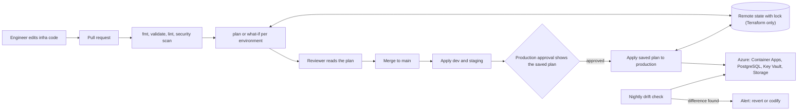
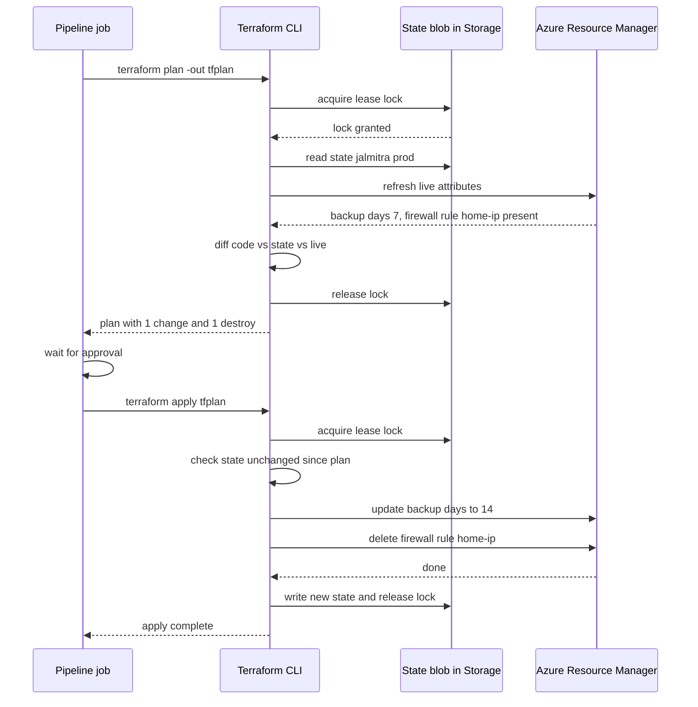

**JalMitra** is a smart water-metering platform for a municipal corporation: 1.8 lakh household meters send readings every 15 minutes, and an ASP.NET Core API serves billing, leak alerts and a citizen app. It runs on Azure Container Apps with Azure Database for PostgreSQL, Key Vault and Blob Storage, in three environments. All of it was created by clicking through the Azure portal. Six months in, staging has a 2-vCore database and production a 4-vCore one, nobody remembers why; a developer added his home IP to production's database firewall during an incident and never removed it; and when the corporation asked for a disaster-recovery copy in another region, the team estimated two weeks "to work out what we actually have". Infrastructure as Code (IaC) turns that unknown into a set of reviewed files in Git, from which any environment can be created, compared or rebuilt.

## Learning objectives

By the end of this lesson you will be able to:

1. Explain Infrastructure as Code, declarative desired state and idempotency, and why they beat portal clicks and hand-written scripts.
2. Read and write Bicep and Terraform for a typical ASP.NET Core platform (container app, PostgreSQL, Key Vault, storage, logging).
3. Explain Terraform state, remote backends and locking, and how Bicep works without a state file; use `plan` and `what-if` to preview changes.
4. Detect drift, decide whether to revert or codify it, and prevent it with permissions.
5. Structure code with modules and per-environment parameters so dev, staging and production differ only where intended.
6. Run IaC in a pipeline with plan on pull request and apply after approval, and practise for free with Terraform's Docker provider.
7. Make the application validate its infrastructure contract at start-up, so a misconfigured environment fails fast.

## Prerequisites

- [Development, testing, staging and production](#/lesson/m15-environments): IaC is how environments stay alike.
- [CI/CD with GitHub Actions and Azure DevOps](#/lesson/m15-ci-cd): infrastructure changes go through the same pipeline discipline.
- [Azure App Service, Container Apps and AKS](#/lesson/m15-azure-compute) and [Azure data services](#/lesson/m15-azure-data): the resources this lesson declares.

## Explain it like I'm a beginner

Building a house from memory works once. The second time, the windows end up in slightly different places. An architect's **drawing** fixes that: any builder can construct the same house from it, inspectors can compare the house with the drawing, and a change ("add a balcony") is first made on paper and approved.

Infrastructure as Code is the architect's drawing for your cloud resources.

- You write a file that says *what should exist*: "a PostgreSQL 17 server, General Purpose, 4 vCores, 14 days of backups, in Central India".
- A tool reads the file, compares it with what exists, and makes only the changes needed. Run it twice and nothing happens the second time (it is **idempotent**).
- Before changing anything, the tool shows a **plan**: "will change backup days from 7 to 14, will create one storage account". You review the plan like a code review.
- The files live in Git, so every change has an author, a review and a history.

**Bicep** is Microsoft's IaC language for Azure. **Terraform** (and its open-source fork OpenTofu) is a multi-cloud IaC tool that also manages things like DNS providers, GitHub settings and even local Docker containers.

## First-principles explanation

### Why not portal clicks or scripts?

| Approach | Repeatable? | Reviewable? | Knows current state? | Handles changes? |
|---|---|---|---|---|
| Portal clicks | No | No | Only by looking | By hand |
| Imperative scripts (`az postgres flexible-server create ...`) | Partly | Yes | No: running twice fails or duplicates | You write every "if exists, update" branch |
| Declarative IaC (Bicep, Terraform) | Yes | Yes, plus a plan | Yes (Azure or state file) | Tool computes the difference |

**Declarative** means you describe the end state, not the steps. The tool works out the steps: create what's missing, update what differs, and (if configured) delete what's no longer declared. That is the same idea as desired-state controllers in Kubernetes.

The practical benefits for JalMitra:

- **Parity**: staging and production come from the same code with different parameters, so differences are deliberate and visible in one parameter file.
- **Review**: a firewall rule for a home IP shows up in a pull request, where someone asks "why?".
- **Recovery**: a disaster-recovery region is "deploy the same code with `location = southindia`", not two weeks of archaeology.
- **Audit**: Git history answers "who changed backup retention, and when?".

### Bicep in one page

Bicep compiles to ARM JSON templates and is deployed by Azure Resource Manager. Key ideas:

- `param` (inputs, with decorators like `@allowed`, `@minValue`, `@secure()`), `var` (computed values), `resource` (an Azure resource with a type and API version), `module` (another Bicep file), `output` (values for callers).
- References create **implicit dependencies**: if the container app uses `keyVault.properties.vaultUri`, Bicep deploys the vault first.
- `existing` references a resource you don't manage in this file (for example a shared Log Analytics workspace).
- **Scopes**: a deployment targets a resource group, subscription, management group or tenant.
- **Parameter files** (`.bicepparam`) hold per-environment values.
- **No state file**: Azure itself is the source of truth. Each deployment compares the template with the live resources.
- **Deployment modes**: *incremental* (default) creates and updates what's declared and leaves other resources in the resource group alone; *complete* also deletes resources in the group that aren't declared. **Deployment stacks** add managed lifecycle (delete or detach resources removed from the template) and deny settings that block changes outside the stack.
- **What-if** (`az deployment group what-if`) previews creates, modifications and deletes before you deploy.

### Terraform in one page

Terraform uses HCL files and **providers** (plugins for Azure, AWS, Docker, GitHub and hundreds more):

- `resource`, `data` (read existing things), `variable`, `locals`, `output`, `module`.
- `terraform init` downloads providers and configures the **backend** (where state is stored).
- `terraform plan` compares configuration, **state** and the real world, and prints the changes. `terraform plan -detailed-exitcode` exits with 0 for no changes, 2 for changes and 1 for errors, which makes it easy to use in scheduled drift checks.
- `terraform apply` executes a plan. Applying a saved plan file (`plan -out=tfplan`, then `apply tfplan`) guarantees you apply exactly what was reviewed.
- `lifecycle { prevent_destroy = true }` makes Terraform refuse to plan the destruction of a resource (essential for the production database); `create_before_destroy` changes the order of replacements.
- `import` blocks bring existing, click-created resources under management; `moved` blocks rename resources in code without destroying them.

### State: Terraform's memory

Terraform's **state** maps each resource in your code (`azurerm_postgresql_flexible_server.main`) to a real object (its Azure resource ID) and stores the attributes it last saw. Without state, Terraform could not know that the server named in the code is *that* server, or that a resource deleted from the code should be destroyed.

Rules for state:

- **Store it remotely** with **locking**: an Azure Storage blob (the `azurerm` backend locks with a blob lease), Terraform Cloud, or another supported backend. Local state on a laptop means a second person runs an apply against stale state.
- **One state per environment and component**: `jalmitra/prod/platform.tfstate`, `jalmitra/staging/platform.tfstate`. A smaller state means a smaller blast radius and faster plans.
- **State contains secrets**: generated passwords, connection strings and keys appear in plain text. Restrict access to the storage account, enable versioning and soft delete, and avoid putting secrets into state where possible (use Entra ID authentication instead of passwords, Key Vault references, managed identities).
- **Never edit state by hand.** Use `terraform state mv`, `moved` blocks, `import` or `terraform state rm` for the rare repairs.

Bicep avoids a separate state file by asking Azure directly, which removes the locking and secrets-in-state problems, at the cost of being Azure-only and not tracking resources outside a deployment's scope.

### Plan and what-if: review before you change

The plan is the most valuable output of IaC. A sample Terraform plan line:

```text
  # azurerm_postgresql_flexible_server.main must be replaced
-/+ resource "azurerm_postgresql_flexible_server" "main" {
      ~ location = "centralindia" -> "southindia" # forces replacement
```

"Must be replaced" on a database means **delete and recreate**: data loss. Some properties can be changed in place (backup retention, SKU within limits); others force replacement (location, sometimes the name or network mode). Read every plan, and make the pipeline stop on unexpected replacements of stateful resources. `prevent_destroy` turns that review into a hard rule.

### Drift: when reality and code disagree

**Drift** is any difference between the declared state and the live infrastructure. Causes:

- Portal changes during an incident ("I'll just add my IP").
- Another tool or script changing the same resource.
- Azure itself: platform-managed updates, autoscale changing instance counts, Azure Policy remediation adding tags.
- Partially failed deployments.

Detect it on a schedule: run `terraform plan -detailed-exitcode` or `az deployment group what-if` nightly against every environment, and alert when there is a difference. Then decide per change:

- **Revert**: the change was wrong or temporary (the home IP). Re-apply the code.
- **Codify**: the change was right (an incident fix that increased connections). Put it into the code, review it, apply.
- **Ignore deliberately**: properties managed by something else (replica counts set by autoscale). Use `lifecycle { ignore_changes = [...] }` in Terraform, and document it.

One blind spot: Terraform only compares resources that are **in its state**. A brand-new resource created in the portal (a new firewall rule, an extra storage account) is invisible to `plan`. Catch those with an inventory check that lists everything in the resource group and compares it with state, or use Bicep deployment stacks, which track every resource in their scope.

Prevent it: in production, people get **read** access in the portal; only the pipeline's identity can write. Deployment stacks' deny settings and Azure Policy can block changes outside IaC. Keep a documented **break-glass** procedure for emergencies, which always ends with codifying or reverting.

### Modules: reusable building blocks

A **module** is a folder of IaC with inputs and outputs: `modules/postgres` takes a name, SKU, backup settings and zone redundancy, and outputs the host name. Good modules:

- encode your standards once (Entra-only authentication, diagnostics to Log Analytics, required tags, no public network access in production),
- have a small, clear interface (5–15 inputs, not 60),
- are versioned (a Git tag, a private Bicep registry in Azure Container Registry, or a Terraform registry), so changing a module doesn't silently change every environment at once.

Avoid wrapping a single resource in a module that just passes every property through: it adds indirection and no standards. Public module libraries (Azure Verified Modules for Bicep and Terraform) are a good starting point.

### Environments: same code, different parameters

```text
infra/
  bicep/
    main.bicep                 # composition: which modules, wired together
    modules/
      container-app.bicep
      postgres.bicep
      key-vault.bicep
      storage.bicep
      log-analytics.bicep
    env/
      dev.bicepparam
      staging.bicepparam
      prod.bicepparam
  terraform/                   # the same platform in Terraform, for comparison
    modules/postgres/ ...
    envs/
      dev/main.tf  backend.tf  terraform.tfvars
      staging/...
      prod/...
  local/                       # free lab: Terraform + Docker provider
    main.tf
```

What legitimately differs between JalMitra's environments:

| Parameter | dev | staging | prod |
|---|---|---|---|
| PostgreSQL SKU | Burstable B1ms | General Purpose 2 vCores | General Purpose 4 vCores |
| High availability | Off | Off | Zone redundant |
| Backup retention | 7 days | 7 days | 14 days, geo-redundant |
| Container app replicas | 0–1 (scale to zero) | 1–2 | 2–10 |
| Public network access | Allowed with firewall | Private | Private |

Everything else (module versions, authentication mode, diagnostics, naming pattern, tags) is identical. If staging should resemble production for performance testing, make the difference a single parameter, not a different file.

Separate directories (or separate parameter files) per environment are clearer than Terraform **workspaces** for long-lived environments, because each environment's backend, credentials and approvals are explicit.

### IaC in the pipeline

The same discipline as application code ([CI/CD](#/lesson/m15-ci-cd)):

1. **Pull request**: format and lint (`bicep lint`, `terraform fmt -check`, `terraform validate`), static security checks (for example Checkov or similar scanners), then **plan or what-if** against each environment, posted as a PR comment.
2. **Merge**: apply to dev automatically, then staging.
3. **Production**: the plan is shown in the environment approval; after approval, apply **the saved plan**. If the live state changed since the plan, Terraform refuses the stale plan and you re-plan.
4. **Nightly**: drift detection on all environments.

The pipeline authenticates with OIDC federation to an identity that has rights only to its environment's resource groups.

### Secrets and identity

- Don't pass secrets as parameters if you can avoid them. Prefer **managed identities** and **Entra ID authentication** for PostgreSQL, Storage and Key Vault, so no password exists.
- When a secret is unavoidable, create it directly in Key Vault (outside the template) and reference it, or mark Bicep parameters `@secure()` so they are not logged, and Terraform variables `sensitive = true` (which hides them in output but **not** in state).
- Output non-secret wiring only: URIs, host names, client IDs.

### The application's side: an infrastructure contract

IaC outputs become the app's configuration: the container app's environment variables are set from module outputs (`Infrastructure__KeyVaultUri = kv.outputs.uri`). The app should **validate** that contract at start-up: required values present, URLs well-formed, and resource names consistent with the environment it believes it is in. A staging app that accidentally receives the production database host should refuse to start, not quietly write test data into production. That check costs a few lines of options validation and prevents a classic, serious incident.

### Free local practice

You can learn the full Terraform workflow without an Azure subscription:

- The **Docker provider** (`kreuzwerker/docker`) manages local images, networks, volumes and containers. Declare PostgreSQL and the API as resources, then `init`, `plan`, `apply`, change a parameter, `plan` again, delete a container by hand and watch the plan detect the drift.
- **Bicep** compiles and lints locally for free (`bicep build`, `bicep lint`), so you can practise syntax, modules and parameter files; deployment and what-if need an Azure subscription.
- **Azurite** emulates Azure Storage locally for app-side testing.

### Cost of IaC itself

IaC tools are free (Bicep, Terraform CLI, OpenTofu). The real cost is time: writing modules and keeping them current. A rough estimate for a platform like JalMitra: one to two weeks to codify the existing environments (including imports), then minutes per change instead of hours. It pays back the first time you build a new environment or recover from a mistake.

### When a simpler approach is enough

A weekend prototype with one App Service and a database can be created with a few `az` CLI commands in a script. The moment there is a second environment, a second person, or data you can't afford to lose, move to declarative IaC. Don't build a module library before you have two consumers for it: start with one readable `main.bicep` and extract modules when duplication appears.

## Visual explanation

### From pull request to infrastructure



An engineer's change starts as a pull request. Formatting, validation, linting and a security scan run first, then the tool computes a plan (Terraform) or a what-if (Bicep) for each environment, which the reviewer reads like code. After merge, the pipeline applies to dev and staging. Production waits at an approval that shows the saved plan, and after approval exactly that plan is applied. Terraform reads and writes its remote state (with a lock) during plan and apply; Bicep asks Azure directly. Separately, a nightly job compares code with live Azure resources and raises an alert when they differ, so drift is found within a day instead of during the next incident.

### A Terraform apply with state locking



The plan step takes a lease on the state blob so that no other run can change state at the same time, reads the recorded state, and refreshes the live attributes from Azure. It finds that backup retention is 7 days instead of the declared 14, and that a firewall rule recorded in state (it was imported earlier) is no longer in the code, and produces a plan with one change and one deletion. The lock is released while a human approves. Apply locks again, verifies that the state hasn't changed since the plan was made (otherwise the saved plan is stale and refused), executes the two changes in Azure, writes the new state and releases the lock.

## Step-by-step example

### Step 1: inventory and import

List what exists in each resource group (`az resource list`), then write the Bicep or Terraform that describes it. In Terraform, add `import` blocks for each resource and run `plan` until it shows **no changes**: now the code matches reality. In Bicep, run what-if until it shows only expected differences.

### Step 2: make environments differ only by parameters

Move the hard-coded values into `dev`, `staging` and `prod` parameter files. The 2-vCore versus 4-vCore difference is now one visible line, and the team can decide whether it is intended.

### Step 3: protect production

Add `prevent_destroy` to the database (Terraform) or put production in a deployment stack with deny settings (Bicep). Remove the developers' write role on production resource groups; the pipeline's identity is the only writer.

### Step 4: pipeline

Plan on every pull request, apply to dev and staging on merge, and apply the approved plan to production. The home-IP firewall rule was imported in step 1 along with everything else, so it is in state. The team deletes its block from the code; the next production plan proposes destroying it, and the reviewer approves.

### Step 5: drift detection

A nightly job runs a plan with `-detailed-exitcode` for each environment and alerts on exit code 2.

### Step 6: app contract

Wire module outputs into the container app's environment variables and add start-up validation to the API.

## Production-style C# implementation

### Bicep: composition and one module

```bicep
// infra/bicep/main.bicep
targetScope = 'resourceGroup'

@allowed(['dev', 'staging', 'prod'])
param environment string
param location string = resourceGroup().location
param workload string = 'jalmitra'
param postgresSkuName string
@allowed(['Burstable', 'GeneralPurpose', 'MemoryOptimized'])
param postgresSkuTier string
param postgresZoneRedundant bool = false
@minValue(7)
param backupRetentionDays int = 7
param geoRedundantBackup bool = false
param minReplicas int = 0
param maxReplicas int = 2
param apiImage string
param tags object

var envShort = { dev: 'dev', staging: 'stg', prod: 'prd' }[environment]
var suffix = '${workload}-${envShort}-cin-001'

module logs 'modules/log-analytics.bicep' = {
  name: 'logs'
  params: { name: 'log-${suffix}', location: location, tags: tags }
}

module identity 'modules/identity.bicep' = {
  name: 'identity'
  params: { name: 'id-${suffix}', location: location, tags: tags }
}

module kv 'modules/key-vault.bicep' = {
  name: 'kv'
  params: { name: 'kv-${suffix}', location: location, tags: tags, readerPrincipalId: identity.outputs.principalId }
}

module storage 'modules/storage.bicep' = {
  name: 'storage'
  params: { name: replace('st${suffix}', '-', ''), location: location, tags: tags, contributorPrincipalId: identity.outputs.principalId }
}

module pg 'modules/postgres.bicep' = {
  name: 'pg'
  params: {
    name: 'psql-${suffix}'
    location: location
    tags: tags
    skuName: postgresSkuName
    skuTier: postgresSkuTier
    zoneRedundant: postgresZoneRedundant
    backupRetentionDays: backupRetentionDays
    geoRedundantBackup: geoRedundantBackup
    adminPrincipalId: identity.outputs.principalId
  }
}

module api 'modules/container-app.bicep' = {
  name: 'api'
  params: {
    name: 'ca-${suffix}'
    location: location
    tags: tags
    image: apiImage
    identityId: identity.outputs.id
    logAnalyticsId: logs.outputs.id
    minReplicas: minReplicas
    maxReplicas: maxReplicas
    env: [
      { name: 'Infrastructure__Environment', value: environment }
      { name: 'Infrastructure__ResourceSuffix', value: suffix }
      { name: 'Infrastructure__KeyVaultUri', value: kv.outputs.uri }
      { name: 'Infrastructure__BlobEndpoint', value: storage.outputs.blobEndpoint }
      { name: 'Infrastructure__PostgresHost', value: pg.outputs.fqdn }
      { name: 'Infrastructure__PostgresDatabase', value: 'jalmitra' }
      { name: 'Infrastructure__ManagedIdentityClientId', value: identity.outputs.clientId }
    ]
  }
}

output apiFqdn string = api.outputs.fqdn
```

```bicep
// infra/bicep/modules/postgres.bicep
param name string
param location string
param tags object
param skuName string
param skuTier string
param zoneRedundant bool
param backupRetentionDays int
param geoRedundantBackup bool
param adminPrincipalId string

resource server 'Microsoft.DBforPostgreSQL/flexibleServers@2024-08-01' = {
  name: name
  location: location
  tags: tags
  sku: { name: skuName, tier: skuTier }
  properties: {
    version: '17'
    storage: { storageSizeGB: 128, autoGrow: 'Enabled' }
    backup: {
      backupRetentionDays: backupRetentionDays
      geoRedundantBackup: geoRedundantBackup ? 'Enabled' : 'Disabled'
    }
    highAvailability: { mode: zoneRedundant ? 'ZoneRedundant' : 'Disabled' }
    authConfig: { activeDirectoryAuth: 'Enabled', passwordAuth: 'Disabled' }   // no password exists
  }
}

resource db 'Microsoft.DBforPostgreSQL/flexibleServers/databases@2024-08-01' = {
  parent: server
  name: 'jalmitra'
}

output fqdn string = server.properties.fullyQualifiedDomainName
```

```bicep
// infra/bicep/env/prod.bicepparam
using '../main.bicep'

param environment = 'prod'
param postgresSkuName = 'Standard_D4ds_v5'
param postgresSkuTier = 'GeneralPurpose'
param postgresZoneRedundant = true
param backupRetentionDays = 14
param geoRedundantBackup = true
param minReplicas = 2
param maxReplicas = 10
param apiImage = 'acrjalmitra.azurecr.io/jalmitra/api@sha256:9f2c...'   // set by the pipeline
param tags = {
  workload: 'jalmitra'
  environment: 'prod'
  costCentre: 'MUNI-WATER-07'
  owner: 'water-it@example.gov.in'
  managedBy: 'bicep'
}
```

```text
# Preview and deploy (pipeline, with OIDC login)
az deployment group what-if --resource-group rg-jalmitra-prd-cin-001 --template-file infra/bicep/main.bicep --parameters infra/bicep/env/prod.bicepparam
az deployment group create  --resource-group rg-jalmitra-prd-cin-001 --template-file infra/bicep/main.bicep --parameters infra/bicep/env/prod.bicepparam
```

Resource API versions in these files are examples; use the current stable versions from the Azure resource reference when you write your own.

### The same database in Terraform

```hcl
# infra/terraform/envs/prod/backend.tf
terraform {
  required_version = ">= 1.9"
  required_providers {
    azurerm = { source = "hashicorp/azurerm", version = "~> 4.0" }
  }
  backend "azurerm" {
    resource_group_name  = "rg-tfstate-prd-cin-001"
    storage_account_name = "sttfstateprdcin001"
    container_name       = "tfstate"
    key                  = "jalmitra/prod/platform.tfstate"
    use_azuread_auth     = true          # pipeline identity, no storage key
  }
}

provider "azurerm" {
  features {}
  subscription_id = var.subscription_id
}
```

```hcl
# infra/terraform/modules/postgres/main.tf
variable "name"                  { type = string }
variable "resource_group_name"   { type = string }
variable "location"              { type = string }
variable "sku_name"              { type = string }            # e.g. GP_Standard_D4ds_v5
variable "zone_redundant"        { type = bool }
variable "backup_retention_days" { type = number }
variable "geo_redundant_backup"  { type = bool }
variable "tenant_id"             { type = string }
variable "tags"                  { type = map(string) }

resource "azurerm_postgresql_flexible_server" "main" {
  name                         = var.name
  resource_group_name          = var.resource_group_name
  location                     = var.location
  version                      = "17"                       # allowed values depend on provider version
  sku_name                     = var.sku_name
  storage_mb                   = 131072
  auto_grow_enabled            = true
  backup_retention_days        = var.backup_retention_days
  geo_redundant_backup_enabled = var.geo_redundant_backup
  zone                         = "1"
  tags                         = var.tags

  dynamic "high_availability" {
    for_each = var.zone_redundant ? [1] : []
    content {
      mode                      = "ZoneRedundant"
      standby_availability_zone = "2"
    }
  }

  authentication {
    active_directory_auth_enabled = true
    password_auth_enabled         = false
    tenant_id                     = var.tenant_id
  }

  lifecycle {
    prevent_destroy = true        # a plan that would destroy it fails
  }
}

output "fqdn" { value = azurerm_postgresql_flexible_server.main.fqdn }
```

```hcl
# infra/terraform/envs/prod/main.tf
module "postgres" {
  source                = "../../modules/postgres"
  name                  = "psql-jalmitra-prd-cin-001"
  resource_group_name   = "rg-jalmitra-prd-cin-001"
  location              = "centralindia"
  sku_name              = "GP_Standard_D4ds_v5"
  zone_redundant        = true
  backup_retention_days = 14
  geo_redundant_backup  = true
  tenant_id             = var.tenant_id
  tags                  = local.tags
}

# Bring the click-created server under management without recreating it.
import {
  to = module.postgres.azurerm_postgresql_flexible_server.main
  id = "/subscriptions/<sub-id>/resourceGroups/rg-jalmitra-prd-cin-001/providers/Microsoft.DBforPostgreSQL/flexibleServers/psql-jalmitra-prd-cin-001"
}
```

```text
# Nightly drift check (exit code 2 = differences found)
terraform -chdir=infra/terraform/envs/prod init -input=false
terraform -chdir=infra/terraform/envs/prod plan -detailed-exitcode -input=false -lock-timeout=5m
```

### Free lab: Terraform with the Docker provider

```hcl
# infra/local/main.tf   (terraform init && terraform apply, no cloud account)
terraform {
  required_providers {
    docker = { source = "kreuzwerker/docker", version = "~> 3.0" }
  }
}

provider "docker" {}

variable "environment" { default = "dev" }
variable "pg_password" {
  type      = string
  sensitive = true          # hidden in output, still stored in local state
}
variable "pg_port" { default = 5433 }

resource "docker_network" "lab" { name = "jalmitra-${var.environment}" }

resource "docker_volume" "pgdata" { name = "jalmitra-pgdata-${var.environment}" }

resource "docker_image" "postgres" {
  name         = "postgres:17.6"
  keep_locally = true
}

resource "docker_container" "postgres" {
  name  = "jalmitra-postgres-${var.environment}"
  image = docker_image.postgres.image_id
  env   = ["POSTGRES_DB=jalmitra", "POSTGRES_USER=jal", "POSTGRES_PASSWORD=${var.pg_password}"]
  networks_advanced { name = docker_network.lab.name }
  volumes {
    volume_name    = docker_volume.pgdata.name
    container_path = "/var/lib/postgresql/data"
  }
  ports {
    internal = 5432
    external = var.pg_port
    ip       = "127.0.0.1"
  }
}

resource "docker_container" "api" {
  name  = "jalmitra-api-${var.environment}"
  image = "jalmitra-api:dev"
  env = [
    "Infrastructure__Environment=${var.environment}",
    "Infrastructure__ResourceSuffix=jalmitra-${var.environment}-local-001",
    "Infrastructure__KeyVaultUri=https://kv-jalmitra-${var.environment}-local.example/",
    "Infrastructure__BlobEndpoint=http://azurite-${var.environment}:10000/devstoreaccount1",
    "Infrastructure__PostgresHost=${docker_container.postgres.name}",
    "Infrastructure__PostgresDatabase=jalmitra",
  ]
  networks_advanced { name = docker_network.lab.name }
  ports { internal = 8080, external = 8080 }
}
```

Try: `terraform apply -var pg_password=local-only`, then `docker rm -f jalmitra-postgres-dev`, then `terraform plan`: Terraform reports that the container must be created again. That is drift detection on your laptop. Change `pg_port` and plan again: changing a container's port forces replacement, which you can see in the plan.

### Application side: validate the infrastructure contract

```csharp file=Infrastructure/InfrastructureContract.cs
using System.ComponentModel.DataAnnotations;

namespace JalMitra.Infrastructure;

/// <summary>Values the IaC deployment hands to the app (module outputs to environment variables).
/// None of them are secrets: the app authenticates with its managed identity.</summary>
public sealed class InfrastructureContract
{
    [Required, RegularExpression("^(dev|staging|prod)$")]
    public string Environment { get; set; } = "";

    /// <summary>For example "jalmitra-prd-cin-001": the naming suffix shared by every resource.</summary>
    [Required, MinLength(5)]
    public string ResourceSuffix { get; set; } = "";

    [Required, Url]
    public string KeyVaultUri { get; set; } = "";

    [Required, Url]
    public string BlobEndpoint { get; set; } = "";

    [Required]
    public string PostgresHost { get; set; } = "";

    [Required]
    public string PostgresDatabase { get; set; } = "";

    public string? ManagedIdentityClientId { get; set; }

    public static string ShortCode(string environment) => environment switch
    {
        "dev" => "dev",
        "staging" => "stg",
        "prod" => "prd",
        _ => throw new ArgumentOutOfRangeException(nameof(environment), environment, "Unknown environment."),
    };
}
```

```csharp file=Infrastructure/EnvironmentGuard.cs
using Microsoft.Extensions.Options;

namespace JalMitra.Infrastructure;

/// <summary>Refuses to start if the wiring points at another environment's resources, for example a
/// staging app configured with the production database host. Relies on the naming convention
/// that every resource name contains the environment short code (dev, stg, prd).</summary>
public sealed class EnvironmentGuard : IValidateOptions<InfrastructureContract>
{
    private static readonly string[] AllCodes = ["dev", "stg", "prd"];

    public ValidateOptionsResult Validate(string? name, InfrastructureContract c)
    {
        if (string.IsNullOrEmpty(c.Environment) || !AllCodes.Contains(SafeShort(c.Environment)))
            return ValidateOptionsResult.Skip;   // DataAnnotations reports the missing or invalid environment

        var expected = SafeShort(c.Environment);
        var failures = new List<string>();

        if (!c.ResourceSuffix.Contains($"-{expected}-", StringComparison.OrdinalIgnoreCase))
            failures.Add($"ResourceSuffix '{c.ResourceSuffix}' does not contain '-{expected}-'.");

        foreach (var (label, value) in new[] { ("KeyVaultUri", c.KeyVaultUri), ("BlobEndpoint", c.BlobEndpoint), ("PostgresHost", c.PostgresHost) })
        {
            var host = HostOf(value);
            var foreign = AllCodes.Where(code => code != expected && host.Contains(code, StringComparison.OrdinalIgnoreCase)).ToList();
            if (foreign.Count > 0)
                failures.Add($"{label} host '{host}' looks like environment '{string.Join(",", foreign)}', but this app is '{c.Environment}'.");
        }

        return failures.Count == 0 ? ValidateOptionsResult.Success : ValidateOptionsResult.Fail(failures);
    }

    private static string SafeShort(string env) => env switch { "dev" => "dev", "staging" => "stg", "prod" => "prd", _ => "" };

    private static string HostOf(string value) =>
        Uri.TryCreate(value, UriKind.Absolute, out var uri) ? uri.Host : value;
}
```

```csharp file=Program.cs
using JalMitra.Infrastructure;
using Microsoft.Extensions.Options;

var builder = WebApplication.CreateBuilder(args);

builder.Services.AddOptions<InfrastructureContract>()
    .Bind(builder.Configuration.GetSection("Infrastructure"))
    .ValidateDataAnnotations()
    .ValidateOnStart();                       // fail at start-up, not on the first request
builder.Services.AddSingleton<IValidateOptions<InfrastructureContract>, EnvironmentGuard>();

builder.Services.AddHealthChecks();

var app = builder.Build();

app.MapHealthChecks("/health/ready");

// Non-secret view of the wiring: handy after an IaC change. Expose internally only.
app.MapGet("/infra", (IOptions<InfrastructureContract> infra) =>
{
    var c = infra.Value;
    return Results.Ok(new
    {
        c.Environment,
        c.ResourceSuffix,
        keyVaultHost = new Uri(c.KeyVaultUri).Host,
        blobHost = new Uri(c.BlobEndpoint).Host,
        c.PostgresHost,
        c.PostgresDatabase,
        usesManagedIdentity = !string.IsNullOrEmpty(c.ManagedIdentityClientId),
    });
});

app.MapGet("/api/meters/{meterId}/latest", (string meterId) =>
    Results.Ok(new { meterId, litres = 412.6, readAtIst = "2026-10-20T09:45:00+05:30" }));

app.Run();
```

Design notes:

- **IaC outputs are the app's configuration.** Container app environment variables are set from module outputs, so a renamed Key Vault flows to the app automatically on the next deployment.
- **Fail fast.** `ValidateOnStart` makes a misconfigured revision fail its start-up and readiness, so Container Apps never routes traffic to it and the previous revision keeps serving.
- **Naming is a safety feature.** Because every resource name contains `dev`, `stg` or `prd`, the guard can catch cross-environment wiring cheaply. Exercise 2 builds the naming function.
- **No secrets in the contract.** The app uses its managed identity for Key Vault, Storage and PostgreSQL (Entra authentication), so IaC never handles a password.

## Bad design vs good design

**Bad**: IaC in name only.

```text
- One main.tf for all three environments, switched with "terraform workspace select" by hand
- State in terraform.tfstate on the lead's laptop, shared over email when he's on leave
- PostgreSQL admin password as a default variable value in variables.tf
- Provider version not pinned, "terraform init -upgrade" in the pipeline
- Developers have Contributor on production "for emergencies", portal fixes not codified
- Nobody reads the plan; pipeline runs "terraform apply -auto-approve" on every merge
- One 2,000-line file, no modules; the same 40 lines copied for each storage account
```

What goes wrong: someone applies staging changes to production because the wrong workspace was selected. Two people apply from different copies of state and corrupt it. The password is in Git history forever. A provider upgrade changes defaults and plans unexpected replacements. Drift accumulates until the next apply silently reverts an emergency fix, or deletes the home-IP rule during the next incident. An unread plan replaces the production database.

**Good**: one directory and backend per environment; remote state with locking, versioning and restricted access; Entra authentication instead of passwords; pinned provider and module versions upgraded deliberately; read-only portal access in production with a break-glass process; plan on PR, approval showing the saved plan, `prevent_destroy` on stateful resources; small modules encoding standards; nightly drift detection.

:::callout type=warning title="Replacement means deletion"
In a plan, `-/+` (Terraform) or "Delete" and "Create" for the same resource (what-if) on a database, storage account or Key Vault means data loss or new endpoints. Make the pipeline fail if a plan replaces any resource tagged as stateful unless a reviewer explicitly overrides it.
:::

:::callout type=tradeoff title="Bicep or Terraform?"
Bicep: Azure-only, no state file to manage, day-zero support for new Azure features, first-class in Azure tooling. Terraform: multi-cloud and multi-service (DNS, GitHub, monitoring SaaS, Docker), a large module ecosystem, but you manage state and wait for provider support for new Azure features. A team that is only on Azure often picks Bicep; a team managing several clouds or many non-Azure services often picks Terraform. Both are good; mixing them for the same resources is not.
:::

## Practical playground

The canvas shows JalMitra's current state: three environments created by hand, with nothing connecting them to Git. Redesign the delivery of infrastructure.

1. Add a Git repository, a pipeline worker and a remote state store. Which arrows are reads and which are writes?
2. Show where plans are reviewed and where production approval happens.
3. Add a scheduled drift detector. What does it compare, and who gets the alert?
4. Mark which identities may write to production.

:::playground type=hld title="From portal clicks to Infrastructure as Code"
```json
{
  "nodes": [
    { "id": "eng", "type": "client", "label": "Engineers with portal Contributor access" },
    { "id": "dev", "type": "app-server", "label": "Dev environment (clicked)", "props": { "instances": 1 } },
    { "id": "stg", "type": "app-server", "label": "Staging environment (clicked)", "props": { "instances": 1 } },
    { "id": "prod", "type": "app-server", "label": "Production environment (clicked)", "props": { "instances": 2 } },
    { "id": "pg", "type": "database", "label": "Production PostgreSQL (home IP in firewall)" }
  ],
  "edges": [
    { "from": "eng", "to": "dev", "kind": "sync", "label": "portal" },
    { "from": "eng", "to": "stg", "kind": "sync", "label": "portal" },
    { "from": "eng", "to": "prod", "kind": "sync", "label": "portal" },
    { "from": "prod", "to": "pg", "kind": "sync" }
  ]
}
```
:::

## Exercises

:::exercise id=m15-iac-ex1 difficulty=beginner kind=written title="Review a Terraform change"
A pull request contains this file and the plan output below. Write a review: what is wrong in the code, what does the plan tell you, and should this be approved?

```hcl
terraform {
  required_providers { azurerm = { source = "hashicorp/azurerm" } }
}
provider "azurerm" { features {} }

variable "admin_password" { default = "Jal@Mitra2026" }

resource "azurerm_postgresql_flexible_server" "main" {
  name                   = "psql-jalmitra-prd-cin-001"
  resource_group_name    = "rg-jalmitra-prd-cin-001"
  location               = "southindia"
  version                = "17"
  sku_name               = "GP_Standard_D4ds_v5"
  administrator_login    = "jaladmin"
  administrator_password = var.admin_password
  backup_retention_days  = 14
}
```

```text
  # azurerm_postgresql_flexible_server.main must be replaced
-/+ resource "azurerm_postgresql_flexible_server" "main" {
      ~ location = "centralindia" -> "southindia" # forces replacement
      + administrator_password = (sensitive value)
Plan: 1 to add, 0 to change, 1 to destroy.
```
::acceptance
- Identifies that the plan **destroys and recreates** the production database because of the location change, and that this means data loss.
- Flags the hard-coded password default (in Git and in state), and recommends Entra authentication or a Key Vault reference.
- Flags the unpinned provider version and missing backend configuration (local state).
- Recommends `prevent_destroy` and explains the correct way to move a database to another region (a new server plus data migration or geo-restore, not an in-place change).
- Verdict: do not approve.
::hint
Read the plan's summary line first. What does "1 to destroy" mean for a database?
::hint
Where does `default = "Jal@Mitra2026"` end up? Think of Git history and the state file.
::hint
What happens when `terraform init` runs without a `backend` block?
::solution
**Verdict: request changes. Do not approve.**

1. **The plan replaces the production database.** `location` forces replacement, so Terraform will destroy `psql-jalmitra-prd-cin-001` in Central India and create an empty one in South India. All meter readings and bills would be lost (backups are tied to the deleted server's lifecycle and retention rules; don't rely on them for this). Moving regions is a migration project: create a new server in South India (or geo-restore from a geo-redundant backup), replicate or copy data, cut the app over, then retire the old one, each step planned and reviewed.
2. **Hard-coded password.** The default value lives in Git history forever and in the state file in plain text. Use Entra ID authentication with `password_auth_enabled = false`, or if a password is unavoidable, generate it outside Terraform into Key Vault and reference it, and mark the variable `sensitive = true` (knowing it still lands in state).
3. **No backend.** Without a `backend` block, state is a local file on whoever runs it. Add the `azurerm` backend with Entra authentication, locking, versioning and restricted access.
4. **Unpinned provider.** Pin with `version = "~> 4.0"` and commit the lock file (`.terraform.lock.hcl`), so upgrades are deliberate.
5. **No protection.** Add `lifecycle { prevent_destroy = true }` to the server; this plan would then have failed instead of waiting for someone to notice.
6. Minor: no tags, no high availability or geo-redundant backup settings declared for production, names and resource group hard-coded instead of coming from a module and parameters.
::mistakes
- Approving because "the summary says 1 to add", without noticing the matching destroy.
- Fixing the password by moving it into `terraform.tfvars` committed to Git.
:::

:::exercise id=m15-iac-ex2 difficulty=beginner kind=code title="Generate resource names that Azure accepts"
Write a naming function based on a Cloud Adoption Framework-style pattern: `{abbr}-{workload}-{env}-{region}-{instance}`.

- Abbreviations: ResourceGroup `rg`, ContainerApp `ca`, PostgresServer `psql`, KeyVault `kv`, StorageAccount `st`, LogAnalytics `log`.
- Environments: `dev` → `dev`, `staging` → `stg`, `prod` → `prd`. Regions: `centralindia` → `cin`, `southindia` → `sin`, `westindia` → `win`. Anything else throws `ArgumentException`.
- Workload: lower-case it and remove every character that isn't `a-z` or `0-9`. Empty after cleaning throws `ArgumentException`.
- Instance: 1 to 999, formatted as three digits; otherwise `ArgumentOutOfRangeException`.
- Storage accounts have **no hyphens**: `st{workload}{env}{region}{instance}`.
- Maximum lengths: ResourceGroup 90, ContainerApp 32, PostgresServer 63, KeyVault 24, StorageAccount 24, LogAnalytics 63. If too long, **shorten the workload** so the name fits exactly.
::acceptance
- `ContainerApp, "JalMitra", "prod", "centralindia", 1` gives `ca-jalmitra-prd-cin-001`.
- `StorageAccount` gives `stjalmitraprdcin001`.
- Long workloads are shortened to fit (Key Vault 24, Container App 32).
- Invalid environment, region, workload or instance throw.
::hint
Build the name from fixed parts plus the workload, so you can compute how many characters the workload may use.
::hint
For the hyphenated pattern, the fixed part is `abbr-` + `-env-region-NNN`. For storage it is `st` + `envregionNNN`.
::hint
`allowed = maxLength - fixedLength`, then `workload[..Math.Min(workload.Length, allowed)]`.
::starter
```csharp file=ResourceNamer.cs
using System;

public enum ResourceKind { ResourceGroup, ContainerApp, PostgresServer, KeyVault, StorageAccount, LogAnalytics }

public static class ResourceNamer
{
    public static string Name(ResourceKind kind, string workload, string environment, string region, int instance)
        => throw new NotImplementedException();
}
```
::tests
```csharp file=ResourceNamerTests.cs
using System;
using Xunit;

public class ResourceNamerTests
{
    [Fact]
    public void Standard_names()
    {
        Assert.Equal("ca-jalmitra-prd-cin-001", ResourceNamer.Name(ResourceKind.ContainerApp, "JalMitra", "prod", "centralindia", 1));
        Assert.Equal("rg-jalmitra-stg-sin-002", ResourceNamer.Name(ResourceKind.ResourceGroup, "jal-mitra", "staging", "southindia", 2));
        Assert.Equal("psql-jalmitra-dev-win-010", ResourceNamer.Name(ResourceKind.PostgresServer, "jalmitra", "dev", "westindia", 10));
    }

    [Fact]
    public void Storage_has_no_hyphens() =>
        Assert.Equal("stjalmitraprdcin001", ResourceNamer.Name(ResourceKind.StorageAccount, "Jal_Mitra!", "prod", "centralindia", 1));

    [Fact]
    public void Long_workloads_are_shortened_to_fit()
    {
        var kv = ResourceNamer.Name(ResourceKind.KeyVault, "smartwatermetering", "prod", "centralindia", 1);
        Assert.Equal("kv-smartwate-prd-cin-001", kv);
        Assert.Equal(24, kv.Length);

        var ca = ResourceNamer.Name(ResourceKind.ContainerApp, "smartwatermetering", "prod", "centralindia", 1);
        Assert.Equal("ca-smartwatermeterin-prd-cin-001", ca);
        Assert.Equal(32, ca.Length);

        var st = ResourceNamer.Name(ResourceKind.StorageAccount, "smartwatermeteringplatform", "staging", "southindia", 3);
        Assert.Equal(24, st.Length);
        Assert.StartsWith("stsmartwatermet", st);
        Assert.EndsWith("stgsin003", st);
    }

    [Fact]
    public void Invalid_inputs_throw()
    {
        Assert.Throws<ArgumentException>(() => ResourceNamer.Name(ResourceKind.KeyVault, "jalmitra", "qa", "centralindia", 1));
        Assert.Throws<ArgumentException>(() => ResourceNamer.Name(ResourceKind.KeyVault, "jalmitra", "prod", "eastus", 1));
        Assert.Throws<ArgumentException>(() => ResourceNamer.Name(ResourceKind.KeyVault, "---", "prod", "centralindia", 1));
        Assert.Throws<ArgumentOutOfRangeException>(() => ResourceNamer.Name(ResourceKind.KeyVault, "jalmitra", "prod", "centralindia", 1000));
        Assert.Throws<ArgumentOutOfRangeException>(() => ResourceNamer.Name(ResourceKind.KeyVault, "jalmitra", "prod", "centralindia", 0));
    }
}
```
::solution
Clean and validate inputs, compute the fixed part, then fit the workload into what's left.

```csharp file=ResourceNamer.cs
using System;
using System.Linq;

public enum ResourceKind { ResourceGroup, ContainerApp, PostgresServer, KeyVault, StorageAccount, LogAnalytics }

public static class ResourceNamer
{
    public static string Name(ResourceKind kind, string workload, string environment, string region, int instance)
    {
        var env = environment switch
        {
            "dev" => "dev",
            "staging" => "stg",
            "prod" => "prd",
            _ => throw new ArgumentException($"Unknown environment '{environment}'.", nameof(environment)),
        };
        var reg = region switch
        {
            "centralindia" => "cin",
            "southindia" => "sin",
            "westindia" => "win",
            _ => throw new ArgumentException($"Unknown region '{region}'.", nameof(region)),
        };
        if (instance is < 1 or > 999) throw new ArgumentOutOfRangeException(nameof(instance));

        var clean = new string(workload.ToLowerInvariant().Where(c => c is >= 'a' and <= 'z' or >= '0' and <= '9').ToArray());
        if (clean.Length == 0) throw new ArgumentException("Workload has no usable characters.", nameof(workload));

        var (abbr, max) = kind switch
        {
            ResourceKind.ResourceGroup => ("rg", 90),
            ResourceKind.ContainerApp => ("ca", 32),
            ResourceKind.PostgresServer => ("psql", 63),
            ResourceKind.KeyVault => ("kv", 24),
            ResourceKind.StorageAccount => ("st", 24),
            _ => ("log", 63),
        };
        var num = instance.ToString("000");

        if (kind == ResourceKind.StorageAccount)
        {
            var tail = $"{env}{reg}{num}";
            var allowed = max - abbr.Length - tail.Length;
            return $"{abbr}{clean[..Math.Min(clean.Length, allowed)]}{tail}";
        }

        var suffix = $"-{env}-{reg}-{num}";
        var room = max - abbr.Length - 1 - suffix.Length;
        return $"{abbr}-{clean[..Math.Min(clean.Length, room)]}{suffix}";
    }
}
```

In real IaC the same logic lives in the module (Bicep `take()` and `replace()`, Terraform `substr()` and `replace()`), but having it in C# too lets the app's `EnvironmentGuard` and your tests agree on exactly one convention. Storage account and Key Vault names are also **globally unique** across Azure, so some teams add a short hash of the subscription ID (Bicep's `uniqueString()`) to avoid collisions.
::mistakes
- Truncating the whole name at the end, which cuts off the instance number or environment code.
- Forgetting that storage accounts reject hyphens and upper-case letters.
- Allowing an empty workload, producing `kv--prd-cin-001`, which Key Vault rejects (no consecutive hyphens).
:::

:::exercise id=m15-iac-ex3 difficulty=intermediate kind=code title="Compute a plan"
Implement the heart of `terraform plan`. Given the **desired** resources (from code) and the **current** resources (from state, refreshed), produce one change per address:

- In desired only: **Create**. Changed properties: all its property names.
- In both: changed properties are the names (union of both sides) whose values differ or exist on one side only. None: **NoOp**. A different `Type`, or any changed property in `forceNewProperties`: **Replace**. Otherwise **Update**.
- In current only: **Delete**. Changed properties: empty.
- If a Replace or Delete affects an address in `preventDestroy`, throw `InvalidOperationException` naming every such address.
- Changes are sorted by address (ordinal); changed property names are sorted (ordinal).
- `Plan.Summary`: `"No changes."` if all are NoOp, otherwise `"Plan: A to add, C to change, D to destroy."`, where Replace counts as one add and one destroy.
::acceptance
- A backup retention change is an Update; a location change is a Replace (force-new).
- A resource removed from code is a Delete; a new one is a Create.
- `prevent_destroy` on the database makes a location change throw.
- The summary for create + update + replace + delete is `Plan: 2 to add, 1 to change, 2 to destroy.`
::hint
Index both lists by address with dictionaries, then loop over the union of addresses.
::hint
For changed properties: `a.Keys.Union(b.Keys).Where(k => !a.TryGetValue(k, out var x) || !b.TryGetValue(k, out var y) || x != y)`.
::hint
Collect protected violations in a list while building the changes, and throw once at the end with all of them.
::starter
```csharp file=PlanCalculator.cs
using System;
using System.Collections.Generic;

public sealed record ResourceState(string Address, string Type, IReadOnlyDictionary<string, string> Properties);

public enum ChangeAction { NoOp, Create, Update, Replace, Delete }

public sealed record ResourceChange(string Address, ChangeAction Action, IReadOnlyList<string> ChangedProperties);

public sealed record Plan(IReadOnlyList<ResourceChange> Changes)
{
    public string Summary => throw new NotImplementedException();
}

public static class PlanCalculator
{
    public static Plan Compute(
        IReadOnlyList<ResourceState> desired,
        IReadOnlyList<ResourceState> current,
        IReadOnlySet<string> forceNewProperties,
        IReadOnlySet<string> preventDestroy)
        => throw new NotImplementedException();
}
```
::tests
```csharp file=PlanCalculatorTests.cs
using System;
using System.Collections.Generic;
using System.Linq;
using Xunit;

public class PlanCalculatorTests
{
    private static readonly HashSet<string> ForceNew = new() { "location", "name" };
    private static readonly HashSet<string> NoProtect = new();

    private static ResourceState Pg(string location = "centralindia", string backup = "14") =>
        new("azurerm_postgresql_flexible_server.main", "azurerm_postgresql_flexible_server",
            new Dictionary<string, string> { ["name"] = "psql-jalmitra-prd-cin-001", ["location"] = location, ["backup_retention_days"] = backup });

    private static ResourceState Kv() =>
        new("azurerm_key_vault.main", "azurerm_key_vault", new Dictionary<string, string> { ["name"] = "kv-jalmitra-prd-cin-001", ["location"] = "centralindia" });

    private static ResourceState Rule(string ip) =>
        new("azurerm_postgresql_flexible_server_firewall_rule.home", "azurerm_postgresql_flexible_server_firewall_rule", new Dictionary<string, string> { ["start_ip"] = ip });

    [Fact]
    public void No_changes()
    {
        var plan = PlanCalculator.Compute(new[] { Pg(), Kv() }, new[] { Pg(), Kv() }, ForceNew, NoProtect);
        Assert.True(plan.Changes.All(c => c.Action == ChangeAction.NoOp));
        Assert.Equal("No changes.", plan.Summary);
    }

    [Fact]
    public void In_place_update()
    {
        var plan = PlanCalculator.Compute(new[] { Pg(backup: "14") }, new[] { Pg(backup: "7") }, ForceNew, NoProtect);
        var c = Assert.Single(plan.Changes);
        Assert.Equal(ChangeAction.Update, c.Action);
        Assert.Equal(new[] { "backup_retention_days" }, c.ChangedProperties.ToArray());
        Assert.Equal("Plan: 0 to add, 1 to change, 0 to destroy.", plan.Summary);
    }

    [Fact]
    public void Force_new_property_replaces()
    {
        var plan = PlanCalculator.Compute(new[] { Pg(location: "southindia") }, new[] { Pg() }, ForceNew, NoProtect);
        Assert.Equal(ChangeAction.Replace, plan.Changes.Single().Action);
    }

    [Fact]
    public void Prevent_destroy_blocks_replace()
    {
        var protect = new HashSet<string> { "azurerm_postgresql_flexible_server.main" };
        var ex = Assert.Throws<InvalidOperationException>(() =>
            PlanCalculator.Compute(new[] { Pg(location: "southindia") }, new[] { Pg() }, ForceNew, protect));
        Assert.Contains("azurerm_postgresql_flexible_server.main", ex.Message);
    }

    [Fact]
    public void Mixed_plan_sorted_with_summary()
    {
        var newKv = new ResourceState("azurerm_key_vault.secondary", "azurerm_key_vault", new Dictionary<string, string> { ["name"] = "kv-2", ["location"] = "southindia" });
        var desired = new[] { Pg(backup: "14"), Kv() with { Properties = new Dictionary<string, string> { ["name"] = "kv-renamed", ["location"] = "centralindia" } }, newKv };
        var current = new[] { Pg(backup: "7"), Kv(), Rule("49.36.10.22") };
        var plan = PlanCalculator.Compute(desired, current, ForceNew, NoProtect);
        Assert.Equal(new[]
        {
            "azurerm_key_vault.main:Replace",
            "azurerm_key_vault.secondary:Create",
            "azurerm_postgresql_flexible_server.main:Update",
            "azurerm_postgresql_flexible_server_firewall_rule.home:Delete",
        }, plan.Changes.Select(c => $"{c.Address}:{c.Action}").ToArray());
        Assert.Equal(new[] { "location", "name" }, plan.Changes[1].ChangedProperties.ToArray());
        Assert.Equal("Plan: 2 to add, 1 to change, 2 to destroy.", plan.Summary);
    }
}
```
::solution
Union of addresses, classify each, check protection, sort.

```csharp file=PlanCalculator.cs
using System;
using System.Collections.Generic;
using System.Linq;

public sealed record ResourceState(string Address, string Type, IReadOnlyDictionary<string, string> Properties);

public enum ChangeAction { NoOp, Create, Update, Replace, Delete }

public sealed record ResourceChange(string Address, ChangeAction Action, IReadOnlyList<string> ChangedProperties);

public sealed record Plan(IReadOnlyList<ResourceChange> Changes)
{
    public string Summary
    {
        get
        {
            if (Changes.All(c => c.Action == ChangeAction.NoOp)) return "No changes.";
            var add = Changes.Count(c => c.Action is ChangeAction.Create or ChangeAction.Replace);
            var change = Changes.Count(c => c.Action == ChangeAction.Update);
            var destroy = Changes.Count(c => c.Action is ChangeAction.Delete or ChangeAction.Replace);
            return $"Plan: {add} to add, {change} to change, {destroy} to destroy.";
        }
    }
}

public static class PlanCalculator
{
    public static Plan Compute(
        IReadOnlyList<ResourceState> desired,
        IReadOnlyList<ResourceState> current,
        IReadOnlySet<string> forceNewProperties,
        IReadOnlySet<string> preventDestroy)
    {
        var want = desired.ToDictionary(r => r.Address, StringComparer.Ordinal);
        var have = current.ToDictionary(r => r.Address, StringComparer.Ordinal);
        var changes = new List<ResourceChange>();
        var blocked = new List<string>();

        foreach (var address in want.Keys.Union(have.Keys).OrderBy(a => a, StringComparer.Ordinal))
        {
            want.TryGetValue(address, out var d);
            have.TryGetValue(address, out var c);
            ResourceChange change;

            if (c is null)
                change = new(address, ChangeAction.Create, d!.Properties.Keys.OrderBy(k => k, StringComparer.Ordinal).ToList());
            else if (d is null)
                change = new(address, ChangeAction.Delete, Array.Empty<string>());
            else
            {
                var diff = Diff(d.Properties, c.Properties);
                var action = diff.Count == 0 && d.Type == c.Type ? ChangeAction.NoOp
                    : d.Type != c.Type || diff.Any(forceNewProperties.Contains) ? ChangeAction.Replace
                    : ChangeAction.Update;
                change = new(address, action, diff);
            }

            if (change.Action is ChangeAction.Delete or ChangeAction.Replace && preventDestroy.Contains(address))
                blocked.Add(address);
            changes.Add(change);
        }

        if (blocked.Count > 0)
            throw new InvalidOperationException($"Plan would destroy protected resources: {string.Join(", ", blocked)}");
        return new Plan(changes);
    }

    private static List<string> Diff(IReadOnlyDictionary<string, string> a, IReadOnlyDictionary<string, string> b) =>
        a.Keys.Union(b.Keys)
            .Where(k => !a.TryGetValue(k, out var x) || !b.TryGetValue(k, out var y) || !string.Equals(x, y, StringComparison.Ordinal))
            .OrderBy(k => k, StringComparer.Ordinal)
            .ToList();
}
```

Real providers know, per resource type, which attributes force replacement; Terraform marks them in the plan with `# forces replacement`. The structure is the same: diff, classify, protect, summarise. Counting a replacement as both an add and a destroy is how Terraform's summary line reports it, and it's why "1 to add, 1 to destroy" deserves a second look.
::mistakes
- Counting a Replace only as a change, which hides the destroy from the summary.
- Ignoring properties that exist only on one side (a property removed from code is still a change).
- Throwing on the first protected resource instead of reporting all of them.
:::

:::exercise id=m15-iac-ex4 difficulty=intermediate kind=code title="Merge and validate environment parameters"
Each environment's parameters are a base set plus overrides. Implement:

- `EnvironmentParameters.Merge(baseParams, overrides)`: overrides replace base values. An override key that **doesn't exist** in the base throws `ArgumentException` naming the key (it's almost always a typo, like `backupRetentionDay`).
- `EnvironmentParameters.Validate(environment, merged)`: returns violations (strings). For `prod` only:
  - `zoneRedundant` must be `true`.
  - `postgresSkuTier` must not be `Burstable`.
  - `backupRetentionDays` must be an integer of at least 14.
  - `geoRedundantBackup` must be `true`.
  - `minReplicas` must be an integer of at least 2.
- Values are strings; booleans compare case-insensitively with `true`. A value that should be an integer but isn't produces the violation `"<name> must be an integer"`. A missing key produces `"<name> is missing"`. Violations are returned in the order of the rules above. Non-prod environments return no violations.
::acceptance
- Overrides replace base values; an unknown override key throws.
- A correct prod parameter set passes.
- Each prod rule produces its violation; non-integers and missing keys are reported.
- Staging with Burstable and 7 days is valid.
::hint
Copy the base into a new `Dictionary`, then apply overrides one by one, checking `ContainsKey` first.
::hint
Write small helpers: `RequireTrue(name)`, `RequireMinInt(name, min)`, `RequireNot(name, value)`.
::hint
Keep a `List<string>` and add messages in rule order.
::starter
```csharp file=EnvironmentParameters.cs
using System;
using System.Collections.Generic;

public static class EnvironmentParameters
{
    public static IReadOnlyDictionary<string, string> Merge(IReadOnlyDictionary<string, string> baseParams, IReadOnlyDictionary<string, string> overrides)
        => throw new NotImplementedException();

    public static IReadOnlyList<string> Validate(string environment, IReadOnlyDictionary<string, string> merged)
        => throw new NotImplementedException();
}
```
::tests
```csharp file=EnvironmentParametersTests.cs
using System;
using System.Collections.Generic;
using System.Linq;
using Xunit;

public class EnvironmentParametersTests
{
    private static Dictionary<string, string> Base() => new()
    {
        ["postgresSkuTier"] = "Burstable",
        ["postgresSkuName"] = "Standard_B1ms",
        ["zoneRedundant"] = "false",
        ["backupRetentionDays"] = "7",
        ["geoRedundantBackup"] = "false",
        ["minReplicas"] = "0",
    };

    private static Dictionary<string, string> ProdOverrides() => new()
    {
        ["postgresSkuTier"] = "GeneralPurpose",
        ["postgresSkuName"] = "Standard_D4ds_v5",
        ["zoneRedundant"] = "True",
        ["backupRetentionDays"] = "14",
        ["geoRedundantBackup"] = "true",
        ["minReplicas"] = "2",
    };

    [Fact]
    public void Merge_overrides_and_rejects_typos()
    {
        var merged = EnvironmentParameters.Merge(Base(), new Dictionary<string, string> { ["minReplicas"] = "1" });
        Assert.Equal("1", merged["minReplicas"]);
        Assert.Equal("Burstable", merged["postgresSkuTier"]);
        var ex = Assert.Throws<ArgumentException>(() => EnvironmentParameters.Merge(Base(), new Dictionary<string, string> { ["backupRetentionDay"] = "14" }));
        Assert.Contains("backupRetentionDay", ex.Message);
    }

    [Fact]
    public void Good_prod_passes() =>
        Assert.Empty(EnvironmentParameters.Validate("prod", EnvironmentParameters.Merge(Base(), ProdOverrides())));

    [Fact]
    public void Base_values_in_prod_violate_every_rule()
    {
        var v = EnvironmentParameters.Validate("prod", Base());
        Assert.Equal(5, v.Count);
        Assert.Contains("zoneRedundant", v[0]);
        Assert.Contains("postgresSkuTier", v[1]);
        Assert.Contains("backupRetentionDays", v[2]);
        Assert.Contains("geoRedundantBackup", v[3]);
        Assert.Contains("minReplicas", v[4]);
    }

    [Fact]
    public void Non_integer_and_missing_values()
    {
        var p = new Dictionary<string, string>(EnvironmentParameters.Merge(Base(), ProdOverrides()));
        p["backupRetentionDays"] = "fourteen";
        p.Remove("minReplicas");
        var v = EnvironmentParameters.Validate("prod", p);
        Assert.Equal(new[] { "backupRetentionDays must be an integer", "minReplicas is missing" }, v.ToArray());
    }

    [Fact]
    public void Staging_is_not_held_to_prod_rules() =>
        Assert.Empty(EnvironmentParameters.Validate("staging", Base()));
}
```
::solution
A copy-and-override merge with key checks, then a list of small rule checks.

```csharp file=EnvironmentParameters.cs
using System;
using System.Collections.Generic;

public static class EnvironmentParameters
{
    public static IReadOnlyDictionary<string, string> Merge(IReadOnlyDictionary<string, string> baseParams, IReadOnlyDictionary<string, string> overrides)
    {
        var merged = new Dictionary<string, string>(baseParams, StringComparer.Ordinal);
        foreach (var (key, value) in overrides)
        {
            if (!merged.ContainsKey(key))
                throw new ArgumentException($"Override '{key}' does not exist in the base parameters. Typo?", nameof(overrides));
            merged[key] = value;
        }
        return merged;
    }

    public static IReadOnlyList<string> Validate(string environment, IReadOnlyDictionary<string, string> merged)
    {
        var violations = new List<string>();
        if (environment != "prod") return violations;

        void RequireTrue(string name)
        {
            if (!merged.TryGetValue(name, out var v)) violations.Add($"{name} is missing");
            else if (!v.Equals("true", StringComparison.OrdinalIgnoreCase)) violations.Add($"{name} must be true in prod");
        }

        void RequireMinInt(string name, int min)
        {
            if (!merged.TryGetValue(name, out var v)) violations.Add($"{name} is missing");
            else if (!int.TryParse(v, out var n)) violations.Add($"{name} must be an integer");
            else if (n < min) violations.Add($"{name} must be at least {min} in prod (is {n})");
        }

        RequireTrue("zoneRedundant");

        if (!merged.TryGetValue("postgresSkuTier", out var tier)) violations.Add("postgresSkuTier is missing");
        else if (tier.Equals("Burstable", StringComparison.OrdinalIgnoreCase)) violations.Add("postgresSkuTier must not be Burstable in prod");

        RequireMinInt("backupRetentionDays", 14);
        RequireTrue("geoRedundantBackup");
        RequireMinInt("minReplicas", 2);
        return violations;
    }
}
```

In a real pipeline these rules sit next to the IaC: Bicep `@minValue` decorators handle some, and a policy-as-code tool (Azure Policy, Open Policy Agent, or a check like this in C#) handles cross-parameter and per-environment rules. Rejecting unknown override keys is cheap and catches a whole class of "I set it but nothing changed" bugs.
::mistakes
- Silently adding unknown override keys, so the typo `backupRetentionDay` leaves production on 7 days.
- Comparing booleans case-sensitively, so `True` from a YAML file fails.
- Applying production rules to every environment, which makes dev expensive for no benefit.
:::

:::exercise id=m15-iac-ex5 difficulty=advanced kind=code title="Three-way drift detection"
A two-way diff (code versus live) can't tell "someone changed it in the portal" from "we changed the code but haven't applied yet". With the **recorded** state as a third input, it can. For every property name in the union of the three maps (sorted ordinal), with missing values treated as `null`:

| desired vs recorded | live vs recorded | desired vs live | Status |
|---|---|---|---|
| equal | equal | (equal) | `InSync` |
| different | equal | | `PendingChange` (code changed, not yet applied) |
| equal | different | | `Drifted` (changed outside IaC) |
| different | different | equal | `StateStale` (someone applied the same change by hand) |
| different | different | different | `Conflict` |

Also implement `NeedsHumanReview(reports)`: true if any property is `Drifted` or `Conflict`.
::acceptance
- The firewall rule added in the portal is `Drifted`; backup days changed in code only is `PendingChange`.
- A SKU changed both in code and by hand to the same value is `StateStale`; to different values is `Conflict`.
- Properties missing on one side are compared as null.
- Reports are sorted by property name.
::hint
Write `bool Same(string? a, string? b) => string.Equals(a, b, StringComparison.Ordinal);`.
::hint
Check the table's rows in order; the first two columns decide most cases.
::hint
Collect keys from all three dictionaries into a `SortedSet<string>(StringComparer.Ordinal)`.
::starter
```csharp file=DriftDetector.cs
using System;
using System.Collections.Generic;

public enum PropertyStatus { InSync, PendingChange, Drifted, StateStale, Conflict }

public sealed record PropertyReport(string Property, PropertyStatus Status, string? Desired, string? Recorded, string? Live);

public static class DriftDetector
{
    public static IReadOnlyList<PropertyReport> Compare(
        IReadOnlyDictionary<string, string> desired,
        IReadOnlyDictionary<string, string> recorded,
        IReadOnlyDictionary<string, string> live)
        => throw new NotImplementedException();

    public static bool NeedsHumanReview(IReadOnlyList<PropertyReport> reports) => throw new NotImplementedException();
}
```
::tests
```csharp file=DriftDetectorTests.cs
using System.Collections.Generic;
using System.Linq;
using Xunit;

public class DriftDetectorTests
{
    private static Dictionary<string, string> D(params (string k, string v)[] items) => items.ToDictionary(i => i.k, i => i.v);

    [Fact]
    public void Classifies_every_case()
    {
        var desired  = D(("backup_days", "14"), ("sku", "GP_D4"), ("tier", "GeneralPurpose"), ("ha", "ZoneRedundant"), ("version", "17"));
        var recorded = D(("backup_days", "7"),  ("sku", "GP_D2"), ("tier", "Burstable"),      ("ha", "ZoneRedundant"), ("version", "17"));
        var live     = D(("backup_days", "7"),  ("sku", "GP_D4"), ("tier", "MemoryOptimized"), ("ha", "Disabled"),     ("version", "17"), ("firewall_home_ip", "49.36.10.22"));

        var r = DriftDetector.Compare(desired, recorded, live).ToDictionary(x => x.Property, x => x.Status);
        Assert.Equal(PropertyStatus.PendingChange, r["backup_days"]);
        Assert.Equal(PropertyStatus.StateStale, r["sku"]);
        Assert.Equal(PropertyStatus.Conflict, r["tier"]);
        Assert.Equal(PropertyStatus.Drifted, r["ha"]);
        Assert.Equal(PropertyStatus.InSync, r["version"]);
        Assert.Equal(PropertyStatus.Drifted, r["firewall_home_ip"]);
    }

    [Fact]
    public void Sorted_and_carries_values()
    {
        var reports = DriftDetector.Compare(D(("b", "1"), ("a", "1")), D(("a", "1"), ("b", "1")), D(("a", "2"), ("b", "1")));
        Assert.Equal(new[] { "a", "b" }, reports.Select(x => x.Property).ToArray());
        Assert.Equal(new PropertyReport("a", PropertyStatus.Drifted, "1", "1", "2"), reports[0]);
    }

    [Fact]
    public void Review_needed_only_for_drift_or_conflict()
    {
        var pending = DriftDetector.Compare(D(("x", "2")), D(("x", "1")), D(("x", "1")));
        Assert.False(DriftDetector.NeedsHumanReview(pending));
        var drifted = DriftDetector.Compare(D(("x", "1")), D(("x", "1")), D(("x", "9")));
        Assert.True(DriftDetector.NeedsHumanReview(drifted));
        Assert.False(DriftDetector.NeedsHumanReview(DriftDetector.Compare(D(), D(), D())));
    }

    [Fact]
    public void Removed_from_code_but_still_live_is_pending()
    {
        var r = DriftDetector.Compare(D(), D(("tag_temp", "yes")), D(("tag_temp", "yes"))).Single();
        Assert.Equal(PropertyStatus.PendingChange, r.Status);
        Assert.Null(r.Desired);
    }
}
```
::solution
Union of keys, then the decision table.

```csharp file=DriftDetector.cs
using System;
using System.Collections.Generic;
using System.Linq;

public enum PropertyStatus { InSync, PendingChange, Drifted, StateStale, Conflict }

public sealed record PropertyReport(string Property, PropertyStatus Status, string? Desired, string? Recorded, string? Live);

public static class DriftDetector
{
    public static IReadOnlyList<PropertyReport> Compare(
        IReadOnlyDictionary<string, string> desired,
        IReadOnlyDictionary<string, string> recorded,
        IReadOnlyDictionary<string, string> live)
    {
        var keys = new SortedSet<string>(desired.Keys.Concat(recorded.Keys).Concat(live.Keys), StringComparer.Ordinal);
        var reports = new List<PropertyReport>(keys.Count);
        foreach (var k in keys)
        {
            var d = desired.GetValueOrDefault(k);
            var r = recorded.GetValueOrDefault(k);
            var l = live.GetValueOrDefault(k);

            var codeChanged = !Same(d, r);
            var liveChanged = !Same(l, r);
            var status = (codeChanged, liveChanged) switch
            {
                (false, false) => PropertyStatus.InSync,
                (true, false) => PropertyStatus.PendingChange,
                (false, true) => PropertyStatus.Drifted,
                _ => Same(d, l) ? PropertyStatus.StateStale : PropertyStatus.Conflict,
            };
            reports.Add(new PropertyReport(k, status, d, r, l));
        }
        return reports;
    }

    public static bool NeedsHumanReview(IReadOnlyList<PropertyReport> reports) =>
        reports.Any(r => r.Status is PropertyStatus.Drifted or PropertyStatus.Conflict);

    private static bool Same(string? a, string? b) => string.Equals(a, b, StringComparison.Ordinal);
}
```

How to act on each status: **PendingChange** is normal; the next apply handles it. **StateStale** is harmless but means someone bypassed the pipeline; refresh state and find out who. **Drifted** needs a decision: revert by applying, or codify by changing the code. **Conflict** is the dangerous one: code and portal disagree, and applying would overwrite the manual change, which may have been an incident fix. Stop and talk to the person who made it.
::mistakes
- Treating every difference between code and live as drift, so normal pending changes trigger alerts every night.
- Auto-applying on drift detection, which can silently undo an emergency fix made at 2 a.m.
:::

:::exercise id=m15-iac-ex6 difficulty=intermediate kind=hld title="IaC delivery for three environments and a DR region"
Design how JalMitra's infrastructure code is stored, reviewed and applied for dev, staging and production, plus a disaster-recovery copy of production in South India that must be creatable within 4 hours. Include: repository layout, state or deployment strategy, identities and permissions, the pipeline stages, drift detection, and how the DR environment differs from production.
::acceptance
- One codebase with per-environment parameters; DR is another parameter set, not a copy of the code.
- Separate state (or deployment scope) and pipeline identity per environment, with least privilege.
- Plan or what-if on PR, approval with the saved plan for production, protection for stateful resources.
- Nightly drift detection with alerting, and a break-glass process.
- DR approach states how data gets there (geo-redundant backup restore or replica) and the estimated time.
::hint
What is the slowest step in creating the DR environment? It's rarely the infrastructure.
::hint
Should the DR environment exist all the time (warm) or be created only when needed (cold)? Compare cost against the 4-hour target.
::hint
Each environment's pipeline identity should be unable to touch other environments.
::starter
```json
{
  "nodes": [
    { "id": "git", "type": "external", "label": "Git repository" },
    { "id": "prod", "type": "app-server", "label": "Production (Central India)", "props": { "instances": 2 } },
    { "id": "pg", "type": "database", "label": "Production PostgreSQL" }
  ],
  "edges": [
    { "from": "git", "to": "prod", "kind": "sync" },
    { "from": "prod", "to": "pg", "kind": "sync" }
  ]
}
```
::solution
```json
{
  "nodes": [
    { "id": "git", "type": "external", "label": "Git: infra/bicep main + modules + env/{dev,staging,prod,dr}.bicepparam" },
    { "id": "ci", "type": "worker", "label": "Pipeline: lint, scan, what-if on PR, deploy on merge" },
    { "id": "idDev", "type": "external", "label": "Pipeline identity dev (OIDC, Contributor on rg-*-dev only)" },
    { "id": "idProd", "type": "external", "label": "Pipeline identity prod and dr (OIDC, approval-gated)" },
    { "id": "dev", "type": "app-server", "label": "Dev (scale to zero, Burstable DB)" },
    { "id": "stg", "type": "app-server", "label": "Staging (GP 2 vCores)" },
    { "id": "prod", "type": "app-server", "label": "Production Central India (zone redundant)", "props": { "instances": 2, "region": "centralindia", "multiAz": true } },
    { "id": "pg", "type": "database", "label": "Prod PostgreSQL, geo-redundant backups", "props": { "replicas": 1 } },
    { "id": "dr", "type": "app-server", "label": "DR South India: created from dr.bicepparam when needed", "props": { "instances": 0, "region": "southindia" } },
    { "id": "pgdr", "type": "database", "label": "DR PostgreSQL via geo-restore", "props": { "region": "southindia" } },
    { "id": "acr", "type": "object-storage", "label": "Container registry with geo-replication to South India" },
    { "id": "drift", "type": "scheduler", "label": "Nightly what-if per environment" },
    { "id": "mon", "type": "monitoring", "label": "Alerts: drift found, deployment failed" }
  ],
  "edges": [
    { "from": "git", "to": "ci", "kind": "async", "label": "PR and merge" },
    { "from": "ci", "to": "idDev", "kind": "sync" },
    { "from": "ci", "to": "idProd", "kind": "sync", "label": "after approval" },
    { "from": "idDev", "to": "dev", "kind": "sync" },
    { "from": "idDev", "to": "stg", "kind": "sync" },
    { "from": "idProd", "to": "prod", "kind": "sync" },
    { "from": "idProd", "to": "dr", "kind": "sync", "label": "DR runbook" },
    { "from": "prod", "to": "pg", "kind": "sync" },
    { "from": "pg", "to": "pgdr", "kind": "async", "label": "geo-redundant backup" },
    { "from": "dr", "to": "pgdr", "kind": "sync" },
    { "from": "acr", "to": "dr", "kind": "async", "label": "pull image" },
    { "from": "drift", "to": "prod", "kind": "sync" },
    { "from": "drift", "to": "mon", "kind": "async" }
  ]
}
```

**Repository.** One `main.bicep` composing versioned modules, and four parameter files: `dev`, `staging`, `prod`, `dr`. `dr.bicepparam` is production's file with `location = 'southindia'`, the DR resource group, and `restoreFromGeoBackup = true` for the database module. No copied code.

**Deployment and state.** Bicep with one resource group per environment (`rg-jalmitra-prd-cin-001`, `rg-jalmitra-prd-sin-001` for DR). Production in a deployment stack with deny settings, so portal writes are blocked. (With Terraform: one state file per environment in a locked, versioned storage container that only the pipeline identities can read.)

**Identities.** OIDC federated identities per environment. The dev/staging identity has Contributor only on dev and staging resource groups. The production identity has rights on the production and DR resource groups and can only be used by jobs in the approval-gated `production` environment. Humans have Reader on production, plus a break-glass group with time-limited elevation (for example Privileged Identity Management), whose every use triggers a ticket to codify or revert.

**Pipeline.** PR: `bicep lint`, security scan, what-if for each environment posted to the PR. Merge: deploy dev, then staging, then wait for approval with the production what-if attached, then deploy production. A stateful-resource guard fails the job if what-if shows a delete of the database, Key Vault or storage account.

**Drift.** Nightly what-if per environment; any difference raises an alert to the platform channel with the diff. Triage with the three-way logic (exercise 5): pending, drifted, conflict.

**DR.** The infrastructure itself deploys in roughly 20–40 minutes (estimate, measure with a drill). The slow part is data: PostgreSQL geo-restore from geo-redundant backups takes time proportional to database size (estimate an hour or more for a large database; drill it), and the restore point may be some time behind the primary (RPO in the order of an hour for geo-redundant backup; check current documentation). Container images are geo-replicated so the DR app can pull them even if Central India is down. DNS switches to the DR endpoint at the end. Total: well within 4 hours if drilled twice a year. A cold DR environment costs almost nothing until used; if the corporation later needs an RTO of minutes, switch to a warm standby with a cross-region read replica, at the cost of running it permanently.
::mistakes
- Creating DR by copying the production folder, which drifts from production within weeks.
- One pipeline identity with Owner on the whole subscription.
- Testing DR only on paper; the first real restore always finds a missing secret or role assignment.
:::

## Automated testing

**1. Static checks on every PR**: `bicep build` and `bicep lint` (or `terraform fmt -check` and `terraform validate`), plus a security scanner for misconfigurations such as public storage access, missing TLS minimums or open firewall ranges.

**2. Unit tests for your conventions and rules**: the naming, parameter validation, plan and drift logic above are plain C#. Keep the rules in code that is tested once and used by both the pipeline and the app.

**3. Plan assertions.** Save the plan as JSON (`terraform show -json tfplan`) or what-if output, and assert in the pipeline: no deletes of resources tagged `stateful=true`, no public network access in production, every resource has the required tags. A small C# or script step that reads the JSON is enough.

**4. Ephemeral environments.** For module changes, deploy the module into a short-lived resource group (`rg-jalmitra-pr-1234`), run smoke tests, and delete the group. Locally, the Docker-provider lab gives the same loop for free.

**5. App contract tests.** Start the API with `WebApplicationFactory` and configuration that points a `staging` app at a `prd` host; assert that start-up fails with the guard's message. Start it with consistent values and assert `/infra` returns them.

**6. DR drills.** Deploy `dr.bicepparam` into a test subscription twice a year, restore the database, run smoke tests, measure the time, and record it as your real RTO.

## Real-world application

- **Most cloud teams** now manage production infrastructure with Bicep, ARM, Terraform, OpenTofu, Pulumi or CloudFormation, and review infrastructure changes with plans in pull requests.
- **Azure Verified Modules** publish Microsoft-maintained Bicep and Terraform modules that encode recommended defaults, a common starting point for module libraries.
- **Landing zones** for enterprises and governments use IaC to create subscriptions, networks, policies and logging in a standard way before any application is deployed.
- **Platform teams** offer "golden path" modules (a database, a container app with logging and identity) so product teams can self-serve infrastructure that already meets security and cost standards.
- **Regulated environments** use IaC history as audit evidence: every production change has a commit, a reviewer, a plan and an approval.

## Interview questions

:::interview
::q beginner
What is Infrastructure as Code, and what does "declarative" mean?
::a
Infrastructure as Code means describing servers, databases, networks and their settings in version-controlled files that a tool applies, instead of creating them by hand. Declarative means the files describe the desired end state ("a PostgreSQL 17 server with 14 days of backups"), and the tool works out what to create, change or delete to reach it. Running it again when nothing changed does nothing (idempotency). Benefits: repeatable environments, reviewable changes with a plan, history and audit, and fast recovery.
::q beginner
What is the difference between Bicep and Terraform?
::a
Bicep is Microsoft's Azure-only language; it compiles to ARM templates and is deployed by Azure Resource Manager, with no separate state file, because Azure is the source of truth. It supports new Azure features immediately and offers what-if previews. Terraform is a multi-cloud tool with providers for Azure, AWS, GCP and many other services; it keeps a state file mapping code to real resources, plans changes against that state, and has a large module ecosystem. Bicep suits Azure-only teams; Terraform suits teams managing several clouds or many non-Azure services.
::q intermediate
What is Terraform state, and how should you manage it?
::a
State is Terraform's record of which real resource corresponds to each resource in the code, plus the attributes it last saw. Terraform uses it to compute plans and to know what to destroy when code is removed. Manage it remotely in a backend with locking (for example an Azure Storage blob with lease locking), one state per environment or component to limit blast radius, with versioning, soft delete and tight access control, because state can contain secrets in plain text. Never edit it by hand; use `import`, `moved` blocks and `state` commands for repairs.
::q intermediate
How do you detect and handle configuration drift?
::a
Detect it by running `terraform plan -detailed-exitcode` or Bicep what-if on a schedule against every environment and alerting on differences. For each difference decide: revert (re-apply the code) if the change was wrong or temporary, codify (update the code) if it was right, or explicitly ignore properties managed elsewhere, such as autoscaled replica counts, with `ignore_changes`. Prevent drift by giving humans read-only access in production, using deny settings or policies, and having a break-glass process that always ends in a code change or a revert.
::q advanced
A plan in the production pipeline shows the PostgreSQL server "must be replaced". How do you respond, and how do you prevent this from ever being applied by accident?
::a
Stop: replacement means the existing server is destroyed and a new empty one created, which is data loss. Find which attribute forces replacement (the plan marks it, for example location or a networking mode) and why it changed: a deliberate change that needs a migration plan, a provider upgrade with new defaults, or a mistake. If the change is wanted, do it as a migration: create the new server alongside, move the data (replica, dump and restore, or geo-restore), switch the app, then remove the old server in a separate, reviewed change. To prevent accidents, set `prevent_destroy` on stateful resources, add a pipeline check that fails when the JSON plan contains delete or replace actions on resources tagged stateful, require approval with the saved plan for production, and pin provider versions so upgrades are reviewed.
::q advanced
How would you structure IaC for many teams sharing a platform?
::a
Split by ownership and change rate. A platform layer (networks, shared monitoring, policies, registries) owned by the platform team, with its own state or deployment scope. Versioned modules that encode standards (a database with Entra auth, backups and diagnostics; a container app with identity and logging), published to a registry. Each product team composes those modules in its own repository with per-environment parameter files and its own state and pipeline identity, limited to its resource groups. Shared values cross layers through outputs or data lookups, not copy-paste. Policies (Azure Policy or policy-as-code checks in pipelines) enforce rules like required tags and no public endpoints, so teams can move fast inside guardrails.
:::

## Summary and revision

**Key takeaways**

- IaC describes desired infrastructure in reviewed files; tools compute and apply the difference idempotently.
- Bicep is Azure-native with no state file and what-if previews; Terraform is multi-provider with a state file and plans.
- Terraform state must be remote, locked, per environment, access-controlled and never hand-edited; it may contain secrets.
- Always read the plan. Replacements of stateful resources mean data loss; protect them with `prevent_destroy`, stacks or pipeline checks.
- Drift happens; detect it nightly, then revert, codify or deliberately ignore. Prevent it with read-only human access in production.
- Modules encode standards; keep them small and versioned. Environments share code and differ only by parameters.
- IaC goes through the same pipeline as code: lint and plan on PR, approval with the saved plan, OIDC identities per environment.
- The app should validate its infrastructure contract at start-up, catching cross-environment wiring.
- Practise for free with Terraform's Docker provider and local Bicep linting.

**Terminology**: Infrastructure as Code, declarative, idempotent, desired state, Bicep, ARM, module, parameter file, what-if, deployment mode, deployment stack, Terraform, provider, state, backend, lock, plan, apply, import, `moved`, `prevent_destroy`, drift, break-glass.

:::flashcards
Q: What does idempotent mean for IaC?
A: Applying the same code again when nothing changed makes no changes.
Q: Why does Terraform need state?
A: To map code resources to real resource IDs and remember attributes, so it can plan updates and know what to destroy.
Q: Where should Terraform state live?
A: In a remote backend with locking, versioning and restricted access, one state per environment or component.
Q: What does Bicep use instead of a state file?
A: Azure Resource Manager's view of the live resources; what-if compares the template with them.
Q: What does "-/+ must be replaced" mean on a database in a plan?
A: Destroy and recreate, which loses the data. Stop and investigate.
Q: What does terraform plan -detailed-exitcode return when there are changes?
A: Exit code 2 (0 means no changes, 1 means error), useful for drift detection jobs.
Q: Three responses to detected drift?
A: Revert by re-applying, codify by updating the code, or deliberately ignore properties managed elsewhere.
Q: How should environments differ in IaC?
A: Same code and modules, different parameter files, with differences visible and intentional.
Q: Why validate infrastructure configuration at app start-up?
A: To fail fast when wiring is wrong, such as a staging app pointed at the production database.
:::

## Knowledge check

:::quiz pass=70
::q single
During an incident, a developer creates a new firewall rule for his home IP on the production database in the portal. It was never imported. What will the next `terraform plan` show about it?
- [ ] A change that deletes the rule.
- [x] Nothing: Terraform only compares resources in its state, so a new resource created outside it is invisible. An inventory check or a deployment stack is needed to catch it.
- [ ] An error, because the state is corrupted.
- [ ] A replacement of the database server.
> Plans detect drift on managed resources. Brand-new unmanaged resources need a separate inventory comparison, which is why portal write access in production is the real problem.
::q single
Which change in a Terraform plan should most alarm a reviewer?
- [ ] `~ backup_retention_days = 7 -> 14`
- [ ] `+ resource "azurerm_storage_container" "reports"`
- [x] `-/+ resource "azurerm_postgresql_flexible_server" "main"` with `location` forcing replacement
- [ ] `~ tags["owner"] = "a@x" -> "b@x"`
> Replacement of a stateful resource is destroy plus create: data loss.
::q multi
Which are good practices for Terraform state? (Select all that apply.)
- [x] Remote backend with locking.
- [x] Separate state per environment.
- [ ] Commit `terraform.tfstate` to Git so everyone has the latest copy.
- [x] Restrict access, because state can contain secrets.
> State in Git leaks secrets and has no locking.
::q single
Staging uses a 2-vCore database and production a 4-vCore one. In good IaC, where should that difference appear?
- [ ] In two different copies of the module.
- [x] In the staging and production parameter files, with the same code.
- [ ] Nowhere; environments should always be identical.
- [ ] In a manual step after deployment.
> Same code, different parameters, so differences are visible and deliberate.
::q single
The nightly drift job finds a property where the code and the recorded state agree, but the live value is different. What is it?
- [ ] A pending change
- [x] Drift: something changed it outside IaC
- [ ] A stale state
- [ ] A conflict
> Code equals state, live differs: someone or something changed the resource directly.
::q single
A staging container app starts with `Infrastructure__PostgresHost=psql-jalmitra-prd-cin-001...`. With the lesson's EnvironmentGuard, what happens?
- [ ] The app starts and connects to production.
- [x] Options validation fails at start-up, so the new revision never becomes ready and receives no traffic.
- [ ] The app rewrites the host to the staging server.
- [ ] Bicep refuses to deploy.
> ValidateOnStart plus the guard turns cross-environment wiring into a start-up failure.
::q single
You want to practise plan, apply and drift with no cloud account. What is the simplest option?
- [ ] Bicep what-if against a local emulator.
- [x] Terraform with the Docker provider managing local containers, networks and volumes.
- [ ] Editing ARM JSON by hand.
- [ ] Azure portal free trial only.
> The Docker provider exercises the full Terraform workflow locally. Bicep compiles and lints locally but needs Azure to deploy.
:::

## Completion criteria

You have finished this lesson when you can:

- [ ] Score at least 70 % on the knowledge check.
- [ ] Complete exercise 1 and pass the tests for exercise 2.
- [ ] Complete exercise 3, 4 or 5 with all tests passing.
- [ ] Run the Docker-provider lab: apply, remove a container by hand, see the drift in a plan, and apply again.
- [ ] Explain, using the sequence diagram, why Terraform locks state and why a saved plan can be refused at apply time.
