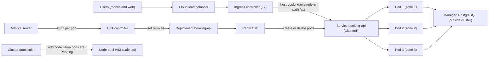
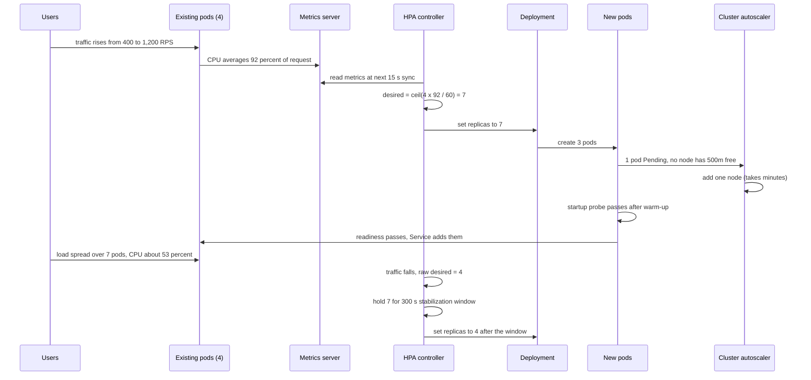

It is the Friday before Diwali. An intercity bus-booking platform normally serves about 400 requests per second (RPS) in the evening. At 8 p.m. a cashback offer goes live in a payments app and traffic climbs to 1,800 RPS in four minutes. The search API runs as four containers on two virtual machines. Within ninety seconds response times go from 120 ms to 9 seconds, health checks start failing, the load balancer pulls containers out of rotation, the remaining ones get even more traffic, and the whole service falls over. The team had heard that Kubernetes "autoscales". It does, but only if you tell it what a healthy container looks like, how much CPU each one needs, what metric to scale on, and how fast to react. This lesson is about those settings and the reasoning behind each one.

## Learning objectives

By the end of this lesson you will be able to:

1. Explain what Kubernetes does (desired state and controllers) and when a simpler platform is a better choice.
2. Describe pods, Deployments, ReplicaSets, Services, Ingress, ConfigMaps and Secrets, and read their YAML.
3. Configure liveness, readiness and startup probes correctly for an ASP.NET Core service, and implement the matching endpoints.
4. Set CPU and memory requests and limits, and explain scheduling, throttling and OOM kills.
5. Calculate what the Horizontal Pod Autoscaler (HPA) will do, including tolerance, min/max and the scale-down stabilization window.
6. Diagnose the common failures: CrashLoopBackOff, cascading readiness failures, slow scale-up and dropped requests during shutdown.

## Prerequisites

- [Docker, Dockerfiles and Docker Compose](#/lesson/m15-docker): containers and images.
- [Vertical versus horizontal scaling and elasticity](#/lesson/m11-scaling): why we add instances instead of bigger machines.
- [Stateless versus stateful services](#/lesson/m11-stateless): pods are replaced all the time, so they must not hold user state.
- [Azure App Service, Container Apps and AKS](#/lesson/m15-azure-compute): where Kubernetes fits among compute options.

## Explain it like I'm a beginner

Think of a large restaurant kitchen with a head chef.

- The owner writes on a whiteboard: "We need **6 cooks** making dosas, each with **one stove and half a counter**." That whiteboard is the **desired state**.
- The head chef keeps looking at the kitchen. If a cook goes home sick, the chef calls a new one. If there are 7 cooks, one is sent to rest. The chef never stops checking: "Does the kitchen match the whiteboard?" That endless checking is a **control loop (controller)**.
- Each cook works at a **station** with their own tools. In Kubernetes, the station is a **pod**: one or more containers that share a network address and run together on one machine.
- Customers don't walk up to a particular cook. They give their order at the **counter**, which passes it to whichever cook is free. That counter is a **Service**: one stable address in front of a changing set of pods.
- The **front door with a host** who sends people to the dosa counter or the dessert counter based on what they ask for is the **Ingress**: it routes HTTP requests by host name and path.
- A cook who has just arrived is still washing hands and lighting the stove. The host should not send orders yet. "Ready to take orders?" is a **readiness probe**. "Is this cook still breathing, or have they fainted?" is a **liveness probe**: a fainted cook gets replaced.
- When the queue at the counter gets long, the manager adds cooks. That is the **Horizontal Pod Autoscaler**. If the kitchen itself runs out of stoves, the owner rents more kitchen space: the **cluster autoscaler** adds machines (nodes).

Kubernetes is the head chef plus the whiteboard. You describe what you want in files (YAML), and controllers work non-stop to make reality match.

## First-principles explanation

### The core idea: declarative desired state

Without an orchestrator you *do* things: "start container on VM 2", "restart it if it crashes", "update nginx config". With Kubernetes you *declare* things: "there should be 6 replicas of image `booking-api:1.42`, reachable as `booking-api` on port 80". The API server stores that declaration in a database (etcd). Controllers watch the declaration and the real world and act on the difference:

- The **Deployment controller** makes sure a ReplicaSet exists for the current pod template, and manages the rollover between old and new ReplicaSets during an update.
- The **ReplicaSet controller** counts pods with matching labels and creates or deletes pods to reach the desired count.
- The **scheduler** picks a node for each new pod, based on its resource requests and constraints.
- The **kubelet** on each node starts the containers, runs the probes and reports status.
- The **HPA controller** periodically (every 15 seconds by default) reads metrics and changes the Deployment's replica count.

Every component only reacts to state. That is why Kubernetes heals itself after a node dies: the ReplicaSet sees 4 of 6 pods, and creates 2 more elsewhere. It's also why misconfigurations are amplified: if your liveness probe is wrong, the kubelet will faithfully kill healthy containers forever.

### The building blocks

| Object | Plain English | What it is for |
|---|---|---|
| **Pod** | One work station | One or more containers sharing an IP address and volumes, scheduled together. Pods are disposable; you rarely create them directly. |
| **Deployment** | "Keep N copies of this, and update them gradually" | Manages ReplicaSets and rolling updates for stateless apps. |
| **ReplicaSet** | The counter of copies | Ensures N pods with a given template exist. Created by a Deployment. |
| **Service** | A stable phone number | A virtual IP and DNS name (`booking-api.prod.svc.cluster.local`) that load-balances to ready pods matching a label selector. |
| **Ingress** (or Gateway API) | The front door host | Layer 7 routing of external HTTP(S) traffic by host and path to Services, implemented by an ingress controller (NGINX, Application Gateway for Containers, Traefik and others). |
| **ConfigMap / Secret** | Settings sheets | Configuration and sensitive values injected as environment variables or files. Secrets are only base64-encoded by default; use encryption at rest and an external vault integration for real secrets. |
| **Namespace** | A room in the building | A scope for names, quotas and access rules. |
| **StatefulSet** | Numbered stations that keep their own storage | Stable pod names and per-pod volumes for stateful workloads. Most teams still run their main PostgreSQL as a managed service outside the cluster. |
| **Job / CronJob** | One-off and scheduled tasks | Batch work, such as a database migration job or a nightly report. |
| **HorizontalPodAutoscaler** | The manager who adds cooks | Changes a Deployment's replica count based on metrics. |
| **PodDisruptionBudget** | "Never take away more than one cook at a time" | Limits voluntary evictions (node upgrades, drains) so a minimum number of pods stays available. |

### Reading a Deployment and a Service

YAML is just nested key-value text. Here is the booking API, with each important line explained after.

```yaml
apiVersion: apps/v1
kind: Deployment
metadata:
  name: booking-api
  namespace: prod
spec:
  replicas: 4                      # the HPA will take over this number
  selector:
    matchLabels: { app: booking-api }
  strategy:
    type: RollingUpdate
    rollingUpdate: { maxSurge: 25%, maxUnavailable: 0 }
  template:
    metadata:
      labels: { app: booking-api }
    spec:
      terminationGracePeriodSeconds: 30
      topologySpreadConstraints:
        - maxSkew: 1
          topologyKey: topology.kubernetes.io/zone
          whenUnsatisfiable: ScheduleAnyway
          labelSelector: { matchLabels: { app: booking-api } }
      containers:
        - name: api
          image: myregistry.azurecr.io/booking-api:1.42.0
          ports: [{ containerPort: 8080 }]
          env:
            - name: ConnectionStrings__Bookings
              valueFrom: { secretKeyRef: { name: booking-db, key: connection } }
          resources:
            requests: { cpu: 500m, memory: 512Mi }
            limits:   { memory: 768Mi }
          startupProbe:
            httpGet: { path: /healthz/startup, port: 8080 }
            periodSeconds: 5
            failureThreshold: 24      # up to 120 s to start
          readinessProbe:
            httpGet: { path: /healthz/ready, port: 8080 }
            periodSeconds: 5
            failureThreshold: 2
          livenessProbe:
            httpGet: { path: /healthz/live, port: 8080 }
            periodSeconds: 10
            failureThreshold: 3
          lifecycle:
            preStop:
              sleep: { seconds: 10 }  # older clusters: exec a sleep command instead
---
apiVersion: v1
kind: Service
metadata:
  name: booking-api
  namespace: prod
spec:
  selector: { app: booking-api }
  ports: [{ port: 80, targetPort: 8080 }]
```

- `selector` and `labels` are how objects find each other. The Service has no list of pods; it selects "all ready pods with `app: booking-api`". Get a label wrong and the Service routes to nothing.
- `maxSurge: 25%, maxUnavailable: 0` means during a rollout Kubernetes may add one extra pod (25 % of 4) but never drops below 4 ready pods. More on rollouts in [Blue-green, canary and rolling deployments](#/lesson/m15-deployment-strategies).
- `topologySpreadConstraints` spreads pods across availability zones so one zone failure doesn't take out all replicas.
- `resources`, the three probes and `preStop` get their own sections below.

### Requests and limits: how scheduling and throttling work

Every container declares two numbers for CPU and memory:

- A **request** is a reservation. The scheduler only places a pod on a node with that much *unreserved* capacity. It's what the pod is guaranteed.
- A **limit** is a ceiling. For **CPU**, exceeding the limit causes **throttling**: the container is paused for the rest of each 100 ms scheduling period. For **memory**, exceeding the limit gets the container **OOM-killed** (out of memory) and restarted.

CPU is measured in millicores: `500m` is half a core, `2` is two cores. Memory in bytes with suffixes: `512Mi` is 512 × 1,024 × 1,024 bytes; `512M` is 512 × 1,000,000.

Back-of-the-envelope packing. A node with 4 vCPU and 16 GiB typically has a bit less *allocatable* after the system reserves some for the kubelet and OS; assume 3,860m CPU and 12.5 GiB (an estimate: check `kubectl describe node`). Each booking-api pod requests 500m and 512Mi:

- By CPU: 3,860 ÷ 500 = 7.7, so 7 pods.
- By memory: 12.5 × 1,024 ÷ 512 = 25 pods.
- CPU is the binding constraint: **7 pods per node**. For 12 pods you need ⌈12 ÷ 7⌉ = 2 nodes, and 3 if you want them spread over three zones with room to lose one.

Two common recommendations, and why:

1. **Set memory limit ≥ request, and close to it.** Memory can't be taken back from a process without killing it. If many pods use more than they requested, the node runs out and the kubelet evicts pods.
2. **Be careful with CPU limits.** A CPU limit throttles your service even when the node has idle cores, which shows up as mysterious latency spikes. Many teams set a CPU request and no CPU limit for latency-sensitive APIs, relying on requests to share CPU fairly under contention. Others keep limits for predictability or multi-tenant fairness. Measure throttling (`container_cpu_cfs_throttled_periods_total`) before deciding.

The pairing of request and limit sets a pod's **Quality of Service class**: `Guaranteed` (requests equal limits for every resource), `Burstable` (some requests set) or `BestEffort` (nothing set, first to be evicted).

.NET note: the runtime reads the container's CPU and memory limits to size the thread pool and GC heap, so test small pods under load and tune `DOTNET_GCHeapHardLimitPercent` if needed.

### Probes: three different questions

| Probe | Question | On failure | Typical ASP.NET Core check |
|---|---|---|---|
| **Startup** | "Has the app finished starting?" | Keep waiting until `failureThreshold × periodSeconds`, then restart | Has warm-up completed? |
| **Readiness** | "Should this pod receive traffic right now?" | Remove from Service endpoints (no restart) | Warmed up, not draining, critical dependencies reachable |
| **Liveness** | "Is the process stuck beyond repair?" | Restart the container | Can the process respond at all? Nothing external. |

The most important rule: **liveness must not check dependencies**. If PostgreSQL is slow and the liveness probe queries it, every pod fails liveness at once, every pod restarts, the restarts make start-up connections hit the database together, and you have turned a slow database into a total outage. A restart can't fix a remote database. Liveness should only fail when the process itself is broken (deadlocked, out of threads), which in practice means: "the HTTP endpoint answers".

Readiness *may* check dependencies, but think about what happens when they all fail together. If the database is down, removing every pod from the Service means users get a connection error from the load balancer instead of a friendly "try again in a minute" from your app. A common compromise: readiness checks only local state (warm-up complete, not shutting down) and dependencies that are specific to that pod; shared dependencies are handled by timeouts, circuit breakers and degraded responses in the app.

The **startup probe** exists for slow starters. Without it, you would have to set `initialDelaySeconds` on liveness high enough for the slowest start, which delays detection of real hangs forever after. With it, liveness and readiness only begin once startup succeeds.

### Graceful shutdown: why requests get dropped during deploys

When Kubernetes deletes a pod, two things happen **in parallel**:

1. The pod is marked terminating, and the endpoint controller removes it from the Service. That removal must propagate to every node's kube-proxy and to the ingress controller, which takes a moment (often a few seconds).
2. The kubelet runs the `preStop` hook, then sends `SIGTERM` to the container. After `terminationGracePeriodSeconds` (default 30) it sends `SIGKILL`.

If the app exits immediately on `SIGTERM`, the ingress may still send it requests for a few seconds, and those requests fail with connection errors. The fix:

- A `preStop` sleep (5–10 s) so the endpoint removal propagates before the app even hears `SIGTERM`.
- On `SIGTERM`, ASP.NET Core's host stops accepting new connections and waits for in-flight requests up to `HostOptions.ShutdownTimeout` (30 s by default in recent .NET). Make sure `preStop + ShutdownTimeout < terminationGracePeriodSeconds`, for example 10 + 15 < 30.
- Flip readiness to unhealthy as soon as shutdown begins, so anything still checking stops sending work.

### The Horizontal Pod Autoscaler (HPA)

The HPA is a control loop that runs every 15 seconds (the controller manager's default sync period). For a resource metric like CPU, it computes:

```text
desiredReplicas = ceil( currentReplicas × currentMetricValue ÷ targetMetricValue )
```

CPU utilisation is measured **relative to the request**. If each pod requests 500m and uses 450m, utilisation is 90 %.

Worked example: 4 replicas averaging 90 % CPU, target 60 %. Ratio 90 ÷ 60 = 1.5. Desired = ⌈4 × 1.5⌉ = 6.

Details that matter in practice:

- **Tolerance.** If the ratio is within 10 % of 1.0 (0.9 to 1.1 by default), the HPA does nothing, to avoid flapping. 4 replicas at 64 % against a 60 % target is a ratio of 1.067: no change.
- **Min and max.** The result is clamped to `minReplicas` and `maxReplicas`. `maxReplicas` is a cost and safety ceiling: it protects the database from being flooded by 200 pods, each with a connection pool.
- **Scale-down stabilization.** By default the HPA looks at all recommendations in the last **300 seconds** and uses the **highest** one when scaling down. So after a spike ends, replicas stay up for 5 minutes. That prevents a sawtooth when traffic is bursty.
- **Scale-up policies.** By default the HPA can at most double the replicas or add 4 pods (whichever is more) every 15 seconds, with no stabilization window for scale-up. You can tune both with the `behavior` field.
- **Missing metrics and unready pods.** Pods still starting, or with no metrics yet, are treated conservatively (assumed 0 % when scaling up and 100 % when scaling down) so new pods don't cause an overshoot.
- **Metrics source.** Resource metrics come from the metrics server. Custom metrics (requests per second, queue length) need an adapter, for example Prometheus Adapter or KEDA, which is built into AKS as an add-on.

```yaml
apiVersion: autoscaling/v2
kind: HorizontalPodAutoscaler
metadata: { name: booking-api, namespace: prod }
spec:
  scaleTargetRef: { apiVersion: apps/v1, kind: Deployment, name: booking-api }
  minReplicas: 4
  maxReplicas: 30
  metrics:
    - type: Resource
      resource:
        name: cpu
        target: { type: Utilization, averageUtilization: 60 }
  behavior:
    scaleUp:
      stabilizationWindowSeconds: 0
      policies:
        - { type: Percent, value: 100, periodSeconds: 15 }
        - { type: Pods, value: 6, periodSeconds: 15 }
      selectPolicy: Max
    scaleDown:
      stabilizationWindowSeconds: 300
      policies:
        - { type: Percent, value: 20, periodSeconds: 60 }
```

**Choosing the metric.** CPU works well for CPU-bound APIs. It is a poor signal for:

- I/O-bound services that spend most time waiting on a database: CPU stays at 20 % while latency climbs. Scale on requests per second per pod or on in-flight requests.
- Queue workers: scale on queue length (or "messages per pod"), ideally with KEDA, which can also scale to zero.
- Memory: rarely a good scaling metric for .NET services because the GC doesn't give memory back quickly, so the HPA scales up and never down.

**Why autoscaling still drops requests in a spike.** The HPA reacts to metrics that are already averaged over a window, then new pods must be scheduled, images pulled, the app started and readiness passed. Add those up:

```text
metric window and scrape     ~15–60 s
HPA sync period              up to 15 s
pod scheduling               ~1–5 s (if a node has room)
image pull                   ~5–30 s (much less if cached)
app start + warm-up          ~5–40 s for ASP.NET Core
readiness passes             ~5–10 s
---------------------------------------------
total                        roughly 35 s to 2.5 min (estimate)
```

If no node has room, the **cluster autoscaler** must add a VM, which commonly takes a few minutes more. During that time existing pods carry the spike. Three mitigations:

1. **Headroom**: target 60 % CPU instead of 85 %, so existing pods can absorb a 1.4× jump while new ones start.
2. **Scheduled scaling**: raise `minReplicas` before a known event (sale, results day, match) with a CronJob or KEDA's cron scaler.
3. **Faster start**: small images, ReadyToRun or Native AOT where suitable, cached images on nodes, and a warm-up that is short and bounded.

The **Vertical Pod Autoscaler (VPA)** recommends requests from observed usage, useful for right-sizing. Don't let VPA and HPA both act on CPU for one Deployment.

### When Kubernetes is not the answer

Kubernetes is a platform for building platforms. You get portability, a huge ecosystem and fine control, and you pay with complexity: cluster upgrades every few months, networking, ingress controllers, certificates, RBAC, policy, observability, node pools, and people who understand them. For a single ASP.NET Core API, or a handful, **Azure App Service** or **Azure Container Apps** (which runs on Kubernetes and KEDA but hides the cluster) usually delivers autoscaling, rolling deployments and health checks with a fraction of the operational work. Choose AKS when you run many services, need fine-grained control (custom networking, GPU pools, sidecars, operators), or have a platform team. See [Azure App Service, Container Apps and AKS](#/lesson/m15-azure-compute).

## Visual explanation

### Architecture: request path and control loops



Follow the request path first: users reach a cloud load balancer, which forwards to the ingress controller pods. The ingress controller reads Ingress rules and forwards `/api` requests for the host to the `booking-api` Service. The Service is not a process; it is a rule (implemented by kube-proxy or the CNI on each node) that spreads connections over the currently **ready** pods, which are spread over three zones and all talk to a managed PostgreSQL outside the cluster. Now the control loops: the metrics server collects CPU usage from each node's kubelet; the HPA reads it every 15 seconds and writes a new replica count to the Deployment; the Deployment's ReplicaSet creates or deletes pods; new pods join the Service only when their readiness probe passes. If a new pod cannot be scheduled because no node has enough unreserved CPU, it stays `Pending`, and the cluster autoscaler adds a node to the pool.

### Sequence: a spike, a scale-up and a scale-down



Read it top to bottom. Existing pods absorb the spike first, which is why headroom matters. The HPA notices only at its next sync, and computes 7 from the formula. Two of the new pods fit on existing nodes; one stays Pending until the cluster autoscaler adds a node, which is the slowest step. New pods receive traffic only after the startup probe and then the readiness probe pass, so a slow warm-up directly delays relief. After traffic drops, the raw recommendation falls to 4 immediately, but the scale-down stabilization window keeps 7 replicas for five minutes in case the drop is temporary, then scales down. Each of those pod deletions goes through the graceful shutdown sequence described earlier.

## Step-by-step example

We'll take the booking search API from "four containers on two VMs" to a correctly autoscaled Deployment.

### Step 1 — measure one pod

Run a load test (k6, JMeter or Azure Load Testing) against **one** pod with a 500m request and no CPU limit. Increase RPS until p95 latency crosses the SLO (300 ms). Suppose it holds 150 RPS at 70 % CPU of the request and degrades beyond 210 RPS. This number is specific to your code, data and hardware; never copy it from elsewhere.

### Step 2 — size the baseline and the peak

- Normal evening: 400 RPS ÷ 150 = 2.7, so 3 pods. Use **4 as minReplicas**: if a zone fails and takes one or two of the 4 pods with it, the remaining pods run hot for a minute while the HPA replaces them, instead of the service falling over.
- Festival peak: 1,800 RPS ÷ 150 = 12 pods at 70 % CPU. With a 60 % target, the HPA will want ⌈12 × 70 ÷ 60⌉ = 14.
- **maxReplicas: 30** gives room above the expected peak while capping database connections: 30 pods × 20 pooled connections = 600 connections, which must fit the database's `max_connections` (or go through PgBouncer). See [Database connection pooling](#/lesson/m09-connection-pooling).

### Step 3 — size the nodes

7 pods per 4-vCPU node (calculated above). Peak 14 pods → 2 nodes minimum; 3 zones → at least 3 nodes, cluster autoscaler max 6. The ingress controller and monitoring agents need their own share; give them a separate system node pool.

### Step 4 — implement probes and graceful shutdown

Add `/healthz/startup`, `/healthz/ready` and `/healthz/live` (see the C# below). Warm-up loads route and fare caches, which takes about 8 seconds. Set the startup probe to allow 120 s, readiness every 5 s, liveness every 10 s with 3 failures. Add `preStop` sleep 10 s and `ShutdownTimeout` 15 s, under a 30 s grace period.

### Step 5 — add the HPA and test the spike

Apply the HPA YAML above. Run a load test that ramps from 400 to 1,800 RPS in 4 minutes. Watch `kubectl get hpa -w` and the p95 latency. In our hypothetical run, the first scale-up happens about 40 s in, new pods serve traffic about 70 s in, and one node is added after about 3 minutes. Latency briefly reaches 600 ms, breaching the SLO for roughly 90 seconds.

### Step 6 — close the gap

Two cheap fixes: raise `minReplicas` to 10 from 7:30 p.m. on announced sale days with a scheduled scaler, and allow scale-up of 6 pods per 15 s. Re-test: the SLO holds. Record the numbers next to the HPA config so the next person knows why `minReplicas` is what it is.

## Production-style C# implementation

Kubernetes decides *when* to restart, route and scale. Your ASP.NET Core service must give it honest signals: separate startup, readiness and liveness endpoints, readiness that turns off during shutdown, and a custom metric for scaling when CPU is the wrong signal.

```text
Booking.Api/
  Program.cs
  Hosting/PodLifecycle.cs
  Hosting/WarmupService.cs
  Hosting/ProbeChecks.cs
  Hosting/InFlightMetrics.cs
```

```csharp file=Hosting/PodLifecycle.cs
namespace Booking.Api.Hosting;

public enum PodPhase { Starting, Ready, Draining }

/// <summary>Single source of truth for what the probes report.
/// Starting until warm-up completes, Ready while serving, Draining once SIGTERM arrives.</summary>
public sealed class PodLifecycle
{
    private int _phase = (int)PodPhase.Starting;

    public PodPhase Phase => (PodPhase)Volatile.Read(ref _phase);

    public void MarkReady() =>
        Interlocked.CompareExchange(ref _phase, (int)PodPhase.Ready, (int)PodPhase.Starting);

    /// <summary>Draining is terminal: a pod never becomes ready again after shutdown begins.</summary>
    public void BeginDraining() => Interlocked.Exchange(ref _phase, (int)PodPhase.Draining);
}
```

```csharp file=Hosting/WarmupService.cs
using Microsoft.Extensions.Caching.Memory;
using Microsoft.Extensions.Options;

namespace Booking.Api.Hosting;

public sealed class WarmupOptions
{
    /// <summary>Upper bound on warm-up. Keep it well inside the startup probe budget.</summary>
    public TimeSpan MaxWarmup { get; set; } = TimeSpan.FromSeconds(60);
}

public interface IWarmupTask
{
    string Name { get; }
    Task RunAsync(CancellationToken ct);
}

/// <summary>Loads caches the first requests would otherwise pay for, then marks the pod ready.
/// Runs in the background so Kestrel starts listening (and the liveness probe answers) immediately.</summary>
public sealed class WarmupService(
    IEnumerable<IWarmupTask> tasks,
    PodLifecycle lifecycle,
    IOptions<WarmupOptions> options,
    ILogger<WarmupService> logger) : BackgroundService
{
    protected override async Task ExecuteAsync(CancellationToken stoppingToken)
    {
        using var timeout = CancellationTokenSource.CreateLinkedTokenSource(stoppingToken);
        timeout.CancelAfter(options.Value.MaxWarmup);

        foreach (var task in tasks)
        {
            try
            {
                await task.RunAsync(timeout.Token);
                logger.LogInformation("Warm-up step {Step} completed", task.Name);
            }
            catch (OperationCanceledException) when (!stoppingToken.IsCancellationRequested)
            {
                // A slow cache must not keep the pod out of service forever: serve cold instead.
                logger.LogWarning("Warm-up step {Step} timed out, continuing cold", task.Name);
                break;
            }
            catch (Exception ex)
            {
                logger.LogWarning(ex, "Warm-up step {Step} failed, continuing cold", task.Name);
            }
        }

        if (!stoppingToken.IsCancellationRequested) lifecycle.MarkReady();
    }
}

/// <summary>Example warm-up: pre-load the fare table into an in-memory cache.</summary>
public sealed class FareCacheWarmup(IMemoryCache cache) : IWarmupTask
{
    public string Name => "fare-cache";

    public async Task RunAsync(CancellationToken ct)
    {
        await Task.Delay(TimeSpan.FromMilliseconds(200), ct); // stands in for a database read
        cache.Set("fares:v1", new Dictionary<string, decimal> { ["BLR-MYS"] = 450m, ["BLR-CHN"] = 899m });
    }
}
```

```csharp file=Hosting/ProbeChecks.cs
using Microsoft.Extensions.Diagnostics.HealthChecks;

namespace Booking.Api.Hosting;

/// <summary>Startup: passes once warm-up has finished (Ready) or shutdown has begun.</summary>
public sealed class StartupCheck(PodLifecycle lifecycle) : IHealthCheck
{
    public Task<HealthCheckResult> CheckHealthAsync(HealthCheckContext context, CancellationToken cancellationToken = default) =>
        Task.FromResult(lifecycle.Phase == PodPhase.Starting
            ? HealthCheckResult.Unhealthy("warming up")
            : HealthCheckResult.Healthy());
}

/// <summary>Readiness: only local state. Shared dependencies (the database) are deliberately NOT checked
/// here, so a database blip does not remove every pod from the Service at once.</summary>
public sealed class ReadinessCheck(PodLifecycle lifecycle, InFlightMetrics inFlight) : IHealthCheck
{
    public int MaxInFlight { get; init; } = 400;

    public Task<HealthCheckResult> CheckHealthAsync(HealthCheckContext context, CancellationToken cancellationToken = default)
    {
        var data = new Dictionary<string, object> { ["phase"] = lifecycle.Phase.ToString(), ["inFlight"] = inFlight.Current };
        var result = lifecycle.Phase switch
        {
            PodPhase.Starting => HealthCheckResult.Unhealthy("warming up", data: data),
            PodPhase.Draining => HealthCheckResult.Unhealthy("draining", data: data),
            // Shed load briefly when this pod is saturated, so the Service prefers other pods.
            _ when inFlight.Current > MaxInFlight => HealthCheckResult.Degraded("saturated", data: data),
            _ => HealthCheckResult.Healthy("ready", data),
        };
        return Task.FromResult(result);
    }
}
```

```csharp file=Hosting/InFlightMetrics.cs
using System.Diagnostics.Metrics;

namespace Booking.Api.Hosting;

/// <summary>Counts in-flight requests and publishes them as an OpenTelemetry-compatible gauge.
/// A Prometheus scrape plus Prometheus Adapter or KEDA can then scale on "in-flight requests per pod",
/// which tracks an I/O-bound API better than CPU does.</summary>
public sealed class InFlightMetrics : IDisposable
{
    private readonly Meter _meter;
    private long _current;

    public InFlightMetrics(IMeterFactory meterFactory)
    {
        _meter = meterFactory.Create("Booking.Api");
        _meter.CreateObservableGauge("booking.http.in_flight", () => Interlocked.Read(ref _current),
            unit: "{request}", description: "Requests currently being processed by this pod");
    }

    public long Current => Interlocked.Read(ref _current);

    public void Enter() => Interlocked.Increment(ref _current);
    public void Exit() => Interlocked.Decrement(ref _current);

    public void Dispose() => _meter.Dispose();
}

public sealed class InFlightMiddleware(RequestDelegate next, InFlightMetrics metrics)
{
    public async Task InvokeAsync(HttpContext context)
    {
        // Probe traffic should not count as user load.
        if (context.Request.Path.StartsWithSegments("/healthz")) { await next(context); return; }
        metrics.Enter();
        try { await next(context); }
        finally { metrics.Exit(); }
    }
}
```

```csharp file=Program.cs
using Booking.Api.Hosting;
using Microsoft.AspNetCore.Diagnostics.HealthChecks;
using Microsoft.Extensions.Diagnostics.HealthChecks;

var builder = WebApplication.CreateBuilder(args);

// preStop sleep (10 s) + ShutdownTimeout (15 s) must stay below terminationGracePeriodSeconds (30 s).
builder.Services.Configure<HostOptions>(o => o.ShutdownTimeout = TimeSpan.FromSeconds(15));

builder.Services.AddMemoryCache();
builder.Services.AddMetrics();
builder.Services.AddSingleton<PodLifecycle>();
builder.Services.AddSingleton<InFlightMetrics>();
builder.Services.Configure<WarmupOptions>(builder.Configuration.GetSection("Warmup"));
builder.Services.AddSingleton<IWarmupTask, FareCacheWarmup>();
builder.Services.AddHostedService<WarmupService>();

builder.Services.AddHealthChecks()
    .AddCheck("self", () => HealthCheckResult.Healthy(), tags: ["live"])
    .AddCheck<StartupCheck>("startup", tags: ["startup"])
    .AddCheck<ReadinessCheck>("ready", tags: ["ready"]);

var app = builder.Build();

var lifecycle = app.Services.GetRequiredService<PodLifecycle>();
// SIGTERM: stop advertising readiness at once. Kestrel keeps finishing in-flight requests.
app.Lifetime.ApplicationStopping.Register(lifecycle.BeginDraining);

app.UseMiddleware<InFlightMiddleware>();

static HealthCheckOptions Tagged(string tag) => new()
{
    Predicate = r => r.Tags.Contains(tag),
    // Degraded (saturated) still returns 200 so the pod is not pulled; the status is visible in the body.
    ResultStatusCodes =
    {
        [HealthStatus.Healthy] = StatusCodes.Status200OK,
        [HealthStatus.Degraded] = StatusCodes.Status200OK,
        [HealthStatus.Unhealthy] = StatusCodes.Status503ServiceUnavailable,
    },
};

app.MapHealthChecks("/healthz/live", Tagged("live"));
app.MapHealthChecks("/healthz/startup", Tagged("startup"));
app.MapHealthChecks("/healthz/ready", Tagged("ready"));

app.MapGet("/api/search", (string from, string to) =>
    Results.Ok(new { from, to, departures = new[] { "06:00", "09:30", "22:15" } }));

app.Run();
```

Design notes:

- **Liveness checks nothing external.** The `self` check only proves the process can answer HTTP. A slow database will never cause restarts.
- **Warm-up is bounded.** A cache that can't load in 60 seconds is skipped and the pod serves cold. An unbounded warm-up hitting a struggling database would keep every new pod out of service exactly when you need them.
- **Draining is one-way.** Once `ApplicationStopping` fires, readiness fails until the pod dies. Together with the `preStop` sleep, this stops new traffic before Kestrel closes.
- **Degraded is not unready.** Pulling a saturated pod out of rotation sends its load to the others, which then saturate too: a cascade. Report saturation for dashboards; let the HPA add capacity.
- **Custom metric.** `booking.http.in_flight` is exported through the .NET metrics API; with an OpenTelemetry Prometheus exporter and an adapter (or KEDA's Prometheus scaler) the HPA can target, say, 60 in-flight requests per pod.

## Bad design vs good design

**Bad**: settings copied from a blog post.

```yaml
resources:
  limits: { cpu: 250m, memory: 256Mi }        # no requests: scheduler places pods blindly
livenessProbe:
  httpGet: { path: /health, port: 8080 }      # /health also pings PostgreSQL and Redis
  initialDelaySeconds: 5
  periodSeconds: 5
  failureThreshold: 1
# no readinessProbe, no startupProbe, no preStop
---
# HPA on memory, maxReplicas 200
```

What goes wrong: when only limits are set, Kubernetes copies them into requests, so each pod gets a tiny 250m CPU and is throttled under any real load. The .NET GC sizes itself for 256Mi, collects constantly and gets OOM-killed during bursts. The liveness probe checks PostgreSQL, so a 6-second database stall restarts every pod simultaneously, with `failureThreshold: 1` making it trigger on a single slow response. With a 5-second initial delay and no startup probe, a cold start that takes 12 seconds gets killed before it ever starts: CrashLoopBackOff. Without readiness, pods get traffic while still warming up. Without `preStop`, every deployment drops requests. Scaling on memory ratchets up and never down, and `maxReplicas: 200` would open 4,000 database connections.

**Good**: requests sized from a load test and a memory limit close to the request; separate startup, readiness and liveness endpoints with liveness checking only the process; readiness off during warm-up and draining; `preStop` sleep and a shutdown timeout inside the grace period; HPA on CPU (or in-flight requests) with headroom, a `maxReplicas` derived from database capacity, and a PodDisruptionBudget; topology spread across zones.

:::callout type=mistake title="Liveness that checks the database"
A liveness probe is a request to restart you. Ask: "would restarting this container fix the failure?" If the answer is no (database down, downstream API slow, disk full on another server), the check does not belong in liveness.
:::

:::callout type=tradeoff title="CPU limits"
No CPU limit: best latency, but a runaway pod can starve neighbours that requested less than they use. CPU limit: predictable sharing, but throttling even when cores are idle. Decide per workload, and measure throttling either way.
:::

## Practical playground

The simulator models a service behind an autoscaler during a traffic spike: base load, a ramp to a multiple of it, a hold, and a fall. Each instance serves a fixed number of requests per second; new instances take `provisionSec` to become ready; the autoscaler targets a utilisation and waits `cooldownSec` between actions.

1. Start with the defaults below. Note the dropped percentage and when new instances arrive relative to the spike.
2. Set `provisionSec` to 120 (a node must be added). How many more requests drop? This is the cost of the cluster autoscaler path.
3. Lower `targetUtil` from 0.7 to 0.5. Dropped requests fall; what happens to average utilisation, and therefore cost?
4. Raise the starting `instances` to 8 (scheduled pre-scaling). Compare with step 3: which is cheaper for a spike you know is coming?
5. Turn autoscaling off and find the fixed instance count that drops nothing. Compare its average utilisation with the autoscaled run.

:::playground type=sim sim=scaling title="HPA versus a festival traffic spike" instances=4 capacityPerInstance=150 provisionSec=60 cooldownSec=30 spikeMultiplier=4 targetUtil=0.6 maxInstances=30
:::

## Exercises

:::exercise id=m15-kubernetes-ex1 difficulty=beginner kind=code title="Parse resource quantities and pack pods onto nodes"
Write the arithmetic a platform engineer does before every capacity change: parse Kubernetes CPU and memory quantities, then work out how many pods fit on a node and how many nodes a Deployment needs.
::requirements
- `K8sQuantity.ParseCpuMillicores(string)`: `"500m"` → 500, `"2"` → 2000, `"1.5"` → 1500, `"0.25"` → 250. Round to the nearest millicore. Anything else (empty, negative, `"abc"`, `"5x"`) throws `FormatException`.
- `K8sQuantity.ParseMemoryBytes(string)`: binary suffixes `Ki`, `Mi`, `Gi` (powers of 1,024), decimal suffixes `k`, `M`, `G` (powers of 1,000), or a plain integer of bytes. Invalid input throws `FormatException`.
- `PodPacking.PodsPerNode(long nodeCpuMillicores, long nodeMemoryBytes, long podCpuMillicores, long podMemoryBytes)`: the number of pods whose **requests** fit, limited by whichever resource runs out first. Pod requests must be positive, else `ArgumentOutOfRangeException`.
- `PodPacking.NodesNeeded(int replicas, int podsPerNode)`: smallest node count that holds all replicas. `podsPerNode` of 0 throws `InvalidOperationException` (the pod can never be scheduled).
::acceptance
- `"512Mi"` parses to 536,870,912 and `"1Gi"` to 1,073,741,824.
- A node with 3,860m and 12.5 GiB fits 7 pods of 500m/512Mi.
- 12 replicas at 7 per node need 2 nodes; 14 need 2; 15 need 3.
- Invalid quantities throw `FormatException`.
::hint
Split each string into a number part and a suffix part. Check the suffix first.
::hint
For CPU, a trailing `m` means the number is already millicores; otherwise it's cores, so multiply by 1,000.
::hint
Use `decimal.TryParse` with `CultureInfo.InvariantCulture` and `NumberStyles.AllowDecimalPoint` so `"1.5"` works everywhere and `"-1"` is rejected.
::hint
Pods per node is `Math.Min(nodeCpu / podCpu, nodeMem / podMem)` with integer division. Nodes needed is a ceiling division: `(replicas + perNode - 1) / perNode`.
::starter
```csharp file=K8sQuantity.cs
using System;

public static class K8sQuantity
{
    public static long ParseCpuMillicores(string quantity) => throw new NotImplementedException();
    public static long ParseMemoryBytes(string quantity) => throw new NotImplementedException();
}

public static class PodPacking
{
    public static int PodsPerNode(long nodeCpuMillicores, long nodeMemoryBytes, long podCpuMillicores, long podMemoryBytes) =>
        throw new NotImplementedException();
    public static int NodesNeeded(int replicas, int podsPerNode) => throw new NotImplementedException();
}
```
::tests
```csharp file=K8sQuantityTests.cs
using System;
using Xunit;

public class K8sQuantityTests
{
    [Fact] public void Millicores() => Assert.Equal(500, K8sQuantity.ParseCpuMillicores("500m"));
    [Fact] public void Whole_cores() => Assert.Equal(2000, K8sQuantity.ParseCpuMillicores("2"));
    [Fact] public void Fractional_cores() => Assert.Equal(1500, K8sQuantity.ParseCpuMillicores("1.5"));
    [Fact] public void Quarter_core() => Assert.Equal(250, K8sQuantity.ParseCpuMillicores("0.25"));
    [Fact] public void Bad_cpu_throws() => Assert.Throws<FormatException>(() => K8sQuantity.ParseCpuMillicores("5x"));
    [Fact] public void Negative_cpu_throws() => Assert.Throws<FormatException>(() => K8sQuantity.ParseCpuMillicores("-1"));
    [Fact] public void Empty_cpu_throws() => Assert.Throws<FormatException>(() => K8sQuantity.ParseCpuMillicores(""));

    [Fact] public void Mebibytes() => Assert.Equal(536_870_912L, K8sQuantity.ParseMemoryBytes("512Mi"));
    [Fact] public void Gibibytes() => Assert.Equal(1_073_741_824L, K8sQuantity.ParseMemoryBytes("1Gi"));
    [Fact] public void Kibibytes() => Assert.Equal(2048L, K8sQuantity.ParseMemoryBytes("2Ki"));
    [Fact] public void Decimal_megabytes() => Assert.Equal(256_000_000L, K8sQuantity.ParseMemoryBytes("256M"));
    [Fact] public void Decimal_gigabytes() => Assert.Equal(2_000_000_000L, K8sQuantity.ParseMemoryBytes("2G"));
    [Fact] public void Plain_bytes() => Assert.Equal(1000L, K8sQuantity.ParseMemoryBytes("1000"));
    [Fact] public void Bad_memory_throws() => Assert.Throws<FormatException>(() => K8sQuantity.ParseMemoryBytes("12Qi"));

    [Fact]
    public void Lesson_node_fits_seven()
    {
        long nodeMem = (long)(12.5 * 1024 * 1024 * 1024);
        Assert.Equal(7, PodPacking.PodsPerNode(3860, nodeMem, 500, 512L * 1024 * 1024));
    }

    [Fact]
    public void Memory_can_be_the_limit() =>
        Assert.Equal(4, PodPacking.PodsPerNode(8000, 4L * 1024 * 1024 * 1024, 250, 1024L * 1024 * 1024));

    [Fact] public void Zero_request_throws() => Assert.Throws<ArgumentOutOfRangeException>(() => PodPacking.PodsPerNode(4000, 1000, 0, 10));

    [Fact] public void Twelve_need_two() => Assert.Equal(2, PodPacking.NodesNeeded(12, 7));
    [Fact] public void Fourteen_need_two() => Assert.Equal(2, PodPacking.NodesNeeded(14, 7));
    [Fact] public void Fifteen_need_three() => Assert.Equal(3, PodPacking.NodesNeeded(15, 7));
    [Fact] public void Pod_too_big_throws() => Assert.Throws<InvalidOperationException>(() => PodPacking.NodesNeeded(3, 0));
}
```
::solution
```csharp file=K8sQuantity.cs
using System;
using System.Globalization;

public static class K8sQuantity
{
    public static long ParseCpuMillicores(string quantity)
    {
        if (string.IsNullOrWhiteSpace(quantity)) throw new FormatException("empty CPU quantity");
        var milli = quantity.EndsWith('m');
        var number = ParseNonNegative(milli ? quantity[..^1] : quantity);
        return (long)Math.Round(milli ? number : number * 1000m, MidpointRounding.AwayFromZero);
    }

    public static long ParseMemoryBytes(string quantity)
    {
        if (string.IsNullOrWhiteSpace(quantity)) throw new FormatException("empty memory quantity");
        (string Suffix, decimal Factor)[] units =
        [
            ("Ki", 1024m), ("Mi", 1024m * 1024), ("Gi", 1024m * 1024 * 1024),
            ("k", 1000m), ("M", 1_000_000m), ("G", 1_000_000_000m),
        ];
        foreach (var (suffix, factor) in units)
        {
            if (quantity.EndsWith(suffix, StringComparison.Ordinal))
                return (long)Math.Round(ParseNonNegative(quantity[..^suffix.Length]) * factor);
        }
        return (long)ParseNonNegative(quantity);
    }

    private static decimal ParseNonNegative(string s)
    {
        if (!decimal.TryParse(s, NumberStyles.AllowDecimalPoint, CultureInfo.InvariantCulture, out var value))
            throw new FormatException($"'{s}' is not a valid quantity");
        return value;
    }
}

public static class PodPacking
{
    public static int PodsPerNode(long nodeCpuMillicores, long nodeMemoryBytes, long podCpuMillicores, long podMemoryBytes)
    {
        if (podCpuMillicores <= 0) throw new ArgumentOutOfRangeException(nameof(podCpuMillicores));
        if (podMemoryBytes <= 0) throw new ArgumentOutOfRangeException(nameof(podMemoryBytes));
        return (int)Math.Min(nodeCpuMillicores / podCpuMillicores, nodeMemoryBytes / podMemoryBytes);
    }

    public static int NodesNeeded(int replicas, int podsPerNode)
    {
        if (podsPerNode <= 0) throw new InvalidOperationException("The pod's requests exceed a node's allocatable capacity.");
        return (replicas + podsPerNode - 1) / podsPerNode;
    }
}
```

`NumberStyles.AllowDecimalPoint` without `AllowLeadingSign` rejects negative numbers for free. The real Kubernetes quantity format is richer (exponents like `1e3`, suffixes `Ti`, `Pi`, `E`, and `n`/`u` for tiny CPU values), but these cover almost every manifest you will read. Remember the scheduler packs by **requests**, not by actual usage: a node can be "full" while its CPUs sit at 20 %.
::mistakes
- Treating `M` and `Mi` as the same: 512M is about 4.6 % smaller than 512Mi.
- Using `double.Parse` without an invariant culture, which breaks on machines where the decimal separator is a comma.
- Packing by limits or by observed usage instead of requests.
- Forgetting that allocatable capacity is smaller than the VM size.
::extensions
Add `Ti` and the `n` (nanocore) CPU suffix, and a `PodsPerNode` overload that subtracts DaemonSet pods (log agent, CNI) from the node first.
:::

:::exercise id=m15-kubernetes-ex2 difficulty=beginner kind=written title="Diagnose four probe and resource incidents"
For each incident, say what is happening, which setting causes it, and how you would fix it. Keep each answer to a short paragraph.

1. A new release goes into `CrashLoopBackOff`. Logs show the app starting, then "Application is shutting down" after about 15 seconds, every time. The image works fine locally. The liveness probe has `initialDelaySeconds: 10`, `periodSeconds: 5`, `failureThreshold: 1`, and the app takes about 20 seconds to load its configuration from a vault on first start.
2. At 2:14 a.m. the managed PostgreSQL fails over (about 40 seconds). All 12 API pods restart at the same moment, and the service is down for 6 minutes instead of 40 seconds.
3. p99 latency jumps from 180 ms to 1.4 s every few minutes, though average CPU on the nodes is 35 %. The pods have `limits: { cpu: 500m }`.
4. Users see a burst of 502 errors for about 3 seconds on every deployment, even with `maxUnavailable: 0`.
::acceptance
- Each answer names the specific setting at fault.
- Answer 1 introduces a startup probe (or a longer budget) rather than just a bigger initial delay, and says why.
- Answer 2 explains why restarts made it worse.
- Answer 3 mentions CPU throttling and how to measure it.
- Answer 4 explains the race between endpoint removal and SIGTERM.
::hint
For each incident ask: which component acted (kubelet, Service, scheduler), and on what signal?
::hint
Incident 1: compare the start time with how long the liveness probe allows.
::hint
Incident 2: which probe was checking the database? What does a mass restart do to a database that just came back?
::hint
Incident 3: averages hide 100 ms periods. Incident 4: two things happen in parallel when a pod is deleted.
::solution
1. **Liveness kills the app before it finishes starting.** Liveness begins at 10 s and one failure (at 10 or 15 s) restarts the container, but start-up takes 20 s, so it never finishes: CrashLoopBackOff, with growing back-off delays. Fix: add a **startup probe** with a generous budget (for example `periodSeconds: 5, failureThreshold: 12` = 60 s), so liveness only starts afterwards; and raise liveness `failureThreshold` to 3 so one slow response doesn't restart a running pod. Simply raising `initialDelaySeconds` to 30 also works but delays detection of real hangs on every start and breaks again when start-up gets slower.
2. **The liveness probe (or a shared /health used for liveness) checked PostgreSQL.** During failover every check failed, so the kubelet restarted every pod. Restarts can't fix a database. When the database returned, 12 pods started at once, each opening its connection pool and loading caches, and the cold start plus the probes' timing stretched the outage. Fix: liveness checks only the process; database failures are handled with timeouts, retries with backoff and a circuit breaker inside the app; readiness checks local state.
3. **CPU throttling from the CPU limit.** Bursts of work (GC, JSON serialisation of large responses, many concurrent requests) use more than 50 ms of CPU in a 100 ms period, so the container is paused until the next period, even though the node has idle cores. Averages don't show it. Confirm with the `container_cpu_cfs_throttled_periods_total` and `..._throttled_seconds_total` metrics. Fix: remove the CPU limit (keep an accurate request) or raise it substantially, and re-test; for .NET also check that thread pool and GC settings suit the CPU count the runtime sees.
4. **Endpoint removal races with SIGTERM.** When an old pod is deleted, the endpoint removal and the SIGTERM happen in parallel. The app exits in milliseconds, while the ingress controller and kube-proxy still route to it for a few seconds: 502s. Fix: a `preStop` sleep of 5–10 s, readiness that fails on shutdown, and an ASP.NET Core `ShutdownTimeout` that lets in-flight requests finish, all within `terminationGracePeriodSeconds`.
::mistakes
- Fixing incident 1 by deleting the liveness probe entirely (you lose hang detection).
- Blaming the database for incident 2 without noticing the probe turned a 40-second blip into an outage.
- Looking only at average CPU for incident 3.
:::

:::exercise id=m15-kubernetes-ex3 difficulty=intermediate kind=code title="Compute the HPA's desired replica count"
Implement the core of the HPA algorithm for a CPU utilisation target, so the team can predict what the autoscaler will do before changing a target.
::requirements
- `HpaMath.Utilization(IReadOnlyList<double?> podUsageMillicores, int requestMillicores)` returns the average utilisation percentage over pods **with** metrics (nulls ignored): `sum(usage) ÷ (count × request) × 100`. No pods with metrics → `null`. `requestMillicores <= 0` → `ArgumentOutOfRangeException`.
- `HpaMath.DesiredReplicas(int current, double currentUtilization, double targetUtilization, int min, int max, double tolerance = 0.1)`:
  - `current == 0` returns 0 (scaling is disabled for that workload).
  - `ratio = currentUtilization ÷ targetUtilization`. If `|ratio − 1| <= tolerance`, the raw result is `current`.
  - Otherwise raw = `ceil(current × ratio)`.
  - Clamp the result to `[min, max]`.
  - `targetUtilization <= 0` or `min > max` → `ArgumentOutOfRangeException`.
- Floating-point: round `current × ratio` to 6 decimals before `Math.Ceiling`, so 6 × (70 ÷ 60), which is 7.000000000000001 in binary floating point, gives 7 and not 8.
::acceptance
- 4 pods at 90 % with a 60 % target → 6.
- 4 pods at 64 % with a 60 % target → 4 (within tolerance).
- 10 pods at 20 % with a 60 % target and min 4 → 4.
- 10 pods at 300 % with a 60 % target and max 30 → 30.
- Pods without metrics are ignored in the average.
::hint
Write it as three small steps: ratio, raw desired, clamp.
::hint
`Math.Abs(ratio - 1.0) <= tolerance` is the "do nothing" zone.
::hint
`Math.Clamp(value, min, max)` does the last step.
::hint
```csharp
var raw = Math.Abs(ratio - 1) <= tolerance
    ? current
    : (int)Math.Ceiling(Math.Round(current * ratio, 6));
return Math.Clamp(raw, min, max);
```
::starter
```csharp file=HpaMath.cs
using System;
using System.Collections.Generic;

public static class HpaMath
{
    public static double? Utilization(IReadOnlyList<double?> podUsageMillicores, int requestMillicores) =>
        throw new NotImplementedException();

    public static int DesiredReplicas(int current, double currentUtilization, double targetUtilization, int min, int max, double tolerance = 0.1) =>
        throw new NotImplementedException();
}
```
::tests
```csharp file=HpaMathTests.cs
using System;
using System.Collections.Generic;
using Xunit;

public class HpaMathTests
{
    [Fact] public void Scale_up_example() => Assert.Equal(6, HpaMath.DesiredReplicas(4, 90, 60, 2, 30));
    [Fact] public void Within_tolerance() => Assert.Equal(4, HpaMath.DesiredReplicas(4, 64, 60, 2, 30));
    [Fact] public void Just_outside_tolerance_scales() => Assert.Equal(5, HpaMath.DesiredReplicas(4, 67, 60, 2, 30));
    [Fact] public void Scale_down_clamped_to_min() => Assert.Equal(4, HpaMath.DesiredReplicas(10, 20, 60, 4, 30));
    [Fact] public void Scale_down_normal() => Assert.Equal(5, HpaMath.DesiredReplicas(10, 30, 60, 2, 30));
    [Fact] public void Scale_up_clamped_to_max() => Assert.Equal(30, HpaMath.DesiredReplicas(10, 300, 60, 4, 30));
    [Fact] public void Exact_multiple_does_not_overshoot() => Assert.Equal(7, HpaMath.DesiredReplicas(6, 70, 60, 1, 30));
    [Fact] public void Zero_current_stays_zero() => Assert.Equal(0, HpaMath.DesiredReplicas(0, 90, 60, 1, 30));
    [Fact] public void Current_below_min_is_raised() => Assert.Equal(3, HpaMath.DesiredReplicas(2, 60, 60, 3, 30));
    [Fact] public void Bad_target_throws() => Assert.Throws<ArgumentOutOfRangeException>(() => HpaMath.DesiredReplicas(4, 50, 0, 1, 10));
    [Fact] public void Min_above_max_throws() => Assert.Throws<ArgumentOutOfRangeException>(() => HpaMath.DesiredReplicas(4, 50, 60, 10, 5));

    [Fact]
    public void Utilization_ignores_missing()
    {
        var usage = new List<double?> { 450, null, 350 };
        Assert.Equal(80.0, HpaMath.Utilization(usage, 500)!.Value, 6);
    }

    [Fact] public void Utilization_none_is_null() => Assert.Null(HpaMath.Utilization(new List<double?> { null, null }, 500));
    [Fact] public void Utilization_bad_request_throws() => Assert.Throws<ArgumentOutOfRangeException>(() => HpaMath.Utilization(new List<double?> { 1 }, 0));
}
```
::solution
```csharp file=HpaMath.cs
using System;
using System.Collections.Generic;
using System.Linq;

public static class HpaMath
{
    public static double? Utilization(IReadOnlyList<double?> podUsageMillicores, int requestMillicores)
    {
        if (requestMillicores <= 0) throw new ArgumentOutOfRangeException(nameof(requestMillicores));
        var known = podUsageMillicores.Where(u => u.HasValue).Select(u => u!.Value).ToList();
        if (known.Count == 0) return null;
        return known.Sum() / (known.Count * (double)requestMillicores) * 100.0;
    }

    public static int DesiredReplicas(int current, double currentUtilization, double targetUtilization, int min, int max, double tolerance = 0.1)
    {
        if (targetUtilization <= 0) throw new ArgumentOutOfRangeException(nameof(targetUtilization));
        if (min > max) throw new ArgumentOutOfRangeException(nameof(min), "min must not exceed max");
        if (current == 0) return 0;

        var ratio = currentUtilization / targetUtilization;
        var raw = Math.Abs(ratio - 1.0) <= tolerance
            ? current
            : (int)Math.Ceiling(Math.Round(current * ratio, 6));
        return Math.Clamp(raw, min, max);
    }
}
```

The real controller adds two refinements on top of this formula. When some pods have no metrics or are not yet ready, it recomputes the ratio assuming those pods use 0 % (when scaling up) or 100 % (when scaling down), and only acts if the direction doesn't flip; that keeps freshly started pods from triggering a second scale-up. And the result passes through the `behavior` rules (stabilization windows and rate policies), which exercise 5 covers.

Notice the clamp also *raises* a Deployment below `minReplicas`: if someone runs `kubectl scale --replicas=2` on an HPA-managed Deployment with `minReplicas: 3`, the HPA puts it back.
::mistakes
- Averaging over all pods including those with no metrics, which drags utilisation down and under-scales.
- Rounding instead of taking the ceiling: 4 × 1.3 = 5.2 must become 6, not 5.
- Applying min/max before the tolerance check, so a Deployment below min never gets raised.
::extensions
Support an `AverageValue` target (for example 60 in-flight requests per pod): desired = ceil(sum of metric ÷ target per pod).
:::

:::exercise id=m15-kubernetes-ex4 difficulty=intermediate kind=hld title="Put the bus-booking platform on AKS"
The bus-booking platform has three parts: a **search API** (read-heavy, 400 RPS normal, 1,800 RPS at sale peaks, I/O-bound on PostgreSQL and Redis), a **booking API** (writes, 40 RPS normal, 200 RPS peak, calls a payment gateway), and a **ticket worker** that consumes a queue to generate PDF tickets and send SMS (bursty, up to 5,000 messages in a minute after a sale opens). Data: managed PostgreSQL with one read replica, Redis for seat-hold locks and search caching.

Design the deployment: which Kubernetes objects for each part, what each one scales on and between which limits, which probes, how traffic enters, and what stays outside the cluster. Show capacity arithmetic for search and the worker.
::acceptance
- Each component has a scaling metric that matches its bottleneck, with min/max justified.
- Probe design avoids restart storms when PostgreSQL or Redis is slow.
- The design says what stays outside the cluster and why.
- Includes zone spreading and a PodDisruptionBudget.
- Shows arithmetic for search replicas and worker throughput.
- Mentions how a known sale start time is handled.
::hint
Search is I/O-bound. Is CPU the right metric? What about the worker?
::hint
What caps `maxReplicas` for the booking API? (Think connection pools and the payment gateway's rate limit.)
::hint
The worker can scale on queue length with KEDA, even to zero at night.
::hint
Put stateful managed services outside the cluster unless you have a strong reason, and give the ingress its own node pool.
::starter
```json
{
  "nodes": [
    { "id": "users", "type": "client", "label": "Mobile and web users", "props": { "rps": 1800 } },
    { "id": "lb", "type": "load-balancer", "label": "Cloud load balancer" },
    { "id": "search", "type": "app-server", "label": "Search API", "props": { "instances": 4 } },
    { "id": "booking", "type": "app-server", "label": "Booking API", "props": { "instances": 2 } },
    { "id": "pg", "type": "database", "label": "PostgreSQL", "props": { "replicas": 1 } },
    { "id": "redis", "type": "cache", "label": "Redis" }
  ],
  "edges": [
    { "from": "users", "to": "lb", "kind": "sync" },
    { "from": "lb", "to": "search", "kind": "sync" },
    { "from": "lb", "to": "booking", "kind": "sync" },
    { "from": "search", "to": "pg", "kind": "sync" },
    { "from": "booking", "to": "pg", "kind": "sync" }
  ]
}
```
::solution
```json
{
  "nodes": [
    { "id": "users", "type": "client", "label": "Mobile and web users", "props": { "rps": 1800 } },
    { "id": "lb", "type": "load-balancer", "label": "Cloud load balancer + WAF" },
    { "id": "ing", "type": "api-gateway", "label": "Ingress controller (system node pool, 3 replicas)", "props": { "instances": 3, "multiAz": true } },
    { "id": "search", "type": "app-server", "label": "Search API Deployment, HPA on in-flight requests, 4 to 24", "props": { "instances": 4, "multiAz": true } },
    { "id": "booking", "type": "app-server", "label": "Booking API Deployment, HPA on CPU 60 percent, 3 to 10", "props": { "instances": 3, "multiAz": true } },
    { "id": "worker", "type": "worker", "label": "Ticket worker, KEDA on queue length, 0 to 20", "props": { "instances": 0 } },
    { "id": "q", "type": "queue", "label": "Service Bus queue: ticket jobs" },
    { "id": "pg", "type": "database", "label": "Managed PostgreSQL (outside cluster)", "props": { "replicas": 1, "multiAz": true } },
    { "id": "rr", "type": "read-replica", "label": "Read replica for search" },
    { "id": "redis", "type": "cache", "label": "Managed Redis: search cache + seat holds", "props": { "ttlSeconds": 60 } },
    { "id": "pay", "type": "external", "label": "Payment gateway (rate limited)" },
    { "id": "sms", "type": "external", "label": "SMS provider" },
    { "id": "cron", "type": "scheduler", "label": "Scheduled pre-scale before announced sales" },
    { "id": "mon", "type": "monitoring", "label": "Prometheus or Azure Monitor: HPA, throttling, p95" }
  ],
  "edges": [
    { "from": "users", "to": "lb", "kind": "sync" },
    { "from": "lb", "to": "ing", "kind": "sync" },
    { "from": "ing", "to": "search", "kind": "sync", "label": "/api/search" },
    { "from": "ing", "to": "booking", "kind": "sync", "label": "/api/bookings" },
    { "from": "search", "to": "redis", "kind": "sync" },
    { "from": "search", "to": "rr", "kind": "sync" },
    { "from": "booking", "to": "pg", "kind": "sync" },
    { "from": "booking", "to": "redis", "kind": "sync", "label": "seat hold" },
    { "from": "booking", "to": "pay", "kind": "sync" },
    { "from": "booking", "to": "q", "kind": "async", "label": "ticket job via outbox" },
    { "from": "q", "to": "worker", "kind": "async" },
    { "from": "worker", "to": "sms", "kind": "sync" },
    { "from": "pg", "to": "rr", "kind": "async" },
    { "from": "cron", "to": "search", "kind": "async", "label": "raise minReplicas" },
    { "from": "search", "to": "mon", "kind": "async" }
  ]
}
```

**Search API.** I/O-bound, so CPU underestimates load. Scale on in-flight requests per pod (exported as in the lesson's C#, via KEDA's Prometheus scaler or Prometheus Adapter). Load test says one pod handles about 150 RPS within the SLO with about 40 in flight. Peak: 1,800 ÷ 150 = 12 pods; at a 70 % target that is about 17. `minReplicas: 4` (one third lost with a zone still serves 400 RPS: 3 × 150 = 450), `maxReplicas: 24`. Connection check: 24 pods × 10 connections = 240 to the read replica, within its limit (or through PgBouncer). Redis caches search results for 60 seconds, so many searches never reach PostgreSQL.

**Booking API.** CPU is acceptable here, but `maxReplicas` is set by downstream limits: the payment gateway allows, say, 300 calls per second, and the primary database should not see more than about 200 connections from this service. 10 pods × 20 connections = 200. `minReplicas: 3` across 3 zones. A PodDisruptionBudget of `minAvailable: 2` keeps node upgrades from taking all of them.

**Ticket worker.** A burst of 5,000 jobs in a minute. If one worker processes about 10 jobs per second (PDF plus SMS call; estimate), clearing the burst in about 1 minute needs 5,000 ÷ 60 ÷ 10 ≈ 8–9 workers. KEDA scales on queue length (for example 50 messages per replica), from 0 at night to 20, which also caps the SMS provider's request rate.

**Probes.** All services: liveness on a process-only endpoint, startup probe sized to start-up time, readiness on local state (warm-up, draining). PostgreSQL and Redis failures are handled by timeouts and circuit breakers inside the apps, never by liveness. Workers have no HTTP traffic; a liveness endpoint that checks "the processing loop ticked in the last 60 s" catches a stuck consumer.

**Entry and placement.** A cloud load balancer with a WAF in front of an ingress controller running on a separate system node pool with 3 replicas across zones. App pods use topology spread across 3 zones. PostgreSQL, Redis and the queue are managed services outside the cluster: they need backups, failover and patching that the provider does better, and they keep state out of disposable pods.

**Known sale times.** A scheduled scaler raises search `minReplicas` to 12 and booking to 6 fifteen minutes before an announced sale, and the cluster autoscaler's node count follows. This is cheaper and more reliable than hoping the HPA reacts in time.
::mistakes
- Scaling the I/O-bound search API on CPU and wondering why it never scales.
- Setting `maxReplicas` without checking database connections and third-party rate limits.
- Running PostgreSQL in the cluster on a StatefulSet without a team to operate it.
- Liveness probes that call Redis or the payment gateway.
:::

:::exercise id=m15-kubernetes-ex5 difficulty=advanced kind=code title="Add stabilization and rate limits to the autoscaler"
The raw formula from exercise 3 reacts to every wobble. Implement the HPA `behavior` layer: a scale-down stabilization window and a scale-up rate policy.
::requirements
- `ScalingBehavior` (record) holds `int Min`, `int Max`, `TimeSpan ScaleDownWindow` (default HPA: 300 s), `int ScaleUpPercent` (100), `int ScaleUpPods` (4).
- `HpaBehaviorController(ScalingBehavior behavior)` with `int Next(DateTimeOffset now, int current, int rawDesired)`, called once per sync (assume calls are at least 15 s apart, so one scale-up policy period per call).
- Each call records `(now, rawDesired)`. Recommendations older than `ScaleDownWindow` are discarded.
- If `rawDesired > current` (scale up): result = `min(rawDesired, max(current + current × ScaleUpPercent ÷ 100, current + ScaleUpPods))`. Use integer arithmetic for the percent step.
- Else (scale down or same): result = the **highest** recommendation in the window (including this one), but never more than `current`.
- Finally clamp to `[Min, Max]`.
- Calls with `now` earlier than the previous call throw `ArgumentException`.
::acceptance
- A spike from 4 to a raw 20 goes 4 → 8 → 16 → 20 over three calls (doubling beats +4).
- From 2 replicas, a raw 20 goes to 6 first (+4 beats doubling).
- After the spike, a raw 4 keeps 20 replicas until the high recommendations age out of the 300 s window, then drops.
- A brief dip inside the window does not cause a scale-down.
- Results are clamped to min and max.
::hint
Keep a queue of `(time, recommendation)` and drop the front while it is older than `now − window`.
::hint
Scale-up and scale-down are asymmetric on purpose: fast up (limited only by rate), slow down (limited by memory of recent highs).
::hint
For scale-down, `Math.Min(current, window.Max(r => r.Value))`: the max can't exceed current because you are not scaling up in this branch.
::hint
```csharp
var limit = Math.Max(current + current * b.ScaleUpPercent / 100, current + b.ScaleUpPods);
next = Math.Min(rawDesired, limit);
```
::starter
```csharp file=HpaBehaviorController.cs
using System;
using System.Collections.Generic;

public sealed record ScalingBehavior(int Min, int Max, TimeSpan ScaleDownWindow, int ScaleUpPercent = 100, int ScaleUpPods = 4);

public sealed class HpaBehaviorController
{
    public HpaBehaviorController(ScalingBehavior behavior) => throw new NotImplementedException();

    public int Next(DateTimeOffset now, int current, int rawDesired) => throw new NotImplementedException();
}
```
::tests
```csharp file=HpaBehaviorControllerTests.cs
using System;
using Xunit;

public class HpaBehaviorControllerTests
{
    private static readonly DateTimeOffset T0 = new(2026, 10, 30, 20, 0, 0, TimeSpan.FromHours(5.5));
    private static readonly ScalingBehavior Default = new(2, 30, TimeSpan.FromSeconds(300));

    [Fact]
    public void Doubling_spike()
    {
        var c = new HpaBehaviorController(Default);
        var r1 = c.Next(T0, 4, 20);
        var r2 = c.Next(T0.AddSeconds(15), r1, 20);
        var r3 = c.Next(T0.AddSeconds(30), r2, 20);
        Assert.Equal(new[] { 8, 16, 20 }, new[] { r1, r2, r3 });
    }

    [Fact]
    public void Pods_policy_wins_when_small()
    {
        var c = new HpaBehaviorController(Default);
        Assert.Equal(6, c.Next(T0, 2, 20));
    }

    [Fact]
    public void Scale_down_waits_for_window()
    {
        var c = new HpaBehaviorController(Default);
        c.Next(T0, 20, 20);
        Assert.Equal(20, c.Next(T0.AddSeconds(60), 20, 4));
        Assert.Equal(20, c.Next(T0.AddSeconds(299), 20, 4));
        Assert.Equal(4, c.Next(T0.AddSeconds(301), 20, 4));
    }

    [Fact]
    public void Brief_dip_inside_window_is_ignored()
    {
        var c = new HpaBehaviorController(Default);
        c.Next(T0, 10, 10);
        Assert.Equal(10, c.Next(T0.AddSeconds(15), 10, 5));
        Assert.Equal(10, c.Next(T0.AddSeconds(30), 10, 10));
    }

    [Fact]
    public void Gradual_scale_down_follows_window_max()
    {
        var c = new HpaBehaviorController(Default);
        c.Next(T0, 12, 12);
        c.Next(T0.AddSeconds(100), 12, 9);
        c.Next(T0.AddSeconds(200), 12, 6);
        Assert.Equal(9, c.Next(T0.AddSeconds(350), 12, 5));
        Assert.Equal(6, c.Next(T0.AddSeconds(450), 9, 5));
    }

    [Fact]
    public void Clamped_to_max_and_min()
    {
        var c = new HpaBehaviorController(new ScalingBehavior(3, 10, TimeSpan.Zero));
        Assert.Equal(10, c.Next(T0, 8, 50));
        Assert.Equal(3, c.Next(T0.AddSeconds(15), 10, 1));
    }

    [Fact]
    public void Time_going_backwards_throws()
    {
        var c = new HpaBehaviorController(Default);
        c.Next(T0, 4, 4);
        Assert.Throws<ArgumentException>(() => c.Next(T0.AddSeconds(-1), 4, 4));
    }
}
```
::solution
```csharp file=HpaBehaviorController.cs
using System;
using System.Collections.Generic;
using System.Linq;

public sealed record ScalingBehavior(int Min, int Max, TimeSpan ScaleDownWindow, int ScaleUpPercent = 100, int ScaleUpPods = 4);

public sealed class HpaBehaviorController
{
    private readonly ScalingBehavior _b;
    private readonly Queue<(DateTimeOffset At, int Value)> _recent = new();
    private DateTimeOffset? _last;

    public HpaBehaviorController(ScalingBehavior behavior)
    {
        if (behavior.Min > behavior.Max) throw new ArgumentOutOfRangeException(nameof(behavior));
        _b = behavior;
    }

    public int Next(DateTimeOffset now, int current, int rawDesired)
    {
        if (_last is { } last && now < last) throw new ArgumentException("time went backwards", nameof(now));
        _last = now;

        _recent.Enqueue((now, rawDesired));
        while (_recent.Count > 0 && _recent.Peek().At < now - _b.ScaleDownWindow) _recent.Dequeue();

        int next;
        if (rawDesired > current)
        {
            var limit = Math.Max(current + current * _b.ScaleUpPercent / 100, current + _b.ScaleUpPods);
            next = Math.Min(rawDesired, limit);
        }
        else
        {
            next = Math.Min(current, _recent.Max(r => r.Value));
        }

        return Math.Clamp(next, _b.Min, _b.Max);
    }
}
```

The asymmetry is the whole point: scaling up late drops requests, scaling down late only costs a few minutes of spare pods. In the gradual test, at 350 s the 12 from time 0 has aged out, so the highest remaining recommendation (9 at 100 s) wins; at 450 s that one is gone too and 6 is the maximum.

The real controller differs in a few ways worth knowing: it supports a stabilization window for scale-up too (it then takes the *lowest* recent recommendation), scale-down rate policies (for example "at most 20 % per minute"), multiple policies combined with `selectPolicy: Max | Min | Disabled`, and it tracks how many pods were added within each policy's `periodSeconds` rather than assuming one period per call.
::alternatives
A simple **cooldown** ("no scale-down within 5 minutes of any scaling action") is easier to explain but less precise: it ignores what the metrics said during those minutes. Many older autoscalers (and the simulator in this lesson) use a cooldown.
::mistakes
- Using the *latest* recommendation for scale-down, which removes pods on the first quiet sample.
- Taking the window max during scale-up as well, which is harmless but hides the rate limit logic.
- Pruning the window before adding the current value and then calling `Max` on an empty queue.
- Using doubles for the percent step and getting 7.999 pods.
::extensions
Add a scale-down rate policy: never remove more than 20 % of current pods (rounded up to at least 1) per call.
:::

## Automated testing

**Unit-test the probe logic.** The lifecycle and checks are plain classes:

```csharp
[Fact]
public async Task Readiness_fails_after_shutdown_begins()
{
    var lifecycle = new PodLifecycle();
    lifecycle.MarkReady();
    var check = new ReadinessCheck(lifecycle, new InFlightMetrics(new TestMeterFactory()));
    lifecycle.BeginDraining();
    var result = await check.CheckHealthAsync(new HealthCheckContext());
    Assert.Equal(HealthStatus.Unhealthy, result.Status);
}
```

(`TestMeterFactory` is a tiny `IMeterFactory` that returns `new Meter(options)`.)

**Integration-test the endpoints** with `WebApplicationFactory<Program>`: `/healthz/live` returns 200 immediately, `/healthz/startup` returns 503 until a fake warm-up task completes, `/healthz/ready` returns 503 after `IHostApplicationLifetime.StopApplication()`.

**Validate manifests in CI.** Render Helm or Kustomize output and check it with `kubeconform` (schema validation) and a policy tool such as Kyverno, Gatekeeper or `conftest`: every container has requests, memory limit, readiness and liveness probes, non-root user, and no `latest` tag. These checks stop the "bad design" YAML above before it reaches a cluster.

**Load-test the autoscaling.** In a staging cluster with production-like node sizes, ramp traffic and record: time to first scale-up, time until new pods are ready, peak p95 latency, errors. Re-run after changing the HPA target, image size or start-up code.

**Test shutdown.** During a load test, run `kubectl rollout restart deployment/booking-api` and assert zero 5xx responses. This catches a missing `preStop` or a too-short grace period.

**Game days.** Drain a node and stop a zone's nodes in staging ([Chaos engineering](#/lesson/m14-chaos)).

## Real-world application

- **Managed Kubernetes** (AKS, EKS, GKE) runs the control plane for you; you still own node pools, upgrades, add-ons and workload configuration.
- **Azure Container Apps** runs on Kubernetes with KEDA and Envoy underneath, exposing only apps, revisions and scale rules. Many teams that "need Kubernetes" for a few APIs are well served by it.
- **KEDA** (a CNCF project) is widely used to scale queue consumers on queue depth, including to zero, which matters for cost in batch-heavy systems.
- **Government and infrastructure portals** with spiky, predictable peaks (exam results, tender deadlines, toll or tax filing deadlines) benefit most from scheduled pre-scaling on top of the HPA.

## Interview questions

:::interview
::q beginner
What is the difference between a pod, a Deployment and a Service?
::a
A pod is the smallest unit Kubernetes runs: one or more containers sharing a network address, placed together on one node. Pods are disposable. A Deployment declares "N replicas of this pod template" and manages a ReplicaSet to keep that many running, replacing failed pods and rolling out new versions gradually. A Service gives a stable virtual IP and DNS name that load-balances to the currently ready pods selected by labels, so clients don't care which pods exist at the moment.
::q beginner
What are liveness, readiness and startup probes for?
::a
Startup: "has the app finished starting?"; until it passes, the other probes don't run, so slow starters aren't killed. Readiness: "should this pod get traffic now?"; failing removes the pod from Service endpoints without restarting it, used during warm-up, overload or shutdown. Liveness: "is the process stuck beyond repair?"; failing restarts the container. Liveness should check only the process itself, never shared dependencies like the database, because restarting can't fix them and mass restarts make outages worse.
::q intermediate
How does the HPA decide how many replicas to run?
::a
Every 15 seconds it reads the metric (for CPU, average usage as a percentage of the request) and computes desired = ceil(current × current value ÷ target). If the ratio is within a 10 % tolerance it does nothing. It clamps to min and max, then applies behavior rules: scale-up is rate-limited (by default double or +4 pods per 15 s, whichever is more), and scale-down uses the highest recommendation of the last 5 minutes so replicas don't flap. Pods without metrics or not ready are treated conservatively. Example: 4 pods at 90 % with a 60 % target → ceil(6.0) = 6.
::q intermediate
Explain requests and limits and what happens when a container exceeds each.
::a
Requests are reservations used by the scheduler: a pod is placed only on a node with enough unreserved CPU and memory, and the request is what it's guaranteed under contention. Limits are ceilings. Exceeding a CPU limit throttles the container (it's paused for the rest of each 100 ms period), which shows as latency spikes. Exceeding a memory limit gets the container OOM-killed. Request/limit choices also set the QoS class, which decides eviction order under node pressure. HPA CPU utilisation is relative to the request, so wrong requests also mean wrong autoscaling.
::q advanced
Your service drops requests during every spike despite having an HPA. Walk through the causes and fixes.
::a
Add up the reaction time: metric collection window, HPA sync (up to 15 s), scheduling, possibly a new node from the cluster autoscaler (minutes), image pull, app start and warm-up, readiness. That is often one to several minutes, while existing pods carry the spike. Fixes: more headroom (lower target utilisation), a metric that leads rather than lags (in-flight requests or queue length rather than CPU for I/O-bound services), faster scale-up policies, scheduled pre-scaling for known events, smaller images and faster start-up, spare node capacity (for example low-priority placeholder pods that get pre-empted), and checking that maxReplicas and downstream limits (database connections) aren't the real ceiling. Also check that readiness doesn't remove saturated pods, which cascades.
::q advanced
When would you not use Kubernetes for an ASP.NET Core system?
::a
When the operational cost exceeds the benefit: a few services, a small team, no platform engineers. Kubernetes requires upgrades every few months, ingress and certificate management, networking, RBAC, policy, node pool sizing, observability and security hardening. Azure App Service or Azure Container Apps give rolling deployments, health checks, autoscaling (Container Apps even uses KEDA) and managed TLS with far less work. Choose Kubernetes when you have many services, need custom networking, sidecars, operators or GPU pools, want portability across clouds, or already have a platform team providing a paved path.
:::

## Summary and revision

**Key takeaways**

- Kubernetes stores desired state and runs control loops that make reality match it.
- Deployments manage replicas and rollouts, Services give stable addresses over ready pods, Ingress routes HTTP traffic in.
- Requests drive scheduling and HPA utilisation; limits cap usage (CPU throttles, memory kills).
- Startup, readiness and liveness answer different questions. Liveness never checks shared dependencies.
- Graceful shutdown needs `preStop`, readiness that fails on shutdown, and a shutdown timeout inside the grace period.
- HPA: desired = ceil(current × metric ÷ target), with tolerance, min/max, fast scale-up and a 5-minute scale-down memory.
- Autoscaling has a reaction time measured in minutes; use headroom, the right metric and scheduled pre-scaling.
- For a few services, a managed platform such as Container Apps or App Service is often the better choice.

**Terminology**: desired state, controller, pod, Deployment, ReplicaSet, Service, Ingress, ConfigMap, Secret, namespace, StatefulSet, request, limit, throttling, OOM kill, QoS class, startup probe, readiness probe, liveness probe, preStop, terminationGracePeriodSeconds, HPA, tolerance, stabilization window, KEDA, cluster autoscaler, VPA, PodDisruptionBudget, topology spread.

:::flashcards
Q: What does a Kubernetes controller do?
A: Repeatedly compares desired state with actual state and acts to close the difference.
Q: Readiness versus liveness failure: what happens?
A: Readiness failure removes the pod from Service endpoints. Liveness failure restarts the container.
Q: Why must liveness not check the database?
A: Restarting can't fix the database, and mass restarts turn a short database blip into a full outage.
Q: The HPA formula for a utilisation target?
A: desiredReplicas = ceil(currentReplicas × currentUtilisation ÷ targetUtilisation), skipped if within 10 % tolerance.
Q: What is CPU utilisation measured against in the HPA?
A: The container's CPU request.
Q: Exceeding a CPU limit versus a memory limit?
A: CPU: throttled. Memory: OOM-killed.
Q: Default HPA scale-down stabilization window?
A: 300 seconds, using the highest recommendation within it.
Q: Why add a preStop sleep?
A: So endpoint removal reaches the ingress and kube-proxy before the app receives SIGTERM and stops accepting requests.
Q: What scales a queue worker on queue length, even to zero?
A: KEDA.
:::

## Knowledge check

:::quiz pass=70
::q single
A Deployment has 5 replicas averaging 84 % CPU. The HPA target is 60 %, min 3, max 20. What will the HPA set?
- [ ] 5, within tolerance
- [x] 7
- [ ] 8
- [ ] 20
> Ratio 84 ÷ 60 = 1.4, outside the 10 % tolerance. ceil(5 × 1.4) = 7.
::q single
During a 30-second database failover, every API pod restarts and the outage lasts 5 minutes. What is the most likely cause?
- [ ] The readiness probe period is too short.
- [x] The liveness probe checks the database.
- [ ] The HPA scaled down.
- [ ] The memory limit is too low.
> Liveness failures restart containers. Checking a shared dependency in liveness causes mass restarts that can't fix the dependency.
::q single
An I/O-bound search API's latency climbs from 150 ms to 2 s at peak, but CPU stays at 30 % and the HPA never scales. What's the best fix?
- [ ] Lower the CPU target to 20 %.
- [x] Scale on a metric that tracks the bottleneck, such as in-flight requests or RPS per pod.
- [ ] Add a CPU limit.
- [ ] Increase the readiness probe timeout.
> CPU isn't the bottleneck. A lower CPU target would over-provision at quiet times; a load-related metric scales with actual demand.
::q multi
Which settings help avoid 502 errors during rolling deployments? (Select all that apply.)
- [x] A preStop sleep of a few seconds
- [x] Readiness that fails once shutdown begins
- [x] A shutdown timeout shorter than terminationGracePeriodSeconds
- [ ] A liveness probe with failureThreshold 1
- [ ] Removing the readiness probe
> Endpoint removal and SIGTERM happen in parallel. The sleep and failing readiness stop new traffic first, and the shutdown timeout lets in-flight requests finish before SIGKILL.
::q single
Pods request 1 CPU each. Nodes have 3.86 CPU allocatable and plenty of memory. How many nodes do 10 replicas need?
- [ ] 3
- [x] 4
- [ ] 5
- [ ] 10
> 3,860 ÷ 1,000 = 3 pods per node (integer). ⌈10 ÷ 3⌉ = 4 nodes. Scheduling uses requests, not actual usage.
::q single
Traffic falls sharply at 21:00 after a spike. Replicas stay at 18 until about 21:05. Why?
- [ ] The cluster autoscaler is slow.
- [x] The HPA's scale-down stabilization window keeps the highest recommendation of the last 5 minutes.
- [ ] Pods take 5 minutes to terminate.
- [ ] The metrics server is broken.
> This is intended: it prevents flapping when traffic is bursty. Tune it with behavior.scaleDown.stabilizationWindowSeconds.
::q single
A small team runs two ASP.NET Core APIs and a worker. They want autoscaling and zero-downtime deploys with minimal operations work. What's the best fit?
- [ ] A self-managed Kubernetes cluster on VMs
- [ ] AKS with a custom ingress controller and service mesh
- [x] A managed platform such as Azure Container Apps or App Service
- [ ] Bare VMs with a cron job that restarts crashed processes
> They get scaling (including KEDA rules in Container Apps), health checks and revisions without operating a cluster.
:::

## Completion criteria

You have finished this lesson when you can:

- [ ] Score at least 70 % on the knowledge check.
- [ ] Complete exercises 1, 3 and 5 with all tests passing.
- [ ] Explain each probe in exercise 2's incidents and the setting you would change.
- [ ] Design the AKS deployment in exercise 4 with a justified scaling metric and limits for every component.
- [ ] Calculate, without notes, what the HPA does for a given utilisation, target, min and max.
